# ADS1298 / ADS129x datasheet

<!-- Original PDF: ADS1298.pdf -->


<!-- PDF page 1 -->


**ADS1294, ADS1294R, ADS1296, ADS1296R, ADS1298, ADS1298R**

SBAS459K – JANUARY 2010 – REVISED AUGUST 2015

# <u>**ADS129x Low-Power, 8-Channel, 24-Bit Analog Front-End for Biopotential Measurements**</u>

## **1 Features**

* Eight Low-Noise PGAs and Eight High-Resolution ADCs (ADS1298, ADS1298R)
* Low Power: 0.75 mW/channel
* Input-Referred Noise: 4 μV<sub>PP</sub> (150 Hz BW, G = 6)
* Input Bias Current: 200 pA
* Data Rate: 250 SPS to 32 kSPS
* CMRR: –115 dB
* Programmable Gain: 1, 2, 3, 4, 6, 8, or 12
* Supports systems meeting AAMI EC11, EC13, IEC60601-1, IEC60601-2-27, and IEC60601-2-51 Standards
* Unipolar or Bipolar Supplies:
  – AVDD = 2.7 V to 5.25 V
  – DVDD = 1.65 V to 3.6 V
* Built-In Right Leg Drive Amplifier, Lead-Off Detection, Wilson Center Terminal, Pace Detection, Test Signals
* Integrated Respiration Impedance Measurement
* Digital Pace Detection Capability
* Built-In Oscillator and Reference
* SPI™-Compatible Serial Interface

## **2 Applications**

* Medical Instrumentation (ECG, EMG, and EEG): Patient Monitoring; Holter, Event, Stress, and Vital Signs Including ECG, AED, Telemedicine Bispectral Index (BIS), Evoked Audio Potential (EAP), Sleep Study Monitor

### **Simplified Schematic**

### Simplified Schematic

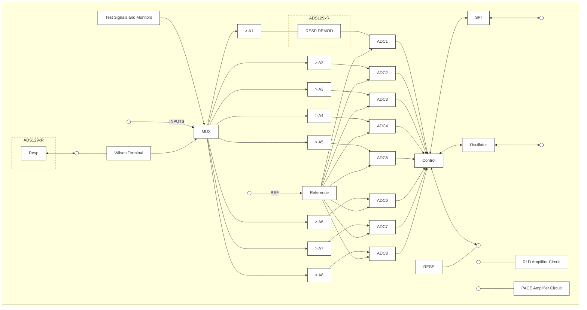

**Additional Schematic Details:**

* **INPUTS:** 8 differential input pairs connected to the MUX.
* **Wilson Terminal (WCT):** Connected to the MUX and an external WCT pin.
* **Reference:** Connected to external REF pins and provides reference to all ADCs (ADC1-ADC8).
* **SPI:** Serial Peripheral Interface connected to external SPI pins.
* **Oscillator:** Connected to external CLK pin and the Control block.
* **GPIO AND CONTROL:** Multiple bidirectional lines connected to the Control block and an internal RESP block.
* **RLD (Right Leg Drive):** Includes an amplifier circuit with resistive summing network and switches labeled "To Channel".
* **PACE:** Includes two amplifier circuits for pace detection.
* **ADS129xR Specific Features:** Includes "RESP DEMOD" in the Channel 1 path and a "Resp" block near the Wilson Terminal.

## **3 Description**

The ADS1294, ADS1296, ADS1298 (ADS129x) and ADS1294R, ADS1296R, ADS1298R (ADS129xR) are a family of multichannel, simultaneous sampling, 24-bit, delta-sigma (ΔΣ) analog-to-digital converters (ADCs) with built-in programmable gain amplifiers (PGAs), internal reference, and an onboard oscillator. The ADS129x and ADS129xR incorporate all of the features that are commonly required in medical electrocardiogram (ECG) and electroencephalogram (EEG) applications. With high levels of integration and exceptional performance, the ADS129x and ADS129xR enables the development of scalable medical instrumentation systems at significantly reduced size, power, and overall cost.

The ADS129x and ADS129xR have a flexible input multiplexer (mux) per channel that can be independently connected to the internally-generated signals for test, temperature, and lead-off detection. Additionally, any configuration of input channels can be selected for derivation of the right leg drive (RLD) output signal. The ADS129x and ADS129xR operate at data rates as high as 32 kSPS, thereby allowing the implementation of software pace detection. Lead-off detection can be implemented internal to the device, either with a pullup or pulldown resistor, or an excitation current sink or source. Three integrated amplifiers generate the Wilson central terminal (WCT) and the Goldberger central terminals (GCT) required for a standard 12-lead ECG. The ADS129xR versions include a fully integrated, respiration impedance measurement function. Multiple ADS129x and ADS129xR devices can be cascaded in high channel count systems in a daisy-chain configuration.

Package options include a tiny 8-mm × 8-mm, 64-ball BGA, and a TQFP-64. The ADS129x BGA version is specified over the commercial temperature range of 0°C to 70°C. The ADS129xR BGA and ADS129x TQFP versions are specified over the industrial temperature range of –40°C to +85°C.

### **Device Information<sup>(1)</sup>**

<table>
  <thead>
    <tr>
      <th>PART NUMBER</th>
      <th>PACKAGE</th>
      <th>BODY SIZE (NOM)</th>
    </tr>
  </thead>
  <tbody>
    <tr>
      <td rowspan="2">ADS129x,<br />ADS129xR</td>
      <td>NFBGA (64)</td>
      <td>8.00 mm × 8.00 mm</td>
    </tr>
    <tr>
      <td>TQFP (64)</td>
      <td>10.00 mm × 10.00 mm</td>
    </tr>
  </tbody>
</table>

(1) For all available packages, see the package option addendum at the end of the data sheet.


<!-- PDF page 2 -->


## **Table of Contents**

<table>
    <tr>
      <td><b>1</b></td>
      <td><b>Features ....................................................................................</b></td>
      <td>1</td>
      <td>9.4</td>
      <td>Device Functional Modes..........................................................</td>
      <td>51</td>
    </tr>
    <tr>
      <td><b>2</b></td>
      <td><b>Applications .............................................................................</b></td>
      <td>1</td>
      <td>9.5</td>
      <td>Programming............................................................................</td>
      <td>59</td>
    </tr>
    <tr>
      <td><b>3</b></td>
      <td><b>Description ...............................................................................</b></td>
      <td>1</td>
      <td>9.6</td>
      <td>Register Maps ..........................................................................</td>
      <td>65</td>
    </tr>
    <tr>
      <td><b>4</b></td>
      <td><b>Revision History.......................................................................</b></td>
      <td>2</td>
      <td><b>10</b></td>
      <td><b>Application and Implementation.........................................</b></td>
      <td>84</td>
    </tr>
    <tr>
      <td><b>5</b></td>
      <td><b>Device Comparison .................................................................</b></td>
      <td>5</td>
      <td>10.1</td>
      <td>Application Information...........................................................</td>
      <td>84</td>
    </tr>
    <tr>
      <td><b>6</b></td>
      <td><b>Pin Configuration and Functions ..........................................</b></td>
      <td>6</td>
      <td>10.2</td>
      <td>Typical Applications ...............................................................</td>
      <td>89</td>
    </tr>
    <tr>
      <td><b>7</b></td>
      <td><b>Specifications.........................................................................</b></td>
      <td>12</td>
      <td><b>11</b></td>
      <td><b>Power Supply Recommendations ......................................</b></td>
      <td>96</td>
    </tr>
    <tr>
      <td></td>
      <td>7.1 Absolute Maximum Ratings .................................................</td>
      <td>12</td>
      <td>11.1</td>
      <td>Power-Up Sequencing ...........................................................</td>
      <td>96</td>
    </tr>
    <tr>
      <td></td>
      <td>7.2 ESD Ratings.........................................................................</td>
      <td>12</td>
      <td>11.2</td>
      <td>Connecting to Unipolar (3 V or 1.8 V) Supplies.....................</td>
      <td>97</td>
    </tr>
    <tr>
      <td></td>
      <td>7.3 Recommended Operating Conditions ..................................</td>
      <td>12</td>
      <td rowspan="2">11.3</td>
      <td rowspan="2">Connecting to Bipolar (±1.5 V or ±1.8 V)<br />Supplies ....................................................................................</td>
      <td rowspan="2">97</td>
    </tr>
    <tr>
      <td></td>
      <td>7.4 Thermal Information .............................................................</td>
      <td>13</td>
    </tr>
    <tr>
      <td></td>
      <td>7.5 Electrical Characteristics......................................................</td>
      <td>13</td>
      <td><b>12</b></td>
      <td><b>Layout.....................................................................................</b></td>
      <td>98</td>
    </tr>
    <tr>
      <td></td>
      <td>7.6 Timing Requirements: Serial Interface.................................</td>
      <td>17</td>
      <td>12.1</td>
      <td>Layout Guidelines ..................................................................</td>
      <td>98</td>
    </tr>
    <tr>
      <td></td>
      <td>7.7 Switching Characteristics: Serial Interface...........................</td>
      <td>17</td>
      <td>12.2</td>
      <td>Layout Example .....................................................................</td>
      <td>99</td>
    </tr>
    <tr>
      <td></td>
      <td>7.8 Typical Characteristics .........................................................</td>
      <td>18</td>
      <td><b>13</b></td>
      <td><b>Device and Documentation Support ................................</b></td>
      <td>100</td>
    </tr>
    <tr>
      <td><b>8</b></td>
      <td><b>Parameter Measurement Information .................................</b></td>
      <td>22</td>
      <td>13.1</td>
      <td>Related Links .......................................................................</td>
      <td>100</td>
    </tr>
    <tr>
      <td></td>
      <td>8.1 Noise Measurements ...........................................................</td>
      <td>22</td>
      <td>13.2</td>
      <td>Community Resources.........................................................</td>
      <td>100</td>
    </tr>
    <tr>
      <td><b>9</b></td>
      <td><b>Detailed Description .............................................................</b></td>
      <td>24</td>
      <td>13.3</td>
      <td>Trademarks ..........................................................................</td>
      <td>100</td>
    </tr>
    <tr>
      <td></td>
      <td>9.1 Overview ..............................................................................</td>
      <td>24</td>
      <td>13.4</td>
      <td>Electrostatic Discharge Caution...........................................</td>
      <td>100</td>
    </tr>
    <tr>
      <td></td>
      <td>9.2 Functional Block Diagram ...................................................</td>
      <td>25</td>
      <td>13.5</td>
      <td>Glossary ...............................................................................</td>
      <td>100</td>
    </tr>
    <tr>
      <td></td>
      <td>9.3 Feature Description..............................................................</td>
      <td>26</td>
      <td><b>14</b></td>
      <td><b>Mechanical, Packaging, and Orderable<br />Information ..........................................................................</b></td>
      <td>100</td>
    </tr>
</table>

## **4 Revision History**

NOTE: Page numbers for previous revisions may differ from page numbers in the current version.

### **Changes from Revision J (January 2014) to Revision K**

<table>
  <thead>
    <tr>
      <th>Changes from Revision J (January 2014) to Revision K</th>
      <th>Page</th>
    </tr>
  </thead>
  <tbody>
    <tr>
      <td>• Added <i>ESD Ratings</i> table, <i>Feature Description</i> section, <i>Device Functional Modes</i>, <i>Application and Implementation</i> section, <i>Power Supply Recommendations</i> section, <i>Layout</i> section, <i>Device and Documentation Support</i> section, and <i>Mechanical, Packaging, and Orderable Information</i> section .................................................................................................</td>
      <td>1</td>
    </tr>
    <tr>
      <td>• Changed text throughout data sheet for clarity ......................................................................................................................</td>
      <td>1</td>
    </tr>
    <tr>
      <td>• Added note to DAISY_IN pin .................................................................................................................................................</td>
      <td>8</td>
    </tr>
    <tr>
      <td>• Added note to DAISY_IN pin ...............................................................................................................................................</td>
      <td>10</td>
    </tr>
    <tr>
      <td>• Changed Equation 3 ............................................................................................................................................................</td>
      <td>32</td>
    </tr>
  </tbody>
</table>

### **Changes from Revision I (January 2012) to Revision J**

<table>
  <thead>
    <tr>
      <th>Changes from Revision I (January 2012) to Revision J</th>
      <th>Page</th>
    </tr>
  </thead>
  <tbody>
    <tr>
      <td>• Changed NC pin discription in <i>Pin Assignments</i> table .........................................................................................................</td>
      <td>10</td>
    </tr>
    <tr>
      <td>• Changed NC pin discription in <i>Pin Assignments</i> table .........................................................................................................</td>
      <td>10</td>
    </tr>
    <tr>
      <td>• Added graph of INTERNAL V<sub>REF</sub> DRIFT vs TEMPERATURE .............................................................................................</td>
      <td>21</td>
    </tr>
    <tr>
      <td>• Changed order of subsections in the <i>Theory of Operation</i> section......................................................................................</td>
      <td>26</td>
    </tr>
    <tr>
      <td>• Changed single-ended input description to correct input range values ...............................................................................</td>
      <td>30</td>
    </tr>
    <tr>
      <td>• Changed Figure 27 to show correct input range for single-ended inputs ............................................................................</td>
      <td>30</td>
    </tr>
    <tr>
      <td>• Changed Figure 28 to show correct input range for single-ended inputs ............................................................................</td>
      <td>30</td>
    </tr>
    <tr>
      <td>• Deleted text regarding large scale signal .............................................................................................................................</td>
      <td>31</td>
    </tr>
    <tr>
      <td>• Changed Figure 32 to provide a more stable external reference driver circuit ....................................................................</td>
      <td>33</td>
    </tr>
    <tr>
      <td>• Updated Figure 57 ...............................................................................................................................................................</td>
      <td>51</td>
    </tr>
    <tr>
      <td>• Added Figure 58 ..................................................................................................................................................................</td>
      <td>52</td>
    </tr>
    <tr>
      <td>• Added discussion of SCLK/<u>DRDY</u> bus behavior to <i>Data Ready (<u>DRDY</u>)</i> section................................................................</td>
      <td>53</td>
    </tr>
    <tr>
      <td>• Added Figure 60 ..................................................................................................................................................................</td>
      <td>53</td>
    </tr>
  </tbody>
</table>


<!-- PDF page 3 -->


# **ADS1294, ADS1294R, ADS1296, ADS1296R, ADS1298, ADS1298R**

**[www.ti.com](http://www.ti.com)**

<table>
<tr>
<td>• Added <i>status Word</i> section and Figure 61 to discuss the status word ................................................................................</td>
<td>53</td>
</tr>
<tr>
<td>• Added <i>Readback Length</i> section..........................................................................................................................................</td>
<td>53</td>
</tr>
<tr>
<td>• Added <i>SCLK Clocking Methods</i> section...............................................................................................................................</td>
<td>60</td>
</tr>
<tr>
<td>• Changed units in TEST_AMP bit description in CONFIG2 register .....................................................................................</td>
<td>68</td>
</tr>
<tr>
<td>• Changed Figure 93 to clarify Initial Flow at Power-Up .........................................................................................................</td>
<td>85</td>
</tr>
<tr>
<td>• Changed <i>Power-Up Sequencing</i> section text to clarify start-up timing ................................................................................</td>
<td>96</td>
</tr>
<tr>
<td>• Changed Figure 105 ............................................................................................................................................................</td>
<td>96</td>
</tr>
<tr>
<td>• Changed power-up reset wait time in Table 38 ...................................................................................................................</td>
<td>96</td>
</tr>
</table>

<table>
<thead>
<tr>
<th><b>Changes from Revision H (October 2011) to Revision I</b></th>
<th>Page</th>
</tr>
</thead>
<tbody>
<tr>
<td>• Added eighth Features bullet (list of standards supported)....................................................................................................</td>
<td>1</td>
</tr>
<tr>
<td>• Updated BGA pin out..............................................................................................................................................................</td>
<td>6</td>
</tr>
<tr>
<td>• Deleted duplicate <i>Digital input voltage</i> and <i>Digital output voltage</i> rows from Absolute Maximum Ratings table.................</td>
<td>12</td>
</tr>
<tr>
<td>• Changed parameter name of Channel Performance, <i>Common-mode rejection ratio</i> and <i>Power-supply rejection ratio</i> parameters in Electrical Characteristics table ......................................................................................................................</td>
<td>14</td>
</tr>
<tr>
<td>• Updated Functional Block Diagram .....................................................................................................................................</td>
<td>25</td>
</tr>
<tr>
<td>• Updated description of <i>Analog Input</i> section........................................................................................................................</td>
<td>30</td>
</tr>
<tr>
<td>• Updated Figure 30 ...............................................................................................................................................................</td>
<td>32</td>
</tr>
<tr>
<td>• Updated Figure 33 ...............................................................................................................................................................</td>
<td>34</td>
</tr>
<tr>
<td>• Updated Figure 34 ...............................................................................................................................................................</td>
<td>35</td>
</tr>
<tr>
<td>• Changed description of START pin in <i>START</i> section.........................................................................................................</td>
<td>51</td>
</tr>
<tr>
<td>• Changed description of <i>Data Ready (DRDY)</i> section ..........................................................................................................</td>
<td>52</td>
</tr>
<tr>
<td>• Changed conversion description in <i>Single-Shot Mode</i> section ............................................................................................</td>
<td>54</td>
</tr>
<tr>
<td>• Changed conversion description in <i>Continuous Mode</i> section.............................................................................................</td>
<td>55</td>
</tr>
<tr>
<td>• Changed Unit column in Table 14 ........................................................................................................................................</td>
<td>55</td>
</tr>
<tr>
<td>• Added power-down recommendation to bit 7 description of <i>CHnSET: Individual Channel Settings</i> section.......................</td>
<td>71</td>
</tr>
<tr>
<td>• Changed description of bit 5 in <i>RESP: Respiration Control Register</i> section ......................................................................</td>
<td>80</td>
</tr>
<tr>
<td>• Corrected name of bit 6 in <i>WCT2: Wilson Central Terminal Control Register</i> section.........................................................</td>
<td>83</td>
</tr>
</tbody>
</table>

<table>
<thead>
<tr>
<th><b>Changes from Revision G (February 2011) to Revision H</b></th>
<th>Page</th>
</tr>
</thead>
<tbody>
<tr>
<td>• Changed footnote 1 of BGA Pin Assignments table ..............................................................................................................</td>
<td>7</td>
</tr>
<tr>
<td>• Added footnote 1 cross-reference to <i>RLDIN, TESTP_PACE_OUT1</i>, and <i>TESTP_PACE_OUT</i> in BGA Pin Assignments table ..................................................................................................................................................................</td>
<td>7</td>
</tr>
<tr>
<td>• Changed footnote 1 of PAG Pin Assignments table ............................................................................................................</td>
<td>10</td>
</tr>
<tr>
<td>• Added footnote 1 cross-reference to <i>TESTP_PACE_OUT1, TESTP_PACE_OUT2</i>, and <i>RLDIN</i> in PAG Pin Assignments table ................................................................................................................................................................</td>
<td>10</td>
</tr>
<tr>
<td>• Changed description of <i>AVSS</i> and <i>AVDD</i> in PAG Pin Assignments table ..........................................................................</td>
<td>11</td>
</tr>
<tr>
<td>• Added <i>(ADS1298)</i> to <i>High-Resolution mode</i> and <i>Low-Power mode</i> test conditions of Supply Current section in Electrical Characteristics table .............................................................................................................................................</td>
<td>16</td>
</tr>
<tr>
<td>• Changed 3-V Power Dissipation, <i>Quiescent channel power</i> test conditions in Electrical Characteristics table ..................</td>
<td>16</td>
</tr>
<tr>
<td>• Changed 5-V Power Dissipation, <i>Quiescent channel power</i> test conditions in Electrical Characteristics table ..................</td>
<td>16</td>
</tr>
<tr>
<td>• Changed title of Figure 20 ...................................................................................................................................................</td>
<td>20</td>
</tr>
<tr>
<td>• Updated Figure 42 ...............................................................................................................................................................</td>
<td>41</td>
</tr>
<tr>
<td>• Added new paragraph to <i>Respiration</i> section ......................................................................................................................</td>
<td>46</td>
</tr>
<tr>
<td>• Updated Equation 5 .............................................................................................................................................................</td>
<td>49</td>
</tr>
<tr>
<td>• Changed title of Table 13 ....................................................................................................................................................</td>
<td>54</td>
</tr>
</tbody>
</table>


<!-- PDF page 4 -->


# **ADS1294, ADS1294R, ADS1296, ADS1296R, ADS1298, ADS1298R**

SBAS459K – JANUARY 2010 – REVISED AUGUST 2015 

[**www.ti.com**](http://www.ti.com)

<table>
<tr>
<td>•</td>
<td>Updated Figure 66 ...............................................................................................................................................</td>
<td>57</td>
</tr>
<tr>
<td>•</td>
<td>Changed description of <i>STANDBY: Enter STANDBY Mode</i> section ...................................................................</td>
<td>61</td>
</tr>
<tr>
<td>•</td>
<td>Changed bit name for bits 5, 6, and 7 in ID register of Table 16 ........................................................................</td>
<td>65</td>
</tr>
<tr>
<td>•</td>
<td>Changed bit name for bits 5, 6, and 7 in <i>ID: ID Control Register</i> section ............................................................</td>
<td>66</td>
</tr>
<tr>
<td>•</td>
<td>Added footnote to Figure 97 ................................................................................................................................</td>
<td>89</td>
</tr>
<tr>
<td>•</td>
<td>Changed description of solid ceramic capacitor in <i>Power Supplies and Grounding</i> section ...............................</td>
<td>96</td>
</tr>
<tr>
<td>•</td>
<td>Changed description of <i>Connecting the Device to Bipolar (±1.5 V/1.8 V) Supplies</i> section ................................</td>
<td>97</td>
</tr>
</table>


<!-- PDF page 5 -->


## **5 Device Comparison**

<table>
  <thead>
    <tr>
      <th>PRODUCT</th>
      <th>PACKAGE OPTIONS</th>
      <th>OPERATING TEMPERATURE RANGE</th>
      <th>RESPIRATION CIRCUITRY</th>
      <th>CHANNELS</th>
      <th>ADC RESOLUTION</th>
      <th>MAXIMUM SAMPLING RATE</th>
    </tr>
  </thead>
  <tbody>
    <tr>
      <td rowspan="2">ADS1194</td>
      <td>TQFP-64</td>
      <td>0°C to 70°C</td>
      <td rowspan="2">No</td>
      <td rowspan="2">4</td>
      <td rowspan="2">16</td>
      <td rowspan="2">8 kSPS</td>
    </tr>
    <tr>
      <td>NFBGA-64</td>
      <td>0°C to 70°C</td>
    </tr>
    <tr>
      <td rowspan="2">ADS1196</td>
      <td>TQFP-64</td>
      <td>0°C to 70°C</td>
      <td rowspan="2">No</td>
      <td rowspan="2">6</td>
      <td rowspan="2">16</td>
      <td rowspan="2">8 kSPS</td>
    </tr>
    <tr>
      <td>NFBGA-64</td>
      <td>0°C to 70°C</td>
    </tr>
    <tr>
      <td rowspan="2">ADS1198</td>
      <td>TQFP-64</td>
      <td>0°C to 70°C</td>
      <td rowspan="2">No</td>
      <td rowspan="2">8</td>
      <td rowspan="2">16</td>
      <td rowspan="2">8 kSPS</td>
    </tr>
    <tr>
      <td>NFBGA-64</td>
      <td>0°C to 70°C</td>
    </tr>
    <tr>
      <td rowspan="2">ADS1294</td>
      <td>TQFP-64</td>
      <td>–40°C to +85°C</td>
      <td rowspan="2">External</td>
      <td rowspan="3">4</td>
      <td rowspan="3">24</td>
      <td rowspan="3">32 kSPS</td>
    </tr>
    <tr>
      <td>NFBGA-64</td>
      <td>0°C to 70°C</td>
    </tr>
    <tr>
      <td>ADS1294R</td>
      <td>NFBGA-64</td>
      <td>–40°C to +85°C</td>
      <td>Yes</td>
    </tr>
    <tr>
      <td rowspan="2">ADS1296</td>
      <td>TQFP-64</td>
      <td>–40°C to +85°C</td>
      <td rowspan="2">External</td>
      <td rowspan="3">6</td>
      <td rowspan="3">24</td>
      <td rowspan="3">32 kSPS</td>
    </tr>
    <tr>
      <td>NFBGA-64</td>
      <td>0°C to 70°C</td>
    </tr>
    <tr>
      <td>ADS1296R</td>
      <td>NFBGA-64</td>
      <td>–40°C to +85°C</td>
      <td>Yes</td>
    </tr>
    <tr>
      <td rowspan="2">ADS1298</td>
      <td>TQFP-64</td>
      <td>–40°C to +85°C</td>
      <td rowspan="2">External</td>
      <td rowspan="3">8</td>
      <td rowspan="3">24</td>
      <td rowspan="3">32 kSPS</td>
    </tr>
    <tr>
      <td>NFBGA-64</td>
      <td>0°C to 70°C</td>
    </tr>
    <tr>
      <td>ADS1298R</td>
      <td>NFBGA-64</td>
      <td>–40°C to +85°C</td>
      <td>Yes</td>
    </tr>
  </tbody>
</table>


<!-- PDF page 6 -->


# **6 Pin Configuration and Functions**

<table>
  <caption>
    **ZXG Package**<br />
    **64-Pin NFBGA**<br />
    **Top View, Solder Bumps on Bottom Side**
  </caption>
  <thead>
    <tr>
      <th>H</th>
      <th>G</th>
      <th>F</th>
      <th>E</th>
      <th>D</th>
      <th>C</th>
      <th>B</th>
      <th>A</th>
      <th></th>
    </tr>
  </thead>
  <tbody>
    <tr>
      <td>IN1P</td>
      <td>IN2P</td>
      <td>IN3P</td>
      <td>IN4P</td>
      <td>IN5P</td>
      <td>IN6P</td>
      <td>IN7P</td>
      <td>IN8P</td>
      <td>1</td>
    </tr>
    <tr>
      <td>IN1N</td>
      <td>IN2N</td>
      <td>IN3N</td>
      <td>IN4N</td>
      <td>IN5N</td>
      <td>IN6N</td>
      <td>IN7N</td>
      <td>IN8N</td>
      <td>2</td>
    </tr>
    <tr>
      <td>VREFP</td>
      <td>VCAP4</td>
      <td>TESTN_<br />$\overline{\text{PACE\_OUT2}}$</td>
      <td>TESTP_<br />$\overline{\text{PACE\_OUT1}}$</td>
      <td>WCT</td>
      <td>RLDINV</td>
      <td>RLDOUT</td>
      <td>RLDIN</td>
      <td>3</td>
    </tr>
    <tr>
      <td>VREFN</td>
      <td>RESP_<br />$\overline{\text{MODP}}$</td>
      <td>RESP_<br />$\overline{\text{MODN}}$</td>
      <td>RESV1</td>
      <td>AVSS</td>
      <td>RLDREF</td>
      <td>AVDD</td>
      <td>AVDD</td>
      <td>4</td>
    </tr>
    <tr>
      <td>VCAP1</td>
      <td>$\overline{\text{PWDN}}$</td>
      <td>GPIO1</td>
      <td>GPIO4</td>
      <td>AVSS</td>
      <td>AVSS</td>
      <td>AVSS</td>
      <td>AVSS</td>
      <td>5</td>
    </tr>
    <tr>
      <td>VCAP2</td>
      <td>$\overline{\text{RESET}}$</td>
      <td>DAISY_IN</td>
      <td>GPIO3</td>
      <td>$\overline{\text{DRDY}}$</td>
      <td>AVDD</td>
      <td>AVDD</td>
      <td>AVDD</td>
      <td>6</td>
    </tr>
    <tr>
      <td>DGND</td>
      <td>START</td>
      <td>$\overline{\text{CS}}$</td>
      <td>GPIO2</td>
      <td>DGND</td>
      <td>DGND</td>
      <td>VCAP3</td>
      <td>AVDD1</td>
      <td>7</td>
    </tr>
    <tr>
      <td>DIN</td>
      <td>CLK</td>
      <td>SCLK</td>
      <td>DOUT</td>
      <td>DVDD</td>
      <td>DVDD</td>
      <td>CLKSEL</td>
      <td>AVSS1</td>
      <td>8</td>
    </tr>
  </tbody>
</table>


<!-- PDF page 7 -->


## **Pin Function: NFBGA Package**

<table><thead><tr><th>PIN</th><th>PIN</th><th>TYPE</th><th>DESCRIPTION</th></tr><tr><th>NO.</th><th>NAME</th><th></th><th></th></tr></thead><tbody><tr><td>1A</td><td>IN8P<sup>(1)</sup></td><td>Analog input</td><td>Differential analog positive input 8 (ADS1298 and ADS1298R)</td></tr><tr><td>1B</td><td>IN7P<sup>(1)</sup></td><td>Analog input</td><td>Differential analog positive input 7 (ADS1298 and ADS1298R)</td></tr><tr><td>1C</td><td>IN6P<sup>(1)</sup></td><td>Analog input</td><td>Differential analog positive input 6 (ADS1296, ADS1298, ADS1296R, ADS1298R)</td></tr><tr><td>1D</td><td>IN5P<sup>(1)</sup></td><td>Analog input</td><td>Differential analog positive input 5 (ADS1296, ADS1298, ADS1296R, ADS1298R)</td></tr><tr><td>1E</td><td>IN4P<sup>(1)</sup></td><td>Analog input</td><td>Differential analog positive input 4</td></tr><tr><td>1F</td><td>IN3P<sup>(1)</sup></td><td>Analog input</td><td>Differential analog positive input 3</td></tr><tr><td>1G</td><td>IN2P<sup>(1)</sup></td><td>Analog input</td><td>Differential analog positive input 2</td></tr><tr><td>1H</td><td>IN1P<sup>(1)</sup></td><td>Analog input</td><td>Differential analog positive input 1</td></tr><tr><td>2A</td><td>IN8N<sup>(1)</sup></td><td>Analog input</td><td>Differential analog negative input 8 (ADS1298, ADS1298R)</td></tr><tr><td>2B</td><td>IN7N<sup>(1)</sup></td><td>Analog input</td><td>Differential analog negative input (ADS1298, ADS1298R)</td></tr><tr><td>2C</td><td>IN6N<sup>(1)</sup></td><td>Analog input</td><td>Differential analog negative input 6 (ADS1296, ADS1298, ADS1296R, ADS1298R)</td></tr><tr><td>2D</td><td>IN5N<sup>(1)</sup></td><td>Analog input</td><td>Differential analog negative input 5 (ADS1296, ADS1298, ADS1296R, ADS1298R)</td></tr><tr><td>2E</td><td>IN4N<sup>(1)</sup></td><td>Analog input</td><td>Differential analog negative input 4</td></tr><tr><td>2F</td><td>IN3N<sup>(1)</sup></td><td>Analog input</td><td>Differential analog negative input 3</td></tr><tr><td>2G</td><td>IN2N<sup>(1)</sup></td><td>Analog input</td><td>Differential analog negative input 2</td></tr><tr><td>2H</td><td>IN1N<sup>(1)</sup></td><td>Analog input</td><td>Differential analog negative input 1</td></tr><tr><td>3A</td><td>RLDIN<sup>(1)</sup></td><td>Analog input</td><td>Right leg drive input to mux</td></tr><tr><td>3B</td><td>RLDOUT</td><td>Analog output</td><td>Right leg drive output</td></tr><tr><td>3C</td><td>RLDINV</td><td>Analog input/output</td><td>Right leg drive inverting input</td></tr><tr><td>3D</td><td>WCT</td><td>Analog output</td><td>Wilson central terminal output</td></tr><tr><td>3E</td><td>TESTP_PACE_OUT1<sup>(1)</sup></td><td>Analog input/buffer output</td><td>Internal test signal or single-ended buffer output based on register settings</td></tr><tr><td>3F</td><td>TESTN_PACE_OUT2<sup>(1)</sup></td><td>Analog input/output</td><td>Internal test signal or single-ended buffer output based on register settings</td></tr><tr><td>3G</td><td>VCAP4</td><td>—</td><td>Analog bypass capacitor; connect 1-μF capacitor to AVSS</td></tr><tr><td>3H</td><td>VREFP</td><td>Analog input/output</td><td>Positive reference input/output voltage</td></tr><tr><td>4A</td><td>AVDD</td><td>Supply</td><td>Analog supply</td></tr><tr><td>4B</td><td>AVDD</td><td>Supply</td><td>Analog supply</td></tr><tr><td>4C</td><td>RLDREF</td><td>Analog input</td><td>Right leg drive noninverting input</td></tr><tr><td>4D</td><td>AVSS</td><td>Supply</td><td>Analog ground</td></tr><tr><td>4E</td><td>RESV1</td><td>Digital input</td><td>Reserved for future use; must tie to logic low (DGND).</td></tr><tr><td>4F</td><td>RESP_MODN</td><td>Analog output</td><td>ADS129xR: modulation clock for respiration measurement, negative side.<br />ADS129x: leave floating.</td></tr><tr><td>4G</td><td>RESP_MODP</td><td>Analog output</td><td>ADS129xR: modulation clock for respiration measurement, positive side.<br />ADS129x: leave floating.</td></tr><tr><td>4H</td><td>VREFN</td><td>Analog input</td><td>Negative reference voltage</td></tr><tr><td>5A</td><td>AVSS</td><td>Supply</td><td>Analog ground</td></tr><tr><td>5B</td><td>AVSS</td><td>Supply</td><td>Analog ground</td></tr><tr><td>5C</td><td>AVSS</td><td>Supply</td><td>Analog ground</td></tr><tr><td>5D</td><td>AVSS</td><td>Supply</td><td>Analog ground</td></tr><tr><td>5E</td><td>GPIO4</td><td>Digital input/output</td><td>General-purpose input/output pin 4</td></tr><tr><td>5F</td><td>GPIO1</td><td>Digital input/output</td><td>General-purpose input/output pin 1</td></tr><tr><td>5G</td><td><u>PWDN</u></td><td>Digital input</td><td>Power-down pin; active low</td></tr><tr><td>5H</td><td>VCAP1</td><td>—</td><td>Analog bypass capacitor; connect 22-μF capacitor to AVSS</td></tr><tr><td>6A</td><td>AVDD</td><td>Supply</td><td>Analog supply</td></tr><tr><td>6B</td><td>AVDD</td><td>Supply</td><td>Analog supply</td></tr><tr><td>6C</td><td>AVDD</td><td>Supply</td><td>Analog supply</td></tr><tr><td>6D</td><td><span style="text-decoration: overline">DRDY</span></td><td>Digital output</td><td>Data ready; active low</td></tr><tr><td>6E</td><td>GPIO3</td><td>Digital input/output</td><td>General purpose input/output pin 3</td></tr><tr><td>6F</td><td>DAISY_IN<sup>(2)</sup></td><td>Digital input</td><td>Daisy-chain input; if not used, short to DGND.</td></tr><tr><td>6G</td><td><span style="text-decoration: overline">RESET</span></td><td>Digital input</td><td>System-reset pin; active low</td></tr><tr><td>6H</td><td>VCAP2</td><td>—</td><td>Analog bypass capacitor; connect 1-μF capacitor to AVSS</td></tr><tr><td>7A</td><td>AVDD1</td><td>Supply</td><td>Analog supply for charge pump</td></tr><tr><td>7B</td><td>VCAP3</td><td>—</td><td>Analog bypass capacitor; internally generated AVDD + 1.9 V; connect 1-μF capacitor to AVSS</td></tr><tr><td>7C</td><td>DGND</td><td>Supply</td><td>Digital ground</td></tr><tr><td>7D</td><td>DGND</td><td>Supply</td><td>Digital ground</td></tr><tr><td>7E</td><td>GPIO2</td><td>Digital input/output</td><td>General-purpose input/output pin 2</td></tr><tr><td>7F</td><td><span style="text-decoration: overline">CS</span></td><td>Digital input</td><td>SPI chip select; active low</td></tr><tr><td>7G</td><td>START</td><td>Digital input</td><td>Start conversion</td></tr><tr><td>7H</td><td>DGND</td><td>Supply</td><td>Digital ground</td></tr><tr><td>8A</td><td>AVSS1</td><td>Supply</td><td>Analog ground for charge pump</td></tr><tr><td>8B</td><td>CLKSEL</td><td>Digital input</td><td>Master clock select</td></tr><tr><td>8C</td><td>DVDD</td><td>Supply</td><td>Digital power supply</td></tr><tr><td>8D</td><td>DVDD</td><td>Supply</td><td>Digital power supply</td></tr><tr><td>8E</td><td>DOUT</td><td>Digital output</td><td>SPI data output</td></tr><tr><td>8F</td><td>SCLK</td><td>Digital input</td><td>SPI clock</td></tr><tr><td>8G</td><td>CLK</td><td>Digital input/output</td><td>External Master clock input or internal clock output.</td></tr><tr><td>8H</td><td>DIN</td><td>Digital input</td><td>SPI data input</td></tr></tbody></table>

(1) Connect unused pins to AVDD.


<!-- PDF page 8 -->


**ADS1294, ADS1294R, ADS1296, ADS1296R, ADS1298, ADS1298R**
SBAS459K – JANUARY 2010 – REVISED AUGUST 2015

(2) When DAISY_IN is not used, tie to logic 0.


<!-- PDF page 9 -->


**PAG PACKAGE**
**64-Pin TQFP**
**Top View**

<table><thead><tr><th>Pin</th><th>Label</th><th>Pin</th><th>Label</th></tr></thead><tbody><tr><td>1</td><td>IN8N</td><td>17</td><td>TESTP_PACE_OUT1</td></tr><tr><td>2</td><td>IN8P</td><td>18</td><td>TESTN_PACE_OUT2</td></tr><tr><td>3</td><td>IN7N</td><td>19</td><td>AVDD</td></tr><tr><td>4</td><td>IN7P</td><td>20</td><td>AVSS</td></tr><tr><td>5</td><td>IN6N</td><td>21</td><td>AVDD</td></tr><tr><td>6</td><td>IN6P</td><td>22</td><td>AVDD</td></tr><tr><td>7</td><td>IN5N</td><td>23</td><td>AVSS</td></tr><tr><td>8</td><td>IN5P</td><td>24</td><td>VREFP</td></tr><tr><td>9</td><td>IN4N</td><td>25</td><td>VREFN</td></tr><tr><td>10</td><td>IN4P</td><td>26</td><td>VCAP4</td></tr><tr><td>11</td><td>IN3N</td><td>27</td><td>NC</td></tr><tr><td>12</td><td>IN3P</td><td>28</td><td>VCAP1</td></tr><tr><td>13</td><td>IN2N</td><td>29</td><td>NC</td></tr><tr><td>14</td><td>IN2P</td><td>30</td><td>VCAP2</td></tr><tr><td>15</td><td>IN1N</td><td>31</td><td>RESV1</td></tr><tr><td>16</td><td>IN1P</td><td>32</td><td>AVSS</td></tr><tr><td>33</td><td>DGND</td><td>49</td><td>DGND</td></tr><tr><td>34</td><td>DIN</td><td>50</td><td>DVDD</td></tr><tr><td>35</td><td>$\overline{\text{PWDN}}$</td><td>51</td><td>DGND</td></tr><tr><td>36</td><td>$\overline{\text{RESET}}$</td><td>52</td><td>CLKSEL</td></tr><tr><td>37</td><td>CLK</td><td>53</td><td>AVSS1</td></tr><tr><td>38</td><td>START</td><td>54</td><td>AVDD1</td></tr><tr><td>39</td><td>$\overline{\text{CS}}$</td><td>55</td><td>VCAP3</td></tr><tr><td>40</td><td>SCLK</td><td>56</td><td>AVDD</td></tr><tr><td>41</td><td>DAISY_IN</td><td>57</td><td>AVSS</td></tr><tr><td>42</td><td>GPIO1</td><td>58</td><td>AVSS</td></tr><tr><td>43</td><td>DOUT</td><td>59</td><td>AVDD</td></tr><tr><td>44</td><td>GPIO2</td><td>60</td><td>RLDREF</td></tr><tr><td>45</td><td>GPIO3</td><td>61</td><td>RLDINV</td></tr><tr><td>46</td><td>GPIO4</td><td>62</td><td>RLDIN</td></tr><tr><td>47</td><td>$\overline{\text{DRDY}}$</td><td>63</td><td>RLDOUT</td></tr><tr><td>48</td><td>DVDD</td><td>64</td><td>WCT</td></tr></tbody></table>


<!-- PDF page 10 -->


**ADS1294, ADS1294R, ADS1296, ADS1296R, ADS1298, ADS1298R**
SBAS459K – JANUARY 2010 – REVISED AUGUST 2015 

[**www.ti.com**](http://www.ti.com)

<table><caption>**Pin Functions: TQFP Package**</caption><thead><tr><th>PIN</th><th>PIN</th><th>TYPE</th><th>DESCRIPTION</th></tr><tr><th>NO.</th><th>NAME</th><th></th><th></th></tr></thead><tbody><tr><td>1</td><td>IN8N<sup>(1)</sup></td><td>Analog input</td><td>Differential analog negative input 8 (ADS1298)</td></tr><tr><td>2</td><td>IN8P<sup>(1)</sup></td><td>Analog input</td><td>Differential analog positive input 8 (ADS1298)</td></tr><tr><td>3</td><td>IN7N<sup>(1)</sup></td><td>Analog input</td><td>Differential analog negative input 7 (ADS1298)</td></tr><tr><td>4</td><td>IN7P<sup>(1)</sup></td><td>Analog input</td><td>Differential analog positive input 7 (ADS1298)</td></tr><tr><td>5</td><td>IN6N<sup>(1)</sup></td><td>Analog input</td><td>Differential analog negative input 6 (ADS1296, ADS1298)</td></tr><tr><td>6</td><td>IN6P<sup>(1)</sup></td><td>Analog input</td><td>Differential analog positive input 6 (ADS1296, ADS1298)</td></tr><tr><td>7</td><td>IN5N<sup>(1)</sup></td><td>Analog input</td><td>Differential analog negative input 5 (ADS1296, ADS1298)</td></tr><tr><td>8</td><td>IN5P<sup>(1)</sup></td><td>Analog input</td><td>Differential analog positive input 5 (ADS1296, ADS1298)</td></tr><tr><td>9</td><td>IN4N<sup>(1)</sup></td><td>Analog input</td><td>Differential analog negative input 4</td></tr><tr><td>10</td><td>IN4P<sup>(1)</sup></td><td>Analog input</td><td>Differential analog positive input 4</td></tr><tr><td>11</td><td>IN3N<sup>(1)</sup></td><td>Analog input</td><td>Differential analog negative input 3</td></tr><tr><td>12</td><td>IN3P<sup>(1)</sup></td><td>Analog input</td><td>Differential analog positive input 3</td></tr><tr><td>13</td><td>IN2N<sup>(1)</sup></td><td>Analog input</td><td>Differential analog negative input 2</td></tr><tr><td>14</td><td>IN2P<sup>(1)</sup></td><td>Analog input</td><td>Differential analog positive input 2</td></tr><tr><td>15</td><td>IN1N<sup>(1)</sup></td><td>Analog input</td><td>Differential analog negative input 1</td></tr><tr><td>16</td><td>IN1P<sup>(1)</sup></td><td>Analog input</td><td>Differential analog positive input 1</td></tr><tr><td>17</td><td>TESTP_PACE_OUT1<sup>(1)</sup></td><td>Analog<br />input/buffer<br />output</td><td>Internal test signal/single-ended buffer output based on register settings</td></tr><tr><td>18</td><td>TESTN_PACE_OUT2<sup>(1)</sup></td><td>Analog<br />input/output</td><td>Internal test signal/single-ended buffer output based on register settings</td></tr><tr><td>19</td><td>AVDD</td><td>Supply</td><td>Analog supply</td></tr><tr><td>20</td><td>AVSS</td><td>Supply</td><td>Analog ground</td></tr><tr><td>21</td><td>AVDD</td><td>Supply</td><td>Analog supply</td></tr><tr><td>22</td><td>AVDD</td><td>Supply</td><td>Analog supply</td></tr><tr><td>23</td><td>AVSS</td><td>Supply</td><td>Analog ground</td></tr><tr><td>24</td><td>VREFP</td><td>Analog<br />input/output</td><td>Positive reference input/output voltage</td></tr><tr><td>25</td><td>VREFN</td><td>Analog input</td><td>Negative reference voltage</td></tr><tr><td>26</td><td>VCAP4</td><td>—</td><td>Analog bypass capacitor; connect 1-μF capacitor to AVSS</td></tr><tr><td>27</td><td>NC</td><td>—</td><td>No connection, can be connected to AVDD or AVSS with a 10-kΩ resistor</td></tr><tr><td>28</td><td>VCAP1</td><td>—</td><td>Analog bypass capacitor; connect 22-μF capacitor to AVSS</td></tr><tr><td>29</td><td>NC</td><td>—</td><td>No connection, can be connected to AVDD or AVSS with a 10-kΩ resistor</td></tr><tr><td>30</td><td>VCAP2</td><td>—</td><td>Analog bypass capacitor; connect 1-μF capacitor to AVSS</td></tr><tr><td>31</td><td>RESV1</td><td>Digital input</td><td>Reserved for future use; must tie to logic low (DGND).</td></tr><tr><td>32</td><td>AVSS</td><td>Supply</td><td>Analog ground</td></tr><tr><td>33</td><td>DGND</td><td>Supply</td><td>Digital ground</td></tr><tr><td>34</td><td>DIN</td><td>Digital input</td><td>SPI data input</td></tr><tr><td>35</td><td><u>PWDN</u></td><td>Digital input</td><td>Power-down pin; active low</td></tr><tr><td>36</td><td><u>RESET</u></td><td>Digital input</td><td>System-reset pin; active low</td></tr><tr><td>37</td><td>CLK</td><td>Digital<br />input/output</td><td>External Master clock input or internal clock output.</td></tr><tr><td>38</td><td>START</td><td>Digital input</td><td>Start conversion</td></tr><tr><td>39</td><td><u>CS</u></td><td>Digital input</td><td>SPI chip select; active low</td></tr><tr><td>40</td><td>SCLK</td><td>Digital input</td><td>SPI clock</td></tr><tr><td>41</td><td>DAISY_IN<sup>(2)</sup></td><td>Digital input</td><td>Daisy-chain input; if not used, short to DGND.</td></tr><tr><td>42</td><td>GPIO1</td><td>Digital<br />input/output</td><td>General-purpose input/output pin 1</td></tr><tr><td>43</td><td>DOUT</td><td>Digital output</td><td>SPI data output</td></tr><tr><td>44</td><td>GPIO2</td><td>Digital<br />input/output</td><td>General-purpose input/output pin 2</td></tr><tr><td>45</td><td>GPIO3</td><td>Digital<br />input/output</td><td>General-purpose input/output pin 3</td></tr><tr><td>46</td><td>GPIO4</td><td>Digital<br />input/output</td><td>General-purpose input/output pin 4</td></tr><tr><td>47</td><td><mark>DRDY</mark></td><td>Digital output</td><td>Data ready; active low</td></tr><tr><td>48</td><td>DVDD</td><td>Supply</td><td>Digital power supply</td></tr><tr><td>49</td><td>DGND</td><td>Supply</td><td>Digital ground</td></tr><tr><td>50</td><td>DVDD</td><td>Supply</td><td>Digital power supply</td></tr><tr><td>51</td><td>DGND</td><td>Supply</td><td>Digital ground</td></tr><tr><td>52</td><td>CLKSEL</td><td>Digital input</td><td>Master clock select</td></tr><tr><td>53</td><td>AVSS1</td><td>Supply</td><td>Analog ground</td></tr><tr><td>54</td><td>AVDD1</td><td>Supply</td><td>Analog supply</td></tr><tr><td>55</td><td>VCAP3</td><td>—</td><td>Analog bypass capacitor; internally generated AVDD + 1.9 V; connect 1-μF capacitor to AVSS</td></tr><tr><td>56</td><td>AVDD</td><td>Supply</td><td>Analog supply</td></tr><tr><td>57</td><td>AVSS</td><td>Supply</td><td>Analog ground</td></tr><tr><td>58</td><td>AVSS</td><td>Supply</td><td>Analog ground</td></tr><tr><td>59</td><td>AVDD</td><td>Supply</td><td>Analog supply</td></tr><tr><td>60</td><td>RLDREF</td><td>Analog input</td><td>Right leg drive noninverting input</td></tr><tr><td>61</td><td>RLDINV</td><td>Analog<br />input/output</td><td>Right leg drive inverting input</td></tr><tr><td>62</td><td>RLDIN<sup>(1)</sup></td><td>Analog input</td><td>Right leg drive input to mux</td></tr><tr><td>63</td><td>RLDOUT</td><td>Analog output</td><td>Right leg drive output</td></tr><tr><td>64</td><td>WCT</td><td>Analog output</td><td>Wilson Central Terminal output</td></tr></tbody></table>

(1) Connect unused pins to AVDD.
(2) When DAISY_IN is not used, tie to logic 0.

10


<!-- PDF page 11 -->


### **Pin Functions: TQFP Package (continued)**


<!-- PDF page 12 -->


# 7 Specifications

## 7.1 *Absolute Maximum Ratings*

over operating free-air temperature range (unless otherwise noted)<sup>(1)</sup>

<table>
<thead>
<tr>
<th></th>
<th>MIN</th>
<th>MAX</th>
<th>UNIT</th>
</tr>
</thead>
<tbody>
<tr>
<td>AVDD to AVSS</td>
<td>–0.3</td>
<td>5.5</td>
<td>V</td>
</tr>
<tr>
<td>DVDD to DGND</td>
<td>–0.3</td>
<td>3.9</td>
<td>V</td>
</tr>
<tr>
<td>AVSS to DGND</td>
<td>–3</td>
<td>0.2</td>
<td>V</td>
</tr>
<tr>
<td>VREFP input to AVSS</td>
<td>AVSS – 0.3</td>
<td>AVDD + 0.3</td>
<td>V</td>
</tr>
<tr>
<td>Analog input voltage</td>
<td>AVSS – 0.3</td>
<td>AVDD + 0.3</td>
<td>V</td>
</tr>
<tr>
<td>Digital input voltage</td>
<td>DGND – 0.3</td>
<td>DVDD + 0.3</td>
<td>V</td>
</tr>
<tr>
<td>Digital output voltage</td>
<td>DGND – 0.3</td>
<td>DVDD + 0.3</td>
<td>V</td>
</tr>
<tr>
<td>Input current (momentary)</td>
<td></td>
<td>100</td>
<td>mA</td>
</tr>
<tr>
<td>Input current (continuous)</td>
<td></td>
<td>10</td>
<td>mA</td>
</tr>
<tr>
<td>Junction temperature, T<sub>J</sub></td>
<td>–40</td>
<td>150</td>
<td>°C</td>
</tr>
<tr>
<td>Storage temperature, T<sub>stg</sub></td>
<td>–60</td>
<td>150</td>
<td>°C</td>
</tr>
</tbody>
</table>

(1) Stresses above these ratings may cause permanent damage. Exposure to absolute maximum conditions for extended periods may degrade device reliability. These are stress ratings only, and functional operation of the device at these or any other conditions beyond those specified is not implied.

## 7.2 ESD Ratings

<table>
  <thead>
    <tr>
      <th></th><th colspan="2"></th>
      <th>VALUE</th>
      <th>UNIT</th>
    </tr>
  </thead>
  <tbody>
    <tr>
      <td rowspan="2">V<sub>(ESD)</sub></td>
      <td rowspan="2">Electrostatic<br />discharge</td>
      <td>Human body model (HBM), per ANSI/ESDA/JEDEC JS-001, all pins<sup>(1)</sup></td>
      <td>±2000</td>
      <td rowspan="2">V</td>
    </tr>
    <tr>
      <td>Charged device model (CDM), per JEDEC specification JESD22-C101, all pins<sup>(2)</sup></td>
      <td>±500</td>
    </tr>
  </tbody>
</table>

(1) JEDEC document JEP155 states that 500-V HBM allows safe manufacturing with a standard ESD control process.(2) JEDEC document JEP157 states that 250-V CDM allows safe manufacturing with a standard ESD control process.

## 7.3 *Recommended Operating Conditions*

over operating ambient temperature range (unless otherwise noted)

<table>
  <thead>
    <tr>
      <th colspan="2"></th>
      <th>MIN</th>
      <th><b>NOM</b></th>
      <th>MAX</th>
      <th>UNIT</th>
    </tr>
  </thead>
  <tbody>
    <tr>
      <td colspan="6"><b><b>POWER SUPPLY</b></b></td>
    </tr>
    <tr>
      <td colspan="2">Analog power supply (AVDD – AVSS)</td>
      <td>2.7</td>
      <td>3</td>
      <td>5.25</td>
      <td>V</td>
    </tr>
    <tr>
      <td colspan="2">Digital power supply (DVDD)</td>
      <td>1.65</td>
      <td>1.8</td>
      <td>3.6</td>
      <td>V</td>
    </tr>
    <tr>
      <td colspan="2">AVDD – DVDD</td>
      <td>–2.1</td>
      <td></td>
      <td>3.6</td>
      <td>V</td>
    </tr>
    <tr>
      <td colspan="6"><b><b>ANALOG INPUTS</b></b></td>
    </tr>
    <tr>
      <td colspan="2">Full-scale differential input voltage range (AINP – AINN)</td>
      <td colspan="3">±V<sub>REF</sub> / Gain</td>
      <td>V</td>
    </tr>
    <tr>
      <td colspan="2">Common-mode input voltage</td>
      <td colspan="3">See the <i>Input Common-Mode Range</i><br />subsection of the <i>PGA Settings and Input<br />Range</i> section</td>
      <td></td>
    </tr>
    <tr>
      <td colspan="6"><b><b>VOLTAGE REFERENCE INPUTS</b></b></td>
    </tr>
    <tr>
      <td rowspan="2">Differential reference voltage</td>
      <td>3-V supply V<sub>REF</sub> = (VREFP – VREFN)</td>
      <td colspan="3">2.5</td>
      <td>V</td>
    </tr>
    <tr>
      <td>5-V supply V<sub>REF</sub> = (VREFP – VREFN)</td>
      <td colspan="3">4</td>
      <td>V</td>
    </tr>
    <tr>
      <td colspan="2">Negative input (VREFN)</td>
      <td colspan="3">AVSS</td>
      <td>V</td>
    </tr>
    <tr>
      <td colspan="2">Positive input (VREFP)</td>
      <td colspan="3">AVSS + 2.5</td>
      <td>V</td>
    </tr>
    <tr>
      <td colspan="6"><b><b>CLOCK INPUT</b></b></td>
    </tr>
    <tr>
      <td>External clock input frequency</td>
      <td>CLKSEL pin = 0</td>
      <td>1.94</td>
      <td>2.048</td>
      <td>2.25</td>
      <td>MHz</td>
    </tr>
    <tr>
      <td colspan="6"><b><b>DIGITAL INPUTS</b></b></td>
    </tr>
    <tr>
      <td colspan="2">Input Voltage</td>
      <td>DGND</td>
      <td></td>
      <td>DVDD</td>
      <td>V</td>
    </tr>
    <tr>
      <td colspan="6"><b><b>TEMPERATURE RANGE</b></b></td>
    </tr>
    <tr>
      <td rowspan="2">Operating temperature range</td>
      <td>Commercial grade</td>
      <td>0</td>
      <td></td>
      <td>70</td>
      <td>°C</td>
    </tr>
    <tr>
      <td>Industrial grade</td>
      <td>–40</td>
      <td></td>
      <td>85</td>
      <td>°C</td>
    </tr>
  </tbody>
</table>


<!-- PDF page 13 -->


## **7.4 Thermal Information**

<table>
  <thead>
    <tr>
      <th rowspan="3" colspan="2">THERMAL METRIC<sup>(1)</sup></th>
      <th colspan="2"><b>ADS129x, ADS129xR</b></th>
      <th rowspan="3">UNIT</th>
    </tr>
    <tr>
      <th>PAG (TQFP)</th>
      <th>ZXG (NFBGA)</th>
    </tr>
    <tr>
      <th>64 PINS</th>
      <th>64 PINS</th>
    </tr>
  </thead>
  <tbody>
    <tr>
      <td>R<sub>θJA</sub></td>
      <td>Junction-to-ambient thermal resistance</td>
      <td>35</td>
      <td>48</td>
      <td>°C/W</td>
    </tr>
    <tr>
      <td>R<sub>θJC(top)</sub></td>
      <td>Junction-to-case (top) thermal resistance</td>
      <td>31</td>
      <td>8</td>
      <td>°C/W</td>
    </tr>
    <tr>
      <td>R<sub>θJB</sub></td>
      <td>Junction-to-board thermal resistance</td>
      <td>26</td>
      <td>25</td>
      <td>°C/W</td>
    </tr>
    <tr>
      <td>ψ<sub>JT</sub></td>
      <td>Junction-to-top characterization parameter</td>
      <td>0.1</td>
      <td>0.5</td>
      <td>°C/W</td>
    </tr>
    <tr>
      <td>ψ<sub>JB</sub></td>
      <td>Junction-to-board characterization parameter</td>
      <td>N/A</td>
      <td>22</td>
      <td>°C/W</td>
    </tr>
  </tbody>
</table>

(1) For more information about traditional and new thermal metrics, see the <i>Semiconductor and IC Package Thermal Metrics</i> application report, SPRA953.

### **7.5 Electrical Characteristics**

Min and max specifications apply for all commercial grade (T<sub>A</sub> = 0°C to 70°C) devices, and from T<sub>A</sub> = –40°C to +85°C for industrial-grade devices. Typical specifications at T<sub>A</sub> = 25°C. All specifications at DVDD = 1.8 V, AVDD – AVSS = 3 V<sup>(1)</sup>, V<sub>REF</sub> = 2.4 V, external f<sub>CLK</sub> = 2.048 MHz, data rate = 500 SPS, HR mode<sup>(2)</sup>, and gain = 6 (unless otherwise noted).

<table>
  <thead>
    <tr>
      <th><b>PARAMETER</b></th>
      <th><b>TEST CONDITIONS</b></th>
      <th><b>MIN</b></th>
      <th><b>TYP</b></th>
      <th>MAX</th>
      <th>UNIT</th>
    </tr>
  </thead>
  <tbody>
    <tr>
      <td colspan="6"><b><b>ANALOG INPUTS</b></b></td>
    </tr>
    <tr>
      <td>Input capacitance</td>
      <td></td>
      <td></td>
      <td>20</td>
      <td></td>
      <td>pF</td>
    </tr>
    <tr>
      <td rowspan="3">Input bias current</td>
      <td>T<sub>A</sub> = 25°C, input = 1.5 V</td>
      <td></td>
      <td></td>
      <td>±200</td>
      <td>pA</td>
    </tr>
    <tr>
      <td>T<sub>A</sub> = 0°C to 70°C, input = 1.5 V</td>
      <td></td>
      <td>±1</td>
      <td></td>
      <td>nA</td>
    </tr>
    <tr>
      <td>T<sub>A</sub> = –40°C to +85°C, input = 1.5 V</td>
      <td></td>
      <td>±1.2</td>
      <td></td>
      <td>nA</td>
    </tr>
    <tr>
      <td rowspan="3">DC input impedance</td>
      <td>No lead-off</td>
      <td>1000</td>
      <td></td>
      <td></td>
      <td>MΩ</td>
    </tr>
    <tr>
      <td>Current source lead-off detection</td>
      <td></td>
      <td>500</td>
      <td></td>
      <td>MΩ</td>
    </tr>
    <tr>
      <td>Pullup resistor lead-off detection</td>
      <td></td>
      <td>10</td>
      <td></td>
      <td>MΩ</td>
    </tr>
    <tr>
      <td colspan="6"><b><b>PGA PERFORMANCE</b></b></td>
    </tr>
    <tr>
      <td>Gain settings</td>
      <td></td>
      <td colspan="3">1, 2, 3, 4, 6, 8, 12</td>
      <td></td>
    </tr>
    <tr>
      <td>Bandwidth</td>
      <td></td>
      <td colspan="3">See Table 5</td>
      <td></td>
    </tr>
    <tr>
      <td colspan="6"><b><b>ADC PERFORMANCE</b></b></td>
    </tr>
    <tr>
      <td rowspan="3">Resolution</td>
      <td>Data rates up to 8 kSPS, no missing codes</td>
      <td>24</td>
      <td></td>
      <td></td>
      <td>Bits</td>
    </tr>
    <tr>
      <td>16-kSPS data rate</td>
      <td>19</td>
      <td></td>
      <td></td>
      <td>Bits</td>
    </tr>
    <tr>
      <td>32-kSPS data rate</td>
      <td>17</td>
      <td></td>
      <td></td>
      <td>Bits</td>
    </tr>
    <tr>
      <td rowspan="2">Data rate</td>
      <td>f<sub>CLK</sub> = 2.048 MHz, HR mode</td>
      <td>500</td>
      <td></td>
      <td>32000</td>
      <td>SPS</td>
    </tr>
    <tr>
      <td>f<sub>CLK</sub> = 2.048 MHz, LP mode</td>
      <td>250</td>
      <td></td>
      <td>16000</td>
      <td>SPS</td>
    </tr>
    <tr>
      <td colspan="6"><b><b>DC CHANNEL PERFORMANCE</b></b></td>
    </tr>
    <tr>
      <td rowspan="3">Input-referred noise</td>
      <td>Gain = 6<sup>(3)</sup>, 10 seconds of data</td>
      <td></td>
      <td>5</td>
      <td></td>
      <td>μV<sub>PP</sub></td>
    </tr>
    <tr>
      <td>Gain = 6, 256 points, 0.5 seconds of data</td>
      <td></td>
      <td>4</td>
      <td>7</td>
      <td>μV<sub>PP</sub></td>
    </tr>
    <tr>
      <td>Gain settings ≠ 6, data rates≠ 500 SPS</td>
      <td colspan="3">See <i>Noise Measurements</i> section</td>
      <td></td>
    </tr>
    <tr>
      <td rowspan="3">Integral nonlinearity<sup>(4)</sup></td>
      <td>Full-scale with gain = 6, best fit</td>
      <td></td>
      <td>8</td>
      <td></td>
      <td>ppm</td>
    </tr>
    <tr>
      <td>Full-scale with gain = 6, best fit,<br />ADS129xR channel 1</td>
      <td></td>
      <td>40</td>
      <td></td>
      <td>ppm</td>
    </tr>
    <tr>
      <td>–20 dBFS with gain = 6, best fit,<br />ADS129xR channel 1</td>
      <td></td>
      <td>8</td>
      <td></td>
      <td>ppm</td>
    </tr>
    <tr>
      <td>Offset error</td>
      <td></td>
      <td></td>
      <td>±500</td>
      <td></td>
      <td>µV</td>
    </tr>
    <tr>
      <td>Offset error drift</td>
      <td></td>
      <td></td>
      <td>2</td>
      <td></td>
      <td>µV/°C</td>
    </tr>
    <tr>
      <td>Gain error</td>
      <td>Excluding voltage reference error</td>
      <td></td>
      <td>±0.2</td>
      <td>±0.5</td>
      <td>% of FS</td>
    </tr>
    <tr>
      <td>Gain drift</td>
      <td>Excluding voltage reference drift</td>
      <td></td>
      <td>5</td>
      <td></td>
      <td>ppm/°C</td>
    </tr>
    <tr>
      <td>Gain match between channels</td>
      <td></td>
      <td></td>
      <td>0.3</td>
      <td></td>
      <td>% of FS</td>
    </tr>
  </tbody>
</table>

(1) Performance is applicable for 5-V operation as well. Production testing for limits is performed at 3 V.
(2) LP mode = low-power mode.
(3) Noise data measured in a 10-second interval. Test not performed in production. Input-referred noise is calculated with input shorted (without electrode resistance) over a 10-second interval.
(4) The presence of internal demodulation circuitry on channel 1 causes degradation of INL and THD. The effect is pronounced for full-scale signals and is less for small ECG-type signals.


<!-- PDF page 14 -->


## **Electrical Characteristics (continued)**

Min and max specifications apply for all commercial grade (T<sub>A</sub> = 0°C to 70°C) devices, and from T<sub>A</sub> = –40°C to +85°C for industrial-grade devices. Typical specifications at T<sub>A</sub> = 25°C. All specifications at DVDD = 1.8 V, AVDD – AVSS = 3 V<sup>(1)</sup>, V<sub>REF</sub> = 2.4 V, external f<sub>CLK</sub> = 2.048 MHz, data rate = 500 SPS, HR mode<sup>(2)</sup>, and gain = 6 (unless otherwise noted).

<table>
  <thead>
    <tr>
      <th colspan="2"><b>PARAMETER</b></th>
      <th><b>TEST CONDITIONS</b></th>
      <th><b>MIN</b></th>
      <th><b>TYP</b></th>
      <th>MAX</th>
      <th>UNIT</th>
    </tr>
  </thead>
  <tbody>
    <tr>
      <th colspan="7"><b>AC CHANNEL PERFORMANCE</b></th>
    </tr>
    <tr>
      <td>CMRR</td>
      <td>Common-mode rejection ratio</td>
      <td>f<sub>CM</sub> = 50 Hz, 60 Hz<sup>(5)</sup></td>
      <td>–105</td>
      <td>–115</td>
      <td></td>
      <td>dB</td>
    </tr>
    <tr>
      <td>PSRR</td>
      <td>Power-supply rejection ratio</td>
      <td>f<sub>PS</sub> = 50 Hz, 60 Hz</td>
      <td></td>
      <td>90</td>
      <td></td>
      <td>dB</td>
    </tr>
    <tr>
      <td></td>
      <td>Crosstalk</td>
      <td>f<sub>IN</sub> = 50 Hz, 60 Hz</td>
      <td></td>
      <td>–126</td>
      <td></td>
      <td>dB</td>
    </tr>
    <tr>
      <td>SNR</td>
      <td>Signal-to-noise ratio</td>
      <td>f<sub>IN</sub> = 10 Hz input, gain = 6</td>
      <td></td>
      <td>112</td>
      <td></td>
      <td>dB</td>
    </tr>
    <tr>
      <td rowspan="5">THD</td>
      <td rowspan="5">Total harmonic distortion<sup>(4)</sup></td>
      <td>10 Hz, –0.5 dBFs</td>
      <td></td>
      <td>–98</td>
      <td></td>
      <td>dB</td>
    </tr>
    <tr>
      <td>ADS129xR channel 1, 10 Hz, –0.5 dBFs</td>
      <td></td>
      <td>–70</td>
      <td></td>
      <td>dB</td>
    </tr>
    <tr>
      <td>100 Hz, –0.5 dBFs<sup>(6)</sup></td>
      <td></td>
      <td>–100</td>
      <td></td>
      <td>dB</td>
    </tr>
    <tr>
      <td>ADS129xR channel 1, 100 Hz, –0.5 dBFs<sup>(6)</sup></td>
      <td></td>
      <td>–68</td>
      <td></td>
      <td>dB</td>
    </tr>
    <tr>
      <td>ADS129xR channel 1, 100 Hz, –20 dBFs<sup>(6)</sup></td>
      <td></td>
      <td>–86</td>
      <td></td>
      <td>dB</td>
    </tr>
    <tr>
      <th colspan="7"><b>DIGITAL FILTER</b></th>
    </tr>
    <tr>
      <td></td>
      <td>–3-dB bandwidth</td>
      <td></td>
      <td></td>
      <td>0.262 f<sub>DR</sub></td>
      <td></td>
      <td>Hz</td>
    </tr>
    <tr>
      <td></td>
      <td>Digital filter settling</td>
      <td>Full setting</td>
      <td></td>
      <td>4</td>
      <td></td>
      <td>Conversions</td>
    </tr>
    <tr>
      <th colspan="7"><b>RIGHT LEG DRIVE (RLD) AMPLIFIER AND PACE AMPLIFIERS</b></th>
    </tr>
    <tr>
      <td></td>
      <td>RLD integrated noise</td>
      <td>BW = 150 Hz</td>
      <td></td>
      <td>7</td>
      <td></td>
      <td>μV<sub>RMS</sub></td>
    </tr>
    <tr>
      <td></td>
      <td>Pace integrated noise</td>
      <td>BW = 8 kHz</td>
      <td></td>
      <td>20</td>
      <td></td>
      <td>μV<sub>RMS</sub></td>
    </tr>
    <tr>
      <td></td>
      <td>Pace-amplifier crosstalk</td>
      <td>Crosstalk between pace amplifiers</td>
      <td></td>
      <td>60</td>
      <td></td>
      <td>dB</td>
    </tr>
    <tr>
      <td></td>
      <td>Gain bandwidth product</td>
      <td>50 kΩ || 10 pF load, gain = 1</td>
      <td></td>
      <td>100</td>
      <td></td>
      <td>kHz</td>
    </tr>
    <tr>
      <td></td>
      <td>Slew rate</td>
      <td>50 kΩ || 10 pF load, gain = 1</td>
      <td></td>
      <td>0.25</td>
      <td></td>
      <td>V/μs</td>
    </tr>
    <tr>
      <td rowspan="4"></td>
      <td rowspan="4">Pace and RLD amplifier drive strength</td>
      <td>Short circuit to GND (AVDD = 3 V)</td>
      <td></td>
      <td>270</td>
      <td></td>
      <td>μA</td>
    </tr>
    <tr>
      <td>Short circuit to supply (AVDD = 3 V)</td>
      <td></td>
      <td>550</td>
      <td></td>
      <td>μA</td>
    </tr>
    <tr>
      <td>Short circuit to GND (AVDD = 5 V)</td>
      <td></td>
      <td>490</td>
      <td></td>
      <td>μA</td>
    </tr>
    <tr>
      <td>Short circuit to supply (AVDD = 5 V)</td>
      <td></td>
      <td>810</td>
      <td></td>
      <td>μA</td>
    </tr>
    <tr>
      <td rowspan="2"></td>
      <td rowspan="2">Pace and RLD current</td>
      <td>Peak swing (AVSS + 0.3 V to AVDD + 0.3 V)<br />at AVDD = 3 V</td>
      <td></td>
      <td>50</td>
      <td></td>
      <td>μA</td>
    </tr>
    <tr>
      <td>Peak swing (AVSS + 0.3 V to AVDD + 0.3 V)<br />at AVDD = 5 V</td>
      <td></td>
      <td>75</td>
      <td></td>
      <td>μA</td>
    </tr>
    <tr>
      <td></td>
      <td>Pace-amplifier output resistance</td>
      <td></td>
      <td></td>
      <td>100</td>
      <td></td>
      <td>Ω</td>
    </tr>
    <tr>
      <td></td>
      <td>Total harmonic distortion</td>
      <td>f<sub>IN</sub> = 100 Hz, gain = 1</td>
      <td></td>
      <td>–70</td>
      <td></td>
      <td>dB</td>
    </tr>
    <tr>
      <td></td>
      <td>Common-mode input range</td>
      <td></td>
      <td>AVSS + 0.7</td>
      <td></td>
      <td>AVDD – 0.3</td>
      <td>V</td>
    </tr>
    <tr>
      <td></td>
      <td>Common-mode resistor matching</td>
      <td>Internal 200-kΩ resistor matching</td>
      <td></td>
      <td>0.1%</td>
      <td></td>
      <td></td>
    </tr>
    <tr>
      <td></td>
      <td>Short-circuit current</td>
      <td></td>
      <td></td>
      <td>±0.25</td>
      <td></td>
      <td>mA</td>
    </tr>
    <tr>
      <td></td>
      <td>Quiescent power consumption</td>
      <td>Either RLD or pace amplifier</td>
      <td></td>
      <td>20</td>
      <td></td>
      <td>μA</td>
    </tr>
    <tr>
      <th colspan="7"><b>WILSON CENTRAL TERMINAL (WCT) AMPLIFIER</b></th>
    </tr>
    <tr>
      <td></td>
      <td>Integrated noise</td>
      <td>BW = 150 Hz</td>
      <td></td>
      <td>See Table 6</td>
      <td></td>
      <td>nV/√Hz</td>
    </tr>
    <tr>
      <td></td>
      <td>Gain bandwidth product</td>
      <td></td>
      <td></td>
      <td>See Table 6</td>
      <td></td>
      <td>kHz</td>
    </tr>
    <tr>
      <td></td>
      <td>Slew rate</td>
      <td></td>
      <td></td>
      <td>See Table 6</td>
      <td></td>
      <td>V/s</td>
    </tr>
    <tr>
      <td></td>
      <td>Total harmonic distortion</td>
      <td>f<sub>IN</sub> = 100 Hz</td>
      <td></td>
      <td>90</td>
      <td></td>
      <td>dB</td>
    </tr>
    <tr>
      <td></td>
      <td>Common-mode input range</td>
      <td></td>
      <td>AVSS + 0.3</td>
      <td></td>
      <td>AVDD – 0.3</td>
      <td>V</td>
    </tr>
    <tr>
      <td></td>
      <td>Short-circuit current</td>
      <td>Through internal 30-kΩ resistor</td>
      <td></td>
      <td>±0.25</td>
      <td></td>
      <td>mA</td>
    </tr>
    <tr>
      <td></td>
      <td>Quiescent power consumption</td>
      <td></td>
      <td></td>
      <td>See Table 6</td>
      <td></td>
      <td>μA</td>
    </tr>
  </tbody>
</table>

(5) CMRR is measured with a common-mode signal of AVSS + 0.3 V to AVDD – 0.3 V. The values indicated are the maximum of the eight channels.
(6) Harmonics above the second harmonic are attenuated by the digital filter.


<!-- PDF page 15 -->


**ADS1294, ADS1294R, ADS1296, ADS1296R, ADS1298, ADS1298R**

**[www.ti.com](http://www.ti.com)** [space] SBAS459K – JANUARY 2010 – REVISED AUGUST 2015

## **Electrical Characteristics (continued)**

Min and max specifications apply for all commercial grade (T<sub>A</sub> = 0°C to 70°C) devices, and from T<sub>A</sub> = –40°C to +85°C for industrial-grade devices. Typical specifications at T<sub>A</sub> = 25°C. All specifications at DVDD = 1.8 V, AVDD – AVSS = 3 V<sup>(1)</sup>, V<sub>REF</sub> = 2.4 V, external f<sub>CLK</sub> = 2.048 MHz, data rate = 500 SPS, HR mode<sup>(2)</sup>, and gain = 6 (unless otherwise noted).

<table>
  <thead>
    <tr>
      <th><b>PARAMETER</b></th>
      <th><b>TEST CONDITIONS</b></th>
      <th><b>MIN</b></th>
      <th><b>TYP</b></th>
      <th>MAX</th>
      <th>UNIT</th>
    </tr>
  </thead>
  <tbody>
    <tr>
      <td colspan="6"><b><b>LEAD-OFF DETECT</b></b></td>
    </tr>
    <tr>
      <td>Frequency</td>
      <td>See Table 16 for settings</td>
      <td></td>
      <td>0, f<sub>DR</sub>/4</td>
      <td></td>
      <td>kHz</td>
    </tr>
    <tr>
      <td>Current</td>
      <td>See Table 16 for settings</td>
      <td></td>
      <td>6, 12, 18, 24</td>
      <td></td>
      <td>nA</td>
    </tr>
    <tr>
      <td>Current accuracy</td>
      <td></td>
      <td></td>
      <td>±20%</td>
      <td></td>
      <td></td>
    </tr>
    <tr>
      <td>Comparator threshold accuracy</td>
      <td></td>
      <td></td>
      <td>±30</td>
      <td></td>
      <td>mV</td>
    </tr>
    <tr>
      <td colspan="6"><b><b>RESPIRATION (ADS129xR ONLY)</b></b></td>
    </tr>
    <tr>
      <td rowspan="2">Frequency</td>
      <td>Internal source</td>
      <td></td>
      <td>32, 64</td>
      <td></td>
      <td>kHz</td>
    </tr>
    <tr>
      <td>External source</td>
      <td>32</td>
      <td></td>
      <td>64</td>
      <td>kHz</td>
    </tr>
    <tr>
      <td>Phase shift</td>
      <td>See Table 16 for settings</td>
      <td>22.5</td>
      <td>90</td>
      <td>157.5</td>
      <td>Degrees</td>
    </tr>
    <tr>
      <td>Impedance range</td>
      <td>I<sub>RESP</sub> = 30 μA</td>
      <td></td>
      <td></td>
      <td>10</td>
      <td>kΩ</td>
    </tr>
    <tr>
      <td>Impedance measurement noise</td>
      <td>0.05-Hz to 2-Hz brick wall filter, 32-kHz modulation<br />clock, phase = 112.5, I<sub>RESP</sub> = 30 μA with 2-kΩ baseline<br />load, gain = 4</td>
      <td></td>
      <td>20</td>
      <td></td>
      <td>mΩ<sub>PP</sub></td>
    </tr>
    <tr>
      <td>Modulator current</td>
      <td>internal reference, signal path = 82 kΩ,<br />baseline = 2.21 kΩ</td>
      <td></td>
      <td>29</td>
      <td></td>
      <td>µA</td>
    </tr>
    <tr>
      <td colspan="6"><b><b>EXTERNAL REFERENCE</b></b></td>
    </tr>
    <tr>
      <td>Input impedance</td>
      <td></td>
      <td></td>
      <td>10</td>
      <td></td>
      <td>kΩ</td>
    </tr>
    <tr>
      <td colspan="6"><b><b>INTERNAL REFERENCE</b></b></td>
    </tr>
    <tr>
      <td rowspan="2">Output voltage</td>
      <td>Register bit CONFIG3.V<sub>REF</sub>_4V = 0,<br />AVDD ≥ 2.7 V</td>
      <td></td>
      <td>2.4</td>
      <td></td>
      <td>V</td>
    </tr>
    <tr>
      <td>Register bit CONFIG3.V<sub>REF</sub>_4V = 1,<br />AVDD ≥ 4.4 V</td>
      <td></td>
      <td>4</td>
      <td></td>
      <td>V</td>
    </tr>
    <tr>
      <td>V<sub>REF</sub> accuracy</td>
      <td></td>
      <td></td>
      <td>±0.2%</td>
      <td></td>
      <td></td>
    </tr>
    <tr>
      <td rowspan="3">Internal reference drift</td>
      <td>T<sub>A</sub> = 25°C</td>
      <td></td>
      <td>35</td>
      <td></td>
      <td>ppm/°C</td>
    </tr>
    <tr>
      <td>Commercial grade, 0°C to 70°C</td>
      <td></td>
      <td>35</td>
      <td></td>
      <td>ppm</td>
    </tr>
    <tr>
      <td>Industrial grade, –40°C to 85°C</td>
      <td></td>
      <td>45</td>
      <td></td>
      <td>ppm</td>
    </tr>
    <tr>
      <td>Start-up time</td>
      <td></td>
      <td></td>
      <td>150</td>
      <td></td>
      <td>ms</td>
    </tr>
    <tr>
      <td colspan="6"><b><b>SYSTEM MONITORS</b></b></td>
    </tr>
    <tr>
      <td>Analog-supply reading error</td>
      <td></td>
      <td></td>
      <td>2%</td>
      <td></td>
      <td></td>
    </tr>
    <tr>
      <td>Digital-supply reading error</td>
      <td></td>
      <td></td>
      <td>2%</td>
      <td></td>
      <td></td>
    </tr>
    <tr>
      <td rowspan="2">Device wakeup</td>
      <td>From power up to <u>DRDY</u> low</td>
      <td></td>
      <td>150</td>
      <td></td>
      <td>ms</td>
    </tr>
    <tr>
      <td>STANDBY mode</td>
      <td></td>
      <td>9</td>
      <td></td>
      <td>ms</td>
    </tr>
    <tr>
      <td>Temperature-sensor reading,<br />voltage</td>
      <td>T<sub>A</sub> = 25°C</td>
      <td></td>
      <td>145</td>
      <td></td>
      <td>mV</td>
    </tr>
    <tr>
      <td>Temperature-sensor reading,<br />coefficient</td>
      <td></td>
      <td></td>
      <td>490</td>
      <td></td>
      <td>μV/°C</td>
    </tr>
    <tr>
      <td>Test-signal frequency</td>
      <td>See Table 16 for settings</td>
      <td></td>
      <td>f<sub>CLK</sub> / 2<sup>21</sup>, f<sub>CLK</sub> / 2<sup>20</sup></td>
      <td></td>
      <td>Hz</td>
    </tr>
    <tr>
      <td>Test-signal voltage</td>
      <td>See Table 16 for settings</td>
      <td></td>
      <td>±1, ±2</td>
      <td></td>
      <td>mV</td>
    </tr>
    <tr>
      <td>Test-signal accuracy</td>
      <td></td>
      <td></td>
      <td>±2%</td>
      <td></td>
      <td></td>
    </tr>
    <tr>
      <td colspan="6"><b><b>CLOCK</b></b></td>
    </tr>
    <tr>
      <td>Internal-oscillator clock<br />frequency</td>
      <td>Nominal frequency</td>
      <td></td>
      <td>2.048</td>
      <td></td>
      <td>MHz</td>
    </tr>
    <tr>
      <td rowspan="3">Internal clock accuracy</td>
      <td>T<sub>A</sub> = 25°C</td>
      <td></td>
      <td></td>
      <td>±0.5%</td>
      <td></td>
    </tr>
    <tr>
      <td>0°C ≤ T<sub>A</sub> ≤ 70°C</td>
      <td></td>
      <td></td>
      <td>±2%</td>
      <td></td>
    </tr>
    <tr>
      <td>–40°C ≤ T<sub>A</sub> ≤ 85°C, industrial grade versions only</td>
      <td></td>
      <td></td>
      <td>±2.5%</td>
      <td></td>
    </tr>
    <tr>
      <td>Internal-oscillator start-up time</td>
      <td></td>
      <td></td>
      <td></td>
      <td>20</td>
      <td>μs</td>
    </tr>
    <tr>
      <td>Internal-oscillator power<br />consumption</td>
      <td></td>
      <td></td>
      <td>120</td>
      <td></td>
      <td>μW</td>
    </tr>
  </tbody>
</table>


<!-- PDF page 16 -->


**ADS1294, ADS1294R, ADS1296, ADS1296R, ADS1298, ADS1298R**
SBAS459K – JANUARY 2010 – REVISED AUGUST 2015

## **Electrical Characteristics (continued)**

Min and max specifications apply for all commercial grade (T<sub>A</sub> = 0°C to 70°C) devices, and from T<sub>A</sub> = –40°C to +85°C for industrial-grade devices. Typical specifications at T<sub>A</sub> = 25°C. All specifications at DVDD = 1.8 V, AVDD – AVSS = 3 V<sup>(1)</sup>, V<sub>REF</sub> = 2.4 V, external f<sub>CLK</sub> = 2.048 MHz, data rate = 500 SPS, HR mode<sup>(2)</sup>, and gain = 6 (unless otherwise noted).

<table>
  <thead>
    <tr>
      <th colspan="2"><b>PARAMETER</b></th>
      <th colspan="2"><b>TEST CONDITIONS</b></th>
      <th><b>MIN</b></th>
      <th><b>TYP</b></th>
      <th>MAX</th>
      <th>UNIT</th>
    </tr>
  </thead>
  <tbody>
    <tr>
      <th colspan="8"><b>DIGITAL INPUT/OUTPUT (DVDD = 1.65 V to 3.6 V)</b></th>
    </tr>
    <tr>
      <td>V<sub>IH</sub></td>
      <td>High-level input voltage</td>
      <td colspan="2"></td>
      <td>0.8 DVDD</td>
      <td></td>
      <td>DVDD + 0.1</td>
      <td>V</td>
    </tr>
    <tr>
      <td>V<sub>IL</sub></td>
      <td>Low-level input voltage</td>
      <td colspan="2"></td>
      <td>–0.1</td>
      <td></td>
      <td>0.2 DVDD</td>
      <td>V</td>
    </tr>
    <tr>
      <td>V<sub>OH</sub></td>
      <td>High-level output voltage</td>
      <td colspan="2">I<sub>OH</sub> = –500 μA</td>
      <td>DVDD – 0.4</td>
      <td></td>
      <td></td>
      <td>V</td>
    </tr>
    <tr>
      <td>V<sub>OL</sub></td>
      <td>Low-level output voltage</td>
      <td colspan="2">I<sub>OL</sub> = 500 μA</td>
      <td></td>
      <td></td>
      <td>0.4</td>
      <td>V</td>
    </tr>
    <tr>
      <td>I<sub>IN</sub></td>
      <td>Input current</td>
      <td colspan="2">0 V &#x3C; V<sub>DigitalInput</sub> &#x3C; DVDD</td>
      <td>–10</td>
      <td></td>
      <td>10</td>
      <td>μA</td>
    </tr>
    <tr>
      <th colspan="8"><b>POWER SUPPLY (RLD, WCT, AND PACE AMPLIFIERS TURNED OFF)</b></th>
    </tr>
    <tr>
      <td rowspan="4">I<sub>AVDD</sub></td>
      <td rowspan="4">AVDD current</td>
      <td rowspan="2">AVDD – AVSS = 3 V</td>
      <td>HR mode (ADS1298)</td>
      <td></td>
      <td>2.75</td>
      <td></td>
      <td>mA</td>
    </tr>
    <tr>
      <td>LP mode<sup>(2)</sup> (ADS1298)</td>
      <td></td>
      <td>1.8</td>
      <td></td>
      <td>mA</td>
    </tr>
    <tr>
      <td rowspan="2">AVDD – AVSS = 5 V</td>
      <td>HR mode (ADS1298)</td>
      <td></td>
      <td>3.1</td>
      <td></td>
      <td>mA</td>
    </tr>
    <tr>
      <td>LP mode (ADS1298)</td>
      <td></td>
      <td>2.1</td>
      <td></td>
      <td>mA</td>
    </tr>
    <tr>
      <td rowspan="4">I<sub>DVDD</sub></td>
      <td rowspan="4">DVDD current</td>
      <td rowspan="2">DVDD = 1.8 V</td>
      <td>HR mode (ADS1298)</td>
      <td></td>
      <td>0.3</td>
      <td></td>
      <td>mA</td>
    </tr>
    <tr>
      <td>LP mode (ADS1298)</td>
      <td></td>
      <td>0.3</td>
      <td></td>
      <td>mA</td>
    </tr>
    <tr>
      <td rowspan="2">DVDD = 3 V</td>
      <td>HR mode (ADS1298)</td>
      <td></td>
      <td>0.5</td>
      <td></td>
      <td>mA</td>
    </tr>
    <tr>
      <td>LP mode (ADS1298)</td>
      <td></td>
      <td>0.5</td>
      <td></td>
      <td>mA</td>
    </tr>
    <tr>
      <td colspan="2" rowspan="12">Power dissipation</td>
      <td rowspan="2">ADS1298, ADS1298R,<br />AVDD – AVSS = 3 V</td>
      <td>HR mode</td>
      <td></td>
      <td>8.8</td>
      <td>9.5</td>
      <td>mW</td>
    </tr>
    <tr>
      <td>LP mode (250 SPS)</td>
      <td></td>
      <td>6.0</td>
      <td>7.0</td>
      <td>mW</td>
    </tr>
    <tr>
      <td rowspan="2">ADS1296, ADS1296R,<br />AVDD – AVSS = 3 V</td>
      <td>HR mode</td>
      <td></td>
      <td>7.2</td>
      <td>7.9</td>
      <td>mW</td>
    </tr>
    <tr>
      <td>LP mode (250 SPS)</td>
      <td></td>
      <td>5.3</td>
      <td>6.6</td>
      <td>mW</td>
    </tr>
    <tr>
      <td rowspan="2">ADS1294, ADS1294R,<br />AVDD – AVSS = 3 V</td>
      <td>HR mode</td>
      <td></td>
      <td>5.4</td>
      <td>6</td>
      <td>mW</td>
    </tr>
    <tr>
      <td>LP mode (250 SPS)</td>
      <td></td>
      <td>4.1</td>
      <td>4.4</td>
      <td>mW</td>
    </tr>
    <tr>
      <td rowspan="2">ADS1298, ADS1298R,<br />AVDD – AVSS = 5 V</td>
      <td>HR mode</td>
      <td></td>
      <td>17.5</td>
      <td></td>
      <td>mW</td>
    </tr>
    <tr>
      <td>LP mode (250 SPS)</td>
      <td></td>
      <td>12.5</td>
      <td></td>
      <td>mW</td>
    </tr>
    <tr>
      <td rowspan="2">ADS1296, ADS1296R,<br />AVDD – AVSS = 5 V</td>
      <td>HR mode</td>
      <td></td>
      <td>14.1</td>
      <td></td>
      <td>mW</td>
    </tr>
    <tr>
      <td>LP mode (250 SPS)</td>
      <td></td>
      <td>10</td>
      <td></td>
      <td>mW</td>
    </tr>
    <tr>
      <td rowspan="2">ADS1294, ADS1294R,<br />AVDD – AVSS = 5 V</td>
      <td>HR mode</td>
      <td></td>
      <td>10.1</td>
      <td></td>
      <td>mW</td>
    </tr>
    <tr>
      <td>LP mode (250 SPS)</td>
      <td></td>
      <td>8.3</td>
      <td></td>
      <td>mW</td>
    </tr>
    <tr>
      <td colspan="2" rowspan="2">Power-down</td>
      <td colspan="2">AVDD – AVSS = 3 V</td>
      <td></td>
      <td>10</td>
      <td></td>
      <td>μW</td>
    </tr>
    <tr>
      <td colspan="2">AVDD – AVSS = 5 V</td>
      <td></td>
      <td>20</td>
      <td></td>
      <td>μW</td>
    </tr>
    <tr>
      <td colspan="2" rowspan="2">Standby mode</td>
      <td colspan="2">AVDD – AVSS = 3 V</td>
      <td></td>
      <td>2</td>
      <td></td>
      <td>mW</td>
    </tr>
    <tr>
      <td colspan="2">AVDD – AVSS = 5 V</td>
      <td></td>
      <td>4</td>
      <td></td>
      <td>mW</td>
    </tr>
    <tr>
      <td colspan="2" rowspan="2">Quiescent channel power</td>
      <td colspan="2">AVDD – AVSS = 3 V, PGA + ADC</td>
      <td></td>
      <td>818</td>
      <td></td>
      <td>μW</td>
    </tr>
    <tr>
      <td colspan="2">AVDD – AVSS = 5 V, PGA + ADC</td>
      <td></td>
      <td>1.5</td>
      <td></td>
      <td>mW</td>
    </tr>
  </tbody>
</table>


<!-- PDF page 17 -->


## 7.6 **Timing Requirements: Serial Interface**

specifications apply from $T_A = –40°C$ to $+85°C$ (unless otherwise noted); load on $D_{OUT} = 20\text{ pF } || 100\text{ k}\Omega$

<table>
  <thead>
    <tr>
      <th colspan="2"></th>
      <th colspan="2">2.7 V ≤ DVDD ≤ 3.6 V</th>
      <th colspan="2">1.65 V ≤ DVDD ≤ 2 V</th>
      <th rowspan="2">UNIT</th>
    </tr>
    <tr>
      <th></th>
      <th></th>
      <th>MIN</th>
      <th>MAX</th>
      <th>MIN</th>
      <th>MAX</th>
    </tr>
  </thead>
  <tbody>
    <tr>
      <td>t<sub>CLK</sub></td>
      <td>Master clock period</td>
      <td>414</td>
      <td>514</td>
      <td>414</td>
      <td>514</td>
      <td>ns</td>
    </tr>
    <tr>
      <td>t<sub>CSSC</sub></td>
      <td><mark>CS</mark> low to first SCLK, setup time</td>
      <td>6</td>
      <td></td>
      <td>17</td>
      <td></td>
      <td>ns</td>
    </tr>
    <tr>
      <td>t<sub>SCLK</sub></td>
      <td>SCLK period</td>
      <td>50</td>
      <td></td>
      <td>66.6</td>
      <td></td>
      <td>ns</td>
    </tr>
    <tr>
      <td>t<sub>SPWH, L</sub></td>
      <td>SCLK pulse width, high and low</td>
      <td>15</td>
      <td></td>
      <td>25</td>
      <td></td>
      <td>ns</td>
    </tr>
    <tr>
      <td>t<sub>DIST</sub></td>
      <td>DIN valid to SCLK falling edge: setup time</td>
      <td>10</td>
      <td></td>
      <td>10</td>
      <td></td>
      <td>ns</td>
    </tr>
    <tr>
      <td>t<sub>DIHD</sub></td>
      <td>Valid DIN after SCLK falling edge: hold time</td>
      <td>10</td>
      <td></td>
      <td>11</td>
      <td></td>
      <td>ns</td>
    </tr>
    <tr>
      <td>t<sub>CSH</sub></td>
      <td><mark>CS</mark> high pulse</td>
      <td>2</td>
      <td></td>
      <td>2</td>
      <td></td>
      <td>t<sub>CLK</sub></td>
    </tr>
    <tr>
      <td>t<sub>SCCS</sub></td>
      <td>Eighth SCLK falling edge to <mark>CS</mark> high</td>
      <td>4</td>
      <td></td>
      <td>4</td>
      <td></td>
      <td>t<sub>CLK</sub></td>
    </tr>
    <tr>
      <td>t<sub>SDECODE</sub></td>
      <td>Command decode time</td>
      <td>4</td>
      <td></td>
      <td>4</td>
      <td></td>
      <td>t<sub>CLK</sub></td>
    </tr>
    <tr>
      <td>t<sub>DISCK2ST</sub></td>
      <td>DAISY_IN valid to SCLK rising edge: setup time</td>
      <td>10</td>
      <td></td>
      <td>10</td>
      <td></td>
      <td>ns</td>
    </tr>
    <tr>
      <td>t<sub>DISCK2HT</sub></td>
      <td>DAISY_IN valid after SCLK rising edge: hold time</td>
      <td>10</td>
      <td></td>
      <td>10</td>
      <td></td>
      <td>ns</td>
    </tr>
  </tbody>
</table>

## 7.7 **Switching Characteristics: Serial Interface**

specifications apply from $T_A = –40°C$ to $+85°C$ (unless otherwise noted). Load on $D_{OUT} = 20\text{ pF } || 100\text{ k}\Omega$.

<table>
  <thead>
    <tr>
      <th colspan="2" rowspan="2"><b>PARAMETER</b></th>
      <th colspan="2">2.7 V ≤ DVDD ≤ 3.6 V</th>
      <th colspan="2">1.65 V ≤ DVDD ≤ 2 V</th>
      <th rowspan="2">UNIT</th>
    </tr>
    <tr>
      <th>MIN</th>
      <th>MAX</th>
      <th>MIN</th>
      <th>MAX</th>
    </tr>
  </thead>
  <tbody>
    <tr>
      <td>t<sub>DOHD</sub></td>
      <td>SCLK falling edge to invalid DOUT: hold time</td>
      <td>10</td>
      <td></td>
      <td>10</td>
      <td></td>
      <td>ns</td>
    </tr>
    <tr>
      <td>t<sub>DOPD</sub></td>
      <td>SCLK rising edge to DOUT valid: setup time</td>
      <td></td>
      <td>17</td>
      <td></td>
      <td>32</td>
      <td>ns</td>
    </tr>
    <tr>
      <td>t<sub>CSDOD</sub></td>
      <td><mark>CS</mark> low to DOUT driven</td>
      <td>10</td>
      <td></td>
      <td>20</td>
      <td></td>
      <td>ns</td>
    </tr>
    <tr>
      <td>t<sub>CSDOZ</sub></td>
      <td><mark>CS</mark> high to DOUT Hi-Z</td>
      <td></td>
      <td>10</td>
      <td></td>
      <td>20</td>
      <td>ns</td>
    </tr>
  </tbody>
</table>


NOTE: SPI settings are CPOL = 0 and CPHA = 1.

**Figure 1. Serial Interface Timing**


NOTE: Daisy-chain timing shown for eight-channel ADS1298 and ADS1298R.

**Figure 2. Daisy-Chain Interface Timing**


<!-- PDF page 18 -->


## 7.8 Typical Characteristics

at T<sub>A</sub> = 25°C, AVDD = 3 V, AVSS = 0 V, DVDD = 1.8 V, internal VREFP = 2.4 V, VREFN = AVSS, external clock = 2.048 MHz, data rate = 500 SPS, high-resolution mode, and gain = 6 (unless otherwise noted)

<table>
  <caption>Figure 3. Input-Referred Noise — Input-Referred Noise (μV) vs Time (sec); Peak-to-Peak Over 10sec = 5μV</caption>
  <thead>
    <tr>
      <th>Time (sec)</th>
      <th>Input-Referred Noise (μV)</th>
    </tr>
  </thead>
  <tbody>
    <tr>
      <th>0</th>
      <td>0.5</td>
    </tr>
    <tr>
      <th>1</th>
      <td>-0.2</td>
    </tr>
    <tr>
      <th>2</th>
      <td>-0.5</td>
    </tr>
    <tr>
      <th>3</th>
      <td>0.1</td>
    </tr>
    <tr>
      <th>4</th>
      <td>0.3</td>
    </tr>
    <tr>
      <th>5</th>
      <td>0.4</td>
    </tr>
    <tr>
      <th>6</th>
      <td>0.2</td>
    </tr>
    <tr>
      <th>7</th>
      <td>0.0</td>
    </tr>
    <tr>
      <th>8</th>
      <td>0.6</td>
    </tr>
    <tr>
      <th>9</th>
      <td>0.5</td>
    </tr>
    <tr>
      <th>10</th>
      <td>0.7</td>
    </tr>
  </tbody>
</table>

**Figure 3. Input-Referred Noise**

<table>
  <caption>Figure 4. Noise Histogram — Occurrences vs Input-Referred Noise (µV)</caption>
  <thead>
    <tr>
      <th>Input-Referred Noise (µV)</th>
      <th>Occurrences</th>
    </tr>
  </thead>
  <tbody>
    <tr>
      <th>–2.88</th>
      <td>10</td>
    </tr>
    <tr>
      <th>–2.35</th>
      <td>30</td>
    </tr>
    <tr>
      <th>–1.85</th>
      <td>110</td>
    </tr>
    <tr>
      <th>–1.35</th>
      <td>460</td>
    </tr>
    <tr>
      <th>–0.84</th>
      <td>900</td>
    </tr>
    <tr>
      <th>–0.34</th>
      <td>1500</td>
    </tr>
    <tr>
      <th>0.17</th>
      <td>1110</td>
    </tr>
    <tr>
      <th>0.67</th>
      <td>620</td>
    </tr>
    <tr>
      <th>1.17</th>
      <td>210</td>
    </tr>
    <tr>
      <th>1.68</th>
      <td>60</td>
    </tr>
    <tr>
      <th>2.18</th>
      <td>0</td>
    </tr>
  </tbody>
</table>

**Figure 4. Noise Histogram**

<table>
  <caption>Figure 5. Internal Reference vs Temperature</caption>
  <thead>
    <tr>
      <th>Temperature (°C)</th>
      <th>Internal Reference (V)</th>
    </tr>
  </thead>
  <tbody>
    <tr>
      <th>-40</th>
      <td>2.3970</td>
    </tr>
    <tr>
      <th>-15</th>
      <td>2.3990</td>
    </tr>
    <tr>
      <th>10</th>
      <td>2.4010</td>
    </tr>
    <tr>
      <th>35</th>
      <td>2.4030</td>
    </tr>
    <tr>
      <th>60</th>
      <td>2.4049</td>
    </tr>
    <tr>
      <th>85</th>
      <td>2.4067</td>
    </tr>
  </tbody>
</table>

**Figure 5. Internal Reference vs Temperature**

<table>
  <caption>Figure 6. CMRR vs Frequency; Data Rate = 4kSPS, AIN = AVDD – 0.3V to AVSS + 0.3V; Common-Mode Rejection Ratio (dB) vs Frequency (Hz)</caption>
  <thead>
    <tr>
      <th>Frequency (Hz)</th>
      <th>Gain = 1</th>
      <th>Gain = 2</th>
      <th>Gain = 3</th>
      <th>Gain = 4</th>
      <th>Gain = 6</th>
      <th>Gain = 8</th>
      <th>Gain = 12</th>
    </tr>
  </thead>
  <tbody>
    <tr>
      <th>10</th>
      <td>-109</td>
      <td>-115</td>
      <td>-117</td>
      <td>-119</td>
      <td>-122</td>
      <td>-122</td>
      <td>-122</td>
    </tr>
    <tr>
      <th>20</th>
      <td>-110</td>
      <td>-114</td>
      <td>-117</td>
      <td>-118</td>
      <td>-120</td>
      <td>-122</td>
      <td>-123</td>
    </tr>
    <tr>
      <th>30</th>
      <td>-109</td>
      <td>-114</td>
      <td>-117</td>
      <td>-118</td>
      <td>-120</td>
      <td>-121</td>
      <td>-123</td>
    </tr>
    <tr>
      <th>40</th>
      <td>-109</td>
      <td>-114</td>
      <td>-116</td>
      <td>-117</td>
      <td>-119</td>
      <td>-120</td>
      <td>-121</td>
    </tr>
    <tr>
      <th>50</th>
      <td>-109</td>
      <td>-113</td>
      <td>-116</td>
      <td>-117</td>
      <td>-118</td>
      <td>-119</td>
      <td>-119</td>
    </tr>
    <tr>
      <th>60</th>
      <td>-108</td>
      <td>-112</td>
      <td>-115</td>
      <td>-116</td>
      <td>-117</td>
      <td>-117</td>
      <td>-117</td>
    </tr>
    <tr>
      <th>70</th>
      <td>-108</td>
      <td>-111</td>
      <td>-114</td>
      <td>-115</td>
      <td>-115</td>
      <td>-115</td>
      <td>-115</td>
    </tr>
    <tr>
      <th>80</th>
      <td>-108</td>
      <td>-110</td>
      <td>-113</td>
      <td>-113</td>
      <td>-114</td>
      <td>-114</td>
      <td>-114</td>
    </tr>
    <tr>
      <th>90</th>
      <td>-107</td>
      <td>-109</td>
      <td>-112</td>
      <td>-112</td>
      <td>-113</td>
      <td>-113</td>
      <td>-113</td>
    </tr>
    <tr>
      <th>100</th>
      <td>-106</td>
      <td>-108</td>
      <td>-111</td>
      <td>-111</td>
      <td>-112</td>
      <td>-112</td>
      <td>-112</td>
    </tr>
    <tr>
      <th>200</th>
      <td>-100</td>
      <td>-102</td>
      <td>-105</td>
      <td>-105</td>
      <td>-106</td>
      <td>-106</td>
      <td>-106</td>
    </tr>
    <tr>
      <th>300</th>
      <td>-97</td>
      <td>-99</td>
      <td>-101</td>
      <td>-101</td>
      <td>-102</td>
      <td>-102</td>
      <td>-102</td>
    </tr>
    <tr>
      <th>400</th>
      <td>-94</td>
      <td>-96</td>
      <td>-99</td>
      <td>-99</td>
      <td>-100</td>
      <td>-100</td>
      <td>-100</td>
    </tr>
    <tr>
      <th>500</th>
      <td>-92</td>
      <td>-94</td>
      <td>-97</td>
      <td>-97</td>
      <td>-98</td>
      <td>-98</td>
      <td>-98</td>
    </tr>
    <tr>
      <th>600</th>
      <td>-91</td>
      <td>-93</td>
      <td>-95</td>
      <td>-95</td>
      <td>-96</td>
      <td>-96</td>
      <td>-96</td>
    </tr>
    <tr>
      <th>700</th>
      <td>-90</td>
      <td>-92</td>
      <td>-94</td>
      <td>-94</td>
      <td>-95</td>
      <td>-95</td>
      <td>-95</td>
    </tr>
    <tr>
      <th>800</th>
      <td>-89</td>
      <td>-91</td>
      <td>-93</td>
      <td>-93</td>
      <td>-94</td>
      <td>-94</td>
      <td>-94</td>
    </tr>
    <tr>
      <th>900</th>
      <td>-88</td>
      <td>-90</td>
      <td>-92</td>
      <td>-92</td>
      <td>-93</td>
      <td>-93</td>
      <td>-93</td>
    </tr>
    <tr>
      <th>1k</th>
      <td>-87</td>
      <td>-89</td>
      <td>-91</td>
      <td>-91</td>
      <td>-92</td>
      <td>-92</td>
      <td>-92</td>
    </tr>
  </tbody>
</table>

**Figure 6. CMRR vs Frequency**

<table>
  <caption>Figure 7. Leakage Current vs Input Voltage; AVDD – AVSS = 5V, PGA = 1</caption>
  <thead>
    <tr>
      <th>Input Voltage (V)</th>
      <th>Input Leakage Current (nA)</th>
    </tr>
  </thead>
  <tbody>
    <tr>
      <th>0.3</th>
      <td>0.073</td>
    </tr>
    <tr>
      <th>0.8</th>
      <td>0.083</td>
    </tr>
    <tr>
      <th>1.3</th>
      <td>0.092</td>
    </tr>
    <tr>
      <th>1.8</th>
      <td>0.101</td>
    </tr>
    <tr>
      <th>2.3</th>
      <td>0.110</td>
    </tr>
    <tr>
      <th>2.8</th>
      <td>0.119</td>
    </tr>
    <tr>
      <th>3.3</th>
      <td>0.128</td>
    </tr>
    <tr>
      <th>3.8</th>
      <td>0.137</td>
    </tr>
    <tr>
      <th>4.3</th>
      <td>0.146</td>
    </tr>
    <tr>
      <th>4.8</th>
      <td>0.155</td>
    </tr>
  </tbody>
</table>

**Figure 7. Leakage Current vs Input Voltage**

<table>
  <caption>Figure 8. Leakage Current vs Temperature</caption>
  <thead>
    <tr>
      <th>Temperature (°C)</th>
      <th>Leakage Current (pA)</th>
    </tr>
  </thead>
  <tbody>
    <tr>
      <th>-40</th>
      <td>0</td>
    </tr>
    <tr>
      <th>-15</th>
      <td>5</td>
    </tr>
    <tr>
      <th>10</th>
      <td>15</td>
    </tr>
    <tr>
      <th>35</th>
      <td>160</td>
    </tr>
    <tr>
      <th>60</th>
      <td>440</td>
    </tr>
    <tr>
      <th>85</th>
      <td>1140</td>
    </tr>
  </tbody>
</table>

**Figure 8. Leakage Current vs Temperature**


<!-- PDF page 19 -->


## **Typical Characteristics (continued)**

at T<sub>A</sub> = 25°C, AVDD = 3 V, AVSS = 0 V, DVDD = 1.8 V, internal VREFP = 2.4 V, VREFN = AVSS, external clock = 2.048 MHz, data rate = 500 SPS, high-resolution mode, and gain = 6 (unless otherwise noted)

<table>
  <caption>**Figure 9. PSRR vs Frequency**; Data Rate = 4kSPS; Power-Supply Rejection Ratio (dB) vs Frequency (Hz)</caption>
  <thead>
    <tr>
      <th rowspan="2">Frequency (Hz)</th>
      <th colspan="7">Power-Supply Rejection Ratio (dB)</th>
    </tr>
    <tr>
      <th>Gain = 1</th>
      <th>Gain = 2</th>
      <th>Gain = 3</th>
      <th>Gain = 4</th>
      <th>Gain = 6</th>
      <th>Gain = 8</th>
      <th>Gain = 12</th>
    </tr>
  </thead>
  <tbody>
    <tr>
      <th>10</th>
      <td>80</td>
      <td>86</td>
      <td>90</td>
      <td>92</td>
      <td>96</td>
      <td>98</td>
      <td>102</td>
    </tr>
    <tr>
      <th>20</th>
      <td>80</td>
      <td>86</td>
      <td>90</td>
      <td>92</td>
      <td>96</td>
      <td>98</td>
      <td>102</td>
    </tr>
    <tr>
      <th>30</th>
      <td>80</td>
      <td>86</td>
      <td>90</td>
      <td>92</td>
      <td>96</td>
      <td>98</td>
      <td>102</td>
    </tr>
    <tr>
      <th>40</th>
      <td>80</td>
      <td>86</td>
      <td>90</td>
      <td>92</td>
      <td>96</td>
      <td>98</td>
      <td>102</td>
    </tr>
    <tr>
      <th>50</th>
      <td>80</td>
      <td>86</td>
      <td>90</td>
      <td>92</td>
      <td>96</td>
      <td>98</td>
      <td>102</td>
    </tr>
    <tr>
      <th>60</th>
      <td>80</td>
      <td>86</td>
      <td>90</td>
      <td>92</td>
      <td>96</td>
      <td>98</td>
      <td>102</td>
    </tr>
    <tr>
      <th>70</th>
      <td>80</td>
      <td>86</td>
      <td>90</td>
      <td>92</td>
      <td>96</td>
      <td>98</td>
      <td>102</td>
    </tr>
    <tr>
      <th>80</th>
      <td>80</td>
      <td>86</td>
      <td>90</td>
      <td>92</td>
      <td>96</td>
      <td>98</td>
      <td>102</td>
    </tr>
    <tr>
      <th>90</th>
      <td>80</td>
      <td>86</td>
      <td>90</td>
      <td>92</td>
      <td>96</td>
      <td>98</td>
      <td>102</td>
    </tr>
    <tr>
      <th>100</th>
      <td>80</td>
      <td>86</td>
      <td>90</td>
      <td>92</td>
      <td>96</td>
      <td>98</td>
      <td>102</td>
    </tr>
    <tr>
      <th>200</th>
      <td>80</td>
      <td>86</td>
      <td>90</td>
      <td>92</td>
      <td>96</td>
      <td>98</td>
      <td>102</td>
    </tr>
    <tr>
      <th>300</th>
      <td>80</td>
      <td>86</td>
      <td>91</td>
      <td>92</td>
      <td>95</td>
      <td>97</td>
      <td>100</td>
    </tr>
    <tr>
      <th>400</th>
      <td>81</td>
      <td>87</td>
      <td>91</td>
      <td>92</td>
      <td>97</td>
      <td>99</td>
      <td>102</td>
    </tr>
    <tr>
      <th>500</th>
      <td>81</td>
      <td>87</td>
      <td>90</td>
      <td>92</td>
      <td>98</td>
      <td>100</td>
      <td>103</td>
    </tr>
    <tr>
      <th>600</th>
      <td>82</td>
      <td>87</td>
      <td>87</td>
      <td>92</td>
      <td>96</td>
      <td>98</td>
      <td>103</td>
    </tr>
    <tr>
      <th>700</th>
      <td>81</td>
      <td>88</td>
      <td>89</td>
      <td>93</td>
      <td>96</td>
      <td>98</td>
      <td>101</td>
    </tr>
    <tr>
      <th>800</th>
      <td>80</td>
      <td>89</td>
      <td>91</td>
      <td>94</td>
      <td>97</td>
      <td>98</td>
      <td>101</td>
    </tr>
    <tr>
      <th>900</th>
      <td>81</td>
      <td>89</td>
      <td>92</td>
      <td>95</td>
      <td>98</td>
      <td>98</td>
      <td>101</td>
    </tr>
    <tr>
      <th>1000</th>
      <td>83</td>
      <td>88</td>
      <td>91</td>
      <td>94</td>
      <td>97</td>
      <td>99</td>
      <td>102</td>
    </tr>
  </tbody>
</table>

<table>
  <caption>**Figure 10. THD vs Frequency** — Data Rate = 4kSPS, AIN = 0.5dBFS; Total Harmonic Distortion (dB) vs Frequency (Hz)</caption>
  <thead>
    <tr>
      <th>Frequency (Hz)</th>
      <th>Gain = 1 (dB)</th>
      <th>Gain = 2 (dB)</th>
      <th>Gain = 3 (dB)</th>
      <th>Gain = 4 (dB)</th>
      <th>Gain = 6 (dB)</th>
      <th>Gain = 8 (dB)</th>
      <th>Gain = 12 (dB)</th>
    </tr>
  </thead>
  <tbody>
    <tr>
      <th>10</th>
      <td>-101.5</td>
      <td>-102.5</td>
      <td>-100.5</td>
      <td>-101.0</td>
      <td>-100.5</td>
      <td>-100.5</td>
      <td>-95.5</td>
    </tr>
    <tr>
      <th>20</th>
      <td>-102.5</td>
      <td>-102.5</td>
      <td>-101.5</td>
      <td>-102.0</td>
      <td>-100.0</td>
      <td>-98.0</td>
      <td>-95.0</td>
    </tr>
    <tr>
      <th>30</th>
      <td>-101.5</td>
      <td>-101.5</td>
      <td>-101.5</td>
      <td>-100.0</td>
      <td>-96.5</td>
      <td>-94.0</td>
      <td>-91.5</td>
    </tr>
    <tr>
      <th>40</th>
      <td>-101.5</td>
      <td>-101.5</td>
      <td>-101.5</td>
      <td>-100.0</td>
      <td>-97.0</td>
      <td>-94.5</td>
      <td>-90.5</td>
    </tr>
    <tr>
      <th>50</th>
      <td>-101.5</td>
      <td>-101.5</td>
      <td>-101.5</td>
      <td>-99.5</td>
      <td>-96.5</td>
      <td>-93.5</td>
      <td>-89.5</td>
    </tr>
    <tr>
      <th>60</th>
      <td>-101.5</td>
      <td>-101.5</td>
      <td>-101.5</td>
      <td>-98.5</td>
      <td>-95.5</td>
      <td>-92.5</td>
      <td>-88.5</td>
    </tr>
    <tr>
      <th>70</th>
      <td>-101.5</td>
      <td>-101.5</td>
      <td>-101.0</td>
      <td>-97.5</td>
      <td>-94.5</td>
      <td>-91.0</td>
      <td>-87.0</td>
    </tr>
    <tr>
      <th>80</th>
      <td>-101.5</td>
      <td>-101.5</td>
      <td>-100.5</td>
      <td>-96.5</td>
      <td>-93.5</td>
      <td>-90.0</td>
      <td>-86.0</td>
    </tr>
    <tr>
      <th>90</th>
      <td>-101.5</td>
      <td>-101.5</td>
      <td>-100.5</td>
      <td>-96.0</td>
      <td>-92.5</td>
      <td>-89.0</td>
      <td>-85.0</td>
    </tr>
    <tr>
      <th>100</th>
      <td>-101.0</td>
      <td>-101.0</td>
      <td>-100.0</td>
      <td>-95.0</td>
      <td>-91.5</td>
      <td>-88.0</td>
      <td>-84.0</td>
    </tr>
    <tr>
      <th>200</th>
      <td>-99.0</td>
      <td>-96.5</td>
      <td>-94.5</td>
      <td>-89.5</td>
      <td>-86.0</td>
      <td>-82.5</td>
      <td>-78.5</td>
    </tr>
    <tr>
      <th>300</th>
      <td>-96.5</td>
      <td>-93.5</td>
      <td>-91.5</td>
      <td>-86.5</td>
      <td>-83.0</td>
      <td>-79.5</td>
      <td>-75.5</td>
    </tr>
    <tr>
      <th>400</th>
      <td>-94.5</td>
      <td>-91.5</td>
      <td>-89.5</td>
      <td>-84.5</td>
      <td>-81.0</td>
      <td>-77.5</td>
      <td>-74.0</td>
    </tr>
    <tr>
      <th>500</th>
      <td>-93.0</td>
      <td>-90.0</td>
      <td>-88.5</td>
      <td>-83.5</td>
      <td>-80.0</td>
      <td>-76.5</td>
      <td>-73.0</td>
    </tr>
    <tr>
      <th>600</th>
      <td>-92.0</td>
      <td>-89.0</td>
      <td>-87.5</td>
      <td>-82.5</td>
      <td>-79.0</td>
      <td>-75.5</td>
      <td>-72.5</td>
    </tr>
    <tr>
      <th>700</th>
      <td>-91.5</td>
      <td>-88.5</td>
      <td>-87.0</td>
      <td>-82.0</td>
      <td>-78.5</td>
      <td>-75.0</td>
      <td>-72.0</td>
    </tr>
    <tr>
      <th>800</th>
      <td>-91.0</td>
      <td>-88.5</td>
      <td>-87.0</td>
      <td>-82.0</td>
      <td>-78.5</td>
      <td>-75.0</td>
      <td>-72.0</td>
    </tr>
    <tr>
      <th>900</th>
      <td>-91.0</td>
      <td>-88.5</td>
      <td>-87.0</td>
      <td>-82.0</td>
      <td>-78.5</td>
      <td>-75.0</td>
      <td>-72.0</td>
    </tr>
    <tr>
      <th>1000</th>
      <td>-91.5</td>
      <td>-88.5</td>
      <td>-87.5</td>
      <td>-82.5</td>
      <td>-79.0</td>
      <td>-75.5</td>
      <td>-72.5</td>
    </tr>
  </tbody>
</table>

<table>
  <caption>**Figure 11. INL vs PGA Gain** — Integral Nonlinearity (ppm) vs Input (Normalized to Full-Scale)</caption>
  <thead>
    <tr>
      <th>Input (Normalized to Full-Scale)</th>
      <th>Gain = 1</th>
      <th>Gain = 2</th>
      <th>Gain = 3</th>
      <th>Gain = 4</th>
      <th>Gain = 6</th>
      <th>Gain = 8</th>
      <th>Gain = 12</th>
    </tr>
  </thead>
  <tbody>
    <tr>
      <th>-1.0</th>
      <td>-5.0</td>
      <td>-4.8</td>
      <td>-4.6</td>
      <td>-4.4</td>
      <td>-5.2</td>
      <td>-6.8</td>
      <td>-10.0</td>
    </tr>
    <tr>
      <th>-0.8</th>
      <td>-1.8</td>
      <td>-1.4</td>
      <td>-1.0</td>
      <td>-0.8</td>
      <td>-2.4</td>
      <td>-4.2</td>
      <td>-7.4</td>
    </tr>
    <tr>
      <th>-0.6</th>
      <td>3.2</td>
      <td>2.4</td>
      <td>1.8</td>
      <td>1.6</td>
      <td>0.8</td>
      <td>-0.2</td>
      <td>-1.2</td>
    </tr>
    <tr>
      <th>-0.4</th>
      <td>6.4</td>
      <td>4.0</td>
      <td>3.4</td>
      <td>3.2</td>
      <td>2.4</td>
      <td>1.6</td>
      <td>1.2</td>
    </tr>
    <tr>
      <th>-0.2</th>
      <td>8.0</td>
      <td>4.2</td>
      <td>4.0</td>
      <td>4.2</td>
      <td>5.4</td>
      <td>3.2</td>
      <td>3.6</td>
    </tr>
    <tr>
      <th>0</th>
      <td>1.0</td>
      <td>1.2</td>
      <td>1.0</td>
      <td>1.4</td>
      <td>4.4</td>
      <td>5.0</td>
      <td>6.2</td>
    </tr>
    <tr>
      <th>0.2</th>
      <td>-6.4</td>
      <td>-2.0</td>
      <td>-1.4</td>
      <td>-1.4</td>
      <td>0.8</td>
      <td>2.4</td>
      <td>3.4</td>
    </tr>
    <tr>
      <th>0.4</th>
      <td>-5.2</td>
      <td>-1.8</td>
      <td>-2.4</td>
      <td>-1.2</td>
      <td>-0.2</td>
      <td>1.8</td>
      <td>2.0</td>
    </tr>
    <tr>
      <th>0.6</th>
      <td>-1.4</td>
      <td>-1.8</td>
      <td>-1.8</td>
      <td>-1.8</td>
      <td>-1.2</td>
      <td>-1.0</td>
      <td>-1.2</td>
    </tr>
    <tr>
      <th>0.8</th>
      <td>1.4</td>
      <td>0.2</td>
      <td>-0.2</td>
      <td>-0.2</td>
      <td>-1.2</td>
      <td>-3.8</td>
      <td>-7.4</td>
    </tr>
    <tr>
      <th>1.0</th>
      <td>5.4</td>
      <td>2.8</td>
      <td>1.2</td>
      <td>0.6</td>
      <td>-1.2</td>
      <td>-3.6</td>
      <td>-5.2</td>
    </tr>
  </tbody>
</table>

<table>
  <caption>**Figure 12. INL vs Temperature** — Integral Nonlinearity (ppm) vs Input Range (Normalized to Full-Scale) at various temperatures</caption>
  <thead>
    <tr>
      <th rowspan="2">Input Range (Normalized to Full-Scale)</th>
      <th colspan="8">Temperature (°C)</th>
    </tr>
    <tr>
      <th>-40°C</th>
      <th>-20°C</th>
      <th>0°C</th>
      <th>+25°C</th>
      <th>+40°C</th>
      <th>+60°C</th>
      <th>+70°C</th>
      <th>+85°C</th>
    </tr>
  </thead>
  <tbody>
    <tr>
      <th>-1.0</th>
      <td>-7.4</td>
      <td>1.6</td>
      <td>0.2</td>
      <td>-0.4</td>
      <td>3.2</td>
      <td>-0.2</td>
      <td>5.0</td>
      <td>1.2</td>
    </tr>
    <tr>
      <th>-0.9</th>
      <td>-5.0</td>
      <td>0.2</td>
      <td>-1.0</td>
      <td>-1.4</td>
      <td>0.2</td>
      <td>-1.8</td>
      <td>1.4</td>
      <td>-0.4</td>
    </tr>
    <tr>
      <th>-0.8</th>
      <td>-2.8</td>
      <td>-1.4</td>
      <td>-1.8</td>
      <td>-1.2</td>
      <td>1.1</td>
      <td>-1.8</td>
      <td>-0.2</td>
      <td>-1.6</td>
    </tr>
    <tr>
      <th>-0.7</th>
      <td>-0.2</td>
      <td>-0.4</td>
      <td>-1.2</td>
      <td>0.2</td>
      <td>0.8</td>
      <td>-1.2</td>
      <td>-1.4</td>
      <td>-2.2</td>
    </tr>
    <tr>
      <th>-0.6</th>
      <td>2.4</td>
      <td>0.8</td>
      <td>-0.2</td>
      <td>0.2</td>
      <td>-0.8</td>
      <td>-1.8</td>
      <td>-2.2</td>
      <td>-2.8</td>
    </tr>
    <tr>
      <th>-0.5</th>
      <td>3.4</td>
      <td>1.4</td>
      <td>0.8</td>
      <td>-0.4</td>
      <td>-2.0</td>
      <td>-2.4</td>
      <td>-2.6</td>
      <td>-3.2</td>
    </tr>
    <tr>
      <th>-0.4</th>
      <td>4.8</td>
      <td>1.2</td>
      <td>1.2</td>
      <td>-0.4</td>
      <td>-2.2</td>
      <td>-2.4</td>
      <td>-3.0</td>
      <td>-5.8</td>
    </tr>
    <tr>
      <th>-0.3</th>
      <td>5.0</td>
      <td>0.2</td>
      <td>1.2</td>
      <td>-0.2</td>
      <td>-1.8</td>
      <td>-2.2</td>
      <td>-2.4</td>
      <td>-6.8</td>
    </tr>
    <tr>
      <th>-0.2</th>
      <td>3.8</td>
      <td>-0.4</td>
      <td>0.8</td>
      <td>0.4</td>
      <td>-0.8</td>
      <td>-1.2</td>
      <td>-0.4</td>
      <td>-5.8</td>
    </tr>
    <tr>
      <th>-0.1</th>
      <td>2.4</td>
      <td>0.2</td>
      <td>0.4</td>
      <td>1.0</td>
      <td>0.8</td>
      <td>0.8</td>
      <td>2.4</td>
      <td>-2.4</td>
    </tr>
    <tr>
      <th>0.0</th>
      <td>1.8</td>
      <td>-0.4</td>
      <td>0.4</td>
      <td>1.6</td>
      <td>2.8</td>
      <td>3.4</td>
      <td>5.4</td>
      <td>1.2</td>
    </tr>
    <tr>
      <th>0.1</th>
      <td>2.0</td>
      <td>-1.0</td>
      <td>1.6</td>
      <td>1.8</td>
      <td>3.6</td>
      <td>4.4</td>
      <td>6.6</td>
      <td>6.2</td>
    </tr>
    <tr>
      <th>0.2</th>
      <td>1.8</td>
      <td>-0.8</td>
      <td>1.8</td>
      <td>2.2</td>
      <td>3.2</td>
      <td>4.0</td>
      <td>6.2</td>
      <td>5.8</td>
    </tr>
    <tr>
      <th>0.3</th>
      <td>0.8</td>
      <td>-0.2</td>
      <td>1.4</td>
      <td>2.4</td>
      <td>1.8</td>
      <td>2.8</td>
      <td>4.8</td>
      <td>4.2</td>
    </tr>
    <tr>
      <th>0.4</th>
      <td>-1.2</td>
      <td>-0.2</td>
      <td>-0.2</td>
      <td>2.4</td>
      <td>0.2</td>
      <td>1.4</td>
      <td>2.4</td>
      <td>1.8</td>
    </tr>
    <tr>
      <th>0.5</th>
      <td>-4.2</td>
      <td>-0.4</td>
      <td>-2.2</td>
      <td>1.4</td>
      <td>-0.4</td>
      <td>0.2</td>
      <td>0.2</td>
      <td>-0.2</td>
    </tr>
    <tr>
      <th>0.6</th>
      <td>-4.4</td>
      <td>-1.2</td>
      <td>-2.2</td>
      <td>0.4</td>
      <td>-1.2</td>
      <td>-0.8</td>
      <td>-1.8</td>
      <td>-2.2</td>
    </tr>
    <tr>
      <th>0.7</th>
      <td>-1.4</td>
      <td>-0.4</td>
      <td>-1.2</td>
      <td>0.4</td>
      <td>-1.4</td>
      <td>-1.2</td>
      <td>-3.2</td>
      <td>-3.8</td>
    </tr>
    <tr>
      <th>0.8</th>
      <td>-1.2</td>
      <td>-1.4</td>
      <td>-0.8</td>
      <td>0.2</td>
      <td>-1.0</td>
      <td>-1.8</td>
      <td>-3.8</td>
      <td>-4.2</td>
    </tr>
    <tr>
      <th>0.9</th>
      <td>-2.2</td>
      <td>-0.2</td>
      <td>-0.4</td>
      <td>-1.2</td>
      <td>-0.8</td>
      <td>-2.4</td>
      <td>-4.2</td>
      <td>-4.4</td>
    </tr>
    <tr>
      <th>1.0</th>
      <td>-3.4</td>
      <td>2.0</td>
      <td>-1.0</td>
      <td>-3.0</td>
      <td>-0.4</td>
      <td>-2.2</td>
      <td>-4.4</td>
      <td>-4.4</td>
    </tr>
  </tbody>
</table>

<table><caption>**Figure 13. THD FFT Plot (60-Hz Signal)** — PGA Gain = 1, THD = –102dB, SNR = 115dB, fDR = 500SPS, fCLK = External Clock</caption><thead><tr><th>Frequency (Hz)</th><th>Amplitude (dBFS)</th></tr></thead><tbody><tr><th>0</th><td>-132</td></tr><tr><th>10</th><td>-145</td></tr><tr><th>20</th><td>-148</td></tr><tr><th>30</th><td>-146</td></tr><tr><th>40</th><td>-144</td></tr><tr><th>50</th><td>-142</td></tr><tr><th>60</th><td>0</td></tr><tr><th>70</th><td>-140</td></tr><tr><th>80</th><td>-144</td></tr><tr><th>90</th><td>-146</td></tr><tr><th>100</th><td>-148</td></tr><tr><th>110</th><td>-147</td></tr><tr><th>120</th><td>-102</td></tr><tr><th>130</th><td>-148</td></tr><tr><th>140</th><td>-149</td></tr><tr><th>150</th><td>-147</td></tr><tr><th>160</th><td>-148</td></tr><tr><th>170</th><td>-149</td></tr><tr><th>180</th><td>-105</td></tr><tr><th>190</th><td>-150</td></tr><tr><th>200</th><td>-127</td></tr><tr><th>210</th><td>-151</td></tr><tr><th>220</th><td>-152</td></tr><tr><th>230</th><td>-151</td></tr><tr><th>240</th><td>-134</td></tr><tr><th>250</th><td>-152</td></tr><tr><th>PGA Gain</th><th>Offset (µV)</th></tr><tr><th>1</th><td>680</td></tr><tr><th>2</th><td>420</td></tr><tr><th>3</th><td>340</td></tr><tr><th>4</th><td>290</td></tr><tr><th>5</th><td>265</td></tr><tr><th>6</th><td>245</td></tr><tr><th>7</th><td>230</td></tr><tr><th>8</th><td>220</td></tr><tr><th>9</th><td>215</td></tr><tr><th>10</th><td>210</td></tr><tr><th>11</th><td>205</td></tr><tr><th>12</th><td>200</td></tr></tbody></table>

<table>
  <caption>**Figure 14. FFT Plot (60-Hz Signal)** — PGA Gain = 6, THD = –104dB, SNR = 74.5dB, f<sub>DR</sub> = 32kSPS</caption>
  <thead>
    <tr>
      <th>Frequency (kHz)</th>
      <th>Peak Amplitude (dBFS)</th>
      <th>Noise Floor Average (dBFS)</th>
    </tr>
  </thead>
  <tbody>
    <tr>
      <th>0</th>
      <td>-105</td>
      <td>-140</td>
    </tr>
    <tr>
      <th>2</th>
      <td></td>
      <td>-145</td>
    </tr>
    <tr>
      <th>4</th>
      <td></td>
      <td>-135</td>
    </tr>
    <tr>
      <th>6</th>
      <td></td>
      <td>-125</td>
    </tr>
    <tr>
      <th>8</th>
      <td></td>
      <td>-120</td>
    </tr>
    <tr>
      <th>10</th>
      <td></td>
      <td>-115</td>
    </tr>
    <tr>
      <th>12</th>
      <td></td>
      <td>-112</td>
    </tr>
    <tr>
      <th>14</th>
      <td></td>
      <td>-110</td>
    </tr>
    <tr>
      <th>16</th>
      <td></td>
      <td>-108</td>
    </tr>
  </tbody>
</table>


<!-- PDF page 20 -->


# **ADS1294, ADS1294R, ADS1296, ADS1296R, ADS1298, ADS1298R**


SBAS459K – JANUARY 2010 – REVISED AUGUST 2015 **[www.ti.com](http://www.ti.com)**

## **Typical Characteristics (continued)**

at T<sub>A</sub> = 25°C, AVDD = 3 V, AVSS = 0 V, DVDD = 1.8 V, internal VREFP = 2.4 V, VREFN = AVSS, external clock = 2.048 MHz, data rate = 500 SPS, high-resolution mode, and gain = 6 (unless otherwise noted)

<table>
  <caption>**Figure 16. Test-Signal Amplitude Accuracy**; Data From 31 Devices, Two Lots</caption>
  <thead>
    <tr>
      <th>Error (%)</th>
      <th>Number of Bins</th>
    </tr>
  </thead>
  <tbody>
    <tr>
      <th>–0.53</th>
      <td>2</td>
    </tr>
    <tr>
      <th>–0.41</th>
      <td>7</td>
    </tr>
    <tr>
      <th>–0.29</th>
      <td>19</td>
    </tr>
    <tr>
      <th>–0.18</th>
      <td>43</td>
    </tr>
    <tr>
      <th>–0.06</th>
      <td>49</td>
    </tr>
    <tr>
      <th>0.06</th>
      <td>58</td>
    </tr>
    <tr>
      <th>0.18</th>
      <td>43</td>
    </tr>
    <tr>
      <th>0.30</th>
      <td>23</td>
    </tr>
    <tr>
      <th>0.42</th>
      <td>6</td>
    </tr>
    <tr>
      <th>0.54</th>
      <td>6</td>
    </tr>
    <tr>
      <th>0.66</th>
      <td>1</td>
    </tr>
  </tbody>
</table>

<table>
  <caption>**Figure 17. Lead-Off Comparator Threshold Accuracy**; Data From 31 Devices, Two Lots; Number of Bins vs Threshold Error (mV)</caption>
  <thead>
    <tr>
      <th>Threshold Error (mV)</th>
      <th>Number of Bins</th>
    </tr>
  </thead>
  <tbody>
    <tr>
      <th>–20 to –15</th>
      <td>3</td>
    </tr>
    <tr>
      <th>–15 to –10</th>
      <td>7</td>
    </tr>
    <tr>
      <th>–10 to 0</th>
      <td>17</td>
    </tr>
    <tr>
      <th>0 to 5</th>
      <td>41</td>
    </tr>
    <tr>
      <th>5 to 10</th>
      <td>69</td>
    </tr>
    <tr>
      <th>10 to 15</th>
      <td>67</td>
    </tr>
    <tr>
      <th>15 to 20</th>
      <td>31</td>
    </tr>
    <tr>
      <th>20 to 25</th>
      <td>14</td>
    </tr>
    <tr>
      <th>25 to 30</th>
      <td>3</td>
    </tr>
    <tr>
      <th>30 to 35</th>
      <td>3</td>
    </tr>
    <tr>
      <th>35 to 40</th>
      <td>1</td>
    </tr>
  </tbody>
</table>

<table>
  <caption>**Figure 18. Lead-Off Current-Source Accuracy Distribution**; Data From 31 Devices, Two Lots; Current Setting = 24nA</caption>
  <thead>
    <tr>
      <th>Error in Current Magnitude (nA)</th>
      <th>Number of Bins</th>
    </tr>
  </thead>
  <tbody>
    <tr>
      <th>–2.70</th>
      <td>16</td>
    </tr>
    <tr>
      <th>–2.14</th>
      <td>20</td>
    </tr>
    <tr>
      <th>–1.57</th>
      <td>56</td>
    </tr>
    <tr>
      <th>–1.01</th>
      <td>71</td>
    </tr>
    <tr>
      <th>–0.45</th>
      <td>87</td>
    </tr>
    <tr>
      <th>0.12</th>
      <td>98</td>
    </tr>
    <tr>
      <th>0.68</th>
      <td>85</td>
    </tr>
    <tr>
      <th>1.24</th>
      <td>39</td>
    </tr>
    <tr>
      <th>1.80</th>
      <td>27</td>
    </tr>
    <tr>
      <th>2.37</th>
      <td>8</td>
    </tr>
    <tr>
      <th>2.93</th>
      <td>1</td>
    </tr>
  </tbody>
</table>

<table>
  <caption>Figure 19. ADS129xR Nonlinearity — Integral Nonlinearity (ppm) vs Input Range (Normalized to Full-Scale) for Channels 1–8</caption>
  <thead>
    <tr>
      <th>Input Range (Normalized to Full-Scale)</th>
      <th>Channel 1</th>
      <th>Channel 2</th>
      <th>Channel 3</th>
      <th>Channel 4</th>
      <th>Channel 5</th>
      <th>Channel 6</th>
      <th>Channel 7</th>
      <th>Channel 8</th>
    </tr>
  </thead>
  <tbody>
    <tr>
      <th>–1</th>
      <td>27</td>
      <td>–5</td>
      <td>–4</td>
      <td>–4</td>
      <td>–4</td>
      <td>–5</td>
      <td>–4</td>
      <td>–4</td>
    </tr>
    <tr>
      <th>–0.8</th>
      <td>–10</td>
      <td>–1</td>
      <td>–1</td>
      <td>–1</td>
      <td>–1</td>
      <td>–1</td>
      <td>–1</td>
      <td>–1</td>
    </tr>
    <tr>
      <th>–0.6</th>
      <td>–28</td>
      <td>–1</td>
      <td>–1</td>
      <td>–1</td>
      <td>–1</td>
      <td>–1</td>
      <td>–1</td>
      <td>–1</td>
    </tr>
    <tr>
      <th>–0.4</th>
      <td>–21</td>
      <td>3</td>
      <td>3</td>
      <td>3</td>
      <td>2</td>
      <td>2</td>
      <td>2</td>
      <td>3</td>
    </tr>
    <tr>
      <th>–0.2</th>
      <td>–10</td>
      <td>4</td>
      <td>4</td>
      <td>4</td>
      <td>3</td>
      <td>3</td>
      <td>2</td>
      <td>4</td>
    </tr>
    <tr>
      <th>0</th>
      <td>5</td>
      <td>4</td>
      <td>4</td>
      <td>4</td>
      <td>4</td>
      <td>3</td>
      <td>3</td>
      <td>4</td>
    </tr>
    <tr>
      <th>0.2</th>
      <td>22</td>
      <td>2</td>
      <td>3</td>
      <td>3</td>
      <td>2</td>
      <td>2</td>
      <td>2</td>
      <td>3</td>
    </tr>
    <tr>
      <th>0.4</th>
      <td>29</td>
      <td>2</td>
      <td>3</td>
      <td>3</td>
      <td>2</td>
      <td>2</td>
      <td>2</td>
      <td>3</td>
    </tr>
    <tr>
      <th>0.6</th>
      <td>28</td>
      <td>2</td>
      <td>2</td>
      <td>2</td>
      <td>2</td>
      <td>2</td>
      <td>2</td>
      <td>2</td>
    </tr>
    <tr>
      <th>0.8</th>
      <td>–2</td>
      <td>–2</td>
      <td>–2</td>
      <td>–2</td>
      <td>–2</td>
      <td>–2</td>
      <td>–2</td>
      <td>–2</td>
    </tr>
    <tr>
      <th>1</th>
      <td>–41</td>
      <td>–5</td>
      <td>–5</td>
      <td>–6</td>
      <td>–5</td>
      <td>–5</td>
      <td>–5</td>
      <td>–5</td>
    </tr>
  </tbody>
</table>

<table>
  <caption>Figure 20. ADS1298 and ADS1298R Channel Power — Power (mW) vs Number of Channels Disabled for AVDD = 3V and AVDD = 5V</caption>
  <thead>
    <tr>
      <th>Number of Channels Disabled</th>
      <th>AVDD = 3V (mW)</th>
      <th>AVDD = 5V (mW)</th>
    </tr>
  </thead>
  <tbody>
    <tr>
      <th>0</th>
      <td>8.6</td>
      <td>16.4</td>
    </tr>
    <tr>
      <th>1</th>
      <td>7.8</td>
      <td>14.9</td>
    </tr>
    <tr>
      <th>2</th>
      <td>7.0</td>
      <td>13.4</td>
    </tr>
    <tr>
      <th>3</th>
      <td>6.2</td>
      <td>11.9</td>
    </tr>
    <tr>
      <th>4</th>
      <td>5.4</td>
      <td>10.4</td>
    </tr>
    <tr>
      <th>5</th>
      <td>4.6</td>
      <td>8.9</td>
    </tr>
    <tr>
      <th>6</th>
      <td>3.8</td>
      <td>7.4</td>
    </tr>
    <tr>
      <th>7</th>
      <td>3.0</td>
      <td>5.9</td>
    </tr>
    <tr>
      <th>8</th>
      <td>2.2</td>
      <td>4.4</td>
    </tr>
  </tbody>
</table>


<!-- PDF page 21 -->


# **Typical Characteristics (continued)**

at T<sub>A</sub> = 25°C, AVDD = 3 V, AVSS = 0 V, DVDD = 1.8 V, internal VREFP = 2.4 V, VREFN = AVSS, external clock = 2.048 MHz, data rate = 500 SPS, high-resolution mode, and gain = 6 (unless otherwise noted)

<table>
  <caption>**Figure 21. ADS129xR THD**; f<sub>IN</sub> = 10Hz, –0.5dBFS</caption>
  <thead>
    <tr>
      <th>Channel</th>
      <th>Total Harmonic Distortion (dBc)</th>
    </tr>
  </thead>
  <tbody>
    <tr>
      <th>1</th>
      <td>68</td>
    </tr>
    <tr>
      <th>2</th>
      <td>102</td>
    </tr>
    <tr>
      <th>3</th>
      <td>102</td>
    </tr>
    <tr>
      <th>4</th>
      <td>101</td>
    </tr>
    <tr>
      <th>5</th>
      <td>104</td>
    </tr>
    <tr>
      <th>6</th>
      <td>104</td>
    </tr>
    <tr>
      <th>7</th>
      <td>103</td>
    </tr>
    <tr>
      <th>8</th>
      <td>102</td>
    </tr>
  </tbody>
</table>

<table>
  <caption>**Figure 22. SNR vs Input Amplitude** **(10-Hz Sine Wave)**</caption>
  <thead>
    <tr>
      <th rowspan="2">Input Amplitude (dBFS)</th>
      <th colspan="4">Signal-to-Noise Ratio (dB)</th>
    </tr>
    <tr>
      <th>Internal Master Clock, AVDD = 3V</th>
      <th>Internal Master Clock, AVDD = 5V</th>
      <th>External Master Clock, AVDD = 3V</th>
      <th>External Master Clock, AVDD = 5V</th>
    </tr>
  </thead>
  <tbody>
    <tr>
      <th>–60</th>
      <td>54</td>
      <td>58</td>
      <td>53</td>
      <td>54</td>
    </tr>
    <tr>
      <th>–50</th>
      <td>64</td>
      <td>68</td>
      <td>63</td>
      <td>64</td>
    </tr>
    <tr>
      <th>–40</th>
      <td>74</td>
      <td>78</td>
      <td>73</td>
      <td>74</td>
    </tr>
    <tr>
      <th>–30</th>
      <td>84</td>
      <td>87</td>
      <td>83</td>
      <td>84</td>
    </tr>
    <tr>
      <th>–20</th>
      <td>94</td>
      <td>95</td>
      <td>94</td>
      <td>97</td>
    </tr>
    <tr>
      <th>–12</th>
      <td>98</td>
      <td>101</td>
      <td>102</td>
      <td>106</td>
    </tr>
    <tr>
      <th>–5</th>
      <td>103</td>
      <td>105</td>
      <td>109</td>
      <td>113</td>
    </tr>
    <tr>
      <th>–2</th>
      <td>105</td>
      <td>105</td>
      <td>112</td>
      <td>116</td>
    </tr>
    <tr>
      <th>–0.5</th>
      <td>106</td>
      <td>105</td>
      <td>113</td>
      <td>117</td>
    </tr>
  </tbody>
</table>

<table>
  <caption>Figure 23. Internal V<sub>REF</sub> Drift vs Temperature</caption>
  <thead>
    <tr>
      <th rowspan="2">Temperature (°C)</th>
      <th colspan="3">V<sub>ref</sub> (V)</th>
    </tr>
    <tr>
      <th>Minimum Sample</th>
      <th>Typical (Mean)</th>
      <th>Maximum Sample</th>
    </tr>
  </thead>
  <tbody>
    <tr>
      <th>-40</th>
      <td>2.3945</td>
      <td>2.3965</td>
      <td>2.3975</td>
    </tr>
    <tr>
      <th>-15</th>
      <td>2.3968</td>
      <td>2.3982</td>
      <td>2.3992</td>
    </tr>
    <tr>
      <th>10</th>
      <td>2.3988</td>
      <td>2.3998</td>
      <td>2.4005</td>
    </tr>
    <tr>
      <th>35</th>
      <td>2.4002</td>
      <td>2.4008</td>
      <td>2.4015</td>
    </tr>
    <tr>
      <th>60</th>
      <td>2.4010</td>
      <td>2.4015</td>
      <td>2.4022</td>
    </tr>
    <tr>
      <th>85</th>
      <td>2.4012</td>
      <td>2.4018</td>
      <td>2.4026</td>
    </tr>
    <tr>
      <th>110</th>
      <td>2.4004</td>
      <td>2.4015</td>
      <td>2.4029</td>
    </tr>
  </tbody>
</table>


<!-- PDF page 22 -->


# **8 Parameter Measurement Information**

## **8.1 Noise Measurements**

**NOTE**
The ADS129xR channel performance differs from the ADS129x in regards to respiration circuitry found on channel one. Unless otherwise noted, ADS129x refers to all specifications and functional descriptions of the ADS1294, ADS1296, ADS1298, ADS1294R, ADS1296R, and ADS1298R. ADS129xR refers to all specifications and functional descriptions of only the ADS1294R, ADS1296R, and ADS1298R.
------------------------------------------------------------------------------------------------------------------------------------------------------------------------------------------------------------------------------------------------------------------------------------------------------------------------------------------------------------------------------------------------

Optimize the ADS129x noise performance by adjusting the data rate and PGA setting. Reduce the data rate to increase the averaging, and the noise drops correspondingly. Increase the PGA value to reduce the input-referred noise. This lowered noise level is particularly useful when measuring low-level biopotential signals. Table 1 and Table 2 summarize the noise performance of the ADS129x in high-resolution (HR) mode and low power (LP) mode, respectively, with a 3-V analog power supply. Table 3 and Table 4 summarize the noise performance of the ADS129x in HR and LP modes, respectively, with a 5-V analog power supply. The data are representative of typical noise performance at $T_A = 25^\circ\text{C}$. The data shown are the result of averaging the readings from multiple devices and are measured with the inputs shorted together. A minimum of 1000 consecutive readings are used to calculate the RMS and peak-to-peak noise for each reading. For the two highest data rates, the noise is limited by quantization noise of the ADC and does not have a gaussian distribution. Thus, the ratio between rms noise and peak-to-peak noise is approximately 10. For the lower data rates, the ratio is approximately 6.6.

Table 1 to Table 4 show measurements taken with an internal reference. The data are also representative of the ADS129x noise performance when using a low-noise external reference such as the REF5025.

<table>
	<caption>Table 1. Input-Referred Noise μV<sub>RMS</sub> (μV<sub>PP</sub>) in High-Resolution Mode<br />3-V Analog Supply and 2.4-V Reference<sup>(1)</sup></caption>
	<thead>
		<tr>
			<th>DR BITS OF<br />CONFIG1<br />REGISTER</th>
			<th>OUTPUT<br />DATA RATE<br />(SPS)</th>
			<th>–3-dB<br />BANDWIDTH<br />(Hz)</th>
			<th>PGA<br />GAIN = 1</th>
			<th>PGA<br />GAIN = 2</th>
			<th>PGA<br />GAIN = 3</th>
			<th>PGA<br />GAIN = 4</th>
			<th>PGA<br />GAIN = 6</th>
			<th>PGA<br />GAIN = 8</th>
			<th>PGA<br />GAIN = 12</th>
		</tr>
	</thead>
	<tbody>
		<tr>
			<td>000</td>
			<td>32000</td>
			<td>8398</td>
			<td>335 (3553)</td>
			<td>168 (1701)</td>
			<td>112 (1100)</td>
			<td>85 (823)</td>
			<td>58 (529)</td>
			<td>42.5 (378)</td>
			<td>28.6 (248)</td>
		</tr>
		<tr>
			<td>001</td>
			<td>16000</td>
			<td>4193</td>
			<td>56 (613)</td>
			<td>28 (295)</td>
			<td>18.8 (188)</td>
			<td>14.3 (143)</td>
			<td>9.7 (94)</td>
			<td>7.4 (69)</td>
			<td>5.2 (44.3)</td>
		</tr>
		<tr>
			<td>010</td>
			<td>8000</td>
			<td>2096</td>
			<td>12.4 (111)</td>
			<td>6.5 (54)</td>
			<td>4.5 (37.9)</td>
			<td>3.5 (29.7)</td>
			<td>2.6 (21.7)</td>
			<td>2.2 (17.8)</td>
			<td>1.8 (13.8)</td>
		</tr>
		<tr>
			<td>011</td>
			<td>4000</td>
			<td>1048</td>
			<td>6.1 (44.8)</td>
			<td>3.2 (23.3)</td>
			<td>2.4 (17.1)</td>
			<td>1.9 (14)</td>
			<td>1.5 (11.1)</td>
			<td>1.3 (9.7)</td>
			<td>1.2 (8.5)</td>
		</tr>
		<tr>
			<td>100</td>
			<td>2000</td>
			<td>524</td>
			<td>4.1 (27.8)</td>
			<td>2.2 (15.4)</td>
			<td>1.6 (11)</td>
			<td>1.3 (9.1)</td>
			<td>1.1 (7.3)</td>
			<td>1 (6.5)</td>
			<td>0.9 (6)</td>
		</tr>
		<tr>
			<td>101</td>
			<td>1000</td>
			<td>262</td>
			<td>2.9 (19)</td>
			<td>1.6 (10.1)</td>
			<td>1.2 (7.5)</td>
			<td>1 (6.2)</td>
			<td>0.8 (5)</td>
			<td>0.7 (4.6)</td>
			<td>0.6 (4.1)</td>
		</tr>
		<tr>
			<td>110</td>
			<td>500</td>
			<td>131</td>
			<td>2.1 (12.5)</td>
			<td>1.1 (6.8)</td>
			<td>0.9 (5.1)</td>
			<td>0.7 (4.3)</td>
			<td>0.6 (3.5)</td>
			<td>0.5 (3.1)</td>
			<td>0.5 (2.9)</td>
		</tr>
	</tbody>
</table>

(1) At least 1000 consecutive readings used to calculate the RMS and peak-to-peak noise values in this table.

<table>
	<caption>Table 2. Input-Referred Noise μV<sub>RMS</sub> (μV<sub>PP</sub>) in Low-Power Mode<br />3-V Analog Supply and 2.4-V Reference<sup>(1)</sup></caption>
	<thead>
		<tr>
			<th>DR BITS OF<br />CONFIG1<br />REGISTER</th>
			<th>OUTPUT<br />DATA RATE<br />(SPS)</th>
			<th>–3-dB<br />BANDWIDTH<br />(Hz)</th>
			<th>PGA<br />GAIN = 1</th>
			<th>PGA<br />GAIN = 2</th>
			<th>PGA<br />GAIN = 3</th>
			<th>PGA<br />GAIN = 4</th>
			<th>PGA<br />GAIN = 6</th>
			<th>PGA<br />GAIN = 8</th>
			<th>PGA<br />GAIN = 12</th>
		</tr>
	</thead>
	<tbody>
		<tr>
			<td>000</td>
			<td>16000</td>
			<td>4193</td>
			<td>333 (3481)</td>
			<td>166 (1836)</td>
			<td>111 (1168)</td>
			<td>84 (834)</td>
			<td>56 (576)</td>
			<td>42 (450)</td>
			<td>28 (284)</td>
		</tr>
		<tr>
			<td>001</td>
			<td>8000</td>
			<td>2096</td>
			<td>56 (554)</td>
			<td>28 (272)</td>
			<td>19 (177)</td>
			<td>14.3 (133)</td>
			<td>9.7 (85)</td>
			<td>7.4 (64)</td>
			<td>5 (42.4)</td>
		</tr>
		<tr>
			<td>010</td>
			<td>4000</td>
			<td>1048</td>
			<td>12.5 (99)</td>
			<td>6.5 (51)</td>
			<td>4.5 (35)</td>
			<td>3.4 (25.9)</td>
			<td>2.4 (18.8)</td>
			<td>2 (14.5)</td>
			<td>1.5 (11.3)</td>
		</tr>
		<tr>
			<td>011</td>
			<td>2000</td>
			<td>524</td>
			<td>6.1 (41.8)</td>
			<td>3.2 (22.2)</td>
			<td>2.3 (15.9)</td>
			<td>1.8 (12.1)</td>
			<td>1.4 (9.3)</td>
			<td>1.2 (7.8)</td>
			<td>1 (6.7)</td>
		</tr>
		<tr>
			<td>100</td>
			<td>1000</td>
			<td>262</td>
			<td>4.1 (26.3)</td>
			<td>2.2 (14.6)</td>
			<td>1.6 (9.9)</td>
			<td>1.3 (8.1)</td>
			<td>1 (6.2)</td>
			<td>0.8 (5.4)</td>
			<td>0.7 (4.7)</td>
		</tr>
		<tr>
			<td>101</td>
			<td>500</td>
			<td>131</td>
			<td>3 (17.9)</td>
			<td>1.6 (9.8)</td>
			<td>1.1 (6.8)</td>
			<td>0.9 (5.7)</td>
			<td>0.7 (4.2)</td>
			<td>0.6 (3.6)</td>
			<td>0.5 (3.4)</td>
		</tr>
		<tr>
			<td>110</td>
			<td>250</td>
			<td>65</td>
			<td>2.1 (11.9)</td>
			<td>1.1 (6.3)</td>
			<td>0.8 (4.6)</td>
			<td>0.7 (4)</td>
			<td>0.5 (3)</td>
			<td>0.5 (2.6)</td>
			<td>0.4 (2.4)</td>
		</tr>
	</tbody>
</table>

(1) At least 1000 consecutive readings used to calculate the RMS and peak-to-peak noise values in this table.


<!-- PDF page 23 -->


<table>
	<caption>Table 3. Input-Referred Noise μV<sub>RMS</sub> (μV<sub>PP</sub>) in High-Resolution Mode<br />5-V Analog Supply and 4-V Reference<sup>(1)</sup></caption>
	<thead>
		<tr>
			<th>DR BITS OF<br />CONFIG1<br />REGISTER</th>
			<th>OUTPUT<br />DATA RATE<br />(SPS)</th>
			<th>–3-dB<br />BANDWIDTH<br />(Hz)</th>
			<th>PGA<br />GAIN = 1</th>
			<th>PGA<br />GAIN = 2</th>
			<th>PGA<br />GAIN = 3</th>
			<th>PGA<br />GAIN = 4</th>
			<th>PGA<br />GAIN = 6</th>
			<th>PGA<br />GAIN = 8</th>
			<th>PGA<br />GAIN = 12</th>
		</tr>
	</thead>
	<tbody>
		<tr>
			<td>000</td>
			<td>32000</td>
			<td>8398</td>
			<td>521 (5388)</td>
			<td>260 (2900)</td>
			<td>173 (1946)</td>
			<td>130 (1403)</td>
			<td>87 (917)</td>
			<td>65 (692)</td>
			<td>44 (483)</td>
		</tr>
		<tr>
			<td>001</td>
			<td>16000</td>
			<td>4193</td>
			<td>86 (1252)</td>
			<td>43 (633)</td>
			<td>29 (402)</td>
			<td>22 (298)</td>
			<td>15 (206)</td>
			<td>11 (141)</td>
			<td>7 (91)</td>
		</tr>
		<tr>
			<td>010</td>
			<td>8000</td>
			<td>2096</td>
			<td>17 (207)</td>
			<td>9 (112)</td>
			<td>6 (71)</td>
			<td>4 (57)</td>
			<td>3 (36)</td>
			<td>3 (29)</td>
			<td>2 (18)</td>
		</tr>
		<tr>
			<td>011</td>
			<td>4000</td>
			<td>1048</td>
			<td>6.4 (48.2)</td>
			<td>3.4 (25.9)</td>
			<td>2.4 (17.7)</td>
			<td>1.9 (15.4)</td>
			<td>1.5 (11.2)</td>
			<td>1.3 (9.6)</td>
			<td>1.1 (8.2)</td>
		</tr>
		<tr>
			<td>100</td>
			<td>2000</td>
			<td>524</td>
			<td>4.2 (29.9)</td>
			<td>2.3 (15.9)</td>
			<td>1.6 (11.1)</td>
			<td>1.3 (9.3)</td>
			<td>1 (7.5)</td>
			<td>0.9 (6.6)</td>
			<td>0.8 (5.8)</td>
		</tr>
		<tr>
			<td>101</td>
			<td>1000</td>
			<td>262</td>
			<td>2.9 (18.8)</td>
			<td>1.6 (10.4)</td>
			<td>1.1 (7.8)</td>
			<td>0.9 (6.1)</td>
			<td>0.7 (4.9)</td>
			<td>0.6 (4.7)</td>
			<td>0.6 (3.9)</td>
		</tr>
		<tr>
			<td>110</td>
			<td>500</td>
			<td>131</td>
			<td>2 (12.8)</td>
			<td>1.1 (7.2)</td>
			<td>0.8 (5.2)</td>
			<td>0.7 (4)</td>
			<td>0.5 (3.3)</td>
			<td>0.5 (3.3)</td>
			<td>0.4 (2.7)</td>
		</tr>
	</tbody>
</table>

(1) At least 1000 consecutive readings used to calculate the RMS and peak-to-peak noise values in this table.

<table>
	<caption>Table 4. Input-Referred Noise μV<sub>RMS</sub> (μV<sub>PP</sub>) in Low-Power Mode<br />5-V Analog Supply and 4-V Reference<sup>(1)</sup></caption>
	<thead>
		<tr>
			<th>DR BITS OF<br />CONFIG1<br />REGISTER</th>
			<th>OUTPUT<br />DATA RATE<br />(SPS)</th>
			<th>–3-dB<br />BANDWIDTH<br />(Hz)</th>
			<th>PGA<br />GAIN = 1</th>
			<th>PGA<br />GAIN = 2</th>
			<th>PGA<br />GAIN = 3</th>
			<th>PGA<br />GAIN = 4</th>
			<th>PGA<br />GAIN = 6</th>
			<th>PGA<br />GAIN = 8</th>
			<th>PGA<br />GAIN = 12</th>
		</tr>
	</thead>
	<tbody>
		<tr>
			<td>000</td>
			<td>16000</td>
			<td>4193</td>
			<td>526 (5985)</td>
			<td>263 (2953)</td>
			<td>175 (1918)</td>
			<td>132 (1410)</td>
			<td>88 (896)</td>
			<td>66 (681)</td>
			<td>44 (458)</td>
		</tr>
		<tr>
			<td>001</td>
			<td>8000</td>
			<td>2096</td>
			<td>88 (1201)</td>
			<td>44 (619)</td>
			<td>29 (411)</td>
			<td>22 (280)</td>
			<td>15 (191)</td>
			<td>11 (139)</td>
			<td>7 (83)</td>
		</tr>
		<tr>
			<td>010</td>
			<td>4000</td>
			<td>1048</td>
			<td>17 (208)</td>
			<td>9 (103)</td>
			<td>6 (62)</td>
			<td>4 (52)</td>
			<td>3 (37)</td>
			<td>2 (25)</td>
			<td>2 (16)</td>
		</tr>
		<tr>
			<td>011</td>
			<td>2000</td>
			<td>524</td>
			<td>6 (41.1)</td>
			<td>3.3 (23.3)</td>
			<td>2.2 (15.5)</td>
			<td>1.8 (12.3)</td>
			<td>1.3 (9.8)</td>
			<td>1.1 (7.8)</td>
			<td>0.9 (6.5)</td>
		</tr>
		<tr>
			<td>100</td>
			<td>1000</td>
			<td>262</td>
			<td>4.1 (27.1)</td>
			<td>2.3 (14.8)</td>
			<td>1.5 (10.1)</td>
			<td>1.2 (8.1)</td>
			<td>0.9 (6)</td>
			<td>0.8 (5.4)</td>
			<td>0.7 (4.4)</td>
		</tr>
		<tr>
			<td>101</td>
			<td>500</td>
			<td>131</td>
			<td>2.9 (17.4)</td>
			<td>1.6 (9.6)</td>
			<td>1.1 (6.6)</td>
			<td>0.9 (5.9)</td>
			<td>0.7 (4.3)</td>
			<td>0.6 (3.4)</td>
			<td>0.5 (3.2)</td>
		</tr>
		<tr>
			<td>110</td>
			<td>250</td>
			<td>65</td>
			<td>2.1 (11.9)</td>
			<td>1.1 (6.6)</td>
			<td>0.8 (4.6)</td>
			<td>0.6 (3.7)</td>
			<td>0.5 (3)</td>
			<td>0.4 (2.5)</td>
			<td>0.4 (2.2)</td>
		</tr>
	</tbody>
</table>

(1) At least 1000 consecutive readings used to calculate the RMS and peak-to-peak noise values in this table.


<!-- PDF page 24 -->


**ADS1294, ADS1294R, ADS1296, ADS1296R, ADS1298, ADS1298R**
SBAS459K – JANUARY 2010 – REVISED AUGUST 2015

# 9 Detailed Description

## 9.1 Overview

**NOTE**

## The ADS129xR channel performance differs from the ADS129x in regards to respiration circuitry found on channel one. Unless otherwise noted, ADS129x refers to all specifications and functional descriptions of the ADS1294, ADS1296, ADS1298, ADS1294R, ADS1296R, and ADS1298R. ADS129xR refers to all specifications and functional descriptions of only the ADS1294R, ADS1296R, and ADS1298R.

The ADS129x are low-power, multichannel, simultaneously-sampling, 24-bit delta-sigma (ΔΣ) analog-to-digital converters (ADCs) with integrated programmable gain amplifiers (PGAs). These devices incorporate various ECG-specific functions that make them well-suited for scalable electrocardiogram (ECG), electroencephalography (EEG), and electromyography (EMG) applications. These devices are also used in high performance, multichannel data acquisition systems by powering down the ECG-specific circuitry.

The ADS129x have a highly-programmable multiplexer (mux) that allows for temperature, supply, input short, and RLD measurements. Additionally, the mux allows any of the input electrodes to be programmed as the patient reference drive. The PGA gain is chosen from one of seven settings: 1, 2, 3, 4, 6, 8, or 12. The ADCs in the device offer data rates from 250 SPS to 32 kSPS. Communicate with the device by using an SPI-compatible interface. The device provides four GPIO pins for general use. Synchronize multiple devices by using the START pin.

Program the internal reference to either 2.4 V or 4 V. The internal oscillator generates a 2.048-MHz clock. The versatile right-leg drive (RLD) block allows for choosing the average of any combination of electrodes to generate the patient drive signal. Lead-off detection is accomplished either by using a pullup or pulldown resistor, or a current source or sink. An internal ac lead-off detection feature is also available. These devices support both hardware pace detection and software pace detection. Use the Wilson central terminal (WCT) block to generate the WCT point of the standard 12-lead ECG.

Additionally, the ADS129xR provide options for an internal respiration modulator and a demodulator circuit in the signal path of channel 1.


<!-- PDF page 25 -->


## **9.2 Functional Block Diagram**

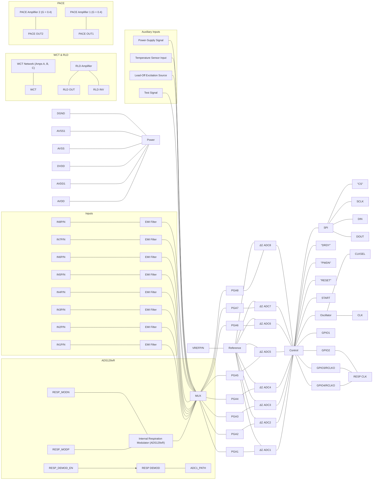

**Functional Blocks and Labels:**

* **Power Pins:** AVDD, AVDD1, DVDD, AVSS, AVSS1, DGND.
* **Reference:** VREFP, VREFN, Reference block.
* **Respiration (ADS129xR only):**
  * RESP_MODP, RESP_MODN
  * Internal Respiration Modulator (ADS129xR)
  * RESP_DEMOD_EN, RESP DEMOD block.
* **Analog Inputs:**
  * IN1P/IN1N through IN8P/IN8N.
  * EMI Filter for each channel.
  * MUX (Multiplexer).
* **Signal Chain:**
  * PGA1 through PGA8 (Programmable Gain Amplifiers) with internal switching.
  * $\Delta\Sigma$ ADC1 through $\Delta\Sigma$ ADC8 (Analog-to-Digital Converters).
* **Digital Control & Interface:**
  * Control block.
  * SPI Interface: $\overline{\text{CS}}$, SCLK, DIN, DOUT.
  * $\overline{\text{DRDY}}$, $\overline{\text{PWDN}}$, $\overline{\text{RESET}}$, START.
  * Oscillator: CLKSEL, CLK.
  * GPIOs: GPIO1, GPIO4/RCLKO, GPIO3/RCLKO, GPIO2.
  * RESP CLK block.
* **Auxiliary Blocks:**
  * Test Signal, Lead-Off Excitation Source, Temperature Sensor Input, Power-Supply Signal.
  * **WCT (Wilson Central Terminal):** Includes amplifiers A, B, and C with inputs from Wmuxa, Wmuxb, Wmuxc.
  * **RLD (Right Leg Drive):** RLD Amplifier with RLD IN, RLD REF, RLD OUT, and RLD INV pins.
  * **PACE Amplifiers:** PACE Amplifier 1 and 2 (Gain G = 0.4) leading to PACE OUT1 and PACE OUT2.

**Device Variants Indicated:**

* **ADS129xR:** Includes Respiration Modulator and Demodulator.
* **ADS1296/6R/8/8R:** Channels 5 and 6.
* **ADS1298/8R:** Channels 7 and 8.


<!-- PDF page 26 -->


## **9.3 Feature Description**

This section discusses the details of the ADS129x internal functional elements. The analog blocks are reviewed first, followed by the digital interface. Blocks implementing ECG-specific functions are covered at the end.

Throughout this document, *f<sub>CLK</sub>* denotes the frequency of the signal at the CLK pin, *t<sub>CLK</sub>* denotes the period of the signal at the CLK pin, *f<sub>DR</sub>* denotes the output data rate, *t<sub>DR</sub>* denotes the time period of the output data, and *f<sub>MOD</sub>* denotes the modulator input sampling frequency.

### **9.3.1 Analog Functionality**

#### **9.3.1.1 *EMI Filter***

An RC filter at the input acts as an EMI filter on all channels. The –3-dB filter bandwidth is approximately 3 MHz.

#### **9.3.1.2 *Analog Input Structure***

The analog input of the ADS129x is shown in Figure 24.

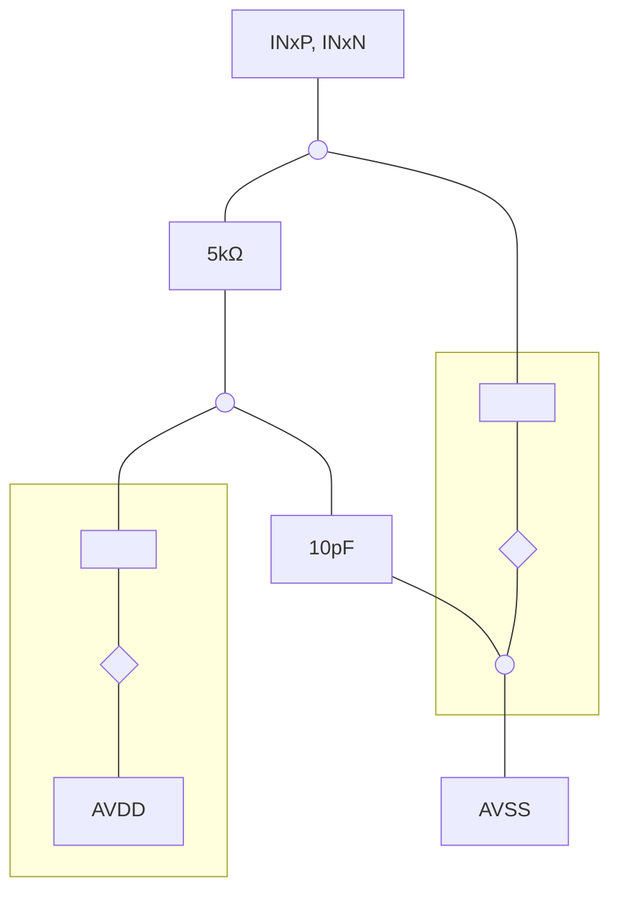

**Figure 24. Analog Input Protection Circuit**


<!-- PDF page 27 -->


## **Feature Description (continued)**

### *9.3.1.3 Input Multiplexer*

The **ADS129x** input multiplexers are very flexible and provide many configurable signal-switching options. Figure 25 shows the multiplexer on a single channel of the device. The device has eight blocks, one for each channel. TEST_PACE_OUT1, TEST_PACE_OUT2, and RLD_IN are common to all eight blocks. VINP and VINN are separate for each of the eight blocks. This flexibility allows for significant device and subsystem diagnostics, calibration, and configuration. Select the switch settings for each channel by writing 1 to the appropriate values to the CH*n*SET[2:0] register (see the *CHnSET* register for details) and the RLD_MEAS bit in the CONFIG3 register (see the *CONFIG3* register for details). More details of the ECG-specific features of the multiplexer are presented in the *Input Multiplexer (Rerouting The Right Leg Drive Signal)* subsection of the *ECG-Specific Functions* section.

```mermaid
graph LR
    subgraph ADS129x_MUX ["ADS129x MUX"]
        direction LR
        
        %% Inputs
        TESTP_PACE_OUT1((TESTP_PACE_OUT1))
        VINP((VINP))
        VINN((VINN))
        RLDIN((RLDIN))
        RLD_REF((RLD_REF))
        TESTN_PACE_OUT2((TESTN_PACE_OUT2))
        
        %% Internal Nodes/Labels
        TestP((TestP))
        TempP((TempP))
        MvddP((MvddP<sup>(1)</sup>))
        TempN((TempN))
        MvddN((MvddN<sup>(1)</sup>))
        TestN((TestN))
        
        EMI[EMI Filter]
        
        %% Switches and Connections - Top Section
        TESTP_PACE_OUT1 --- SW_INT_TEST_P_BAR["$\overline{\text{INT_TEST}}$"]
        TestP --- SW_INT_TEST_P["INT_TEST"]
        SW_INT_TEST_P_BAR & SW_INT_TEST_P --- NODE_P_TEST
        NODE_P_TEST --- SW_MUX_101_P["MUX[2:0] = 101"] --- BUS_P
        
        TempP --- SW_MUX_100_P["MUX[2:0] = 100"] --- BUS_P
        MvddP --- SW_MUX_011_P["MUX[2:0] = 011"] --- BUS_P
        
        %% EMI Filter Connections
        VINP --- EMI
        VINN --- EMI
        
        EMI --- NODE_EMI_P
        EMI --- NODE_EMI_N
        
        NODE_EMI_P --- SW_MUX_000_P["MUX[2:0] = 000"] --- BUS_P
        NODE_EMI_P --- SW_MUX_110_P["MUX[2:0] = 110"] --- NODE_RLD_SUM
        
        NODE_EMI_N --- SW_MUX_111_N["MUX[2:0] = 111"] --- NODE_RLD_SUM
        NODE_EMI_N --- SW_MUX_000_N["MUX[2:0] = 000"] --- BUS_N
        
        FromLoffP[From LoffP] --> NODE_EMI_P
        FromLoffN[From LoffN] --> NODE_EMI_N
        
        %% RLD Section
        RLDIN --- NODE_RLD_SUM
        NODE_RLD_SUM --- SW_RLD_MEAS["MUX[2:0] = 010 AND RLD_MEAS"] --- BUS_P
        RLD_REF --- SW_RLD_MEAS_N["MUX[2:0] = 010 AND RLD_MEAS"] --- BUS_N
        
        %% Bottom Section
        MvddN --- SW_MUX_011_N["MUX[2:0] = 011"] --- BUS_N
        TempN --- SW_MUX_100_N["MUX[2:0] = 100"] --- BUS_N
        
        NODE_N_TEST --- SW_MUX_101_N["MUX[2:0] = 101"] --- BUS_N
        TestN --- SW_INT_TEST_N["INT_TEST"] --- NODE_N_TEST
        TESTN_PACE_OUT2 --- SW_INT_TEST_N_BAR["$\overline{\text{INT_TEST}}$"] --- NODE_N_TEST
        
        %% Outputs
        BUS_P --> ToPgaP((To PgaP))
        BUS_N --> ToPgaN((To PgaN))
        
        %% Common Mode Section
        BUS_P --- SW_MUX_001_P["MUX[2:0] = 001"] --- NODE_CM
        BUS_N --- SW_MUX_001_N["MUX[2:0] = 001"] --- NODE_CM
        NODE_CM --- CM_OUT["$\frac{\text{(AVDD + AVSS)}}{2}$"]
    end
```

(1) MVDD monitor voltage supply depends on channel number; see the *Supply Measurements (MVDDP, MVDDN)* section.

**Figure 25. Input Multiplexer Block for One Channel**

(1) MVDD monitor voltage supply depends on channel number; see the *Supply Measurements (MVDDP, MVDDN)* section.


<!-- PDF page 28 -->


## **Feature Description (continued)**

### **9.3.1.3.1 Device Noise Measurements**

Setting CH*n*SET[2:0] = 001 sets the common-mode voltage of (AVDD – AVSS) / 2 to both inputs of the channel. Use this setting to test the inherent noise of the device.

### **9.3.1.3.2 Test Signals (TestP and TestN)**

Setting CH*n*SET[2:0] = 101 provides internally-generated test signals for use in subsystem verification at power up. This functionality allows the entire signal chain to be tested. Although the test signals are similar to the CAL signals described in the IEC60601-2-51 specification, this feature is not intended for use in compliance testing.

Use register settings to control the test signals (see the *CONFIG2: Configuration Register 2 (address = 02h) (reset = 40h)* section for details). The TEST_AMP bit controls the signal amplitude, and the TEST_FREQ bits control switching at the required frequency.

The test signals are multiplexed and transmitted out of the device at the TESTP_PACE_OUT1 and TESTN_PACE_OUT2 pins. A bit register (CONFIG2.INT_TEST = 0) deactivates the internal test signals so that the test signal can be driven externally. This feature allows the calibration of multiple devices with the same signal. The test signal feature cannot be used in conjunction with the external hardware pace feature (see the *External Hardware Approach* section for details).

### **9.3.1.3.3 Auxiliary Differential Input (TESTP_PACE_OUT1, TESTN_PACE_OUT2)**

When hardware pace detection is not used, the TESTP_PACE_OUT1 and TESPN_PACE_OUT2 signals can be used as a multiplexed differential input channel. These inputs can be multiplexed to any of the eight channels. The performance of the differential input signal fed through these pins is identical to the normal channel performance.

### **9.3.1.3.4 Temperature Sensor (TempP, TempN)**

The ADS129x contain an on-chip temperature sensor. This sensor uses two internal diodes with one diode having a current density 16x that of the other, as shown in Figure 26. The difference in current densities of the diodes yields a difference in voltage that is proportional to absolute temperature.

### Temperature Sensor Monitor


**Figure 26. Measurement of the Temperature Sensor in the Input**

As a result of the low thermal resistance of the package to the printed circuit board (PCB), the internal sensor tracks the PCB temperature closely. Self-heating of the ADS129x causes a higher reading than the temperature of the surrounding PCB.

The scale factor of Equation 1 converts the temperature reading to °C. Before using this equation, scale the the temperature reading code to μV.

$$
\text{Temperature } (^\circ\text{C}) = \left( \frac{\text{Temperature Reading } (\mu\text{V}) - 145,300 \mu\text{V}}{490 \mu\text{V}/^\circ\text{C}} \right) + 25^\circ\text{C} \tag{1}
$$


<!-- PDF page 29 -->


## **Feature Description (continued)**

### **9.3.1.3.5 Supply Measurements (MVDDP, MVDDN)**

Setting CH*n*SET[2:0] = 011 sets the channel inputs to different supply voltages of the device.

For channels 1, 2, 5, 6, 7, and 8, (MVDDP – MVDDN) = [0.5 × (AVDD – AVSS)]

For channels 3 and 4, (MVDDP – MVDDN) = DVDD / 4.

To avoid saturating the PGA while measuring power supplies, set the gain to 1.

For example, if AVDD = 2.5 V and AVSS = –2.5 V, then the measurement result is 2.5 V.

### **9.3.1.3.6 Lead-Off Excitation Signals (LoffP, LoffN)**

The lead-off excitation signals are fed into the multiplexer before the switches. The comparators that detect the lead-off condition are also connected to the multiplexer block before the switches. For a detailed description of the lead-off block, refer to the *Lead-Off Detection* section.

### **9.3.1.3.7 Auxiliary Single-Ended Input**

The RLD_IN pin is primarily used for routing the right leg drive (RLD) signal to any of the electrodes in case the RLD electrode falls off. However, the RLD_IN pin can be used as a multiple single-ended input channel. The signal at the RLD_IN pin can be measured with respect to the voltage at the RLD_REF pin using any of the eight channels. This measurement is done by setting the channel multiplexer setting to 010, and the RLD_MEAS bit of the CONFIG3 register to 1.


<!-- PDF page 30 -->


# **Feature Description (continued)**

## *9.3.1.4 Analog Input*

The analog input to the ADS129x is fully differential. Assuming PGA = 1, the differential input (INP – INN) can span between –V<sub>REF</sub> to V<sub>REF</sub>. The absolute range for INP and INN must be between AVSS – 0.3 V and AVDD + 0.3 V. See Table 13 for an explanation of the correlation between the analog input and the digital codes. As shown in Figure 27 and Figure 28, there are two general methods of driving the analog input of the ADS129x: single-ended or differential. INP and INN are 180° out-of-phase in the differential input method. When the input is single-ended, the INN input is held at the common-mode voltage (CM), preferably at midsupply. The INP input swings around the same common-mode voltage and the peak-to-peak amplitude swings from CM – V<sub>REF</sub> to CM + V<sub>REF</sub>. When the input is differential, the common-mode is given by (INP + INN) / 2. Both the INP and INN inputs swing from CM + ½ V<sub>REF</sub> to CM – ½ V<sub>REF</sub>. For optimal performance, use the ADS129x devices in a differential configuration.

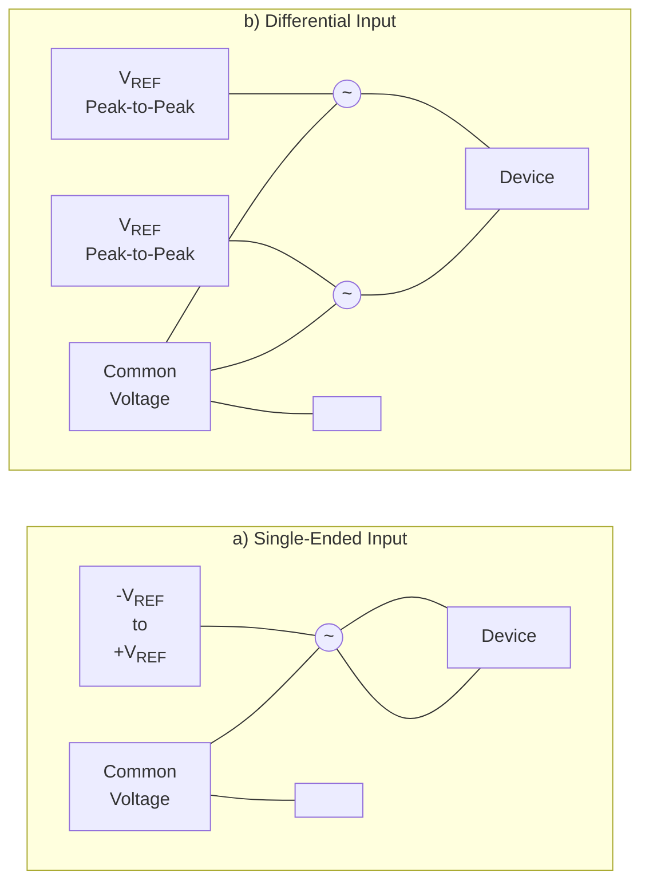

**Figure 27. Methods of Driving the ADS129x: Single-Ended or Differential**


$\text{Common-Mode Voltage (Differential Mode)} = \frac{(\text{INP}) + (\text{INN})}{2}, \text{Common-Mode Voltage (Single-Ended Mode)} = \text{INN}$

$\text{Input Range (Differential Mode)} = (\text{AINP} - \text{AINN}) = 2 \text{ V}_{\text{REF}}$

**Figure 28. Using the ADS129x in Single-Ended and *Differential Input* Modes**


<!-- PDF page 31 -->


### *9.3.1.5 PGA Settings and Input Range*

The PGA is a differential input and differential output amplifier, as shown in Figure 29. The PGA has seven gain settings (1, 2, 3, 4, 6, 8, and 12) that are set by writing to the CH*n*SET register (see the *CHnSET: Individual Channel Settings (n = 1 to 8) (address = 05h to 0Ch) (reset = 00h)* section). The ADS129x have CMOS inputs, and therefore have negligible current noise. Table 5 shows the typical values of bandwidths for various gain settings. Table 5 shows the small-signal bandwidth.

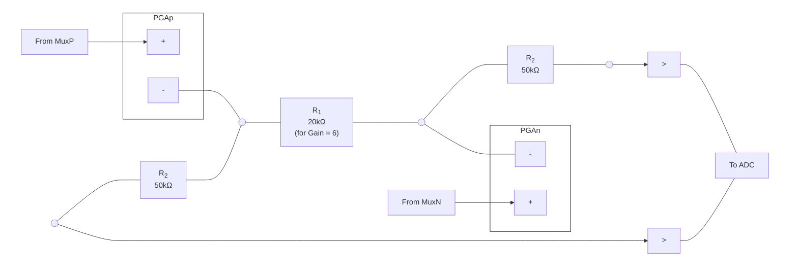

**Figure 29. PGA Implementation**

<table>
  <caption>**Table 5. PGA Gain versus Small-Signal Bandwidth**</caption>
  <thead>
    <tr>
      <th><b>GAIN</b></th>
      <th><b>NOMINAL BANDWIDTH AT ROOM</b><br /><b>TEMPERATURE (kHz)</b></th>
    </tr>
  </thead>
  <tbody>
    <tr>
      <td>1</td>
      <td>237</td>
    </tr>
    <tr>
      <td>2</td>
      <td>146</td>
    </tr>
    <tr>
      <td>3</td>
      <td>127</td>
    </tr>
    <tr>
      <td>4</td>
      <td>96</td>
    </tr>
    <tr>
      <td>6</td>
      <td>64</td>
    </tr>
    <tr>
      <td>8</td>
      <td>48</td>
    </tr>
    <tr>
      <td>12</td>
      <td>32</td>
    </tr>
  </tbody>
</table>

The resistor string of the PGA that implements the gain has 120 kΩ of resistance for a gain of 6. This resistance provides a current path across the outputs of the PGA in the presence of a differential input signal. This current is in addition to the quiescent current specified for the device in the presence of a differential signal at the input.


<!-- PDF page 32 -->


### 9.3.1.5.1 Input Common-Mode Range

The usable input common-mode range of the front end depends on various parameters, including the maximum differential input signal, supply voltage, PGA gain, and more. This range is described in Equation 2:

$$AVDD - 0.2\text{ V} - \left( \frac{\text{Gain} \times \text{V}_{\text{MAX_DIFF}}}{2} \right) > \text{CM} > AVSS + 0.2\text{ V} + \left( \frac{\text{Gain} \times \text{V}_{\text{MAX_DIFF}}}{2} \right) \text{ (2)}$$

where

* V<sub>MAX_DIFF</sub> = maximum differential signal at the input of the PGA
* CM = common-mode range

For example, If V<sub>DD</sub> = 3 V, gain = 6, and V<sub>MAX_DIFF</sub> = 350 mV, then 1.25 V < CM < 1.75 V.

### 9.3.1.5.2 Input Differential Dynamic Range

The differential (INP – INN) signal range depends on the analog supply and reference used in the system. This range is shown in Equation 3.

$$\text{Full-Scale Range} = \frac{\pm V_{\text{REF}}}{\text{Gain}} = \frac{2V_{\text{REF}}}{\text{Gain}} \hfill (3)$$

The 3-V supply, with a reference of 2.4 V and a gain of 6 for ECGs, is optimized for power with a differential input signal of approximately 300 mV. For higher dynamic range, use a 5-V supply with a reference of 4 V (set by the VREF_4V bit of the CONFIG3 register) to increase the differential dynamic range.

### 9.3.1.5.3 ADC Delta-Sigma Modulator

Each channel of the ADS129x has a 24-bit, delta-sigma ADC. This converter uses a second-order modulator optimized for low-power applications. The modulator samples the input signal at the rate of f<sub>MOD</sub> = f<sub>CLK</sub> / 4 for high-resolution (HR) mode and f<sub>MOD</sub> = f<sub>CLK</sub> / 8 for low-power (LP) mode. As in the case of any delta-sigma modulator, the noise of the ADS129x is shaped until f<sub>MOD</sub> / 2, as shown in Figure 30. Use the on-chip digital decimation filters, explained in the *Digital Decimation Filter* section, to filter out the noise at higher frequencies. These on-chip decimation filters also provide antialias filtering. This feature of the delta-sigma converters drastically reduces the complexity of the analog antialiasing filters that are typically needed with Nyquist ADCs.

<table>
  <caption>Figure 30. Modulator Noise Spectrum up to 0.5 × f<sub>MOD</sub></caption>
  <thead>
    <tr>
      <th>Normalized Frequency (f<sub>IN</sub>/f<sub>MOD</sub>)</th>
      <th>Power Spectral Density (dB)</th>
    </tr>
  </thead>
  <tbody>
    <tr>
      <th>0.001</th>
      <td>-145</td>
    </tr>
    <tr>
      <th>0.002</th>
      <td>-135</td>
    </tr>
    <tr>
      <th>0.003</th>
      <td>-132</td>
    </tr>
    <tr>
      <th>0.004</th>
      <td>-130</td>
    </tr>
    <tr>
      <th>0.005</th>
      <td>-128</td>
    </tr>
    <tr>
      <th>0.006</th>
      <td>-126</td>
    </tr>
    <tr>
      <th>0.007</th>
      <td>-124</td>
    </tr>
    <tr>
      <th>0.008</th>
      <td>-122</td>
    </tr>
    <tr>
      <th>0.009</th>
      <td>-120</td>
    </tr>
    <tr>
      <th>0.01</th>
      <td>-118</td>
    </tr>
    <tr>
      <th>0.02</th>
      <td>-105</td>
    </tr>
    <tr>
      <th>0.03</th>
      <td>-98</td>
    </tr>
    <tr>
      <th>0.04</th>
      <td>-92</td>
    </tr>
    <tr>
      <th>0.05</th>
      <td>-88</td>
    </tr>
    <tr>
      <th>0.06</th>
      <td>-85</td>
    </tr>
    <tr>
      <th>0.07</th>
      <td>-82</td>
    </tr>
    <tr>
      <th>0.08</th>
      <td>-80</td>
    </tr>
    <tr>
      <th>0.09</th>
      <td>-78</td>
    </tr>
    <tr>
      <th>0.1</th>
      <td>-76</td>
    </tr>
    <tr>
      <th>0.2</th>
      <td>-65</td>
    </tr>
    <tr>
      <th>0.3</th>
      <td>-58</td>
    </tr>
    <tr>
      <th>0.4</th>
      <td>-54</td>
    </tr>
    <tr>
      <th>0.5</th>
      <td>-58</td>
    </tr>
  </tbody>
</table>

**Figure 30. Modulator Noise Spectrum up to 0.5 × f<sub>MOD</sub>**


<!-- PDF page 33 -->


### *9.3.1.6 Reference*

Figure 31 shows a simplified block diagram of the ADS129x internal reference. The reference voltage is generated with respect to AVSS. When using the internal voltage reference, connect VREFN to AVSS.

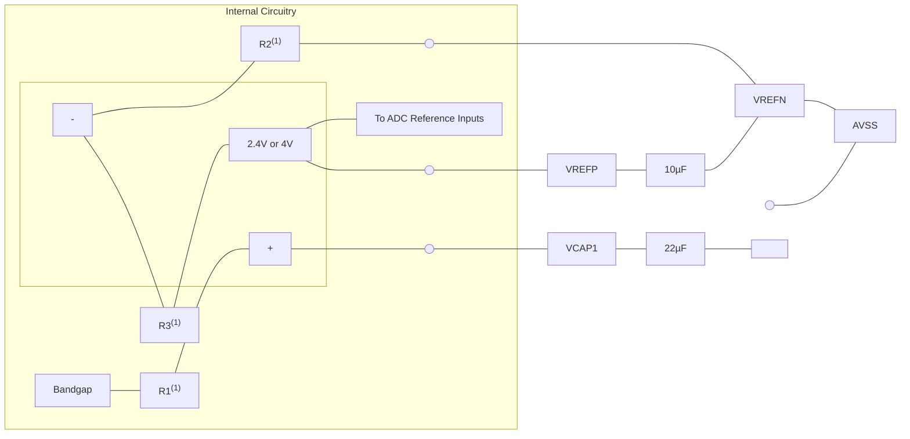

(1) For V<sub>REF</sub> = 2.4 V: R1 = 12.5 kΩ, R2 = 25 kΩ, and R3 = 25 kΩ. For V<sub>REF</sub> = 4 V: R1 = 10.5 kΩ, R2 = 15 kΩ, and R3 = 35 kΩ.

**Figure 31. Internal Reference**

The external band-limiting capacitors determine the amount of reference noise contribution. For high-end ECG systems, choose capacitor values with a bandwidth that is limited to less than 10Hz, so that the reference noise does not dominate the system noise. When using a 3-V analog supply, set the internal reference to 2.4 V. For a 5-V analog supply, set the internal reference to 4 V by setting the VREF_4V bit in the CONFIG2 register.

Alternatively, the internal reference buffer can be powered down and VREFP can be applied externally. Figure 32 shows a typical external reference drive circuitry. Power down is controlled by the PD_REFBUF bit in the CONFIG3 register. By default, the device wakes up in external reference mode.

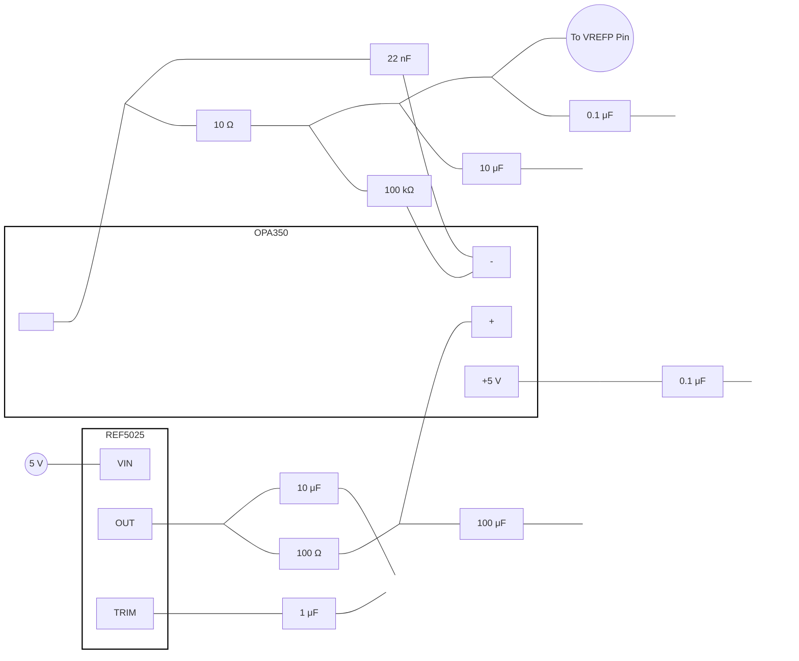

**Figure 32. External Reference Driver**


<!-- PDF page 34 -->


### *9.3.1.7 ECG-Specific Functions*

#### **9.3.1.7.1 Input Multiplexer (Rerouting The Right Leg Drive Signal)**

The input multiplexer has ECG-specific functions for the right leg drive (RLD) signal. The RLD signal is available at the RLDOUT pin after the appropriate channels are selected for the RLD derivation, feedback elements are installed external to the chip, and the loop is closed. This signal can be fed after filtering, or fed directly into the RLDIN pin as shown in Figure 33. Multiplex the RLDIN signal into any one of the input electrodes by setting the mux bits of the appropriate channel set registers to 110 for P-side or 111 for N-side. Figure 33 shows the RLD signal generated from channels 1, 2, and 3 routed to the N-side of channel 8. Use this feature to dynamically change the electrode that is used as the reference signal to drive the patient body. The corresponding channel cannot be used and can be powered down.

```mermaid
graph TD
    subgraph ADS1298 ["ADS1298"]
        direction TB
        
        %% Channel 1
        IN1P((IN1P)) --- EMI1[EMI Filter]
        IN1N((IN1N)) --- EMI1
        EMI1 --- MUX1[MUX]
        MUX1 --- PGA1[PGA1]
        PGA1 --- R1P[Resistor] --- SW1P[/] --- BUS_RLD
        PGA1 --- R1N[Resistor] --- SW1N[/] --- BUS_RLD
        
        %% Channel 2
        IN2P((IN2P)) --- EMI2[EMI Filter]
        IN2N((IN2N)) --- EMI2
        EMI2 --- MUX2[MUX]
        MUX2 --- PGA2[PGA2]
        PGA2 --- R2P[Resistor] --- SW2P[/] --- BUS_RLD
        PGA2 --- R2N[Resistor] --- SW2N[/] --- BUS_RLD
        
        %% Channel 3
        IN3P((IN3P)) --- EMI3[EMI Filter]
        IN3N((IN3N)) --- EMI3
        EMI3 --- MUX3[MUX]
        MUX3 --- PGA3[PGA3]
        PGA3 --- R3P[Resistor] --- SW3P[/] --- BUS_RLD
        PGA3 --- R3N[Resistor] --- SW3N[/] --- BUS_RLD
        
        %% Channel 8
        IN8P((IN8P)) --- EMI8[EMI Filter]
        IN8N((IN8N)) --- EMI8
        EMI8 --- MUX8[MUX]
        MUX8 --- PGA8[PGA8]
        PGA8 --- R8P[Resistor] --- SW8P[/] --- BUS_RLD
        PGA8 --- R8N[Resistor] --- SW8N[/] --- BUS_RLD

        %% RLD Amplifier Section
        AVDD_AVSS["(AVDD + AVSS)/2"] --- SW_RLDREF_INT[/] --- RLD_AMP_IN_P
        RLDIN((RLDIN)) --- RLD_AMP_IN_P
        RLDREF((RLDREF)) --- SW_RLDREF_INT_V[/] --- RLD_AMP_IN_P
        
        BUS_RLD --- RLD_AMP_IN_N
        RLD_AMP_IN_N --- RLD_AMP[RLD_AMP]
        RLD_AMP_IN_P --- RLD_AMP
        RLD_AMP --- RLDOUT((RLDOUT))
        RLD_AMP --- RLDINV((RLDINV))
    end

    %% External Components
    RLDIN --- FF[Filter or Feedthrough] --- RLDOUT
    RLDOUT --- R_EXT[1M&Omega;] --- RLDINV
    RLDOUT --- C_EXT[1.5nF] --- RLDINV

    %% Labels and Settings
    style MUX1 stroke-dasharray: 5 5
    style MUX2 stroke-dasharray: 5 5
    style MUX3 stroke-dasharray: 5 5
    style MUX8 stroke-dasharray: 5 5
```

### Register Settings and Component Values

* **Channel 1:**
  * `MUX1[2:0] = 000`
  * `RLD_SENSP[0] = 1`
  * `RLD_SENSN[0] = 1`
* **Channel 2:**
  * `MUX2[2:0] = 000`
  * `RLD_SENSP[1] = 1`
  * `RLD_SENSN[1] = 1`
* **Channel 3:**
  * `MUX3[2:0] = 000`
  * `RLD_SENSP[2] = 1`
  * `RLD_SENSN[2] = 1`
* **Channel 8:**
  * `MUX8[2:0] = 111`
  * `RLD_SENSP[7] = 0`
  * `RLD_SENSN[7] = 0`
* **RLD Reference:**
  * `RLDREF_INT` (Horizontal switch)
  * `RLDREF_INT` (Vertical switch)
* **External Components:**
  * Resistor: $1\text{M}\Omega^{(1)}$
  * Capacitor: $1.5\text{nF}^{(1)}$

(1) Typical values for example only.

**Figure 33. Example of RLDOUT Signal Configured to be Routed to IN8N**


<!-- PDF page 35 -->


### **9.3.1.7.2 Input Multiplexer (Measuring The Right Leg Drive Signal)**

The RLDOUT signal can also be routed to a channel (that is not used for the calculation of RLD) for measurement. Figure 34 shows the register settings to route the RLDIN signal to channel 8. The measurement is done with respect to the voltage on the RLDREF pin. If RLDREF is set to internal, it is at (AVDD + AVSS) / 2. This feature is useful for debugging purposes during product development.

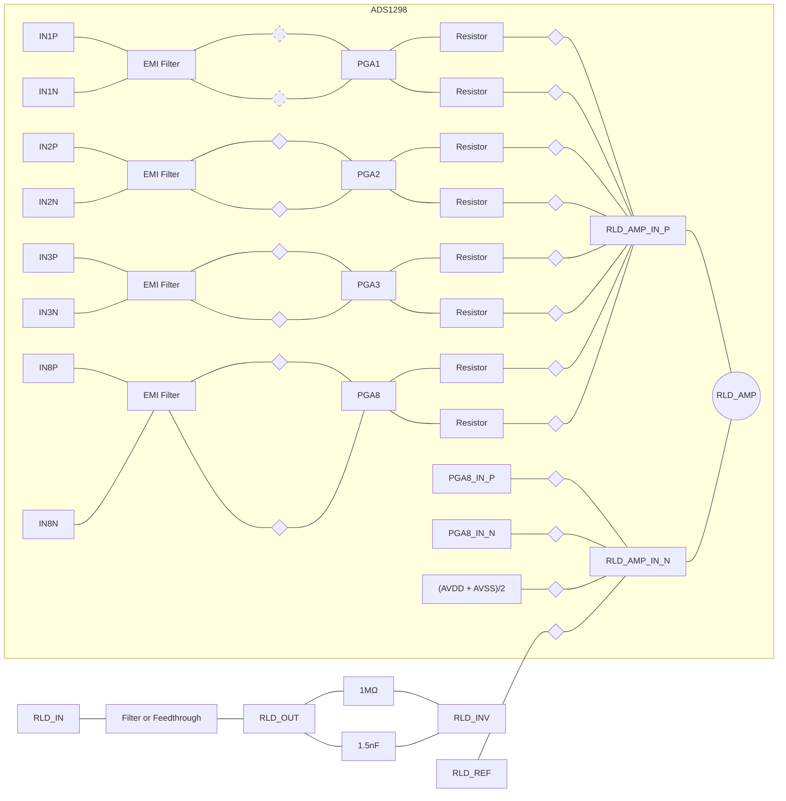

### Register Settings and Annotations

**Multiplexer Settings (MUX):**

* **MUX1[2:0] = 000**: Channel 1 input selected.
* **MUX2[2:0] = 000**: Channel 2 input selected.
* **MUX3[2:0] = 000**: Channel 3 input selected.
* **MUX8[2:0] = 010**: Channel 8 input selected for specific routing.
* **MUX8[2:0] = 010 AND RLD_MEAS = 1**: Routing for RLD measurement.

**RLD Sensitivity Settings:**

* **RLD_SENSP[0] = 1** / **RLD_SENSN[0] = 1**: Channel 1 connected to RLD summing junction.
* **RLD_SENSP[1] = 1** / **RLD_SENSN[1] = 1**: Channel 2 connected to RLD summing junction.
* **RLD_SENSP[2] = 1** / **RLD_SENSN[2] = 1**: Channel 3 connected to RLD summing junction.
* **RLD_SENSP[7] = 0** / **RLD_SENSN[7] = 0**: Channel 8 disconnected from RLD summing junction.

**Internal Reference:**

* **RLDREF_INT**: Switch controlling internal reference connection.

**External Pins:**

* **RLD_IN**: Input to the RLD filter/feedthrough.
* **RLD_REF**: Reference input for the RLD amplifier.
* **RLD_OUT**: Output of the RLD amplifier.
* **RLD_INV**: Inverting input of the RLD amplifier (feedback node).

**(1)** Typical values for ECG applications.

(1) Typical values for example only.

**Figure 34. RLDOUT Signal Configured to be Read Back by Channel 8**


<!-- PDF page 36 -->


### **9.3.1.7.3 Wilson Central Terminal (WCT) and Chest Leads**

In the standard 12-lead ECG, WCT voltage is defined as the average of right arm (RA), left arm (LA), and left leg (LL) electrodes. This voltage is used as the reference voltage for the measurement of the chest leads. The ADS129x has three integrated low-noise amplifiers that generate the WCT voltage. Figure 35 shows the block diagram of the implementation.

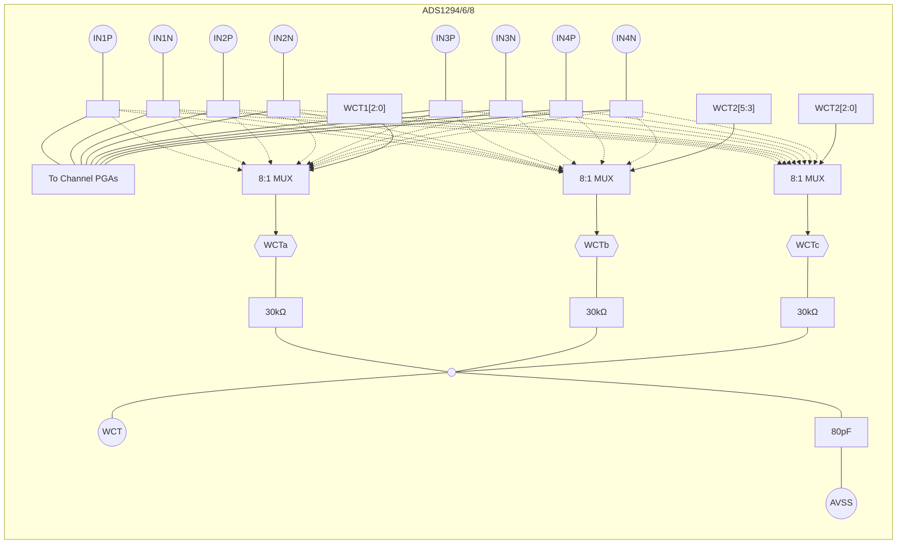

**Figure 35. WCT Voltage**

These devices provide the flexibility to route any one of the eight signals (IN1P to IN4N) to each of the amplifiers to generate the average. This flexibility allows the RA, LA, and LL electrodes to be connected to any input of the first four channels, depending on the lead configuration.

Each of the three amplifiers in the WCT circuitry can be powered down individually with register settings. By powering up two amplifiers, the average of any two electrodes is generated at the WCT pin. Powering up one amplifier provides the buffered electrode voltage at the WCT pin. The WCT amplifiers have limited drive strength, and thus, should be buffered if used to drive a low-impedance load.

Table 6 shows the typical WCT performance when using any 1, 2, or 3 of the WCT buffers.

<table>
  <caption>**Table 6. Typical WCT Performance**</caption>
  <thead>
    <tr>
      <th><b>PARAMETER</b></th>
      <th><b>ANY ONE</b><br /><b>(A, B, or C)</b></th>
      <th><b>ANY TWO</b><br /><b>(A+B, A+C, or B+C)</b></th>
      <th><b>ALL THREE</b><br /><b>(A+B+C)</b></th>
      <th><b>UNIT</b></th>
    </tr>
  </thead>
  <tbody>
    <tr>
      <td>Integrated noise</td>
      <td>540</td>
      <td>382</td>
      <td>312</td>
      <td>nV<sub>RMS</sub></td>
    </tr>
    <tr>
      <td>Power</td>
      <td>53</td>
      <td>59</td>
      <td>65</td>
      <td>μW</td>
    </tr>
    <tr>
      <td>–3-dB BW</td>
      <td>30</td>
      <td>59</td>
      <td>89</td>
      <td>kHz</td>
    </tr>
    <tr>
      <td>Slew rate</td>
      <td>BW limited</td>
      <td>BW limited</td>
      <td>BW limited</td>
      <td>V/μs</td>
    </tr>
  </tbody>
</table>


<!-- PDF page 37 -->


As shown in Table 6, the overall noise reduces when more than one WCT amplifier is powered up. This noise reduction is a result of the fact that noise is averaged by the passive summing network at the output of the amplifiers. Powering down individual buffers gives negligible power savings because a significant portion of the circuitry is shared between the three amplifiers. The bandwidth of the WCT node is limited by the RC network. The internal summing network consists of three 30-kΩ resistors and a 80-pF capacitor. For optimal performance, add an external 100-pF capacitor. The effective bandwidth depends on the number of amplifiers that are powered up, as shown in Table 6.

Only use the WCT node to drive very high input impedances (typically greater than 500 MΩ). A typical application connects this WCT signal to the negative inputs of a ADS129x for use as a reference signal for the chest leads.

As mentioned, all three WCT amplifiers can be connected to one of eight analog input pins. The inputs of the amplifiers are chopped, and the chop frequency varies with the data rates of the ADS129x. The chop frequency for the three highest data rates scale 1:1. For example, at a 32-kSPS data rate, the chop frequency is 32 kHz in HR mode with WCT_CHOP = 0. The chop frequency of the four lower data rates is fixed at 4 kHz. When WCT_CHOP = 1, the chop frequency is fixed to highest data rate frequency (that is, $f_{MOD}$ / 16), as shown in Table 7. The chop frequency appears at the output of the WCT amplifiers as a small square wave riding on dc. The amplitude of the square wave is the offset of the amplifier and is typically 5 $mV_{PP}$. As a result of out-of-band chopping, this artifact does not interfere with ECG-related measurements. As a result of the chopping function, the input current leakage on the pins with the connected WCT amplifiers increases at higher data rates and as the input common voltage swings closer to 0 V (AVSS), as described in Figure 36.

If the output of a channel connected to the WCT amplifier (for example, the V-lead channels) is connected to one of the pace amplifiers for external pace detection, the chopping artifact appears at the pace amplifier output.

<table>
  <caption>**Figure 36. WCT Input Leakage Current vs Input Voltage** (WCT_CHOP = 0); T<sub>A</sub> = +25°C; WCT Input Leakage Current (pA)</caption>
  <thead>
    <tr>
      <th rowspan="2">Input Common-Mode Voltage (V)</th>
      <th colspan="7">Data Rate (DR)</th>
    </tr>
    <tr>
      <th>DR = 0.5kSPS, <u>0.25kSPS</u></th>
      <th>DR = 1kSPS</th>
      <th>DR = 2kSPS</th>
      <th>DR = 4kSPS</th>
      <th>DR = 8kSPS</th>
      <th>DR = 16kSPS</th>
      <th>DR = 32kSPS</th>
    </tr>
  </thead>
  <tbody>
    <tr>
      <th>0.3</th>
      <td>68</td>
      <td>68</td>
      <td>68</td>
      <td>66</td>
      <td>87</td>
      <td>123</td>
      <td>187</td>
    </tr>
    <tr>
      <th>0.8</th>
      <td>62</td>
      <td>62</td>
      <td>62</td>
      <td>60</td>
      <td>72</td>
      <td>90</td>
      <td>130</td>
    </tr>
    <tr>
      <th>1.3</th>
      <td>56</td>
      <td>58</td>
      <td>58</td>
      <td>58</td>
      <td>61</td>
      <td>66</td>
      <td>80</td>
    </tr>
    <tr>
      <th>1.8</th>
      <td>68</td>
      <td>70</td>
      <td>68</td>
      <td>66</td>
      <td>64</td>
      <td>64</td>
      <td>62</td>
    </tr>
    <tr>
      <th>2.3</th>
      <td>90</td>
      <td>88</td>
      <td>86</td>
      <td>84</td>
      <td>82</td>
      <td>80</td>
      <td>78</td>
    </tr>
    <tr>
      <th>2.8</th>
      <td>111</td>
      <td>105</td>
      <td>103</td>
      <td>101</td>
      <td>100</td>
      <td>98</td>
      <td>96</td>
    </tr>
  </tbody>
</table>

<table>
  <caption>**Figure 37. WCT Input Leakage Current vs Input Voltage** (WCT_CHOP = 1); T<sub>A</sub> = +25°C</caption>
  <thead>
    <tr>
      <th rowspan="2">Input Common-Mode Voltage (V)</th>
      <th colspan="2">WCT Input Leakage Current (pA)</th>
    </tr>
    <tr>
      <th>LP Mode</th>
      <th>HR Mode</th>
    </tr>
  </thead>
  <tbody>
    <tr>
      <th>0.3</th>
      <td>123</td>
      <td>186</td>
    </tr>
    <tr>
      <th>0.8</th>
      <td>92</td>
      <td>126</td>
    </tr>
    <tr>
      <th>1.3</th>
      <td>67</td>
      <td>74</td>
    </tr>
    <tr>
      <th>1.8</th>
      <td>62</td>
      <td>64</td>
    </tr>
    <tr>
      <th>2.3</th>
      <td>81</td>
      <td>84</td>
    </tr>
    <tr>
      <th>2.8</th>
      <td>97</td>
      <td>103</td>
    </tr>
  </tbody>
</table>

### Table 7. WCT Amplifiers Chop Frequency

<table>
  <thead>
    <tr>
      <th><b>CONFIG1.DR[2:0] BIT</b></th>
      <th>CONFIG2.WCT_CHOP = 0</th>
      <th>CONFIG2.WCT_CHOP = 1</th>
    </tr>
  </thead>
  <tbody>
    <tr>
      <td>000</td>
      <td>f<sub>MOD</sub>/16</td>
      <td>f<sub>MOD</sub>/16</td>
    </tr>
    <tr>
      <td>001</td>
      <td>f<sub>MOD</sub> / 32</td>
      <td>f<sub>MOD</sub> / 16</td>
    </tr>
    <tr>
      <td>010</td>
      <td>f<sub>MOD</sub> / 64</td>
      <td>f<sub>MOD</sub> / 16</td>
    </tr>
    <tr>
      <td>011</td>
      <td>f<sub>MOD</sub> / 128</td>
      <td>f<sub>MOD</sub> / 16</td>
    </tr>
    <tr>
      <td>100</td>
      <td>f<sub>MOD</sub> / 128</td>
      <td>f<sub>MOD</sub> / 16</td>
    </tr>
    <tr>
      <td>101</td>
      <td>f<sub>MOD</sub> / 128</td>
      <td>f<sub>MOD</sub> / 16</td>
    </tr>
    <tr>
      <td>110</td>
      <td>f<sub>MOD</sub> / 128</td>
      <td>f<sub>MOD</sub> / 16</td>
    </tr>
  </tbody>
</table>


<!-- PDF page 38 -->


### 9.3.1.7.3.1 *Augmented Leads*

In a typical implementation of the 12-lead ECG with eight channels, the augmented leads are calculated digitally. In certain applications, it may be required that all leads are derived in analog rather than digital. The **ADS1298** and **ADS1298R** provide the option to generate the augmented leads by routing appropriate averages to channels 5, 6, and 7. The same three amplifiers that are used to generate the WCT signal are also used to generate the Goldberger central terminal (GCT) signals. Figure 38 shows an example of generating the augmented leads in analog domain. In this implementation, more than eight channels are used to generate the standard 12 leads. This feature is not available in the ADS1294, ADS1294R, ADS1296 and ADS1296R.

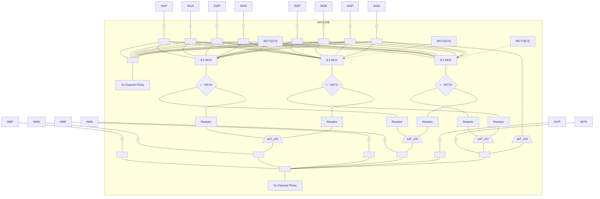

**Figure 38. Analog Domain Augmented Leads**

### 9.3.1.7.3.2 *Right Leg Drive with the WCT Point*

In certain applications, the out-of-phase version of the WCT is used as the RLD reference. The **ADS1298** provides the option to have a buffered version of the WCT terminal at the RLD_OUT pin. This signal can be inverted in phase using an external amplifier and then used as the right leg drive. Refer to the *Right Leg Drive (RLD DC Bias Circuit)* section for more details.


<!-- PDF page 39 -->


**[www.ti.com](http://www.ti.com)**

### 9.3.1.7.4 Lead-Off Detection

Patient electrode impedances decay over time; therefore, these electrode connections must be continuously monitored to verify that a suitable connection is present. The ADS129x lead-off detection functional block provides significant flexibility to choose from various lead-off detection strategies. Although called lead-off detection, this feature is in fact *electrode-off* detection.

The basic principle is to inject an excitation signal and measure the response to determine if the electrode is off. As shown in the lead-off detection functional block diagram in Figure 39, this circuit provides two different methods of determining the state of the patient electrode. The methods differ in the frequency content of the excitation signal. Lead-off can be selectively done on a per channel basis using the LOFF_SENSP and LOFF_SENSN registers. The internal excitation circuitry can be disabled while the sensing circuitry is enabled.

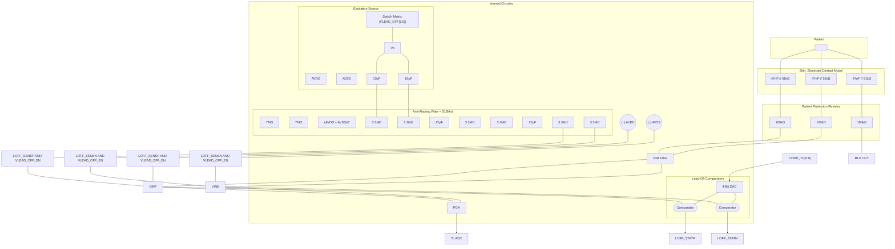

**Figure 39. Lead-Off Detection**


<!-- PDF page 40 -->


### 9.3.1.7.4.1 *DC Lead-Off*

In this approach, the lead-off excitation is accomplished with a dc signal. Choose a dc excitation signal from either a pullup or pulldown resistor, or from a current source or sink system, as shown in Figure 40. Select by setting the VLEAD_OFF_EN bit in the LOFF register. One side of the channel is pulled to supply, and the other side is pulled to ground. Swap the pullup resistor and pulldown resistor by setting the bits in the LOFF_FLIP register, as shown in Figure 41. If using a current source or sink, set the magnitude of the current by using the ILEAD_OFF[1:0] bits in the LOFF register. The current source or sink gives larger input impedance compared to the 10-MΩ pullup or pulldown resistor.

<table>
<thead>
<tr>
<th align="center">Figure 40. DC Lead-Off Excitation Options</th>
<th align="center">Figure 41. LOFF_FLIP Usage</th>
</tr>
</thead>
<tbody>
<tr>
<td align="center"></td>
<td align="center"></td>
</tr>
<tr>
<td align="center">a) Pull-Up/Pull-Down Resistors</td>
<td align="center">a) LOFF_FLIP = 0</td>
</tr>
<tr>
<td align="center"></td>
<td align="center"></td>
</tr>
<tr>
<td align="center">b) Current Source</td>
<td align="center">a) LOFF_FLIP = 1</td>
</tr>
</tbody>
</table>

**Figure 40. DC Lead-Off Excitation Options**
**Figure 41. LOFF_FLIP Usage**

Response sensing is achieved either by looking at the digital output code from the device, or by monitoring the input voltages with on-chip comparators. If either of the electrodes is off, the pullup or pulldown resistors saturate the channel. Look at the output code to determine if either the P-side or the N-side is off. To pinpoint which side is off, check the comparator outputs. During conversion, the input voltage is simultaneously monitored by using a comparator and a 4-bit DAC with levels that are set by the COMP_TH[2:0] bits in the LOFF register. The comparator outputs are stored in the LOFF_STATP and LOFF_STATN registers. These two registers are available as a part of the output data stream (see the *Data Output Pin (DOUT)* section). If dc lead-off is not used, the lead-off comparators can be powered down by setting the PD_LOFF_COMP bit in the CONFIG4 register.

An example procedure to turn on dc lead-off is given in the *Lead-Off* section.

### 9.3.1.7.4.2 *AC Lead-Off*

This method uses an out-of-band ac signal for excitation. The ac signal is generated by providing pullup and pulldown resistors at the input with a fixed frequency. The ac signal is passed through an antialiasing filter to prevent aliasing. Select the frequency with the FLEAD_OFF[1:0] bits in the LOFF register. The excitation frequency is a function of the output data rate and is f<sub>DR</sub> / 4. This out-of-band excitation signal is passed through the channel and measured at the output.

AC signal sensing is achieved by passing the signal through the channel to digitize the signal, and measuring the output. The ac excitation signals are introduced at a frequency that is above the band of interest, generating an out-of-band differential signal that can be filtered out separately and processed. By measuring the magnitude of the excitation signal at the output spectrum, the lead-off status is calculated. Therefore, the ac lead-off detection is accomplished simultaneously with the ECG signal acquisition.


<!-- PDF page 41 -->


### **9.3.1.7.5 RLD Lead-Off**

Determine if the RLD electrode is connected in the ADS129x by powering down the RLD amplifier. After power down, there are two measurement procedures to determine the RLD electrode connect status: a pullup or pulldown resistor, or a sink or source current source, as shown in Figure 42. Set the reference level of the comparator to determine the acceptable RLD impedance threshold.

<table>
<thead>
<tr>
<th align="left">Patient</th>
<th align="left">Skin, Electrode Contact Model</th>
<th align="left">Patient Protection Resistor</th>
<th align="left">Internal Circuitry</th>
</tr>
</thead>
<tbody>
<tr>
<td align="left">(Node)</td>
<td align="left">47nF capacitor in parallel with 51k$\Omega$ resistor</td>
<td align="left">100k$\Omega$ resistor</td>
<td align="left">To ADC input (through $V_{REF}$ connection to any of the channels).</td>
</tr>
<tr>
<td align="left"></td>
<td align="left"></td>
<td align="left"></td>
<td align="left">Switch 1 controlled by: $RLD_SENS$ AND $\overline{VLEAD_OFF_EN}$ connected to current source $ILGND_OFF[1:0]$ to AVSS.</td>
</tr>
<tr>
<td align="left"></td>
<td align="left"></td>
<td align="left"></td>
<td align="left">Switch 2 controlled by: $RLD_SENS$ AND $VLEAD_OFF_EN$ connected to AVSS.</td>
</tr>
<tr>
<td align="left"></td>
<td align="left"></td>
<td align="left"></td>
<td align="left">Comparator/Buffer outputting $RLD_STAT$.</td>
</tr>
<tr>
<td align="left"></td>
<td align="left"></td>
<td align="left"></td>
<td align="left">RLD Amplifier (triangle symbol with + and - inputs).</td>
</tr>
</tbody>
</table>

**Figure 42. RLD Lead-Off Detection at Power Up**

The current source, or pullup or pulldown resistor method has no function when the RLD amplifier is powered on. Use the comparator to sense the voltage at the output of the RLD amplifier. The comparator threshold is set by the same LOFF[7:5] bits that are used to set the thresholds for the other negative inputs.

### **9.3.1.7.6 Right Leg Drive (RLD) DC Bias Circuit**

Use the right leg drive (RLD) circuitry to counter the common-mode interference in a ECG system as a result of power lines and other sources, including fluorescent lights. The RLD circuit senses the common-mode voltage of a selected set of electrodes and creates a negative feedback loop by driving the body with an inverted common-mode signal. The negative feedback loop restricts the common-mode movement to a narrow range, depending on the loop gain. Stabilizing the entire loop is specific to the individual system, based on the various poles in the loop. The ADS129x incorporate muxes that are used to select the channel to the operational amplifier. All the amplifier terminals are available at the pins, allowing selection of the components for the feedback loop. The circuit shown in Figure 43 shows the overall functional connectivity for the RLD bias circuit.

Set the reference voltage for the RLD to be generated internally ([AVDD + AVSS] / 2), or provided externally with a resistive divider. The selection of an internal versus external reference voltage for the RLD loop is defined by writing the appropriate value to the RLDREF_INT bit in the CONFIG3 register.

If the RLD function is not used, power down the amplifier using the PD_RLD bit (see the *CONFIG3: Configuration Register 3 (address = 03h) (reset = 40h)* section for details). This bit is also used in daisy-chain mode to power down all but one of the RLD amplifiers.

The functionality of the RLDIN pin is explained in the *Input Multiplexer* section. An example procedure to use the RLD amplifier is shown in the *Right Leg Drive* section of the *Power-Supply Recommendations*.


<!-- PDF page 42 -->


```mermaid
graph LR
    subgraph "RLD Channel Selection"
        direction TB

        %% PGA Blocks and Switches
        subgraph CH1 ["Channel 1"]
            direction LR
            PGA1P["PGA1P"] --- SW1P{/"RLD1P"/} --- R1P[220kΩ]
            PGA1N["PGA1N"] --- SW1N{/"RLD1N"/} --- R1N[220kΩ]
            PGA1P --- R1_50k[50kΩ] --- PGA1N
            R1_20k[20kΩ] --- PGA1N
        end

        subgraph CH2 ["Channel 2"]
            direction LR
            R2P[220kΩ] --- SW2P{/"RLD2P"/} --- PGA2P["PGA2P"]
            R2N[220kΩ] --- SW2N{/"RLD2N"/} --- PGA2N["PGA2N"]
            PGA2P --- R2_50k[50kΩ] --- PGA2N
            R2_20k[20kΩ] --- PGA2N
        end

        subgraph CH3 ["Channel 3"]
            direction LR
            PGA3P["PGA3P"] --- SW3P{/"RLD3P"/} --- R3P[220kΩ]
            PGA3N["PGA3N"] --- SW3N{/"RLD3N"/} --- R3N[220kΩ]
            PGA3P --- R3_50k[50kΩ] --- PGA3N
            R3_20k[20kΩ] --- PGA3N
        end

        subgraph CH4 ["Channel 4"]
            direction LR
            R4P[220kΩ] --- SW4P{/"RLD4P"/} --- PGA4P["PGA4P"]
            R4N[220kΩ] --- SW4N{/"RLD4N"/} --- PGA4N["PGA4N"]
            PGA4P --- R4_50k[50kΩ] --- PGA4N
            R4_20k[20kΩ] --- PGA4N
        end

        subgraph CH5 ["Channel 5"]
            direction LR
            PGA5P["PGA5P"] --- SW5P{/"RLD5P"/} --- R5P[220kΩ]
            PGA5N["PGA5N"] --- SW5N{/"RLD5N"/} --- R5N[220kΩ]
            PGA5P --- R5_50k[50kΩ] --- PGA5N
            R5_20k[20kΩ] --- PGA5N
        end

        subgraph CH6 ["Channel 6"]
            direction LR
            R6P[220kΩ] --- SW6P{/"RLD6P"/} --- PGA6P["PGA6P"]
            R6N[220kΩ] --- SW6N{/"RLD6N"/} --- PGA6N["PGA6N"]
            PGA6P --- R6_50k[50kΩ] --- PGA6N
            R6_20k[20kΩ] --- PGA6N
        end

        subgraph CH7 ["Channel 7"]
            direction LR
            PGA7P["PGA7P"] --- SW7P{/"RLD7P"/} --- R7P[220kΩ]
            PGA7N["PGA7N"] --- SW7N{/"RLD7N"/} --- R7N[220kΩ]
            PGA7P --- R7_50k[50kΩ] --- PGA7N
            R7_20k[20kΩ] --- PGA7N
        end

        subgraph CH8 ["Channel 8"]
            direction LR
            R8P[220kΩ] --- SW8P{/"RLD8P"/} --- PGA8P["PGA8P"]
            R8N[220kΩ] --- SW8N{/"RLD8N"/} --- PGA8N["PGA8N"]
            PGA8P --- R8_50k[50kΩ] --- PGA8N
            R8_20k[20kΩ] --- PGA8N
        end

        %% Summing Node and RLD Amp
        SumNode(( ))
        R1P & R1N & R2P & R2N & R3P & R3N & R4P & R4N & R5P & R5N & R6P & R6N & R7P & R7N & R8P & R8N --- SumNode
        
        SumNode --- RLDINV
        RLD_Amp["RLD Amp"]
        RLDINV --- RLD_Amp_Neg["-"]
        RLD_Amp_Neg --- RLD_Amp
        
        RLD_Amp_Pos["+"] --- RLD_Amp
        RLD_Amp_Pos --- SW_RLDREF_INT{/"RLDREF_INT"/} --- V_REF["(AVDD + AVSS)/2"]
        RLD_Amp_Pos --- SW_RLDREF_INT_BAR{/"RLDREF_INT"/} --- RLDREF
        
        RLD_Amp --- RLDOUT
        RLD_Amp --- SumNode
    end

    %% External Components
    RLDINV --- CEXT["CEXT (1.5nF)"] --- RLDOUT
    RLDINV --- REXT["REXT (1MΩ)"] --- RLDOUT

    %% Inputs
    FromMUX1P["From MUX1P"] --> PGA1P
    FromMUX1N["From MUX1N"] --> PGA1N
    FromMUX2P["From MUX2P"] --> PGA2P
    FromMUX2N["From MUX2N"] --> PGA2N
    FromMUX3P["From MUX3P"] --> PGA3P
    FromMUX3N["From MUX3N"] --> PGA3N
    FromMUX4P["From MUX4P"] --> PGA4P
    FromMUX4N["From MUX4N"] --> PGA4N
    FromMUX5P["From MUX5P"] --> PGA5P
    FromMUX5N["From MUX5N"] --> PGA5N
    FromMUX6P["From MUX6P"] --> PGA6P
    FromMUX6N["From MUX6N"] --> PGA6N
    FromMUX7P["From MUX7P"] --> PGA7P
    FromMUX7N["From MUX7N"] --> PGA7N
    FromMUX8P["From MUX8P"] --> PGA8P
    FromMUX8N["From MUX8N"] --> PGA8N
```

(1) Typical values.
(2) When CONFIG3 bit RLDREF_INT = 0, the $\overline{\text{RLDREF_INT}}$ switch is closed and the RLDREF_INT switch is open.
When CONFIG3 bit RLDREF_INT = 1, the $\overline{\text{RLDREF_INT}}$ switch is open and the RLDREF_INT switch is closed.

**Figure 43. RLD <u>Channel</u> Selection (2)**


<!-- PDF page 43 -->


### 9.3.1.7.6.1 *WCT as RLD*

In certain applications, the RLD is derived as the average of RA, LA, and LL. This level is the same as the WCT voltage. The WCT amplifier has limited drive strength; therefore, only use the WCT to drive very high impedances directly. The **ADS129x** provide an option to internally buffer the WCT signal by setting the *WCT_TO_RLD* bit in the CONFIG4 register. Short the RLD_OUT and RLD_INV pins external to the device. Before the RLD_OUT signal is connected to the RLD electrode, use an external amplifier to invert the phase of the signal for negative feedback.

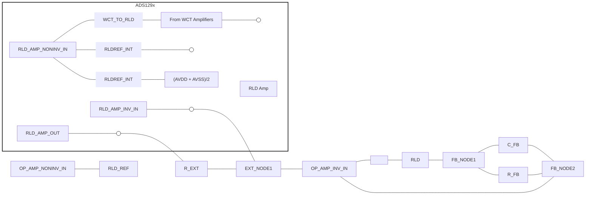

**Figure 44. Using the WCT as the Right Leg Drive (RLD)**

### 9.3.1.7.6.2 *RLD Configuration with Multiple Devices*

Figure 45 shows multiple devices connected to an RLD.

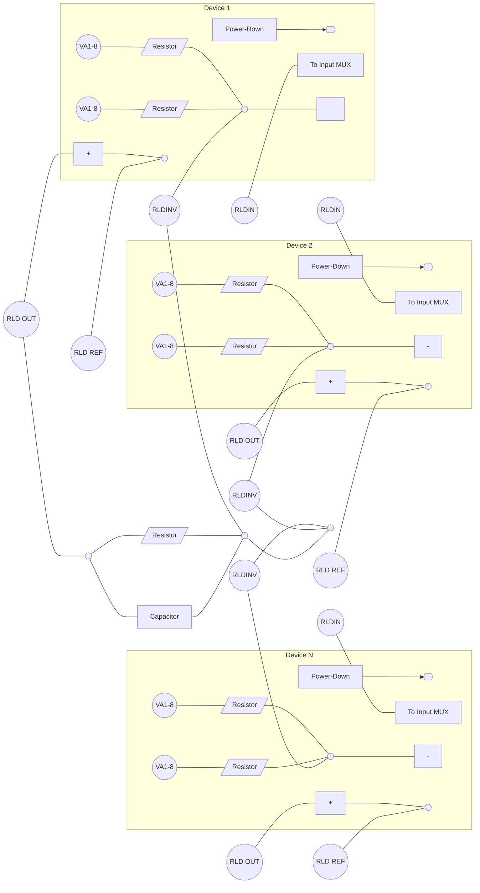

**Figure 45. RLD Connection for Multiple Devices**


<!-- PDF page 44 -->


## **ADS1294, ADS1294R, ADS1296, ADS1296R, ADS1298, ADS1298R**

#### **9.3.1.7.7 Pace Detect**

The ADS129x provide flexibility for pace detection by using either software or external hardware. The software approach is made possible by providing sampling rates up to 32 kSPS. The external hardware approach is made possible by bringing out the output of the PGA at two pins: TESTP_PACE_OUT1 and TESTN_PACE_OUT2. If the WCT amplifier is connected to the signal path, switching noise occurs as a result of chopping; see the *Wilson Central Terminal (WCT) and Chest Leads* section for details.

##### **9.3.1.7.7.1 Software Approach**

To use the software approach, operate the device at 8 kSPS or more to capture the fastest pulse. Afterwards, digital signal processing is used to identify the presence of the pacemaker pulse. The software approach gives the utmost flexibility to program the pace detect threshold *on-the-fly* (dynamically) using software. This flexibility is increasingly important as pacemakers evolve over time. Two parameters must be considered while measuring fast pace pulses:

1. PGA bandwidth: determines the gain setting that can be used; shown in Table 5.
2. Settling time: determines the operating data rate for the device. For a step change in input, the digital decimation filter takes 3 × t<sub>DR</sub> to settle.

##### **9.3.1.7.7.2 External Hardware Approach**

One of the drawbacks of using the software approach is that all channels on a single device must operate at higher data rates. For systems where high data rates are a problem, the ADS129x provide the option of connecting external hardware to the output of the PGA to detect the presence of the pulse. The output of the pace detection logic is then fed into the device <u>through</u> one of the GPIO pins. The GPIO data are transmitted through the SPI port and loaded 2 t<sub>CLKS</sub> before <u>DRDY</u> goes low. Two of the eight channels are selected using register bits in the PACE register: one from the odd-numbered channels, and the other from the even-numbered channels. During the differential to single-ended conversion, there is an attenuation of 0.4; therefore, the total gain in the pace path is equal to (0.4 × PGA_GAIN). The pace output signals are multiplexed with the TESTP and TESTN signals through the TESTP_PACE_OUT1 and TESTN_PACE_OUT2 pins, respectively. Channel selection is achieved by <u>setting</u> bits[4:1] of the PACE register. If the pace circuitry is not used, turn off the pace amplifiers by using the <u>PD_PACE</u> bit in the PACE register.

If the output of a channel connected to the WCT amplifier (for example, the V-lead channels) is connected to one of the pace amplifiers for external pace detection, chopping artifacts appear at the pace amplifier output. See the *Wilson Central Terminal (WCT) and Chest Leads* section for more details.


<!-- PDF page 45 -->


```mermaid
graph TD
    subgraph "PACE[2:1] Selection"
        direction TB
        PGA1P_IN["From MUX1P"] --> PGA1P["PGA1P"]
        PGA1N_IN["From MUX1N"] --> PGA1N["PGA1N"]
        PGA3P_IN["From MUX3P"] --> PGA3P["PGA3P"]
        PGA3N_IN["From MUX3N"] --> PGA3N["PGA3N"]
        PGA5P_IN["From MUX5P"] --> PGA5P["PGA5P"]
        PGA5N_IN["From MUX5N"] --> PGA5N["PGA5N"]
        PGA7P_IN["From MUX7P"] --> PGA7P["PGA7P"]
        PGA7N_IN["From MUX7N"] --> PGA7N["PGA7N"]

        SW1_00["00"]
        SW1_01["01"]
        SW1_10["10"]
        SW1_11["11"]
    end

    subgraph "PACE[4:3] Selection"
        direction TB
        PGA2P_IN["From MUX2P"] --> PGA2P["PGA2P"]
        PGA2N_IN["From MUX2N"] --> PGA2N["PGA2N"]
        PGA4P_IN["From MUX4P"] --> PGA4P["PGA4P"]
        PGA4N_IN["From MUX4N"] --> PGA4N["PGA4N"]
        PGA6P_IN["From MUX6P"] --> PGA6P["PGA6P"]
        PGA6N_IN["From MUX6N"] --> PGA6N["PGA6N"]
        PGA8P_IN["From MUX8P"] --> PGA8P["PGA8P"]
        PGA8N_IN["From MUX8N"] --> PGA8N["PGA8N"]

        SW2_00["00"]
        SW2_01["01"]
        SW2_10["10"]
        SW2_11["11"]
    end

    PGA1P --- R1_50k["50kΩ"] --- SW1_00
    PGA1N --- R2_50k["50kΩ"] --- SW1_00
    PGA3P --- R3_50k["50kΩ"] --- SW1_01
    PGA3N --- R4_50k["50kΩ"] --- SW1_01
    PGA5P --- R5_50k["50kΩ"] --- SW1_10
    PGA5N --- R6_50k["50kΩ"] --- SW1_10
    PGA7P --- R7_50k["50kΩ"] --- SW1_11
    PGA7N --- R8_50k["50kΩ"] --- SW1_11

    PGA2P --- R9_50k["50kΩ"] --- SW2_00
    PGA2N --- R10_50k["50kΩ"] --- SW2_00
    PGA4P --- R11_50k["50kΩ"] --- SW2_01
    PGA4N --- R12_50k["50kΩ"] --- SW2_01
    PGA6P --- R13_50k["50kΩ"] --- SW2_10
    PGA6N --- R14_50k["50kΩ"] --- SW2_10
    PGA8P --- R15_50k["50kΩ"] --- SW2_11
    PGA8N --- R16_50k["50kΩ"] --- SW2_11

    SW1_00 & SW1_01 & SW1_10 & SW1_11 --- BUS1_P["P-Bus"]
    SW1_00 & SW1_01 & SW1_10 & SW1_11 --- BUS1_N["N-Bus"]
    SW2_00 & SW2_01 & SW2_10 & SW2_11 --- BUS2_P["P-Bus"]
    SW2_00 & SW2_01 & SW2_10 & SW2_11 --- BUS2_N["N-Bus"]

    BUS1_P --- R_PACE1_IN["500kΩ"] --- PACE_AMP1["PACE Amp"]
    BUS1_N --- R_PACE1_FB["500kΩ"] --- PACE_AMP1
    PACE_AMP1 --- TESTN_PACE_OUT2["TESTN_PACE_OUT2"]

    BUS2_P --- R_PACE2_IN["500kΩ"] --- PACE_AMP2["PACE Amp"]
    BUS2_N --- R_PACE2_FB["500kΩ"] --- PACE_AMP2
    PACE_AMP2 --- TESTP_PACE_OUT1["TESTP_PACE_OUT1"]

    GPIO1["GPIO1"] --- PACE_IN["PACE_IN (GPIO1) (1)"]
```

**Component Details:**

* **PGA Stages:** 8 differential pairs (PGA1P/N through PGA8P/N).
* **Resistors:**
  * PGA output resistors: 50kΩ.
  * Variable resistors between differential pairs: 20kΩ.
  * PACE Amp feedback and input resistors: 200kΩ and 500kΩ.
* **PACE Amplifiers:** Two amplifiers labeled "PACE Amp" with control signal `PDB_PACE`.
* **Reference Voltage:** `(AVDD + AVSS) / 2` used for PACE Amp biasing.
* **Switch Control:**
  * `PACE[2:1]` controls the selection for the first PACE Amp.
  * `PACE[4:3]` controls the selection for the second PACE Amp.
* **Outputs:**
  * `TESTN_PACE_OUT2`
  * `TESTP_PACE_OUT1`
  * `PACE_IN (GPIO1)` via `GPIO1` pin.

(1) GPIO1 can be used as the PACE_IN signal.

**Figure 46. Hardware Pace Detection Option**


<!-- PDF page 46 -->


### **9.3.1.7.8 Respiration**

As shown in Table 8, the ADS129xR provide three options for respiration impedance measurement: external respiration, internal respiration using on-chip modulation signals, and internal respiration using user-generated modulation signals. The ADS129x provides only external respiration impedance measurement.

<table>
  <caption>**Table 8. Respiration Control**</caption>
  <thead>
    <tr>
      <th>RESP.RESP_CTRL[1]</th>
      <th>RESP.RESP_CTRL[0]</th>
      <th>DESCRIPTION</th>
      <th>MODE AVAILABLE</th>
    </tr>
  </thead>
  <tbody>
    <tr>
      <td>0</td>
      <td>0</td>
      <td>Respiration disabled</td>
      <td>ADS129x, ADS129xR</td>
    </tr>
    <tr>
      <td>0</td>
      <td>1</td>
      <td>Generates modulation and demodulation signals for external<br />respiration circuitry. RESP_CLK signals on GPIO2, GPIO3,<br />and GPIO4.</td>
      <td>ADS129x, ADS129xR</td>
    </tr>
    <tr>
      <td>1</td>
      <td>0</td>
      <td>Respiration measurement using internally-generated<br />RESP_MOD signals.</td>
      <td>ADS129xR</td>
    </tr>
    <tr>
      <td>1</td>
      <td>1</td>
      <td>Respiration measurement using user-generated modulation<br />and blocking signal.</td>
      <td>ADS129xR<sup>(1)</sup></td>
    </tr>
  </tbody>
</table>

(1) Do not set RESP_CTRL[1:0] = 11 if CLKSEL = 1 (internal master clock).

For more information on respiration impedance measurement, see *Respiration Rate Measurement Using Impedance Pneumography*, SBAA181.

#### *9.3.1.7.8.1 External Respiration Circuitry (RESP_CTRL = 01b)*

With this option, GPIO2, GPIO3, and GPIO4 are automatically configured as outputs. The phase relationship between the signals is shown in Figure 47. GPIO2 is the exclusive-OR of GPIO3 and GPIO4, as shown in Figure 48. GPIO3 is the modulation signal, and GPIO4 is the demodulation signal. While using this option, the general-purpose pin functions of GPIO2, GPIO3, and GPIO4 are not available. The modulation frequency is set to either 64 kHz or 32 kHz by using the RESP_FREQ[2:0] bits in the CONFIG4 register. The remaining bit options of RESP_FREQ[2:0] generate square waves on GPIO3 and GPIO4. The exclusive-OR out on GPIO2 is only available in 64-kHz or 32-kHz. The phase of GPIO4, relative to GPIO3, is set by RESP_PH[2:0] bits in the RESP register.

Use this option to implement custom respiration impedance circuitry external to the ADS129x.


**Figure 47. External Respiration (RESP_CTRL = 01b) Timing**

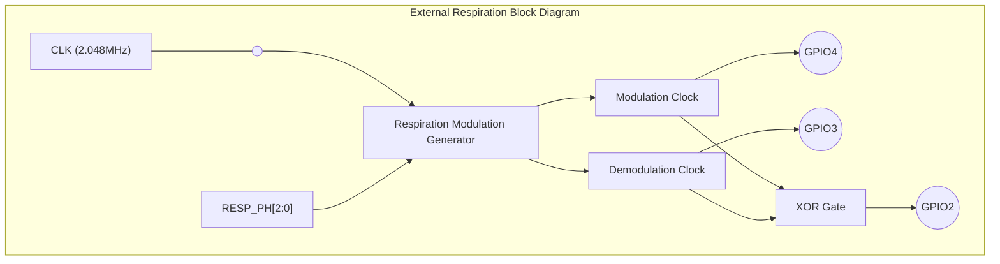

**Figure 48. External Respiration (RESP_CTRL = 01b) Block Diagram**

<table>
  <caption>Table 9. Switching Characteristics for Figure 47<sup>(1)</sup></caption>
  <thead>
    <tr>
      <th rowspan="2" colspan="2"><b>PARAMETER</b></th>
      <th colspan="3">2.7 V ≤ DVDD ≤ 3.6 V</th>
      <th colspan="3">1.65 V ≤ DVDD ≤ 2 V</th>
      <th rowspan="2">UNIT</th>
    </tr>
    <tr>
      <th>MIN</th>
      <th>TYP</th>
      <th>MAX</th>
      <th>MIN</th>
      <th>TYP</th>
      <th>MAX</th>
    </tr>
  </thead>
  <tbody>
    <tr>
      <td>t<sub>PHASE</sub></td>
      <td>Respiration phase delay, set by RESP.RESP_PH[2:0]</td>
      <td>22.5</td>
      <td></td>
      <td>157.5</td>
      <td>22.5</td>
      <td></td>
      <td>157.5</td>
      <td>Degrees</td>
    </tr>
    <tr>
      <td>t<sub>BLKDLY</sub></td>
      <td>Modulation clock rising edge to XOR signal</td>
      <td></td>
      <td>1</td>
      <td></td>
      <td></td>
      <td>5</td>
      <td></td>
      <td>ns</td>
    </tr>
  </tbody>
</table>

(1) Specifications apply from –40°C to 85°C.


<!-- PDF page 47 -->


### 9.3.1.7.8.2 *Internal Respiration Circuitry with Internal Clock (RESP_CTRL = 10b, ADS129xR Only)*

Figure 49 shows a block diagram of the internal respiration circuitry. The internal modulation and demodulator circuitry can be selectively used.

The modulation block is controlled by the RESP_MOD_EN bit and the demodulation block is controlled by the RESP_DEMOD_EN bit. The modulation signal is a square wave of magnitude VREFP – AVSS. Using this option, the output of the modulation circuitry is available at the RESP_MODP and RESP_MODN pins of the device. This availability allows custom filtering to be added to the square-wave modulation signal. Using this option, GPIO2, GPIO3, and GPIO4 can be used for other purposes. The modulation frequency is either 64 kHz or 32 kHz, as set by the RESP_FREQ[2:0] bits in the CONFIG4 register. The phase of the internal demodulation signal is set by the RESP_PH[2:0] bits in the RESP register.

When this respiration option is enabled, ADS129xR channel 1 cannot be used to acquire ECG signals. If the RA and LA leads are intended to measure respiration and ECG signals, wire the two leads into channel 1 for respiration and channel 2 for ECG signals.

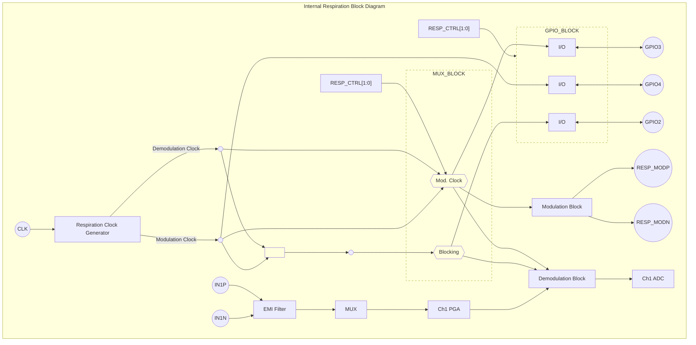

**Figure 49. Internal Respiration Block Diagram**

### 9.3.1.7.8.3 *Internal Respiration Circuitry With User-Generated Signals (RESP_CTRL = 11b, ADS129xR Only)*

In this mode GPIO2, GPIO3, and GPIO4 are automatically configured as inputs and cannot be used for other purposes. The signals must be provided as described in Figure 50. Do not use the internal master clock in this mode.


Figure 50. Internal Respiration (RESP_CTRL = 11b) Timing Diagram

<table>
  <caption>Table 10. Swtiching Characteristics for Figure 50 <sup>(1)</sup></caption>
  <thead>
    <tr>
      <th colspan="2" rowspan="2"><b>PARAMETER</b></th>
      <th colspan="3"><b>1.65 V ≤ DVDD ≤ 3.6V</b></th>
      <th rowspan="2"><b>UNIT</b></th>
    </tr>
    <tr>
      <th><b>MIN</b></th>
      <th><b>TYP</b></th>
      <th><b>MAX</b></th>
    </tr>
  </thead>
  <tbody>
    <tr>
      <td>t<sub>PHASE</sub></td>
      <td>Respiration phase delay</td>
      <td>0</td>
      <td></td>
      <td>157.5</td>
      <td>Degrees</td>
    </tr>
    <tr>
      <td>t<sub>BLKDLY</sub></td>
      <td>Modulation clock rising edge to XOR signal</td>
      <td></td>
      <td>0</td>
      <td>5</td>
      <td>ns</td>
    </tr>
  </tbody>
</table>

(1) Specifications apply from –40°C to 85°C.


<!-- PDF page 48 -->


## **9.3.2 Digital Functionality**

### ***9.3.2.1 GPIO Pins (GPIO[4:1])***

The ADS129x have a total of four general-purpose digital input/output (GPIO) pins available in normal operation. The digital I/O pins are individually configurable as either inputs or as outputs through the GPIOC bits of the GPIO register. The GPIOD bits in the GPIO register control the level of the pins. When reading the GPIOD bits, the data returned are the logic level of the pins, whether they are programmed as inputs or outputs. When the GPIO pin is configured as an input, a write to the corresponding GPIOD bit has no effect. When configured as an output, a write to the GPIOD bit sets the output value.

If configured as inputs, these pins must be driven; do not float these pins. The GPIO pins are set as inputs after power-on or after a reset. Figure 51 shows the GPIO port structure. If not used, short these pins to DGND.

For example, one configuration is to use GPIO1 as the PACEIN signal, multiplex GPIO2 with RESP_BLK signal, multiplex GPIO3 with the RESP signal, and multiplex GPIO4 with the RESP_PH signal.

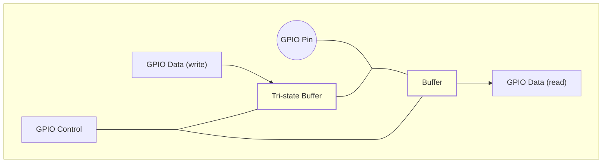

**Figure 51. GPIO Port Pin**

### ***9.3.2.2 Power-Down Pin ($\overline{\text{PWDN}}$)***

When $\overline{\text{PWDN}}$ is pulled low, all on-chip circuitry is powered down. To exit power-down mode, take the $\overline{\text{PWDN}}$ pin high. Upon exiting from power-down mode, the internal oscillator and the reference require time to wakeup. During power down, shut down the external clock to save power.

### ***9.3.2.3 Reset ($\overline{\text{RESET}}$ Pin and Reset Command)***

There are two methods to reset the ADS129x: pull the $\overline{\text{RESET}}$ pin low, <u>or send</u> the RESET opcode command (see the *RESET: Reset Registers to Default Values* section). Take the $\overline{\text{RESET}}$ pin low to force a reset. Make sure to follow the minimum pulse width timing specifications before taking the $\overline{\text{RESET}}$ pin back high. The RESET command takes effect on the eighth SCLK falling edge of the opcode command. At reset, 18 $t_{\text{CLK}}$ cycles are required to complete initialization of the configuration registers to the default states and start the conversion cycle. For more information, see the *RESET: Reset Registers to Default Values* section. An internal reset is automatically issued to the digital filter whenever registers CONFIG1 and RESP are set to new values with a WREG command.


<!-- PDF page 49 -->


### 9.3.2.4 *Digital Decimation Filter*

The digital filter receives the modulator output and decimates the data stream. By adjusting the amount of filtering, tradeoffs are made between resolution and data rate: filter more for higher resolution, filter less for higher data rates. Higher data rates are typically used in ECG applications to implement software pace detection and ac lead-off detection.

The digital filter on each channel consists of a third-order sinc filter. The decimation ratio on the sinc filters is adjusted by the DR bits in the CONFIG1 register (see Table 16 for details). This setting is a global setting that affects all channels; therefore, in these devices, all channels operate at the same data rate.

#### 9.3.2.4.1 Sinc Filter Stage (sinx / x)

The sinc filter is a variable-decimation rate, third-order, low-pass filter. Data are supplied to this section of the filter from the modulator at the rate of $f_{MOD}$. The sinc filter attenuates the high-frequency noise of the modulator, then decimates the data stream into parallel data. The decimation rate affects the overall data rate of the converter.

Equation 4 shows the scaled Z-domain transfer function of the sinc filter.

$$|H(z)| = \left| \frac{1 - Z^{-N}}{1 - Z^{-1}} \right|^3 \eqno(4)$$

The frequency-domain transfer function of the sinc filter is shown in Equation 5.

$$|H(f)| = \left| \frac{\sin \left( \frac{N \pi f}{f_{MOD}} \right)}{N \times \sin \left( \frac{\pi f}{f_{MOD}} \right)} \right|^3 \eqno(5)$$

where

* N = decimation ratio

The sinc filter has notches (or zeroes) that occur at the output data rate multiples. At these frequencies, the filter has infinite attenuation. Figure 52 shows the frequency response of the sinc filter and Figure 53 shows the rolloff of the sinc filter. With a step change at input, the filter requires $3 \times t_{DR}$ conversion cycles to settle. After a rising edge of the START pin or completion of the START command, the filter takes $t_{SETTLE}$ periods to give the first data output. The settling time of the filters at various data rates are discussed in the *Start Mode* subsection of the *SPI Interface* section. Figure 54 and Figure 55 show the filter transfer function to $f_{MOD} / 2$ and $f_{MOD} / 16$, respectively, at different data rates. Figure 56 shows the transfer function extended out to $4 \times f_{MOD}$. As shown in the figures, the passband of the ADS129x repeats itself at every $f_{MOD}$ multiple. Choose input R-C antialiasing filters for the system that sufficiently attenuate any interference in frequencies around multiples of $f_{MOD}$.

<table>
  <caption>**Figure 52. Sinc Filter Frequency Response**</caption>
  <thead>
    <tr>
      <th>Normalized Frequency (f<sub>IN</sub> / f<sub>DR</sub>)</th>
      <th>Gain (dB)</th>
    </tr>
  </thead>
  <tbody>
    <tr>
      <th>0</th>
      <td>0</td>
    </tr>
    <tr>
      <th>0.25</th>
      <td>-2</td>
    </tr>
    <tr>
      <th>0.5</th>
      <td>-10</td>
    </tr>
    <tr>
      <th>0.75</th>
      <td>-28</td>
    </tr>
    <tr>
      <th>1</th>
      <td>-140</td>
    </tr>
    <tr>
      <th>1.25</th>
      <td>-52</td>
    </tr>
    <tr>
      <th>1.5</th>
      <td>-40</td>
    </tr>
    <tr>
      <th>1.75</th>
      <td>-52</td>
    </tr>
    <tr>
      <th>2</th>
      <td>-140</td>
    </tr>
    <tr>
      <th>2.25</th>
      <td>-62</td>
    </tr>
    <tr>
      <th>2.5</th>
      <td>-54</td>
    </tr>
    <tr>
      <th>2.75</th>
      <td>-62</td>
    </tr>
    <tr>
      <th>3</th>
      <td>-140</td>
    </tr>
    <tr>
      <th>3.25</th>
      <td>-68</td>
    </tr>
    <tr>
      <th>3.5</th>
      <td>-62</td>
    </tr>
    <tr>
      <th>3.75</th>
      <td>-68</td>
    </tr>
    <tr>
      <th>4</th>
      <td>-140</td>
    </tr>
    <tr>
      <th>4.25</th>
      <td>-74</td>
    </tr>
    <tr>
      <th>4.5</th>
      <td>-69</td>
    </tr>
    <tr>
      <th>4.75</th>
      <td>-74</td>
    </tr>
    <tr>
      <th>5</th>
      <td>-140</td>
    </tr>
  </tbody>
</table>

<table>
  <caption>**Figure 53. Sinc Filter Roll-Off** — Normalized Frequency (f<sub>IN</sub> / f<sub>DR</sub>) vs Gain (dB)</caption>
  <thead>
    <tr>
      <th>Normalized Frequency (f<sub>IN</sub> / f<sub>DR</sub>)</th>
      <th>Gain (dB)</th>
    </tr>
  </thead>
  <tbody>
    <tr>
      <th>0</th>
      <td>0.00</td>
    </tr>
    <tr>
      <th>0.025</th>
      <td>-0.03</td>
    </tr>
    <tr>
      <th>0.05</th>
      <td>-0.11</td>
    </tr>
    <tr>
      <th>0.075</th>
      <td>-0.25</td>
    </tr>
    <tr>
      <th>0.1</th>
      <td>-0.45</td>
    </tr>
    <tr>
      <th>0.125</th>
      <td>-0.71</td>
    </tr>
    <tr>
      <th>0.15</th>
      <td>-1.03</td>
    </tr>
    <tr>
      <th>0.175</th>
      <td>-1.42</td>
    </tr>
    <tr>
      <th>0.2</th>
      <td>-1.88</td>
    </tr>
    <tr>
      <th>0.225</th>
      <td>-2.41</td>
    </tr>
    <tr>
      <th>0.25</th>
      <td>-3.00</td>
    </tr>
    <tr>
      <th>0.275</th>
      <td></td>
    </tr>
    <tr>
      <th>0.3</th>
      <td></td>
    </tr>
    <tr>
      <th>0.325</th>
      <td></td>
    </tr>
    <tr>
      <th>0.35</th>
      <td></td>
    </tr>
  </tbody>
</table>


<!-- PDF page 50 -->


<table>
  <caption>Figure 54. Transfer Function of On-Chip Decimation Filters to f<sub>MOD</sub> / 2; Gain (dB) vs Normalized Frequency (f<sub>IN</sub>/f<sub>MOD</sub>)</caption>
  <thead>
    <tr>
      <th>Normalized Frequency (f<sub>IN</sub>/f<sub>MOD</sub>)</th>
      <th>Gain (dB) for DR[2:0] = 000</th>
      <th>Gain (dB) for DR[2:0] = 110</th>
    </tr>
  </thead>
  <tbody>
    <tr>
      <th>0</th>
      <td>0</td>
      <td>0</td>
    </tr>
    <tr>
      <th>0.05</th>
      <td>-32</td>
      <td>-138</td>
    </tr>
    <tr>
      <th>0.10</th>
      <td>-40</td>
      <td>-140</td>
    </tr>
    <tr>
      <th>0.15</th>
      <td>-52</td>
      <td>-140</td>
    </tr>
    <tr>
      <th>0.20</th>
      <td>-60</td>
      <td>-140</td>
    </tr>
    <tr>
      <th>0.25</th>
      <td>-65</td>
      <td>-140</td>
    </tr>
    <tr>
      <th>0.30</th>
      <td>-68</td>
      <td>-140</td>
    </tr>
    <tr>
      <th>0.35</th>
      <td>-72</td>
      <td>-140</td>
    </tr>
    <tr>
      <th>0.40</th>
      <td>-75</td>
      <td>-140</td>
    </tr>
    <tr>
      <th>0.45</th>
      <td>-78</td>
      <td>-140</td>
    </tr>
    <tr>
      <th>0.50</th>
      <td>-80</td>
      <td>-140</td>
    </tr>
  </tbody>
</table>

<table>
  <caption>Figure 55. Transfer Function of On-Chip Decimation Filters to f<sub>MOD</sub> / 16; Gain (dB) vs Normalized Frequency (f<sub>IN</sub>/f<sub>MOD</sub>)</caption>
  <thead>
    <tr>
      <th rowspan="2">Normalized Frequency (f<sub>IN</sub>/f<sub>MOD</sub>)</th>
      <th colspan="7">Gain (dB) by Data Rate Setting (DR[2:0])</th>
    </tr>
    <tr>
      <th>DR[2:0] = 110</th>
      <th>DR[2:0] = 101</th>
      <th>DR[2:0] = 100</th>
      <th>DR[2:0] = 011</th>
      <th>DR[2:0] = 010</th>
      <th>DR[2:0] = 001</th>
      <th>DR[2:0] = 000</th>
    </tr>
  </thead>
  <tbody>
    <tr>
      <th>0</th>
      <td>0</td>
      <td>0</td>
      <td>0</td>
      <td>0</td>
      <td>0</td>
      <td>0</td>
      <td>0</td>
    </tr>
    <tr>
      <th>0.01</th>
      <td>-1</td>
      <td>-4</td>
      <td>-14</td>
      <td>-40</td>
      <td>-100</td>
      <td>-140</td>
      <td>-140</td>
    </tr>
    <tr>
      <th>0.02</th>
      <td>-4</td>
      <td>-14</td>
      <td>-40</td>
      <td>-100</td>
      <td>-140</td>
      <td>-140</td>
      <td>-140</td>
    </tr>
    <tr>
      <th>0.03</th>
      <td>-9</td>
      <td>-30</td>
      <td>-100</td>
      <td>-140</td>
      <td>-140</td>
      <td>-140</td>
      <td>-140</td>
    </tr>
    <tr>
      <th>0.04</th>
      <td>-16</td>
      <td>-60</td>
      <td>-40</td>
      <td>-100</td>
      <td>-140</td>
      <td>-140</td>
      <td>-140</td>
    </tr>
    <tr>
      <th>0.05</th>
      <td>-25</td>
      <td>-100</td>
      <td>-40</td>
      <td>-100</td>
      <td>-140</td>
      <td>-140</td>
      <td>-140</td>
    </tr>
    <tr>
      <th>0.06</th>
      <td>-36</td>
      <td>-140</td>
      <td>-80</td>
      <td>-100</td>
      <td>-140</td>
      <td>-140</td>
      <td>-140</td>
    </tr>
    <tr>
      <th>0.07</th>
      <td>-50</td>
      <td>-140</td>
      <td>-140</td>
      <td>-140</td>
      <td>-140</td>
      <td>-140</td>
      <td>-140</td>
    </tr>
  </tbody>
</table>

<table>
  <caption>**Figure 56. Transfer Function of On-Chip Decimation Filters** to 4 × f<sub>MOD</sub> for DR[2:0] = 000 and DR[2:0] = 110</caption>
  <thead>
    <tr>
      <th rowspan="2">Normalized Frequency (f<sub>IN</sub>/f<sub>MOD</sub>)</th>
      <th colspan="2">Gain (dB)</th>
    </tr>
    <tr>
      <th>DR[2:0] = 000</th>
      <th>DR[2:0] = 110</th>
    </tr>
  </thead>
  <tbody>
    <tr>
      <th>0</th>
      <td>0</td>
      <td>0</td>
    </tr>
    <tr>
      <th>0.1</th>
      <td>-40</td>
      <td>-40</td>
    </tr>
    <tr>
      <th>0.2</th>
      <td>-72</td>
      <td>-72</td>
    </tr>
    <tr>
      <th>0.3</th>
      <td>-74</td>
      <td>-74</td>
    </tr>
    <tr>
      <th>0.4</th>
      <td>-72</td>
      <td>-72</td>
    </tr>
    <tr>
      <th>0.5</th>
      <td>-40</td>
      <td>-40</td>
    </tr>
    <tr>
      <th>0.6</th>
      <td>-72</td>
      <td>-72</td>
    </tr>
    <tr>
      <th>0.7</th>
      <td>-74</td>
      <td>-74</td>
    </tr>
    <tr>
      <th>0.8</th>
      <td>-72</td>
      <td>-72</td>
    </tr>
    <tr>
      <th>0.9</th>
      <td>-40</td>
      <td>-40</td>
    </tr>
    <tr>
      <th>1.0</th>
      <td>0</td>
      <td>-115</td>
    </tr>
    <tr>
      <th>1.1</th>
      <td>-40</td>
      <td>-40</td>
    </tr>
    <tr>
      <th>1.2</th>
      <td>-72</td>
      <td>-72</td>
    </tr>
    <tr>
      <th>1.3</th>
      <td>-74</td>
      <td>-74</td>
    </tr>
    <tr>
      <th>1.4</th>
      <td>-72</td>
      <td>-72</td>
    </tr>
    <tr>
      <th>1.5</th>
      <td>-40</td>
      <td>-40</td>
    </tr>
    <tr>
      <th>1.6</th>
      <td>-72</td>
      <td>-72</td>
    </tr>
    <tr>
      <th>1.7</th>
      <td>-74</td>
      <td>-74</td>
    </tr>
    <tr>
      <th>1.8</th>
      <td>-72</td>
      <td>-72</td>
    </tr>
    <tr>
      <th>1.9</th>
      <td>-40</td>
      <td>-40</td>
    </tr>
    <tr>
      <th>2.0</th>
      <td>0</td>
      <td>-82</td>
    </tr>
    <tr>
      <th>2.1</th>
      <td>-40</td>
      <td>-40</td>
    </tr>
    <tr>
      <th>2.2</th>
      <td>-72</td>
      <td>-72</td>
    </tr>
    <tr>
      <th>2.3</th>
      <td>-74</td>
      <td>-74</td>
    </tr>
    <tr>
      <th>2.4</th>
      <td>-72</td>
      <td>-72</td>
    </tr>
    <tr>
      <th>2.5</th>
      <td>-40</td>
      <td>-40</td>
    </tr>
    <tr>
      <th>2.6</th>
      <td>-72</td>
      <td>-72</td>
    </tr>
    <tr>
      <th>2.7</th>
      <td>-74</td>
      <td>-74</td>
    </tr>
    <tr>
      <th>2.8</th>
      <td>-72</td>
      <td>-72</td>
    </tr>
    <tr>
      <th>2.9</th>
      <td>-40</td>
      <td>-40</td>
    </tr>
    <tr>
      <th>3.0</th>
      <td>0</td>
      <td>-115</td>
    </tr>
    <tr>
      <th>3.1</th>
      <td>-40</td>
      <td>-40</td>
    </tr>
    <tr>
      <th>3.2</th>
      <td>-72</td>
      <td>-72</td>
    </tr>
    <tr>
      <th>3.3</th>
      <td>-74</td>
      <td>-74</td>
    </tr>
    <tr>
      <th>3.4</th>
      <td>-72</td>
      <td>-72</td>
    </tr>
    <tr>
      <th>3.5</th>
      <td>-40</td>
      <td>-40</td>
    </tr>
    <tr>
      <th>3.6</th>
      <td>-72</td>
      <td>-72</td>
    </tr>
    <tr>
      <th>3.7</th>
      <td>-74</td>
      <td>-74</td>
    </tr>
    <tr>
      <th>3.8</th>
      <td>-72</td>
      <td>-72</td>
    </tr>
    <tr>
      <th>3.9</th>
      <td>-40</td>
      <td>-40</td>
    </tr>
    <tr>
      <th>4.0</th>
      <td>0</td>
      <td>0</td>
    </tr>
  </tbody>
</table>

### *9.3.2.5 Clock*

The ADS129x provide two different methods for device clocking: internal and external. Internal clocking is ideally suited for low-power, battery-powered systems. The internal oscillator is trimmed for accuracy at room temperature. The accuracy varies over the specified temperature range; see the *Electrical Characteristics*. Clock selection is controlled by the CLKSEL pin and the CLK_EN register bit.

Use the CLKSEL pin to select either the internal or external clock. The CLK_EN bit in the CONFIG1 register enables and disables the oscillator clock to be output in the CLK pin. A truth table for these two pins is shown in Table 11. Use the CLK_EN bit is when multiple devices are connected in a daisy-chain configuration. During power down, shut down the external clock to save power.

<table>
  <caption>Table 11. CLKSEL Pin and CLK_EN Bit</caption>
  <thead>
    <tr>
      <th>CLKSEL PIN</th>
      <th>CONFIG1.CLK_EN BIT</th>
      <th><b>CLOCK SOURCE</b></th>
      <th><b>CLK PIN STATUS</b></th>
    </tr>
  </thead>
  <tbody>
    <tr>
      <td>0</td>
      <td>X</td>
      <td>External clock</td>
      <td>Input: external clock</td>
    </tr>
    <tr>
      <td>1</td>
      <td>0</td>
      <td>Internal clock oscillator</td>
      <td>Tri-state</td>
    </tr>
    <tr>
      <td>1</td>
      <td>1</td>
      <td>Internal clock oscillator</td>
      <td>Output: internal clock oscillator</td>
    </tr>
  </tbody>
</table>


<!-- PDF page 51 -->


# **9.4 Device Functional Modes**

## **9.4.1 Data Acquisition**

This section describes the data acquisition process in relation to the START and $\overline{\text{DRDY}}$ pins, settled data, and data readback.

### ***9.4.1.1 Start Mode***

Pull the START pin high for at least 2 t<sub>CLK</sub> periods, or send the START command to begin conversions. When the START pin is low, or if the START command has not been sent, the device does not issue a $\overline{\text{DRDY}}$ signal (conversions are halted).

When using the START opcode to begin conversions, hold the START pin low. The ADS129x feature two modes to control conversion: continuous and single-shot. The mode is selected by SINGLE_SHOT (bit 3 of the CONFIG4 register). In multiple device configurations, the START pin is used to synchronize devices (see the *Multiple Device Configuration* section for more details).

#### **9.4.1.1.1 Settling Time**

The settling time (t<sub>SETTLE</sub>) is the time it takes for the converter to output fully-settled data when the START signal is pulled high.

When the START pin is pulled high, or when the START command is sent, the device ADCs convert the input signals and $\overline{\text{DRDY}}$ is pulled high. The next falling edge of $\overline{\text{DRDY}}$ indicates that data are ready. Figure 57 shows the timing diagram and Table 12 shows the settling time for different data rates as a function of t<sub>CLK</sub>. The settling time depends on f<sub>CLK</sub> and the decimation ratio (controlled by the DR[2:0] bits in the CONFIG1 register).

```mermaid
graph TD
    subgraph "Timing Diagram"
        direction LR
        
        START_L["START"] --- START_WAVE[" "]
        DIN_L["DIN"] --- DIN_WAVE[" "]
        DRDY_L["$\overline{\text{DRDY}}$"] --- DRDY_WAVE[" "]
    end
```

<table>
<thead>
<tr>
<th align="left">Signal</th>
<th align="left">Waveform Description</th>
</tr>
</thead>
<tbody>
<tr>
<td align="left"><strong>START</strong></td>
<td align="left">Transitions from Low to High.</td>
</tr>
<tr>
<td align="left"><strong>DIN</strong></td>
<td align="left">Shows a "START" command packet (with break symbols $\approx$) followed by an idle state (also with break symbols $\approx$).</td>
</tr>
<tr>
<td align="left"><strong>$\overline{\text{DRDY}}$</strong></td>
<td align="left">Transitions from Low to High shortly after the START signal goes high. It remains High for a duration labeled <strong>$t_{\text{SETTLE}}$</strong> before returning to Low.</td>
</tr>
</tbody>
</table>

**Figure 57. Settling Time for Initial Conversion**

<table>
  <caption>Table 12. Settling Times for Different Data Rates (t<sub>SETTLE</sub>)</caption>
  <thead>
    <tr>
      <th rowspan="2">DR[2:0]</th>
      <th colspan="2">SETTLING TIME (t<sub>CLK</sub> Periods)</th>
    </tr>
    <tr>
      <th><b>HIGH-RESOLUTION MODE</b></th>
      <th><b>LOW-POWER MODE</b></th>
    </tr>
  </thead>
  <tbody>
    <tr>
      <td>000</td>
      <td>296</td>
      <td>584</td>
    </tr>
    <tr>
      <td>001</td>
      <td>584</td>
      <td>1160</td>
    </tr>
    <tr>
      <td>010</td>
      <td>1160</td>
      <td>2312</td>
    </tr>
    <tr>
      <td>011</td>
      <td>2312</td>
      <td>4616</td>
    </tr>
    <tr>
      <td>100</td>
      <td>4616</td>
      <td>9224</td>
    </tr>
    <tr>
      <td>101</td>
      <td>9224</td>
      <td>18440</td>
    </tr>
    <tr>
      <td>110</td>
      <td>18440</td>
      <td>36872</td>
    </tr>
  </tbody>
</table>


<!-- PDF page 52 -->


When the START pin is held high and there is a step change in the input signal, $3 \times t_{DR}$ conversion cycles are required for the filter to settle to the new value, as shown in Figure 58. Settled data are available on the fourth $\overline{\text{DRDY}}$ pulse. This settling time must be considered when trying to measure narrow pace pulses for pace detection. Data are available to read at each $\overline{\text{DRDY}}$ high-to-low transition, but can be ignored.


**Figure 58. Settling Time for Input Transient**

### *9.4.1.2 Data Ready Pin ($\overline{\text{DRDY}}$)*

$\overline{\text{DRDY}}$ is an output. When $\overline{\text{DRDY}}$ transitions low, new conversion data are ready. The $\overline{\text{CS}}$ signal has no effect on the data ready signal. Regardless of the status of the $\overline{\text{CS}}$ signal, a rising edge on SCLK pulls $\overline{\text{DRDY}}$ high. Thus, when using multiple devices in the SPI bus, gate SCLK with $\overline{\text{CS}}$. The behavior of $\overline{\text{DRDY}}$ depends on if the device is in RDATAC mode or if the RDATA command is being used to read data on demand. See the *RDATAC: Read Data Continuous* and *RDATA: Read Data* sections for further details.

When reading data with the RDATA command, the read operation can overlap the occurrence of the next $\overline{\text{DRDY}}$ without data corruption.

Use the START pin or the START command to place the device either in normal data capture mode or pulse data capture mode.

Figure 59 shows the relationship among $\overline{\text{DRDY}}$, DOUT, and SCLK during data retrieval (in the case of an ADS129x with a selected data rate that gives 24-bit resolution). DOUT latches at the rising edge of SCLK. The device pulls $\overline{\text{DRDY}}$ high at the first falling edge of SCLK, regardless of whether data are being retrieved from the device or a command is being sent through the DIN pin. The data starts from the MSB of the status word and then proceeds to the ADC channel data in sequential order (that is, channel 1, channel 2, ..., channel x). Channels that are powered down still have a position in the data stream; however, the data are not valid and can be ignored.

$\overline{\text{CS}}$  _____________________| __________________________________________________________________

$\overline{\text{DRDY}}$ ___________________________|_________________| _______________________________________________

SCLK _____________________________________________|__| __ |__| __ |__| __ |__| __

DOUT - - - - - - - - - - - - - - - - - - - - - - - - - - - - - - < MSB >< MSB-1 >< MSB-2 >_____

**Figure 59. $\overline{\text{DRDY}}$ with Data Retrieval ($\overline{\text{CS}} = 0$)**


<!-- PDF page 53 -->


The $\overline{\text{DRDY}}$ signal is cleared on the first SCLK falling edge, regardless of the state of $\overline{\text{CS}}$. Even if no data are clocked out, the $\overline{\text{DRDY}}$ signal is still cleared. Take this condition into consideration if the SPI bus is used to communicate with other devices on the same bus. Figure 60 shows a timing diagram for this multiplexing.

$\overline{\text{CS}}$ _________________________________________________________________

$\overline{\text{DRDY}}$ ********|‾‾‾‾‾‾‾‾‾|********__________________________________

SCLK _________________|‾‾|**|‾‾|**|‾‾|**|‾‾|**|‾‾|**|‾‾|**|‾‾|**|‾‾|**

**Figure 60. $\overline{\text{DRDY}}$ and SCLK Behavior for SPI Bus Multiplexing**

## *9.4.1.3 Data Retrieval*

Data retrieval is accomplished in one of two methods:

1. RDATAC: the read data continuous command sets the device mode that reads data continuously without sending opcodes. See the *RDATAC: Read Data Continuous* section for more details.
2. RDATA: the read data command reads just one data output from the device. See the *RDATA: Read Data* section for more details.

See the *SPI Command Definitions* section for more details.

The conversion data are read by shifting the data out on DOUT. The MSB of the data on DOUT is clocked out on the first SCLK rising edge. $\overline{\text{DRDY}}$ returns to high on the first SCLK falling edge. Keep DIN low for the entire read operation.

### **9.4.1.3.1 Status Word**

The ADS129x data readback is preceded by a status word that provides information on the state of the ADC. The status word is 24 bits long and contains the values for LOFF_STATP, LOFF_STATN, and part of the GPIO registers. The content alignment is shown in Figure 61.


**Figure 61. Status Word Content**

### **9.4.1.3.2 Readback Length**

The number of bits in the data output depends on the number of channels and the number of bits per channel. The data format for each channel data is twos complement and MSB first. For the ADS129x with 32-kSPS and 64-kSPS data rates, the number of data bits is 24 status bits + 16 bits per channel × 8 channels = 152 bits. For all other data rates, the number of data bits is 24 status bits + 24 bits per channel × 8 channels = 216 bits. When channels are powered down using the user-register setting, the corresponding channel output is set to 0. However, the sequence of channel outputs remains the same. The ADS1294 outputs four channels of data and the ADS1296 outputs six channels of data.

The ADS129x also provide a multiple-readback feature. Set the DAISY_IN bit in the CONFIG1 register to 1 for multiple readbacks. Simply provide additional SCLKs to read data multiple times; the MSB data byte repeats after reading the last byte.


<!-- PDF page 54 -->


### **9.4.1.3.3 Data Format**

The ADS129x output 24 bits of data per channel in binary twos complement format, MSB first. The LSB has a weight of $V_{REF} / (2^{23} - 1)$. A positive full-scale input produces an output code of 7FFFFFh and the negative full-scale input produces an output code of 800000h. The output clips at these codes for signals exceeding full-scale. Table 13 summarizes the ideal output codes for different input signals. For DR[2:0] = 000 and 001, the device has only 17 and 19 bits of resolution, respectively. The last seven (in 17-bit mode) or five (in 19-bit mode) bits can be ignored.

<table>
  <caption>Table 13. Ideal Output Code versus Input Signal<sup>(1)</sup></caption>
  <thead>
    <tr>
      <th>INPUT SIGNAL, V<sub>IN</sub><br /><b>(INxP – INxN)</b></th>
      <th>IDEAL OUTPUT CODE<sup>(2)</sup></th>
    </tr>
  </thead>
  <tbody>
    <tr>
      <td>≥ V<sub>REF</sub></td>
      <td>7FFFFFh</td>
    </tr>
    <tr>
      <td>V<sub>REF</sub> / (2<sup>23</sup> – 1)</td>
      <td>000001h</td>
    </tr>
    <tr>
      <td>0</td>
      <td>000000h</td>
    </tr>
    <tr>
      <td>–V<sub>REF</sub> / (2<sup>23</sup> – 1)</td>
      <td>FFFFFFh</td>
    </tr>
    <tr>
      <td>≤ –V<sub>REF</sub> (2<sup>23</sup> / (2<sup>23</sup> – 1))</td>
      <td>800000h</td>
    </tr>
  </tbody>
</table>

(1) Only valid for 24-bit resolution data rates, with gain = 1.
(2) Excludes effects of noise, linearity, offset, and gain error.

### *9.4.1.4 Single-Shot Mode*

Enable single-shot mode by setting the SINGLE_SHOT bit in CONFIG4 register to 1. In single-shot mode, the ADS129x perform a single conversion when the START pin is taken high, or when the START opcode command is sent. As seen in Figure 62, when a conversion completes, $\overline{\text{DRDY}}$ goes low and further conversions are stopped. Regardless of whether the conversion data are read or not, $\overline{\text{DRDY}}$ remains low. To begin a new conversion, take the START pin low and then back high for at least two $t_{CLK}$s, or transmit the START opcode again. When switching from continous conversion mode to single-shot mode, make sure the START signal is pulsed, or issue a STOP command followed by a START command.


**Figure 62. $\overline{\text{DRDY}}$ With No Data Retrieval in Single-Shot Mode**

Single-shot conversion mode is provided for applications that require nonstandard or noncontinuous data rates. Issue a START command or toggle the START pin high to reset the digital filter, effectively dropping the data rate by a factor of four. This mode leaves the system more susceptible to aliasing effects, thus requiring more complex analog or digital filtering. Loading on the host processor increases because it must toggle the START pin or send a START command to initiate a new conversion cycle.


<!-- PDF page 55 -->


### *9.4.1.5 Continuous Conversion Mode*

Conversions begin when the START pin <u>is</u> <u>taken</u> high for at least two t<sub>CLK</sub>s, or when the START opcode command is sent. As seen in Figure 63, the DRDY output goes high when conversions are started and goes low when data are ready. Conversions continue indefinitely until the START pin <u>is taken</u> low or the STOP opcode command is transmitted. When the START pin is pulled low or the stop command is <u>issued,</u> the conversion in progress is allowed to complete. Figure 64 and Table 14 show the required timing of DRDY to the START pin and the START and STOP opcode commands when controlling conversions in this mode. To keep the converter running continuously, permanently tie the START pin high. When switching from single-shot mode to continuous conversion mode, pulse the START signal or a issue a STOP command followed by a START command. This conversion mode is ideal for applications that require a continuous stream of conversions results.


(1) START and STOP opcode commands take effect on the seventh SCLK falling edge.

**Figure 63. Continuous Conversion Mode**


(1) START and STOP commands take effect on the seventh SCLK falling edge at the end of the opcode transmission.

**Figure 64. START to $\overline{\text{DRDY}}$ Timing**

<table>
    <caption>Table 14. Timing Requirements for Figure 64 <sup>(1)</sup></caption>
    <thead>
        <tr>
            <th colspan="2"></th>
            <th><b>MIN</b></th>
            <th>MAX</th>
            <th>UNIT</th>
        </tr>
    </thead>
    <tbody>
        <tr>
            <td>t<sub>SDSU</sub></td>
            <td>START pin low or STOP opcode to <mark>DRDY</mark> setup time to halt further conversions</td>
            <td>16</td>
            <td></td>
            <td>t<sub>CLK</sub></td>
        </tr>
        <tr>
            <td>t<sub>DSHD</sub></td>
            <td>START pin low or STOP opcode to complete current conversion</td>
            <td>16</td>
            <td></td>
            <td>t<sub>CLK</sub></td>
        </tr>
    </tbody>
</table>

(1) START and STOP commands take effect on the seventh SCLK falling edge at the end of the opcode transmission.


<!-- PDF page 56 -->


### **9.4.2 Multiple-Device Configuration**

The ADS129x provide configuration flexibility when multiple devices are connected in a system. The serial interface typically requires four signals: DIN, DOUT, SCLK, and $\overline{\text{CS}}$. With one additional chip select signal per device, multiple devices can be connected together. The number of signals required to interface $n$ devices is $3 + n$.

Daisy-chain the RLD amplifiers as explained in the *RLD Configuration with Multiple Devices* section. To use the internal oscillator in a daisy-chain configuration, set one of the devices as the master for the clock source with the internal oscillator enabled (CLKSEL pin = 1) and the internal oscillator clock brought out of the device by setting the CLK_EN register bit to 1. Use this master device clock as the external clock source for the other devices.

When <u>using</u> multiple devices, synchronize the devices with the START signal. The delay from the START signal to the $\overline{\text{DRDY}}$ signal is fixed for a fixed data rate (see the *Start Mode* section for more details on the settling times). As an example, Figure 65 shows the behavior of two devices when synchronized with the START signal.

There are two configurations used to connect multiple devices with a optimal number of interface pins: cascade or daisy-chain.

```mermaid
graph LR
    START["START"]
    CLK["CLK"]

    subgraph ADS1298_1 ["ADS1298<sub>1</sub>"]
        direction LR
        S1_START((" "))
        S1_CLK((" "))
        S1_DRDY_OUT((" "))
        
        S1_START --- S1_START_L["START<sub>1</sub>"]
        S1_CLK --- S1_CLK_L["CLK"]
        S1_DRDY_L["#overline;DRDY;"] --- S1_DRDY_OUT
    end

    subgraph ADS1298_2 ["ADS1298<sub>2</sub>"]
        direction LR
        S2_START((" "))
        S2_CLK((" "))
        S2_DRDY_OUT((" "))
        
        S2_START --- S2_START_L["START<sub>2</sub>"]
        S2_CLK --- S2_CLK_L["CLK"]
        S2_DRDY_L["#overline;DRDY;"] --- S2_DRDY_OUT
    end

    DRDY1_OUT["#overline;DRDY;<sub>1</sub>"]
    DRDY2_OUT["#overline;DRDY;<sub>2</sub>"]

    START --- DOT1(( ))
    DOT1 --- S1_START
    DOT1 --- S2_START

    CLK --- DOT2(( ))
    DOT2 --- S1_CLK
    DOT2 --- S2_CLK

    S1_DRDY_OUT --> DRDY1_OUT
    S2_DRDY_OUT --> DRDY2_OUT

    style DOT1 fill:#000,stroke:#000,stroke-width:2px
    style DOT2 fill:#000,stroke:#000,stroke-width:2px
```


**Figure 65. Synchronizing Multiple Converters**


<!-- PDF page 57 -->


### 9.4.2.1 *Cascade Configuration*

**Figure 66**(a) shows a configuration with two devices cascaded together. One of the devices is an **ADS1298** (eight channels) and the other is an **ADS1294** (four channels). Together, they create a system with 12 channels. DOUT, SCLK, and DIN are shared. Each device has its own chip select. When a device is not selected by the corresponding <u>CS</u> being driven to logic 1, the DOUT of this device is high-impedance. This structure allows the other device to take control of the DOUT bus. This configuration method is suitable for the majority of applications.

### 9.4.2.2 *Daisy-Chain Configuration*

Enable daisy-chain mode by setting the <u>DAISY_EN</u> bit in the CONFIG1 register. **Figure 66**(b) shows the daisy-chain configuration. In this configuration, SCLK, DIN, and <u>CS</u> are shared across multiple devices. Connect the DOUT pin of the first device to the DAISY_IN pin of the next device, thereby creating a chain. Issue one extra SCLK between each data set. Note that when using daisy-chain mode, the multiple readback feature is not available. Short the DAISY_IN pin to digital ground if not used. Figure 2 describes the required timing for the **ADS1298** shown in **Figure 67**. Data from the **ADS1298** appear first on DOUT, followed by a *don’t care* bit, and finally by the status and data words from the **ADS1294**.

```mermaid
graph LR
    subgraph "a) Cascaded Configuration"
    direction LR
        START1_A(("START<sup>(1)</sup>"))
        CLK_A(("CLK"))
        
        subgraph ADS1298_1 ["ADS1298 (Device 1)"]
            S1["START"]
            C1["CLK"]
            DR1["DRDY"]
            CS1["CS"]
            SC1["SCLK"]
            DI1["DIN"]
            DO1["DOUT"]
        end

        subgraph ADS1294_2 ["ADS1294 (Device 2)"]
            S2["START"]
            C2["CLK"]
            DR2["DRDY"]
            CS2["CS"]
            SC2["SCLK"]
            DI2["DIN"]
            DO2["DOUT"]
        end

        subgraph Host_A ["Host Processor"]
            INT_A["INT"]
            GPO0_A["GPO0"]
            GPO1_A["GPO1"]
            SCLK_A["SCLK"]
            MOSI_A["MOSI"]
            MISO_A["MISO"]
        end

        START1_A --> S1
        START1_A --> S2
        CLK_A --> C1
        CLK_A --> C2
        
        DR1 --> INT_A
        GPO0_A --> CS1
        GPO1_A --> CS2
        SCLK_A --> SC1
        SCLK_A --> SC2
        MOSI_A --> DI1
        MOSI_A --> DI2
        DO1 --> MISO_A
        DO2 --> MISO_A
    end

    subgraph "b) Daisy-Chain Configuration"
    direction LR
        START1_B(("START<sup>(1)</sup>"))
        CLK_B(("CLK"))

        subgraph ADS1298_1B ["ADS1298 (Device 1)"]
            S1B["START"]
            C1B["CLK"]
            DR1B["DRDY"]
            CS1B["CS"]
            SC1B["SCLK"]
            DI1B["DIN"]
            DO1B["DOUT<sub>1</sub>"]
            DAI1B["DAISY_IN<sub>1</sub>"]
        end

        subgraph ADS1294_2B ["ADS1294 (Device 2)"]
            S2B["START"]
            C2B["CLK"]
            DR2B["DRDY"]
            CS2B["CS"]
            SC2B["SCLK"]
            DI2B["DIN"]
            DO2B["DOUT<sub>2</sub>"]
            DAI2B["DAISY_IN<sub>2</sub>"]
        end

        subgraph Host_B ["Host Processor"]
            INT_B["INT"]
            GPO_B["GPO"]
            SCLK_B["SCLK"]
            MOSI_B["MOSI"]
            MISO_B["MISO"]
        end

        START1_B --> S1B
        START1_B --> S2B
        CLK_B --> C1B
        CLK_B --> C2B

        DR1B --> INT_B
        GPO_B --> CS1B
        GPO_B --> CS2B
        SCLK_B --> SC1B
        SCLK_B --> SC2B
        MOSI_B --> DI1B
        MOSI_B --> DI2B
        DO1B --> MISO_B
        DO2B <--> DAI1B
        DAI2B --- ZERO((0))
    end
```

a) Cascaded Configuration
b) Daisy-Chain Configuration

(1) To reduce pin count, set the START pin low and use the START opcode command to synchronize and start conversions.

**Figure 66. Multiple Device Configurations**


**Timing Diagram Details:**

* **DOUT₁ / DAISY_IN₀**: Shows data bits starting with $\text{MSB}_1$ and ending with $\text{LSB}_1$. An arrow indicates that the $\text{MSB}_1$ from this line is shifted into the **DOUT** stream starting at clock cycle 218.
* **SCLK**: Clock signal with numbered pulses: 1, 2, 3, ..., 216, 217, 218, 219, ..., 338.
* **DOUT**:
  * Starts with a `0` bit.
  * **Data from first device (ADS1298)**: Follows the `0` bit, starting with $\text{MSB}_0$ and ending with $\text{LSB}_0$ at clock cycle 216.
  * **XX**: A filler or undefined state at clock cycle 217.
  * **Data from second device (ADS1294)**: Starts at clock cycle 218 with $\text{MSB}_1$ (shifted from DAISY_IN₀) and ends with $\text{LSB}_1$ at clock cycle 338.

**Figure 67. Daisy-Chain Timing for Figure 66(b)**

Important reminders when using daisy-chain mode:

1. Issue one extra SCLK between each data set (see **Figure 67**).
2. All devices are configured to the same register values because <u>CS</u> is shared.
3. Device register readback (RREG) is only valid for device 0 in the daisy chain. Only conversion data can be read from device 1 to device N, where N is the last device in the chain; register data cannot be read.


<!-- PDF page 58 -->


# **ADS1294, ADS1294R, ADS1296, ADS1296R, ADS1298, ADS1298R**

SBAS459K – JANUARY 2010 – REVISED AUGUST 2015

If all devices in the chain operate in the same register setting, DIN can be shared, thereby reducing the SPI communication signals to four, regardless of the number of devices. However, the individual devices cannot be programmed; therefore, the RLD driver cannot be shared among the multiple devices. Furthermore, an external clock must be used.

As shown in Figure 2, the SCLK rising edge shifts data out of the ADS129x on DOUT. The SCLK rising edge is also used to latch data into the device DAISY_IN pin down the chain. This architecture allows for a faster SCLK rate speed, but it also makes the interface sensitive to board-level signal delays. The more devices in the chain, the more challenging it becomes to adhere to setup and hold times. A star-pattern connection of SCLK to all devices, minimizing length of DOUT, and other PCB layout techniques help. Placing delay circuits such as buffers between DOUT and DAISY_IN is another way to mitigate this challenge. One other option is to insert a *D* flip-flop between DOUT and DAISY_IN clocked on an inverted SCLK. In addition, note that daisy-chain mode requires some software overhead to recombine data bits spread across byte boundaries.

The maximum number of daisy-chained devices depends on the data rate at which the device is operated. The maximum number of devices can be estimated with Equation 6:

$$N_{DEVICES} = \frac{f_{SCLK}}{f_{DR} (N_{BITS})(N_{CHANNELS}) + 24}$$

where

* $N_{BITS}$ = device resolution (depends on data rate)
* $N_{CHANNELS}$ = number of channels in the device (4, 6, or 8)

(6)

For example, when the ADS1298 (eight-channel, 24-bit version) is operated at a 2-kSPS data rate with a 4-MHz f<sub>SCLK</sub>, up to ten devices can be daisy-chained.


<!-- PDF page 59 -->


## **9.5 Programming**

### **9.5.1 SPI Interface**

The SPI-compatible serial interface consists of four signals: $\overline{\text{CS}}$, SCLK, DIN, and DOUT. The interface reads conversion data, reads and writes registers, and controls the ADS129x operation. The $\overline{\text{DRDY}}$ output is used as a status signal to indicate when data are ready. $\overline{\text{DRDY}}$ goes low when new data are available.

#### \*\*9.5.1.1 *Chip Select Pin ($\overline{CS}$)* \*\*

Chip select ($\overline{\text{CS}}$) selects the ADS129x devices for SPI communication. While $\overline{\text{CS}}$ is low, the serial interface is active. $\overline{\text{CS}}$ must remain low for the entire duration of the serial communication. After the serial communication is finished, always wait four or more $t_{\text{CLK}}$ periods before taking $\overline{\text{CS}}$ high. When $\overline{\text{CS}}$ is taken high, the serial interface resets, SCLK and DIN are ignored, and DOUT enters a high-impedance state. $\overline{\text{DRDY}}$ asserts when data conversion is complete, regardless of whether $\overline{\text{CS}}$ is high or low.

While ADS129x is selected, the device attempts to decode and execute commands every eight serial clocks. If the device ceases to execute serial commands, it is possible extra clock pulses were presented that placed the serial interface into an unknown state. To reset the serial interface to a known state, take $\overline{\text{CS}}$ high and back low again.

#### \*\*9.5.1.2 *Serial Clock (SCLK)* \*\*

SCLK is the serial peripheral interface (SPI) serial clock. It is used to shift in commands and shift out data from the device. The serial clock (SCLK) features a Schmitt-triggered input, and clocks data on the DIN and DOUT pins into and out of the ADS129x. Even though the input has hysteresis, keep SCLK as clean as possible to prevent glitches from accidentally forcing a clock event. The absolute maximum limit for SCLK is specified in the *Timing Requirements: Serial Interface* table.

While ADS129x is selected ($\overline{\text{CS}}$ = low), the device attempts to decode and execute commands every eight serial clocks. Therefore, present multiples of eight SCLKs every serial transfer to keep the interface in a normal operating mode. If the interface ceases to function because of extra serial clocks, reset by toggling $\overline{\text{CS}}$ high and back low.

For a single device, the minimum speed required for SCLK depends on the number of channels, number of bits of resolution, and output data rate. For multiple cascaded devices, see the *Cascade Configuration* section. Equation 7 shows the calculation for minimum SCLK speed.

$$f_{\text{SCLK}} > (f_{\text{DR}} \times (N_{\text{BITS}} \times N_{\text{CHANNELS}} + 24))$$ (7)

For example, if the ADS1298 is used at 500-SPS (eight channels, 24-bit resolution), the minimum SCLK speed is 110 kHz.

Retrieve data either by putting the device in RDATAC mode or by issuing a RDATA command for data on demand. The SCLK rate limitation of Equation 7 also applies to RDATAC. For the RDATA command, the limitation applies if data must be read between two consecutive $\overline{\text{DRDY}}$ signals. Equation 7 assumes that there are no other commands issued between data captures.


<!-- PDF page 60 -->


## **Programming (continued)**

### **9.5.1.2.1 SCLK Clocking Methods**

As shown in Figure 68, there are two different SCLK clocking methods to satisfy the decode timing specification shown in Figure 1 for multiple-byte commands.

For SCLK speeds that meet the $t_{\text{SDECODE}}$ timing requirement shown in Figure 1, transmit SCLK in a continuous stream when $\overline{\text{CS}}$ is low. This method is not to be confused with a free-running SCLK, where SCLK operates when $\overline{\text{CS}}$ is high. Free-running SCLK operation is not supported by this device.

For faster SCLK speeds that do not meet the $t_{\text{SDECODE}}$ timing requirement, SCLK is transmitted in 8-bit bursts with a delay between bursts. The absolute maximum SCLK limit is specified in the *Timing Requirements: Serial Interface* table. Figure 68 shows the difference between the two SCLK clocking methods for this device.


**Figure 68. SCLK Clocking Methods**

### *9.5.1.3 Data Input Pin (DIN)*

The data input pin (DIN) is used along with SCLK to communicate with the ADS129x (opcode commands and register data). The device latches data on DIN on the falling edge of SCLK.

### *9.5.1.4 Data Output Pin (DOUT)*

The data output pin (DOUT) is used with SCLK to read conversion and register data from the ADS129x. Data on DOUT are shifted out on the rising edge of SCLK. DOUT goes to a high-impedance state when $\overline{\text{CS}}$ is high. In read data continuous mode (see the *SPI Command Definitions* section for more details), the DOUT output line also indicates when new data are available. Use this feature to minimize the number of connections between the device and the system controller.

Figure 69 shows the data output protocol for ADS1298.


**Figure 69. SPI Bus Data Output for the ADS1298 (Eight Channels)**


<!-- PDF page 61 -->


# **Programming (continued)**

## **9.5.2 SPI Command Definitions**

The ADS129x provide flexible configuration control. The opcode commands, summarized in Table 15, control and configure the operation of the ADS129x. The opcode commands are stand-alone, except for the register read and register write operations that require a second command byte plus data. $\overline{\text{CS}}$ can be taken high or held low between opcode commands, but must stay low for the entire command operation (especially for multibyte commands). System opcode commands and the RDATA command are decoded by the ADS129x on the seventh falling edge of SCLK. The register read and write opcodes are decoded on the eighth SCLK falling edge. Be sure to follow SPI timing requirements when pulling $\overline{\text{CS}}$ high after issuing a command.

<table>
  <caption>**Table 15. Opcode Command Definitions**</caption>
  <thead>
    <tr>
      <th>COMMAND</th>
      <th>DESCRIPTION</th>
      <th>FIRST BYTE</th>
      <th>SECOND BYTE</th>
    </tr>
  </thead>
  <tbody>
    <tr>
      <td colspan="4"><strong>SYSTEM COMMANDS</strong></td>
    </tr>
    <tr>
      <td>WAKEUP</td>
      <td>Wakeup from standby mode</td>
      <td>0000 0010 (02h)</td>
      <td>—</td>
    </tr>
    <tr>
      <td>STANDBY</td>
      <td>Enter standby mode</td>
      <td>0000 0100 (04h)</td>
      <td>—</td>
    </tr>
    <tr>
      <td>RESET</td>
      <td>Reset the device</td>
      <td>0000 0110 (06h)</td>
      <td>—</td>
    </tr>
    <tr>
      <td>START</td>
      <td>Start/restart (synchronize) conversions</td>
      <td>0000 1000 (08h)</td>
      <td>—</td>
    </tr>
    <tr>
      <td>STOP</td>
      <td>Stop conversion</td>
      <td>0000 1010 (0Ah)</td>
      <td>—</td>
    </tr>
    <tr>
      <td colspan="4"><strong>DATA READ COMMANDS</strong></td>
    </tr>
    <tr>
      <td>RDATAC</td>
      <td>Enable Read Data Continuous mode.<br />This mode is the default mode at power up.<sup>(1)</sup></td>
      <td>0001 0000 (10h)</td>
      <td>—</td>
    </tr>
    <tr>
      <td>SDATAC</td>
      <td>Stop Read Data Continuously mode</td>
      <td>0001 0001 (11h)</td>
      <td>—</td>
    </tr>
    <tr>
      <td>RDATA</td>
      <td>Read data by command; supports multiple read back.</td>
      <td>0001 0010 (12h)</td>
      <td>—</td>
    </tr>
    <tr>
      <td colspan="4"><strong>REGISTER READ COMMANDS</strong></td>
    </tr>
    <tr>
      <td>RREG</td>
      <td>Read <i>n nnnn</i> registers starting at address <i>r rrrr</i></td>
      <td>001<i>r rrrr</i> (2xh)<sup>(2)</sup></td>
      <td>000<i>n nnnn</i> <sup>(2)</sup></td>
    </tr>
    <tr>
      <td>WREG</td>
      <td>Write <i>n nnnn</i> registers starting at address <i>r rrrr</i></td>
      <td>010<i>r rrrr</i> (4xh)<sup>(2)</sup></td>
      <td>000<i>n nnnn</i> <sup>(2)</sup></td>
    </tr>
  </tbody>
</table>

(1) When in RDATAC mode, the RREG command is ignored.
(2) n nnnn = number of registers to be read/written – 1. For example, to read/write three registers, set n nnnn = 0 (0010). r rrrr = starting register address for read/write opcodes.

### **9.5.2.1 *WAKEUP: Exit Standby Mode***

The WAKEUP opcode exits low-power standby mode; see the *STANDBY: Enter Standby Mode* section. Time is required when exiting standby mode (see the *Electrical Characteristics* for details). *There are no restrictions on the SCLK rate for this command; issue this command at any time.* Any subsequent command must be sent after 4 $t_{\text{CLK}}$ cycles.

### **9.5.2.2 *STANDBY: Enter Standby Mode***

The STANDBY opcode command enters low-power standby mode. All parts of the circuit are shut down except for the reference section. Standby mode power consumption is specified in the *Electrical Characteristics*. *There are no restrictions on the SCLK rate for this command; issue this command at any time.* Send a WAKEUP command to return device to normal operation. Serial interface is active; therefore, register read and write commands are permitted while in this mode.


<!-- PDF page 62 -->


### *9.5.2.3 RESET: Reset Registers to Default Values*

The RESET command <u>resets</u> the digital filter cycle and returns all register settings to the respective default values. See the *Reset ($\overline{\text{RESET}}$ Pin and Reset Command)* section for more details. *There are no restrictions on the SCLK rate for this command; issue this command at any time.* 18 $t_{\text{CLK}}$ cycles are required to execute the RESET command. Do not send any commands during this time.

### *9.5.2.4 START: Start Conversions*

This opcode starts data conversions. Tie the START pin low to control conversions by command. If conversions are in progress this command has no effect. The STOP opcode command is used to stop conversions. If the START command is immediately followed by a STOP command, there must be a gap of 4 $t_{\text{CLK}}$ cycles between the two commands. When the START opcode is sent to the device, keep the START pin low until the STOP command is issued. (See the *Start Mode* subsection of the *SPI Interface* section for more details.) *There are no restrictions on the SCLK rate for this command and it can be issued any time.*

### *9.5.2.5 STOP: Stop Conversions*

The STOP opcode stops conversions. Tie the START pin low to control conversions by command. When the STOP command is sent, the conversion in progress completes and further conversions are stopped. If conversions are already stopped, this command has no effect. *There are no restrictions on the SCLK rate for this command; issue this command at any time.*

### *9.5.2.6 RDATAC: Read Data Continuous*

The RDATAC opcode enables the output of conversion data on each $\overline{\text{DRDY}}$ without the need to issue subsequent read data opcodes. This opcode places the conversion data in the output register where it may be shifted out directly. The read data continuous mode is the default mode of the device and the device defaults to this mode on power up and reset.

RDATAC mode is cancelled by the stop read data continuous command (SDATAC). If the device is in RDATAC mode, an SDATAC command must be issued before any other commands can be sent to the device. There is no restriction on the SCLK rate for this command. However, subsequent data retrieval SCLKs or the SDATAC opcode command must wait at least 4 $t_{\text{CLK}}$ <u>cycles.</u> As shown in Figure 70, the timing for RDATAC illustrates the *keep-out* zone of 4 $t_{\text{CLK}}$ periods around the $\overline{\text{DRDY}}$ pulse when this command cannot be issued. If no data are retrieved from the device, DOUT and $\overline{\text{DRDY}}$ behave similarly in this mode. To retrieve data from the device after RDATAC command is issued, make sure that either the START pin is high or the START command is issued. Figure 70 shows the recommended way to use the RDATAC command. RDATAC is ideally suited for applications such as data loggers or recorders, where registers are set once and do not need to be reconfigured.


(1) $t_{\text{UPDATE}} = 4 / f_{\text{CLK}}$ (where $f_{\text{CLK}} = 1 / t_{\text{CLK}}$). Do not read data during this time.

**Figure 70. RDATAC Usage**


<!-- PDF page 63 -->


### *9.5.2.7 SDATAC: Stop Read Data Continuous*

This SDATAC opcode command cancels read data continuous (RDATAC) mode. There is no restriction on the SCLK rate for this command, but the next command must wait for 4 $t_{CLK}$ cycles.

### *9.5.2.8 RDATA: Read Data*

Issue the RDATA command after $\overline{DRDY}$ goes low to read the conversion result (in SDATAC mode). There is no restriction on the SCLK rate for this command, and there is no wait time needed for the subsequent commands or data retrieval SCLKs. To retrieve data from the device after RDATA command is issued, make sure that either the START pin is high or the START command is issued. When reading data with the RDATA command, the read operation can overlap the occurrence of the next $\overline{DRDY}$ without data corruption. Figure 71 shows the recommended way to use the RDATA command. RDATA is best suited for ECG- and EEG-type systems, where register settings must be read or changed often between conversion cycles.


**Figure 71. RDATA Usage**

### *9.5.2.9 Sending Multibyte Commands*

The ADS129x serial interface decodes commands in bytes, and requires 4 $t_{CLK}$ periods to decode and execute. Therefore, when sending multibyte commands, a 4 $t_{CLK}$ period must separate the end of one byte (or opcode) and the next.

For example, if CLK is 2.048 MHz, then $t_{SDECODE}$ (4 × $t_{CLK}$) is 1.96 µs. When SCLK is 16 MHz, the maximum transfer speed for one byte is 500 ns. This byte transfer time does not meet the $t_{SDECODE}$ specification; therefore, a delay must be inserted so that the end of the second byte arrives 1.46 µs later. However, if SCLK is 4 MHz, one byte is transferred in 2 µs. Because this transfer time exceeds the $t_{SDECODE}$ specification, the processor can send subsequent bytes without delay. In the second scenario, the serial port can be programmed to use multiple byte transfers instead of the single-byte transfers required to meet the timing of the first scenario.


<!-- PDF page 64 -->


### *9.5.2.10 RREG: Read From Register*

The RREG opcode command reads register data. The RREG command is a two-byte opcode followed by the output of the register data. The first byte contains the command opcode and the register address. The second byte of the opcode specifies the number of registers to read – 1.

First opcode byte: 001*r rrrr*, where *r rrrr* is the starting register address.

Second opcode byte: 000*n nnnn*, where *n nnnn* is the number of registers to read – 1.

The 17th SCLK rising edge of the operation clocks out the MSB of the first register, as shown in Figure 72. When the device is in read data continuous mode, it is necessary to issue a SDATAC command before a RREG command can be issued. An RREG command can be issued any time. However, because this command is a multibyte command, there are restrictions on the SCLK rate depending on the way the SCLKs are issued. See the *Serial Clock (SCLK)* section for more details. $\overline{\text{CS}}$ must be low for the entire command.


**Figure 72. RREG Command Example: Read Two Registers Starting from Register 00h (ID Register)** **(OPCODE 1 = 0010 0000, OPCODE 2 = 0000 0001)**

### *9.5.2.11 WREG: Write to Register*

The WREG opcode command writes register data. The WREG command is a two-byte opcode followed by the input of the register data. The first byte contains the command opcode and the register address. The second byte of the opcode specifies the number of registers to write – 1.

First opcode byte: 010*r rrrr*, where *r rrrr* is the starting register address.

Second opcode byte: 000*n nnnn*, where *n nnnn* is the number of registers to write – 1.

After the opcode bytes, the register data follows (in MSB-first format), as shown in Figure 73. The WREG command can be issued any time. However, because this command is a multibyte command, there are restrictions on the SCLK rate depending on the way the SCLKs are issued. See the *Serial Clock (SCLK)* section for more details. $\overline{\text{CS}}$ must be low for the entire command.


**Figure 73. WREG Command Example: Write Two Registers Starting from 00h (ID Register)** **(OPCODE 1 = 0100 0000, OPCODE 2 = 0000 0001)**


<!-- PDF page 65 -->


**[www.ti.com](http://www.ti.com)**

## 9.6 Register Maps

Table 16 lists the various ADS129x registers.

<table>
    <caption>**Table 16. Register Assignments**</caption>
    <thead>
        <tr>
            <th>ADDRESS</th>
            <th>REGISTER</th>
            <th>RESET VALUE (Hex)</th>
            <th>BIT 7</th>
            <th>BIT 6</th>
            <th>BIT 5</th>
            <th>BIT 4</th>
            <th>BIT 3</th>
            <th>BIT 2</th>
            <th>BIT 1</th>
            <th>BIT 0</th>
        </tr>
    </thead>
    <tbody>
        <tr>
            <td colspan="11"><b>DEVICE SETTINGS (READ-ONLY REGISTERS)</b></td>
        </tr>
        <tr>
            <td>00h</td>
            <td>ID</td>
            <td>xx</td>
            <td>DEV_ID7</td>
            <td>DEV_ID6</td>
            <td>DEV_ID5</td>
            <td>1</td>
            <td>0</td>
            <td>DEV_ID2</td>
            <td>DEV_ID1</td>
            <td>DEV_ID0</td>
        </tr>
        <tr>
            <td colspan="11"><b>GLOBAL SETTINGS ACROSS CHANNELS</b></td>
        </tr>
        <tr>
            <td>01h</td>
            <td>CONFIG1</td>
            <td>06</td>
            <td>HR</td>
            <td><span style="text-decoration: overline">DAISY_EN</span></td>
            <td>CLK_EN</td>
            <td>0</td>
            <td>0</td>
            <td>DR2</td>
            <td>DR1</td>
            <td>DR0</td>
        </tr>
        <tr>
            <td>02h</td>
            <td>CONFIG2</td>
            <td>40</td>
            <td>0</td>
            <td>0</td>
            <td>WCT_CHOP</td>
            <td>INT_TEST</td>
            <td>0</td>
            <td>TEST_AMP</td>
            <td>TEST_FREQ1</td>
            <td>TEST_FREQ0</td>
        </tr>
        <tr>
            <td>03h</td>
            <td>CONFIG3</td>
            <td>40</td>
            <td><span style="text-decoration: overline">PD_REFBUF</span></td>
            <td>1</td>
            <td>VREF_4V</td>
            <td>RLD_MEAS</td>
            <td>RLDREF_INT</td>
            <td><span style="text-decoration: overline">PD_RLD</span></td>
            <td>RLD_LOFF_<br />SENS</td>
            <td>RLD_STAT</td>
        </tr>
        <tr>
            <td>04h</td>
            <td>LOFF</td>
            <td>00</td>
            <td>COMP_TH2</td>
            <td>COMP_TH1</td>
            <td>COMP_TH0</td>
            <td>VLEAD_OFF_<br />EN</td>
            <td>ILEAD_OFF1</td>
            <td>ILEAD_OFF0</td>
            <td>FLEAD_OFF1</td>
            <td>FLEAD_OFF0</td>
        </tr>
        <tr>
            <td colspan="11"><b>CHANNEL-SPECIFIC SETTINGS</b></td>
        </tr>
        <tr>
            <td>05h</td>
            <td>CH1SET</td>
            <td>00</td>
            <td>PD1</td>
            <td>GAIN12</td>
            <td>GAIN11</td>
            <td>GAIN10</td>
            <td>0</td>
            <td>MUX12</td>
            <td>MUX11</td>
            <td>MUX10</td>
        </tr>
        <tr>
            <td>06h</td>
            <td>CH2SET</td>
            <td>00</td>
            <td>PD2</td>
            <td>GAIN22</td>
            <td>GAIN21</td>
            <td>GAIN20</td>
            <td>0</td>
            <td>MUX22</td>
            <td>MUX21</td>
            <td>MUX20</td>
        </tr>
        <tr>
            <td>07h</td>
            <td>CH3SET</td>
            <td>00</td>
            <td>PD3</td>
            <td>GAIN32</td>
            <td>GAIN31</td>
            <td>GAIN30</td>
            <td>0</td>
            <td>MUX32</td>
            <td>MUX31</td>
            <td>MUX30</td>
        </tr>
        <tr>
            <td>08h</td>
            <td>CH4SET</td>
            <td>00</td>
            <td>PD4</td>
            <td>GAIN42</td>
            <td>GAIN41</td>
            <td>GAIN40</td>
            <td>0</td>
            <td>MUX42</td>
            <td>MUX41</td>
            <td>MUX40</td>
        </tr>
        <tr>
            <td>09h</td>
            <td>CH5SET <sup>(1)</sup></td>
            <td>00</td>
            <td>PD5</td>
            <td>GAIN52</td>
            <td>GAIN51</td>
            <td>GAIN50</td>
            <td>0</td>
            <td>MUX52</td>
            <td>MUX51</td>
            <td>MUX50</td>
        </tr>
        <tr>
            <td>0Ah</td>
            <td>CH6SET <sup>(1)</sup></td>
            <td>00</td>
            <td>PD6</td>
            <td>GAIN62</td>
            <td>GAIN61</td>
            <td>GAIN60</td>
            <td>0</td>
            <td>MUX62</td>
            <td>MUX61</td>
            <td>MUX60</td>
        </tr>
        <tr>
            <td>0Bh</td>
            <td>CH7SET <sup>(1)</sup></td>
            <td>00</td>
            <td>PD7</td>
            <td>GAIN72</td>
            <td>GAIN71</td>
            <td>GAIN70</td>
            <td>0</td>
            <td>MUX72</td>
            <td>MUX71</td>
            <td>MUX70</td>
        </tr>
        <tr>
            <td>0Ch</td>
            <td>CH8SET <sup>(1)</sup></td>
            <td>00</td>
            <td>PD8</td>
            <td>GAIN82</td>
            <td>GAIN81</td>
            <td>GAIN80</td>
            <td>0</td>
            <td>MUX82</td>
            <td>MUX81</td>
            <td>MUX80</td>
        </tr>
        <tr>
            <td>0Dh</td>
            <td>RLD_SENSP <sup>(2)</sup></td>
            <td>00</td>
            <td>RLD8P<sup>(1)</sup></td>
            <td>RLD7P<sup>(1)</sup></td>
            <td>RLD6P<sup>(1)</sup></td>
            <td>RLD5P<sup>(1)</sup></td>
            <td>RLD4P</td>
            <td>RLD3P</td>
            <td>RLD2P</td>
            <td>RLD1P</td>
        </tr>
        <tr>
            <td>0Eh</td>
            <td>RLD_SENSN <sup>(2)</sup></td>
            <td>00</td>
            <td>RLD8N<sup>(1)</sup></td>
            <td>RLD7N<sup>(1)</sup></td>
            <td>RLD6N<sup>(1)</sup></td>
            <td>RLD5N<sup>(1)</sup></td>
            <td>RLD4N</td>
            <td>RLD3N</td>
            <td>RLD2N</td>
            <td>RLD1N</td>
        </tr>
        <tr>
            <td>0Fh</td>
            <td>LOFF_SENSP <sup>(2)</sup></td>
            <td>00</td>
            <td>LOFF8P</td>
            <td>LOFF7P</td>
            <td>LOFF6P</td>
            <td>LOFF5P</td>
            <td>LOFF4P</td>
            <td>LOFF3P</td>
            <td>LOFF2P</td>
            <td>LOFF1P</td>
        </tr>
        <tr>
            <td>10h</td>
            <td>LOFF_SENSN <sup>(2)</sup></td>
            <td>00</td>
            <td>LOFF8N</td>
            <td>LOFF7N</td>
            <td>LOFF6N</td>
            <td>LOFF5N</td>
            <td>LOFF4N</td>
            <td>LOFF3N</td>
            <td>LOFF2N</td>
            <td>LOFF1N</td>
        </tr>
        <tr>
            <td>11h</td>
            <td>LOFF_FLIP</td>
            <td>00</td>
            <td>LOFF_FLIP8</td>
            <td>LOFF_FLIP7</td>
            <td>LOFF_FLIP6</td>
            <td>LOFF_FLIP5</td>
            <td>LOFF_FLIP4</td>
            <td>LOFF_FLIP3</td>
            <td>LOFF_FLIP2</td>
            <td>LOFF_FLIP1</td>
        </tr>
        <tr>
            <td colspan="11"><b>LEAD-OFF STATUS REGISTERS (READ-ONLY REGISTERS)</b></td>
        </tr>
        <tr>
            <td>12h</td>
            <td>LOFF_STATP</td>
            <td>00</td>
            <td>IN8P_OFF</td>
            <td>IN7P_OFF</td>
            <td>IN6P_OFF</td>
            <td>IN5P_OFF</td>
            <td>IN4P_OFF</td>
            <td>IN3P_OFF</td>
            <td>IN2P_OFF</td>
            <td>IN1P_OFF</td>
        </tr>
        <tr>
            <td>13h</td>
            <td>LOFF_STATN</td>
            <td>00</td>
            <td>IN8N_OFF</td>
            <td>IN7N_OFF</td>
            <td>IN6N_OFF</td>
            <td>IN5N_OFF</td>
            <td>IN4N_OFF</td>
            <td>IN3N_OFF</td>
            <td>IN2N_OFF</td>
            <td>IN1N_OFF</td>
        </tr>
        <tr>
            <td colspan="11"><b>GPIO AND OTHER REGISTERS</b></td>
        </tr>
        <tr>
            <td>14h</td>
            <td>GPIO</td>
            <td>0F</td>
            <td>GPIOD4</td>
            <td>GPIOD3</td>
            <td>GPIOD2</td>
            <td>GPIOD1</td>
            <td>GPIOC4</td>
            <td>GPIOC3</td>
            <td>GPIOC2</td>
            <td>GPIOC1</td>
        </tr>
        <tr>
            <td>15h</td>
            <td>PACE</td>
            <td>00</td>
            <td>0</td>
            <td>0</td>
            <td>0</td>
            <td>PACEE1</td>
            <td>PACEE0</td>
            <td>PACEO1</td>
            <td>PACEO0</td>
            <td><span style="text-decoration: overline">PD_PACE</span></td>
        </tr>
        <tr>
            <td>16h</td>
            <td>RESP</td>
            <td>00</td>
            <td>RESP_<br />DEMOD_EN1</td>
            <td>RESP_MOD_<br />EN1</td>
            <td>1</td>
            <td>RESP_PH2</td>
            <td>RESP_PH1</td>
            <td>RESP_PH0</td>
            <td>RESP_CTRL1</td>
            <td>RESP_CTRL0</td>
        </tr>
        <tr>
            <td>17h</td>
            <td>CONFIG4</td>
            <td>00</td>
            <td>RESP_FREQ2</td>
            <td>RESP_FREQ1</td>
            <td>RESP_FREQ0</td>
            <td>0</td>
            <td>SINGLE_<br />SHOT</td>
            <td>WCT_TO_<br />RLD</td>
            <td><span style="text-decoration: overline">PD_LOFF_</span><br /><span style="text-decoration: overline">COMP</span></td>
            <td>0</td>
        </tr>
        <tr>
            <td>18h</td>
            <td>WCT1</td>
            <td>00</td>
            <td>aVF_CH6</td>
            <td>aVL_CH5</td>
            <td>aVR_CH7</td>
            <td>avR_CH4</td>
            <td><span style="text-decoration: overline">PD_WCTA</span></td>
            <td>WCTA2</td>
            <td>WCTA1</td>
            <td>WCTA0</td>
        </tr>
        <tr>
            <td>19h</td>
            <td>WCT2</td>
            <td>00</td>
            <td><span style="text-decoration: overline">PD_WCTC</span></td>
            <td><span style="text-decoration: overline">PD_WCTB</span></td>
            <td>WCTB2</td>
            <td>WCTB1</td>
            <td>WCTB0</td>
            <td>WCTC2</td>
            <td>WCTC1</td>
            <td>WCTC0</td>
        </tr>
    </tbody>
</table>

(1) CH5SET and CH6SET are not available for the ADS1294 and ADS1294R. CH7SET and CH8SET registers are not available for the ADS1294, ADS1294R, ADS1296, and ADS1296R.
(2) The RLD_SENSP, PACE_SENSP, LOFF_SENSP, LOFF_SENSN, and LOFF_FLIP registers bits[5:4] are not available for the ADS1294 and ADS1294R. Bits[7:6] are not available for the ADS1294, ADS1296, ADS1294R, and ADS1296R.


<!-- PDF page 66 -->


## **9.6.1 Register Descriptions**

The read-only ID control register is programmed during device manufacture to indicate device characteristics.

### **9.6.1.1 *ID: ID Control Register (address = 00h) (reset = xxh)***

**Figure 74. ID Control Register**

<table>
  <thead>
    <tr>
      <th>7</th>
      <th>6</th>
      <th>5</th>
      <th>4</th>
      <th>3</th>
      <th>2</th>
      <th>1</th>
      <th>0</th>
    </tr>
  </thead>
  <tbody>
    <tr>
      <td colspan="3">DEV_ID[7:5]</td>
      <td>1</td>
      <td>0</td>
      <td colspan="3">DEV_ID[2:0]</td>
    </tr>
    <tr>
      <td colspan="3">R-x</td>
      <td colspan="2">R-2h</td>
      <td colspan="3">R-x</td>
    </tr>
  </tbody>
</table>

LEGEND: R/W = Read/Write; R = Read only; -n = value after reset

**Table 17. ID Control Register Field Descriptions**

<table>
  <thead>
    <tr>
      <th>Bit</th>
      <th>Field</th>
      <th>Type</th>
      <th>Reset</th>
      <th>Description</th>
    </tr>
  </thead>
  <tbody>
    <tr>
      <td>7:5</td>
      <td>DEV_ID[7:5]</td>
      <td>R</td>
      <td>xh</td>
      <td><strong>Device ID</strong><br />
      These bits indicate the device family.<br />
      000 = Reserved<br />
      011 = Reserved<br />
      100 = ADS129x device family<br />
      101 = Reserved<br />
      110 = ADS129xR device family<br />
      111 = Reserved</td>
    </tr>
    <tr>
      <td>4:3</td>
      <td>RESERVED</td>
      <td>R</td>
      <td>2h</td>
      <td><strong>Reserved</strong><br />
      Always read back 2h</td>
    </tr>
    <tr>
      <td>2:0</td>
      <td>DEV_ID[2:0]</td>
      <td>R</td>
      <td>xh</td>
      <td><strong>Channel ID</strong><br />
      These bits indicates number of channels.<br />
      000 = 4-channel ADS1294 or ADS1294R<br />
      001 = 6-channel ADS1296 or ADS1296R<br />
      010 = 8-channel ADS1298 or ADS1298R<br />
      011 = Reserved<br />
      111 = Reserved</td>
    </tr>
  </tbody>
</table>


<!-- PDF page 67 -->


### *9.6.1.2 CONFIG1: Configuration Register 1 (address = 01h) (reset = 06h)*

<table>
  <caption>**Figure 75. CONFIG1: Configuration Register 1**</caption>
  <thead>
    <tr>
      <th>7</th>
      <th>6</th>
      <th>5</th>
      <th>4</th>
      <th>3</th>
      <th>2</th>
      <th>1</th>
      <th>0</th>
    </tr>
  </thead>
  <tbody>
    <tr>
      <td>HR</td>
      <td><span style="text-decoration: overline">DAISY_EN</span></td>
      <td>CLK_EN</td>
      <td>0</td>
      <td>0</td>
      <td colspan="3">DR[2:0]</td>
    </tr>
    <tr>
      <td>R/W-0h</td>
      <td>R/W-0h</td>
      <td>R/W-0h</td>
      <td colspan="2">R/W-0h</td>
      <td colspan="3">R/W-6h</td>
    </tr>
  </tbody>
</table>

LEGEND: R/W = Read/Write; R = Read only; -n = value after reset

<table>
	<caption>**Table 18. Configuration Register 1 Field Descriptions**</caption>
	<thead>
		<tr>
			<th>Bit</th>
			<th>Field</th>
			<th>Type</th>
			<th>Reset</th>
			<th>Description</th>
		</tr>
	</thead>
	<tbody>
		<tr>
			<td>7</td>
			<td>HR</td>
			<td>R/W</td>
			<td>0h</td>
			<td><strong>High-resolution or low-power mode</strong><br />This bit determines whether the device runs in low-power or high-resolution mode.<br />0 = LP mode<br />1 = HR mode</td>
		</tr>
		<tr>
			<td>6</td>
			<td><del>DAISY_EN</del></td>
			<td>R/W</td>
			<td>0h</td>
			<td><strong>Daisy-chain or multiple readback mode</strong><br />This bit determines which mode is enabled.<br />0 = Daisy-chain mode<br />1 = Multiple readback mode</td>
		</tr>
		<tr>
			<td>5</td>
			<td>CLK_EN</td>
			<td>R/W</td>
			<td>0h</td>
			<td><strong>CLK connection<sup>(1)</sup></strong><br />This bit determines if the internal oscillator signal is connected to the CLK pin when the CLKSEL pin = 1.<br />0 = Oscillator clock output disabled<br />1 = Oscillator clock output enabled</td>
		</tr>
		<tr>
			<td>4:3</td>
			<td>RESERVED</td>
			<td>R/W</td>
			<td>0h</td>
			<td><strong>Reserved</strong><br />Always write 0h</td>
		</tr>
		<tr>
			<td>2:0</td>
			<td>DR[2:0]</td>
			<td>R/W</td>
			<td>6h</td>
			<td><strong>Output data rate</strong><br />For High-Resolution mode, f<sub>MOD</sub> = f<sub>CLK</sub> / 4. For low power mode, f<sub>MOD</sub> = f<sub>CLK</sub> / 8.<br />These bits determine the output data rate of the device.<br />000: f<sub>MOD</sub> / 16 (HR Mode: 32 kSPS, LP Mode: 16 kSPS)<br />001: f<sub>MOD</sub> / 32 (HR Mode: 16 kSPS, LP Mode: 8 kSPS)<br />010: f<sub>MOD</sub> / 64 (HR Mode: 8 kSPS, LP Mode: 4 kSPS)<br />011: f<sub>MOD</sub> / 128 (HR Mode: 4 kSPS, LP Mode: 2 kSPS)<br />100: f<sub>MOD</sub> / 256 (HR Mode: 2 kSPS, LP Mode: 1 kSPS)<br />101: f<sub>MOD</sub> / 512 (HR Mode: 1 kSPS, LP Mode: 500 SPS)<br />110: f<sub>MOD</sub> / 1024 (HR Mode: 500 SPS, LP Mode: 250 SPS)<br />111: Reserved (do not use)</td>
		</tr>
	</tbody>
</table>

(1) Additional power is consumed when driving external devices.


<!-- PDF page 68 -->


### *9.6.1.3 CONFIG2: Configuration Register 2 (address = 02h) (reset = 40h)*

Configuration register 2 configures the test signal generation. See the *Input Multiplexer* section for more details.

<table>
  <caption>**Figure 76. CONFIG2: Configuration Register 2**</caption>
  <thead>
    <tr>
      <th>7</th>
      <th>6</th>
      <th>5</th>
      <th>4</th>
      <th>3</th>
      <th>2</th>
      <th>1</th>
      <th>0</th>
    </tr>
  </thead>
  <tbody>
    <tr>
      <td>0</td>
      <td>0</td>
      <td>WCT_CHOP</td>
      <td>INT_TEST</td>
      <td>0</td>
      <td>TEST_AMP</td>
      <td colspan="2">TEST_FREQ[1:0]</td>
    </tr>
    <tr>
      <td colspan="2">R/W-1h</td>
      <td>R/W-0h</td>
      <td>R/W-0h</td>
      <td>R/W-0h</td>
      <td>R/W-0h</td>
      <td colspan="2">R/W-0h</td>
    </tr>
  </tbody>
</table>

LEGEND: R/W = Read/Write; R = Read only; -n = value after reset

<table>
  <caption>**Table 19. Configuration Register 2 Field Descriptions**</caption>
  <thead>
    <tr>
      <th>Bit</th>
      <th>Field</th>
      <th>Type</th>
      <th>Reset</th>
      <th>Description</th>
    </tr>
  </thead>
  <tbody>
    <tr>
      <td>7:6</td>
      <td>RESERVED</td>
      <td>R/W</td>
      <td>1h</td>
      <td><strong>Reserved</strong><br />Always write 0h</td>
    </tr>
    <tr>
      <td>5</td>
      <td>WCT_CHOP</td>
      <td>R/W</td>
      <td>0h</td>
      <td><strong><b>WCT chopping scheme</b></strong><br />This bit determines whether the chopping frequency of WCT amplifiers is variable or fixed.<br />0 = Chopping frequency varies, see Table 7<br />1 = Chopping frequency constant at f<sub>MOD</sub> / 16</td>
    </tr>
    <tr>
      <td>4</td>
      <td>INT_TEST</td>
      <td>R/W</td>
      <td>0h</td>
      <td><strong><b>TEST source</b></strong><br />This bit determines the source for the test signal.<br />0 = Test signals are driven externally<br />1 = Test signals are generated internally</td>
    </tr>
    <tr>
      <td>3</td>
      <td>RESERVED</td>
      <td>R/W</td>
      <td>0h</td>
      <td><strong>Reserved</strong><br />Always write 0h</td>
    </tr>
    <tr>
      <td>2</td>
      <td>TEST_AMP</td>
      <td>R/W</td>
      <td>0h</td>
      <td><strong><b>Test signal amplitude</b></strong><br />These bits determine the calibration signal amplitude.<br />0 = 1 × –(VREFP – VREFN) / 2400 V<br />1 = 2 × –(VREFP – VREFN) / 2400 V</td>
    </tr>
    <tr>
      <td>1:0</td>
      <td>TEST_FREQ[1:0]</td>
      <td>R/W</td>
      <td>0h</td>
      <td><strong><b>Test signal frequency</b></strong><br />These bits determine the calibration signal frequency.<br />00 = Pulsed at f<sub>CLK</sub> / 2<sup>21</sup><br />01 = Pulsed at f<sub>CLK</sub> / 2<sup>20</sup><br />10 = Not used<br />11 = At dc</td>
    </tr>
  </tbody>
</table>


<!-- PDF page 69 -->


### *9.6.1.4 CONFIG3: Configuration Register 3 (address = 03h) (reset = 40h)*

Configuration register 3 configures multireference and RLD operation.

#### **Figure 77. CONFIG3: Configuration Register 3**

<table>
  <thead>
    <tr>
      <th>7</th>
      <th>6</th>
      <th>5</th>
      <th>4</th>
      <th>3</th>
      <th>2</th>
      <th>1</th>
      <th>0</th>
    </tr>
  </thead>
  <tbody>
    <tr>
      <td><span style="text-decoration: overline;">PD_REFBUF</span></td>
      <td>1</td>
      <td>VREF_4V</td>
      <td>RLD_MEAS</td>
      <td>RLDREF_INT</td>
      <td><span style="text-decoration: overline;">PD_RLD</span></td>
      <td>RLD_LOFF_SENS</td>
      <td>RLD_STAT</td>
    </tr>
    <tr>
      <td>R/W-0h</td>
      <td>R/W-1h</td>
      <td>R/W-0h</td>
      <td>R/W-0h</td>
      <td>R/W-0h</td>
      <td>R/W-0h</td>
      <td>R/W-0h</td>
      <td>R-0h</td>
    </tr>
  </tbody>
</table>

LEGEND: R/W = Read/Write; R = Read only; -n = value after reset

#### **Table 20. Configuration Register 3 Field Descriptions**

<table>
  <caption>Table 23. Configuration Register 3 Field Descriptions</caption>
  <thead>
    <tr>
      <th>Bit</th>
      <th>Field</th>
      <th>Type</th>
      <th>Reset</th>
      <th>Description</th>
    </tr>
  </thead>
  <tbody>
    <tr>
      <td>7</td>
      <td><mark>PD_REFBUF</mark></td>
      <td>R/W</td>
      <td>0h</td>
      <td><strong>Power-down reference buffer</strong><br />This bit determines the power-down reference buffer state.<br />0 = Power-down internal reference buffer<br />1 = Enable internal reference buffer</td>
    </tr>
    <tr>
      <td>6</td>
      <td>RESERVED</td>
      <td>R/W</td>
      <td>1h</td>
      <td><strong>Reserved</strong><br />Always write 1h</td>
    </tr>
    <tr>
      <td>5</td>
      <td>VREF_4V</td>
      <td>R/W</td>
      <td>0h</td>
      <td><strong>Reference voltage</strong><br />This bit determines the reference voltage, VREFP.<br />0 = VREFP is set to 2.4 V<br />1 = VREFP is set to 4 V (use only with a 5-V analog supply)</td>
    </tr>
    <tr>
      <td>4</td>
      <td>RLD_MEAS</td>
      <td>R/W</td>
      <td>0h</td>
      <td><strong>RLD measurement</strong><br />This bit enables RLD measurement. The RLD signal may be measured with any channel.<br />0 = Open<br />1 = RLD_IN signal is routed to the channel that has the MUX_Setting <i>010</i> (V<sub>REF</sub>)</td>
    </tr>
    <tr>
      <td>3</td>
      <td>RLDREF_INT</td>
      <td>R/W</td>
      <td>0h</td>
      <td><strong>RLDREF signal</strong><br />This bit determines the RLDREF signal source.<br />0 = RLDREF signal fed externally<br />1 = RLDREF signal (AVDD – AVSS) / 2 generated internally</td>
    </tr>
    <tr>
      <td>2</td>
      <td><mark>PD_RLD</mark></td>
      <td>R/W</td>
      <td>0h</td>
      <td><strong>RLD buffer power</strong><br />This bit determines the RLD buffer power state.<br />0 = RLD buffer is powered down<br />1 = RLD buffer is enabled</td>
    </tr>
    <tr>
      <td>1</td>
      <td>RLD_LOFF_SENS</td>
      <td>R/W</td>
      <td>0h</td>
      <td><strong>RLD sense function</strong><br />This bit enables the RLD sense function.<br />0 = RLD sense is disabled<br />1 = RLD sense is enabled</td>
    </tr>
    <tr>
      <td>0</td>
      <td>RLD_STAT</td>
      <td>R</td>
      <td>0h</td>
      <td><strong>RLD lead-off status</strong><br />This bit determines the RLD status.<br />0 = RLD is connected<br />1 = RLD is not connected</td>
    </tr>
  </tbody>
</table>


<!-- PDF page 70 -->


# *9.6.1.5 LOFF: Lead-Off Control Register (address = 04h) (reset = 00h)*

The lead-off control register configures the lead-off detection operation.

**Figure 78. LOFF: Lead-Off Control Register**

<table>
  <thead>
    <tr>
      <th>7</th>
      <th>6</th>
      <th>5</th>
      <th>4</th>
      <th>3</th>
      <th>2</th>
      <th>1</th>
      <th>0</th>
    </tr>
  </thead>
  <tbody>
    <tr>
      <td colspan="3">COMP_TH2[2:0]</td>
      <td>VLEAD_OFF_E<br />N</td>
      <td colspan="2">ILEAD_OFF[1:0]</td>
      <td colspan="2">FLEAD_OFF[1:0]</td>
    </tr>
    <tr>
      <td colspan="3">R/W-0h</td>
      <td>R/W-0h</td>
      <td colspan="2">R/W-0h</td>
      <td colspan="2">R/W-0h</td>
    </tr>
  </tbody>
</table>

LEGEND: R/W = Read/Write; R = Read only; -n = value after reset

**Table 21. Lead-Off Control Register Field Descriptions**

<table>
  <thead>
    <tr>
      <th>Bit</th>
      <th>Field</th>
      <th>Type</th>
      <th>Reset</th>
      <th>Description</th>
    </tr>
  </thead>
  <tbody>
    <tr>
      <td>7:5</td>
      <td>COMP_TH[2:0]</td>
      <td>R/W</td>
      <td>0h</td>
      <td><strong>Lead-off comparator threshold</strong><br />
        Comparator positive side<br />
        000 = 95%<br />
        001 = 92.5%<br />
        010 = 90%<br />
        011 = 87.5%<br />
        100 = 85%<br />
        101 = 80%<br />
        110 = 75%<br />
        111 = 70%<br />
        Comparator negative side<br />
        000 = 5%<br />
        001 = 7.5%<br />
        010 = 10%<br />
        011 = 12.5%<br />
        100 = 15%<br />
        101 = 20%<br />
        110 = 25%<br />
        111 = 30%</td>
    </tr>
    <tr>
      <td>4</td>
      <td>VLEAD_OFF_EN</td>
      <td>R/W</td>
      <td>0h</td>
      <td><strong>Lead-off detection mode</strong><br />
        This bit determines the lead-off detection mode.<br />
        0 = Current source mode lead-off<br />
        1 = pullup or pulldown resistor mode lead-off</td>
    </tr>
    <tr>
      <td>3:2</td>
      <td>ILEAD_OFF[1:0]</td>
      <td>R/W</td>
      <td>0h</td>
      <td><strong>Lead-off current magnitude</strong><br />
        These bits determine the magnitude of current for the current lead-off mode.<br />
        00 = 6 nA<br />
        01 = 12 nA<br />
        10 = 18 nA<br />
        11 = 24 nA</td>
    </tr>
    <tr>
      <td>1:0</td>
      <td>FLEAD_OFF[1:0]</td>
      <td>R/W</td>
      <td>0h</td>
      <td><strong>Lead-off frequency</strong><br />
        These bits determine the frequency of lead-off detect for each channel.<br />
        00 = When any bits of the LOFF_SENSP or LOFF_SENSN registers are turned on, make sure that FLEAD[1:0] are either set to 01 or 11<br />
        01 = AC lead-off detection at f<sub>DR</sub> / 4<br />
        10 = Do not use<br />
        11 = DC lead-off detection turned on</td>
    </tr>
  </tbody>
</table>


<!-- PDF page 71 -->


### **9.6.1.6 *CHnSET: Individual Channel Settings (n = 1 to 8) (address = 05h to 0Ch) (reset = 00h)***

The CH[1:8]SET control register configures the power mode, PGA gain, and multiplexer settings channels. See the *Input Multiplexer* section for details. CH[2:8]SET are similar to CH1SET, corresponding to the respective channels.

**Figure 79. CHnSET: Individual Channel Settings Register**

<table>
  <thead>
    <tr>
      <th>7</th>
      <th>6</th>
      <th>5</th>
      <th>4</th>
      <th>3</th>
      <th>2</th>
      <th>1</th>
      <th>0</th>
    </tr>
  </thead>
  <tbody>
    <tr>
      <td>PD<i>n</i></td>
      <td colspan="3">GAIN<i>n</i>[2:0]</td>
      <td>0</td>
      <td colspan="3">MUX<i>n</i>[2:0]</td>
    </tr>
    <tr>
      <td>R/W-0h</td>
      <td colspan="3">R/W-0h</td>
      <td>R/W-0h</td>
      <td colspan="3">R/W-0h</td>
    </tr>
  </tbody>
</table>

LEGEND: R/W = Read/Write; R = Read only; -n = value after reset

**Table 22. Individual Channel Settings (n = 1 to 8) Field Descriptions**

<table>
  <thead>
    <tr>
      <th>Bit</th>
      <th>Field</th>
      <th>Type</th>
      <th>Reset</th>
      <th>Description</th>
    </tr>
  </thead>
  <tbody>
    <tr>
      <td>7</td>
      <td>PD<i>n</i></td>
      <td>R/W</td>
      <td>0h</td>
      <td><strong>Power-down</strong><br />This bit determines the channel power mode for the corresponding channel.<br />0 = Normal operation<br />1 = Channel power-down.<br />When powering down a channel, TI recommends that the channel be set to input short by setting the appropriate MUX<i>n</i>[2:0] = 001 of the CH<i>n</i>SET register.</td>
    </tr>
    <tr>
      <td>6:4</td>
      <td>GAIN<i>n</i>[2:0]</td>
      <td>R/W</td>
      <td>0h</td>
      <td><strong>PGA gain</strong><br />These bits determine the PGA gain setting.<br />000 = 6<br />001 = 1<br />010 = 2<br />011 = 3<br />100 = 4<br />101 = 8<br />110 = 12</td>
    </tr>
    <tr>
      <td>3</td>
      <td>RESERVED</td>
      <td>R/W</td>
      <td>0h</td>
      <td><strong>Reserved</strong><br />Always write 0h</td>
    </tr>
    <tr>
      <td>2:0</td>
      <td>MUX<i>n</i>[2:0]</td>
      <td>R/W</td>
      <td>0h</td>
      <td><strong>Channel input</strong><br />These bits determine the channel input selection.<br />000 = Normal electrode input<br />001 = Input shorted (for offset or noise measurements)<br />010 = Used in conjunction with RLD_MEAS bit for RLD measurements. See the <i>Right Leg Drive (RLD) DC Bias Circuit</i> subsection of the <i>ECG-Specific Functions</i> section for more details.<br />011 = MVDD for supply measurement<br />100 = Temperature sensor<br />101 = Test signal<br />110 = RLD_DRP (positive electrode is the driver)<br />111 = RLD_DRN (negative electrode is the driver)</td>
    </tr>
  </tbody>
</table>


<!-- PDF page 72 -->


### 9.6.1.7 *RLD_SENSP: RLD Positive Signal Derivation Register (address = 0Dh) (reset = 00h)*

This register controls the selection of the positive signals from each channel for right leg drive (RLD) derivation. See the *Right Leg Drive (RLD) DC Bias Circuit* section for details.

Registers bits[5:4] are not available for the ADS1294 or ADS1294R. Bits[7:6] are not available for the ADS1294, ADS1294R, ADS1296, or ADS1296R.

**Figure 80. RLD_SENSP: RLD Positive Signal Derivation Register**

<table>
  <thead>
    <tr>
      <th>7</th>
      <th>6</th>
      <th>5</th>
      <th>4</th>
      <th>3</th>
      <th>2</th>
      <th>1</th>
      <th>0</th>
    </tr>
  </thead>
  <tbody>
    <tr>
      <td>RLD8P</td>
      <td>RLD7P</td>
      <td>RLD6P</td>
      <td>RLD5P</td>
      <td>RLD4P</td>
      <td>RLD3P</td>
      <td>RLD2P</td>
      <td>RLD1P</td>
    </tr>
    <tr>
      <td>R/W-0h</td>
      <td>R/W-0h</td>
      <td>R/W-0h</td>
      <td>R/W-0h</td>
      <td>R/W-0h</td>
      <td>R/W-0h</td>
      <td>R/W-0h</td>
      <td>R/W-0h</td>
    </tr>
  </tbody>
</table>

LEGEND: R/W = Read/Write; R = Read only; -n = value after reset

**Table 23. RLD Positive Signal Derivation Field Descriptions**

<table>
  <caption>Table 23. RLD Positive Signal Derivation Field Descriptions</caption>
  <thead>
    <tr>
      <th>Bit</th>
      <th>Field</th>
      <th>Type</th>
      <th>Reset</th>
      <th>Description</th>
    </tr>
  </thead>
  <tbody>
    <tr>
      <td>7</td>
      <td>RLD8P</td>
      <td>R/W</td>
      <td>0h</td>
      <td><strong>IN8P to RLD</strong><br />Route channel 8 positive signal into RLD derivation<br />0: Disabled<br />1: Enabled</td>
    </tr>
    <tr>
      <td>6</td>
      <td>RLD7P</td>
      <td>R/W</td>
      <td>0h</td>
      <td><strong>IN7P to RLD</strong><br />Route channel 7 positive signal into RLD derivation<br />0: Disabled<br />1: Enabled</td>
    </tr>
    <tr>
      <td>5</td>
      <td>RLD6P</td>
      <td>R/W</td>
      <td>0h</td>
      <td><strong>IN6P to RLD</strong><br />Route channel 6 positive signal into RLD derivation<br />0: Disabled<br />1: Enabled</td>
    </tr>
    <tr>
      <td>4</td>
      <td>RLD5P</td>
      <td>R/W</td>
      <td>0h</td>
      <td><strong>IN5P to RLD</strong><br />Route channel 5 positive signal into RLD derivation<br />0: Disabled<br />1: Enabled</td>
    </tr>
    <tr>
      <td>3</td>
      <td>RLD4P</td>
      <td>R/W</td>
      <td>0h</td>
      <td><strong>IN4P to RLD</strong><br />Route channel 4 positive signal into RLD derivation<br />0: Disabled<br />1: Enabled</td>
    </tr>
    <tr>
      <td>2</td>
      <td>RLD3P</td>
      <td>R/W</td>
      <td>0h</td>
      <td><strong>IN3P to RLD</strong><br />Route channel 3 positive signal into RLD derivation<br />0: Disabled<br />1: Enabled</td>
    </tr>
    <tr>
      <td>1</td>
      <td>RLD2P</td>
      <td>R/W</td>
      <td>0h</td>
      <td><strong>IN2P to RLD</strong><br />Route channel 2 positive signal into RLD channel<br />0: Disabled<br />1: Enabled</td>
    </tr>
    <tr>
      <td>0</td>
      <td>RLD1P</td>
      <td>R/W</td>
      <td>0h</td>
      <td><strong>IN1P to RLD</strong><br />Route channel 1 positive signal into RLD channel<br />0: Disabled<br />1: Enabled</td>
    </tr>
  </tbody>
</table>


<!-- PDF page 73 -->


### 9.6.1.8 *RLD_SENSN: RLD Negative Signal Derivation Register (address = 0Eh) (reset = 00h)*

This register controls the selection of the negative signals from each channel for right leg drive derivation. See the *Right Leg Drive (RLD) DC Bias Circuit* section for details.

Registers bits[5:4] are not available for the ADS1294 and ADS1294R. Bits[7:6] are not available for the ADS1294, ADS1294R, ADS1296, or ADS1296R.

<table>
  <caption>Figure 81. RLD_SENSN: RLD Negative Signal Derivation Register</caption>
  <thead>
    <tr>
      <th>7</th>
      <th>6</th>
      <th>5</th>
      <th>4</th>
      <th>3</th>
      <th>2</th>
      <th>1</th>
      <th>0</th>
    </tr>
  </thead>
  <tbody>
    <tr>
      <td>RLD8N</td>
      <td>RLD7N</td>
      <td>RLD6N</td>
      <td>RLD5N</td>
      <td>RLD4N</td>
      <td>RLD3N</td>
      <td>RLD2N</td>
      <td>RLD1N</td>
    </tr>
    <tr>
      <td>R/W-0h</td>
      <td>R/W-0h</td>
      <td>R/W-0h</td>
      <td>R/W-0h</td>
      <td>R/W-0h</td>
      <td>R/W-0h</td>
      <td>R/W-0h</td>
      <td>R/W-0h</td>
    </tr>
  </tbody>
</table>

LEGEND: R/W = Read/Write; R = Read only; -n = value after reset

<table>
  <caption>**Table 24. RLD Negative Signal Derivation Field Descriptions**</caption>
  <thead>
    <tr>
      <th>Bit</th>
      <th>Field</th>
      <th>Type</th>
      <th>Reset</th>
      <th>Description</th>
    </tr>
  </thead>
  <tbody>
    <tr>
      <td>7</td>
      <td>RLD8N</td>
      <td>R/W</td>
      <td>0h</td>
      <td><strong>IN8N to RLD</strong><br />Route channel 8 negative signal into RLD derivation<br />0: Disabled<br />1: Enabled</td>
    </tr>
    <tr>
      <td>6</td>
      <td>RLD7N</td>
      <td>R/W</td>
      <td>0h</td>
      <td><strong>IN7N to RLD</strong><br />Route channel 7 negative signal into RLD derivation<br />0: Disabled<br />1: Enabled</td>
    </tr>
    <tr>
      <td>5</td>
      <td>RLD6N</td>
      <td>R/W</td>
      <td>0h</td>
      <td><strong>IN6N to RLD</strong><br />Route channel 6 negative signal into RLD derivation<br />0: Disabled<br />1: Enabled</td>
    </tr>
    <tr>
      <td>4</td>
      <td>RLD5N</td>
      <td>R/W</td>
      <td>0h</td>
      <td><strong>IN5N to RLD</strong><br />Route channel 5 negative signal into RLD derivation<br />0: Disabled<br />1: Enabled</td>
    </tr>
    <tr>
      <td>3</td>
      <td>RLD4N</td>
      <td>R/W</td>
      <td>0h</td>
      <td><strong>IN4N to RLD</strong><br />Route channel 4 negative signal into RLD derivation<br />0: Disabled<br />1: Enabled</td>
    </tr>
    <tr>
      <td>2</td>
      <td>RLD3N</td>
      <td>R/W</td>
      <td>0h</td>
      <td><strong>IN3N to RLD</strong><br />Route channel 3 negative signal into RLD derivation<br />0: Disabled<br />1: Enabled</td>
    </tr>
    <tr>
      <td>1</td>
      <td>RLD2N</td>
      <td>R/W</td>
      <td>0h</td>
      <td><strong>IN2N to RLD</strong><br />Route channel 2 negative signal into RLD derivation<br />0: Disabled<br />1: Enabled</td>
    </tr>
    <tr>
      <td>0</td>
      <td>RLD1N</td>
      <td>R/W</td>
      <td>0h</td>
      <td><strong>IN1N to RLD</strong><br />Route channel 1 negative signal into RLD derivation<br />0: Disabled<br />1: Enabled</td>
    </tr>
  </tbody>
</table>


<!-- PDF page 74 -->


### 9.6.1.9 *LOFF_SENSP: Positive Signal Lead-Off Detection Register (address = 0Fh) (reset = 00h)*

This register selects the positive side from each channel for lead-off detection. See the *Lead-Off Detection* section for details. The LOFF_STATP register bits are only valid if the corresponding LOFF_SENSP bits are set to 1.

Registers bits[5:4] are not available for the ADS1294 or ADS1294R. Bits[7:6] are not available for the ADS1294, ADS1294R, ADS1296, or ADS1296R.

<table>
  <caption>Figure 82. LOFF_SENSP: Positive Signal Lead-Off Detection Register</caption>
  <thead>
    <tr>
      <th>7</th>
      <th>6</th>
      <th>5</th>
      <th>4</th>
      <th>3</th>
      <th>2</th>
      <th>1</th>
      <th>0</th>
    </tr>
  </thead>
  <tbody>
    <tr>
      <td>LOFF8P</td>
      <td>LOFF7P</td>
      <td>LOFF6P</td>
      <td>LOFF5P</td>
      <td>LOFF4P</td>
      <td>LOFF3P</td>
      <td>LOFF2P</td>
      <td>LOFF1P</td>
    </tr>
    <tr>
      <td>R/W-0h</td>
      <td>R/W-0h</td>
      <td>R/W-0h</td>
      <td>R/W-0h</td>
      <td>R/W-0h</td>
      <td>R/W-0h</td>
      <td>R/W-0h</td>
      <td>R/W-0h</td>
    </tr>
  </tbody>
</table>

LEGEND: R/W = Read/Write; R = Read only; -n = value after reset

<table>
  <caption>**Table 25. Positive Signal Lead-Off Detection Field Descriptions**</caption>
  <thead>
    <tr>
      <th>Bit</th>
      <th>Field</th>
      <th>Type</th>
      <th>Reset</th>
      <th>Description</th>
    </tr>
  </thead>
  <tbody>
    <tr>
      <td>7</td>
      <td>LOFF8P</td>
      <td>R/W</td>
      <td>0h</td>
      <td><strong>IN8P lead off</strong><br />Enable lead-off detection on IN8P<br />0: Disabled<br />1: Enabled</td>
    </tr>
    <tr>
      <td>6</td>
      <td>LOFF7P</td>
      <td>R/W</td>
      <td>0h</td>
      <td><strong>IN7P lead off</strong><br />Enable lead-off detection on IN7P<br />0: Disabled<br />1: Enabled</td>
    </tr>
    <tr>
      <td>5</td>
      <td>LOFF6P</td>
      <td>R/W</td>
      <td>0h</td>
      <td><strong>IN6P lead off</strong><br />Enable lead-off detection on IN6P<br />0: Disabled<br />1: Enabled</td>
    </tr>
    <tr>
      <td>4</td>
      <td>LOFF5P</td>
      <td>R/W</td>
      <td>0h</td>
      <td><strong>IN5P lead off</strong><br />Enable lead-off detection on IN5P<br />0: Disabled<br />1: Enabled</td>
    </tr>
    <tr>
      <td>3</td>
      <td>LOFF4P</td>
      <td>R/W</td>
      <td>0h</td>
      <td><strong>IN4P lead off</strong><br />Enable lead-off detection on IN4P<br />0: Disabled<br />1: Enabled</td>
    </tr>
    <tr>
      <td>2</td>
      <td>LOFF3P</td>
      <td>R/W</td>
      <td>0h</td>
      <td><strong>IN3P lead off</strong><br />Enable lead-off detection on IN3P<br />0: Disabled<br />1: Enabled</td>
    </tr>
    <tr>
      <td>1</td>
      <td>LOFF2P</td>
      <td>R/W</td>
      <td>0h</td>
      <td><strong>IN2P lead off</strong><br />Enable lead-off detection on IN2P<br />0: Disabled<br />1: Enabled</td>
    </tr>
    <tr>
      <td>0</td>
      <td>LOFF1P</td>
      <td>R/W</td>
      <td>0h</td>
      <td><strong>IN1P lead off</strong><br />Enable lead-off detection on IN1P<br />0: Disabled<br />1: Enabled</td>
    </tr>
  </tbody>
</table>


<!-- PDF page 75 -->


### 9.6.1.10 *LOFF_SENSN: Negative Signal Lead-Off Detection Register (address = 10h) (reset = 00h)*

This register selects the negative side from each channel for lead-off detection. See the *Lead-Off Detection* section for details. The LOFF_STATN register bits are only valid if the corresponding LOFF_SENSN bits are set to 1.

Registers bits[5:4] are not available for the ADS1294 or ADS1294R. Bits[7:6] are not available for the ADS1294, ADS1294R, ADS1296, or ADS1296R.

**Figure 83. LOFF_SENSN: Negative Signal Lead-Off Detection Register**

<table>
  <thead>
    <tr>
      <th>7</th>
      <th>6</th>
      <th>5</th>
      <th>4</th>
      <th>3</th>
      <th>2</th>
      <th>1</th>
      <th>0</th>
    </tr>
  </thead>
  <tbody>
    <tr>
      <td>LOFF8N</td>
      <td>LOFF7N</td>
      <td>LOFF6N</td>
      <td>LOFF5N</td>
      <td>LOFF4N</td>
      <td>LOFF3N</td>
      <td>LOFF2N</td>
      <td>LOFF1N</td>
    </tr>
    <tr>
      <td>R/W-0h</td>
      <td>R/W-0h</td>
      <td>R/W-0h</td>
      <td>R/W-0h</td>
      <td>R/W-0h</td>
      <td>R/W-0h</td>
      <td>R/W-0h</td>
      <td>R/W-0h</td>
    </tr>
  </tbody>
</table>

LEGEND: R/W = Read/Write; R = Read only; -n = value after reset

**Table 26. Negative Signal Lead-Off Detection Field Descriptions**

<table>
  <thead>
    <tr>
      <th>Bit</th>
      <th>Field</th>
      <th>Type</th>
      <th>Reset</th>
      <th>Description</th>
    </tr>
  </thead>
  <tbody>
    <tr>
      <td>7</td>
      <td>LOFF8N</td>
      <td>R/W</td>
      <td>0h</td>
      <td><strong>IN8N lead off</strong><br />Enable lead-off detection on IN8N<br />0: Disabled<br />1: Enabled</td>
    </tr>
    <tr>
      <td>6</td>
      <td>LOFF7N</td>
      <td>R/W</td>
      <td>0h</td>
      <td><strong>IN7N lead off</strong><br />Enable lead-off detection on IN7N<br />0: Disabled<br />1: Enabled</td>
    </tr>
    <tr>
      <td>5</td>
      <td>LOFF6N</td>
      <td>R/W</td>
      <td>0h</td>
      <td><strong>IN6N lead off</strong><br />Enable lead-off detection on IN6N<br />0: Disabled<br />1: Enabled</td>
    </tr>
    <tr>
      <td>4</td>
      <td>LOFF5N</td>
      <td>R/W</td>
      <td>0h</td>
      <td><strong>IN5N lead off</strong><br />Enable lead-off detection on IN5N<br />0: Disabled<br />1: Enabled</td>
    </tr>
    <tr>
      <td>3</td>
      <td>LOFF4N</td>
      <td>R/W</td>
      <td>0h</td>
      <td><strong>IN4N lead off</strong><br />Enable lead-off detectionn on IN4N<br />0: Disabled<br />1: Enabled</td>
    </tr>
    <tr>
      <td>2</td>
      <td>LOFF3N</td>
      <td>R/W</td>
      <td>0h</td>
      <td><strong>IN3N lead off</strong><br />Enable lead-off detectionion on IN3N<br />0: Disabled<br />1: Enabled</td>
    </tr>
    <tr>
      <td>1</td>
      <td>LOFF2N</td>
      <td>R/W</td>
      <td>0h</td>
      <td><strong>IN2N lead off</strong><br />Enable lead-off detectionction on IN2N<br />0: Disabled<br />1: Enabled</td>
    </tr>
    <tr>
      <td>0</td>
      <td>LOFF1N</td>
      <td>R/W</td>
      <td>0h</td>
      <td><strong>IN1N lead off</strong><br />Enable lead-off detectionction on IN1N<br />0: Disabled<br />1: Enabled</td>
    </tr>
  </tbody>
</table>


<!-- PDF page 76 -->


### 9.6.1.11 *LOFF_FLIP: Lead-Off Flip Register (address = 11h) (reset = 00h)*

This register controls the direction of the current used for lead-off derivation. See the *Lead-Off Detection* section for details.

<table>
  <caption>Figure 84. LOFF_FLIP: Lead-Off Flip Register</caption>
  <thead>
    <tr>
      <th>7</th>
      <th>6</th>
      <th>5</th>
      <th>4</th>
      <th>3</th>
      <th>2</th>
      <th>1</th>
      <th>0</th>
    </tr>
  </thead>
  <tbody>
    <tr>
      <td>LOFF_FLIP8</td>
      <td>LOFF_FLIP7</td>
      <td>LOFF_FLIP6</td>
      <td>LOFF_FLIP5</td>
      <td>LOFF_FLIP4</td>
      <td>LOFF_FLIP3</td>
      <td>LOFF_FLIP2</td>
      <td>LOFF_FLIP1</td>
    </tr>
    <tr>
      <td>R/W-0h</td>
      <td>R/W-0h</td>
      <td>R/W-0h</td>
      <td>R/W-0h</td>
      <td>R/W-0h</td>
      <td>R/W-0h</td>
      <td>R/W-0h</td>
      <td>R/W-0h</td>
    </tr>
  </tbody>
</table>

LEGEND: R/W = Read/Write; R = Read only; -n = value after reset

<table>
  <caption>**Table 27. Lead-Off Flip Register Field Descriptions**</caption>
  <thead>
    <tr>
      <th>Bit</th>
      <th>Field</th>
      <th>Type</th>
      <th>Reset</th>
      <th>Description</th>
    </tr>
  </thead>
  <tbody>
    <tr>
      <td>7</td>
      <td>LOFF_FLIP8</td>
      <td>R/W</td>
      <td>0h</td>
      <td><strong>Channel 8 LOFF polarity flip</strong><br />Flip the pullup/pulldown polarity of the current source or resistor on channel 8 for lead-off derivation.<br />0: No Flip: IN8P is pulled to AVDD and IN8N pulled to AVSS<br />1: Flipped: IN8P is pulled to AVSS and IN8N pulled to AVDD</td>
    </tr>
    <tr>
      <td>6</td>
      <td>LOFF_FLIP7</td>
      <td>R/W</td>
      <td>0h</td>
      <td><strong>Channel 7 LOFF polarity flip</strong><br />Flip the pullup/pulldown polarity of the current source or resistor on channel 7 for lead-off derivation.<br />0: No Flip: IN7P is pulled to AVDD and IN7N pulled to AVSS<br />1: Flipped: IN7P is pulled to AVSS and IN7N pulled to AVDD</td>
    </tr>
    <tr>
      <td>5</td>
      <td>LOFF_FLIP6</td>
      <td>R/W</td>
      <td>0h</td>
      <td><strong>Channel 6 LOFF polarity flip</strong><br />Flip the pullup/pulldown polarity of the current source or resistor on channel 6 for lead-off derivation.<br />0: No Flip: IN6P is pulled to AVDD and IN6N pulled to AVSS<br />1: Flipped: IN6P is pulled to AVSS and IN6N pulled to AVDD</td>
    </tr>
    <tr>
      <td>4</td>
      <td>LOFF_FLIP5</td>
      <td>R/W</td>
      <td>0h</td>
      <td><strong>Channel 5 LOFF polarity flip</strong><br />Flip the pullup/pulldown polarity of the current source or resistor on channel 5 for lead-off derivation.<br />0: No Flip: IN5P is pulled to AVDD and IN5N pulled to AVSS<br />1: Flipped: IN5P is pulled to AVSS and IN5N pulled to AVDD</td>
    </tr>
    <tr>
      <td>3</td>
      <td>LOFF_FLIP4</td>
      <td>R/W</td>
      <td>0h</td>
      <td><strong>Channel 4 LOFF polarity flip</strong><br />Flip the pullup/pulldown polarity of the current source or resistor on channel 4 for lead-off derivation.<br />0: No Flip: IN4P is pulled to AVDD and IN4N pulled to AVSS<br />1: Flipped: IN4P is pulled to AVSS and IN4N pulled to AVDD</td>
    </tr>
    <tr>
      <td>2</td>
      <td>LOFF_FLIP3</td>
      <td>R/W</td>
      <td>0h</td>
      <td><strong>Channel 3 LOFF polarity flip</strong><br />Flip the pullup/pulldown polarity of the current source or resistor on channel 3 for lead-off derivation.<br />0: No Flip: IN3P is pulled to AVDD and IN3N pulled to AVSS<br />1: Flipped: IN3P is pulled to AVSS and IN3N pulled to AVDD</td>
    </tr>
    <tr>
      <td>1</td>
      <td>LOFF_FLIP2</td>
      <td>R/W</td>
      <td>0h</td>
      <td><strong>Channel 2 LOFF Polarity Flip</strong><br />Flip the pullup/pulldown polarity of the current source or resistor on channel 2 for lead-off derivation.<br />0: No Flip: IN2P is pulled to AVDD and IN2N pulled to AVSS<br />1: Flipped: IN2P is pulled to AVSS and IN2N pulled to AVDD</td>
    </tr>
    <tr>
      <td>0</td>
      <td>LOFF_FLIP1</td>
      <td>R/W</td>
      <td>0h</td>
      <td><strong>Channel 1 LOFF Polarity Flip</strong><br />Flip the pullup/pulldown polarity of the current source or resistor on channel 1 for lead-off derivation.<br />0: No Flip: IN1P is pulled to AVDD and IN1N pulled to AVSS<br />1: Flipped: IN1P is pulled to AVSS and IN1N pulled to AVDD</td>
    </tr>
  </tbody>
</table>


<!-- PDF page 77 -->


### *9.6.1.12 LOFF_STATP: Lead-Off Positive Signal Status Register (address = 12h) (reset = 00h)*

This register stores the status of whether the positive electrode on each channel is on or off. See the *Lead-Off Detection* section for details. Ignore the LOFF_STATP values if the corresponding LOFF_SENSP bits are not set to 1.

When the LOFF_SENSEP bits are 0, the LOFF_STATP bits should be ignored.

**Figure 85. LOFF_STATP: Lead-Off Positive Signal Status Register (Read-Only)**

<table>
  <thead>
    <tr>
      <th>7</th>
      <th>6</th>
      <th>5</th>
      <th>4</th>
      <th>3</th>
      <th>2</th>
      <th>1</th>
      <th>0</th>
    </tr>
  </thead>
  <tbody>
    <tr>
      <td>IN8P_OFF</td>
      <td>IN7P_OFF</td>
      <td>IN6P_OFF</td>
      <td>IN5P_OFF</td>
      <td>IN4P_OFF</td>
      <td>IN3P_OFF</td>
      <td>IN2P_OFF</td>
      <td>IN1P_OFF</td>
    </tr>
    <tr>
      <td>R-0h</td>
      <td>R-0h</td>
      <td>R-0h</td>
      <td>R-0h</td>
      <td>R-0h</td>
      <td>R-0h</td>
      <td>R-0h</td>
      <td>R-0h</td>
    </tr>
  </tbody>
</table>

LEGEND: R/W = Read/Write; R = Read only; -n = value after reset

**Table 28. Lead-Off Positive Signal Status Field Descriptions**

<table>
  <caption>Table 28. Lead-Off Positive Signal Status Field Descriptions</caption>
  <thead>
    <tr>
      <th>Bit</th>
      <th>Field</th>
      <th>Type</th>
      <th>Reset</th>
      <th>Description</th>
    </tr>
  </thead>
  <tbody>
    <tr>
      <td>7</td>
      <td>IN8P_OFF</td>
      <td>R</td>
      <td>0h</td>
      <td><strong>Channel 8 positive channel lead-off status</strong><br />Status of whether IN8P electrode is on or off<br />0: Electrode is on<br />1: Electrode is off</td>
    </tr>
    <tr>
      <td>6</td>
      <td>IN7P_OFF</td>
      <td>R</td>
      <td>0h</td>
      <td><strong>Channel 7 positive channel lead-off status</strong><br />Status of whether IN7P electrode is on or off<br />0: Electrode is on<br />1: Electrode is off</td>
    </tr>
    <tr>
      <td>5</td>
      <td>IN6P_OFF</td>
      <td>R</td>
      <td>0h</td>
      <td><strong>Channel 6 positive channel lead-off status</strong><br />Status of whether IN6P electrode is on or off<br />0: Electrode is on<br />1: Electrode is off</td>
    </tr>
    <tr>
      <td>4</td>
      <td>IN5P_OFF</td>
      <td>R</td>
      <td>0h</td>
      <td><strong>Channel 5 positive channel lead-off status</strong><br />Status of whether IN5P electrode is on or off<br />0: Electrode is on<br />1: Electrode is off</td>
    </tr>
    <tr>
      <td>3</td>
      <td>IN4P_OFF</td>
      <td>R</td>
      <td>0h</td>
      <td><strong>Channel 4 positive channel lead-off status</strong><br />Status of whether IN4P electrode is on or off<br />0: Electrode is on<br />1: Electrode is off</td>
    </tr>
    <tr>
      <td>2</td>
      <td>IN3P_OFF</td>
      <td>R</td>
      <td>0h</td>
      <td><strong>Channel 3 positive channel lead-off status</strong><br />Status of whether IN3P electrode is on or off<br />0: Electrode is on<br />1: Electrode is off</td>
    </tr>
    <tr>
      <td>1</td>
      <td>IN2P_OFF</td>
      <td>R</td>
      <td>0h</td>
      <td><strong>Channel 2 positive channel lead-off status</strong><br />Status of whether IN2P electrode is on or off<br />0: Electrode is on<br />1: Electrode is off</td>
    </tr>
    <tr>
      <td>0</td>
      <td>IN1P_OFF</td>
      <td>R</td>
      <td>0h</td>
      <td><strong>Channel 1 positive channel lead-off status</strong><br />Status of whether IN1P electrode is on or off<br />0: Electrode is on<br />1: Electrode is off</td>
    </tr>
  </tbody>
</table>


<!-- PDF page 78 -->


## 9.6.1.13 *LOFF_STATN: Lead-Off Negative Signal Status Register (address = 13h) (reset = 00h)*

This register stores the status of whether the negative electrode on each channel is on or off. See the *Lead-Off Detection* section for details. Ignore the LOFF_STATN values if the corresponding LOFF_SENSN bits are not set to 1.

When the LOFF_SENSEN bits are 0, the LOFF_STATP bits should be ignored.

<table>
  <caption>Figure 86. LOFF_STATN: Lead-Off Negative Signal Status Register (Read-Only)</caption>
  <thead>
    <tr>
      <th>7</th>
      <th>6</th>
      <th>5</th>
      <th>4</th>
      <th>3</th>
      <th>2</th>
      <th>1</th>
      <th>0</th>
    </tr>
  </thead>
  <tbody>
    <tr>
      <td>IN8N_OFF</td>
      <td>IN7N_OFF</td>
      <td>IN6N_OFF</td>
      <td>IN5N_OFF</td>
      <td>IN4N_OFF</td>
      <td>IN3N_OFF</td>
      <td>IN2N_OFF</td>
      <td>IN1N_OFF</td>
    </tr>
    <tr>
      <td>R-0h</td>
      <td>R-0h</td>
      <td>R-0h</td>
      <td>R-0h</td>
      <td>R-0h</td>
      <td>R-0h</td>
      <td>R-0h</td>
      <td>R-0h</td>
    </tr>
  </tbody>
</table>

LEGEND: R/W = Read/Write; R = Read only; -n = value after reset

<table>
  <caption>**Table 29. Lead-Off Negative Signal Status Field Descriptions**</caption>
  <thead>
    <tr>
      <th>Bit</th>
      <th>Field</th>
      <th>Type</th>
      <th>Reset</th>
      <th>Description</th>
    </tr>
  </thead>
  <tbody>
    <tr>
      <td>7</td>
      <td>IN8N_OFF</td>
      <td>R</td>
      <td>0h</td>
      <td><strong>Channel 8 negative channel lead-off status</strong><br />Status of whether IN8N electrode is on or off<br />0: Electrode is on<br />1: Electrode is off</td>
    </tr>
    <tr>
      <td>6</td>
      <td>IN7N_OFF</td>
      <td>R</td>
      <td>0h</td>
      <td><strong>Channel 7 negative channel lead-off status</strong><br />Status of whether IN7N electrode is on or off<br />0: Electrode is on<br />1: Electrode is off</td>
    </tr>
    <tr>
      <td>5</td>
      <td>IN6N_OFF</td>
      <td>R</td>
      <td>0h</td>
      <td><strong>Channel 6 negative channel lead-off status</strong><br />Status of whether IN6N electrode is on or off<br />0: Electrode is on<br />1: Electrode is off</td>
    </tr>
    <tr>
      <td>4</td>
      <td>IN5N_OFF</td>
      <td>R</td>
      <td>0h</td>
      <td><strong>Channel 5 negative channel lead-off status</strong><br />Status of whether IN5N electrode is on or off<br />0: Electrode is on<br />1: Electrode is off</td>
    </tr>
    <tr>
      <td>3</td>
      <td>IN4N_OFF</td>
      <td>R</td>
      <td>0h</td>
      <td><strong>Channel 4 negative channel lead-off status</strong><br />Status of whether IN4N electrode is on or off<br />0: Electrode is on<br />1: Electrode is off</td>
    </tr>
    <tr>
      <td>2</td>
      <td>IN3N_OFF</td>
      <td>R</td>
      <td>0h</td>
      <td><strong>Channel 3 negative channel lead-off status</strong><br />Status of whether IN3N electrode is on or off<br />0: Electrode is on<br />1: Electrode is off</td>
    </tr>
    <tr>
      <td>1</td>
      <td>IN2N_OFF</td>
      <td>R</td>
      <td>0h</td>
      <td><strong>Channel 2 negative channel lead-off status</strong><br />Status of whether IN2N electrode is on or off<br />0: Electrode is on<br />1: Electrode is off</td>
    </tr>
    <tr>
      <td>0</td>
      <td>IN1N_OFF</td>
      <td>R</td>
      <td>0h</td>
      <td><strong>Channel 1 negative channel lead-off status</strong><br />Status of whether IN1N electrode is on or off<br />0: Electrode is on<br />1: Electrode is off</td>
    </tr>
  </tbody>
</table>


<!-- PDF page 79 -->


**[www.ti.com](http://www.ti.com)**

### 9.6.1.14 *GPIO: General-Purpose I/O Register (address = 14h) (reset = 0Fh)*

The general-purpose I/O register controls the action of the three GPIO pins. When RESP_CTRL[1:0] is in mode 01 and 11, the GPIO2, GPIO3, and GPIO4 pins are not available for use.

<table>
  <caption>**Figure 87. GPIO: General-Purpose I/O Register**</caption>
  <thead>
    <tr>
      <th>7</th>
      <th>6</th>
      <th>5</th>
      <th>4</th>
      <th>3</th>
      <th>2</th>
      <th>1</th>
      <th>0</th>
    </tr>
  </thead>
  <tbody>
    <tr>
      <td colspan="4">GPIOD[4:1]</td>
      <td colspan="4">GPIOC[4:1]</td>
    </tr>
    <tr>
      <td colspan="4">R/W-0h</td>
      <td colspan="4">R/W-Fh</td>
    </tr>
  </tbody>
</table>

LEGEND: R/W = Read/Write; R = Read only; -n = value after reset

<table>
  <caption>**Table 30. General-Purpose I/O Field Descriptions**</caption>
  <thead>
    <tr>
      <th>Bit</th>
      <th>Field</th>
      <th>Type</th>
      <th>Reset</th>
      <th>Description</th>
    </tr>
  </thead>
  <tbody>
    <tr>
      <td>7:4</td>
      <td>GPIOD[4:1]</td>
      <td>R/W</td>
      <td>0h</td>
      <td><strong><b>GPIO data</b></strong><br />These bits are used to read and write data to the GPIO ports. When reading the register, the data returned correspond to the state of the GPIO external pins, whether they are programmed as inputs or as outputs. As outputs, a write to the GPIOD sets the output value. As inputs, a write to the GPIOD has no effect. GPIO is not available in certain respiration modes.</td>
    </tr>
    <tr>
      <td>3:0</td>
      <td>GPIOC[4:1]</td>
      <td>R/W</td>
      <td>Fh</td>
      <td><strong><b>GPIO control (corresponding GPIOD)</b></strong><br />These bits determine if the corresponding GPIOD pin is an input or output.<br />0 = Output<br />1 = Input</td>
    </tr>
  </tbody>
</table>

### 9.6.1.15 *PACE: Pace Detect Register (address = 15h) (reset = 00h)*

This register provides the pace controls that configure the channel signal used to feed the external pace detect circuitry. See the *Pace Detect* section for details.

<table>
  <caption>**Figure 88. PACE: Pace Detect Register**</caption>
  <thead>
    <tr>
      <th>7</th>
      <th>6</th>
      <th>5</th>
      <th>4</th>
      <th>3</th>
      <th>2</th>
      <th>1</th>
      <th>0</th>
    </tr>
  </thead>
  <tbody>
    <tr>
      <td>0</td>
      <td>0</td>
      <td>0</td>
      <td colspan="2">PACEE[1:0]</td>
      <td colspan="2">PACEO[1:0]</td>
      <td><u>PD_PACE</u></td>
    </tr>
    <tr>
      <td>R/W-0h</td>
      <td>R/W-0h</td>
      <td>R/W-0h</td>
      <td colspan="2">R/W-0h</td>
      <td colspan="2">R/W-0h</td>
      <td>R/W-0h</td>
    </tr>
  </tbody>
</table>

LEGEND: R/W = Read/Write; R = Read only; -n = value after reset

<table>
  <caption>Table 31. (For example, CONTROL_REVISION Register) Field Descriptions</caption>
  <thead>
    <tr>
      <th>Bit</th>
      <th>Field</th>
      <th>Type</th>
      <th>Reset</th>
      <th>Description</th>
    </tr>
  </thead>
  <tbody>
    <tr>
      <td>7:5</td>
      <td>RESERVED</td>
      <td>R/W</td>
      <td>0h</td>
      <td><strong>Reserved</strong><br />Always write 0h</td>
    </tr>
    <tr>
      <td>4:3</td>
      <td>PACEE[1:0]</td>
      <td>R/W</td>
      <td>0h</td>
      <td><strong>Pace even channels</strong><br />These bits control the selection of the even number channels available on TEST_PACE_OUT1. Only one channel may be selected at any time.<br />00 = Channel 2<br />01 = Channel 4<br />10 = Channel 6 (ADS1296, ADS1296R, ADS1298, ADS1298R)<br />11 = Channel 8 (ADS1298 and ADS1298R)</td>
    </tr>
    <tr>
      <td>2:1</td>
      <td>PACEO[1:0]</td>
      <td>R/W</td>
      <td>0h</td>
      <td><strong>Pace odd channels</strong><br />These bits control the selection of the odd number channels available on TEST_PACE_OUT2. Only one channel may be selected at any time.<br />00 = Channel 1<br />01 = Channel 3<br />10 = Channel 5 (ADS1296, ADS1296R, ADS1298, ADS1298R)<br />11 = Channel 7 (ADS1298, ADS1298R)</td>
    </tr>
    <tr>
      <td>0</td>
      <td><u>PD_PACE</u></td>
      <td>R/W</td>
      <td>0h</td>
      <td><strong>Pace detect buffer</strong><br />This bit is used to enable/disable the pace detect buffer.<br />0 = Pace detect buffer turned off<br />1 = Pace detect buffer turned on</td>
    </tr>
  </tbody>
</table>


<!-- PDF page 80 -->


### *9.6.1.16 RESP: Respiration Control Register (address = 16h) (reset = 00h)*

This register provides the controls for the respiration circuitry; see the *Respiration* section for details.

**Figure 89. RESP: Respiration Control Register**

<table>
  <thead>
    <tr>
      <th>7</th>
      <th>6</th>
      <th>5</th>
      <th>4</th>
      <th>3</th>
      <th>2</th>
      <th>1</th>
      <th>0</th>
    </tr>
  </thead>
  <tbody>
    <tr>
      <td>RESP_DEMOD_EN1</td>
      <td>RESP_MOD_EN1</td>
      <td>1</td>
      <td colspan="3">RESP_PH[2:0]</td>
      <td colspan="2">RESP_CTRL[1:0]</td>
    </tr>
    <tr>
      <td>R/W-0h</td>
      <td>R/W-0h</td>
      <td>R/W-0h</td>
      <td colspan="3">R/W-0h</td>
      <td colspan="2">R/W-0h</td>
    </tr>
  </tbody>
</table>

LEGEND: R/W = Read/Write; R = Read only; -n = value after reset

**Table 32. Respiration Control Register Field Descriptions**

<table>
  <caption>Table 32. Respiration Control Register Field Descriptions</caption>
  <thead>
    <tr>
      <th>Bit</th>
      <th>Field</th>
      <th>Type</th>
      <th>Reset</th>
      <th>Description</th>
    </tr>
  </thead>
  <tbody>
    <tr>
      <td>7</td>
      <td>RESP_DEMOD_EN1</td>
      <td>R/W</td>
      <td>0h</td>
      <td><strong>Enables respiration demodulation circuitry (ADS129xR only; for ADS129x always write 0)</strong><br />This bit enables and disables the demodulation circuitry on channel 1.<br />0 = RESP demodulation circuitry turned off<br />1 = RESP demodulation circuitry turned on</td>
    </tr>
    <tr>
      <td>6</td>
      <td>RESP_MOD_EN1</td>
      <td>R/W</td>
      <td>0h</td>
      <td><strong>RESP_MOD_EN1: Enables respiration modulation circuitry (ADS129xR only; for ADS129x always write 0)</strong><br />This bit enables and disables the modulation circuitry on channel 1.<br />0 = RESP modulation circuitry turned off<br />1 = RESP modulation circuitry turned on</td>
    </tr>
    <tr>
      <td>5</td>
      <td>RESERVED</td>
      <td>R/W</td>
      <td>0h</td>
      <td><strong>Reserved</strong><br />Always write 1h</td>
    </tr>
    <tr>
      <td>4:2</td>
      <td>RESP_PH[2:0]</td>
      <td>R/W</td>
      <td>0h</td>
      <td><strong>Respiration phase<sup>(1)</sup></strong><br />000 = 22.5°<br />001 = 45°<br />010 = 67.5°<br />011 = 90°<br />100 = 112.5°<br />101 = 135°<br />110 = 157.5°<br />111 = N/A</td>
    </tr>
    <tr>
      <td>1:0</td>
      <td>RESP_CTRL[1:0]</td>
      <td>R/W</td>
      <td>0h</td>
      <td><strong>Respiration control</strong><br />These bits set the mode of the respiration circuitry.<br />00 = No respiration<br />01= External respiration<br />10 = Internal respiration with internal signals<br />11 = Internal respiration with user-generated signals</td>
    </tr>
  </tbody>
</table>

(1) RESP_PH[2:0] phase control bits only for internal respiration (RESP_CTRL = 10) and external respiration (RESP_CTRL = 01) modes when the CONFIG4.RESP_FREQ[2:0] register bits are 000b or 001b.


<!-- PDF page 81 -->


### 9.6.1.17 *CONFIG4: Configuration Register 4 (address = 17h) (reset = 00h)*

**Figure 90. CONFIG4: Configuration Register 4**

<table>
  <thead>
    <tr>
      <th>7</th>
      <th>6</th>
      <th>5</th>
      <th>4</th>
      <th>3</th>
      <th>2</th>
      <th>1</th>
      <th>0</th>
    </tr>
  </thead>
  <tbody>
    <tr>
      <td colspan="3">RESP_FREQ[2:0]</td>
      <td>0</td>
      <td>SINGLE_SHOT</td>
      <td>WCT_TO_RLD</td>
      <td><span style="text-decoration: overline">PD_LOFF_CO</span><br />MP</td>
      <td>0</td>
    </tr>
    <tr>
      <td colspan="3">R/W-0h</td>
      <td>R/W-0h</td>
      <td>R/W-0h</td>
      <td>R/W-0h</td>
      <td>R/W-0h</td>
      <td>R/W-0h</td>
    </tr>
  </tbody>
</table>

LEGEND: R/W = Read/Write; R = Read only; -n = value after reset

**Table 33. Configuration Register 4 Field Descriptions**

<table>
  <caption>Table 33. Configuration Register 4 Field Descriptions</caption>
  <thead>
    <tr>
      <th>Bit</th>
      <th>Field</th>
      <th>Type</th>
      <th>Reset</th>
      <th>Description</th>
    </tr>
  </thead>
  <tbody>
    <tr>
      <td>7:5</td>
      <td>RESP_FREQ[2:0]</td>
      <td>R/W</td>
      <td>0h</td>
      <td><strong>Respiration modulation frequency</strong><br />
        These bits control the respiration control frequency when RESP_CTRL[1:0] = 10 or RESP_CTRL[1:0] = 10<sup>(1)</sup>.<br />
        000 = 64 kHz modulation clock<br />
        001 = 32 kHz modulation clock<br />
        010 = 16kHz square wave on GPIO3 and GPIO04. Output on GPIO4 is 180 degree out of phase with GPIO3.<br />
        011 = 8kHz square wave on GPIO3 and GPIO04. Output on GPIO4 is 180 degree out of phase with GPIO3.<br />
        100 = 4kHz square wave on GPIO3 and GPIO04. Output on GPIO4 is 180 degree out of phase with GPIO3.<br />
        101 = 2kHz square wave on GPIO3 and GPIO04. Output on GPIO4 is 180 degree out of phase with GPIO3.<br />
        110 = 1kHz square wave on GPIO3 and GPIO04. Output on GPIO4 is 180 degree out of phase with GPIO3.<br />
        111 = 500Hz square wave on GPIO3 and GPIO04. Output on GPIO4 is 180 degree out of phase with GPIO3.<br />
        Modes 000 and 001 are modulation frequencies in internal and external respiration modes. In internal respiration mode, the control signals appear at the RESP_MODP and RESP_MODN terminals. All other bit settings generate square waves as described above on GPIO4 and GPIO3.</td>
    </tr>
    <tr>
      <td>4</td>
      <td>RESERVED</td>
      <td>R/W</td>
      <td>0h</td>
      <td><strong>Reserved</strong><br />
        Always write 0h</td>
    </tr>
    <tr>
      <td>3</td>
      <td>SINGLE_SHOT</td>
      <td>R/W</td>
      <td>0h</td>
      <td><strong>Single-shot conversion</strong><br />
        This bit sets the conversion mode.<br />
        0 = Continuous conversion mode<br />
        1 = Single-shot mode</td>
    </tr>
    <tr>
      <td>2</td>
      <td>WCT_TO_RLD</td>
      <td>R/W</td>
      <td>0h</td>
      <td><strong>Connects the WCT to the RLD</strong><br />
        This bit connects WCT to RLD.<br />
        0 = WCT to RLD connection off<br />
        1 = WCT to RLD connection on</td>
    </tr>
    <tr>
      <td>1</td>
      <td><u>PD_LOFF_COMP</u></td>
      <td>R/W</td>
      <td>0h</td>
      <td><strong>Lead-off comparator power-down</strong><br />
        This bit powers down the lead-off comparators.<br />
        0 = Lead-off comparators disabled<br />
        1 = Lead-off comparators enabled</td>
    </tr>
    <tr>
      <td>0</td>
      <td>RESERVED</td>
      <td>R/W</td>
      <td>0h</td>
      <td><strong>Reserved</strong><br />
        Always write 0h</td>
    </tr>
  </tbody>
</table>

(1) These frequencies assume f<sub>CLK</sub> = 2.048 MHz.

(1) These frequencies assume f<sub>CLK</sub> = 2.048 MHz.


<!-- PDF page 82 -->


### *9.6.1.18 WCT1: Wilson Central Terminal and Augmented Lead Control Register (address = 18h) (reset = 00h)*

The WCT1 control register configures the device WCT circuit channel selection and the augmented leads.

<table>
  <caption>**Figure 91. WCT1: Wilson Central Terminal and Augmented Lead Control Register**</caption>
  <thead>
    <tr>
      <th>7</th>
      <th>6</th>
      <th>5</th>
      <th>4</th>
      <th>3</th>
      <th>2</th>
      <th>1</th>
      <th>0</th>
    </tr>
  </thead>
  <tbody>
    <tr>
      <td>aVF_CH6</td>
      <td>aVL_CH5</td>
      <td>aVR_CH7</td>
      <td>aVR_CH4</td>
      <td><mark>PD_WCTA</mark></td>
      <td colspan="3">WCTA[2:0]</td>
    </tr>
    <tr>
      <td>R/W-0h</td>
      <td>R/W-0h</td>
      <td>R/W-0h</td>
      <td>R/W-0h</td>
      <td>R/W-0h</td>
      <td colspan="3">R/W-0h</td>
    </tr>
  </tbody>
</table>

LEGEND: R/W = Read/Write; R = Read only; -n = value after reset

<table>
  <caption>**Table 34. Wilson Central Terminal and Augmented Lead Control Field Descriptions**</caption>
  <thead>
    <tr>
      <th>Bit</th>
      <th>Field</th>
      <th>Type</th>
      <th>Reset</th>
      <th>Description</th>
    </tr>
  </thead>
  <tbody>
    <tr>
      <td>7</td>
      <td>aVF_CH6</td>
      <td>R/W</td>
      <td>0h</td>
      <td><strong>Enable (WCTA + WCTB)/2 to the negative input of channel 6 (ADS1296, ADS1296R, ADS1298, and ADS1298R)</strong><br />0 = Disabled<br />1 = Enabled</td>
    </tr>
    <tr>
      <td>6</td>
      <td>aVL_CH5</td>
      <td>R/W</td>
      <td>0h</td>
      <td><strong>Enable (WCTA + WCTC)/2 to the negative input of channel 5 (ADS1296, ADS1296R, ADS1298, and ADS1298R)</strong><br />0 = Disabled<br />1 = Enabled</td>
    </tr>
    <tr>
      <td>5</td>
      <td>aVR_CH7</td>
      <td>R/W</td>
      <td>0h</td>
      <td><strong>Enable (WCTB + WCTC)/2 to the negative input of channel 7 (ADS1298 and ADS1298R)</strong><br />0 = Disabled<br />1 = Enabled</td>
    </tr>
    <tr>
      <td>4</td>
      <td>aVR_CH4</td>
      <td>R/W</td>
      <td>0h</td>
      <td><strong>Enable (WCTB + WCTC)/2 to the negative input of channel 4</strong><br />0 = Disabled<br />1 = Enabled</td>
    </tr>
    <tr>
      <td>3</td>
      <td><u>PD_WCTA</u></td>
      <td>R/W</td>
      <td>0h</td>
      <td><strong>Power-down WCTA</strong><br />0 = Powered down<br />1 = Powered on</td>
    </tr>
    <tr>
      <td>2:0</td>
      <td>WCTA[2:0]</td>
      <td>R/W</td>
      <td>0h</td>
      <td><strong>WCT Amplifier A channel selection, typically connected to RA electrode</strong><br />These bits select one of the eight electrode inputs of channels 1 to 4.<br />000 = Channel 1 positive input connected to WCTA amplifier<br />001 = Channel 1 negative input connected to WCTA amplifier<br />010 = Channel 2 positive input connected to WCTA amplifier<br />011 = Channel 2 negative input connected to WCTA amplifier<br />100 = Channel 3 positive input connected to WCTA amplifier<br />101 = Channel 3 negative input connected to WCTA amplifier<br />110 = Channel 4 positive input connected to WCTA amplifier<br />111 = Channel 4 negative input connected to WCTA amplifier</td>
    </tr>
  </tbody>
</table>


<!-- PDF page 83 -->


### *9.6.1.19 WCT2: Wilson Central Terminal Control Register (address = 18h) (reset = 00h)*

The WCT2 configuration register configures the device WCT circuit channel selection.

**Figure 92. WCT2: Wilson Central Terminal Control Register**

<table>
  <thead>
    <tr>
      <th>7</th>
      <th>6</th>
      <th>5</th>
      <th>4</th>
      <th>3</th>
      <th>2</th>
      <th>1</th>
      <th>0</th>
    </tr>
  </thead>
  <tbody>
    <tr>
      <td><span style="text-decoration: overline">PD_WCTC</span></td>
      <td><span style="text-decoration: overline">PD_WCTB</span></td>
      <td colspan="3">WCTB[2:0]</td>
      <td colspan="3">WCTC[2:0]</td>
    </tr>
    <tr>
      <td>R/W-0h</td>
      <td>R/W-0h</td>
      <td colspan="3">R/W-0h</td>
      <td colspan="3">R/W-0h</td>
    </tr>
  </tbody>
</table>

LEGEND: R/W = Read/Write; R = Read only; -n = value after reset

**Table 35. Wilson Central Terminal Control Field Descriptions**

<table>
  <caption>Table 35. Wilson Central Terminal Control Field Descriptions</caption>
  <thead>
    <tr>
      <th>Bit</th>
      <th>Field</th>
      <th>Type</th>
      <th>Reset</th>
      <th>Description</th>
    </tr>
  </thead>
  <tbody>
    <tr>
      <td>7</td>
      <td><span style="text-decoration: overline">PD_WCTC</span></td>
      <td>R/W</td>
      <td>0h</td>
      <td><strong>Power-down WCTC</strong><br />0 = Powered down<br />1 = Powered on</td>
    </tr>
    <tr>
      <td>6</td>
      <td><span style="text-decoration: overline">PD_WCTB</span></td>
      <td>R/W</td>
      <td>0h</td>
      <td><strong>Power-down WCTB</strong><br />0 = Powered down<br />1 = Powered on</td>
    </tr>
    <tr>
      <td>5:3</td>
      <td>WCTB[2:0]</td>
      <td>R/W</td>
      <td>0h</td>
      <td><strong>WCT amplifier B channel selection, typically connected to LA electrode.</strong><br />These bits select one of the eight electrode inputs of channels 1 to 4.<br />000 = Channel 1 positive input connected to WCTB amplifier<br />001 = Channel 1 negative input connected to WCTB amplifier<br />010 = Channel 2 positive input connected to WCTB amplifier<br />011 = Channel 2 negative input connected to WCTB amplifier<br />100 = Channel 3 positive input connected to WCTB amplifier<br />101 = Channel 3 negative input connected to WCTB amplifier<br />110 = Channel 4 positive input connected to WCTB amplifier<br />111 = Channel 4 negative input connected to WCTB amplifier</td>
    </tr>
    <tr>
      <td>2:0</td>
      <td>WCTC[2:0]</td>
      <td>R/W</td>
      <td>0h</td>
      <td><strong>WCT amplifier C channel selection, typically connected to LL electrode.</strong><br />These bits select one of the eight electrode inputs of channels 1 to 4.<br />000 = Channel 1 positive input connected to WCTC amplifier<br />001 = Channel 1 negative input connected to WCTC amplifier<br />010 = Channel 2 positive input connected to WCTC amplifier<br />011 = Channel 2 negative input connected to WCTC amplifier<br />100 = Channel 3 positive input connected to WCTC amplifier<br />101 = Channel 3 negative input connected to WCTC amplifier<br />110 = Channel 4 positive input connected to WCTC amplifier<br />111 = Channel 4 negative input connected to WCTC amplifier</td>
    </tr>
  </tbody>
</table>


<!-- PDF page 84 -->


# **10 Application and Implementation**

**NOTE**

## Information in the following applications sections is not part of the TI component specification, and TI does not warrant its accuracy or completeness. TI’s customers are responsible for determining suitability of components for their purposes. Customers should validate and test their design implementation to confirm system functionality.

## **10.1 Application Information**

### **10.1.1 Setting the Device for Basic Data Capture**

Figure 93 outlines the procedure to configure the device in a basic state and capture data. This procedure puts the device into a configuration that matches the parameters listed in the *Specifications* section, in order to check if the device is working properly in the user system. Follow this procedure initially until familiar with the device settings. After this procedure has been verified, the device can be configured as needed. For details on the timings for commands, refer to the appropriate sections in the data sheet. Sample programming codes are added for the ECG-specific functions.


<!-- PDF page 85 -->


## **Application Information (continued)**

```mermaid
graph TD
    Start(["Analog/Digital Power-Up"]) --> Q1{"External Clock"}
    
    Q1 -- "Yes" --> P1["Set CLKSEL Pin = 0 and Provide External Clock f#quot;CLK#quot; = 2.048MHz"]
    Q1 -- "No" --> P2["Set CLKSEL Pin = 1 and Wait for Oscillator to Wake Up"]
    
    P1 --> P3
    P2 --> P3["Set PDWN = 1 Set RESET = 1 Wait at least t#quot;POR#quot; for Power-On Reset"]
    
    P3 --> Q2{"VCAP1 >= 1.1V"}
    Q2 -- "No" --> Q2
    Q2 -- "Yes" --> P4["Issue Reset Pulse, Wait for 18 t#quot;CLK#quot;s"]
    
    P4 --> P5["Send SDATAC Command"]
    
    P5 --> Q3{"External Reference"}
    Q3 -- "No" --> P6["Set PDB_REFBUF = 1 and Wait for Internal Reference to Settle"]
    Q3 -- "Yes" --> P7
    
    P6 --> P7["Write Certain Registers, Including Input Short"]
    
    P7 --> P8["Set START = 1"]
    P8 --> P9["RDATAC"]
    P9 --> P10["Capture Data and Check Noise"]
    P10 --> P11["Set Test Signals"]
    P11 --> P12["Capture Data and Test Signal"]
```

### Flowchart Comments

* **Analog/Digital Power-Up**: // Follow Power-Up Sequencing
* **Set CLKSEL Pin = 1 and Wait for Oscillator to Wake Up**:
  * // If START is Tied High, After This Step
  * // DRDY Toggles at f<sub>CLK</sub>/8192
  * // (LP Mode with DR = f<sub>MOD</sub>/1024)
* <u>**Set PDWN</u> = 1, Set RESET = 1, Wait at least t<sub>POR</sub> for Power-On Reset**: // Delay for Power-On Reset and Oscillator Start-Up
* **VCAP1 ≥ 1.1V**: // If VCAP1 < 1.1V at t<sub>POR</sub>, continue waiting until VCAP1 ≥ 1.1V
* **Issue Reset Pulse, Wait for 18 t<sub>CLK</sub>s**:
  * // Activate DUT
  * // CS can be Either Tied Permanently Low
  * // Or Selectively Pulled Low Before Sending
  * // Commands or Reading/Sending Data from/to Device
* **Send SDATAC Command**:
  * // Device Wakes Up in RDATAC Mode, so Send
  * // SDATAC Command so Registers can be Written
  * SDATAC
* **External Reference (No path)**:
  * // If Using Internal Reference, Send This Command
  * WREG CONFIG3 0xC0
* **Write Certain Registers, Including Input Short**:
  * // Set Device in HR Mode and DR = f<sub>MOD</sub>/1024
  * WREG CONFIG1 0x86
  * WREG CONFIG2 0x00
  * // Set All Channels to Input Short
  * WREG CHnSET 0x01
* **Set START = 1**:
  * // Activate Conversion
  * // After This Point DRDY Should Toggle at
  * // f<sub>CLK</sub>/4096
* **RDATAC**:
  * // Put the Device Back in RDATAC Mode
  * RDATAC
* **Capture Data and Check Noise**: // Look for DRDY and Issue 24 + n × 24 SCLKs
* **Set Test Signals**:
  * // Activate a (1mV × V<sub>REF</sub>/2.4) Square-Wave Test Signal
  * // On All Channels
  * SDATAC
  * WREG CONFIG2 0x10
  * WREG CHnSET 0x05
  * RDATAC
* **Capture Data and Test Signal**: // Look for DRDY and Issue 24 + n × 24 SCLKs

**Figure 93. Initial Flow at Power Up**


<!-- PDF page 86 -->


## **Application Information (continued)**

### ***10.1.1.1 Lead-Off***

Sample code to set dc lead-off with pullup or pulldown resistors on all channels:

```text
WREG LOFF 0x13              // Comparator threshold at 95% and 5%, pullup or pulldown resistor
                              // dc lead-off
WREG CONFIG4     0x02  // Turn on dc lead-off comparators
WREG LOFF_SENSP 0xFF  // Turn on the P-side of all channels for lead-off sensing
WREG LOFF_SENSN 0xFF  // Turn on the N-side of all channels for lead-off sensing
```

Observe the status bits of the output data stream to monitor lead-off status.

### ***10.1.1.2 Right Leg Drive***

Sample code to choose RLD as an average of the first three channels.

```text
WREG RLD_SENSP 0x07              // Select channel 1-3 P-side for RLD sensing
WREG RLD_SENSN 0x07              // Select channel 1-3 N-side for RLD sensing
WREG CONFIG3    b' x1xx 1100  // Turn on RLD amplifier, set internal RLDREF voltage
```

Sample code to route the RLD_OUT signal through channel 4 N-side and measure RLD with channel 5. Make sure the external side to the chip RLDOUT is connected to RLDIN.

```text
WREG CONFIG3 b' xxx1 1100  // Turn on RLD amp, set internal RLDREF voltage, set RLD measurement bit
WREG CH4SET  b' 1xxx 0111  // Route RLDIN to channel 4 N-side
WREG CH5SET  b' 1xxx 0010  // Route RLDIN to be measured at channel 5 w.r.t RLDREF
```

### ***10.1.1.3 Pace Detection***

Sample code to select channel 5 and 6 outputs for pace:

```text
WREG PACE b' 0001 0101 // Power-up pace amplifier and select channel 5 and 6 for pace out
```

## **10.1.2 Establishing the Input Common-Mode**

The ADS129x measures fully-differential signals where the common-mode voltage point is the midpoint of the positive and negative analog input. The internal PGA restricts the common-mode input range because of the headroom required for operation. The human body is prone to common-mode drifts because noise easily couples onto the human body, similar to an antenna. These common-mode drifts may push the ADS129x input common-mode voltage out of the measurable range of the ADC.

If a patient-drive electrode is used by the system, the ADS129x includes an on-chip right leg drive (RLD) amplifier that connects to the patient drive electrode. The RLD amplifier function is to bias the patient to maintain the other electrode common-mode voltages within the valid range. When powered on, the amplifier uses either the analog midsupply voltage, or the voltage present at the RLDREF pin, as a reference input to stabilize the output near that voltage.


<!-- PDF page 87 -->


### **Application Information (continued)**

The **ADS129x** provide the option to use input electrode voltages as feedback to the amplifier to more effectively stabilize the output to the amplifier reference voltage by setting corresponding bits in the RLD_SENSP and RLD_SENSN registers. See to Figure 94 for an example of a three-electrode system that leverages this technique.

```mermaid
graph LR
    subgraph ADS129x ["ADS129x"]
        direction TB
        INxP_node(( ))
        INxN_node(( ))
        RLDINV_node(( ))
        RLDOUT_node(( ))
    end

    RA((RA)) --- AA1["Anti-aliasing/ Protection"] --- INxP_node
    LA((LA)) --- AA2["Anti-aliasing/ Protection"] --- INxN_node
    RL((RL)) --- P1["Protection"] --- RLDOUT_node

    RLDINV_node --- C1["1.5 nF"]
    RLDINV_node --- R1["1 M&Omega;"]
    C1 --- RLDOUT_node
    R1 --- RLDOUT_node

    %% Labels for the nodes inside the ADS129x boundary
    INxP_node --- INxP[INxP]
    INxN_node --- INxN[INxN]
    RLDINV_node --- RLDINV[RLDINV]
    RLDOUT_node --- RLDOUT[RLDOUT]

    style ADS129x fill:none,stroke:#000,stroke-width:2px
    style INxP_node fill:#fff,stroke:#000
    style INxN_node fill:#fff,stroke:#000
    style RLDINV_node fill:#fff,stroke:#000
    style RLDOUT_node fill:#fff,stroke:#000
    style INxP stroke:none,fill:none
    style INxN stroke:none,fill:none
    style RLDINV stroke:none,fill:none
    style RLDOUT stroke:none,fill:none
```

**Figure 94. Setting Common-Mode Using RLD Electrode**

A second strategy for maintaining a valid common-mode voltage is to ac-couple the analog inputs, which is especially useful when a patient-drive electrode is not in use. A dc blocking capacitor combined with a voltage divider between the analog power supplies, or a pullup resistor to set the DC bias to a known point, effectively makes sure that the dc common-mode voltage never drifts. Applications that do not use a patient-drive electrode may still use the RLD amplifier on the **ADS129x** as a buffered midsupply voltage to bias the inputs. Take care when choosing the passive components because the capacitor and the resistors form an RC high-pass filter. If passive components are chosen poorly, the filter undesirably attenuates frequencies at the lower end of the signal band. Figure 95 shows an example of this configuration.

```mermaid
graph LR
    RA((RA)) --- AA1["Anti-aliasing/ Protection"]
    AA1 --- CB1["C<sub>Block</sub>"]
    CB1 --- INxP((INxP))

    LA((LA)) --- AA2["Anti-aliasing/ Protection"]
    AA2 --- CB2["C<sub>Block</sub>"]
    CB2 --- INxN((INxN))

    INxP --- RP1["R<sub>Pull-up</sub>"]
    INxN --- RP2["R<sub>Pull-up</sub>"]

    RP1 --- RLDOUT((RLDOUT))
    RP2 --- RLDOUT
    RLDINV((RLDINV)) --- RLDOUT

    subgraph ADS129x
        INxP
        INxN
        RLDINV
        RLDOUT
    end
```

**Figure 95. Setting Common-Mode Without Using RLD Electrode**


<!-- PDF page 88 -->


## **Application Information (continued)**

### **10.1.3 Antialiasing**

As with all analog-to-digital systems, take care to prevent undesired aliasing effects. The **ADS129x** modulator samples the input at either 256 kHz or 512 kHz, depending on whether the device is in low-power (LP) mode or high-resolution (HR) mode, respectively. As is the case with all digital filters, the response of the on-chip digital decimation filter on the **ADS129x** repeats at integer multiples of the modulator frequency. A benefit to using the delta-sigma architecture is that the digital decimation filter significantly attenuates frequencies between the signal band and the alias of the signal band near the modulator frequency. This attenuation, combined with the limited bandwidth of the PGA (see Table 5), makes the requirement on the steepness of the response of the analog antialiasing filter much less stringent. In many cases, acceptable attenuation at the modulator frequency is provided by either a single or double-pole RC low pass filter.

Also take care when choosing components for antialiasing. Common-mode to differential-mode conversion as a result of component mismatch, including antialiasing components, causes common-mode rejection degradation. Figure 96 shows a typical front-end configuration.


**Figure 96. Typical Front-End Configuration**

$V_P$ is the common-mode signal to the system. If the values of R and C modeled in the differential signal are perfectly matched, then the system exhibits a very large CMR. If $\delta R$ and $\delta C$ in resistor R and capacitor C, respectively, are mismatched, the CMR of the entire system is approximated to Equation 8.

$$CMR = 20\log \left( \frac{\delta R}{R} + \frac{\delta C}{C} \right) + 20\log \left( \frac{f}{f_C} \right) \hfill (8)$$

where

* $f_C$ is the –3-dB frequency of the RC filter.

If 1%-precision external components are used and the bandwidth of the RC filter is approximately 6 kHz, the system then has only 74 dB of CMR at 60 Hz. In the real world, the front-end of the ECG does not contain only first-order RC filters; electrodes, cables, and second- or third-order RC filters are also included. Considering all of these components, mismatch can easily accumulate, and thus contribute up to 20% or more of the signal. This degree of mismatch degrades the CMR of the system to less than 60 dB at 60 Hz. Therefore, it is necessary to consider different techniques to improve CMR.

There is a tradeoff when placing the bandwidth of the antialiasing filter in front of the modulator. Considering the mismatch between the discrete components, it is better to select the large bandwidth; the upper limit of the bandwidth is determined by the sampling frequency of the modulator. For more information on ways to prevent common-mode rejection, see *Improving Common-Mode Rejection Using the Right-Leg Drive Amplifier*, SBAA188.


<!-- PDF page 89 -->


# **10.2 Typical Applications**

## **10.2.1 ADS129xR Respiration Measurement Using Internal Modulation Circuitry**

The respiration measurement circuitry on the ADS129xR employs out-of-band amplitude modulation and demodulation to measure changes in thoracic impedance that correspond to breathing. When respiration mode is enabled, channel 1 cannot be used to acquire ECG signals because the internal demodulation circuitry is unique to that channel. ECG signals can still be acquired with the same electrodes used for respiration measurement if they are also connected to another channel. Note the configuration shown in Figure 97.


NOTE: Patient and input protection circuitry not shown.

**Figure 97. Typical Respiration Circuitry**

### *10.2.1.1 Design Requirements*

Table 36 shows the design requirements for the components shown in Figure 97.

<table>
  <caption>**Table 36. Respiration Design Requirements**</caption>
  <thead>
    <tr>
      <th><b>DESIGN PARAMETER</b></th>
      <th><b>VALUE</b></th>
    </tr>
  </thead>
  <tbody>
    <tr>
      <td>Modulation frequency</td>
      <td>32 kHz or 64 kHz</td>
    </tr>
    <tr>
      <td>Input high-pass filter cutoff</td>
      <td>≈ 68 Hz</td>
    </tr>
    <tr>
      <td>ADC reference voltage</td>
      <td>2.4 V</td>
    </tr>
    <tr>
      <td>Maximum ac body current</td>
      <td>100 μA</td>
    </tr>
    <tr>
      <td>Minimum resistance R<sub>1</sub> + R<sub>2</sub></td>
      <td>24 kΩ</td>
    </tr>
  </tbody>
</table>

### *10.2.1.2 Detailed Design Procedure*

To configure the ADS129xR to use its internal modulation circuitry, set RESP register bits[6:7] to enable both the internal modulation and demodulation circuitry. RESP register bits[4:2] determine the phase of the demodulation blocking signal. To configure the device to use the internally generated signals for internal respiration measurement, configure RESP register bits[1:0] to 10b.

The RESP_MODP and RESP_MODN pins produce a 32 kHz or 64 kHz square wave depending on the CONFIG4 ~~regsiter~~ bits[7:5] when configured to use the internal circuitry. The REP_MODP and RESP_MODN pin voltages toggle between VREFP and VREFN at opposite phases at the specified frequency.


<!-- PDF page 90 -->


Choosing $R_1$ and $R_2$ involves first recognizing the ideal behavior of this circuit. Ideally, all of the series capacitors appear as short-circuits to the high-frequency modulation signal, and there is no nonideal shunt capacitance anywhere in the circuit. Figure 98 shows an equivalent circuit representing these assumptions.


**Figure 98. Ideal Behavior of the Respiration Modulation Circuit.**

The voltage appearing at the channel 1 input is set by the voltage divider formed by the resistors in the circuit. Resistor $R_{PP}$ represents any patient protection resistance in the cable; $R_{Electrode}$ represents the electrode-to-body interface resistance; $R_{Baseline}$ represents the baseline body impedance; and $\Delta R$ is the change in thoracic impedance due to respiration. Assume that $R_1$ and $R_2$ are significantly larger than all the other resistors in the circuit, and then approximate the RESP_MOD pins as the terminals of an ac current source with magnitude $I_{MOD}$ according to Equation 9:

$$I_{MOD} \approx \frac{V_{REF}}{R_1 + R_2}$$

where

* $V_{REF}$ is the square wave with the amplitude $V_{REFP} - V_{REFN}$ that is produced at the RESP_MOD pins. (9)

According to IEC60601, patient current at a frequency of 32 kHz must be limited to less than 100 μA; this limitation places a minimum value on the combination of $R_1$ and $R_2$.

For best performance, the inputs to the ADS129xR must be ac coupled and biased to midsupply. The components that perform this function correspond to C1, C5, R3, R4, R5, and R6 in Figure 97. It is possible for ECG interference to couple into channel 1. As a result of this possibility, it is advisable to make the high-pass filter cutoff of those components large enough to attenuate the ECG bandwidth significantly. Conversely, if the cutoff is set to high, the carrier signal may attenuate.

The signal that appears at the channel 1 input is amplified by the PGA, and then fed to the internal demodulation block. The demodulation block removes the square wave from the input leaving only the very low-frequency waveform corresponding to the $\Delta R$ due to respiration, and the offset due to $R_{PP}$, $R_{Electrode}$, and $R_{Baseline}$. Equation 10 describes the modulator output voltage corresponding to the change in body impedance.

$$V_{RESP} = I_{MOD} \times \Delta R \times G_{PGA} \hfill (10)$$

Measure the rate of respiration by using the period at which $V_{RESP}$ oscillates as a result of $\Delta R$. Make sure that the magnitude of $V_{RESP}$ remains greater than the noise-free resolution of the ADS129x. This magnitude imposes upper limits on the sizes of $R_1$ and $R_2$, as well as the cable impedance $R_{PP}$, and demands that the quality of the electrode-to-body connection is high.

Parasitic shunt capacitance tends to attenuate high frequencies and the outputs from the PGA are limited by the bandwidth of the amplifiers. The result is that the square edges of the carrier are rounded. To account for this error, the ADS129xR allows configuration of the RESP_PH[2:0] bits in the RESP register. Those bits control the demodulation phase that introduces a phase delay between the modulation and demodulation clocks to account for the delay introduced by low-pass elements in the circuit.

Choosing the optimal phase depends on the system characteristics. The time constant introduced by the resistance in the path of the input and the cable capacitance is an example of a system level characteristic that influences the amount of phase required for optimal respiration rate measurement.


<!-- PDF page 91 -->


Figure 99 shows a respiration test circuit. Figure 100 and Figure 101 plot noise on channel 1 for the **ADS129xR** as baseline impedance, gain, and phase are swept. The x-axis is the baseline impedance, normalized to a 29-μA modulation current (see Equation 11).

```mermaid
graph LR
    subgraph ADS129xR ["ADS129xR"]
        direction TB
        IN1P_pin((" "))
        RESP_MODP_pin((" "))
        RESP_MODN_pin((" "))
        IN1N_pin((" "))
        
        IN1P_label["IN1P"] --- IN1P_pin
        RESP_MODP_label["RESP_MODP"] --- RESP_MODP_pin
        RESP_MODN_label["RESP_MODN"] --- RESP_MODN_pin
        IN1N_label["IN1N"] --- IN1N_pin
    end

    Node1(( ))
    Node2(( ))

    IN1P_pin --- Node1
    RESP_MODP_pin --- R2_P["R2<br/>40.2 kΩ"] --- Node1
    
    Node1 --- R_BASELINE["RBASELINE<br/>2.21 kΩ"] --- Node2
    
    RESP_MODN_pin --- R2_N["R2<br/>40.2 kΩ"] --- Node2
    IN1N_pin --- Node2

    style ADS129xR fill:none,stroke:#000,stroke-width:2px
    style IN1P_pin fill:#fff,stroke:#000
    style RESP_MODP_pin fill:#fff,stroke:#000
    style RESP_MODN_pin fill:#fff,stroke:#000
    style IN1N_pin fill:#fff,stroke:#000
    style IN1P_label stroke:none,fill:none
    style RESP_MODP_label stroke:none,fill:none
    style RESP_MODN_label stroke:none,fill:none
    style IN1N_label stroke:none,fill:none
    style Node1 fill:#000,stroke:#000
    style Node2 fill:#000,stroke:#000
```

**Figure 99. Respiration-Noise Test Circuit**

<table>
  <caption>Figure 100. Channel-1 Noise vs Impedance for 32-kHz Modulation Clock and Phase; BW = 150 Hz, respiration modulation clock = 32 kHz</caption>
  <thead>
    <tr>
      <th rowspan="2">Normalized Baseline Respiration Impedance (Ω)</th>
      <th colspan="4">Channel 1 Noise (μV<sub>PP</sub>)</th>
    </tr>
    <tr>
      <th>Phase = 112.5, PGA = 4</th>
      <th>Phase = 112.5, PGA = 3</th>
      <th>Phase = 135, PGA = 4</th>
      <th>Phase = 135, PGA = 3</th>
    </tr>
  </thead>
  <tbody>
    <tr>
      <th>2214</th>
      <td>6.38</td>
      <td>7.00</td>
      <td>7.20</td>
      <td>8.02</td>
    </tr>
    <tr>
      <th>3690</th>
      <td>6.22</td>
      <td>6.98</td>
      <td>6.92</td>
      <td>8.18</td>
    </tr>
    <tr>
      <th>4845</th>
      <td>6.28</td>
      <td>7.40</td>
      <td>7.42</td>
      <td>8.30</td>
    </tr>
    <tr>
      <th>8076</th>
      <td>6.40</td>
      <td>7.28</td>
      <td>7.68</td>
      <td>8.42</td>
    </tr>
    <tr>
      <th>9155</th>
      <td>6.75</td>
      <td>7.60</td>
      <td>7.55</td>
      <td>8.55</td>
    </tr>
    <tr>
      <th>15258</th>
      <td>7.78</td>
      <td>7.70</td>
      <td>8.22</td>
      <td>8.82</td>
    </tr>
  </tbody>
</table>

**Figure 100. Channel-1 Noise vs Impedance for 32-kHz Modulation Clock and Phase**

<table>
  <caption>Figure 101. Channel-1 Noise vs Impedance for 64-kHz Modulation Clock and Phase; BW = 150 Hz, respiration modulation clock = 64 kHz; Channel 1 Noise (µVPP)</caption>
  <thead>
    <tr>
      <th rowspan="2">Normalized Baseline Respiration Impedance (Ω)</th>
      <th colspan="4">Phase and PGA Settings</th>
    </tr>
    <tr>
      <th>Phase = 135, PGA = 3</th>
      <th>Phase = 135, PGA = 2</th>
      <th>Phase = 157, PGA = 3</th>
      <th>Phase = 157, PGA = 2</th>
    </tr>
  </thead>
  <tbody>
    <tr>
      <th>2214</th>
      <td>7.5</td>
      <td>8.7</td>
      <td>8.5</td>
      <td>10.5</td>
    </tr>
    <tr>
      <th>3690</th>
      <td>7.6</td>
      <td>9.1</td>
      <td>8.9</td>
      <td>11.2</td>
    </tr>
    <tr>
      <th>4845</th>
      <td>8.0</td>
      <td>9.4</td>
      <td>9.1</td>
      <td>11.4</td>
    </tr>
    <tr>
      <th>8076</th>
      <td>8.4</td>
      <td>9.7</td>
      <td>10.3</td>
      <td>11.7</td>
    </tr>
    <tr>
      <th>9155</th>
      <td>8.0</td>
      <td>10.1</td>
      <td>10.7</td>
      <td>12.5</td>
    </tr>
    <tr>
      <th>15258</th>
      <td>20.0</td>
      <td>12.2</td>
      <td>20.0</td>
      <td>14.5</td>
    </tr>
  </tbody>
</table>

**Figure 101. Channel-1 Noise vs Impedance for 64-kHz Modulation Clock and Phase**

$$R_{\text{NORMALIZED}} = \frac{R_{\text{ACTUAL}} \times I_{\text{ACTUAL}}}{29\mu\text{A}}$$

where

* $R_{\text{ACTUAL}}$ is the baseline body impedance.
* $I_{\text{ACTUAL}}$ is the modulation current, as calculated by (VREFP – VREFN) divided by the impedance of the modulation circuit. (11)

For example, assume that:

* Modulation frequency = 32 kHz
* $R_{\text{ACTUAL}} = 3\text{ k}\Omega$
* $I_{\text{ACTUAL}} = 50\text{ }\mu\text{A}$
* $R_{\text{NORMALIZED}} = (3\text{ k}\Omega \times 50\text{ }\mu\text{A}) / 29\text{ }\mu\text{A} = 5.1\text{ k}\Omega$

Referring to Figure 100 and Figure 101, gain = 4 and phase = 112.5° yield the best performance at 6.4 μV<sub>PP</sub>. ~~Low-pass filtering this signal with~~ a high-order, 2-Hz cutoff reduces the noise to less than 600 nV<sub>PP</sub>. The impedance resolution is 600 nV<sub>PP</sub> / 29 μA = 20 mΩ. When the modulation frequency is 32 kHz, use gains of 3 and 4, and a phase of 112.5° and 135° for best performance. When the modulation frequency is 64 kHz, use gains of 2 and 3 and phase of 135° and 157° for best performance.


<!-- PDF page 92 -->


### *10.2.1.3 Application Curve*

Figure 102 shows respiration data taken with the ADS1298RECGFE-PDK using the Fluke medSim 300b. The data was then low-pass filtered to attenuate noise outside of the band of interest. A modulation frequency of 32 kHz was used along with a PGA gain of 3 and a RESP_PH setting of 112.5°.

<table>
  <caption>**Figure 102. Respiration Impedance Taken With ADS1298R**</caption>
  <thead>
    <tr>
      <th><b>Time (s)</b></th>
      <th><b>Voltage (mV)</b></th>
    </tr>
  </thead>
  <tbody>
    <tr>
      <th>2</th>
      <td>15.808</td>
    </tr>
    <tr>
      <th>3</th>
      <td>15.815</td>
    </tr>
    <tr>
      <th>4</th>
      <td>15.885</td>
    </tr>
    <tr>
      <th>5</th>
      <td>15.808</td>
    </tr>
    <tr>
      <th>6</th>
      <td>15.815</td>
    </tr>
    <tr>
      <th>7</th>
      <td>15.885</td>
    </tr>
    <tr>
      <th>8</th>
      <td>15.808</td>
    </tr>
    <tr>
      <th>9</th>
      <td>15.815</td>
    </tr>
    <tr>
      <th>10</th>
      <td>15.885</td>
    </tr>
    <tr>
      <th>11</th>
      <td>15.808</td>
    </tr>
    <tr>
      <th>12</th>
      <td>15.815</td>
    </tr>
    <tr>
      <th>13</th>
      <td>15.885</td>
    </tr>
    <tr>
      <th>14</th>
      <td>15.808</td>
    </tr>
    <tr>
      <th>15</th>
      <td>15.815</td>
    </tr>
    <tr>
      <th>16</th>
      <td>15.885</td>
    </tr>
    <tr>
      <th>17</th>
      <td>15.808</td>
    </tr>
    <tr>
      <th>18</th>
      <td>15.815</td>
    </tr>
    <tr>
      <th>19</th>
      <td>15.885</td>
    </tr>
    <tr>
      <th>20</th>
      <td>15.808</td>
    </tr>
  </tbody>
</table>


<!-- PDF page 93 -->


# **10.2.2 Software-Based Artificial Pacemaker Detection Using the PACEOUT Pins on the ADS129x**

The electrical pulses produced by an artificial pacemaker are used to regulate the beating of the heart, and have a very small duration (width) when measured on the scale of other biopotential signals. According to the standard listed in AAMI EC11, medical instrumentation must be capable of capturing pacemaker pulses with durations as narrow as 0.5 ms. The **ADS129x** is capable of capturing data at 32 kSPS; ideally, fast enough to capture even the narrowest pulse. However, the data rate setting on the **ADS129x** is global for all channels. Using the **ADS129x** to digitize an input channel fast enough for robust pacemaker detection dictates that all channels must be converted as quickly; a condition that may be undesirable.

An alternative topology is to use the **ADS129x** internal pace buffers to route a single-ended version of any particular channel input out to a fast-sampling SAR ADC to digitize the detection channel signal separately. Detection of a pacemaker pulse is then performed in the digital domain. Refer to Figure 103 for the basic block diagram for this architecture. The example features the combination of the **OPA320** and the **ADS7042**. The **OPA320** is used to drive the input sampling structure of the **ADS7042**, but provides corollary flexibility to add another gain stage and active antialias filtering before the pace output is digitized.

```mermaid
graph LR
    subgraph ADS129x_Block ["ADS129x"]
        direction TB
        ADS129x_Core["ADS129x"]
        IN1["IN1"]
        IN2["IN2"]
        IN3["IN3"]
        IN4["IN4"]
        IN5["IN5"]
        IN6["IN6"]
        IN7["IN7"]
        IN8["IN8"]
        RESPMOD["RESPMOD"]
        AVDD_IN["AVDD"]
        VCAP2["VCAP2"]
        PACEOUT["PACEOUT"]
        AVSS_IN["AVSS"]
        SPI_OUT["SPI"]
        CLK_OUT["CLK"]
    end

    subgraph MCU_Block ["Microcontroller"]
        direction TB
        MCU_Core["Microcontroller"]
        SPI1["SPI 1"]
        GPIO["GPIO"]
        SPI2["SPI 2"]
    end

    VCC1["VCC"] --- AVDD_IN
    AVSS_IN --- GND1[" "]

    SPI_OUT ---|"/ "| SPI1
    CLK_OUT ---> GPIO

    PACEOUT --- C1["C₁"]
    C1 --- Node1(( ))
    VCAP2 --- Node1
    Node1 --- R1["R₁"] --- Node2(( ))
    Node2 --- R2["R₂"] --- Node3(( ))
    Node3 --- R3["R₃"] --- OPA_POS["+"]

    Node2 --- C2["C₂"] --- GND2[" "]
    Node3 --- C3["C₃"] --- GND2

    subgraph OPA_Section ["OPA320"]
        OPA320{{"OPA320"}}
        OPA_POS
        OPA_NEG["-"]
        OPA_VCC["VCC"]
        OPA_GND[" "]
    end

    OPA_VCC --- VCC2["VCC"]
    OPA_GND --- GND3[" "]

    OPA320 --- Node4(( ))
    Node4 --- R5["R₅"] --- OPA_NEG
    OPA_NEG --- R4["R₄"] --- VCAP2

    Node4 --- R6["R₆"] --- Node5(( ))
    Node5 --- R7["R₇"] --- AINP
    Node5 --- C4["C₄"] --- GND4[" "]
    
    subgraph ADS7042_Block ["ADS7042"]
        ADS7042_Core["ADS7042"]
        AINP["AINP"]
        AINN["AINN"]
        AVDD_7042["AVDD"]
        AVSS_7042["AVSS"]
        SPI_7042["SPI"]
    end

    AINN --- Node6(( ))
    Node6 --- C5["C₅"] --- Node5
    Node6 --- GND4

    AVDD_7042 --- VCC3["VCC"]
    AVSS_7042 --- GND5[" "]
    SPI_7042 ---|"/ "| SPI2
```

**Figure 103. Block Diagram of the Software Pacemaker Detection Topology**

## *10.2.2.1 Design Requirements*

Table 37 shows the design requirements for the components shown in Figure 103.

<table>
  <caption>**Table 37. Software Pace Design Requirements**</caption>
  <thead>
    <tr>
      <th><b><b>DESIGN PARAMETER</b></b></th>
      <th><b><b>VALUE</b></b></th>
    </tr>
  </thead>
  <tbody>
    <tr>
      <td>Analog supply voltage</td>
      <td>3.3 V</td>
    </tr>
    <tr>
      <td>Minimum pacemaker signal bandwidth</td>
      <td>0.5 ms</td>
    </tr>
    <tr>
      <td>Minimum pacemaker signal amplitude</td>
      <td>2 mV</td>
    </tr>
    <tr>
      <td>Feedback network R<sub>4</sub> + R<sub>5</sub> (nonunity gain)</td>
      <td>≈ 100 kΩ</td>
    </tr>
  </tbody>
</table>


<!-- PDF page 94 -->


### 10.2.2.2 *Detailed Design Procedure*

The pace amplifiers on the ADS129x provides differential to single-ended conversion and amplification of 0.4 V/V to whatever voltage appears at the output of the PGA of the channel from which the pace amplifier is routed. Selecting which channels are routed to the pace amplifiers is performed in the pace detect register of the ADS129x. The voltage that appears at the output of the pace amplifier is to be taken with respect to analog midsupply.

Before the signal is converted by the ADS7042, the signal must be buffered by a high-speed op amp because the inputs of the ADS7042 represent a switch-capacitor type load. The OPA320 is ideal to perform this function because of the low input bias current and 20-MHz unity gain bandwidth. The op amp also provides the flexibility to provide an extra gain stage before the SAR ADC, isolate filter stages, or to provide simple buffering. The purpose of C<sub>1</sub> and R<sub>1</sub> are to provide ac coupling to the pacemaker detection signal. This coupling may be necessary because electrode offset and the pacemaker pulse can both be, in some cases, up to a few hundred millivolts.

An actively-driven signal ground is required to set the dc bias of the op amp at midsupply. It is possible to use the voltage provided at VCAP2 on the ADS129x as a buffered midsupply voltage. The voltage at the VCAP2 pin may be noisy, but using it to drive the common-mode voltage for both inverting and noninverting inputs to the op amp causes the op amp to cancel that noise significantly because it is common to both inputs.

Op amp feedback resistors R<sub>4</sub> and R<sub>5</sub> set the gain for the OPA320. The transfer function for this configuration is that of the noninverting op amp configuration shown in Equation 12.

$$v_o = v_i(1 + \frac{R_3}{R_2}) \hfill <sub>(12)</sub>$$

Resistors R<sub>4</sub> and R<sub>5</sub> are chosen to set the desired gain. The series combination is approximately 100 kΩ, so that both the feedback current is limited to within the ADS129x VCAP2 internal regulator drive strength, and the Johnson-Nyquist noise of the resistors remains negligible.

If the OPA320 is to be used only as a buffer, remove R<sub>4</sub> removed to provide unity gain. If ac coupling is not desired, for best performance, replace C<sub>1</sub> with a 0-Ω resistor and depopulate R<sub>1</sub>.

The RC network of R<sub>2</sub>, C<sub>2</sub>, R<sub>3</sub>, C<sub>3</sub>, R<sub>6</sub>, C<sub>4</sub>, R<sub>7</sub>, and C<sub>5</sub> form isolated two-pole RC antialiasing filters for the SAR ADC. The component values of the filter are set to provide significant attenuation at the ADC sampling frequency, but still provide enough bandwidth to detect a pacemaker pulse. A bandwidth of greater than 2 kHz is enough to capture a narrow 0.5-ms pacemaker pulse.

In a real-time system, data must be collected and analyzed for a pacemaker with each incoming sample. Digitally filter data that are collected from the ADS7042 to remove out-of-band noise. Unlike a delta-sigma converter, a SAR converter does not apply a filter to the data before it is sent to the host. There are a number of factors that drive a decision on digital-filter implementation. Some of those factors include steepness of the response, phase linearity, and the number of taps. When using this topology with an ADS129xR device simultaneously with the respiration measurement circuitry, take special care to remove noise generated by the respiration modulation circuitry.

The key to detecting a pacemaker pulse is the detection of a steep transition in the input voltage. To measure the magnitude of the transitions in input voltages, apply a digital differentiator algorithm. The algorithm measures the change in voltage magnitude over the span of a few samples and compares the change to a threshold required to trigger detection. The following pseudocode exemplifies some of the processing steps required to use this topology:

```c
newDataPoint = collectFromADS7042( );            // Collect data from the ADS7042
                                                 // Apply combined low-pass filter and differentiator
inputRateOfChange = LPFandDifferentiator( newDataPoint );
if( abs( inputRateOfChange ) > thresholdValue )  // Check if a quick edge occurred
{
    pacemakerFlag = true;                        // Edge detected
}
```


<!-- PDF page 95 -->


### *10.2.2.3 Application Curve*

Figure 104 shows data that was collected from the PACEOUT pin of the ADS1298R (using the OPA320 and the ADS7042), and then filtered. The pacemaker pulse can be clearly identified.

<table>
  <caption>**Figure 104. Filtered ADS7042 Output Data With Pacemaker Pulse**. NOTE: For illustration purposes, plot data were not processed in real time. As a result of the lack of shielding in this particular configuration, data were also high-pass filtered to attenuate the utility noise.</caption>
  <thead>
    <tr>
      <th>Time (s)</th>
      <th>Voltage (V)</th>
    </tr>
  </thead>
  <tbody>
    <tr>
      <th>0.33</th>
      <td>0.00</td>
    </tr>
    <tr>
      <th>0.36</th>
      <td>0.00</td>
    </tr>
    <tr>
      <th>0.39</th>
      <td>0.00</td>
    </tr>
    <tr>
      <th>0.42</th>
      <td>0.00</td>
    </tr>
    <tr>
      <th>0.45</th>
      <td>0.00</td>
    </tr>
    <tr>
      <th>0.455</th>
      <td>0.10</td>
    </tr>
    <tr>
      <th>0.455</th>
      <td>-0.04</td>
    </tr>
    <tr>
      <th>0.48</th>
      <td>0.00</td>
    </tr>
    <tr>
      <th>0.51</th>
      <td>0.00</td>
    </tr>
    <tr>
      <th>0.54</th>
      <td>0.00</td>
    </tr>
    <tr>
      <th>0.57</th>
      <td>0.00</td>
    </tr>
    <tr>
      <th>0.6</th>
      <td>0.00</td>
    </tr>
    <tr>
      <th>0.63</th>
      <td>0.00</td>
    </tr>
    <tr>
      <th>0.66</th>
      <td>0.00</td>
    </tr>
  </tbody>
</table>


<!-- PDF page 96 -->


# 11 Power Supply Recommendations

The ADS129x have three power supplies: AVDD, AVDD1, and DVDD. For best performance, both AVDD and AVDD1 must be as quiet as possible. AVDD1 provides the supply to the charge pump block and has transients at $f_{CLK}$. Therefore, star connect AVDD1 and AVSS1 to AVDD and AVSS. It is important to eliminate noise from AVDD and AVDD1 that is nonsynchronous with ADS129x operation. Bypass each ADS129x supply with 1-μF and 0.1-μF solid ceramic capacitors. For best performance, place the digital circuits (DSP, microcontrollers, FPGAs, and so forth) in the system so that the return currents on those devices do not cross the analog return path of the ADS129x. Power the ADS129x from unipolar or bipolar supplies.

Use surface-mount, low-cost, low-profile, multilayer ceramic-type capacitors for decoupling. In most cases, the VCAP1 capacitor is also a multilayer ceramic; however, in systems where the board is subjected to high- or low-frequency vibration, install a nonferroelectric capacitor, such as a tantalum or class 1 capacitor (C0G or NPO). EIA class 2 and class 3 dielectrics such as (X7R, X5R, X8R, and so forth) are ferroelectric. The piezoelectric property of these capacitors can appear as electrical noise coming from the capacitor. When using internal reference, noise on the VCAP1 node results in performance degradation.

## 11.1 Power-Up Sequencing

Before device power up, all digital and analog inputs must be low. At the time of power up, keep all of these signals low until the power supplies have stabilized, as shown in Figure 105.

Allow time for the supply voltages to reach their final value, and then begin <u>supplying</u> the master clock signal to the CLK pin. Wait for time $t_{POR}$, then transmit a reset pulse using either the $\overline{\text{RESET}}$ pin or RESET command to initialize the digital portion of the chip. Issue the reset after $t_{POR}$ or after the VCAP1 voltage is greater than 1.1 V, whichever time is longer. Note that:

* $t_{POR}$ is described in Table 38.
* The VCAP1 pin charge time is set by the RC time constant; see Figure 31.

After releasing the $\overline{\text{RESET}}$ pin, program the configuration registers; see the *CONFIG1: Configuration Register 1 (address = 01h) (reset = 06h)* section for details. The power-up sequence timing is shown in Table 38.

```mermaid
graph TD
    subgraph Timing_Diagram ["Power-Up Timing Diagram"]
        direction LR
        
        Supplies["Supplies"]
        VCAP1["VCAP1"]
        RESET["RESET"]

        %% Timing markers and labels
        tPOR["t<sub>POR</sub><sup>(1)(2)</sup>"]
        tBG["t<sub>BG</sub><sup>(1)</sup>"]
        tVCAP["VCAP = 1.1V"]
        tRST["t<sub>RST</sub>"]
        tCLK_18["18 × t<sub>CLK</sub>"]
        Start["Start using device"]

        %% Relationships (conceptual representation of the timing sequence)
        Supplies -->|Ramps up| tPOR
        VCAP1 -->|Ramps to 1.1V| tBG
        tBG --- tVCAP
        tPOR -->|Ends at RESET pulse| RESET
        RESET -->|Pulse width| tRST
        RESET -->|Post-reset delay| tCLK_18
        tCLK_18 --> Start
    end
```

**Timing Diagram Details:**

* **Supplies**: Shows the power supply ramping up. The time from the completion of the supply ramp to the negative edge of the $\overline{\text{RESET}}$ pulse is defined as $t_{\text{POR}}^{(1)(2)}$.
* **VCAP1**: Shows the internal voltage regulator ramping up. The time to reach $1.1\text{V}$ is labeled $t_{\text{BG}}^{(1)}$. The level is noted as $\text{VCAP} = 1.1\text{V}$.
* **$\overline{\text{RESET}}$**:
  * Initially low, goes high shortly after supplies start ramping.
  * A negative pulse occurs after $t_{\text{POR}}$.
  * The width of this negative pulse is $t_{\text{RST}}$.
  * After the rising edge of the $\overline{\text{RESET}}$ pulse, there is a wait time of $18 \times t_{\text{CLK}}$ before the instruction "Start using device".

(1) Timing to reset pulse is $t_{POR}$ or after $t_{BG}$, whichever is longer.
(2) When using an external clock, $t_{POR}$ timing does not start until CLK is valid.

**Figure 105. Power-Up Timing Diagram**

<table>
  <caption>**Table 38. Timing Requirements for Figure 105**</caption>
  <thead>
    <tr>
      <th colspan="2"></th>
      <th><b>MIN</b></th>
      <th>MAX</th>
      <th>UNIT</th>
    </tr>
  </thead>
  <tbody>
    <tr>
      <td>t<sub>POR</sub></td>
      <td>Wait after power up until reset</td>
      <td>2<sup>18</sup></td>
      <td></td>
      <td>t<sub>CLK</sub></td>
    </tr>
    <tr>
      <td>t<sub>RST</sub></td>
      <td>Reset low duration</td>
      <td>2</td>
      <td></td>
      <td>t<sub>CLK</sub></td>
    </tr>
  </tbody>
</table>


<!-- PDF page 97 -->


## **11.2 Connecting to Unipolar (3 V or 1.8 V) Supplies**

Figure 106 illustrates the ADS129x connected to a unipolar supply. In this example, analog supply (AVDD) is referenced to analog ground (AVSS) and digital supplies (DVDD) are referenced to digital ground (DGND).

```mermaid
graph TD
    subgraph ADS1298_IC ["ADS1298"]
        direction TB
        AVDD["AVDD"]
        AVDD1["AVDD1"]
        DVDD["DVDD"]
        VREFP["VREFP"]
        VREFN["VREFN"]
        VCAP1["VCAP1"]
        VCAP2["VCAP2"]
        VCAP3["VCAP3"]
        VCAP4["VCAP4"]
        WCT["WCT"]
        RESV1["RESV1"]
        AVSS1["AVSS1"]
        AVSS["AVSS"]
        DGND["DGND"]
    end

    %% Power Supplies
    P3V["+3V"] --- AVDD
    P3V --- AVDD1
    P1_8V["+1.8V"] --- DVDD

    %% Decoupling for +3V
    P3V --- C1["1µF"] --- GND1[ ]
    P3V --- C2["0.1µF"] --- GND2[ ]

    %% Decoupling for +1.8V
    P1_8V --- C3["0.1µF"] --- GND3[ ]
    P1_8V --- C4["1µF"] --- GND4[ ]

    %% Reference Pins
    VREFP --- C5["0.1µF"] --- VREFN
    VREFP --- C6["10µF"] --- VREFN
    VREFN --- GND5[ ]

    %% VCAP Pins
    VCAP1 --- C7["22µF"] --- GND6[ ]
    VCAP2 --- C8["1µF"] --- GND7[ ]
    VCAP3 --- C9["1µF"] --- GND8[ ]
    VCAP3 --- C10["0.1µF"] --- GND9[ ]
    VCAP4 --- C11["1µF"] --- GND10[ ]
    WCT --- C12["1nF"] --- GND11[ ]

    %% Ground Connections
    RESV1 --- GND12[ ]
    AVSS1 --- AVSS
    AVSS --- GND13[ ]
    DGND --- GND14[ ]

    %% Ground Symbols (Styling)
    classDef ground fill:none,stroke:none;
    class GND1,GND2,GND3,GND4,GND5,GND6,GND7,GND8,GND9,GND10,GND11,GND12,GND13,GND14 ground;
```

NOTE: Place the capacitors for supply, reference, WCT, and VCAP1 to VCAP4 as close to the package as possible.

**Figure 106. Single-Supply Operation**

## **11.3 Connecting to Bipolar (±1.5 V or ±1.8 V) Supplies**

Figure 107 illustrates the ADS129x connected to a bipolar supply. In this example, the analog supplies connect to the device analog supply (AVDD). This supply is referenced to the device analog return (AVSS), and the digital supply (DVDD) is referenced to the device digital ground return (DGND).

This circuit diagram illustrates the bipolar supply connections for the ADS1298.

### ADS1298 Pin Connections

<table>
<thead>
<tr>
<th align="left">Pin Name</th>
<th align="left">Connection / Component</th>
</tr>
</thead>
<tbody>
<tr>
<td align="left"><strong>AVDD</strong></td>
<td align="left">Connected to +1.5V supply; decoupled with $1\mu\text{F}$ and $0.1\mu\text{F}$ capacitors to analog ground.</td>
</tr>
<tr>
<td align="left"><strong>AVDD1</strong></td>
<td align="left">Connected to +1.5V supply.</td>
</tr>
<tr>
<td align="left"><strong>DVDD</strong></td>
<td align="left">Connected to +1.8V supply; decoupled with $0.1\mu\text{F}$ and $1\mu\text{F}$ capacitors to digital ground.</td>
</tr>
<tr>
<td align="left"><strong>VREFP</strong></td>
<td align="left">Decoupled to VREFN with $0.1\mu\text{F}$ and $10\mu\text{F}$ capacitors.</td>
</tr>
<tr>
<td align="left"><strong>VREFN</strong></td>
<td align="left">Connected to -1.5V supply.</td>
</tr>
<tr>
<td align="left"><strong>VCAP1</strong></td>
<td align="left">Connected to AVSS through a $22\mu\text{F}$ capacitor.</td>
</tr>
<tr>
<td align="left"><strong>VCAP2</strong></td>
<td align="left">Connected to AVSS through a $1\mu\text{F}$ capacitor.</td>
</tr>
<tr>
<td align="left"><strong>VCAP3</strong></td>
<td align="left">Connected to AVSS through $1\mu\text{F}$ and $0.1\mu\text{F}$ capacitors.</td>
</tr>
<tr>
<td align="left"><strong>VCAP4</strong></td>
<td align="left">Connected to AVSS through a $1\mu\text{F}$ capacitor.</td>
</tr>
<tr>
<td align="left"><strong>WCT</strong></td>
<td align="left">Connected to AVSS through a $1\text{nF}$ capacitor.</td>
</tr>
<tr>
<td align="left"><strong>RESV1</strong></td>
<td align="left">Connected to analog ground.</td>
</tr>
<tr>
<td align="left"><strong>AVSS1</strong></td>
<td align="left">Connected to AVSS (-1.5V supply).</td>
</tr>
<tr>
<td align="left"><strong>AVSS</strong></td>
<td align="left">Connected to -1.5V supply; decoupled with $1\mu\text{F}$ and $0.1\mu\text{F}$ capacitors to analog ground.</td>
</tr>
<tr>
<td align="left"><strong>DGND</strong></td>
<td align="left">Connected to digital ground.</td>
</tr>
</tbody>
</table>

NOTE: Place the capacitors for supply, reference, WCT, and VCAP1 to VCAP4 as close to the package as possible.

**Figure 107. Bipolar Supply Operation**


<!-- PDF page 98 -->


# **12 Layout**

## **12.1 Layout Guidelines**

Use a a low-impedance connection for ground, so that return currents flow undisturbed back to their respective sources. For best performance, dedicate an entire PCB layer to a ground plane and route no other signal traces on this layer. Keep connections to the ground plane as short and direct as possible. When using vias to connect to the ground layer, use multiple vias in parallel to reduce impedance to ground.

A mixed signal layout sometimes incorporates separate analog and digital ground planes that are tied together at one location; however, separating the ground planes is not necessary when analog, digital and power supply components are properly placed. Proper placement of components partitions the analog, digital and power supply circuitry into different PCB regions to prevent digital return currents from coupling into sensitive analog circuitry. If ground plane separation is necessary, then make the connection at the ADC. Connecting individual ground planes at multiple locations creates ground loops, and is not recommended. A single ground plane for analog and digital avoids ground loops.

Bypass supply pins with a low-ESR ceramic capacitor. The placement of the bypass capacitors must be as close as possible to the supply pins using short, direct traces. For optimum performance, the ground-side connections of the bypass capacitors must also be low-impedance connections. The supply current flows through the bypass capacitor pin first and then to the supply pin to make the bypassing most effective (also known as a Kelvin connection). If multiple ADCs are on the same PCB, use wide power-supply traces or dedicated power-supply planes to minimize the potential of crosstalk between ADCs.

If external filtering is used for the analog inputs, use C0G-type ceramic capacitors when possible. C0G capacitors have stable properties and low-noise characteristics. Ideally, route differential signals as pairs to minimize the loop area between the traces. Route digital circuit traces (such as clock signals) away from all analog pins. Note the internal reference output return shares the same pin as the AVSS power supply. To minimize coupling between the power-supply trace and reference return trace, route the two traces separately; ideally, as a star connection at the AVSS pin.

It is essential to make short, direct interconnections on analog input lines and avoid stray wiring capacitance, particularly between the analog input pins and AVSS. These analog input pins are high-impedance and extremely sensitive to extraneous noise. Treat the AVSS pin as a sensitive analog signal and connect directly to the supply ground with proper shielding. Leakage currents between the PCB traces can exceed the input bias current of the ADS129x if shielding is not implemented. Keep digital signals as far as possible from the analog input signals on the PCB.

It is important the SCLK input of the serial interface is free from noise and glitches. Even with relatively slow SCLK frequencies, short digital signal rise and fall times may cause excessive ringing and noise. For best performance, keep the digital signal traces short, using termination resistors as needed, and make sure all digital signals are routed directly above the ground plane with minimal use of vias.

```mermaid
graph LR
    subgraph "Ground Fill or Ground Plane (Left)"
        direction LR
        P1((" ")) --- SC
        P2((" ")) --- SC
        P3((" ")) --- SC
        P4((" ")) --- SC
        SC["Signal Conditioning (RC Filters and Amplifiers)"] === D["Device"]
    end

    subgraph "Optional: Split Ground Cut"
        direction TB
        GC1["Optional: Split Ground Cut"]
        GC2["Optional: Split Ground Cut"]
    end

    D === MC["Microcontroller"]

    subgraph "Ground Fill or Ground Plane (Right)"
        direction LR
        MC === IT["Interface Transceiver"]
        IT --- SG["Supply Generation"]
        IT === CA["Connector or Antenna"]
    end

    style SC fill:#fff,stroke:#000,stroke-width:2px
    style D fill:#fff,stroke:#000,stroke-width:2px
    style MC fill:#fff,stroke:#000,stroke-width:2px
    style IT fill:#fff,stroke:#000,stroke-width:2px
    style SG fill:#fff,stroke:#000,stroke-width:2px
    style CA fill:#fff,stroke:#000,stroke-width:2px
    style GC1 fill:none,stroke:none
    style GC2 fill:none,stroke:none
```

**Figure 108. System Component Placement**


<!-- PDF page 99 -->


## **12.2 Layout Example**

Figure 109 is an example layout of the **ADS129x** requiring a minimum of two PCB layers. The example circuit is shown for either a single analog supply or a bipolar-supply connection. In this example, polygon pours are used as supply connections around the device. If a three- or four-layer PCB is used, the additional inner layers can be dedicated to route power traces. The PCB is partitioned with analog signals routed from the left, digital signals routed to the right, and power routed above and below the device.

<table>
<thead>
<tr>
<th align="left">Legend</th>
<th align="left"></th>
</tr>
</thead>
<tbody>
<tr>
<td align="left"></td>
<td align="left">Via to AVSS pour or plane</td>
</tr>
<tr>
<td align="left"></td>
<td align="left">Via to digital ground pour or plane</td>
</tr>
</tbody>
</table>

### ADS129x PCB Layout Diagram

**Input filtered with differential and common-mode capacitors** (Left side inputs)

**ADS129x Pinout:**

<table>
<thead>
<tr>
<th align="left">Pin</th>
<th align="left">Label</th>
<th align="left">Pin</th>
<th align="left">Label</th>
</tr>
</thead>
<tbody>
<tr>
<td align="left">1</td>
<td align="left">IN8N</td>
<td align="left">64</td>
<td align="left">WCT</td>
</tr>
<tr>
<td align="left">2</td>
<td align="left">IN8P</td>
<td align="left">63</td>
<td align="left">RLDOUT</td>
</tr>
<tr>
<td align="left">3</td>
<td align="left">IN7N</td>
<td align="left">62</td>
<td align="left">RLDIN</td>
</tr>
<tr>
<td align="left">4</td>
<td align="left">IN7P</td>
<td align="left">61</td>
<td align="left">RLDINV</td>
</tr>
<tr>
<td align="left">5</td>
<td align="left">IN6N</td>
<td align="left">60</td>
<td align="left">RLDREF</td>
</tr>
<tr>
<td align="left">6</td>
<td align="left">IN6P</td>
<td align="left">59</td>
<td align="left">AVDD</td>
</tr>
<tr>
<td align="left">7</td>
<td align="left">IN5N</td>
<td align="left">58</td>
<td align="left">AVSS</td>
</tr>
<tr>
<td align="left">8</td>
<td align="left">IN5P</td>
<td align="left">57</td>
<td align="left">AVSS</td>
</tr>
<tr>
<td align="left">9</td>
<td align="left">IN4N</td>
<td align="left">56</td>
<td align="left">AVDD</td>
</tr>
<tr>
<td align="left">10</td>
<td align="left">IN4P</td>
<td align="left">55</td>
<td align="left">VCAP3</td>
</tr>
<tr>
<td align="left">11</td>
<td align="left">IN3N</td>
<td align="left">54</td>
<td align="left">AVDD1</td>
</tr>
<tr>
<td align="left">12</td>
<td align="left">IN3P</td>
<td align="left">53</td>
<td align="left">AVSS1</td>
</tr>
<tr>
<td align="left">13</td>
<td align="left">IN2N</td>
<td align="left">52</td>
<td align="left">CLKSEL</td>
</tr>
<tr>
<td align="left">14</td>
<td align="left">IN2P</td>
<td align="left">51</td>
<td align="left">DGND</td>
</tr>
<tr>
<td align="left">15</td>
<td align="left">IN1N</td>
<td align="left">50</td>
<td align="left">DVDD</td>
</tr>
<tr>
<td align="left">16</td>
<td align="left">IN1P</td>
<td align="left">49</td>
<td align="left">DGND</td>
</tr>
<tr>
<td align="left">17</td>
<td align="left">TESTP_PACE_OUT1</td>
<td align="left">48</td>
<td align="left">DVDD</td>
</tr>
<tr>
<td align="left">18</td>
<td align="left">TESTN_PACE_OUT2</td>
<td align="left">47</td>
<td align="left">DRDY</td>
</tr>
<tr>
<td align="left">19</td>
<td align="left">AVDD</td>
<td align="left">46</td>
<td align="left">GPIO4</td>
</tr>
<tr>
<td align="left">20</td>
<td align="left">AVSS</td>
<td align="left">45</td>
<td align="left">GPIO3</td>
</tr>
<tr>
<td align="left">21</td>
<td align="left">AVDD</td>
<td align="left">44</td>
<td align="left">GPIO2</td>
</tr>
<tr>
<td align="left">22</td>
<td align="left">AVDD</td>
<td align="left">43</td>
<td align="left">DOUT</td>
</tr>
<tr>
<td align="left">23</td>
<td align="left">AVSS</td>
<td align="left">42</td>
<td align="left">GPIO1</td>
</tr>
<tr>
<td align="left">24</td>
<td align="left">VREFP</td>
<td align="left">41</td>
<td align="left">DAISY_IN</td>
</tr>
<tr>
<td align="left">25</td>
<td align="left">VREFN</td>
<td align="left">40</td>
<td align="left">SCLK</td>
</tr>
<tr>
<td align="left">26</td>
<td align="left">VCAP4</td>
<td align="left">39</td>
<td align="left">CS</td>
</tr>
<tr>
<td align="left">27</td>
<td align="left">NC</td>
<td align="left">38</td>
<td align="left">START</td>
</tr>
<tr>
<td align="left">28</td>
<td align="left">VCAP1</td>
<td align="left">37</td>
<td align="left">CLK</td>
</tr>
<tr>
<td align="left">29</td>
<td align="left">NC</td>
<td align="left">36</td>
<td align="left">RESET</td>
</tr>
<tr>
<td align="left">30</td>
<td align="left">VCAP2</td>
<td align="left">35</td>
<td align="left">PWDN</td>
</tr>
<tr>
<td align="left">31</td>
<td align="left">RESV1</td>
<td align="left">34</td>
<td align="left">DIN</td>
</tr>
<tr>
<td align="left">32</td>
<td align="left">AVSS</td>
<td align="left">33</td>
<td align="left">DGND</td>
</tr>
</tbody>
</table>

**Annotations:**

* **Reference, VCAP, and power supply decoupling capacitors close to pins** (Bottom side components)
* **Long digital input lines terminated with resistors to prevent reflection** (Right side digital lines)

**Figure 109. ADS129x Layout Example**


<!-- PDF page 100 -->


# 13 Device and Documentation Support

## 13.1 Related Links

Table 39 lists quick access links. Categories include technical documents, support and community resources, tools and software, and quick access to sample or buy.

<table>
	<caption>**Table 39. Related Links**</caption>
	<thead>
		<tr>
			<th>PARTS</th>
			<th>PRODUCT FOLDER</th>
			<th>SAMPLE &#x26; BUY</th>
			<th>TECHNICAL<br />DOCUMENTS</th>
			<th>TOOLS &#x26;<br />SOFTWARE</th>
			<th>SUPPORT &#x26;<br />COMMUNITY</th>
		</tr>
	</thead>
	<tbody>
		<tr>
			<td>ADS1294</td>
			<td>Click here</td>
			<td>Click here</td>
			<td>Click here</td>
			<td>Click here</td>
			<td>Click here</td>
		</tr>
		<tr>
			<td>ADS1294R</td>
			<td>Click here</td>
			<td>Click here</td>
			<td>Click here</td>
			<td>Click here</td>
			<td>Click here</td>
		</tr>
		<tr>
			<td>ADS1296</td>
			<td>Click here</td>
			<td>Click here</td>
			<td>Click here</td>
			<td>Click here</td>
			<td>Click here</td>
		</tr>
		<tr>
			<td>ADS1296R</td>
			<td>Click here</td>
			<td>Click here</td>
			<td>Click here</td>
			<td>Click here</td>
			<td>Click here</td>
		</tr>
		<tr>
			<td>ADS1298</td>
			<td>Click here</td>
			<td>Click here</td>
			<td>Click here</td>
			<td>Click here</td>
			<td>Click here</td>
		</tr>
		<tr>
			<td>ADS1298R</td>
			<td>Click here</td>
			<td>Click here</td>
			<td>Click here</td>
			<td>Click here</td>
			<td>Click here</td>
		</tr>
	</tbody>
</table>

## 13.2 Community Resources

The following links connect to TI community resources. Linked contents are provided "AS IS" by the respective contributors. They do not constitute TI specifications and do not necessarily reflect TI's views; see TI's Terms of Use.

**TI E2E™ Online Community** *TI's Engineer-to-Engineer (E2E) Community.* Created to foster collaboration among engineers. At e2e.ti.com, you can ask questions, share knowledge, explore ideas and help solve problems with fellow engineers.

**Design Support** *TI's Design Support* Quickly find helpful E2E forums along with design support tools and contact information for technical support.

## 13.3 Trademarks

E2E is a trademark of Texas Instruments.
SPI is a trademark of Motorola Inc.
All other trademarks are the property of their respective owners.

## 13.4 Electrostatic Discharge Caution


 These devices have limited built-in ESD protection. The leads should be shorted together or the device placed in conductive foam during storage or handling to prevent electrostatic damage to the MOS gates.

## 13.5 Glossary

SLYZ022 — *TI Glossary*.
This glossary lists and explains terms, acronyms, and definitions.

# 14 Mechanical, Packaging, and Orderable Information

The following pages include mechanical, packaging, and orderable information. This information is the most current data available for the designated devices. This data is subject to change without notice and revision of this document. For browser-based versions of this data sheet, refer to the left-hand navigation.


<!-- PDF page 101 -->


# **PACKAGE OPTION ADDENDUM**

[www.ti.com](http://www.ti.com)

6-Feb-2026

## **PACKAGING INFORMATION**

<table><thead><tr><th>Orderable part number</th><th>Status<sup>(1)</sup></th><th><b>Material type</b><sup>(2)</sup></th><th>Package | Pins</th><th>Package qty | Carrier</th><th>RoHS<sup>(3)</sup></th><th><b>Lead finish/</b><br /><b>Ball material</b><sup>(4)</sup></th><th><b>MSL rating/</b><br /><b>Peak reflow</b><sup>(5)</sup></th><th><b>Op temp (°C)</b></th><th><b>Part marking</b><sup>(6)</sup></th></tr></thead><tbody><tr><td>[ADS1294CZXGR](https://www.ti.com/product/ADS1294/part-details/ADS1294CZXGR)</td><td>Active</td><td>Production</td><td>NFBGA (ZXG) | 64</td><td>1000 | LARGE T&#x26;R</td><td>Yes</td><td>SNAGCU</td><td>Level-3-260C-168 HR</td><td>0 to 70</td><td>ADS1294</td></tr><tr><td>ADS1294CZXGR.A</td><td>Active</td><td>Production</td><td>NFBGA (ZXG) | 64</td><td>1000 | LARGE T&#x26;R</td><td>Yes</td><td>SNAGCU</td><td>Level-3-260C-168 HR</td><td>0 to 70</td><td>ADS1294</td></tr><tr><td>ADS1294CZXGR.B</td><td>Active</td><td>Production</td><td>NFBGA (ZXG) | 64</td><td>1000 | LARGE T&#x26;R</td><td>Yes</td><td>SNAGCU</td><td>Level-3-260C-168 HR</td><td>0 to 70</td><td>ADS1294</td></tr><tr><td>[ADS1294CZXGT](https://www.ti.com/product/ADS1294/part-details/ADS1294CZXGT)</td><td>Active</td><td>Production</td><td>NFBGA (ZXG) | 64</td><td>250 | SMALL T&#x26;R</td><td>Yes</td><td>SNAGCU</td><td>Level-3-260C-168 HR</td><td>0 to 70</td><td>ADS1294</td></tr><tr><td>ADS1294CZXGT.A</td><td>Active</td><td>Production</td><td>NFBGA (ZXG) | 64</td><td>250 | SMALL T&#x26;R</td><td>Yes</td><td>SNAGCU</td><td>Level-3-260C-168 HR</td><td>0 to 70</td><td>ADS1294</td></tr><tr><td>ADS1294CZXGT.B</td><td>Active</td><td>Production</td><td>NFBGA (ZXG) | 64</td><td>250 | SMALL T&#x26;R</td><td>Yes</td><td>SNAGCU</td><td>Level-3-260C-168 HR</td><td>0 to 70</td><td>ADS1294</td></tr><tr><td>[ADS1294IPAG](https://www.ti.com/product/ADS1294/part-details/ADS1294IPAG)</td><td>Active</td><td>Production</td><td>TQFP (PAG) | 64</td><td>160 | JEDEC<br />TRAY (5+1)</td><td>Yes</td><td>NIPDAU</td><td>Level-3-260C-168 HR</td><td>-40 to 85</td><td>ADS1294</td></tr><tr><td>ADS1294IPAG.A</td><td>Active</td><td>Production</td><td>TQFP (PAG) | 64</td><td>160 | JEDEC<br />TRAY (5+1)</td><td>Yes</td><td>NIPDAU</td><td>Level-3-260C-168 HR</td><td>-40 to 85</td><td>ADS1294</td></tr><tr><td>ADS1294IPAG.B</td><td>Active</td><td>Production</td><td>TQFP (PAG) | 64</td><td>160 | JEDEC<br />TRAY (5+1)</td><td>Yes</td><td>NIPDAU</td><td>Level-3-260C-168 HR</td><td>-40 to 85</td><td>ADS1294</td></tr><tr><td>[ADS1294IPAGR](https://www.ti.com/product/ADS1294/part-details/ADS1294IPAGR)</td><td>Active</td><td>Production</td><td>TQFP (PAG) | 64</td><td>1500 | LARGE T&#x26;R</td><td>Yes</td><td>NIPDAU</td><td>Level-3-260C-168 HR</td><td>-40 to 85</td><td>ADS1294</td></tr><tr><td>ADS1294IPAGR.A</td><td>Active</td><td>Production</td><td>TQFP (PAG) | 64</td><td>1500 | LARGE T&#x26;R</td><td>Yes</td><td>NIPDAU</td><td>Level-3-260C-168 HR</td><td>-40 to 85</td><td>ADS1294</td></tr><tr><td>ADS1294IPAGR.B</td><td>Active</td><td>Production</td><td>TQFP (PAG) | 64</td><td>1500 | LARGE T&#x26;R</td><td>Yes</td><td>NIPDAU</td><td>Level-3-260C-168 HR</td><td>-40 to 85</td><td>ADS1294</td></tr><tr><td>ADS1294IPAGRG4</td><td>Active</td><td>Production</td><td>TQFP (PAG) | 64</td><td>1500 | LARGE T&#x26;R</td><td>Yes</td><td>NIPDAU</td><td>Level-3-260C-168 HR</td><td>-40 to 85</td><td>ADS1294</td></tr><tr><td>ADS1294IPAGRG4.A</td><td>Active</td><td>Production</td><td>TQFP (PAG) | 64</td><td>1500 | LARGE T&#x26;R</td><td>Yes</td><td>NIPDAU</td><td>Level-3-260C-168 HR</td><td>-40 to 85</td><td>ADS1294</td></tr><tr><td>ADS1294IPAGRG4.B</td><td>Active</td><td>Production</td><td>TQFP (PAG) | 64</td><td>1500 | LARGE T&#x26;R</td><td>Yes</td><td>NIPDAU</td><td>Level-3-260C-168 HR</td><td>-40 to 85</td><td>ADS1294</td></tr><tr><td>[ADS1294RIZXGR](https://www.ti.com/product/ADS1294R/part-details/ADS1294RIZXGR)</td><td>Active</td><td>Production</td><td>NFBGA (ZXG) | 64</td><td>1000 | LARGE T&#x26;R</td><td>Yes</td><td>SNAGCU</td><td>Level-3-260C-168 HR</td><td>-40 to 85</td><td>ADS1294R</td></tr><tr><td>ADS1294RIZXGR.A</td><td>Active</td><td>Production</td><td>NFBGA (ZXG) | 64</td><td>1000 | LARGE T&#x26;R</td><td>Yes</td><td>SNAGCU</td><td>Level-3-260C-168 HR</td><td>-40 to 85</td><td>ADS1294R</td></tr><tr><td>[ADS1294RIZXGT](https://www.ti.com/product/ADS1294R/part-details/ADS1294RIZXGT)</td><td>Active</td><td>Production</td><td>NFBGA (ZXG) | 64</td><td>250 | SMALL T&#x26;R</td><td>Yes</td><td>SNAGCU</td><td>Level-3-260C-168 HR</td><td>-40 to 85</td><td>ADS1294R</td></tr><tr><td>ADS1294RIZXGT.A</td><td>Active</td><td>Production</td><td>NFBGA (ZXG) | 64</td><td>250 | SMALL T&#x26;R</td><td>Yes</td><td>SNAGCU</td><td>Level-3-260C-168 HR</td><td>-40 to 85</td><td>ADS1294R</td></tr><tr><td>[ADS1296CZXGR](https://www.ti.com/product/ADS1296/part-details/ADS1296CZXGR)</td><td>Active</td><td>Production</td><td>NFBGA (ZXG) | 64</td><td>1000 | LARGE T&#x26;R</td><td>Yes</td><td>SNAGCU</td><td>Level-3-260C-168 HR</td><td>0 to 70</td><td>ADS1296</td></tr><tr><td>ADS1296CZXGR.A</td><td>Active</td><td>Production</td><td>NFBGA (ZXG) | 64</td><td>1000 | LARGE T&#x26;R</td><td>Yes</td><td>SNAGCU</td><td>Level-3-260C-168 HR</td><td>0 to 70</td><td>ADS1296</td></tr><tr><td>ADS1296CZXGR.B</td><td>Active</td><td>Production</td><td>NFBGA (ZXG) | 64</td><td>1000 | LARGE T&#x26;R</td><td>Yes</td><td>SNAGCU</td><td>Level-3-260C-168 HR</td><td>0 to 70</td><td>ADS1296</td></tr><tr><td>[ADS1296CZXGT](https://www.ti.com/product/ADS1296/part-details/ADS1296CZXGT)</td><td>Active</td><td>Production</td><td>NFBGA (ZXG) | 64</td><td>250 | SMALL T&#x26;R</td><td>Yes</td><td>SNAGCU</td><td>Level-3-260C-168 HR</td><td>0 to 70</td><td>ADS1296</td></tr><tr><td>ADS1296CZXGT.A</td><td>Active</td><td>Production</td><td>NFBGA (ZXG) | 64</td><td>250 | SMALL T&#x26;R</td><td>Yes</td><td>SNAGCU</td><td>Level-3-260C-168 HR</td><td>0 to 70</td><td>ADS1296</td></tr><tr><td>ADS1296CZXGT.B</td><td>Active</td><td>Production</td><td>NFBGA (ZXG) | 64</td><td>250 | SMALL T&#x26;R</td><td>Yes</td><td>SNAGCU</td><td>Level-3-260C-168 HR</td><td>0 to 70</td><td>ADS1296</td></tr><tr><td>[ADS1296IPAG](https://www.ti.com/product/ADS1296/part-details/ADS1296IPAG)</td><td>Active</td><td>Production</td><td>TQFP (PAG) | 64</td><td>160 | JEDEC<br />TRAY (5+1)</td><td>Yes</td><td>NIPDAU</td><td>Level-3-260C-168 HR</td><td>-40 to 85</td><td>ADS1296</td></tr><tr><td>ADS1296IPAG.A</td><td>Active</td><td>Production</td><td>TQFP (PAG) | 64</td><td>160 | JEDEC<br />TRAY (5+1)</td><td>Yes</td><td>NIPDAU</td><td>Level-3-260C-168 HR</td><td>-40 to 85</td><td>ADS1296</td></tr><tr><td>ADS1296IPAG.B</td><td>Active</td><td>Production</td><td>TQFP (PAG) | 64</td><td>160 | JEDEC<br />TRAY (5+1)</td><td>Yes</td><td>NIPDAU</td><td>Level-3-260C-168 HR</td><td>-40 to 85</td><td>ADS1296</td></tr><tr><td>ADS1296IPAGG4</td><td>Active</td><td>Production</td><td>TQFP (PAG) | 64</td><td>160 | JEDEC<br />TRAY (5+1)</td><td>Yes</td><td>NIPDAU</td><td>Level-3-260C-168 HR</td><td>-40 to 85</td><td>ADS1296</td></tr><tr><td>ADS1296IPAGG4.A</td><td>Active</td><td>Production</td><td>TQFP (PAG) | 64</td><td>160 | JEDEC<br />TRAY (5+1)</td><td>Yes</td><td>NIPDAU</td><td>Level-3-260C-168 HR</td><td>-40 to 85</td><td>ADS1296</td></tr><tr><td>ADS1296IPAGG4.B</td><td>Active</td><td>Production</td><td>TQFP (PAG) | 64</td><td>160 | JEDEC<br />TRAY (5+1)</td><td>Yes</td><td>NIPDAU</td><td>Level-3-260C-168 HR</td><td>-40 to 85</td><td>ADS1296</td></tr><tr><td><u>ADS1296IPAGR</u></td><td>Active</td><td>Production</td><td>TQFP (PAG) | 64</td><td>1500 | LARGE T&#x26;R</td><td>Yes</td><td>NIPDAU</td><td>Level-3-260C-168 HR</td><td>-40 to 85</td><td>ADS1296</td></tr><tr><td>ADS1296IPAGR.A</td><td>Active</td><td>Production</td><td>TQFP (PAG) | 64</td><td>1500 | LARGE T&#x26;R</td><td>Yes</td><td>NIPDAU</td><td>Level-3-260C-168 HR</td><td>-40 to 85</td><td>ADS1296</td></tr><tr><td>ADS1296IPAGR.B</td><td>Active</td><td>Production</td><td>TQFP (PAG) | 64</td><td>1500 | LARGE T&#x26;R</td><td>Yes</td><td>NIPDAU</td><td>Level-3-260C-168 HR</td><td>-40 to 85</td><td>ADS1296</td></tr><tr><td><u>ADS1296RIZXGR</u></td><td>Active</td><td>Production</td><td>NFBGA (ZXG) | 64</td><td>1000 | LARGE T&#x26;R</td><td>Yes</td><td>SNAGCU</td><td>Level-3-260C-168 HR</td><td>-40 to 85</td><td>ADS1296R</td></tr><tr><td>ADS1296RIZXGR.A</td><td>Active</td><td>Production</td><td>NFBGA (ZXG) | 64</td><td>1000 | LARGE T&#x26;R</td><td>Yes</td><td>SNAGCU</td><td>Level-3-260C-168 HR</td><td>-40 to 85</td><td>ADS1296R</td></tr><tr><td><u>ADS1296RIZXGT</u></td><td>Active</td><td>Production</td><td>NFBGA (ZXG) | 64</td><td>250 | SMALL T&#x26;R</td><td>Yes</td><td>SNAGCU</td><td>Level-3-260C-168 HR</td><td>-40 to 85</td><td>ADS1296R</td></tr><tr><td>ADS1296RIZXGT.A</td><td>Active</td><td>Production</td><td>NFBGA (ZXG) | 64</td><td>250 | SMALL T&#x26;R</td><td>Yes</td><td>SNAGCU</td><td>Level-3-260C-168 HR</td><td>-40 to 85</td><td>ADS1296R</td></tr><tr><td><u>ADS1298CZXGR</u></td><td>Active</td><td>Production</td><td>NFBGA (ZXG) | 64</td><td>1000 | LARGE T&#x26;R</td><td>Yes</td><td>SNAGCU</td><td>Level-3-260C-168 HR</td><td>0 to 70</td><td>ADS1298</td></tr><tr><td>ADS1298CZXGR.A</td><td>Active</td><td>Production</td><td>NFBGA (ZXG) | 64</td><td>1000 | LARGE T&#x26;R</td><td>Yes</td><td>SNAGCU</td><td>Level-3-260C-168 HR</td><td>0 to 70</td><td>ADS1298</td></tr><tr><td>ADS1298CZXGR.B</td><td>Active</td><td>Production</td><td>NFBGA (ZXG) | 64</td><td>1000 | LARGE T&#x26;R</td><td>Yes</td><td>SNAGCU</td><td>Level-3-260C-168 HR</td><td>0 to 70</td><td>ADS1298</td></tr><tr><td><u>ADS1298CZXGT</u></td><td>Active</td><td>Production</td><td>NFBGA (ZXG) | 64</td><td>250 | SMALL T&#x26;R</td><td>Yes</td><td>SNAGCU</td><td>Level-3-260C-168 HR</td><td>0 to 70</td><td>ADS1298</td></tr><tr><td>ADS1298CZXGT.A</td><td>Active</td><td>Production</td><td>NFBGA (ZXG) | 64</td><td>250 | SMALL T&#x26;R</td><td>Yes</td><td>SNAGCU</td><td>Level-3-260C-168 HR</td><td>0 to 70</td><td>ADS1298</td></tr><tr><td>ADS1298CZXGT.B</td><td>Active</td><td>Production</td><td>NFBGA (ZXG) | 64</td><td>250 | SMALL T&#x26;R</td><td>Yes</td><td>SNAGCU</td><td>Level-3-260C-168 HR</td><td>0 to 70</td><td>ADS1298</td></tr><tr><td><u>ADS1298IPAG</u></td><td>Active</td><td>Production</td><td>TQFP (PAG) | 64</td><td>160 | JEDEC<br />TRAY (5+1)</td><td>Yes</td><td>NIPDAU</td><td>Level-3-260C-168 HR</td><td>-40 to 85</td><td>ADS1298</td></tr><tr><td>ADS1298IPAG.A</td><td>Active</td><td>Production</td><td>TQFP (PAG) | 64</td><td>160 | JEDEC<br />TRAY (5+1)</td><td>Yes</td><td>NIPDAU</td><td>Level-3-260C-168 HR</td><td>-40 to 85</td><td>ADS1298</td></tr><tr><td>ADS1298IPAG.B</td><td>Active</td><td>Production</td><td>TQFP (PAG) | 64</td><td>160 | JEDEC<br />TRAY (5+1)</td><td>Yes</td><td>NIPDAU</td><td>Level-3-260C-168 HR</td><td>-40 to 85</td><td>ADS1298</td></tr><tr><td><u>ADS1298IPAGR</u></td><td>Active</td><td>Production</td><td>TQFP (PAG) | 64</td><td>1500 | LARGE T&#x26;R</td><td>Yes</td><td>NIPDAU</td><td>Level-3-260C-168 HR</td><td>-40 to 85</td><td>ADS1298</td></tr><tr><td>ADS1298IPAGR.A</td><td>Active</td><td>Production</td><td>TQFP (PAG) | 64</td><td>1500 | LARGE T&#x26;R</td><td>Yes</td><td>NIPDAU</td><td>Level-3-260C-168 HR</td><td>-40 to 85</td><td>ADS1298</td></tr><tr><td>ADS1298IPAGR.B</td><td>Active</td><td>Production</td><td>TQFP (PAG) | 64</td><td>1500 | LARGE T&#x26;R</td><td>Yes</td><td>NIPDAU</td><td>Level-3-260C-168 HR</td><td>-40 to 85</td><td>ADS1298</td></tr><tr><td>ADS1298IPAGRG4</td><td>Active</td><td>Production</td><td>TQFP (PAG) | 64</td><td>1500 | LARGE T&#x26;R</td><td>Yes</td><td>NIPDAU</td><td>Level-3-260C-168 HR</td><td>-40 to 85</td><td>ADS1298</td></tr><tr><td>ADS1298IPAGRG4.A</td><td>Active</td><td>Production</td><td>TQFP (PAG) | 64</td><td>1500 | LARGE T&#x26;R</td><td>Yes</td><td>NIPDAU</td><td>Level-3-260C-168 HR</td><td>-40 to 85</td><td>ADS1298</td></tr><tr><td>ADS1298IPAGRG4.B</td><td>Active</td><td>Production</td><td>TQFP (PAG) | 64</td><td>1500 | LARGE T&#x26;R</td><td>Yes</td><td>NIPDAU</td><td>Level-3-260C-168 HR</td><td>-40 to 85</td><td>ADS1298</td></tr><tr><td>ADS1298RIZXGR</td><td>Active</td><td>Production</td><td>NFBGA (ZXG) | 64</td><td>1000 | LARGE T&#x26;R</td><td>Yes</td><td>SNAGCU</td><td>Level-3-260C-168 HR</td><td>-40 to 85</td><td>ADS1298R</td></tr><tr><td>ADS1298RIZXGR.A</td><td>Active</td><td>Production</td><td>NFBGA (ZXG) | 64</td><td>1000 | LARGE T&#x26;R</td><td>Yes</td><td>SNAGCU</td><td>Level-3-260C-168 HR</td><td>-40 to 85</td><td>ADS1298R</td></tr><tr><td>ADS1298RIZXGT</td><td>Active</td><td>Production</td><td>NFBGA (ZXG) | 64</td><td>250 | SMALL T&#x26;R</td><td>Yes</td><td>SNAGCU</td><td>Level-3-260C-168 HR</td><td>-40 to 85</td><td>ADS1298R</td></tr><tr><td>ADS1298RIZXGT.A</td><td>Active</td><td>Production</td><td>NFBGA (ZXG) | 64</td><td>250 | SMALL T&#x26;R</td><td>Yes</td><td>SNAGCU</td><td>Level-3-260C-168 HR</td><td>-40 to 85</td><td>ADS1298R</td></tr></tbody></table>


<!-- PDF page 102 -->


# **PACKAGE OPTION ADDENDUM**

[www.ti.com](http://www.ti.com) <span style="float: right;">6-Feb-2026</span>


<!-- PDF page 103 -->


**(1) Status:** For more details on status, see our product life cycle.

**(2) Material type:** When designated, preproduction parts are prototypes/experimental devices, and are not yet approved or released for full production. Testing and final process, including without limitation quality assurance, reliability performance testing, and/or process qualification, may not yet be complete, and this item is subject to further changes or possible discontinuation. If available for ordering, purchases will be subject to an additional waiver at checkout, and are intended for early internal evaluation purposes only. These items are sold without warranties of any kind.

**(3) RoHS values:** Yes, No, RoHS Exempt. See the TI RoHS Statement for additional information and value definition.

**(4) Lead finish/Ball material:** Parts may have multiple material finish options. Finish options are separated by a vertical ruled line. Lead finish/Ball material values may wrap to two lines if the finish value exceeds the maximum column width.

**(5) MSL rating/Peak reflow:** The moisture sensitivity level ratings and peak solder (reflow) temperatures. In the event that a part has multiple moisture sensitivity ratings, only the lowest level per JEDEC standards is shown. Refer to the shipping label for the actual reflow temperature that will be used to mount the part to the printed circuit board.

**(6) Part marking:** There may be an additional marking, which relates to the logo, the lot trace code information, or the environmental category of the part.

Multiple part markings will be inside parentheses. Only one part marking contained in parentheses and separated by a "\~" will appear on a part. If a line is indented then it is a continuation of the previous line and the two combined represent the entire part marking for that device.

**Important Information and Disclaimer:** The information provided on this page represents TI's knowledge and belief as of the date that it is provided. TI bases its knowledge and belief on information provided by third parties, and makes no representation or warranty as to the accuracy of such information. Efforts are underway to better integrate information from third parties. TI has taken and continues to take reasonable steps to provide representative and accurate information but may not have conducted destructive testing or chemical analysis on incoming materials and chemicals. TI and TI suppliers consider certain information to be proprietary, and thus CAS numbers and other limited information may not be available for release.

In no event shall TI's liability arising out of such information exceed the total purchase price of the TI part(s) at issue in this document sold by TI to Customer on an annual basis.


<!-- PDF page 104 -->


[www.ti.com](http://www.ti.com)
4-Sep-2026

## **TAPE AND REEL INFORMATION**

### REEL DIMENSIONS


### TAPE DIMENSIONS


<table>
<thead>
<tr>
<th align="left"></th>
<th align="left"></th>
</tr>
</thead>
<tbody>
<tr>
<td align="left">A0</td>
<td align="left">Dimension designed to accommodate the component width</td>
</tr>
<tr>
<td align="left">B0</td>
<td align="left">Dimension designed to accommodate the component length</td>
</tr>
<tr>
<td align="left">K0</td>
<td align="left">Dimension designed to accommodate the component thickness</td>
</tr>
<tr>
<td align="left">W</td>
<td align="left">Overall width of the carrier tape</td>
</tr>
<tr>
<td align="left">P1</td>
<td align="left">Pitch between successive cavity centers</td>
</tr>
</tbody>
</table>

### **QUADRANT ASSIGNMENTS FOR PIN 1 ORIENTATION IN TAPE**


\*All dimensions are nominal

\*All dimensions are nominal

<table>
  <thead>
    <tr>
      <th>Device</th>
      <th>Package <b>Type</b></th>
      <th>Package <b>Drawing</b></th>
      <th>Pins</th>
      <th>SPQ</th>
      <th>Reel <u>Diameter</u> (mm)</th>
      <th>Reel <b>Width</b> <b>W1 (mm)</b></th>
      <th>A0 (mm)</th>
      <th>B0 (mm)</th>
      <th>K0 (mm)</th>
      <th>P1 (mm)</th>
      <th>W (mm)</th>
      <th><b>Pin1</b> <b>Quadrant</b></th>
    </tr>
  </thead>
  <tbody>
    <tr>
      <td>ADS1294IPAGR</td>
      <td>TQFP</td>
      <td>PAG</td>
      <td>64</td>
      <td>1500</td>
      <td>330.0</td>
      <td>24.4</td>
      <td>13.0</td>
      <td>13.0</td>
      <td>1.5</td>
      <td>16.0</td>
      <td>24.0</td>
      <td>Q2</td>
    </tr>
    <tr>
      <td>ADS1294IPAGRG4</td>
      <td>TQFP</td>
      <td>PAG</td>
      <td>64</td>
      <td>1500</td>
      <td>330.0</td>
      <td>24.4</td>
      <td>13.0</td>
      <td>13.0</td>
      <td>1.5</td>
      <td>16.0</td>
      <td>24.0</td>
      <td>Q2</td>
    </tr>
    <tr>
      <td>ADS1296IPAGR</td>
      <td>TQFP</td>
      <td>PAG</td>
      <td>64</td>
      <td>1500</td>
      <td>330.0</td>
      <td>24.4</td>
      <td>13.0</td>
      <td>13.0</td>
      <td>1.5</td>
      <td>16.0</td>
      <td>24.0</td>
      <td>Q2</td>
    </tr>
    <tr>
      <td>ADS1298IPAGR</td>
      <td>TQFP</td>
      <td>PAG</td>
      <td>64</td>
      <td>1500</td>
      <td>330.0</td>
      <td>24.4</td>
      <td>13.0</td>
      <td>13.0</td>
      <td>1.5</td>
      <td>16.0</td>
      <td>24.0</td>
      <td>Q2</td>
    </tr>
    <tr>
      <td>ADS1298IPAGRG4</td>
      <td>TQFP</td>
      <td>PAG</td>
      <td>64</td>
      <td>1500</td>
      <td>330.0</td>
      <td>24.4</td>
      <td>13.0</td>
      <td>13.0</td>
      <td>1.5</td>
      <td>16.0</td>
      <td>24.0</td>
      <td>Q2</td>
    </tr>
  </tbody>
</table>


<!-- PDF page 105 -->


# **PACKAGE MATERIALS INFORMATION**

[www.ti.com](http://www.ti.com) <span style="float: right;">4-Sep-2026</span>

## **TAPE AND REEL BOX DIMENSIONS**

**TAPE AND REEL BOX DIMENSIONS**


\*All dimensions are nominal

<table>
  <thead>
    <tr>
      <th><b>Device</b></th>
      <th>Package Type</th>
      <th>Package Drawing</th>
      <th>Pins</th>
      <th>SPQ</th>
      <th>Length (mm)</th>
      <th><b><i>Width (mm)</i></b></th>
      <th>Height (mm)</th>
    </tr>
  </thead>
  <tbody>
    <tr>
      <td>ADS1294IPAGR</td>
      <td>TQFP</td>
      <td>PAG</td>
      <td>64</td>
      <td>1500</td>
      <td>350.0</td>
      <td>350.0</td>
      <td>43.0</td>
    </tr>
    <tr>
      <td>ADS1294IPAGRG4</td>
      <td>TQFP</td>
      <td>PAG</td>
      <td>64</td>
      <td>1500</td>
      <td>350.0</td>
      <td>350.0</td>
      <td>43.0</td>
    </tr>
    <tr>
      <td>ADS1296IPAGR</td>
      <td>TQFP</td>
      <td>PAG</td>
      <td>64</td>
      <td>1500</td>
      <td>350.0</td>
      <td>350.0</td>
      <td>43.0</td>
    </tr>
    <tr>
      <td>ADS1298IPAGR</td>
      <td>TQFP</td>
      <td>PAG</td>
      <td>64</td>
      <td>1500</td>
      <td>350.0</td>
      <td>350.0</td>
      <td>43.0</td>
    </tr>
    <tr>
      <td>ADS1298IPAGRG4</td>
      <td>TQFP</td>
      <td>PAG</td>
      <td>64</td>
      <td>1500</td>
      <td>350.0</td>
      <td>350.0</td>
      <td>43.0</td>
    </tr>
  </tbody>
</table>


<!-- PDF page 106 -->


## TRAY


**L** - Outer tray length without tabs
**W** - Outer tray width
**KO** - Outer tray height
**P1** - Tray unit pocket pitch
**CW** - Measurement for tray edge (Y direction) to corner pocket center
**CL** - Measurement for tray edge (X direction) to corner pocket center

Chamfer on Tray corner indicates Pin 1 orientation of packed units.

\*All dimensions are nominal

\*All dimensions are nominal

<table>
<thead>
<tr>
<th>Device</th>
<th>Package<br />Name</th>
<th>Package<br />Type</th>
<th>Pins</th>
<th>SPQ</th>
<th>Unit array<br />matrix</th>
<th>Max<br />temperature<br />(°C)</th>
<th>L (mm)</th>
<th>W<br />(mm)</th>
<th>K0<br />(µm)</th>
<th>P1<br />(mm)</th>
<th>CL<br />(mm)</th>
<th>CW<br />(mm)</th>
</tr>
</thead>
<tbody>
<tr>
<td>ADS1294IPAG</td>
<td>PAG</td>
<td>TQFP</td>
<td>64</td>
<td>160</td>
<td>8 x 20</td>
<td>150</td>
<td>315</td>
<td>135.9</td>
<td>7620</td>
<td>15.2</td>
<td>13.1</td>
<td>13</td>
</tr>
<tr>
<td>ADS1294IPAG.A</td>
<td>PAG</td>
<td>TQFP</td>
<td>64</td>
<td>160</td>
<td>8 x 20</td>
<td>150</td>
<td>315</td>
<td>135.9</td>
<td>7620</td>
<td>15.2</td>
<td>13.1</td>
<td>13</td>
</tr>
<tr>
<td>ADS1294IPAG.B</td>
<td>PAG</td>
<td>TQFP</td>
<td>64</td>
<td>160</td>
<td>8 x 20</td>
<td>150</td>
<td>315</td>
<td>135.9</td>
<td>7620</td>
<td>15.2</td>
<td>13.1</td>
<td>13</td>
</tr>
<tr>
<td>ADS1296IPAG</td>
<td>PAG</td>
<td>TQFP</td>
<td>64</td>
<td>160</td>
<td>8 x 20</td>
<td>150</td>
<td>315</td>
<td>135.9</td>
<td>7620</td>
<td>15.2</td>
<td>13.1</td>
<td>13</td>
</tr>
<tr>
<td>ADS1296IPAG.A</td>
<td>PAG</td>
<td>TQFP</td>
<td>64</td>
<td>160</td>
<td>8 x 20</td>
<td>150</td>
<td>315</td>
<td>135.9</td>
<td>7620</td>
<td>15.2</td>
<td>13.1</td>
<td>13</td>
</tr>
<tr>
<td>ADS1296IPAG.B</td>
<td>PAG</td>
<td>TQFP</td>
<td>64</td>
<td>160</td>
<td>8 x 20</td>
<td>150</td>
<td>315</td>
<td>135.9</td>
<td>7620</td>
<td>15.2</td>
<td>13.1</td>
<td>13</td>
</tr>
<tr>
<td>ADS1296IPAGG4</td>
<td>PAG</td>
<td>TQFP</td>
<td>64</td>
<td>160</td>
<td>8 x 20</td>
<td>150</td>
<td>315</td>
<td>135.9</td>
<td>7620</td>
<td>15.2</td>
<td>13.1</td>
<td>13</td>
</tr>
<tr>
<td>ADS1296IPAGG4.A</td>
<td>PAG</td>
<td>TQFP</td>
<td>64</td>
<td>160</td>
<td>8 x 20</td>
<td>150</td>
<td>315</td>
<td>135.9</td>
<td>7620</td>
<td>15.2</td>
<td>13.1</td>
<td>13</td>
</tr>
<tr>
<td>ADS1296IPAGG4.B</td>
<td>PAG</td>
<td>TQFP</td>
<td>64</td>
<td>160</td>
<td>8 x 20</td>
<td>150</td>
<td>315</td>
<td>135.9</td>
<td>7620</td>
<td>15.2</td>
<td>13.1</td>
<td>13</td>
</tr>
<tr>
<td>ADS1298IPAG</td>
<td>PAG</td>
<td>TQFP</td>
<td>64</td>
<td>160</td>
<td>8 x 20</td>
<td>150</td>
<td>315</td>
<td>135.9</td>
<td>7620</td>
<td>15.2</td>
<td>13.1</td>
<td>13</td>
</tr>
<tr>
<td>ADS1298IPAG.A</td>
<td>PAG</td>
<td>TQFP</td>
<td>64</td>
<td>160</td>
<td>8 x 20</td>
<td>150</td>
<td>315</td>
<td>135.9</td>
<td>7620</td>
<td>15.2</td>
<td>13.1</td>
<td>13</td>
</tr>
<tr>
<td>ADS1298IPAG.B</td>
<td>PAG</td>
<td>TQFP</td>
<td>64</td>
<td>160</td>
<td>8 x 20</td>
<td>150</td>
<td>315</td>
<td>135.9</td>
<td>7620</td>
<td>15.2</td>
<td>13.1</td>
<td>13</td>
</tr>
</tbody>
</table>


<!-- PDF page 107 -->


4220377/A 03/2023

4220377/A 03/2023

### NOTES:

1. All linear dimensions are in millimeters. Any dimensions in parenthesis are for reference only. Dimensioning and tolerancing per ASME Y14.5M.
2. This drawing is subject to change without notice.
3. This package is lead-free.


<!-- PDF page 108 -->


# **EXAMPLE BOARD LAYOUT**

# **ZXG0064A**

# **NFBGA <u>- 1.45 mm max height**</u>

PLASTIC BALL GRID ARRAY


**LAND PATTERN EXAMPLE**
EXPOSED METAL SHOWN
SCALE: 12X


**NON-SOLDER MASK DEFINED (PREFERRED)**


**SOLDER MASK DEFINED**

**SOLDER MASK DETAILS**
NOT TO SCALE

4220377/A 03/2023

### NOTES: (continued)

4. Final dimensions may vary due to manufacturing tolerance considerations and also routing constraints.
   For information, see Texas Instruments literature number SPRAA99 ([www.ti.com/lit/spraa99](http://www.ti.com/lit/spraa99)).


<!-- PDF page 109 -->


# **EXAMPLE STENCIL DESIGN**

## **NFBGA <u>- 1.45 mm max height**</u>

PLASTIC BALL GRID ARRAY

**SOLDER PASTE EXAMPLE**
**BASED ON 0.125 mm THICK STENCIL**
**SCALE:12X**


**Dimensions and Annotations:**

* **(0.8) TYP**: Horizontal pitch between columns 1 and 2.
* **(0.8) TYP**: Vertical pitch between rows A and B.
* **(Ø 0.4) TYP**: Diameter of the circular solder paste pads.
* **Grid Labels**:
  * Columns: 1, 2, 3, 4, 5, 6, 7, 8
  * Rows: A, B, C, D, E, F, G, H
* **Symmetry Lines**:
  * Vertical center line labeled **SYMM** with center line symbol ($\mathbb{L}$).
  * Horizontal center line labeled **SYMM** with center line symbol ($\mathbb{L}$).

4220377/A 03/2023

**NOTES: (continued)**

5. Laser cutting apertures with trapezoidal walls and rounded corners may offer better paste release.


<!-- PDF page 110 -->


## **PAG (S-PQFP-G64)**

## **PLASTIC QUAD FLATPACK**


**Top View Dimensions:**

* Pin Pitch: **0,50**
* Pin Width: $\frac{\mathbf{0,27}}{\mathbf{0,17}}$
* Positional Tolerance: $\bigoplus$ **0,08** (M)
* Pin Numbers: **1**, **16**, **17**, **32**, **33**, **48**, **49**, **64**
* Pin-to-Pin Distance: **7,50 TYP**
* Body Size: $\frac{\mathbf{10,20}}{\mathbf{9,80}}$ **SQ**
* Total Width: $\frac{\mathbf{**12,20**}}{\mathbf{**11,80**}}$ **SQ**

**Side View Dimensions:**

* Package Height: $\frac{\mathbf{1,05}}{\mathbf{0,95}}$
* Maximum Height: **1,20 MAX**
* **Seating Plane**
* Flatness Tolerance: $\square$ **0,08**

**Detail View Dimensions:**

* Standoff: **0,05 MIN**
* Lead Thickness: **0,13 NOM**
* Gage Plane
* Lead Tip to Gage Plane: **0,25**
* Lead Angle: **0°–7°**
* Foot Length: $\frac{\mathbf{0,75}}{\mathbf{0,45}}$

**4040282/C 11/96**

**NOTES:** A. All linear dimensions are in millimeters.
B. This drawing is subject to change without notice.
C. Falls within JEDEC MS-026


<!-- PDF page 111 -->


## PLASTIC QUAD FLATPACK

## PAG (S-PQFP-G64)

### Example Board Layout


* **Pin 1** indicator at top-left.
* Horizontal pitch: **60x0,5**
* Overall width (center-to-center of pads): **11,2**
* Overall height (center-to-center of pads): **11,2**

### Stencil Openings

**Based on a stencil thickness of .127mm (.005inch).**

* **Pin 1** indicator at top-left.
* Individual pad dimensions: **64x1,55** by **64x0,25**
* Horizontal pitch: **60x0,5**
* Overall width (center-to-center of openings): **11,2**
* Overall height (center-to-center of openings): **11,2**

### Example Pad Geometry (Detail)

* **0,3**: Width of solder mask opening.
* **1,6**: Length of solder mask opening.
* **0,05 All Around**: Clearance between pad and solder mask opening.
* **Example Solder Mask Opening (See Note F)**: Outer rectangle.
* **Example Pad Geometry**: Inner rectangle.

4211414/B 04/11

4211414/B 04/11

**NOTES:**
A. All linear dimensions are in millimeters.
B. This drawing is subject to change without notice.
C. Laser cutting apertures with trapezoidal walls and also rounding corners will offer better paste release. Customers should contact their board assembly site for stencil design recommendations. Example stencil design based on a 50% volumetric metal load solder paste. Refer to IPC-7525 for other stencil recommendations.
D. Customers should contact their board fabrication site for solder mask tolerances between and around signal pads.


<!-- PDF page 112 -->


## PAG (S-PQFP-G64)

## PLASTIC QUAD FLATPACK

### Example Board Layout


* **Pin 1** indicator at top-left.
* **60x0,5**: Pitch dimension for the pads.
* **11,2**: Overall width and height between centerlines of opposing pad rows.

### Stencil Openings

**Based on a stencil thickness of .127mm (.005inch).**


* **Pin 1** indicator at top-left.
* **64x1,55**: Length of the stencil openings.
* **64x0,25**: Width of the stencil openings.
* **60x0,5**: Pitch dimension.
* **11,2**: Overall width and height between centerlines.

### Example Pad Geometry

(Detail view from Example Board Layout)


* **0,3**: Width of the **Example Solder Mask Opening (See Note F)**.
* **1,6**: Length of the solder mask opening.
* **0,05 All Around**: Clearance between the **Example Pad Geometry** and the solder mask opening.

4211414/B 04/11

4211414/B 04/11

**NOTES:**
A. All linear dimensions are in millimeters.
B. This drawing is subject to change without notice.
C. Laser cutting apertures with trapezoidal walls and also rounding corners will offer better paste release. Customers should contact their board assembly site for stencil design recommendations. Example stencil design based on a 50% volumetric metal load solder paste. Refer to IPC-7525 for other stencil recommendations.
D. Customers should contact their board fabrication site for solder mask tolerances between and around signal pads.


<!-- PDF page 113 -->


## **IMPORTANT NOTICE AND DISCLAIMER**

TI PROVIDES TECHNICAL AND RELIABILITY DATA (INCLUDING DATASHEETS), DESIGN RESOURCES (INCLUDING REFERENCE DESIGNS), APPLICATION OR OTHER DESIGN ADVICE, WEB TOOLS, SAFETY INFORMATION, AND OTHER RESOURCES “AS IS” AND WITH ALL FAULTS, AND DISCLAIMS ALL WARRANTIES, EXPRESS AND IMPLIED, INCLUDING WITHOUT LIMITATION ANY IMPLIED WARRANTIES OF MERCHANTABILITY, FITNESS FOR A PARTICULAR PURPOSE OR NON-INFRINGEMENT OF THIRD PARTY INTELLECTUAL PROPERTY RIGHTS.

These resources are intended for skilled developers designing with TI products. You are solely responsible for (1) selecting the appropriate TI products for your application, (2) designing, validating and testing your application, and (3) ensuring your application meets applicable standards, and any other safety, security, regulatory or other requirements.

These resources are subject to change without notice. TI grants you permission to use these resources only for development of an application that uses the TI products described in the resource. Other reproduction and display of these resources is prohibited. No license is granted to any other TI intellectual property right or to any third party intellectual property right. TI disclaims responsibility for, and you fully indemnify TI and its representatives against any claims, damages, costs, losses, and liabilities arising out of your use of these resources.

TI’s products are provided subject to <u>TI’s Terms of Sale, TI’s General Quality Guidelines,</u> or other applicable terms available either on <u>ti.com</u> or provided in conjunction with such TI products. TI’s provision of these resources does not expand or otherwise alter TI’s applicable warranties or warranty disclaimers for TI products. Unless TI explicitly designates a product as custom or customer-specified, TI products are standard, catalog, general purpose devices.

TI objects to and rejects any additional or different terms you may propose.

Copyright © 2026, Texas Instruments Incorporated

Last updated 10/2025
