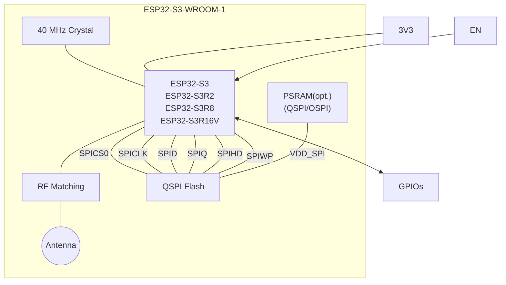
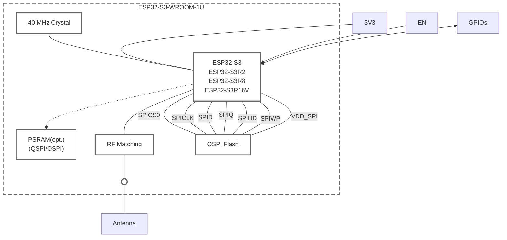

# ESP32-S3-WROOM-1 datasheet

<!-- Original PDF: ESP32-S3-WROOM-1.pdf -->

<!-- PDF page 1 -->

# ESP32-S3-WROOM-1

# ESP32-S3-WROOM-1U

## Datasheet **Version 1.8**

* 2.4 GHz Wi-Fi (802.11b/g/n) and Bluetooth® 5 module
* Built around ESP32-S3 series of SoCs, Xtensa® dual-core 32-bit LX7 microprocessor
* Flash up to 16 MB, PSRAM up to 16 MB
* Up to 36 GPIOs, rich set of peripherals
* On-board PCB antenna or external antenna connector

  

  **ESP32-S3-WROOM-1**

  **ESP32-S3-WROOM-1U**

<!-- PDF page 2 -->

# 1 Module Overview

**Note:**

Check the link or the QR code to make sure that you use the latest version of this document:
https://www.espressif.com/documentation/esp32-s3-wroom-1_wroom-1u_datasheet_en.pdf

## 1.1 Features

### CPU and On-Chip Memory

* ESP32-S3 series of SoCs embedded, Xtensa® dual-core 32-bit LX7 microprocessor (with single precision FPU), up to 240 MHz
* 384 KB ROM
* 512 KB SRAM
* 16 KB SRAM in RTC
* Up to 16 MB PSRAM

### Wi-Fi

* 802.11b/g/n
* Bit rate: 802.11n up to 150 Mbps
* A-MPDU and A-MSDU aggregation
* 0.4 µs guard interval support
* Center frequency range of operating channel: 2412 \~ 2484 MHz

### Bluetooth

* Bluetooth LE: Bluetooth 5, Bluetooth mesh
* Speed: 125 Kbps, 500 Kbps, 1 Mbps, 2 Mbps
* Advertising extensions
* Multiple advertisement sets
* Channel selection algorithm #2
* Internal co-existence mechanism between Wi-Fi and Bluetooth to share the same antenna

### Peripherals

* 36 GPIOs
* 4 strapping GPIOs
* SPI, LCD interface, Camera interface, UART, I2C, I2S, remote control, pulse counter, LED PWM, full-speed USB 2.0 OTG, USB Serial/JTAG controller, MCPWM, SD/MMC host controller, GDMA, TWAI® controller (compatible with ISO 11898-1), ADC, touch sensor, temperature sensor, timers and watchdogs

### Integrated Components on Module

* 40 MHz crystal oscillator
* Up to 16 MB Quad SPI flash

### Antenna Options

* ESP32-S3-WROOM-1: On-board PCB antenna
* ESP32-S3-WROOM-1U: External antenna via a connector

### Operating Conditions

* Operating voltage/Power supply: 3.0 \~ 3.6 V
* Operating ambient temperature:
  – 65 °C version: –40 \~ 65 °C
  – 85 °C version: –40 \~ 85 °C
  – 105 °C version: –40 \~ 105 °C

### Certification

* RF certification: See certificates
* Green certification: RoHS/REACH

### Test

* HTOL/HTSL/uHAST/TCT/ESD

<!-- PDF page 3 -->

## 1.2 Series Comparison

ESP32-S3-WROOM-1 and ESP32-S3-WROOM-1U are two powerful, generic Wi-Fi + Bluetooth LE MCU modules that are built around the ESP32-S3 series of SoCs. On top of a rich set of peripherals, the acceleration for neural network computing and signal processing workloads provided by the SoC make the modules an ideal choice for a wide variety of application scenarios related to AI and Artificial Intelligence of Things (AIoT), such as wake word detection, speech commands recognition, face detection and recognition, smart home, smart appliances, smart control panel, smart speaker, etc.

ESP32-S3-WROOM-1 comes with a PCB antenna. ESP32-S3-WROOM-1U comes with an external antenna connector. A wide selection of module variants are available for customers as shown in Table 1-1 and 1-2. H4 series modules operate at –40 \~ 105 °C ambient temperature, R8 and R16V series modules operate at –40 \~ 65 °C ambient temperature, and other module variants operate at –40 \~ 85 °C ambient temperature. For R8 and R16V series modules with Octal SPI PSRAM, if the PSRAM ECC function is enabled, the maximum ambient temperature can be improved to 85 °C, while the usable size of PSRAM will be reduced by 1/16.

<table>
  <caption>Table 1-1. ESP32-S3-WROOM-1 Series Comparison1</caption>
  <thead>
    <tr>
      <th>Part Number2</th>
      <th>Flash3, 4</th>
      <th>PSRAM4</th>
      <th>Ambient Temp.5 (°C)</th>
      <th>Size6 (mm)</th>
    </tr>
  </thead>
  <tbody>
    <tr>
      <td>ESP32-S3-WROOM-1-N4</td>
      <td>4 MB (Quad SPI)</td>
      <td>-</td>
      <td>–40 ~ 85</td>
      <td rowspan="11">18.0 × 25.5 × 3.1</td>
    </tr>
    <tr>
      <td>ESP32-S3-WROOM-1-N8</td>
      <td>8 MB (Quad SPI)</td>
      <td>-</td>
      <td>–40 ~ 85</td>
    </tr>
    <tr>
      <td>ESP32-S3-WROOM-1-N16</td>
      <td>16 MB (Quad SPI)</td>
      <td>-</td>
      <td>–40 ~ 85</td>
    </tr>
    <tr>
      <td>ESP32-S3-WROOM-1-H4</td>
      <td>4 MB (Quad SPI)</td>
      <td>-</td>
      <td>–40 ~ 105</td>
    </tr>
    <tr>
      <td>ESP32-S3-WROOM-1-N4R2</td>
      <td>4 MB (Quad SPI)</td>
      <td>2 MB (Quad SPI)</td>
      <td>–40 ~ 85</td>
    </tr>
    <tr>
      <td>ESP32-S3-WROOM-1-N8R2</td>
      <td>8 MB (Quad SPI)</td>
      <td>2 MB (Quad SPI)</td>
      <td>–40 ~ 85</td>
    </tr>
    <tr>
      <td>ESP32-S3-WROOM-1-N16R2</td>
      <td>16 MB (Quad SPI)</td>
      <td>2 MB (Quad SPI)</td>
      <td>–40 ~ 85</td>
    </tr>
    <tr>
      <td>ESP32-S3-WROOM-1-N4R8</td>
      <td>4 MB (Quad SPI)</td>
      <td>8 MB (Octal SPI)</td>
      <td>–40 ~ 65</td>
    </tr>
    <tr>
      <td>ESP32-S3-WROOM-1-N8R8</td>
      <td>8 MB (Quad SPI)</td>
      <td>8 MB (Octal SPI)</td>
      <td>–40 ~ 65</td>
    </tr>
    <tr>
      <td>ESP32-S3-WROOM-1-N16R8</td>
      <td>16 MB (Quad SPI)</td>
      <td>8 MB (Octal SPI)</td>
      <td>–40 ~ 65</td>
    </tr>
    <tr>
      <td>ESP32-S3-WROOM-1-N16R16VA7</td>
      <td>16 MB (Quad SPI)</td>
      <td>16 MB (Octal SPI)</td>
      <td>–40 ~ 65</td>
    </tr>
  </tbody>
</table>

1 This table shares the same notes presented in Table 1-2 below.

<table>
  <caption>Table 1-2. ESP32-S3-WROOM-1U Series Comparison</caption>
  <thead>
    <tr>
      <th>Part Number2</th>
      <th>Flash3, 4</th>
      <th>PSRAM4</th>
      <th>Ambient Temp.5 (°C)</th>
      <th>Size6 (mm)</th>
    </tr>
  </thead>
  <tbody>
    <tr>
      <td>ESP32-S3-WROOM-1U-N4</td>
      <td>4 MB (Quad SPI)</td>
      <td>-</td>
      <td>–40 ~ 85</td>
      <td rowspan="11">18.0 × 19.2 × 3.2</td>
    </tr>
    <tr>
      <td>ESP32-S3-WROOM-1U-N8</td>
      <td>8 MB (Quad SPI)</td>
      <td>-</td>
      <td>–40 ~ 85</td>
    </tr>
    <tr>
      <td>ESP32-S3-WROOM-1U-N16</td>
      <td>16 MB (Quad SPI)</td>
      <td>-</td>
      <td>–40 ~ 85</td>
    </tr>
    <tr>
      <td>ESP32-S3-WROOM-1U-H4</td>
      <td>4 MB (Quad SPI)</td>
      <td>-</td>
      <td>–40 ~ 105</td>
    </tr>
    <tr>
      <td>ESP32-S3-WROOM-1U-N4R2</td>
      <td>4 MB (Quad SPI)</td>
      <td>2 MB (Quad SPI)</td>
      <td>–40 ~ 85</td>
    </tr>
    <tr>
      <td>ESP32-S3-WROOM-1U-N8R2</td>
      <td>8 MB (Quad SPI)</td>
      <td>2 MB (Quad SPI)</td>
      <td>–40 ~ 85</td>
    </tr>
    <tr>
      <td>ESP32-S3-WROOM-1U-N16R2</td>
      <td>16 MB (Quad SPI)</td>
      <td>2 MB (Quad SPI)</td>
      <td>–40 ~ 85</td>
    </tr>
    <tr>
      <td>ESP32-S3-WROOM-1U-N4R8</td>
      <td>4 MB (Quad SPI)</td>
      <td>8 MB (Octal SPI)</td>
      <td>–40 ~ 65</td>
    </tr>
    <tr>
      <td>ESP32-S3-WROOM-1U-N8R8</td>
      <td>8 MB (Quad SPI)</td>
      <td>8 MB (Octal SPI)</td>
      <td>–40 ~ 65</td>
    </tr>
    <tr>
      <td>ESP32-S3-WROOM-1U-N16R8</td>
      <td>16 MB (Quad SPI)</td>
      <td>8 MB (Octal SPI)</td>
      <td>–40 ~ 65</td>
    </tr>
    <tr>
      <td>ESP32-S3-WROOM-1U-N16R16VA7</td>
      <td>16 MB (Quad SPI)</td>
      <td>16 MB (Octal SPI)</td>
      <td>–40 ~ 65</td>
    </tr>
  </tbody>
</table>

<!-- PDF page 4 -->

2 For customization of ESP32-S3-WROOM-1-H4, ESP32-S3-WROOM-1U-H4, and ESP32-S3-WROOM-1-N16R16VA, please <u>contact us</u>. 3 By default, the SPI flash on the module operates at a maximum clock frequency of 80 MHz and does not support the auto suspend feature. If you have a requirement for a higher flash clock frequency of 120 MHz or if you need the flash auto suspend feature, please <u>contact us</u>. 4 The modules use PSRAM integrated in the chip’s package. For specifications, refer to Section 6.5 *Memory Specifications*. 5 Ambient temperature specifies the recommended temperature range of the environment immediately outside the Espressif module. 6 For details, refer to Section 10.1 *Module Dimensions*. 7 Please note that the VDD_SPI voltage is 1.8 V for ESP32-S3-WROOM-1-N16R16VA and ESP32-S3-WROOM-1U-N16R16VA only.

At the core of the modules is an ESP32-S3 series of SoC, an Xtensa® 32-bit LX7 CPU that operates at up to 240 MHz. You can power off the CPU and make use of the low-power co-processor to constantly monitor the peripherals for changes or crossing of thresholds.

**Note:**
For more information on ESP32-S3, please refer to *<u>ESP32-S3 Series Datasheet</u>*.
For chip revision identification, ESP-IDF release that supports a specific chip revision, and other information on chip revisions, please refer to *<u>ESP32-S3 Series SoC Errata</u>* > Section *Chip Revision Identification*.

## 1.3 Applications

* Smart Home
* Industrial Automation
* Health Care
* Consumer Electronics
* Smart Agriculture
* POS Machines
* Service Robot
* Audio Devices
* Generic Low-power IoT Sensor Hubs
* Generic Low-power IoT Data Loggers
* Cameras for Video Streaming
* USB Devices
* Speech Recognition
* Image Recognition
* Wi-Fi + Bluetooth Networking Card
* Touch and Proximity Sensing

<!-- PDF page 5 -->

# Contents

<table><tr><td><strong>1</strong></td><td><strong>Module Overview</strong></td><td>2</td></tr><tr><td>1.1</td><td>Features</td><td>2</td></tr><tr><td>1.2</td><td>Series Comparison</td><td>3</td></tr><tr><td>1.3</td><td>Applications</td><td>4</td></tr><tr><td><strong>2</strong></td><td><strong>Block Diagram</strong></td><td>9</td></tr><tr><td><strong>3</strong></td><td><strong>Pin Definitions</strong></td><td>10</td></tr><tr><td>3.1</td><td>Pin Layout</td><td>10</td></tr><tr><td>3.2</td><td>Pin Description</td><td>11</td></tr><tr><td><strong>4</strong></td><td><strong>Boot Configurations</strong></td><td>13</td></tr><tr><td>4.1</td><td>Chip Boot Mode Control</td><td>14</td></tr><tr><td>4.2</td><td>VDD_SPI Voltage Control</td><td>15</td></tr><tr><td>4.3</td><td>ROM Messages Printing Control</td><td>15</td></tr><tr><td>4.4</td><td>JTAG Signal Source Control</td><td>15</td></tr><tr><td>4.5</td><td>Chip Power-up and Reset</td><td>16</td></tr><tr><td><strong>5</strong></td><td><strong>Peripherals</strong></td><td>17</td></tr><tr><td>5.1</td><td>Peripheral Overview</td><td>17</td></tr><tr><td>5.2</td><td>Peripheral Description</td><td>17</td></tr><tr><td></td><td>5.2.1    Connectivity Interface</td><td>17</td></tr><tr><td></td><td>    5.2.1.1    UART Controller</td><td>17</td></tr><tr><td></td><td>    5.2.1.2    I2C Interface</td><td>18</td></tr><tr><td></td><td>    5.2.1.3    I2S Interface</td><td>18</td></tr><tr><td></td><td>    5.2.1.4    LCD and Camera Controller</td><td>19</td></tr><tr><td></td><td>    5.2.1.5    Serial Peripheral Interface (SPI)</td><td>19</td></tr><tr><td></td><td>    5.2.1.6    Two-Wire Automotive Interface (TWAI®)</td><td>21</td></tr><tr><td></td><td>    5.2.1.7    USB 2.0 OTG Full-Speed Interface</td><td>21</td></tr><tr><td></td><td>    5.2.1.8    USB Serial/JTAG Controller</td><td>22</td></tr><tr><td></td><td>    5.2.1.9    SD/MMC Host Controller</td><td>23</td></tr><tr><td></td><td>    5.2.1.10    Motor Control PWM (MCPWM)</td><td>24</td></tr><tr><td></td><td>    5.2.1.11    Remote Control Peripheral (RMT)</td><td>24</td></tr><tr><td></td><td>    5.2.1.12    Pulse Count Controller (PCNT)</td><td>25</td></tr><tr><td>5.2.2</td><td>Analog Signal Processing</td><td>25</td></tr><tr><td></td><td>    5.2.2.1    SAR ADC</td><td>25</td></tr><tr><td></td><td>    5.2.2.2    Temperature Sensor</td><td>25</td></tr><tr><td></td><td>    5.2.2.3    Touch Sensor</td><td>26</td></tr><tr><td><strong>6</strong></td><td><strong>Electrical Characteristics</strong></td><td>27</td></tr><tr><td>6.1</td><td>Absolute Maximum Ratings</td><td>27</td></tr><tr><td>6.2</td><td>Recommended Operating Conditions</td><td>27</td></tr><tr><td>6.3</td><td>DC Characteristics (3.3 V, 25 °C)</td><td>27</td></tr><tr><td>6.4</td><td>Current Consumption Characteristics</td><td>28</td></tr><tr><td>6.4.1</td><td>    Current Consumption in Active Mode</td><td>28</td></tr><tr><td>6.4.2</td><td>    Current Consumption in Other Modes</td><td>29</td></tr><tr><td>6.5</td><td>Memory Specifications</td><td>30</td></tr><tr><td><strong>7</strong></td><td><strong>RF Characteristics</strong></td><td>32</td></tr><tr><td>7.1</td><td>Wi-Fi Radio</td><td>32</td></tr><tr><td>7.1.1</td><td>    Wi-Fi RF Transmitter (TX) Characteristics</td><td>32</td></tr><tr><td>7.1.2</td><td>    Wi-Fi RF Receiver (RX) Characteristics</td><td>33</td></tr><tr><td>7.2</td><td>Bluetooth LE Radio</td><td>34</td></tr><tr><td>7.2.1</td><td>    Bluetooth LE RF Transmitter (TX) Characteristics</td><td>35</td></tr><tr><td>7.2.2</td><td>    Bluetooth LE RF Receiver (RX) Characteristics</td><td>36</td></tr><tr><td><strong>8</strong></td><td><strong>Module Schematics</strong></td><td>39</td></tr><tr><td><strong>9</strong></td><td><strong>Peripheral Schematics</strong></td><td>41</td></tr><tr><td><strong>10</strong></td><td><strong>Physical Dimensions</strong></td><td>42</td></tr><tr><td>10.1</td><td>Module Dimensions</td><td>42</td></tr><tr><td>10.2</td><td>Dimensions of External Antenna Connector</td><td>43</td></tr><tr><td><strong>11</strong></td><td><strong>PCB Layout Recommendations</strong></td><td>45</td></tr><tr><td>11.1</td><td>PCB Land Pattern</td><td>45</td></tr><tr><td>11.2</td><td>Module Placement for PCB Design</td><td>46</td></tr><tr><td><strong>12</strong></td><td><strong>Product Handling</strong></td><td>47</td></tr><tr><td>12.1</td><td>Storage Conditions</td><td>47</td></tr><tr><td>12.2</td><td>Electrostatic Discharge (ESD)</td><td>47</td></tr><tr><td>12.3</td><td>Reflow Profile</td><td>47</td></tr><tr><td>12.4</td><td>Ultrasonic Vibration</td><td>48</td></tr><tr><td><strong>Datasheet Versioning</strong></td><td></td><td>49</td></tr><tr><td><strong>Related Documentation and Resources</strong></td><td></td><td>50</td></tr><tr><td><strong>Revision History</strong></td><td></td><td>51</td></tr></table>

<!-- PDF page 6 -->

<!-- PDF page 7 -->

List of Tables

# List of Tables

<table>
    <tr>
      <td>1-1</td>
      <td>ESP32-S3-WROOM-1 Series Comparison1</td>
      <td>3</td>
    </tr>
    <tr>
      <td>1-2</td>
      <td>ESP32-S3-WROOM-1U Series Comparison</td>
      <td>3</td>
    </tr>
    <tr>
      <td>3-1</td>
      <td>Pin Definitions</td>
      <td>11</td>
    </tr>
    <tr>
      <td>4-1</td>
      <td>Default Configuration of Strapping Pins</td>
      <td>13</td>
    </tr>
    <tr>
      <td>4-2</td>
      <td>Description of Timing Parameters for the Strapping Pins</td>
      <td>14</td>
    </tr>
    <tr>
      <td>4-3</td>
      <td>Chip Boot Mode Control</td>
      <td>14</td>
    </tr>
    <tr>
      <td>4-4</td>
      <td>VDD_SPI Voltage Control</td>
      <td>15</td>
    </tr>
    <tr>
      <td>4-5</td>
      <td>JTAG Signal Source Control</td>
      <td>16</td>
    </tr>
    <tr>
      <td>4-6</td>
      <td>Description of Timing Parameters for Power-up and Reset</td>
      <td>16</td>
    </tr>
    <tr>
      <td>6-1</td>
      <td>Absolute Maximum Ratings</td>
      <td>27</td>
    </tr>
    <tr>
      <td>6-2</td>
      <td>Recommended Operating Conditions</td>
      <td>27</td>
    </tr>
    <tr>
      <td>6-3</td>
      <td>DC Characteristics (3.3 V, 25 °C)</td>
      <td>27</td>
    </tr>
    <tr>
      <td>6-4</td>
      <td>Current Consumption for Wi-Fi (2.4 GHz) in Active Mode</td>
      <td>28</td>
    </tr>
    <tr>
      <td>6-5</td>
      <td>Current Consumption for Bluetooth LE in Active Mode</td>
      <td>28</td>
    </tr>
    <tr>
      <td>6-6</td>
      <td>Current Consumption in Modem-sleep Mode</td>
      <td>29</td>
    </tr>
    <tr>
      <td>6-7</td>
      <td>Current Consumption in Low-Power Modes</td>
      <td>30</td>
    </tr>
    <tr>
      <td>6-8</td>
      <td>Flash Specifications</td>
      <td>30</td>
    </tr>
    <tr>
      <td>6-9</td>
      <td>PSRAM Specifications</td>
      <td>31</td>
    </tr>
    <tr>
      <td>7-1</td>
      <td>Wi-Fi RF Characteristics</td>
      <td>32</td>
    </tr>
    <tr>
      <td>7-2</td>
      <td>TX Power with Spectral Mask and EVM Meeting 802.11 Standards</td>
      <td>32</td>
    </tr>
    <tr>
      <td>7-3</td>
      <td>TX EVM Test1</td>
      <td>32</td>
    </tr>
    <tr>
      <td>7-4</td>
      <td>RX Sensitivity</td>
      <td>33</td>
    </tr>
    <tr>
      <td>7-5</td>
      <td>Maximum RX Level</td>
      <td>34</td>
    </tr>
    <tr>
      <td>7-6</td>
      <td>RX Adjacent Channel Rejection</td>
      <td>34</td>
    </tr>
    <tr>
      <td>7-7</td>
      <td>Bluetooth LE RF Characteristics</td>
      <td>34</td>
    </tr>
    <tr>
      <td>7-8</td>
      <td>Bluetooth LE - Transmitter Characteristics - 1 Mbps</td>
      <td>35</td>
    </tr>
    <tr>
      <td>7-9</td>
      <td>Bluetooth LE - Transmitter Characteristics - 2 Mbps</td>
      <td>35</td>
    </tr>
    <tr>
      <td>7-10</td>
      <td>Bluetooth LE - Transmitter Characteristics - 125 Kbps</td>
      <td>35</td>
    </tr>
    <tr>
      <td>7-11</td>
      <td>Bluetooth LE - Transmitter Characteristics - 500 Kbps</td>
      <td>36</td>
    </tr>
    <tr>
      <td>7-12</td>
      <td>Bluetooth LE - Receiver Characteristics - 1 Mbps</td>
      <td>36</td>
    </tr>
    <tr>
      <td>7-13</td>
      <td>Bluetooth LE - Receiver Characteristics - 2 Mbps</td>
      <td>36</td>
    </tr>
    <tr>
      <td>7-14</td>
      <td>Bluetooth LE - Receiver Characteristics - 125 Kbps</td>
      <td>37</td>
    </tr>
    <tr>
      <td>7-15</td>
      <td>Bluetooth LE - Receiver Characteristics - 500 Kbps</td>
      <td>37</td>
    </tr>
</table>

<!-- PDF page 8 -->

List of Figures

# List of Figures

<table>
    <tr>
      <td>2-1</td>
      <td>ESP32-S3-WROOM-1 Block Diagram</td>
      <td>9</td>
    </tr>
    <tr>
      <td>2-2</td>
      <td>ESP32-S3-WROOM-1U Block Diagram</td>
      <td>9</td>
    </tr>
    <tr>
      <td>3-1</td>
      <td>Pin Layout (Top View)</td>
      <td>10</td>
    </tr>
    <tr>
      <td>4-1</td>
      <td>Visualization of Timing Parameters for the Strapping Pins</td>
      <td>14</td>
    </tr>
    <tr>
      <td>4-2</td>
      <td>Visualization of Timing Parameters for Power-up and Reset</td>
      <td>16</td>
    </tr>
    <tr>
      <td>8-1</td>
      <td>ESP32-S3-WROOM-1 Schematics</td>
      <td>39</td>
    </tr>
    <tr>
      <td>8-2</td>
      <td>ESP32-S3-WROOM-1U Schematics</td>
      <td>40</td>
    </tr>
    <tr>
      <td>9-1</td>
      <td>Peripheral Schematics</td>
      <td>41</td>
    </tr>
    <tr>
      <td>10-1</td>
      <td>ESP32-S3-WROOM-1 Physical Dimensions</td>
      <td>42</td>
    </tr>
    <tr>
      <td>10-2</td>
      <td>ESP32-S3-WROOM-1U Physical Dimensions</td>
      <td>42</td>
    </tr>
    <tr>
      <td>10-3</td>
      <td>Dimensions of External Antenna Connector</td>
      <td>43</td>
    </tr>
    <tr>
      <td>11-1</td>
      <td>ESP32-S3-WROOM-1 Recommended PCB Land Pattern</td>
      <td>45</td>
    </tr>
    <tr>
      <td>11-2</td>
      <td>ESP32-S3-WROOM-1U Recommended PCB Land Pattern</td>
      <td>46</td>
    </tr>
    <tr>
      <td>12-1</td>
      <td>Reflow Profile</td>
      <td>47</td>
    </tr>
</table>

<!-- PDF page 9 -->

2 Block Diagram

# 2 Block Diagram

Figure 2-1. ESP32-S3-WROOM-1 Block Diagram

Figure 2-2. ESP32-S3-WROOM-1U Block Diagram

**Note:**
For the pin mapping between the chip and the in-package PSRAM, please refer to *ESP32-S3 Series Datasheet* > Table *Pin Mapping Between Chip and In-package Flash/PSRAM*.

<!-- PDF page 10 -->

# 3 Pin Definitions

## 3.1 Pin Layout

The pin diagram below shows the approximate location of pins on the module. For the actual diagram drawn to scale, please refer to Figure 10.1 *Module Dimensions*.

```mermaid
graph TD
    subgraph "ESP32-S3-WROOM-1 Pin Layout"
        direction TB
        
        Keepout["Keepout Zone"]
        
        subgraph "Central GND Pads"
            direction TB
            GND_C1["GND"] --- GND_C2["GND"] --- GND_C3["GND"]
            GND_C4["GND"] --- GND_C5["41 GND"] --- GND_C6["GND"]
            GND_C7["GND"] --- GND_C8["GND"] --- GND_C9["GND"]
        end

        %% Left Side Pins
        P1["1 GND"]
        P2["2 3V3"]
        P3["3 EN"]
        P4["4 IO4"]
        P5["5 IO5"]
        P6["6 IO6"]
        P7["7 IO7"]
        P8["8 IO15"]
        P9["9 IO16"]
        P10["10 IO17"]
        P11["11 IO18"]
        P12["12 IO8"]
        P13["13 IO19"]
        P14["14 IO20"]

        %% Bottom Side Pins
        P15["15 IO3"]
        P16["16 IO46"]
        P17["17 IO9"]
        P18["18 IO10"]
        P19["19 IO11"]
        P20["20 IO12"]
        P21["21 IO13"]
        P22["22 IO14"]
        P23["23 IO21"]
        P24["24 IO47"]
        P25["25 IO48"]
        P26["26 IO45"]

        %% Right Side Pins
        P27["27 IO0"]
        P28["28 IO35"]
        P29["29 IO36"]
        P30["30 IO37"]
        P31["31 IO38"]
        P32["32 IO39"]
        P33["33 IO40"]
        P34["34 IO41"]
        P35["35 IO42"]
        P36["36 RXD0"]
        P37["37 TXD0"]
        P38["38 IO2"]
        P39["39 IO1"]
        P40["40 GND"]
    end
```

Figure 3-1. Pin Layout (Top View)

**Note:**

The pin diagram is applicable to ESP32-S3-WROOM-1 and ESP32-S3-WROOM-1U, but the latter has no antenna keepout zone. To learn more about the keepout zone for module’s antenna on the base board, please refer to *ESP32-S3 Hardware Design Guidelines* > Section *General Principles of PCB Layout for Modules*.

<!-- PDF page 11 -->

## 3.2 Pin Description

The module has 41 pins. See pin definitions in Table *3-1 Pin Definitions*.

For explanations of pin names and function names, as well as configurations of peripheral pins, please refer to *<u>ESP32-S3 Series Datasheet</u>*.

<table><caption>Table 3-1. Pin Definitions</caption><thead><tr><th>Name</th><th>No.</th><th>Type a</th><th>Function</th></tr></thead><tbody><tr><td>GND</td><td>1</td><td>P</td><td>GND</td></tr><tr><td>3V3</td><td>2</td><td>P</td><td>Power supply</td></tr><tr><td>EN</td><td>3</td><td>I</td><td>High: on, enables the chip. Low: off, the chip powers off. Note: Do not leave the EN pin floating.</td></tr><tr><td>IO4</td><td>4</td><td>I/O/T</td><td>RTC_GPIO4, <b>GPIO4</b>, TOUCH4, ADC1_CH3</td></tr><tr><td>IO5</td><td>5</td><td>I/O/T</td><td>RTC_GPIO5, <b>GPIO5</b>, TOUCH5, ADC1_CH4</td></tr><tr><td>IO6</td><td>6</td><td>I/O/T</td><td>RTC_GPIO6, <b>GPIO6</b>, TOUCH6, ADC1_CH5</td></tr><tr><td>IO7</td><td>7</td><td>I/O/T</td><td>RTC_GPIO7, <b>GPIO7</b>, TOUCH7, ADC1_CH6</td></tr><tr><td>IO15</td><td>8</td><td>I/O/T</td><td>RTC_GPIO15, <b>GPIO15</b>, U0RTS, ADC2_CH4, XTAL_32K_P</td></tr><tr><td>IO16</td><td>9</td><td>I/O/T</td><td>RTC_GPIO16, <b>GPIO16</b>, U0CTS, ADC2_CH5, XTAL_32K_N</td></tr><tr><td>IO17</td><td>10</td><td>I/O/T</td><td>RTC_GPIO17, <b>GPIO17</b>, U1TXD, ADC2_CH6</td></tr><tr><td>IO18</td><td>11</td><td>I/O/T</td><td>RTC_GPIO18, <b>GPIO18</b>, U1RXD, ADC2_CH7, CLK_OUT3</td></tr><tr><td>IO8</td><td>12</td><td>I/O/T</td><td>RTC_GPIO8, <b>GPIO8</b>, TOUCH8, ADC1_CH7, SUBSPICS1</td></tr><tr><td>IO19</td><td>13</td><td>I/O/T</td><td>RTC_GPIO19, <b>GPIO19</b>, U1RTS, ADC2_CH8, CLK_OUT2, <b>USB_D-</b></td></tr><tr><td>IO20</td><td>14</td><td>I/O/T</td><td>RTC_GPIO20, <b>GPIO20</b>, U1CTS, ADC2_CH9, CLK_OUT1, <b>USB_D+</b></td></tr><tr><td>IO3</td><td>15</td><td>I/O/T</td><td>RTC_GPIO3, <b>GPIO3</b>, TOUCH3, ADC1_CH2</td></tr><tr><td>IO46</td><td>16</td><td>I/O/T</td><td><b>GPIO46</b></td></tr><tr><td>IO9</td><td>17</td><td>I/O/T</td><td>RTC_GPIO9, <b>GPIO9</b>, TOUCH9, ADC1_CH8, FSPIHD, SUBSPIHD</td></tr><tr><td>IO10</td><td>18</td><td>I/O/T</td><td>RTC_GPIO10, <b>GPIO10</b>, TOUCH10, ADC1_CH9, FSPICS0, FSPIIO4, SUBSPICS0</td></tr><tr><td>IO11</td><td>19</td><td>I/O/T</td><td>RTC_GPIO11, <b>GPIO11</b>, TOUCH11, ADC2_CH0, FSPID, FSPIIO5, SUBSPID</td></tr><tr><td>IO12</td><td>20</td><td>I/O/T</td><td>RTC_GPIO12, <b>GPIO12</b>, TOUCH12, ADC2_CH1, FSPICLK, FSPIIO6, SUBSPICLK</td></tr><tr><td>IO13</td><td>21</td><td>I/O/T</td><td>RTC_GPIO13, <b>GPIO13</b>, TOUCH13, ADC2_CH2, FSPIQ, FSPIIO7, SUBSPIQ</td></tr><tr><td>IO14</td><td>22</td><td>I/O/T</td><td>RTC_GPIO14, <b>GPIO14</b>, TOUCH14, ADC2_CH3, FSPIWP, FSPIDQS, SUBSPIWP</td></tr><tr><td>IO21</td><td>23</td><td>I/O/T</td><td>RTC_GPIO21, <b>GPIO21</b></td></tr><tr><td>IO47 c</td><td>24</td><td>I/O/T</td><td>SPICLK_P_DIFF, <b>GPIO47</b>, SUBSPICLK_P_DIFF</td></tr><tr><td>IO48 c</td><td>25</td><td>I/O/T</td><td>SPICLK_N_DIFF, <b>GPIO48</b>, SUBSPICLK_N_DIFF</td></tr><tr><td>IO45</td><td>26</td><td>I/O/T</td><td><b>GPIO45</b></td></tr><tr><td>IO0</td><td>27</td><td>I/O/T</td><td>RTC_GPIO0, <b>GPIO0</b></td></tr><tr><td>IO35 b</td><td>28</td><td>I/O/T</td><td>SPIIO6, <b>GPIO35</b>, FSPID, SUBSPID</td></tr><tr><td>IO36 b</td><td>29</td><td>I/O/T</td><td>SPIIO7, <b>GPIO36</b>, FSPICLK, SUBSPICLK</td></tr><tr><td>IO37 b</td><td>30</td><td>I/O/T</td><td>SPIDQS, <b>GPIO37</b>, FSPIQ, SUBSPIQ</td></tr><tr><td>IO38</td><td>31</td><td>I/O/T</td><td><b>GPIO38</b>, FSPIWP, SUBSPIWP</td></tr><tr><td>IO39</td><td>32</td><td>I/O/T</td><td><strong>MTCK</strong>, GPIO39, CLK_OUT3, SUBSPICS1</td></tr><tr><td>IO40</td><td>33</td><td>I/O/T</td><td><strong>MTDO</strong>, GPIO40, CLK_OUT2</td></tr><tr><td>IO41</td><td>34</td><td>I/O/T</td><td><strong>MTDI</strong>, GPIO41, CLK_OUT1</td></tr><tr><td>IO42</td><td>35</td><td>I/O/T</td><td><strong>MTMS</strong>, GPIO42</td></tr><tr><td>RXD0</td><td>36</td><td>I/O/T</td><td><strong>U0RXD</strong>, GPIO44, CLK_OUT2</td></tr><tr><td>TXD0</td><td>37</td><td>I/O/T</td><td><strong>U0TXD</strong>, GPIO43, CLK_OUT1</td></tr><tr><td>IO2</td><td>38</td><td>I/O/T</td><td>RTC_GPIO2, <strong>GPIO2</strong>, TOUCH2, ADC1_CH1</td></tr><tr><td>IO1</td><td>39</td><td>I/O/T</td><td>RTC_GPIO1, <strong>GPIO1</strong>, TOUCH1, ADC1_CH0</td></tr><tr><td>GND</td><td>40</td><td>P</td><td>GND</td></tr><tr><td>EPAD</td><td>41</td><td>P</td><td>GND</td></tr></tbody></table>

Cont’d on next page

<!-- PDF page 12 -->

a P: power supply; I: input; O: output; T: high impedance. Pin functions in bold font are the default pin functions. For pin 28 \~ 30, the default function is decided by eFuse bit. b For modules with Octal SPI PSRAM, i.e., modules embedded with ESP32-S3R8 or ESP32-S3R16V, pins IO35, IO36, and IO37 are connected to the Octal SPI PSRAM and are not available for other uses. c For modules embedded with ESP32-S3R16V, as the VDD_SPI voltage of the ESP32-S3R16V chip is set to 1.8 V, the working voltage for GPIO47 and GPIO48 is also 1.8 V, which is different from other GPIOs.

<!-- PDF page 13 -->

# 4 Boot Configurations

**Note:**
The content below is excerpted from <u>*ESP32-S3 Series Datasheet*</u> > Section *Boot Configurations*. For the strapping pin mapping between the chip and modules, please refer to Chapter 8 *Module Schematics*.

The chip allows for configuring the following boot parameters through strapping pins and eFuse bits at power-up or a hardware reset, without microcontroller interaction.

* **Chip boot mode**
  – Strapping pin: GPIO0 and GPIO46
* **VDD_SPI voltage**
  – Strapping pin: GPIO45
  – eFuse parameter: EFUSE_VDD_SPI_FORCE and EFUSE_VDD_SPI_TIEH
* **ROM message printing**
  – Strapping pin: GPIO46
  – eFuse parameter: EFUSE_UART_PRINT_CONTROL and EFUSE_DIS_USB_SERIAL_JTAG_ROM_PRINT
* **JTAG signal source**
  – Strapping pin: GPIO3
  – eFuse parameter: EFUSE_DIS_PAD_JTAG, EFUSE_DIS_USB_JTAG, and EFUSE_STRAP_JTAG_SEL

The default values of all the above eFuse parameters are 0, which means that they are not burnt. Given that eFuse is one-time programmable, once programmed to 1, it can never be reverted to 0. For how to program eFuse parameters, please refer to <u>*ESP32-S3 Technical Reference Manual*</u> > Chapter *eFuse Controller*.

The default values of the strapping pins, namely the logic levels, are determined by pins’ internal weak pull-up/pull-down resistors at reset if the pins are not connected to any circuit, or connected to an external high-impedance circuit.

<table>
  <caption>Table 4-1. Default Configuration of Strapping Pins</caption>
  <thead>
    <tr>
      <th><u>Strapping Pin</u></th>
      <th>Default Configuration</th>
      <th><u>Bit Value</u></th>
    </tr>
  </thead>
  <tbody>
    <tr>
      <td><strong>GPIO0</strong></td>
      <td>Weak pull-up</td>
      <td>1</td>
    </tr>
    <tr>
      <td><strong>GPIO3</strong></td>
      <td>Floating</td>
      <td>–</td>
    </tr>
    <tr>
      <td><strong>GPIO45</strong></td>
      <td>Weak pull-down</td>
      <td>0</td>
    </tr>
    <tr>
      <td><strong>GPIO46</strong></td>
      <td>Weak pull-down</td>
      <td>0</td>
    </tr>
  </tbody>
</table>

To change the bit values, the strapping pins should be connected to external pull-down/pull-up resistances. If the ESP32-S3 is used as a device by a host MCU, the strapping pin voltage levels can also be controlled by the host MCU.

All strapping pins have latches. At system reset, the latches sample the bit values of their respective strapping pins and store them until the chip is powered down or shut down. The states of latches cannot be changed in

<!-- PDF page 14 -->

any other way. It makes the strapping pin values available during the entire chip operation, and the pins are freed up to be used as regular IO pins after reset.

The timing of signals connected to the strapping pins should adhere to the *setup time* and *hold time* specifications in Table 4-2 and Figure 4-1.

<table>
    <caption>Table 4-2. Description of Timing Parameters for the Strapping Pins</caption>
    <thead>
        <tr>
            <th>Parameter</th>
            <th>Description</th>
            <th>Min (ms)</th>
        </tr>
    </thead>
    <tbody>
        <tr>
            <td>t<i>SU</i></td>
            <td><i>Setup time</i> is the time reserved for the power rails to stabilize be- fore the EN pin is pulled high to activate the chip.</td>
            <td>0</td>
        </tr>
        <tr>
            <td>t<i>H</i></td>
            <td><i>Hold time</i> is the time reserved for the chip to read the strapping pin values after EN is already high and before these pins start op- erating as regular IO pins.</td>
            <td>3</td>
        </tr>
    </tbody>
</table>

Figure 4-1. Visualization of Timing Parameters for the Strapping Pins

## 4.1 Chip Boot Mode Control

GPIO0 and GPIO46 control the boot mode after the reset is released. See Table 4-3 *Chip Boot Mode Control*.

<table>
  <caption>Table 4-3. Chip Boot Mode Control</caption>
  <thead>
    <tr>
      <th>Boot Mode</th>
      <th>GPIO0</th>
      <th>GPIO46</th>
    </tr>
  </thead>
  <tbody>
    <tr>
      <td><strong>SPI Boot</strong></td>
      <td><strong>1</strong></td>
      <td>Any value</td>
    </tr>
    <tr>
      <td>Joint Download Boot 2</td>
      <td>0</td>
      <td>0</td>
    </tr>
  </tbody>
</table>

1 <strong>Bold</strong> marks the default value and configura-
tion.

2 Joint Download Boot mode supports the following download methods:

* USB Download Boot:
  * USB-Serial-JTAG Download Boot
  * USB-OTG Download Boot
* UART Download Boot

<!-- PDF page 15 -->

In SPI Boot mode, the ROM bootloader loads and executes the program from SPI flash to boot the system.

In Joint Download Boot mode, users can download binary files into flash using UART0 or USB interface. It is also possible to download binary files into SRAM and execute it from SRAM.

In addition to SPI Boot and Joint Download Boot modes, ESP32-S3 also supports SPI Download Boot mode. For details, please see <u>*ESP32-S3 Technical Reference Manual*</u> > Chapter *Chip Boot Control*.

## 4.2 VDD_SPI Voltage Control

Depending on the value of EFUSE_VDD_SPI_FORCE, the voltage can be controlled in two ways.

<table>
  <caption>Table 4-4. VDD_SPI Voltage Control</caption>
  <thead>
    <tr>
      <th>VDD_SPI power source 2</th>
      <th>Voltage</th>
      <th>EFUSE_VDD_SPI_FORCE</th>
      <th>GPIO45</th>
      <th>EFUSE_VDD_SPI_TIEH</th>
    </tr>
  </thead>
  <tbody>
    <tr>
      <td><strong>VDD3P3_RTC via R<i>SPI</i></strong></td>
      <td><strong>3.3 V</strong></td>
      <td rowspan="2">0</td>
      <td><strong>0</strong></td>
      <td rowspan="2">Ignored</td>
    </tr>
    <tr>
      <td>Flash Voltage Regulator</td>
      <td>1.8 V</td>
      <td>1</td>
    </tr>
    <tr>
      <td>Flash Voltage Regulator</td>
      <td>1.8 V</td>
      <td rowspan="2">1</td>
      <td rowspan="2">Ignored</td>
      <td>0</td>
    </tr>
    <tr>
      <td>VDD3P3_RTC via R<i>SPI</i></td>
      <td>3.3 V</td>
      <td>1</td>
    </tr>
  </tbody>
</table>

1 <b>Bold</b> marks the default value and configuration. 2 See <u><i>ESP32-S3 Series Datasheet</i></u> > Section <i>Power Scheme</i>.

## 4.3 ROM Messages Printing Control

During boot process the messages by the ROM code can be printed to:

* **(Default) UART0 and USB Serial/JTAG controller**
* USB Serial/JTAG controller
* UART0

The ROM messages printing to UART or USB Serial/JTAG controller can be respectively disabled by configuring registers and eFuse. For detailed information, please refer to <u>*ESP32-S3 Technical Reference Manual*</u> > Chapter *Chip Boot Control*.

## 4.4 JTAG Signal Source Control

The strapping pin GPIO3 can be used to control the source of JTAG signals during the early boot process. This pin does not have any internal pull resistors and the strapping value must be controlled by the external circuit that cannot be in a high impedance state.

As Table 4-5 shows, GPIO3 is used in combination with EFUSE_DIS_PAD_JTAG, EFUSE_DIS_USB_JTAG, and EFUSE_STRAP_JTAG_SEL.

<!-- PDF page 16 -->

<table>
  <caption>Table 4-5. JTAG Signal Source Control</caption>
  <thead>
    <tr>
      <th>JTAG Signal Source</th>
      <th>EFUSE_DIS_PAD_JTAG</th>
      <th>EFUSE_DIS_USB_JTAG</th>
      <th>EFUSE_STRAP_JTAG_SEL</th>
      <th>GPIO3</th>
    </tr>
  </thead>
  <tbody>
    <tr>
      <td rowspan="3"><strong>USB Serial/JTAG Controller</strong></td>
      <td><strong>0</strong></td>
      <td><strong>0</strong></td>
      <td><strong>0</strong></td>
      <td>Ignored</td>
    </tr>
    <tr>
      <td>0</td>
      <td>0</td>
      <td>1</td>
      <td>1</td>
    </tr>
    <tr>
      <td>1</td>
      <td>0</td>
      <td>Ignored</td>
      <td>Ignored</td>
    </tr>
    <tr>
      <td rowspan="2">JTAG pins 2</td>
      <td>0</td>
      <td>0</td>
      <td>1</td>
      <td>0</td>
    </tr>
    <tr>
      <td>0</td>
      <td>1</td>
      <td>Ignored</td>
      <td>Ignored</td>
    </tr>
    <tr>
      <td>JTAG is disabled</td>
      <td>1</td>
      <td>1</td>
      <td>Ignored</td>
      <td>Ignored</td>
    </tr>
  </tbody>
</table>

1 <strong>Bold</strong> marks the default value and configuration. 2 JTAG pins refer to MTDI, MTCK, MTMS, and MTDO.

## 4.5 Chip Power-up and Reset

Once the power is supplied to the chip, its power rails need a short time to stabilize. After that, EN – the pin used for power-up and reset – is pulled high to activate the chip. For information on EN as well as power-up and reset timing, see Figure 4-2 and Table 4-6.

Figure 4-2. Visualization of Timing Parameters for Power-up and Reset

<table>
  <caption>Table 4-6. Description of Timing Parameters for Power-up and Reset</caption>
  <thead>
    <tr>
      <th>Parameter</th>
      <th>Description</th>
      <th>Min (μs)</th>
    </tr>
  </thead>
  <tbody>
    <tr>
      <td>tSTBL</td>
      <td>Time reserved for the power rails of VDDA, VDD3P3, VDD3P3_RTC, and VDD3P3_CPU to stabilize before the EN pin is pulled high to activate the chip</td>
      <td>50</td>
    </tr>
    <tr>
      <td>tRST</td>
      <td>Time reserved for EN to stay below VIL_nRST to reset the chip (see Table 6-3)</td>
      <td>50</td>
    </tr>
  </tbody>
</table>

<!-- PDF page 17 -->

# 5 Peripherals

## 5.1 Peripheral Overview

ESP32-S3 integrates a rich set of peripherals including SPI, LCD, Camera interface, UART, I2C, I2S, remote control, pulse counter, LED PWM, USB Serial/JTAG, MCPWM, SD/MMC host controller, TWAI® controller (compatible with ISO 11898-1, i.e., CAN Specification 2.0), ADC, touch sensor, and temperature sensor. It also includes a full-speed USB 2.0 On-The-Go (OTG) interface to enable USB communication.

To learn more about on-chip components, please refer to *<u>ESP32-S3 Series Datasheet</u>* > Section *Functional Description*.

**Note:**
The content below is sourced from *<u>ESP32-S3 Series Datasheet</u>* > Section *Peripherals*. Some information may not be applicable to ESP32-S3-WROOM-1 and ESP32-S3-WROOM-1U as not all the IO signals are exposed on the module. To learn more about peripheral signals, please refer to *<u>ESP32-S3 Technical Reference Manual</u>* > Section *Peripheral Signals via GPIO Matrix*.

## 5.2 Peripheral Description

This section describes the chip’s peripheral capabilities, covering connectivity interfaces and on-chip sensors that extend its functionality.

### 5.2.1 Connectivity Interface

This subsection describes the connectivity interfaces on the chip that enable communication and interaction with external devices and networks.

#### 5.2.1.1 UART Controller

ESP32-S3 has three UART (Universal Asynchronous Receiver Transmitter) controllers, i.e., UART0, UART1, and UART2, which support IrDA and asynchronous communication (RS232 and RS485) at a speed of up to 5 Mbps.

**Feature List**

* Three clock sources that can be divided
* Programmable baud rate
* 1024 x 8-bit RAM shared by TX FIFOs and RX FIFOs of the three UART controllers
* Full-duplex asynchronous communication
* Automatic baud rate detection of input signals
* Data bits ranging from 5 to 8
* Stop bits of 1, 1.5, 2, or 3 bits
* Parity bit

<!-- PDF page 18 -->

* Special character AT_CMD detection
* RS485 protocol
* IrDA protocol
* High-speed data communication using GDMA
* UART as wake-up source
* Software and hardware flow control

For details, see <u>*ESP32-S3 Technical Reference Manual*</u> > Chapter *UART Controller*.

### **Pin Assignment**

For details, see <u>*ESP32-S3 Series Datasheet*</u> > Section *Peripheral Pin Assignment*.

### 5.2.1.2 I2C Interface

ESP32-S3 has two I2C bus interfaces which are used for I2C master mode or slave mode, depending on the user's configuration.

#### **Feature List**

* Standard mode (100 kbit/s)
* Fast mode (400 kbit/s)
* Up to 800 kbit/s (constrained by SCL and SDA pull-up strength)
* 7-bit and 10-bit addressing mode
* Double addressing mode (slave addressing and slave register addressing)

The hardware provides a command abstraction layer to simplify the usage of the I2C peripheral.

For details, see <u>*ESP32-S3 Technical Reference Manual*</u> > Chapter *I2C Controller*.

#### **Pin Assignment**

For details, see <u>*ESP32-S3 Series Datasheet*</u> > Section *Peripheral Pin Assignment*.

### 5.2.1.3 I2S Interface

ESP32-S3 includes two standard I2S interfaces. They can operate in master mode or slave mode, in full-duplex mode or half-duplex communication mode, and can be configured to operate with an 8-bit, 16-bit, 24-bit, or 32-bit resolution as an input or output channel. BCK clock frequency, from 10 kHz up to 40 MHz, is supported.

The I2S interface has a dedicated DMA controller. It supports TDM PCM, TDM MSB alignment, TDM LSB alignment, TDM Phillips, and PDM interface.

For details, see <u>*ESP32-S3 Technical Reference Manual*</u> > Chapter *I2S Controller*.

<!-- PDF page 19 -->

## **Pin Assignment**

For details, see <u>*ESP32-S3 Series Datasheet*</u> > Section *Peripheral Pin Assignment*.

### **5.2.1.4 LCD and Camera Controller**

The LCD and Camera controller of ESP32-S3 consists of a LCD module and a camera module.

The LCD module is designed to send parallel video data signals, and its bus supports 8-bit \~ 16-bit parallel RGB, I8080, and MOTO6800 interfaces. These interfaces operate at 40 MHz or lower, and support conversion among RGB565, YUV422, YUV420, and YUV411.

The camera module is designed to receive parallel video data signals, and its bus supports an 8-bit \~ 16-bit DVP image sensor, with clock frequency of up to 40 MHz. The camera interface supports conversion among RGB565, YUV422, YUV420, and YUV411.

For details, see <u>*ESP32-S3 Technical Reference Manual*</u> > Chapter *LCD and Camera Controller*.

## **Pin Assignment**

For details, see <u>*ESP32-S3 Series Datasheet*</u> > Section *Peripheral Pin Assignment*.

### **5.2.1.5 Serial Peripheral Interface (SPI)**

ESP32-S3 has the following SPI interfaces:

* **SPI0** used by ESP32-S3’s GDMA controller and cache to access in-package or off-package flash/PSRAM
* **SPI1** used by the CPU to access in-package or off-package flash/PSRAM
* **SPI2** is a general purpose SPI controller with access to a DMA channel allocated by the GDMA controller
* **SPI3** is a general purpose SPI controller with access to a DMA channel allocated by the GDMA controller

### **Feature List**

* **SPI0 and SPI1:**
  * Supports Single SPI, Dual SPI, Quad SPI, Octal SPI, QPI, and OPI modes
  * 8-line SPI mode supports single data rate (SDR) and double data rate (DDR)
  * Configurable clock frequency with a maximum of 120 MHz for 8-line SPI SDR/DDR modes
  * Data transmission is in bytes
* **SPI2:**
  * Supports operation as a master or slave
  * Connects to a DMA channel allocated by the GDMA controller
  * Supports Single SPI, Dual SPI, Quad SPI, Octal SPI, QPI, and OPI modes
  * Configurable clock polarity (CPOL) and phase (CPHA)
  * Configurable clock frequency
  * Data transmission is in bytes

<!-- PDF page 20 -->

* Configurable read and write data bit order: most-significant bit (MSB) first, or least-significant bit (LSB) first

* As a master
  * Supports 2-line full-duplex communication with clock frequency up to 80 MHz
  * Full-duplex 8-line SPI mode supports single data rate (SDR) only
  * Supports 1-, 2-, 4-, 8-line half-duplex communication with clock frequency up to 80 MHz
  * Half-duplex 8-line SPI mode supports both single data rate (up to 80 MHz) and double data rate (up to 40 MHz)
  * Provides six SPI_CS pins for connection with six independent SPI slaves
  * Configurable CS setup time and hold time

* As a slave
  * Supports 2-line full-duplex communication with clock frequency up to 60 MHz
  * Supports 1-, 2-, 4-line half-duplex communication with clock frequency up to 60 MHz
  * Full-duplex and half-duplex 8-line SPI mode supports single data rate (SDR) only

* **SPI3**:
  * Supports operation as a master or slave
  * Connects to a DMA channel allocated by the GDMA controller
  * Supports Single SPI, Dual SPI, Quad SPI, and QPI modes
  * Configurable clock polarity (CPOL) and phase (CPHA)
  * Configurable clock frequency
  * Data transmission is in bytes
  * Configurable read and write data bit order: most-significant bit (MSB) first, or least-significant bit (LSB) first
  * As a master
    * Supports 2-line full-duplex communication with clock frequency up to 80 MHz
    * Supports 1-, 2-, 4-line half-duplex communication with clock frequency up to 80 MHz
    * Provides three SPI_CS pins for connection with three independent SPI slaves
    * Configurable CS setup time and hold time
  * As a slave
    * Supports 2-line full-duplex communication with clock frequency up to 60 MHz
    * Supports 1-, 2-, 4-line half-duplex communication with clock frequency up to 60 MHz

For details, see *<u>ESP32-S3 Technical Reference Manual</u>* > Chapter *SPI Controller*.

## **Pin Assignment**

For details, see *<u>ESP32-S3 Series Datasheet</u>* > Section *Peripheral Pin Assignment*.

<!-- PDF page 21 -->

## 5.2.1.6 Two-Wire Automotive Interface (TWAI®)

The Two-Wire Automotive Interface (TWAI®) is a multi-master, multi-cast communication protocol with error detection and signaling as well as inbuilt message priorities and arbitration.

### Feature List

* Compatible with ISO 11898-1 protocol (CAN Specification 2.0)
* Standard frame format (11-bit ID) and extended frame format (29-bit ID)
* Bit rates from 1 Kbit/s to 1 Mbit/s
* Multiple modes of operation:
  * Normal
  * Listen Only
  * Self-Test (no acknowledgment required)
* 64-byte receive FIFO
* Acceptance filter (single and dual filter modes)
* Error detection and handling:
  * Error counters
  * Configurable error interrupt threshold
  * Error code capture
  * Arbitration lost capture

For details, see *<u>ESP32-S3 Technical Reference Manual</u>* > Chapter *Two-wire Automotive Interface*.

### Pin Assignment

For details, see *<u>ESP32-S3 Series Datasheet</u>* > Section *Peripheral Pin Assignment*.

## 5.2.1.7 USB 2.0 OTG Full-Speed Interface

ESP32-S3 features a full-speed USB OTG interface along with an integrated transceiver. The USB OTG interface complies with the USB 2.0 specification.

### General Features

* FS and LS data rates
* HNP and SRP as A-device or B-device
* Dynamic FIFO (DFIFO) sizing
* Multiple modes of memory access
  * Scatter/Gather DMA mode
  * Buffer DMA mode

<!-- PDF page 22 -->

* Slave mode

* Can choose integrated transceiver or external transceiver

* Utilizing integrated transceiver with USB Serial/JTAG by time-division multiplexing when only integrated transceiver is used

* Support USB OTG using one of the transceivers while USB Serial/JTAG using the other one when both integrated transceiver or external transceiver are used

### **Device Mode Features**

* Endpoint number 0 always present (bi-directional, consisting of EPO IN and EPO OUT)
* Six additional endpoints (endpoint numbers 1 to 6), configurable as IN or OUT
* Maximum of five IN endpoints concurrently active at any time (including EPO IN)
* All OUT endpoints share a single RX FIFO
* Each IN endpoint has a dedicated TX FIFO

### **Host Mode Features**

* Eight channels (pipes)
  * A control pipe consists of two channels (IN and OUT), as IN and OUT transactions must be handled separately. Only Control transfer type is supported.
  * Each of the other seven channels is dynamically configurable to be IN or OUT, and supports Bulk, Isochronous, and Interrupt transfer types.
* All channels share an RX FIFO, non-periodic TX FIFO, and periodic TX FIFO. The size of each FIFO is configurable.

For details, see <u>*ESP32-S3 Technical Reference Manual*</u> > Chapter *USB On-The-Go*.

### **Pin Assignment**

For details, see <u>*ESP32-S3 Series Datasheet*</u> > Section *Peripheral Pin Assignment*.

### **5.2.1.8 USB Serial/JTAG Controller**

ESP32-S3 integrates a USB Serial/JTAG controller.

#### **Feature List**

* USB Full-speed device.
* Can be configured to either use internal USB PHY of ESP32-S3 or external PHY via GPIO matrix.
* Fixed function device, hardwired for CDC-ACM (Communication Device Class - Abstract Control Model) and JTAG adapter functionality.
* Two OUT Endpoints, three IN Endpoints in addition to Control Endpoint 0; Up to 64-byte data payload size.

<!-- PDF page 23 -->

* Internal PHY, so no or very few external components needed to connect to a host computer.
* CDC-ACM adherent serial port emulation is plug-and-play on most modern OSes.
* JTAG interface allows fast communication with CPU debug core using a compact representation of JTAG instructions.
* CDC-ACM supports host controllable chip reset and entry into download mode.

For details, see *<u>ESP32-S3 Technical Reference Manual</u>* > Chapter *USB Serial/JTAG Controller*.

### Pin Assignment

For details, see *<u>ESP32-S3 Series Datasheet</u>* > Section *Peripheral Pin Assignment*.

## 5.2.1.9 SD/MMC Host Controller

ESP32-S3 has an SD/MMC Host controller.

### Feature List

* Secure Digital (SD) memory version 3.0 and version 3.01
* Secure Digital I/O (SDIO) version 3.0
* Consumer Electronics Advanced Transport Architecture (CE-ATA) version 1.1
* Multimedia Cards (MMC version 4.41, eMMC version 4.5 and version 4.51)
* Up to 80 MHz clock output
* Three data bus modes:
  – 1-bit
  – 4-bit (supports two SD/SDIO/MMC 4.41 cards, and one SD card operating at 1.8 V in 4-bit mode)
  – 8-bit

**Note:**
When working at 80 MHz, the clock phase adjustment is limited and only phase 0° and 180° are supported. The PCB layout should be optimized accordingly to ensure timing closure.

For details, see *<u>ESP32-S3 Technical Reference Manual</u>* > Chapter *SD/MMC Host Controller*.

### Pin Assignment

For details, see *<u>ESP32-S3 Series Datasheet</u>* > Section *Peripheral Pin Assignment*.

### Feature List

* Can generate a digital waveform with configurable periods and duty cycle. The duty cycle resolution can be up to 14 bits within a 1 ms period
* Multiple clock sources, including APB clock and external main crystal clock
* Can operate when the CPU is in Light-sleep mode

<!-- PDF page 24 -->

* Gradual increase or decrease of duty cycle, useful for the LED RGB color-fading generator

For details, see <u>*ESP32-S3 Technical Reference Manual*</u> > Chapter *LED PWM Controller*.

### **Pin Assignment**

For details, see <u>*ESP32-S3 Series Datasheet*</u> > Section *Peripheral Pin Assignment*.

### **5.2.1.10 Motor Control PWM (MCPWM)**

ESP32-S3 integrates two MCPWMs that can be used to drive digital motors and smart light. Each MCPWM peripheral has one clock divider (prescaler), three PWM timers, three PWM operators, and a capture module. PWM timers are used for generating timing references. The PWM operators generate desired waveform based on the timing references. Any PWM operator can be configured to use the timing references of any PWM timers. Different PWM operators can use the same PWM timer’s timing references to produce related PWM signals. PWM operators can also use different PWM timers’ values to produce the PWM signals that work alone. Different PWM timers can also be synchronized together.

For details, see <u>*ESP32-S3 Technical Reference Manual*</u> > Chapter *Motor Control PWM*.

### **Pin Assignment**

For details, see <u>*ESP32-S3 Series Datasheet*</u> > Section *Peripheral Pin Assignment*.

### **5.2.1.11 Remote Control Peripheral (RMT)**

The Remote Control Peripheral (RMT) is designed to send and receive infrared remote control signals.

### **Feature List**

* Four TX channels
* Four RX channels
* Support multiple channels (programmable) transmitting data simultaneously
* Eight channels share a 384 x 32-bit RAM
* Support modulation on TX pulses
* Support filtering and demodulation on RX pulses
* Wrap TX mode
* Wrap RX mode
* Continuous TX mode
* DMA access for TX mode on channel 3
* DMA access for RX mode on channel 7

For details, see <u>*ESP32-S3 Technical Reference Manual*</u> > Chapter *Remote Control Peripheral*.

### **Pin Assignment**

For details, see <u>*ESP32-S3 Series Datasheet*</u> > Section *Peripheral Pin Assignment*.

<!-- PDF page 25 -->

### 5.2.1.12 Pulse Count Controller (PCNT)

The pulse count controller (PCNT) captures pulse and counts pulse edges through multiple modes.

#### **Feature List**

* Four independent pulse counters (units) that count from 1 to 65535
* Each unit consists of two independent channels sharing one pulse counter
* All channels have input pulse signals (e.g. sig_ch0_**un**) with their corresponding control signals (e.g. ctrl_ch0_**un**)
* Independently filter glitches of input pulse signals (sig_ch0_**un** and sig_ch1_**un**) and control signals (ctrl_ch0_**un** and ctrl_ch1_**un**) on each unit
* Each channel has the following parameters:
  1. Selection between counting on positive or negative edges of the input pulse signal
  2. Configuration to Increment, Decrement, or Disable counter mode for control signal’s high and low states

For details, see <u>*ESP32-S3 Technical Reference Manual*</u> > Chapter *Pulse Count Controller*.

#### **Pin Assignment**

For details, see <u>*ESP32-S3 Series Datasheet*</u> > Section *Peripheral Pin Assignment*.

## 5.2.2 Analog Signal Processing

This subsection describes components on the chip that sense and process real-world data.

### 5.2.2.1 SAR ADC

ESP32-S3 integrates two 12-bit SAR ADCs and supports measurements on 20 channels (analog-enabled pins). For power-saving purpose, the ULP coprocessors in ESP32-S3 can also be used to measure voltage in sleep modes. By using threshold settings or other methods, we can awaken the CPU from sleep modes.

For details, see <u>*ESP32-S3 Technical Reference Manual*</u> > Chapter *On-Chip Sensors and Analog Signal Processing*.

#### **Pin Assignment**

For details, see <u>*ESP32-S3 Series Datasheet*</u> > Section *Peripheral Pin Assignment*.

### 5.2.2.2 Temperature Sensor

The temperature sensor generates a voltage that varies with temperature. The voltage is internally converted via an ADC into a digital value.

The temperature sensor has a range of -40 °C to 125 °C. It is designed primarily to sense the temperature changes inside the chip. The temperature value depends on factors such as microcontroller clock frequency or I/O load. Generally, the chip’s internal temperature is higher than the ambient temperature.

<!-- PDF page 26 -->

For details, see <u>*ESP32-S3 Technical Reference Manual*</u> > Chapter *On-Chip Sensors and Analog Signal Processing*.

#### 5.2.2.3 Touch Sensor

ESP32-S3 has 14 capacitive-sensing GPIOs, which detect variations induced by touching or approaching the GPIOs with a finger or other objects. The low-noise nature of the design and the high sensitivity of the circuit allow relatively small pads to be used. Arrays of pads can also be used, so that a larger area or more points can be detected. The touch sensing performance can be further enhanced by the waterproof design and digital filtering feature.

**Note:**
ESP32-S3 touch sensor has not passed the Conducted Susceptibility (CS) test for now, and thus has limited application scenarios.

For details, see <u>*ESP32-S3 Technical Reference Manual*</u> > Chapter *On-Chip Sensors and Analog Signal Processing*.

### Pin Assignment

For details, see <u>*ESP32-S3 Series Datasheet*</u> > Section *Peripheral Pin Assignment*.

<!-- PDF page 27 -->

# 6 Electrical Characteristics

## 6.1 Absolute Maximum Ratings

Stresses above those listed in Table 6-1 *Absolute Maximum Ratings* may cause permanent damage to the device. These are stress ratings only and functional operation of the device at these or any other conditions beyond those indicated under Table 6-2 *Recommended Operating Conditions* is not implied. Exposure to absolute-maximum-rated conditions for extended periods may affect device reliability.

<table>
  <caption>Table 6-1. Absolute Maximum Ratings</caption>
  <thead>
    <tr>
      <th>Symbol</th>
      <th>Parameter</th>
      <th>Min</th>
      <th>Max</th>
      <th>Unit</th>
    </tr>
  </thead>
  <tbody>
    <tr>
      <td>VDD33</td>
      <td>Power supply voltage</td>
      <td>–0.3</td>
      <td>3.6</td>
      <td>V</td>
    </tr>
    <tr>
      <td>T<i>STORE</i></td>
      <td>Storage temperature</td>
      <td>–40</td>
      <td>105</td>
      <td>°C</td>
    </tr>
  </tbody>
</table>

## 6.2 Recommended Operating Conditions

<table>
  <caption>Table 6-2. Recommended Operating Conditions</caption>
  <thead>
    <tr>
      <th>Symbol</th>
      <th>Parameter</th>
      <th>Min</th>
      <th>Typ</th>
      <th>Max</th>
      <th>Unit</th>
    </tr>
  </thead>
  <tbody>
    <tr>
      <td>VDD33</td>
      <td>Power supply voltage</td>
      <td>3.0</td>
      <td>3.3</td>
      <td>3.6</td>
      <td>V</td>
    </tr>
    <tr>
      <td>I<i>VDD</i></td>
      <td>Current delivered by external power supply</td>
      <td>0.5</td>
      <td>—</td>
      <td>—</td>
      <td>A</td>
    </tr>
    <tr>
      <td rowspan="3">T<i>A</i></td>
      <td>Operating ambient temperature (65 °C version)</td>
      <td rowspan="3">–40</td>
      <td rowspan="3">—</td>
      <td>65</td>
      <td rowspan="3">°C</td>
    </tr>
    <tr>
      <td>Operating ambient temperature (85 °C version)</td>
      <td>85</td>
    </tr>
    <tr>
      <td>Operating ambient temperature (105 °C version)</td>
      <td>105</td>
    </tr>
  </tbody>
</table>

## 6.3 DC Characteristics (3.3 V, 25 °C)

<table>
  <caption>Table 6-3. DC Characteristics (3.3 V, 25 °C)</caption>
  <thead>
    <tr>
      <th>Parameter</th>
      <th>Description</th>
      <th>Min</th>
      <th>Typ</th>
      <th>Max</th>
      <th>Unit</th>
    </tr>
  </thead>
  <tbody>
    <tr>
      <td>C<i>IN</i></td>
      <td>Pin capacitance</td>
      <td>—</td>
      <td>2</td>
      <td>—</td>
      <td>pF</td>
    </tr>
    <tr>
      <td>V<i>IH</i></td>
      <td>High-level input voltage</td>
      <td>0.75 × VDD1</td>
      <td>—</td>
      <td>VDD1 + 0.3</td>
      <td>V</td>
    </tr>
    <tr>
      <td>V<i>IL</i></td>
      <td>Low-level input voltage</td>
      <td>–0.3</td>
      <td>—</td>
      <td>0.25 × VDD1</td>
      <td>V</td>
    </tr>
    <tr>
      <td>I<i>IH</i></td>
      <td>High-level input current</td>
      <td>—</td>
      <td>—</td>
      <td>50</td>
      <td>nA</td>
    </tr>
    <tr>
      <td>I<i>IL</i></td>
      <td>Low-level input current</td>
      <td>—</td>
      <td>—</td>
      <td>50</td>
      <td>nA</td>
    </tr>
    <tr>
      <td>V<i>OH</i>2</td>
      <td>High-level output voltage</td>
      <td>0.8 × VDD1</td>
      <td>—</td>
      <td>—</td>
      <td>V</td>
    </tr>
    <tr>
      <td>V<i>OL</i>2</td>
      <td>Low-level output voltage</td>
      <td>—</td>
      <td>—</td>
      <td>0.1 × VDD1</td>
      <td>V</td>
    </tr>
    <tr>
      <td>I<i>OH</i></td>
      <td>High-level source current (VDD1 = 3.3 V, V<i>OH</i> >= 2.64 V, PAD_DRIVER = 3)</td>
      <td>—</td>
      <td>40</td>
      <td>—</td>
      <td>mA</td>
    </tr>
    <tr>
      <td>I<i>OL</i></td>
      <td>Low-level sink current (VDD1 = 3.3 V, V<i>OL</i> = 0.495 V, PAD_DRIVER = 3)</td>
      <td>—</td>
      <td>28</td>
      <td>—</td>
      <td>mA</td>
    </tr>
    <tr>
      <td>R<i>PU</i></td>
      <td>Internal weak pull-up resistor</td>
      <td>—</td>
      <td>45</td>
      <td>—</td>
      <td>kΩ</td>
    </tr>
    <tr>
      <td>R<i>PD</i></td>
      <td>Internal weak pull-down resistor</td>
      <td>—</td>
      <td>45</td>
      <td>—</td>
      <td>kΩ</td>
    </tr>
  </tbody>
</table>

<!-- PDF page 28 -->

<table>
    <tr>
      <td>V<i>IH_nRST</i></td>
      <td>Chip reset release voltage (EN voltage is within the specified range)</td>
      <td>0.75 × VDD 1</td>
      <td>—</td>
      <td>VDD 1 + 0.3</td>
      <td>V</td>
    </tr>
    <tr>
      <td>V<i>IL_nRST</i></td>
      <td>Chip reset voltage (EN voltage is within the specified range)</td>
      <td>–0.3</td>
      <td>—</td>
      <td>0.25 × VDD 1</td>
      <td>V</td>
    </tr>
</table>

1 VDD – voltage from a power pin of a respective power domain. 2 V<i>OH</i> and V<i>OL</i> are measured using high-impedance load.

## 6.4 Current Consumption Characteristics

### 6.4.1 Current Consumption in Active Mode

With the use of advanced power-management technologies, the module can switch between different power modes. For details on different power modes, please refer to *<u>ESP32-S3 Series Datasheet</u>* > Section *Power Management Unit*.

The current consumption measurements are taken with a 3.3 V supply at 25 °C ambient temperature.

TX current consumption is rated at a 100% duty cycle.

RX current consumption is rated when the peripherals are disabled and the CPU idle.

<table>
  <caption>Table 6-4. Current Consumption for Wi-Fi (2.4 GHz) in Active Mode</caption>
  <thead>
    <tr>
      <th>Work Mode</th>
      <th>RF Condition</th>
      <th>Description</th>
      <th>Peak (mA)</th>
    </tr>
  </thead>
  <tbody>
    <tr>
      <td rowspan="6">Active (RF working)</td>
      <td rowspan="4">TX</td>
      <td>802.11b, 1 Mbps, @20.5 dBm</td>
      <td>355</td>
    </tr>
    <tr>
      <td>802.11g, 54 Mbps, @18 dBm</td>
      <td>297</td>
    </tr>
    <tr>
      <td>802.11n, HT20, MCS 7, @17.5 dBm</td>
      <td>286</td>
    </tr>
    <tr>
      <td>802.11n, HT40, MCS 7, @17 dBm</td>
      <td>285</td>
    </tr>
    <tr>
      <td rowspan="2">RX</td>
      <td>802.11b/g/n, HT20</td>
      <td>95</td>
    </tr>
    <tr>
      <td>802.11n, HT40</td>
      <td>97</td>
    </tr>
  </tbody>
</table>

<table>
  <caption>Table 6-5. Current Consumption for Bluetooth LE in Active Mode</caption>
  <thead>
    <tr>
      <th>Work Mode</th>
      <th>RF Condition</th>
      <th>Description</th>
      <th>Peak (mA)</th>
    </tr>
  </thead>
  <tbody>
    <tr>
      <td rowspan="5">Active (RF working)</td>
      <td rowspan="4">TX</td>
      <td>Bluetooth LE @ 20.0 dBm</td>
      <td>344</td>
    </tr>
    <tr>
      <td>Bluetooth LE @ 9.0 dBm</td>
      <td>202</td>
    </tr>
    <tr>
      <td>Bluetooth LE @ 0 dBm</td>
      <td>187</td>
    </tr>
    <tr>
      <td>Bluetooth LE @ –15.0 dBm</td>
      <td>119</td>
    </tr>
    <tr>
      <td>RX</td>
      <td>Bluetooth LE</td>
      <td>93</td>
    </tr>
  </tbody>
</table>

<!-- PDF page 29 -->

**Note:**
The content below is excerpted from Section *Current Consumption in Other Modes* in <u>*ESP32-S3 Series Datasheet*</u>.

## 6.4.2 Current Consumption in Other Modes

Please note that if the chip embedded has in-package PSRAM, the current consumption of the module might be higher compared to the measurements below.

<table><caption>Table 6-6. Current Consumption in Modem-sleep Mode</caption><thead><tr><th>Work mode</th><th>Description</th><th>Frequency (MHz)</th><th>Description</th><th>Typ1 (mA)</th><th>Typ2 (mA)</th></tr></thead><tbody><tr><td>Modem-sleep3</td><td></td><td>40</td><td>WAITI (Dual core in idle state)</td><td>13.2</td><td>18.8</td></tr><tr><td></td><td></td><td></td><td>Single core running 32-bit data access instructions, the other core in idle state</td><td>16.2</td><td>21.8</td></tr><tr><td></td><td></td><td></td><td>Dual core running 32-bit data access instructions</td><td>18.7</td><td>24.4</td></tr><tr><td></td><td></td><td></td><td>Single core running 128-bit data access instructions, the other core in idle state</td><td>19.9</td><td>25.4</td></tr><tr><td></td><td></td><td></td><td>Dual core running 128-bit data access instructions</td><td>23.0</td><td>28.8</td></tr><tr><td></td><td></td><td>80</td><td>WAITI</td><td>22.0</td><td>36.1</td></tr><tr><td></td><td></td><td></td><td>Single core running 32-bit data access instructions, the other core in idle state</td><td>28.4</td><td>42.6</td></tr><tr><td></td><td></td><td></td><td>Dual core running 32-bit data access instructions</td><td>33.1</td><td>47.3</td></tr><tr><td></td><td></td><td></td><td>Single core running 128-bit data access instructions, the other core in idle state</td><td>35.1</td><td>49.6</td></tr><tr><td></td><td></td><td></td><td>Dual core running 128-bit data access instructions</td><td>41.8</td><td>56.3</td></tr><tr><td></td><td></td><td>160</td><td>WAITI</td><td>27.6</td><td>42.3</td></tr><tr><td></td><td></td><td></td><td>Single core running 32-bit data access instructions, the other core in idle state</td><td>39.9</td><td>54.6</td></tr><tr><td></td><td></td><td></td><td>Dual core running 32-bit data access instructions</td><td>49.6</td><td>64.1</td></tr><tr><td></td><td></td><td></td><td>Single core running 128-bit data access instructions, the other core in idle state</td><td>54.4</td><td>69.2</td></tr><tr><td></td><td></td><td></td><td>Dual core running 128-bit data access instructions</td><td>66.7</td><td>81.1</td></tr><tr><td></td><td></td><td>240</td><td>WAITI</td><td>32.9</td><td>47.6</td></tr><tr><td></td><td></td><td></td><td>Single core running 32-bit data access instructions, the other core in idle state</td><td>51.2</td><td>65.9</td></tr><tr><td></td><td></td><td></td><td>Dual core running 32-bit data access instructions</td><td>66.2</td><td>81.3</td></tr><tr><td></td><td></td><td></td><td>Single core running 128-bit data access instructions, the other core in idle state</td><td>72.4</td><td>87.9</td></tr><tr><td></td><td></td><td></td><td>Dual core running 128-bit data access instructions</td><td>91.7</td><td>107.9</td></tr><tr><td>Light-sleep1</td><td>VDD_SPI and Wi-Fi are powered down, and all GPIOs are high-impedance.</td><td></td><td></td><td></td><td>240</td></tr><tr><td>Deep-sleep</td><td>The ULP co-processor is powered on2</td><td></td><td>ULP-FSM</td><td></td><td>170</td></tr><tr><td></td><td></td><td></td><td>ULP-RISC-V</td><td></td><td>190</td></tr><tr><td></td><td>ULP sensor-monitored pattern3</td><td></td><td></td><td></td><td>18</td></tr><tr><td></td><td>RTC memory and RTC peripherals are powered up.</td><td></td><td></td><td></td><td>8</td></tr><tr><td></td><td>RTC memory is powered up. RTC peripherals are powered down.</td><td></td><td></td><td></td><td>7</td></tr><tr><td>Power off</td><td>EN is set to low level. The chip is shut down.</td><td></td><td></td><td></td><td>1</td></tr></tbody></table>

1 Current consumption when all peripheral clocks are <b>disabled</b>. 2 Current consumption when all peripheral clocks are <b>enabled</b>. In practice, the current consumption might be different depending on which peripherals are enabled. 3 In Modem-sleep mode, Wi-Fi is clock gated, and the current consumption might be higher when accessing flash. For a flash rated at 80 Mbit/s, in SPI 2-line mode the consumption is 10 mA.

<!-- PDF page 30 -->

1 In Light-sleep mode, all related SPI pins are pulled up. For chips embedded with PSRAM, please add corresponding PSRAM consumption values, e.g., 140 µA for 8 MB 8-line PSRAM (3.3 V), 200 µA for 8 MB 8-line PSRAM (1.8 V) and 40 µA for 2 MB 4-line PSRAM (3.3 V). 2 During Deep-sleep, when the ULP co-processor is powered on, peripherals such as GPIO and I2C are able to operate. 3 The “ULP sensor-monitored pattern” refers to the mode where the ULP coprocessor or the sensor works periodically. When touch sensors work with a duty cycle of 1%, the typical current consumption is 18 µA.

## 6.5 Memory Specifications

The data below is sourced from the memory vendor datasheet. These values are guaranteed through design and/or characterization but are not fully tested in production. Devices are shipped with the memory erased.

<table>
  <caption>Table 6-8. Flash Specifications</caption>
  <thead>
    <tr>
      <th>Parameter</th>
      <th>Description</th>
      <th>Min</th>
      <th>Typ</th>
      <th>Max</th>
      <th>Unit</th>
    </tr>
  </thead>
  <tbody>
    <tr>
      <td rowspan="2">VCC</td>
      <td>Power supply voltage (1.8 V)</td>
      <td>1.65</td>
      <td>1.80</td>
      <td>2.00</td>
      <td>V</td>
    </tr>
    <tr>
      <td>Power supply voltage (3.3 V)</td>
      <td>2.7</td>
      <td>3.3</td>
      <td>3.6</td>
      <td>V</td>
    </tr>
    <tr>
      <td>FC</td>
      <td>Maximum clock frequency</td>
      <td>80</td>
      <td>—</td>
      <td>—</td>
      <td>MHz</td>
    </tr>
    <tr>
      <td>—</td>
      <td>Program/erase cycles</td>
      <td>100,000</td>
      <td>—</td>
      <td>—</td>
      <td>cycles</td>
    </tr>
    <tr>
      <td>TRET</td>
      <td>Data retention time</td>
      <td>20</td>
      <td>—</td>
      <td>—</td>
      <td>years</td>
    </tr>
    <tr>
      <td>TPP</td>
      <td>Page program time</td>
      <td>—</td>
      <td>0.8</td>
      <td>5</td>
      <td>ms</td>
    </tr>
    <tr>
      <td>TSE</td>
      <td>Sector erase time (4 KB)</td>
      <td>—</td>
      <td>70</td>
      <td>500</td>
      <td>ms</td>
    </tr>
    <tr>
      <td>TBE1</td>
      <td>Block erase time (32 KB)</td>
      <td>—</td>
      <td>0.2</td>
      <td>2</td>
      <td>s</td>
    </tr>
    <tr>
      <td>TBE2</td>
      <td>Block erase time (64 KB)</td>
      <td>—</td>
      <td>0.3</td>
      <td>3</td>
      <td>s</td>
    </tr>
    <tr>
      <td rowspan="5">TCE</td>
      <td>Chip erase time (16 Mb)</td>
      <td>—</td>
      <td>7</td>
      <td>20</td>
      <td>s</td>
    </tr>
    <tr>
      <td>Chip erase time (32 Mb)</td>
      <td>—</td>
      <td>20</td>
      <td>60</td>
      <td>s</td>
    </tr>
    <tr>
      <td>Chip erase time (64 Mb)</td>
      <td>—</td>
      <td>25</td>
      <td>100</td>
      <td>s</td>
    </tr>
    <tr>
      <td>Chip erase time (128 Mb)</td>
      <td>—</td>
      <td>60</td>
      <td>200</td>
      <td>s</td>
    </tr>
    <tr>
      <td>Chip erase time (256 Mb)</td>
      <td>—</td>
      <td>70</td>
      <td>300</td>
      <td>s</td>
    </tr>
  </tbody>
</table>

<!-- PDF page 31 -->

<table>
  <caption>Table 6-9. PSRAM Specifications</caption>
  <thead>
    <tr>
      <th>Parameter</th>
      <th>Description</th>
      <th>Min</th>
      <th>Typ</th>
      <th>Max</th>
      <th>Unit</th>
    </tr>
  </thead>
  <tbody>
    <tr>
      <td rowspan="2">VCC</td>
      <td>Power supply voltage (1.8 V)</td>
      <td>1.62</td>
      <td>1.80</td>
      <td>1.98</td>
      <td>V</td>
    </tr>
    <tr>
      <td>Power supply voltage (3.3 V)</td>
      <td>2.7</td>
      <td>3.3</td>
      <td>3.6</td>
      <td>V</td>
    </tr>
    <tr>
      <td>FC</td>
      <td>Maximum clock frequency</td>
      <td>80</td>
      <td>—</td>
      <td>—</td>
      <td>MHz</td>
    </tr>
  </tbody>
</table>

<!-- PDF page 32 -->

# 7 RF Characteristics

This section contains tables with RF characteristics of the Espressif product.

The RF data is measured at the antenna port, where RF cable is connected, including the front-end loss. The external antennas used for the tests on the modules with external antenna connectors have an impedance of 50 Ω.

Devices should operate in the center frequency range allocated by regional regulatory authorities. The target center frequency range and the target transmit power are configurable by software. See 

[ESP RF Test Tool and Test Guide](https://www.espressif.com/en/support/download/other-tools?keys=RF+Test+Tool)

 for instructions.

Unless otherwise stated, the RF tests are conducted with a 3.3 V (±5%) supply at 25 ºC ambient temperature.

## 7.1 Wi-Fi Radio

<table>
  <caption>Table 7-1. Wi-Fi RF Characteristics</caption>
  <thead>
    <tr>
      <th>Name</th>
      <th>Description</th>
    </tr>
  </thead>
  <tbody>
    <tr>
      <td>Center frequency range of operating channel</td>
      <td>2412 ~ 2484 MHz</td>
    </tr>
    <tr>
      <td>Wi-Fi wireless standard</td>
      <td>IEEE 802.11b/g/n</td>
    </tr>
  </tbody>
</table>

### 7.1.1 Wi-Fi RF Transmitter (TX) Characteristics

<table>
  <caption>Table 7-2. TX Power with Spectral Mask and EVM Meeting 802.11 Standards</caption>
  <thead>
    <tr>
      <th>Rate</th>
      <th>Min (dBm)</th>
      <th>Typ (dBm)</th>
      <th>Max (dBm)</th>
    </tr>
  </thead>
  <tbody>
    <tr>
      <td>802.11b, 1 Mbps</td>
      <td>—</td>
      <td>20.5</td>
      <td>—</td>
    </tr>
    <tr>
      <td>802.11b, 11 Mbps</td>
      <td>—</td>
      <td>20.5</td>
      <td>—</td>
    </tr>
    <tr>
      <td>802.11g, 6 Mbps</td>
      <td>—</td>
      <td>20.0</td>
      <td>—</td>
    </tr>
    <tr>
      <td>802.11g, 54 Mbps</td>
      <td>—</td>
      <td>18.0</td>
      <td>—</td>
    </tr>
    <tr>
      <td>802.11n, HT20, MCS 0</td>
      <td>—</td>
      <td>19.0</td>
      <td>—</td>
    </tr>
    <tr>
      <td>802.11n, HT20, MCS 7</td>
      <td>—</td>
      <td>17.5</td>
      <td>—</td>
    </tr>
    <tr>
      <td>802.11n, HT40, MCS 0</td>
      <td>—</td>
      <td>18.5</td>
      <td>—</td>
    </tr>
    <tr>
      <td>802.11n, HT40, MCS 7</td>
      <td>—</td>
      <td>17.0</td>
      <td>—</td>
    </tr>
  </tbody>
</table>

Table 7-3. TX EVM Test1

<table><thead><tr><th>Rate</th><th>Min (dB)</th><th>Typ (dB)</th><th>Limit (dB)</th></tr></thead><tbody><tr><td>802.11b, 1 Mbps, @20.5 dBm</td><td>—</td><td>–24.5</td><td>–10</td></tr><tr><td>802.11b, 11 Mbps, @20.5 dBm</td><td>—</td><td>–24.5</td><td>–10</td></tr><tr><td>802.11g, 6 Mbps, @20 dBm</td><td>—</td><td>–23.0</td><td>–5</td></tr><tr><td>802.11g, 54 Mbps, @18 dBm</td><td>—</td><td>–29.5</td><td>–25</td></tr><tr><td>802.11n, HT20, MCS 0, @19 dBm</td><td>—</td><td>–24.0</td><td>–5</td></tr><tr><td>802.11n, HT20, MCS 7, @17.5 dBm</td><td>—</td><td>–30.5</td><td>–27</td></tr><tr><td>802.11n, HT40, MCS 0, @18.5 dBm</td><td>—</td><td>–25.0</td><td>–5</td></tr><tr><td>802.11n, HT40, MCS 7, @17 dBm</td><td>—</td><td>–30.0</td><td>–27</td></tr></tbody></table>

Cont’d on next page

<!-- PDF page 33 -->

1 EVM is measured at the corresponding typical TX power provided in Table <i>7-2 TX Power with Spectral Mask and EVM Meeting 802.11 Standards</i> above.

### 7.1.2 Wi-Fi RF Receiver (RX) Characteristics

For RX tests, the PER (packet error rate) limit is 8% for 802.11b, and 10% for 802.11g/n.

<table><caption>Table 7-4. RX Sensitivity</caption><thead><tr><th>Rate</th><th>Min (dBm)</th><th>Typ (dBm)</th><th>Max (dBm)</th></tr></thead><tbody><tr><td>802.11b, 1 Mbps</td><td>—</td><td>–98.2</td><td>—</td></tr><tr><td>802.11b, 2 Mbps</td><td>—</td><td>–95.6</td><td>—</td></tr><tr><td>802.11b, 5.5 Mbps</td><td>—</td><td>–92.8</td><td>—</td></tr><tr><td>802.11b, 11 Mbps</td><td>—</td><td>–88.5</td><td>—</td></tr><tr><td>802.11g, 6 Mbps</td><td>—</td><td>–93.0</td><td>—</td></tr><tr><td>802.11g, 9 Mbps</td><td>—</td><td>–92.0</td><td>—</td></tr><tr><td>802.11g, 12 Mbps</td><td>—</td><td>–90.8</td><td>—</td></tr><tr><td>802.11g, 18 Mbps</td><td>—</td><td>–88.5</td><td>—</td></tr><tr><td>802.11g, 24 Mbps</td><td>—</td><td>–85.5</td><td>—</td></tr><tr><td>802.11g, 36 Mbps</td><td>—</td><td>–82.2</td><td>—</td></tr><tr><td>802.11g, 48 Mbps</td><td>—</td><td>–78.0</td><td>—</td></tr><tr><td>802.11g, 54 Mbps</td><td>—</td><td>–76.2</td><td>—</td></tr><tr><td>802.11n, HT20, MCS 0</td><td>—</td><td>–93.0</td><td>—</td></tr><tr><td>802.11n, HT20, MCS 1</td><td>—</td><td>–90.6</td><td>—</td></tr><tr><td>802.11n, HT20, MCS 2</td><td>—</td><td>–88.4</td><td>—</td></tr><tr><td>802.11n, HT20, MCS 3</td><td>—</td><td>–84.8</td><td>—</td></tr><tr><td>802.11n, HT20, MCS 4</td><td>—</td><td>–81.6</td><td>—</td></tr><tr><td>802.11n, HT20, MCS 5</td><td>—</td><td>–77.4</td><td>—</td></tr><tr><td>802.11n, HT20, MCS 6</td><td>—</td><td>–75.6</td><td>—</td></tr><tr><td>802.11n, HT20, MCS 7</td><td>—</td><td>–74.2</td><td>—</td></tr><tr><td>802.11n, HT40, MCS 0</td><td>—</td><td>–90.0</td><td>—</td></tr><tr><td>802.11n, HT40, MCS 1</td><td>—</td><td>–87.5</td><td>—</td></tr><tr><td>802.11n, HT40, MCS 2</td><td>—</td><td>–85.0</td><td>—</td></tr><tr><td>802.11n, HT40, MCS 3</td><td>—</td><td>–82.0</td><td>—</td></tr><tr><td>802.11n, HT40, MCS 4</td><td>—</td><td>–78.5</td><td>—</td></tr><tr><td>802.11n, HT40, MCS 5</td><td>—</td><td>–74.4</td><td>—</td></tr><tr><td>802.11n, HT40, MCS 6</td><td>—</td><td>–72.5</td><td>—</td></tr><tr><td>802.11n, HT40, MCS 7</td><td>—</td><td>–71.2</td><td>—</td></tr></tbody></table>

Cont’d on next page

<!-- PDF page 34 -->

<table>
  <caption>Table 7-5. Maximum RX Level</caption>
  <thead>
    <tr>
      <th>Rate</th>
      <th>Min (dBm)</th>
      <th>Typ (dBm)</th>
      <th>Max (dBm)</th>
    </tr>
  </thead>
  <tbody>
    <tr>
      <td>802.11b, 1 Mbps</td>
      <td>—</td>
      <td>5</td>
      <td>—</td>
    </tr>
    <tr>
      <td>802.11b, 11 Mbps</td>
      <td>—</td>
      <td>5</td>
      <td>—</td>
    </tr>
    <tr>
      <td>802.11g, 6 Mbps</td>
      <td>—</td>
      <td>5</td>
      <td>—</td>
    </tr>
    <tr>
      <td>802.11g, 54 Mbps</td>
      <td>—</td>
      <td>0</td>
      <td>—</td>
    </tr>
    <tr>
      <td>802.11n, HT20, MCS 0</td>
      <td>—</td>
      <td>5</td>
      <td>—</td>
    </tr>
    <tr>
      <td>802.11n, HT20, MCS 7</td>
      <td>—</td>
      <td>0</td>
      <td>—</td>
    </tr>
    <tr>
      <td>802.11n, HT40, MCS 0</td>
      <td>—</td>
      <td>5</td>
      <td>—</td>
    </tr>
    <tr>
      <td>802.11n, HT40, MCS 7</td>
      <td>—</td>
      <td>0</td>
      <td>—</td>
    </tr>
  </tbody>
</table>

<table>
  <caption>Table 7-6. RX Adjacent Channel Rejection</caption>
  <thead>
    <tr>
      <th>Rate</th>
      <th>Min (dB)</th>
      <th>Typ (dB)</th>
      <th>Max (dB)</th>
    </tr>
  </thead>
  <tbody>
    <tr>
      <td>802.11b, 1 Mbps</td>
      <td>—</td>
      <td>35</td>
      <td>—</td>
    </tr>
    <tr>
      <td>802.11b, 11 Mbps</td>
      <td>—</td>
      <td>35</td>
      <td>—</td>
    </tr>
    <tr>
      <td>802.11g, 6 Mbps</td>
      <td>—</td>
      <td>31</td>
      <td>—</td>
    </tr>
    <tr>
      <td>802.11g, 54 Mbps</td>
      <td>—</td>
      <td>14</td>
      <td>—</td>
    </tr>
    <tr>
      <td>802.11n, HT20, MCS 0</td>
      <td>—</td>
      <td>31</td>
      <td>—</td>
    </tr>
    <tr>
      <td>802.11n, HT20, MCS 7</td>
      <td>—</td>
      <td>13</td>
      <td>—</td>
    </tr>
    <tr>
      <td>802.11n, HT40, MCS 0</td>
      <td>—</td>
      <td>19</td>
      <td>—</td>
    </tr>
    <tr>
      <td>802.11n, HT40, MCS 7</td>
      <td>—</td>
      <td>8</td>
      <td>—</td>
    </tr>
  </tbody>
</table>

## 7.2 Bluetooth LE Radio

<table>
  <caption>Table 7-7. Bluetooth LE RF Characteristics</caption>
  <thead>
    <tr>
      <th>Name</th>
      <th>Description</th>
    </tr>
  </thead>
  <tbody>
    <tr>
      <td>Center frequency range of operating channel</td>
      <td>2402 ~ 2480 MHz</td>
    </tr>
    <tr>
      <td>RF transmit power range</td>
      <td>–24.0 ~ 20.0 dBm</td>
    </tr>
  </tbody>
</table>

<!-- PDF page 35 -->

### 7.2.1 Bluetooth LE RF Transmitter (TX) Characteristics

**Table 7-8. Bluetooth LE - Transmitter Characteristics - 1 Mbps**

<table>
  <thead>
    <tr>
      <th>Parameter</th>
      <th>Description</th>
      <th>Min</th>
      <th>Typ</th>
      <th>Max</th>
      <th>Unit</th>
    </tr>
  </thead>
  <tbody>
    <tr>
      <td rowspan="4">Carrier frequency offset and drift</td>
      <td>Max |<i>fn</i>|<i>n</i>=0, 1, 2, ..<i>k</i></td>
      <td>—</td>
      <td>2.50</td>
      <td>—</td>
      <td>kHz</td>
    </tr>
    <tr>
      <td>Max |<i>f</i>0 − <i>fn</i>|</td>
      <td>—</td>
      <td>2.00</td>
      <td>—</td>
      <td>kHz</td>
    </tr>
    <tr>
      <td>Max |<i>fn</i> − <i>fn−5</i>|</td>
      <td>—</td>
      <td>1.40</td>
      <td>—</td>
      <td>kHz</td>
    </tr>
    <tr>
      <td>|<i>f</i>1 − <i>f</i>0|</td>
      <td>—</td>
      <td>1.00</td>
      <td>—</td>
      <td>kHz</td>
    </tr>
    <tr>
      <td rowspan="3">Modulation characteristics</td>
      <td>Δ <i>f</i>1avg</td>
      <td>—</td>
      <td>249.00</td>
      <td>—</td>
      <td>kHz</td>
    </tr>
    <tr>
      <td>Min Δ <i>f</i>2max (for at least 99.9% of all Δ <i>f</i>2max)</td>
      <td>—</td>
      <td>198.00</td>
      <td>—</td>
      <td>kHz</td>
    </tr>
    <tr>
      <td>Δ <i>f</i>2avg/Δ <i>f</i>1avg</td>
      <td>—</td>
      <td>0.86</td>
      <td>—</td>
      <td>—</td>
    </tr>
    <tr>
      <td rowspan="3">In-band spurious emissions</td>
      <td>±2 MHz offset</td>
      <td>—</td>
      <td>−37.00</td>
      <td>—</td>
      <td>dBm</td>
    </tr>
    <tr>
      <td>±3 MHz offset</td>
      <td>—</td>
      <td>−42.00</td>
      <td>—</td>
      <td>dBm</td>
    </tr>
    <tr>
      <td>>±3 MHz offset</td>
      <td>—</td>
      <td>−44.00</td>
      <td>—</td>
      <td>dBm</td>
    </tr>
  </tbody>
</table>

**Table 7-9. Bluetooth LE - Transmitter Characteristics - 2 Mbps**

<table>
  <thead>
    <tr>
      <th>Parameter</th>
      <th>Description</th>
      <th>Min</th>
      <th>Typ</th>
      <th>Max</th>
      <th>Unit</th>
    </tr>
  </thead>
  <tbody>
    <tr>
      <td rowspan="4">Carrier frequency offset and drift</td>
      <td>Max |<i>fn</i>|<i>n</i>=0, 1, 2, ..<i>k</i></td>
      <td>—</td>
      <td>2.50</td>
      <td>—</td>
      <td>kHz</td>
    </tr>
    <tr>
      <td>Max |<i>f</i>0 − <i>fn</i>|</td>
      <td>—</td>
      <td>2.00</td>
      <td>—</td>
      <td>kHz</td>
    </tr>
    <tr>
      <td>Max |<i>fn</i> − <i>fn</i>−5|</td>
      <td>—</td>
      <td>1.40</td>
      <td>—</td>
      <td>kHz</td>
    </tr>
    <tr>
      <td>|<i>f</i>1 − <i>f</i>0|</td>
      <td>—</td>
      <td>1.00</td>
      <td>—</td>
      <td>kHz</td>
    </tr>
    <tr>
      <td rowspan="3">Modulation characteristics</td>
      <td>Δ <i>f</i>1avg</td>
      <td>—</td>
      <td>499.00</td>
      <td>—</td>
      <td>kHz</td>
    </tr>
    <tr>
      <td>Min Δ <i>f</i>2max (for at least 99.9% of all Δ <i>f</i>2max)</td>
      <td>—</td>
      <td>416.00</td>
      <td>—</td>
      <td>kHz</td>
    </tr>
    <tr>
      <td>Δ <i>f</i>2avg/Δ <i>f</i>1avg</td>
      <td>—</td>
      <td>0.89</td>
      <td>—</td>
      <td>—</td>
    </tr>
    <tr>
      <td rowspan="3">In-band spurious emissions</td>
      <td>±4 MHz offset</td>
      <td>—</td>
      <td>−42.00</td>
      <td>—</td>
      <td>dBm</td>
    </tr>
    <tr>
      <td>±5 MHz offset</td>
      <td>—</td>
      <td>−44.00</td>
      <td>—</td>
      <td>dBm</td>
    </tr>
    <tr>
      <td>>±5 MHz offset</td>
      <td>—</td>
      <td>−47.00</td>
      <td>—</td>
      <td>dBm</td>
    </tr>
  </tbody>
</table>

**Table 7-10. Bluetooth LE - Transmitter Characteristics - 125 Kbps**

<table>
  <thead>
    <tr>
      <th>Parameter</th>
      <th>Description</th>
      <th>Min</th>
      <th>Typ</th>
      <th>Max</th>
      <th>Unit</th>
    </tr>
  </thead>
  <tbody>
    <tr>
      <td rowspan="4">Carrier frequency offset and drift</td>
      <td>Max |<i>fn</i>|<i>n</i>=0, 1, 2, ..<i>k</i></td>
      <td>—</td>
      <td>0.80</td>
      <td>—</td>
      <td>kHz</td>
    </tr>
    <tr>
      <td>Max |<i>f</i>0 − <i>fn</i>|</td>
      <td>—</td>
      <td>1.00</td>
      <td>—</td>
      <td>kHz</td>
    </tr>
    <tr>
      <td>|<i>fn</i> − <i>fn−3</i>|</td>
      <td>—</td>
      <td>0.30</td>
      <td>—</td>
      <td>kHz</td>
    </tr>
    <tr>
      <td>|<i>f</i>0 − <i>f</i>3|</td>
      <td>—</td>
      <td>1.00</td>
      <td>—</td>
      <td>kHz</td>
    </tr>
    <tr>
      <td rowspan="2">Modulation characteristics</td>
      <td>Δ <i>f</i>1avg</td>
      <td>—</td>
      <td>248.00</td>
      <td>—</td>
      <td>kHz</td>
    </tr>
    <tr>
      <td>Min Δ <i>f</i>1max (for at least 99.9% of allΔ <i>f</i>1max)</td>
      <td>—</td>
      <td>222.00</td>
      <td>—</td>
      <td>kHz</td>
    </tr>
    <tr>
      <td rowspan="3">In-band spurious emissions</td>
      <td>±2 MHz offset</td>
      <td>—</td>
      <td>−37.00</td>
      <td>—</td>
      <td>dBm</td>
    </tr>
    <tr>
      <td>±3 MHz offset</td>
      <td>—</td>
      <td>−42.00</td>
      <td>—</td>
      <td>dBm</td>
    </tr>
    <tr>
      <td>>±3 MHz offset</td>
      <td>—</td>
      <td>−44.00</td>
      <td>—</td>
      <td>dBm</td>
    </tr>
  </tbody>
</table>

<!-- PDF page 36 -->

<table>
  <caption>Table 7-11. Bluetooth LE - Transmitter Characteristics - 500 Kbps</caption>
  <thead>
    <tr>
      <th>Parameter</th>
      <th>Description</th>
      <th>Min</th>
      <th>Typ</th>
      <th>Max</th>
      <th>Unit</th>
    </tr>
  </thead>
  <tbody>
    <tr>
      <td rowspan="4">Carrier frequency offset and drift</td>
      <td>Max $|f_{n}|_{n=0, 1, 2, ..k}$</td>
      <td>—</td>
      <td>0.80</td>
      <td>—</td>
      <td>kHz</td>
    </tr>
    <tr>
      <td>Max $|f_{0} - f_{n}|$</td>
      <td>—</td>
      <td>1.00</td>
      <td>—</td>
      <td>kHz</td>
    </tr>
    <tr>
      <td>$|f_{n} - f_{n-3}|$</td>
      <td>—</td>
      <td>0.85</td>
      <td>—</td>
      <td>kHz</td>
    </tr>
    <tr>
      <td>$|f_{0} - f_{3}|$</td>
      <td>—</td>
      <td>0.34</td>
      <td>—</td>
      <td>kHz</td>
    </tr>
    <tr>
      <td rowspan="2">Modulation characteristics</td>
      <td>$\Delta$ $f2_{\text{avg}}$</td>
      <td>—</td>
      <td>213.00</td>
      <td>—</td>
      <td>kHz</td>
    </tr>
    <tr>
      <td>Min $\Delta$ $f2_{\text{max}}$ (for at least 99.9% of all $\Delta$ $f2_{\text{max}}$)</td>
      <td>—</td>
      <td>196.00</td>
      <td>—</td>
      <td>kHz</td>
    </tr>
    <tr>
      <td rowspan="3">In-band spurious emissions</td>
      <td>±2 MHz offset</td>
      <td>—</td>
      <td>–37.00</td>
      <td>—</td>
      <td>dBm</td>
    </tr>
    <tr>
      <td>±3 MHz offset</td>
      <td>—</td>
      <td>–42.00</td>
      <td>—</td>
      <td>dBm</td>
    </tr>
    <tr>
      <td>>±3 MHz offset</td>
      <td>—</td>
      <td>–44.00</td>
      <td>—</td>
      <td>dBm</td>
    </tr>
  </tbody>
</table>

## 7.2.2 Bluetooth LE RF Receiver (RX) Characteristics

<table>
  <caption>Table 7-12. Bluetooth LE - Receiver Characteristics - 1 Mbps</caption>
  <thead>
    <tr>
      <th>Parameter</th>
      <th>Description</th>
      <th>Min</th>
      <th>Typ</th>
      <th>Max</th>
      <th>Unit</th>
    </tr>
  </thead>
  <tbody>
    <tr>
      <td>Sensitivity @30.8% PER</td>
      <td>—</td>
      <td>—</td>
      <td>–96.5</td>
      <td>—</td>
      <td>dBm</td>
    </tr>
    <tr>
      <td>Maximum received signal @30.8% PER</td>
      <td>—</td>
      <td>—</td>
      <td>8</td>
      <td>—</td>
      <td>dBm</td>
    </tr>
    <tr>
      <td>Co-channel C/I</td>
      <td>F = F0 MHz</td>
      <td>—</td>
      <td>8</td>
      <td>—</td>
      <td>dB</td>
    </tr>
    <tr>
      <td rowspan="8">Adjacent channel selectivity C/I</td>
      <td>F = F0 + 1 MHz</td>
      <td>—</td>
      <td>4</td>
      <td>—</td>
      <td>dB</td>
    </tr>
    <tr>
      <td>F = F0 – 1 MHz</td>
      <td>—</td>
      <td>4</td>
      <td>—</td>
      <td>dB</td>
    </tr>
    <tr>
      <td>F = F0 + 2 MHz</td>
      <td>—</td>
      <td>–23</td>
      <td>—</td>
      <td>dB</td>
    </tr>
    <tr>
      <td>F = F0 – 2 MHz</td>
      <td>—</td>
      <td>–23</td>
      <td>—</td>
      <td>dB</td>
    </tr>
    <tr>
      <td>F = F0 + 3 MHz</td>
      <td>—</td>
      <td>–34</td>
      <td>—</td>
      <td>dB</td>
    </tr>
    <tr>
      <td>F = F0 – 3 MHz</td>
      <td>—</td>
      <td>–34</td>
      <td>—</td>
      <td>dB</td>
    </tr>
    <tr>
      <td>F > F0 + 3 MHz</td>
      <td>—</td>
      <td>–36</td>
      <td>—</td>
      <td>dB</td>
    </tr>
    <tr>
      <td>F > F0 – 3 MHz</td>
      <td>—</td>
      <td>–37</td>
      <td>—</td>
      <td>dB</td>
    </tr>
    <tr>
      <td>Image frequency</td>
      <td>—</td>
      <td>—</td>
      <td>–36</td>
      <td>—</td>
      <td>dB</td>
    </tr>
    <tr>
      <td rowspan="2">Adjacent channel to image frequency</td>
      <td>F = F<i>image</i> + 1 MHz</td>
      <td>—</td>
      <td>–39</td>
      <td>—</td>
      <td>dB</td>
    </tr>
    <tr>
      <td>F = F<i>image</i> – 1 MHz</td>
      <td>—</td>
      <td>–34</td>
      <td>—</td>
      <td>dB</td>
    </tr>
    <tr>
      <td rowspan="4">Out-of-band blocking performance</td>
      <td>30 MHz ~ 2000 MHz</td>
      <td>—</td>
      <td>–12</td>
      <td>—</td>
      <td>dBm</td>
    </tr>
    <tr>
      <td>2003 MHz ~ 2399 MHz</td>
      <td>—</td>
      <td>–18</td>
      <td>—</td>
      <td>dBm</td>
    </tr>
    <tr>
      <td>2484 MHz ~ 2997 MHz</td>
      <td>—</td>
      <td>–16</td>
      <td>—</td>
      <td>dBm</td>
    </tr>
    <tr>
      <td>3000 MHz ~ 12.75 GHz</td>
      <td>—</td>
      <td>–10</td>
      <td>—</td>
      <td>dBm</td>
    </tr>
    <tr>
      <td>Intermodulation</td>
      <td>—</td>
      <td>—</td>
      <td>–29</td>
      <td>—</td>
      <td>dBm</td>
    </tr>
  </tbody>
</table>

<table>
  <caption>Table 7-13. Bluetooth LE - Receiver Characteristics - 2 Mbps</caption>
  <thead>
    <tr>
      <th>Parameter</th>
      <th>Description</th>
      <th>Min</th>
      <th>Typ</th>
      <th>Max</th>
      <th>Unit</th>
    </tr>
  </thead>
  <tbody>
    <tr>
      <td>Sensitivity @30.8% PER</td>
      <td>—</td>
      <td>—</td>
      <td>–92</td>
      <td>—</td>
      <td>dBm</td>
    </tr>
    <tr>
      <td>Maximum received signal @30.8% PER</td>
      <td>—</td>
      <td>—</td>
      <td>3</td>
      <td>—</td>
      <td>dBm</td>
    </tr>
  </tbody>
</table>

**Cont’d on next page**

<!-- PDF page 37 -->

**Table 7-13 – cont’d from previous page**

<table>
  <thead>
    <tr>
      <th>Parameter</th>
      <th>Description</th>
      <th>Min</th>
      <th>Typ</th>
      <th>Max</th>
      <th>Unit</th>
    </tr>
  </thead>
  <tbody>
    <tr>
      <td>Co-channel C/I</td>
      <td>F = F0 MHz</td>
      <td>—</td>
      <td>8</td>
      <td>—</td>
      <td>dB</td>
    </tr>
    <tr>
      <td rowspan="8">Adjacent channel selectivity C/I</td>
      <td>F = F0 + 2 MHz</td>
      <td>—</td>
      <td>4</td>
      <td>—</td>
      <td>dB</td>
    </tr>
    <tr>
      <td>F = F0 – 2 MHz</td>
      <td>—</td>
      <td>4</td>
      <td>—</td>
      <td>dB</td>
    </tr>
    <tr>
      <td>F = F0 + 4 MHz</td>
      <td>—</td>
      <td>–27</td>
      <td>—</td>
      <td>dB</td>
    </tr>
    <tr>
      <td>F = F0 – 4 MHz</td>
      <td>—</td>
      <td>–27</td>
      <td>—</td>
      <td>dB</td>
    </tr>
    <tr>
      <td>F = F0 + 6 MHz</td>
      <td>—</td>
      <td>–38</td>
      <td>—</td>
      <td>dB</td>
    </tr>
    <tr>
      <td>F = F0 – 6 MHz</td>
      <td>—</td>
      <td>–38</td>
      <td>—</td>
      <td>dB</td>
    </tr>
    <tr>
      <td>F > F0 + 6 MHz</td>
      <td>—</td>
      <td>–41</td>
      <td>—</td>
      <td>dB</td>
    </tr>
    <tr>
      <td>F > F0 – 6 MHz</td>
      <td>—</td>
      <td>–41</td>
      <td>—</td>
      <td>dB</td>
    </tr>
    <tr>
      <td>Image frequency</td>
      <td>—</td>
      <td>—</td>
      <td>–27</td>
      <td>—</td>
      <td>dB</td>
    </tr>
    <tr>
      <td rowspan="2">Adjacent channel to image frequency</td>
      <td>F = F<i>image</i> + 2 MHz</td>
      <td>—</td>
      <td>–38</td>
      <td>—</td>
      <td>dB</td>
    </tr>
    <tr>
      <td>F = F<i>image</i> – 2 MHz</td>
      <td>—</td>
      <td>4</td>
      <td>—</td>
      <td>dB</td>
    </tr>
    <tr>
      <td rowspan="4">Out-of-band blocking performance</td>
      <td>30 MHz ~ 2000 MHz</td>
      <td>—</td>
      <td>–15</td>
      <td>—</td>
      <td>dBm</td>
    </tr>
    <tr>
      <td>2003 MHz ~ 2399 MHz</td>
      <td>—</td>
      <td>–21</td>
      <td>—</td>
      <td>dBm</td>
    </tr>
    <tr>
      <td>2484 MHz ~ 2997 MHz</td>
      <td>—</td>
      <td>–21</td>
      <td>—</td>
      <td>dBm</td>
    </tr>
    <tr>
      <td>3000 MHz ~ 12.75 GHz</td>
      <td>—</td>
      <td>–9</td>
      <td>—</td>
      <td>dBm</td>
    </tr>
    <tr>
      <td>Intermodulation</td>
      <td>—</td>
      <td>—</td>
      <td>–29</td>
      <td>—</td>
      <td>dBm</td>
    </tr>
  </tbody>
</table>

**Table 7-14. Bluetooth LE - Receiver Characteristics - 125 Kbps**

<table>
  <thead>
    <tr>
      <th>Parameter</th>
      <th>Description</th>
      <th>Min</th>
      <th>Typ</th>
      <th>Max</th>
      <th>Unit</th>
    </tr>
  </thead>
  <tbody>
    <tr>
      <td>Sensitivity @30.8% PER</td>
      <td>—</td>
      <td>—</td>
      <td>–103.5</td>
      <td>—</td>
      <td>dBm</td>
    </tr>
    <tr>
      <td>Maximum received signal @30.8% PER</td>
      <td>—</td>
      <td>—</td>
      <td>8</td>
      <td>—</td>
      <td>dBm</td>
    </tr>
    <tr>
      <td>Co-channel C/I</td>
      <td>F = F0 MHz</td>
      <td>—</td>
      <td>4</td>
      <td>—</td>
      <td>dB</td>
    </tr>
    <tr>
      <td rowspan="8">Adjacent channel selectivity C/I</td>
      <td>F = F0 + 1 MHz</td>
      <td>—</td>
      <td>1</td>
      <td>—</td>
      <td>dB</td>
    </tr>
    <tr>
      <td>F = F0 – 1 MHz</td>
      <td>—</td>
      <td>2</td>
      <td>—</td>
      <td>dB</td>
    </tr>
    <tr>
      <td>F = F0 + 2 MHz</td>
      <td>—</td>
      <td>–26</td>
      <td>—</td>
      <td>dB</td>
    </tr>
    <tr>
      <td>F = F0 – 2 MHz</td>
      <td>—</td>
      <td>–26</td>
      <td>—</td>
      <td>dB</td>
    </tr>
    <tr>
      <td>F = F0 + 3 MHz</td>
      <td>—</td>
      <td>–36</td>
      <td>—</td>
      <td>dB</td>
    </tr>
    <tr>
      <td>F = F0 – 3 MHz</td>
      <td>—</td>
      <td>–39</td>
      <td>—</td>
      <td>dB</td>
    </tr>
    <tr>
      <td>F > F0 + 3 MHz</td>
      <td>—</td>
      <td>–42</td>
      <td>—</td>
      <td>dB</td>
    </tr>
    <tr>
      <td>F > F0 – 3 MHz</td>
      <td>—</td>
      <td>–43</td>
      <td>—</td>
      <td>dB</td>
    </tr>
    <tr>
      <td>Image frequency</td>
      <td>—</td>
      <td>—</td>
      <td>–42</td>
      <td>—</td>
      <td>dB</td>
    </tr>
    <tr>
      <td rowspan="2">Adjacent channel to image frequency</td>
      <td>F = Fimage + 1 MHz</td>
      <td>—</td>
      <td>–43</td>
      <td>—</td>
      <td>dB</td>
    </tr>
    <tr>
      <td>F = Fimage – 1 MHz</td>
      <td>—</td>
      <td>–36</td>
      <td>—</td>
      <td>dB</td>
    </tr>
  </tbody>
</table>

**Table 7-15. Bluetooth LE - Receiver Characteristics - 500 Kbps**

<table><thead><tr><th>Parameter</th><th>Description</th><th>Min</th><th>Typ</th><th>Max</th><th>Unit</th></tr></thead><tbody><tr><td>Sensitivity @30.8% PER</td><td>—</td><td>—</td><td>–100</td><td>—</td><td>dBm</td></tr><tr><td>Maximum received signal @30.8% PER</td><td>—</td><td>—</td><td>8</td><td>—</td><td>dBm</td></tr><tr><td>Co-channel C/I</td><td>F = F0 MHz</td><td>—</td><td>4</td><td>—</td><td>dB</td></tr><tr><td>Adjacent channel selectivity C/I</td><td>F = F0 + 1 MHz</td><td>—</td><td>1</td><td>—</td><td>dB</td></tr><tr><td></td><td>F = F0 – 1 MHz</td><td>—</td><td>0</td><td>—</td><td>dB</td></tr><tr><td></td><td>F = F0 + 2 MHz</td><td>—</td><td>–24</td><td>—</td><td>dB</td></tr><tr><td></td><td>F = F0 – 2 MHz</td><td>—</td><td>–24</td><td>—</td><td>dB</td></tr><tr><td></td><td>F = F0 + 3 MHz</td><td>—</td><td>–37</td><td>—</td><td>dB</td></tr><tr><td></td><td>F = F0 – 3 MHz</td><td>—</td><td>–39</td><td>—</td><td>dB</td></tr><tr><td></td><td>F > F0 + 3 MHz</td><td>—</td><td>–38</td><td>—</td><td>dB</td></tr><tr><td></td><td>F > F0 – 3 MHz</td><td>—</td><td>–42</td><td>—</td><td>dB</td></tr><tr><td>Image frequency</td><td>—</td><td>—</td><td>–38</td><td>—</td><td>dB</td></tr><tr><td>Adjacent channel to image frequency</td><td>F = F<i>image</i> + 1 MHz</td><td>—</td><td>–42</td><td>—</td><td>dB</td></tr><tr><td></td><td>F = F<i>image</i> – 1 MHz</td><td>—</td><td>–37</td><td>—</td><td>dB</td></tr></tbody></table>

Cont’d on next page

<!-- PDF page 38 -->

Table 7-15 – cont’d from previous page

<!-- PDF page 39 -->

# 8 Module Schematics

This is the reference design of the module. For modules with PSRAM, the VDD_SPI voltage is fixed to 3.3 V or 1.8 V via eFuse, so their VDD_SPI voltage will not be affected by the GPIO45 level. However, for other modules, please ensure that GPIO45 is not pulled high when the module is powered up by the external circuit.

This is a circuit schematic for the ESP32-S3-WROOM-1 module.

### Main Components and Connections

#### U1: ESP32-S3 / ESP32-S3R2 / ESP32-S3R8 / ESP32-S3R16V

The central microcontroller unit with the following pin groups:

* **Power & Ground:** VDDA (56, 55), VDD3P3 (3), VDD3P3_RTC (21), VDD3P3_CPU (46), VDD_SPI (29), GND (57).
* **Crystal Interface:** XTAL_P (54), XTAL_N (53) connected to Y1.
* **RF Interface:** LNA_IN (1) connected to the antenna circuit.
* **GPIOs:** Pins 4-14, 15-20, 22-28, 30-35, 37-42, 43-45, 47-52.
* **SPI Interface (Internal Flash):** SPICLK_P (36), SPICLK_N (35), SPID (34), SPIQ (33), SPICLK (32), SPICSO (31), SPIWP (30), SPIHD (29).

#### U3: ESP32-S3-WROOM-1 (Module Pin-out)

The module's external pin interface:

* **Left Side (1-14):** GND, 3V3, EN, IO4, IO5, IO6, IO7, IO15, IO16, IO17, IO18, IO8, IO19, IO20.
* **Right Side (27-41):** IO0, IO35, IO36, IO37, IO38, IO39, IO40, IO41, IO42, RXD0, TXD0, IO2, IO1, GND, EPAD.
* **Bottom Side (15-26):** IO3, IO46, IO9, IO10, IO11, IO12, IO13, IO14, IO21, IO47, IO48, IO45.

#### U2: FLASH Memory

* **Pins:** /CS (1), CLK (6), /HOLD (7), DI (5), DO (2), /WP (3), VDD (8), GND (4).
* **Connections:** Linked to U1 via SPI signals (SPICSO, SPICLK, SPIHD, SPID, SPIQ, SPIWP).

#### Y1: Crystal Oscillator

* **Frequency:** 40MHz (±10ppm).
* **Capacitors:** C1 (TBD) and C4 (TBD) connected to GND.
* **Note:** The values of C1 and C4 vary with the selection of the crystal.

#### Antenna Circuit (ANT1)

* **Label:** 50 ohm Impedance Control.
* **Components:** RF_ANT, L3 (TBD), C5 (TBD), C11 (TBD), L2 (TBD), C12 (TBD).
* **Note:** The values of L3, C5, C11, L2, and C12 vary with the actual PCB board.

### Passive Components and Power Filtering

* **Decoupling Capacitors:**
  * VDD33: C3 (1uF), C2 (10nF), C6 (10uF), C7 (1uF), C8 (0.1uF), C9 (0.1uF), C15 (0.1uF).
  * VDD_SPI: C13 (0.1uF), C14 (1uF).
  * Other: C10 (0.1uF).
* **Resistors:**
  * R1 (10K NC) on CHIP_PU.
  * R3 (499) on U0TXD.
  * R4 (0) on XTAL_P path. Note: The value of R4 varies with the actual PCB board (suggested 24 nH if inductor).
  * R16, R15, R10, R14, R13 (all 0 ohm) on SPI lines.
* **Inductors:** L1 (2.0nH).
* **Protection:** D1 (ESD diode) on CHIP_PU line.

### General Notes

* **NC:** No component.
* **TBD:** To be determined based on PCB/crystal selection.

Figure 8-1. ESP32-S3-WROOM-1 Schematics

<!-- PDF page 40 -->

40

The following markdown represents the circuit schematic for the ESP32-S3-WROOM-1U.

### Crystal Oscillator Circuit

* **Y1**: 40MHz(±10ppm) Crystal
  * Pin 1 (XIN) connected to C1 (TBD) and ESP32-S3 XTAL_P.
  * Pin 3 (XOUT) connected to C4 (TBD) and ESP32-S3 XTAL_N.
  * Pins 2 and 4 connected to GND.
* **Note**: The values of C1 and C4 vary with the selection of the crystal.

### Power Supply and Decoupling

* **VDD33 Rail**:
  * Decoupling capacitors: C3 (1uF), C2 (10nF), C6 (10uF), C7 (1uF), C8 (0.1uF), C9 (0.1uF), C10 (0.1uF), C15 (0.1uF).
  * L1: 2.0nH(0.1nH) inductor in series with VDD33.
  * R1: 10K(NC) pull-up resistor on CHIP_PU.
  * D1: ESD protection diode on CHIP_PU.

### RF Interface

* **ANT1**: Antenna connector.
* **Matching Network**: C11 (TBD), L2 (TBD), C12 (TBD).
* **Note**: 50 ohm Impedance Control. The values of C11, L2 and C12 vary with the actual PCB board.

### U1: ESP32-S3 (Main SoC)

<table><thead><tr><th>Pin</th><th>Label</th><th>Connection</th></tr></thead><tbody><tr><td>1</td><td>LNA_IN</td><td>RF Path</td></tr><tr><td>2</td><td>VDD3P3</td><td>VDD33</td></tr><tr><td>3</td><td>VDD3P3</td><td>VDD33</td></tr><tr><td>4</td><td>CHIP_PU</td><td>CHIP_PU</td></tr><tr><td>5</td><td>GPIO0</td><td>GPIO0</td></tr><tr><td>6</td><td>GPIO1</td><td>GPIO1</td></tr><tr><td>7</td><td>GPIO2</td><td>GPIO2</td></tr><tr><td>8</td><td>GPIO3</td><td>GPIO3</td></tr><tr><td>9</td><td>GPIO4</td><td>GPIO4</td></tr><tr><td>10</td><td>GPIO5</td><td>GPIO5</td></tr><tr><td>11</td><td>GPIO6</td><td>GPIO6</td></tr><tr><td>12</td><td>GPIO7</td><td>GPIO7</td></tr><tr><td>13</td><td>GPIO8</td><td>GPIO8</td></tr><tr><td>14</td><td>GPIO9</td><td>GPIO9</td></tr><tr><td>57</td><td>GND</td><td>GND</td></tr><tr><td>42</td><td>GPIO37</td><td>GPIO37</td></tr><tr><td>41</td><td>GPIO36</td><td>GPIO36</td></tr><tr><td>40</td><td>GPIO35</td><td>GPIO35</td></tr><tr><td>39</td><td>GPIO34</td><td>NC</td></tr><tr><td>38</td><td>GPIO33</td><td>NC</td></tr><tr><td>37</td><td>SPICLK_P</td><td>GPIO47</td></tr><tr><td>36</td><td>SPICLK_N</td><td>GPIO48</td></tr><tr><td>35</td><td>SPID</td><td>R16 (0) to SPID</td></tr><tr><td>34</td><td>SPIQ</td><td>R15 (0) to SPIQ</td></tr><tr><td>33</td><td>SPICLK</td><td>R10 (0) to SPICLK</td></tr><tr><td>32</td><td>SPICSO</td><td>SPICSO</td></tr><tr><td>31</td><td>SPIWP</td><td>R14 (0) to SPIWP</td></tr><tr><td>30</td><td>SPIHD</td><td>R13 (0) to SPIHD</td></tr><tr><td>29</td><td>VDD_SPI</td><td>VDD_SPI</td></tr></tbody></table>

* **Top Pins (43-56)**: MTCK, MTDO, MTDI, VDD3P3_CPU, MTMS, U0TXD, U0RXD, GPIO45, GPIO46, XTAL_N, XTAL_P, VDD3P3, VDDA, VDDA.
* **Bottom Pins (15-28)**: GPIO10-GPIO14, XTAL_32K_P, XTAL_32K_N, GPIO17-GPIO21, SPICS1.

### U2: FLASH

* **Pins**: 1 (/CS), 2 (DO), 3 (/WP), 4 (GND), 5 (DI), 6 (CLK), 7 (/HOLD), 8 (VDD).
* **Connections**: Connected to SPI bus (SPICSO, SPIQ, SPIWP, SPID, SPICLK, SPIHD) and VDD_SPI.
* **Decoupling**: C13 (0.1uF), C14 (1uF) on VDD_SPI.

### U3: ESP32-S3-WROOM-1U (Module Pin-out)

* **Left Side (1-14)**: GND, 3V3, EN, IO4, IO5, IO6, IO7, IO15, IO16, IO17, IO18, IO8, IO19, IO20.
* **Right Side (27-41)**: IO0, IO35, IO36, IO37, IO38, IO39, IO40, IO41, IO42, RXD0, TXD0, IO2, IO1, GND, EPAD.
* **Bottom Side (15-26)**: IO3, IO46, IO9, IO10, IO11, IO12, IO13, IO14, IO21, IO47, IO48, IO45.

### Miscellaneous

* **R4**: Resistor/Inductor (initial value 24 nH) between ESP32-S3 and VDD33.
* **R3**: 499 ohm resistor on U0TXD line.
* **NC**: No component.

Figure 8-2. ESP32-S3-WROOM-1U Schematics

<!-- PDF page 41 -->

# 9 Peripheral Schematics

This is the typical application circuit of the module connected with peripheral components (for example, power supply, antenna, reset button, JTAG interface, and UART interface).

```mermaid
graph LR
    subgraph U1 ["ESP32-S3-WROOM-1/ESP32-S3-WROOM-1U"]
        direction TB
        P1["1 GND"]
        P2["2 3V3"]
        P3["3 EN"]
        P4["4 IO4"]
        P5["5 IO5"]
        P6["6 IO6"]
        P7["7 IO7"]
        P8["8 IO15"]
        P9["9 IO16"]
        P10["10 IO17"]
        P11["11 IO18"]
        P12["12 IO8"]
        P13["13 IO19"]
        P14["14 IO20"]
        P15["15 IO3"]
        P16["16 IO46"]
        P17["17 IO9"]
        P18["18 IO10"]
        P19["19 IO11"]
        P20["20 IO12"]
        P21["21 IO13"]
        P22["22 IO14"]
        P23["23 IO21"]
        P24["24 IO47"]
        P25["25 IO48"]
        P26["26 IO45"]
        P27["27 IO0"]
        P28["28 IO35"]
        P29["29 IO36"]
        P30["30 IO37"]
        P31["31 IO38"]
        P32["32 IO39"]
        P33["33 IO40"]
        P34["34 IO41"]
        P35["35 IO42"]
        P36["36 RXD0"]
        P37["37 TXD0"]
        P38["38 IO2"]
        P39["39 IO1"]
        P40["40 GND"]
        P41["41 EPAD"]
    end

    VDD33 --- C1["C1 22uF"] --- GND
    VDD33 --- C3["C3 0.1uF"] --- GND
    VDD33 --- P2
    GND --- P1
    GND --- P40
    GND --- P41

    P3 --- EN_NET["EN"]
    EN_NET --- R1["R1 TBD"] --- VDD33
    EN_NET --- C2["C2 TBD"] --- GND

    P4 --- IO4_NET["IO4"]
    P5 --- IO5_NET["IO5"]
    P6 --- IO6_NET["IO6"]
    P7 --- IO7_NET["IO7"]
    P8 --- IO15_NET["IO15"]
    P9 --- IO16_NET["IO16"]
    P10 --- IO17_NET["IO17"]
    P11 --- IO18_NET["IO18"]
    P12 --- IO8_NET["IO8"]
    P13 --- IO19_NET["IO19"]
    P14 --- IO20_NET["IO20"]

    subgraph Crystal_Circuit ["X1: ESR = Max. 70 KΩ"]
        X1["X1 32.768KHz(NC)"]
        C4["C4 12pF(NC)"]
        C7["C7 12pF(NC)"]
        R2["R2 NC"]
        R3["R3 0(NC)"]
        R5["R5 0(NC)"]
    end
    IO15_NET --- R3 --- X1
    IO16_NET --- R5 --- X1
    X1 --- C4 --- GND
    X1 --- C7 --- GND
    X1 --- R2 --- X1

    subgraph USB_OTG ["JP3 USB OTG"]
        JP3_1["1"]
        JP3_2["2"]
    end
    JP3_1 --- USB_D_MINUS["USB_D-"] --- R6["R6 0"] --- IO19_NET
    JP3_2 --- USB_D_PLUS["USB_D+"] --- R4["R4 0"] --- IO20_NET
    USB_D_MINUS --- C6["C6 TBD"] --- GND
    USB_D_PLUS --- C5["C5 TBD"] --- GND

    subgraph UART_Header ["JP1 UART"]
        JP1_1["1"]
        JP1_2["2"]
        JP1_3["3"]
        JP1_4["4"]
    end
    JP1_1 --- VDD33
    JP1_2 --- P37
    JP1_3 --- P36
    JP1_4 --- GND

    subgraph JTAG_Header ["JP2 JTAG"]
        JP2_1["1 TMS"]
        JP2_2["2 TDI"]
        JP2_3["3 TDO"]
        JP2_4["4 TCK"]
    end
    JP2_1 --- P35
    JP2_2 --- P34
    JP2_3 --- P33
    JP2_4 --- P32

    subgraph Boot_Option ["JP4 Boot Option"]
        JP4_1["1"]
        JP4_2["2"]
    end
    JP4_1 --- P27
    JP4_2 --- GND

    subgraph Reset_Circuit ["SW1"]
        SW1["SW1"]
        C8["C8 0.1uF"]
        R7["R7 0"]
    end
    SW1 --- GND
    SW1 --- R7 --- EN_NET
    SW1 --- C8 --- GND

    P15 --- IO3_NET["IO3"]
    P16 --- IO46_NET["IO46"]
    P17 --- IO9_NET["IO9"]
    P18 --- IO10_NET["IO10"]
    P19 --- IO11_NET["IO11"]
    P20 --- IO12_NET["IO12"]
    P21 --- IO13_NET["IO13"]
    P22 --- IO14_NET["IO14"]
    P23 --- IO21_NET["IO21"]
    P24 --- IO47_NET["IO47"]
    P25 --- IO48_NET["IO48"]
    P26 --- IO45_NET["IO45"]

    P39 --- IO1_NET["IO1"]
    P38 --- IO2_NET["IO2"]
    P31 --- IO38_NET["IO38"]
    P30 --- IO37_NET["IO37"]
    P29 --- IO36_NET["IO36"]
    P28 --- IO35_NET["IO35"]
```

NC: No component.

For ESP32-S3-WROOM-1-N16R16V and ESP32-S3-WROOM-1U-N16R16V, IO47/IO48 operates in the 1.8V voltage domain.

**Figure 9-1. Peripheral Schematics**

* Soldering the EPAD to the ground of the base board is not a must, however, it can optimize thermal performance. If you choose to solder it, please apply the correct amount of soldering paste. Too much soldering paste may increase the gap between the module and the baseboard. As a result, the adhesion between other pins and the baseboard may be poor.

* To ensure that the power supply to the ESP32-S3 chip is stable during power-up, ~~it is~~ advised to add an RC delay circuit at the EN pin. The recommended setting for the RC delay circuit is usually R = 10 kΩ and C = 1 µF. However, specific parameters should be adjusted based on the power-up timing of the module and the power-up and reset sequence timing of the chip. For ESP32-S3’s power-up and reset sequence timing diagram, please refer Section 4.5 *Chip Power-up and Reset*.

<!-- PDF page 42 -->

# 10 Physical Dimensions

## 10.1 Module Dimensions

Unit: mm

### Top View

* Width: $18 \pm 0.2$
* Height: $25.5 \pm 0.2$
* Antenna area height: $6$
* Shield cover width: $15.8$
* Shield cover height: $17.6$
* Pad pitch: $1.27$
* Pad width: $0.9$ ($40 \times 0.9$)
* Pad length: $1.5$
* Pad center-to-center distance (vertical): $16.51$
* Pad center-to-center distance (horizontal): $13.97$
* Pad hole diameter: $\varnothing 0.55$ ($40 \times \varnothing 0.55$)
* Test point diameter: $\varnothing 0.5$
* Bottom edge to pad center: $1.05$
* Side edge to pad center: $1$
* Pad edge width: $0.45$ ($40 \times 0.45$)

### Side View

* Total thickness: $3.1 \pm 0.15$
* PCB thickness: $0.8$

### Bottom View

* Pad width: $0.9$ ($40 \times 0.9$)
* Pad length: $0.85$ ($40 \times 0.85$)
* Pad pitch: $1.27$
* Thermal pad size: $3.7 \times 3.7$
* Thermal pad grid pitch: $0.9$ (horizontal and vertical)
* Thermal pad individual pad size: $0.5 \times 0.5$
* Thermal pad center to bottom edge: $10.29$
* Thermal pad center to side edge: $7.5$
* Bottom edge pad pitch: $1.27$
* Bottom edge pad offset: $2.015$

Figure 10-1. ESP32-S3-WROOM-1 Physical Dimensions

Unit: mm

### Top View

* Width: $18 \pm 0.2$
* Height: $19.2 \pm 0.2$
* Shield cover width: $15.65$
* Shield cover height: $17.5$
* Distance from left edge to shield: $10.75$
* Distance from right edge to antenna connector center: $3$
* Distance from top edge to antenna connector center: $2.46$
* Distance from bottom edge to shield: $1.1$
* Shield cutout height: $13.1$
* Shield cutout width: $13.97$
* Pad pitch: $1.27$
* Pad count and width: $40 \times 0.9$
* Pad length: $1.5$
* Bottom pad count and width: $40 \times 0.45$
* Bottom pad spacing: $1.08$
* Via count and diameter: $40 \times \varnothing 0.55$
* Via diameter: $\varnothing 0.5$

### Side View

* Total thickness: $3.2 \pm 0.15$
* PCB thickness: $0.8$

### Bottom View

* Pad count and width: $40 \times 0.9$
* Bottom pad count and width: $40 \times 0.85$
* Center pad array pitch: $1.27$
* Center pad array offset from bottom: $2.015$
* Center pad size: $0.9 \times 0.9$
* Center pad spacing: $0.5$
* Center pad array total width: $3.7$
* Center pad array total height: $3.7$
* Center pad array vertical position: $10.29$
* Center pad array horizontal position: $7.5$

Figure 10-2. ESP32-S3-WROOM-1U Physical Dimensions

**Note:**

For information about tape, reel, and product marking, please refer to *ESP32-S3 Module Packaging Information*.

<!-- PDF page 43 -->

## 10.2 Dimensions of External Antenna Connector

ESP32-S3-WROOM-1U uses the first generation external antenna connector as shown in Figure 10-3 *Dimensions of External Antenna Connector*. This connector is compatible with the following connectors:

* U.FL Series connector from Hirose
* MHF I connector from I-PEX
* AMC connector from Amphenol

Unit: mm

**SECTION A-A**

<table>
<thead>
<tr>
<th align="left">ITEM</th>
<th align="left">PART NAME</th>
<th align="left">Q'TY</th>
<th align="left">MATERIAL/FINISH</th>
</tr>
</thead>
<tbody>
<tr>
<td align="left">③</td>
<td align="left">SHELL</td>
<td align="left">1</td>
<td align="left">COPPER ALLOY/Au PLATED OVER Ni</td>
</tr>
<tr>
<td align="left">②</td>
<td align="left">CONTACT</td>
<td align="left">1</td>
<td align="left">COPPER ALLOY/Au PLATED OVER Ni</td>
</tr>
<tr>
<td align="left">①</td>
<td align="left">HOUSING</td>
<td align="left">1</td>
<td align="left">HIGHT TEMP. PLASTIC UL94V-0/WHITE</td>
</tr>
</tbody>
</table>

Figure 10-3. *Dimensions of External Antenna Connector*

<!-- PDF page 44 -->

The external antenna used for ESP32-S3-WROOM-1U during certification testing is the first generation monopole antenna, with material code TFPD05H08750011.

The module does not include an external antenna upon shipment. If needed, select a suitable external antenna based on the product’s usage environment and performance requirements.

It is recommended to select an antenna that meets the following requirements:

* 2.4 GHz band
* 50 Ω impedance
* The maximum gain does not exceed 2.33 dBi, the gain of the antenna used for certification
* The connector matches the specifications shown in Figure 10-3 *Dimensions of External Antenna Connector*

**Note:**
If you use an external antenna of a different type or gain, additional testing, such as EMC, may be required beyond the existing antenna test reports for Espressif modules. Specific requirements depend on the certification type.

<!-- PDF page 45 -->

# 11 PCB Layout Recommendations

## 11.1 PCB Land Pattern

This section provides the following resources for your reference:

* Figures for recommended PCB land patterns with all the dimensions needed for PCB design. See Figure 11-1 *ESP32-S3-WROOM-1 Recommended PCB Land Pattern* and Figure 11-2 *ESP32-S3-WROOM-1U Recommended PCB Land Pattern*.
* Source files of recommended PCB land patterns to measure dimensions not covered in Figure 11-1 and Figure 11-2. You can view the source files for [ESP32-S3-WROOM-1](https://www.espressif.com/sites/default/files/modules-dxf/ESP32-S3-WROOM-1 PCB Footprint.dxf) and [ESP32-S3-WROOM-1U](https://www.espressif.com/sites/default/files/modules-dxf/ESP32-S3-WROOM-1U PCB Footprint.dxf) with Autodesk Viewer.
* 3D models of ESP32-S3-WROOM-1 and ESP32-S3-WROOM-1U. Please make sure that you download the 3D model file in .STEP format (beware that some browsers might add .txt).

Unit: mm

 Via for thermal pad

 Copper

**Dimensions and Labels:**

* **Top Section:**
  * Width: 18
  * Antenna Area
  * Height (Antenna Area): 6
  * Height (Top to first pad): 7.49
* **Side Pads (Left):**
  * Total height of pad row: 16.51
  * Pad count and width: 40 x 1.5
  * Pad height and spacing: 40 x 0.9
  * Pad pitch: 1.27
  * Pad width: 0.9
  * Pad spacing: 0.5
  * Distance from bottom pad to edge: 1.5
  * Distance from bottom pad center to edge: 0.5
  * Pin numbering: 1 (top), 15 (bottom)
* **Side Pads (Right):**
  * Total module height: 25.5
  * Pad pitch: 1.27
  * Pin numbering: 40 (top), 26 (bottom)
* **Bottom Pads:**
  * Pad width: 0.9
  * Pad spacing: 0.5
  * Pad pitch: 1.27
  * Distance from side edge to first pad center: 2.015 (both sides)
  * Total width between outer pad edges: 17.5
* **Thermal Pad (Center):**
  * Grid size: 3.7 x 3.7
  * Individual pad width: 0.9
  * Individual pad spacing: 0.5
  * Horizontal distance from left edge to center: 7.5
  * Vertical distance from bottom edge to center: 10.29

Figure 11-1. ESP32-S3-WROOM-1 Recommended PCB Land Pattern

<!-- PDF page 46 -->

Unit: mm

 Via for thermal pad

 Copper

**Dimensions and Labels from Diagram:**

* **Overall Width:** 18
* **Overall Height:** 19.2
* **Pad Count and Size (Left):** 40 x 1.5
* **Pad Count and Pitch (Left):** 40 x 0.9
* **Vertical Pad Span (Left):** 16.51
* **Bottom Pad Span:** 17.5
* **Center Pad Area:** 3.7 x 3.7
* **Center Pad Pitch:** 0.9 (horizontal and vertical)
* **Center Pad Size:** 0.5 x 0.5
* **Distance from Left Edge to Center Pad Center:** 7.5
* **Distance from Bottom Edge to Center Pad Center:** 10.29
* **Bottom Pad Pitch:** 1.27
* **Bottom Pad Width:** 0.5
* **Right Side Pad Pitch:** 1.27
* **Right Side Pad Width:** 1.19
* **Corner Pad Offsets:** 2.015 (from bottom corners)
* **Pin Numbering:** 1 (top left), 15 (bottom left), 26 (bottom right), 40 (top right)
* **Other vertical dimensions:** 1.5, 0.5

Figure 11-2. ESP32-S3-WROOM-1U Recommended PCB Land Pattern

## 11.2 Module Placement for PCB Design

If module-on-board design is adopted, attention should be paid while positioning the module on the base board. The interference of the base board on the module’s antenna performance should be minimized.

For details about module placement for PCB design, please refer to <u>*ESP32-S3 Hardware Design Guidelines*</u> > Section *General Principles of PCB Layout for Modules*.

<!-- PDF page 47 -->

# 12 Product Handling

## 12.1 Storage Conditions

The products sealed in moisture barrier bags (MBB) should be stored in a non-condensing atmospheric environment of < 40 °C and 90%RH. The module is rated at the moisture sensitivity level (MSL) of 3.

After unpacking, the module must be soldered within 168 hours with the factory conditions 25±5 °C and 60%RH. If the above conditions are not met, the module needs to be baked.

## 12.2 Electrostatic Discharge (ESD)

* Human body model (HBM): ±2000 V
* Charged-device model (CDM): ±500 V

## 12.3 Reflow Profile

Solder the module in a single reflow.

<table>
  <caption>Figure 12-1. Reflow Profile — Solder: Sn-Ag-Cu (SAC305) lead-free solder</caption>
  <thead>
    <tr>
      <th>Stage</th>
      <th>Temperature Range (°C)</th>
      <th>Duration (s)</th>
      <th>Rate (°C/s)</th>
    </tr>
  </thead>
  <tbody>
    <tr>
      <th><b>Ramp-up</b></th>
      <td>25 – 150</td>
      <td>60 – 90</td>
      <td>1 – 3</td>
    </tr>
    <tr>
      <th><b>Preheating</b></th>
      <td>150 – 200</td>
      <td>60 – 120</td>
      <td></td>
    </tr>
    <tr>
      <th>Soldering</th>
      <td>> 217</td>
      <td>60 – 90</td>
      <td></td>
    </tr>
    <tr>
      <th><b>Cooling</b></th>
      <td>&#x3C; 180</td>
      <td></td>
      <td>-5 ~ -1</td>
    </tr>
  </tbody>
</table>

<table>
  <caption>Reflow Profile Peak Parameters</caption>
  <thead>
    <tr>
      <th>Parameter</th>
      <th>Value</th>
    </tr>
  </thead>
  <tbody>
    <tr>
      <th>Peak temperature</th>
      <td>235 – 250 °C</td>
    </tr>
    <tr>
      <th>Peak time</th>
      <td>30 – 70 s</td>
    </tr>
    <tr>
      <th>Soldering time</th>
      <td>> 30 s</td>
    </tr>
  </tbody>
</table>

<!-- PDF page 48 -->

## 12.4 Ultrasonic Vibration

Avoid exposing Espressif modules to vibration from ultrasonic equipment, such as ultrasonic welders or ultrasonic cleaners. This vibration may induce resonance in the in-module crystal and lead to its malfunction or even failure. As a consequence, **the module may stop working or its performance may deteriorate.**

<!-- PDF page 49 -->

# Datasheet Versioning

<table>
  <thead>
    <tr>
      <th>Datasheet Version</th>
      <th>Status</th>
      <th>Watermark</th>
      <th>Definition</th>
    </tr>
  </thead>
  <tbody>
    <tr>
      <td>v0.1 ~ v0.5 (excluding v0.5)</td>
      <td>Draft</td>
      <td>Confidential</td>
      <td>This datasheet is under development for products in the design stage. Specifications may change without prior notice.</td>
    </tr>
    <tr>
      <td>v0.5 ~ v1.0 (excluding v1.0)</td>
      <td>Preliminary release</td>
      <td>Preliminary</td>
      <td>This datasheet is actively updated for products in the verification stage. Specifications may change before mass production, and the changes will be documentation in the datasheet’s Revision History.</td>
    </tr>
    <tr>
      <td>v1.0 and higher</td>
      <td>Official release</td>
      <td>—</td>
      <td>This datasheet is publicly released for products in mass production. Specifications are finalized, and major changes will be communicated via Product Change Notifications (PCN).</td>
    </tr>
    <tr>
      <td>Any version</td>
      <td>—</td>
      <td>Not Recommended for New Design (NRND)1</td>
      <td>This datasheet is updated less frequently for products not recommended for new designs.</td>
    </tr>
    <tr>
      <td>Any version</td>
      <td>—</td>
      <td>End of Life (EOL)2</td>
      <td>This datasheet is no longer mtained for products that have reached end of life.</td>
    </tr>
  </tbody>
</table>

1 Watermark will be added to the datasheet title page only when all the product variants covered by this datasheet are not recommended for new designs. 2 Watermark will be added to the datasheet title page only when all the product variants covered by this datasheet have reached end of life.

<!-- PDF page 50 -->

## Related Documentation

* <u>ESP32-S3 Series Datasheet</u> – Specifications of the ESP32-S3 hardware.
* <u>ESP32-S3 Technical Reference Manual</u> – Detailed information on how to use the ESP32-S3 memory and peripherals.
* <u>ESP32-S3 Hardware Design Guidelines</u> – Guidelines on how to integrate the ESP32-S3 into your hardware product.
* <u>ESP32-S3 Series SoC Errata</u> – Descriptions of known errors in ESP32-S3 series of SoCs.
* *Certificates* <u>https://espressif.com/en/support/documents/certificates</u>
* *ESP32-S3 Product/Process Change Notifications (PCN)* <u>https://espressif.com/en/support/documents/pcns?keys=ESP32-S3</u>
* *ESP32-S3 Advisories* – Information on security, bugs, compatibility, component reliability. <u>https://espressif.com/en/support/documents/advisories?keys=ESP32-S3</u>
* *Documentation Updates and Update Notification Subscription* <u>https://espressif.com/en/support/download/documents</u>

## Developer Zone

* <u>ESP-IDF Programming Guide for ESP32-S3</u> – Extensive documentation for the ESP-IDF development framework.
* *ESP-IDF* and other development frameworks on GitHub. <u>https://github.com/espressif</u>
* *ESP32 BBS Forum* – Engineer-to-Engineer (E2E) Community for Espressif products where you can post questions, share knowledge, explore ideas, and help solve problems with fellow engineers. <u>https://esp32.com/</u>
* *ESP-FAQ* – A summary document of frequently asked questions released by Espressif. <u>https://espressif.com/projects/esp-faq/en/latest/index.html</u>
* *The ESP Journal* – Best Practices, Articles, and Notes from Espressif folks. <u>https://blog.espressif.com/</u>
* See the tabs *SDKs and Demos, Apps, Tools, AT Firmware*. <u>https://espressif.com/en/support/download/sdks-demos</u>

## Products

* *ESP32-S3 Series SoCs* – Browse through all ESP32-S3 SoCs. <u>https://espressif.com/en/products/socs?id=ESP32-S3</u>
* *ESP32-S3 Series Modules* – Browse through all ESP32-S3-based modules. <u>https://espressif.com/en/products/modules?id=ESP32-S3</u>
* *ESP32-S3 Series DevKits* – Browse through all ESP32-S3-based devkits. <u>https://espressif.com/en/products/devkits?id=ESP32-S3</u>
* *ESP Product Selector* – Find an Espressif hardware product suitable for your needs by comparing or applying filters. <u>https://products.espressif.com/#/product-selector?language=en</u>

## Contact Us

* See the tabs *Sales Questions, Technical Enquiries, Circuit Schematic & PCB Design Review, Get Samples* (Online stores), *Become Our Supplier, Comments & Suggestions*. <u>https://espressif.com/en/contact-us/sales-questions</u>

<!-- PDF page 51 -->

# Revision History

<table><thead><tr><th>Date</th><th>Version</th><th>Release notes</th></tr></thead><tbody><tr><td>2026-03-02</td><td>v1.8</td><td>
        • Updated “Ordering Code” to “Part Number” globally 
        • Updated the <i>Pin Assignment</i> part for each subsection in Section <i>5.2 Peripheral Description</i> 
        • Added a note in Section <i>5.2.1.9 SD/MMC Host Controller</i> 
        • Updated Table <i>6-7 Current Consumption in Low-Power Modes</i>
      </td></tr><tr><td>2025-11-18</td><td>v1.7</td><td>• Added Table <i>6-5 Current Consumption for Bluetooth LE in Active Mode</i></td></tr><tr><td>2025-07-25</td><td>v1.6</td><td>
        • Added Section <i>4.5 Chip Power-up and Reset</i> 
        • Added Section <i>6.5 Memory Specifications</i> 
        • Added the external antenna information for certification in Section <i>10.2 Dimensions of External Antenna Connector</i> 
        • Added Section <i>Datasheet Versioning</i> 
        • Other minor changes
      </td></tr><tr><td>2025-06-10</td><td>v1.5</td><td>• Added a note about the pin mapping between the chip and the in-package flash/PSRAM in Section <i>2 Block Diagram</i></td></tr><tr><td>2024-11-14</td><td>v1.4</td><td>
        • Renamed module variants ESP32-S3-WROOM-1-N16R16V and ESP32-S3-WROOM-1U-N16R16V to ESP32-S3-WROOM-1-N16R16VA and ESP32-S3-WROOM-1U-N16R16VA 
        • Added a reference to the chip revision information in the note in Section Section <i>1.2 Series Comparison</i> 
        • Updated Section <i>1.3 Applications</i> 
        • Restructured the previous Section <i>Strapping Pins</i> as Section <i>4 Boot Configurations</i> 
        • Added Section <i>5.2 Peripheral Description</i> 
        • Divided Section <i>Electrical Characteristics</i> into Section <i>6 Electrical Characteristics</i> and Section <i>7 RF Characteristics</i> with updated formatting and wording 
        • Divided Section <i>Physical Dimensions and PCB Land Pattern</i> into Section <i>10 Physical Dimensions</i> and <i>11 PCB Layout Recommendations</i> and added Section <i>11.2 Module Placement for PCB Design</i> 
        • Added the 3D model link of ESP32-S3-WROOM-1U in Section <i>11.1 PCB Land Pattern</i> 
        • Updated Figure <i>12-1 Reflow Profile</i> 
        • Other minor updates to formatting and wording
      </td></tr><tr><td>2023-11-24</td><td>v1.3</td><td>
        ● Added the new module variants ESP32-S3-WROOM-1-N16R16VA and ESP32-S3-WROOM-1U-N16R16VA, and updated the related information 
        ● Updated table notes to Table <i>1-2 ESP32-S3-WROOM-1U Series Comparison</i> 
        ● Updated Section <i>4.1 Chip Boot Mode Control</i> 
        ● Updated the module schematics in Section <i>8 Module Schematics</i> 
        ● Updated the physical dimensions figure in Section <i>10.1 Module Dimensions</i> 
        ● Other minor updates
      </td></tr><tr><td>2023-03-07</td><td>v1.2</td><td>
        ● Update Section <i>Strapping Pins</i> 
        ● Update Section <i>6.4 Current Consumption Characteristics</i> 
        ● Update the minimum value of RF transmit power in Section <i>7.2.1 Bluetooth LE RF Transmitter (TX) Characteristics</i> 
        ● Update descriptions in Section <i>9 Peripheral Schematics</i> 
        ● Add descriptions in Section <i>11.1 PCB Land Pattern</i> 
        ● Update Section 12.4 
        ● Other minor changes
      </td></tr><tr><td>2022-07-22</td><td>v1.1</td><td>
        ● Update Table 1-1 and Table 1-2 
        ● Other minor updates
      </td></tr><tr><td>2022-04-21</td><td>v1.0</td><td>
        ● Update Bluetooth LE RF data 
        ● Update power consumption data in Table 6-7 
        ● Add certification and test information 
        ● Update Section <i>Strapping Pins</i>
      </td></tr><tr><td>2021-10-29</td><td>v0.6</td><td>Overall update for chip evision 1</td></tr><tr><td>2021-07-19</td><td>v0.5.1</td><td>Preliminary release, for chip revision 0</td></tr></tbody></table>

Cont’d on next page

<!-- PDF page 52 -->

Cont’d from previous page

<!-- PDF page 53 -->

## Disclaimer and Copyright Notice

Information in this document, including URL references, is subject to change without notice.

ALL THIRD PARTY’S INFORMATION IN THIS DOCUMENT IS PROVIDED AS IS WITH NO WARRANTIES TO ITS AUTHENTICITY AND ACCURACY.

NO WARRANTY IS PROVIDED TO THIS DOCUMENT FOR ITS MERCHANTABILITY, NON-INFRINGEMENT, FITNESS FOR ANY PARTICULAR PURPOSE, NOR DOES ANY WARRANTY OTHERWISE ARISING OUT OF ANY PROPOSAL, SPECIFICATION OR SAMPLE.

All liability, including liability for infringement of any proprietary rights, relating to use of information in this document is disclaimed. No licenses express or implied, by estoppel or otherwise, to any intellectual property rights are granted herein.

The Wi-Fi Alliance Member logo is a trademark of the Wi-Fi Alliance. The Bluetooth logo is a registered trademark of Bluetooth SIG.

All trade names, trademarks and registered trademarks mentioned in this document are property of their respective owners, and are hereby acknowledged.

**Copyright © 2026 Espressif Systems (Shanghai) Co., Ltd. All rights reserved.**

[www.espressif.com](http://www.espressif.com)
