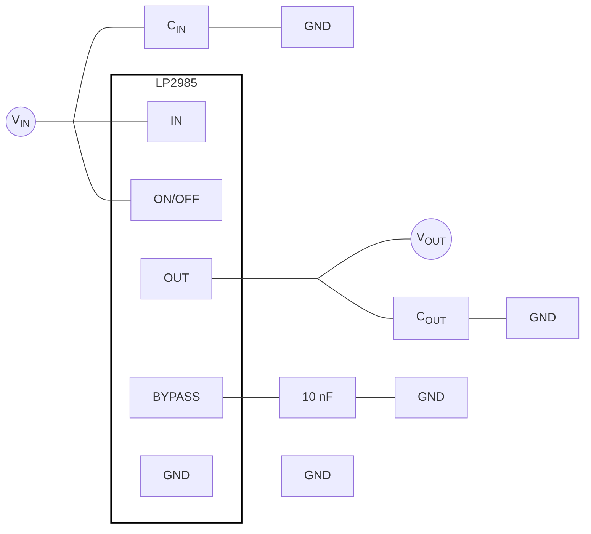
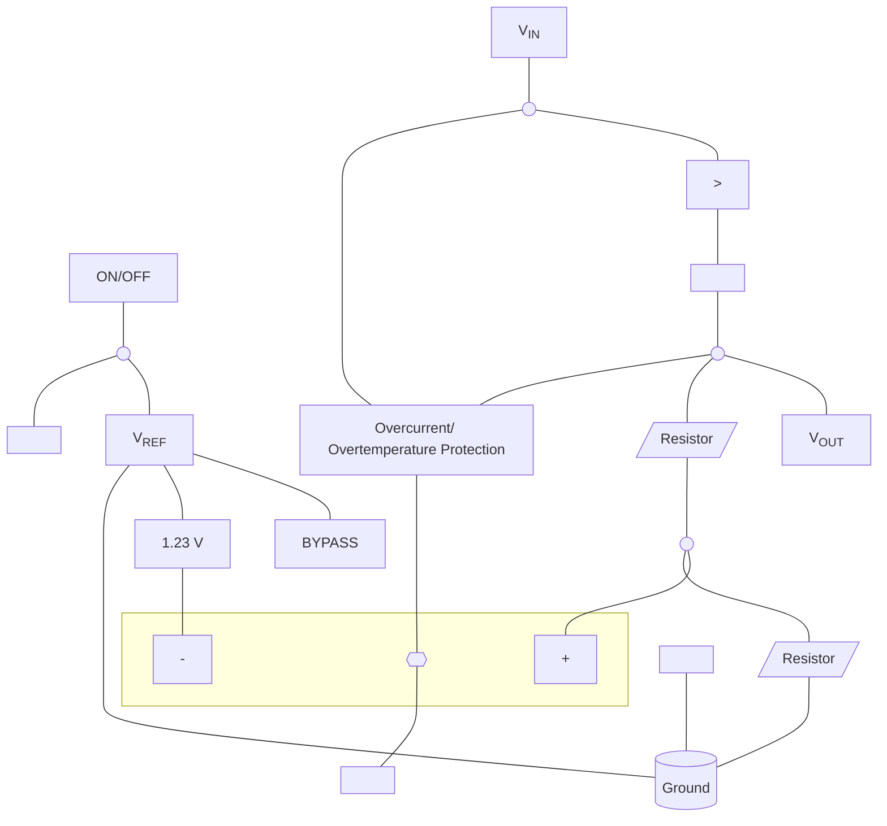
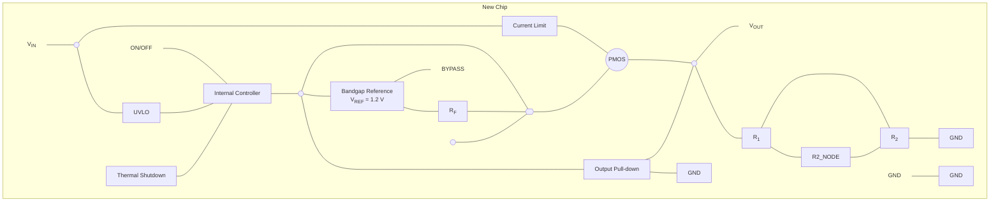
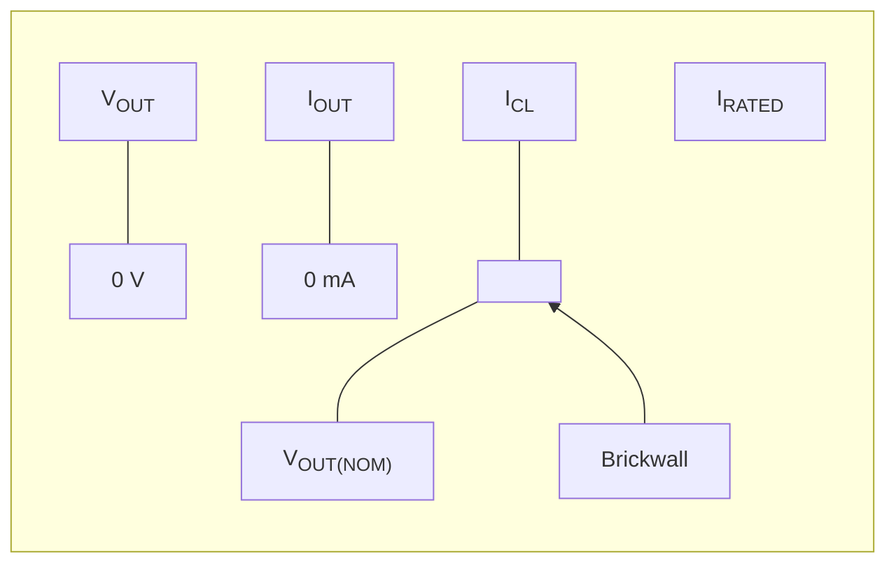
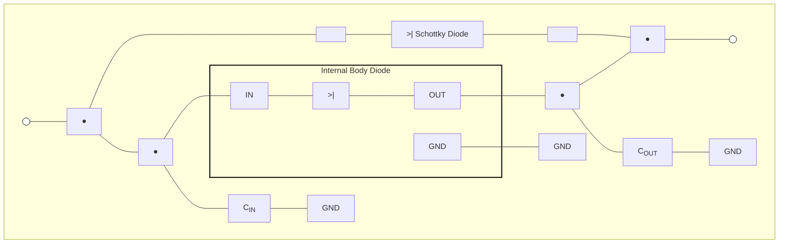
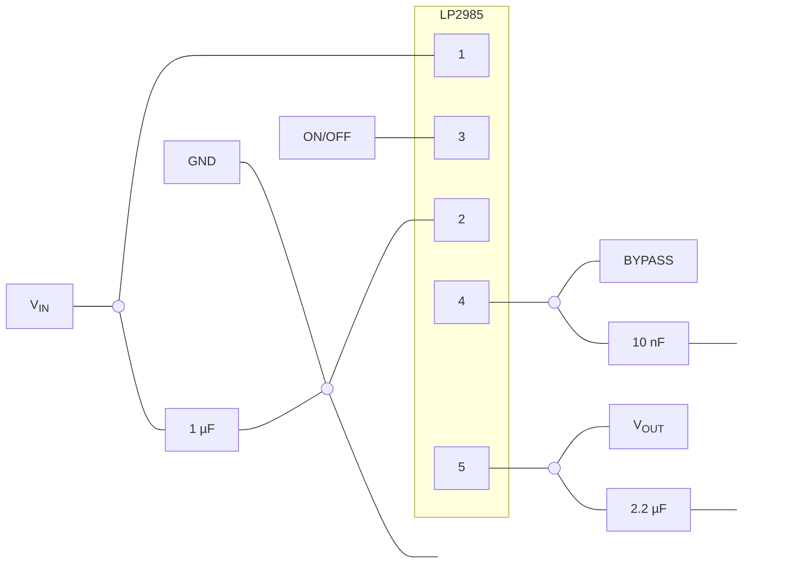
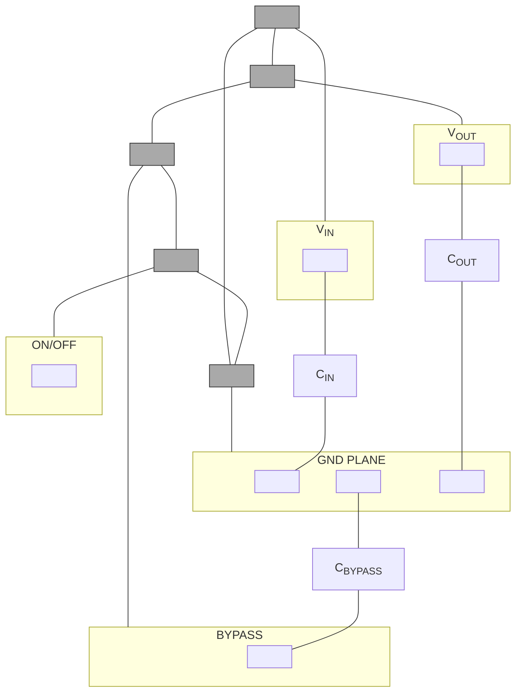
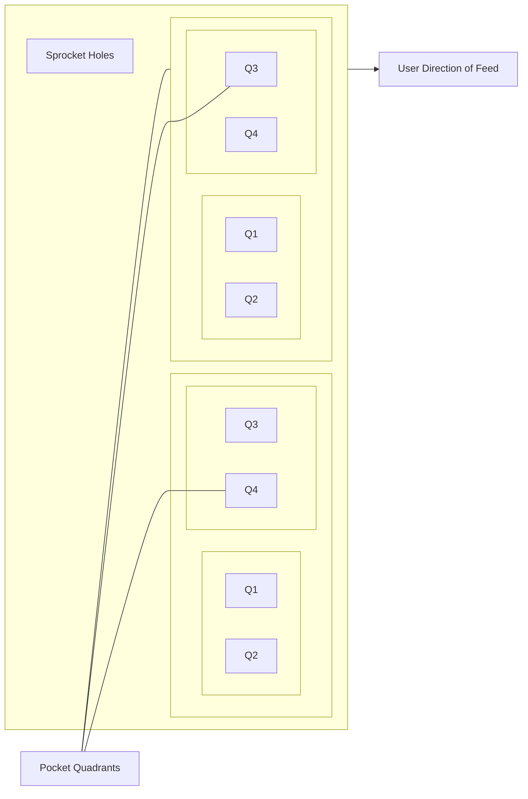

# LP2985 LDO datasheet

<!-- Original PDF: LP2985.pdf -->

<!-- PDF page 1 -->

# **LP2985 150mA, Low-Noise, Low-Dropout Regulator With Shutdown**

## **1 Features**

* VIN range (new chip): 2.5V to 16V
* VOUT range (new chip):
  – 1.2V to 5.0V (fixed, 100mV steps)
* VOUT accuracy:
  – ±1% for A-grade (legacy chip)
  – ±1.5% for standard-grade (legacy chip)
  – ±0.5% (new chip)
* ±1% output accuracy over load and temperature (new chip)
* Output current: Up to 150mA
* Low IQ (new chip): 71μA at ILOAD = 0mA
* Low IQ (new chip): 750μA at ILOAD = 150mA
* Shutdown current:
  – 0.01μA (typ, legacy chip)
  – 1.12μA (typ, new chip)
* Low noise: 30μVRMS with 10nF bypass capacitor
* Output current limiting and thermal protection
* Stable with 2.2µF ceramic capacitors (new chip)
* High PSRR: 70dB at 1kHz, 40dB at 1MHz (new chip)
* Operating junction temperature: –40°C to +125°C
* Package: 5-pin SOT-23 (DBV)

## **2 Applications**

* Washer and dryer
* Land mobile radio
* Active antenna system mMIMO
* Cordless power tool
* Motor drives and control boards

## **3 Description**

The LP2985 is a fixed-output, wide-input, low-noise, low-dropout voltage regulator supporting an input voltage range from 2.5V to 16V (for new chip) and up to 150mA of load current. The LP2985 supports an output range of 1.2V to 5.0V (for new chip).

Additionally, the LP2985 (new chip) has a ±1% output accuracy across load, and temperature that can meet the needs of low-voltage microcontrollers (MCUs) and processors.

Low output noise of 30µVRMS (with 10nF bypass capacitors) and wide bandwidth PSRR performance of greater than 70dB at 1kHz and 40dB at 1MHz help attenuate the switching frequency of an upstream DC/DC converter and minimize post regulator filtering.

The new chip provides internal soft-start mechanism to reduce inrush current during start up, thus minimizing input capacitance. Standard protection features, such as overcurrent and overtemperature protection, are also included.

The LP2985 is available in a 5-pin 2.9mm × 2.8mm SOT-23 (DBV) package.

### **Package Information**

<table>
  <thead>
    <tr>
      <th><b>PART</b> <b>NUMBER</b></th>
      <th><b>PACKAGE</b>(1)</th>
      <th><b>PACKAGING SIZE</b>(2)</th>
    </tr>
  </thead>
  <tbody>
    <tr>
      <td>LP2985</td>
      <td>DBV (SOT-23, 5)</td>
      <td>2.9mm × 2.8mm</td>
    </tr>
  </tbody>
</table>

(1) For more information, see the <i>Mechanical, Packaging, and Orderable Information</i>.
(2) The package size (length × width) is a nominal value and includes pins, where applicable.

<table>
  <caption>**Dropout Voltage vs Temperature (New Chip)** — Dropout (mV) vs Temperature (°C) for various Iout</caption>
  <thead>
    <tr>
      <th rowspan="2">Temperature (°C)</th>
      <th colspan="4">Iout</th>
    </tr>
    <tr>
      <th>1mA</th>
      <th>10mA</th>
      <th>50mA</th>
      <th>150mA</th>
    </tr>
  </thead>
  <tbody>
    <tr>
      <th>-50</th>
      <td>10</td>
      <td>76</td>
      <td>93</td>
      <td>134</td>
    </tr>
    <tr>
      <th>-25</th>
      <td>10</td>
      <td>82</td>
      <td>102</td>
      <td>147</td>
    </tr>
    <tr>
      <th>0</th>
      <td>11</td>
      <td>88</td>
      <td>111</td>
      <td>159</td>
    </tr>
    <tr>
      <th>25</th>
      <td>11</td>
      <td>95</td>
      <td>120</td>
      <td>172</td>
    </tr>
    <tr>
      <th>50</th>
      <td>12</td>
      <td>102</td>
      <td>129</td>
      <td>185</td>
    </tr>
    <tr>
      <th>75</th>
      <td>12</td>
      <td>110</td>
      <td>138</td>
      <td>198</td>
    </tr>
    <tr>
      <th>100</th>
      <td>13</td>
      <td>116</td>
      <td>147</td>
      <td>212</td>
    </tr>
    <tr>
      <th>125</th>
      <td>14</td>
      <td>122</td>
      <td>156</td>
      <td>225</td>
    </tr>
    <tr>
      <th>150</th>
      <td>14</td>
      <td>123</td>
      <td>166</td>
      <td>238</td>
    </tr>
  </tbody>
</table>

**Typical Application Circuit**

<!-- PDF page 2 -->

# **Table of Contents**

<table><tr><td><strong><b>1 Features</b></strong>............................................................................</td><td>1</td><td><strong><b>7 Application and Implementation</b></strong>..................................</td><td>20</td></tr><tr><td><strong><b>2 Applications</b></strong>.....................................................................</td><td>1</td><td>    7.1 Application Information.............................................</td><td>20</td></tr><tr><td><strong><b>3 Description</b></strong>.......................................................................</td><td>1</td><td>    7.2 Typical Application....................................................</td><td>24</td></tr><tr><td><strong><b>4 Pin Configuration and Functions</b></strong>...................................</td><td>3</td><td>    7.3 Power Supply Recommendations.............................</td><td>29</td></tr><tr><td><strong><b>5 Specifications</b></strong>..................................................................</td><td>4</td><td>    7.4 Layout.......................................................................</td><td>29</td></tr><tr><td>    5.1 Absolute Maximum Ratings........................................</td><td>4</td><td><strong><b>8 Device and Documentation Support</b></strong>............................</td><td>30</td></tr><tr><td>    5.2 ESD Ratings...............................................................</td><td>4</td><td>    8.1 Device Support.........................................................</td><td>30</td></tr><tr><td>    5.3 Recommended Operating Conditions.........................</td><td>4</td><td>    8.2 Receiving Notification of Documentation Updates....</td><td>30</td></tr><tr><td>    5.4 Thermal Information....................................................</td><td>5</td><td>    8.3 Support Resources...................................................</td><td>30</td></tr><tr><td>    5.5 Electrical Characteristics.............................................</td><td>5</td><td>    8.4 Trademarks...............................................................</td><td>30</td></tr><tr><td>    5.6 Typical Characteristics................................................</td><td>8</td><td>    8.5 Electrostatic Discharge Caution................................</td><td>30</td></tr><tr><td><strong><b>6 Detailed Description</b></strong>......................................................</td><td>15</td><td>    8.6 Glossary....................................................................</td><td>30</td></tr><tr><td>    6.1 Overview...................................................................</td><td>15</td><td><strong><b>9 Revision History</b></strong>............................................................</td><td>31</td></tr><tr><td>    6.2 Functional Block Diagrams.......................................</td><td>15</td><td><strong><b>10 Mechanical, Packaging, and Orderable</b></strong></td><td></td></tr><tr><td>    6.3 Feature Description...................................................</td><td>16</td><td>    <strong>Information</strong>....................................................................</td><td>31</td></tr><tr><td>    6.4 Device Functional Modes..........................................<b>PIN</b> <b>NAME</b></td><td>18 <b>PIN</b> <b>NO.</b></td><td><b>TYPE</b></td><td><b>DESCRIPTION</b></td></tr><tr><td>BYPASS</td><td>4</td><td>I/O</td><td>BYPASS pin to achieve low noise performance. Connecting an external capacitor between BYPASS pin and ground reduces reference voltage noise. See the <i>Recommended Operating Conditions</i> section for more information.</td></tr><tr><td>GND</td><td>2</td><td>—</td><td>Ground</td></tr><tr><td>ON/<u>OFF</u></td><td>3</td><td>I</td><td>Enable pin for the LDO. Driving the ON/<u>OFF</u> pin high enables the device. Driving this pin low disables the device. High and low thresholds are listed in the <i>Electrical Characteristics</i> table. Tie this pin to VIN if unused.</td></tr><tr><td>VIN</td><td>1</td><td>I</td><td>Input supply pin. Use a capacitor with a value of 1 µF or larger from this pin to ground. See the <i>Input and Output Capacitor Requirements</i> section for more information.</td></tr><tr><td>VOUT</td><td>5</td><td>O</td><td>Output of the regulator. Use a capacitor with a value of 2.2 µF or larger from this pin to ground.(1) See the <i>Input and Output Capacitor Requirements</i> section for more information.</td></tr></table>

<!-- PDF page 3 -->

# **4 Pin Configuration and Functions**

**Figure 4-1. DBV Package, 5-Pin SOT-23 (Top View)**

(1) The nominal output capacitance must be greater than 1 μF. Throughout this document, the nominal derating on these capacitors is 50%. Make sure that the effective capacitance at the pin is greater than 1 μF.

<!-- PDF page 4 -->

# **5 Specifications**

## **5.1 Absolute Maximum Ratings**

over operating free-air temperature range (unless otherwise noted)(1) (2)

<table>
  <thead>
    <tr>
      <th colspan="2"></th>
      <th>MIN</th>
      <th>MAX</th>
      <th>UNIT</th>
    </tr>
  </thead>
  <tbody>
    <tr>
      <td rowspan="2">VIN</td>
      <td>Continuous input voltage range (for legacy chip)</td>
      <td>–0.3</td>
      <td>16</td>
      <td rowspan="7">V</td>
    </tr>
    <tr>
      <td>Continuous input voltage range (for new chip)</td>
      <td>–0.3</td>
      <td>18</td>
    </tr>
    <tr>
      <td rowspan="2">VOUT</td>
      <td>Output voltage range (for legacy chip)</td>
      <td>–0.3</td>
      <td>9</td>
    </tr>
    <tr>
      <td>Output voltage range (for new chip)</td>
      <td>–0.3</td>
      <td>VIN + 0.3 or 9 (whichever is smaller)</td>
    </tr>
    <tr>
      <td>VBYPASS</td>
      <td>BYPASS pin voltage range (for new chip)</td>
      <td>–0.3</td>
      <td>3</td>
    </tr>
    <tr>
      <td rowspan="2">VON/OFF</td>
      <td>ON/OFF pin voltage range (for legacy chip)</td>
      <td>–0.3</td>
      <td>16</td>
    </tr>
    <tr>
      <td>ON/OFF pin voltage range (for new chip)</td>
      <td>–0.3</td>
      <td>18</td>
    </tr>
    <tr>
      <td>Current</td>
      <td>Maximum output</td>
      <td colspan="2">Internally limited</td>
      <td>A</td>
    </tr>
    <tr>
      <td rowspan="2">Temperature</td>
      <td>Operating junction, TJ</td>
      <td>–55</td>
      <td>150</td>
      <td rowspan="2">°C</td>
    </tr>
    <tr>
      <td>Storage, Tstg</td>
      <td>–65</td>
      <td>150</td>
    </tr>
  </tbody>
</table>

(1) Stresses beyond those listed under <i>Absolute Maximum Ratings</i> may cause permanent damage to the device. These are stress ratings only, which do not imply functional operation of the device at these or any other conditions beyond those indicated under <i>Recommended Operating Conditions</i>. Exposure to absolute-maximum-rated conditions for extended periods may affect device reliability.
(2) All voltages with respect to GND.

## **5.2 ESD Ratings**

<table>
  <thead>
    <tr>
      <th></th>
      <th></th>
      <th></th>
      <th>VALUE <b>(Legacy</b> Chip)</th>
      <th>VALUE <b>(New</b> Chip)</th>
      <th>UNIT</th>
    </tr>
  </thead>
  <tbody>
    <tr>
      <td rowspan="2">V(ESD)</td>
      <td rowspan="2">Electrostatic discharge</td>
      <td>Human body model (HBM), per ANSI/ESDA/JEDEC JS-001(1)</td>
      <td>±2000</td>
      <td>±3000</td>
      <td rowspan="2">V</td>
    </tr>
    <tr>
      <td>Charged device model (CDM), per JEDEC specification JESD22-C101(2)</td>
      <td>±500</td>
      <td>±1000</td>
    </tr>
  </tbody>
</table>

(1) JEDEC document JEP155 states that 2-kV HBM allows safe manufacturing with a standard ESD control process.
(2) JEDEC document JEP157 states that 500-V CDM allows safe manufacturing with a standard ESD control process.

## **5.3 Recommended Operating Conditions**

<table>
  <thead>
    <tr>
      <th colspan="2"></th>
      <th>MIN</th>
      <th><b>NOM</b></th>
      <th>MAX</th>
      <th>UNIT</th>
    </tr>
  </thead>
  <tbody>
    <tr>
      <td rowspan="2">VIN</td>
      <td>Supply input voltage (for legacy chip)</td>
      <td>2.2</td>
      <td></td>
      <td>16</td>
      <td rowspan="2">V</td>
    </tr>
    <tr>
      <td>Supply input voltage (for new chip)</td>
      <td>2.5</td>
      <td></td>
      <td>16</td>
    </tr>
    <tr>
      <td rowspan="2">VOUT</td>
      <td>Output voltage (for legacy chip)</td>
      <td>1.2</td>
      <td></td>
      <td>10.0</td>
      <td rowspan="2">V</td>
    </tr>
    <tr>
      <td>Output voltage (for new chip)</td>
      <td>1.2</td>
      <td></td>
      <td>5.0</td>
    </tr>
    <tr>
      <td>VBYPASS</td>
      <td>Bypass voltage</td>
      <td></td>
      <td>1.2</td>
      <td></td>
      <td>V</td>
    </tr>
    <tr>
      <td rowspan="2">VON/OFF</td>
      <td>Enable voltage (for legacy chip)</td>
      <td>0</td>
      <td></td>
      <td>VIN</td>
      <td rowspan="2">V</td>
    </tr>
    <tr>
      <td>Enable voltage (for new chip)</td>
      <td>0</td>
      <td></td>
      <td>16</td>
    </tr>
    <tr>
      <td>IOUT</td>
      <td>Output current</td>
      <td>0</td>
      <td></td>
      <td>150</td>
      <td>mA</td>
    </tr>
    <tr>
      <td>CIN (1)</td>
      <td>Input capacitor</td>
      <td></td>
      <td>1</td>
      <td></td>
      <td>μF</td>
    </tr>
    <tr>
      <td rowspan="2">COUT</td>
      <td>Output capacitance (for legacy chip)</td>
      <td>2.2</td>
      <td>4.7</td>
      <td></td>
      <td rowspan="2">μF</td>
    </tr>
    <tr>
      <td>Output capacitance (for new chip) (1)</td>
      <td>1</td>
      <td>2.2</td>
      <td>200</td>
    </tr>
    <tr>
      <td>COUT ESR(3)</td>
      <td>Output capacitor ESR (for new chip)(2)</td>
      <td>0</td>
      <td></td>
      <td>1</td>
      <td>Ω</td>
    </tr>
    <tr>
      <td>TJ</td>
      <td>Operating junction temperature</td>
      <td>–40</td>
      <td></td>
      <td>125</td>
      <td>°C</td>
    </tr>
  </tbody>
</table>

(1) All capacitor values are assumed to derate to 50% of the nominal capacitor value. Maintain an effective output capacitance of 1 μF minimum for stability.
(2) Details related to supported ESR range for the legacy chip are available in <i>Recommended Capacitors for the Legacy Chip</i>
(3) Maximum supported ESR range for new chip is 1Ω. For output capacitor with higher ESR values, place a low ESR MLCC capacitor with value of 100nF, close to the output pin of the LDO.

<!-- PDF page 5 -->

## 5.4 Thermal Information

<table>
  <thead>
    <tr>
      <th colspan="2" rowspan="3"><b>THERMAL METRIC</b> (2) (1)</th>
      <th>Legacy Chip</th>
      <th>New Chip</th>
      <th rowspan="3">UNIT</th>
    </tr>
    <tr>
      <th>DBV (SOT23-5)</th>
      <th>DBV (SOT23-5)</th>
    </tr>
    <tr>
      <th>5 PINS</th>
      <th>5 PINS</th>
    </tr>
  </thead>
  <tbody>
    <tr>
      <td>RθJA</td>
      <td>Junction-to-ambient thermal resistance</td>
      <td>205.4</td>
      <td>178.6</td>
      <td>°C/W</td>
    </tr>
    <tr>
      <td>RθJC(top)</td>
      <td>Junction-to-case (top) thermal resistance</td>
      <td>78.8</td>
      <td>77.9</td>
      <td>°C/W</td>
    </tr>
    <tr>
      <td>RθJB</td>
      <td>Junction-to-board thermal resistance</td>
      <td>46.7</td>
      <td>47.2</td>
      <td>°C/W</td>
    </tr>
    <tr>
      <td>ψJT</td>
      <td>Junction-to-top characterization parameter</td>
      <td>8.3</td>
      <td>15.9</td>
      <td>°C/W</td>
    </tr>
    <tr>
      <td>ψJB</td>
      <td>Junction-to-board characterization parameter</td>
      <td>46.3</td>
      <td>46.9</td>
      <td>°C/W</td>
    </tr>
  </tbody>
</table>

(1) For more information about traditional and new thermal metrics, see the Semiconductor and IC Package Thermal Metrics application note.
(2) Thermal performance results are based on the JEDEC standard of 2s2p PCB configuration. These thermal metric parameters can be further improved by 35-55% based on thermally optimized PCB layout designs. See the analysis of the Impact of board layout on LDO thermal performance application note.

## 5.5 Electrical Characteristics

specified at $T_J = 25°C$, $V_{IN} = V_{OUT(nom)} + 1.0 V$ or $V_{IN} = 2.5 V$ (whichever is greater), $I_{OUT} = 1 mA$, $V_{ON/OFF} = 2 V$, $C_{IN} = 1.0 \mu F$, and $C_{OUT} = 2.2 \mu F$ (unless otherwise noted)

<table><thead><tr><th><b>PARAMETER</b></th><th><b>PARAMETER</b></th><th><b>TEST CONDITIONS</b></th><th><b>TEST CONDITIONS</b></th><th>MIN</th><th>TYP</th><th>MAX</th><th>UNIT</th></tr></thead><tbody><tr><td>ΔVOUT</td><td>Output voltage tolerance</td><td>IL = 1 mA</td><td>Legacy chip (standard grade)</td><td>–1.5</td><td></td><td>1.5</td><td>%</td></tr><tr><td></td><td></td><td></td><td>Legacy chip (A grade)</td><td>–1.0</td><td></td><td>1.0</td><td></td></tr><tr><td></td><td></td><td></td><td>New chip</td><td>–0.5</td><td></td><td>0.5</td><td></td></tr><tr><td></td><td></td><td>1 mA ≤ IL ≤ 50 mA</td><td>Legacy chip (standard grade)</td><td>–2.5</td><td></td><td>2.5</td><td></td></tr><tr><td></td><td></td><td></td><td>Legacy chip (A grade)</td><td>–1.5</td><td></td><td>1.5</td><td></td></tr><tr><td></td><td></td><td></td><td>New chip</td><td>–0.5</td><td></td><td>0.5</td><td></td></tr><tr><td></td><td></td><td>1 mA ≤ IL ≤ 150 mA</td><td>Legacy chip (standard grade)</td><td>–3.0</td><td></td><td>3.0</td><td></td></tr><tr><td></td><td></td><td></td><td>Legacy chip (A grade)</td><td>–2.5</td><td></td><td>2.5</td><td></td></tr><tr><td></td><td></td><td></td><td>New chip</td><td>–0.5</td><td></td><td>0.5</td><td></td></tr><tr><td></td><td></td><td>1 mA ≤ IL ≤ 50 mA, –40°C ≤ TJ ≤ 125°C</td><td>Legacy chip (standard grade)</td><td>–3.5</td><td></td><td>3.5</td><td></td></tr><tr><td></td><td></td><td></td><td>Legacy chip (A grade)</td><td>–2.5</td><td></td><td>2.5</td><td></td></tr><tr><td></td><td></td><td></td><td>New chip</td><td>–1</td><td></td><td>1</td><td></td></tr><tr><td></td><td></td><td>1 mA ≤ IL ≤ 150 mA, –40°C ≤ TJ ≤ 125°C</td><td>Legacy chip (standard grade)</td><td>–4.0</td><td></td><td>4.0</td><td></td></tr><tr><td></td><td></td><td></td><td>Legacy chip (A grade)</td><td>–3.5</td><td></td><td>3.5</td><td></td></tr><tr><td></td><td></td><td></td><td>New chip</td><td>–1</td><td></td><td>1</td><td></td></tr><tr><td>ΔVOUT(ΔVIN)</td><td>Line regulation</td><td>VO(NOM) + 1 V ≤ VIN ≤ 16 V</td><td>Legacy chip</td><td></td><td>0.007</td><td>0.014</td><td>%/V</td></tr><tr><td></td><td></td><td></td><td>New chip</td><td></td><td>0.002</td><td>0.014</td><td></td></tr><tr><td></td><td></td><td>VO(NOM) + 1 V ≤ VIN ≤ 16 V, –40°C ≤ TJ ≤ 125°C</td><td>Legacy chip</td><td></td><td>0.007</td><td>0.032</td><td></td></tr><tr><td></td><td></td><td></td><td>New chip</td><td></td><td>0.002</td><td>0.032</td><td></td></tr><tr><td>VIN - VOUT</td><td>Dropout voltage(1)</td><td>IOUT = 0 mA</td><td>Legacy chip</td><td></td><td>1</td><td>3</td><td>mV</td></tr><tr><td></td><td></td><td></td><td>New chip</td><td></td><td>1</td><td>2.75</td><td></td></tr><tr><td></td><td></td><td>IOUT = 0 mA, –40°C ≤ TJ ≤ 125°C</td><td>Legacy chip</td><td></td><td></td><td>5</td><td></td></tr><tr><td></td><td></td><td></td><td>New chip</td><td></td><td></td><td>3</td><td></td></tr><tr><td></td><td></td><td>IOUT = 1 mA</td><td>Legacy chip</td><td></td><td>7</td><td>10</td><td></td></tr><tr><td></td><td></td><td></td><td>New chip</td><td></td><td>11.5</td><td>14</td><td></td></tr><tr><td></td><td></td><td>IOUT = 1 mA, –40°C ≤ TJ ≤ 125°C</td><td>Legacy chip</td><td></td><td></td><td>15</td><td></td></tr><tr><td></td><td></td><td></td><td>New chip</td><td></td><td></td><td>17</td><td></td></tr><tr><td></td><td></td><td>IOUT = 10 mA</td><td>Legacy chip</td><td></td><td>40</td><td>60</td><td></td></tr><tr><td></td><td></td><td></td><td>New chip</td><td></td><td>98</td><td>115</td><td></td></tr><tr><td></td><td></td><td>IOUT = 10 mA, –40°C ≤ TJ ≤ 125°C</td><td>Legacy chip</td><td></td><td></td><td>90</td><td></td></tr><tr><td></td><td></td><td></td><td>New chip</td><td></td><td></td><td>148</td><td></td></tr><tr><td></td><td></td><td>IOUT = 50 mA</td><td>Legacy chip</td><td></td><td>120</td><td>150</td><td></td></tr><tr><td></td><td></td><td></td><td>New chip</td><td></td><td>120</td><td>145</td><td></td></tr><tr><td></td><td></td><td>IOUT = 50 mA, –40°C ≤ TJ ≤ 125°C</td><td>Legacy chip</td><td></td><td></td><td>225</td><td></td></tr><tr><td></td><td></td><td></td><td>New chip</td><td></td><td></td><td>184</td><td></td></tr><tr><td></td><td></td><td>IOUT = 150 mA</td><td>Legacy chip</td><td></td><td>280</td><td>350</td><td></td></tr><tr><td></td><td></td><td></td><td>New chip</td><td></td><td>180</td><td>198</td><td></td></tr><tr><td></td><td></td><td>IOUT = 150 mA, –40°C ≤ TJ ≤ 125°C</td><td>Legacy chip</td><td></td><td></td><td>575</td><td></td></tr><tr><td></td><td></td><td></td><td>New chip</td><td></td><td></td><td>254</td><td></td></tr><tr><td>IGND</td><td>GND pin current</td><td>IOUT = 0 mA</td><td>Legacy chip</td><td></td><td>65</td><td>95</td><td>µA</td></tr><tr><td></td><td></td><td></td><td>New chip</td><td></td><td>69</td><td>95</td><td></td></tr><tr><td></td><td></td><td>IOUT = 0 mA, –40°C ≤ TJ ≤ 125°C</td><td>Legacy chip</td><td></td><td></td><td>125</td><td></td></tr><tr><td></td><td></td><td></td><td>New chip</td><td></td><td></td><td>123</td><td></td></tr><tr><td></td><td></td><td>IOUT = 1 mA</td><td>Legacy chip</td><td></td><td>75</td><td>110</td><td></td></tr><tr><td></td><td></td><td></td><td>New chip</td><td></td><td>78</td><td>110</td><td></td></tr><tr><td></td><td></td><td>IOUT = 1 mA, –40°C ≤ TJ ≤ 125°C</td><td>Legacy chip</td><td></td><td></td><td>170</td><td></td></tr><tr><td></td><td></td><td></td><td>New chip</td><td></td><td></td><td>140</td><td></td></tr><tr><td>IGND</td><td>GND pin current</td><td>IOUT = 10 mA</td><td>Legacy chip</td><td></td><td>120</td><td>220</td><td>µA</td></tr><tr><td></td><td></td><td></td><td>New chip</td><td></td><td>175</td><td>210</td><td></td></tr><tr><td></td><td></td><td>IOUT = 10 mA, –40°C ≤ TJ ≤ 125°C</td><td>Legacy chip</td><td></td><td></td><td>400</td><td></td></tr><tr><td></td><td></td><td></td><td>New chip</td><td></td><td></td><td>250</td><td></td></tr><tr><td>IGND</td><td>GND pin current</td><td>IOUT = 50 mA</td><td>Legacy chip</td><td></td><td>350</td><td>600</td><td>µA</td></tr><tr><td></td><td></td><td></td><td>New chip</td><td></td><td>380</td><td>440</td><td></td></tr><tr><td>IGND</td><td>GND pin current</td><td>IOUT = 50 mA, –40°C ≤ TJ ≤ 125°C</td><td>Legacy chip</td><td></td><td></td><td>900</td><td>µA</td></tr><tr><td>IGND</td><td>GND pin current</td><td>IOUT = 50 mA, –40°C ≤ TJ ≤ 125°C</td><td>New chip</td><td></td><td></td><td>650</td><td>µA</td></tr><tr><td>IGND</td><td>GND pin current</td><td>IOUT = 150 mA</td><td>Legacy chip</td><td></td><td>850</td><td>1200</td><td>µA</td></tr><tr><td>IGND</td><td>GND pin current</td><td>IOUT = 150 mA</td><td>New chip</td><td></td><td>765</td><td>890</td><td>µA</td></tr><tr><td>IGND</td><td>GND pin current</td><td>IOUT = 150 mA, –40°C ≤ TJ ≤ 125°C</td><td>Legacy chip</td><td></td><td></td><td>2000</td><td>µA</td></tr><tr><td>IGND</td><td>GND pin current</td><td>IOUT = 150 mA, –40°C ≤ TJ ≤ 125°C</td><td>New chip</td><td></td><td></td><td>1060</td><td>µA</td></tr><tr><td>IGND</td><td>GND pin current</td><td>VON/OFF &#x3C; 0.3 V, VIN = 16 V</td><td>Legacy chip</td><td></td><td>0.01</td><td>0.08</td><td>µA</td></tr><tr><td>IGND</td><td>GND pin current</td><td>VON/OFF &#x3C; 0.3 V, VIN = 16 V</td><td>New chip</td><td></td><td>1.25</td><td>1.75</td><td>µA</td></tr><tr><td>IGND</td><td>GND pin current</td><td>VON/OFF &#x3C; 0.15 V, VIN = 16 V, –40°C ≤ TJ ≤ 85°C</td><td>Legacy chip</td><td></td><td>0</td><td>1</td><td>µA</td></tr><tr><td>IGND</td><td>GND pin current</td><td>VON/OFF &#x3C; 0.15 V, VIN = 16 V, –40°C ≤ TJ ≤ 85°C</td><td>New chip</td><td></td><td>1.12</td><td>2.25</td><td>µA</td></tr><tr><td>IGND</td><td>GND pin current</td><td>VON/OFF &#x3C; 0.15 V, VIN = 16 V, –40°C ≤ TJ ≤ 125°C</td><td>Legacy chip</td><td></td><td>0.01</td><td>2</td><td>µA</td></tr><tr><td>IGND</td><td>GND pin current</td><td>VON/OFF &#x3C; 0.15 V, VIN = 16 V, –40°C ≤ TJ ≤ 125°C</td><td>New chip</td><td></td><td>1.12</td><td>2.75</td><td>µA</td></tr><tr><td>VUVLO+</td><td>Rising bias supply UVLO</td><td>VIN rising, –40°C ≤ TJ ≤ 125°C</td><td>New chip</td><td></td><td>2.2</td><td>2.4</td><td>V</td></tr><tr><td>VUVLO-</td><td>Falling bias supply UVLO</td><td>VIN falling, –40°C ≤ TJ ≤ 125°C</td><td></td><td>1.9</td><td></td><td></td><td>V</td></tr><tr><td>VUVLO(HYST)</td><td>UVLO hysteresis</td><td>–40°C ≤ TJ ≤ 125°C</td><td></td><td></td><td>0.130</td><td></td><td>V</td></tr><tr><td>VON/OFF</td><td>ON/OFF input voltage</td><td>Low = Output OFF</td><td>Legacy chip</td><td></td><td>0.55</td><td></td><td>V</td></tr><tr><td></td><td></td><td></td><td>New chip</td><td></td><td>0.72</td><td></td><td></td></tr><tr><td></td><td></td><td>Low = Output OFF, VOUT + 1 ≤ VIN ≤ 16 V, –40°C ≤ TJ ≤ 125°C</td><td>Legacy chip</td><td></td><td></td><td>0.15</td><td></td></tr><tr><td></td><td></td><td></td><td>New chip</td><td></td><td></td><td>0.15</td><td></td></tr><tr><td></td><td></td><td>High = Output ON</td><td>Legacy chip</td><td></td><td>1.4</td><td></td><td></td></tr><tr><td></td><td></td><td></td><td>New chip</td><td></td><td>0.85</td><td></td><td></td></tr><tr><td></td><td></td><td>High = Output ON, VOUT + 1 ≤ VIN ≤ 16 V, –40°C ≤ TJ ≤ 125°C</td><td>Legacy chip</td><td>1.6</td><td></td><td></td><td></td></tr><tr><td></td><td></td><td></td><td>New chip</td><td>1.6</td><td></td><td></td><td></td></tr><tr><td>ION/OFF</td><td>ON/OFF input current</td><td>VON/OFF = 0 V</td><td>Legacy chip</td><td></td><td>0.01</td><td></td><td>µA</td></tr><tr><td></td><td></td><td></td><td>New chip</td><td></td><td>0.42</td><td></td><td></td></tr><tr><td>ION/OFF</td><td>ON/OFF input current</td><td>VON/OFF = 0 V, VOUT + 1 ≤ VIN ≤ 16 V, –40°C ≤ TJ ≤ 125°C</td><td>Legacy chip</td><td></td><td></td><td>-1</td><td>µA</td></tr><tr><td></td><td></td><td></td><td>New chip</td><td></td><td></td><td>-0.9</td><td>µA</td></tr><tr><td></td><td></td><td>VON/OFF = 5 V</td><td>Legacy chip</td><td></td><td>5</td><td></td><td>µA</td></tr><tr><td></td><td></td><td></td><td>New chip</td><td></td><td>0.011</td><td></td><td>µA</td></tr><tr><td></td><td></td><td>VON/OFF = 5 V, VOUT + 1 ≤ VIN ≤ 16 V, –40°C ≤ TJ ≤ 125°C</td><td>Legacy chip</td><td></td><td></td><td>15</td><td>µA</td></tr><tr><td></td><td></td><td></td><td>New chip</td><td></td><td></td><td>2.20</td><td>µA</td></tr><tr><td>IO(PK)</td><td>Peak output current</td><td>VOUT ≥ VO(NOM) –5% (steady state)</td><td>Legacy chip</td><td>300</td><td>350</td><td></td><td>mA</td></tr><tr><td></td><td></td><td></td><td>New chip</td><td>300</td><td>350</td><td></td><td></td></tr><tr><td>IO(SC)</td><td>Short output current</td><td>RL = 0 Ω (steady state)</td><td>Legacy chip</td><td></td><td>400</td><td></td><td></td></tr><tr><td></td><td></td><td></td><td>New chip</td><td></td><td>375</td><td></td><td></td></tr><tr><td>ΔVO/ΔVIN</td><td>Ripple rejection</td><td>f = 1 kHz, CBYPASS = 10 nF, COUT = 10 µF</td><td>Legacy chip</td><td></td><td>45</td><td></td><td>dB</td></tr><tr><td></td><td></td><td></td><td>New chip</td><td></td><td>78</td><td></td><td></td></tr><tr><td>Vn</td><td>Output noise voltage</td><td>Bandwidth = 300 Hz to 50 kHz, CBYPASS = 10 nF, COUT = 2.2 µF, VOUT = 3.3 V, ILOAD = 150 mA</td><td>Legacy chip</td><td></td><td>30</td><td></td><td>µVRMS</td></tr><tr><td></td><td></td><td>Bandwidth = 300 Hz to 50 kHz, CBYPASS = 10 nF, COUT = 2.2 µF, VOUT = 3.3 V, ILOAD = 150 mA</td><td>New chip</td><td></td><td>30</td><td></td><td></td></tr><tr><td>Tsd+</td><td>Thermal shutdown threshold</td><td>Shutdown, temperature increasing</td><td>New chip</td><td></td><td>170</td><td></td><td>°C</td></tr><tr><td>Tsd-</td><td></td><td>Reset, temperature decreasing</td><td></td><td></td><td>150</td><td></td><td></td></tr></tbody></table>

<!-- PDF page 6 -->

## **5.5 Electrical Characteristics (continued)**

specified at TJ = 25°C, VIN = VOUT(nom) + 1.0 V or VIN = 2.5 V (whichever is greater), IOUT = 1 mA, VON/OFF = 2 V, CIN = 1.0 µF, and COUT = 2.2 µF (unless otherwise noted)

<!-- PDF page 7 -->

## **5.5 Electrical Characteristics (continued)**

specified at TJ = 25°C, VIN = VOUT(nom) + 1.0 V or VIN = 2.5 V (whichever is greater), IOUT = 1 mA, VON/OFF = 2 V, CIN = 1.0 µF, and COUT = 2.2 µF (unless otherwise noted)

(1) Dropout voltage (VDO) is defined as the input-to-output differential at which the output voltage drops 100 mV below the value measured with a 1 V differential. VDO is measured with VIN = VOUT(nom) – 100 mV for fixed output devices.

<!-- PDF page 8 -->

## **5.6 Typical Characteristics**

at operating temperature $T_J = 25^\circ\text{C}$, $V_{IN} = V_{OUT(NOM)} + 1.0\text{ V}$ or $2.5\text{ V}$ (whichever is greater), $I_{OUT} = 1\text{ mA}$, ON/$\overline{\text{OFF}}$ pin tied to $V_{IN}$, $C_{IN} = 1.0\text{ }\mu\text{F}$, and $C_{OUT} = 4.7\text{ }\mu\text{F}$ (unless otherwise noted)

<table>
  <caption>Figure 5-1. Output Voltage vs Temperature for Legacy Chip; VI = 11 V, VO = 10 V, CI = 1 µF, CO = 4.7 µF, IO = 1 mA</caption>
  <thead>
    <tr>
      <th><b>Temperature – °C</b></th>
      <th>Output Voltage – V</th>
    </tr>
  </thead>
  <tbody>
    <tr>
      <th>-50</th>
      <td></td>
    </tr>
    <tr>
      <th>-40</th>
      <td>9.900</td>
    </tr>
    <tr>
      <th>-25</th>
      <td>9.925</td>
    </tr>
    <tr>
      <th>0</th>
      <td>9.965</td>
    </tr>
    <tr>
      <th>10</th>
      <td>9.990</td>
    </tr>
    <tr>
      <th>25</th>
      <td>10.015</td>
    </tr>
    <tr>
      <th>50</th>
      <td>10.050</td>
    </tr>
    <tr>
      <th>75</th>
      <td>10.085</td>
    </tr>
    <tr>
      <th>85</th>
      <td>10.100</td>
    </tr>
    <tr>
      <th>100</th>
      <td>10.130</td>
    </tr>
    <tr>
      <th>125</th>
      <td>10.160</td>
    </tr>
    <tr>
      <th>150</th>
      <td></td>
    </tr>
  </tbody>
</table>

**Figure 5-1. Output Voltage vs Temperature for Legacy Chip**

<table>
  <caption>Figure 5-2. Output Voltage vs Temperature for Legacy Chip; **VI = 4.3 V**, VO = 3.3 V, **Ci = 1** µF, **Co = 4.7** µF, **IO = 1 mA**</caption>
  <thead>
    <tr>
      <th>Temperature (°C)</th>
      <th>Output Voltage (V)</th>
    </tr>
  </thead>
  <tbody>
    <tr>
      <th>-40</th>
      <td>3.298</td>
    </tr>
    <tr>
      <th>-25</th>
      <td>3.307</td>
    </tr>
    <tr>
      <th>0</th>
      <td>3.314</td>
    </tr>
    <tr>
      <th>25</th>
      <td>3.320</td>
    </tr>
    <tr>
      <th>50</th>
      <td>3.327</td>
    </tr>
    <tr>
      <th>75</th>
      <td>3.334</td>
    </tr>
    <tr>
      <th>100</th>
      <td>3.340</td>
    </tr>
    <tr>
      <th>125</th>
      <td>3.344</td>
    </tr>
  </tbody>
</table>

**Figure 5-2. Output Voltage vs Temperature for Legacy Chip**

<table>
  <caption>Figure 5-3. Output Voltage vs Temperature for New Chip; VI = 4.3 V, VO = 3.3 V, Iout = 1mA, CO = 4.7uF; VIN = 4.3 V, VOUT = 3.3 V (for new chip)</caption>
  <thead>
    <tr>
      <th>Temp °C</th>
      <th>Output Voltage (V)</th>
    </tr>
  </thead>
  <tbody>
    <tr>
      <th>-75</th>
      <td></td>
    </tr>
    <tr>
      <th>-50</th>
      <td>3.301</td>
    </tr>
    <tr>
      <th>-25</th>
      <td>3.300</td>
    </tr>
    <tr>
      <th>0</th>
      <td>3.299</td>
    </tr>
    <tr>
      <th>25</th>
      <td>3.298</td>
    </tr>
    <tr>
      <th>50</th>
      <td>3.297</td>
    </tr>
    <tr>
      <th>75</th>
      <td>3.296</td>
    </tr>
    <tr>
      <th>100</th>
      <td>3.293</td>
    </tr>
    <tr>
      <th>125</th>
      <td>3.290</td>
    </tr>
    <tr>
      <th>150</th>
      <td>3.283</td>
    </tr>
  </tbody>
</table>

**Figure 5-3. Output Voltage vs Temperature for New Chip**

<table>
  <caption>Figure 5-4. Dropout Voltage vs Temperature for Legacy Chip; VO = 3.3 V, Cbyp = 10 nF; Dropout - (V)</caption>
  <thead>
    <tr>
      <th>Temperature - (°C)</th>
      <th>1 mA</th>
      <th>10 mA</th>
      <th>50 mA</th>
      <th>150 mA</th>
    </tr>
  </thead>
  <tbody>
    <tr>
      <th>-50</th>
      <td>0.001</td>
      <td>0.022</td>
      <td>0.088</td>
      <td>0.250</td>
    </tr>
    <tr>
      <th>-25</th>
      <td>0.001</td>
      <td>0.022</td>
      <td>0.092</td>
      <td>0.250</td>
    </tr>
    <tr>
      <th>0</th>
      <td>0.001</td>
      <td>0.024</td>
      <td>0.100</td>
      <td>0.265</td>
    </tr>
    <tr>
      <th>25</th>
      <td>0.002</td>
      <td>0.026</td>
      <td>0.108</td>
      <td>0.285</td>
    </tr>
    <tr>
      <th>50</th>
      <td>0.002</td>
      <td>0.028</td>
      <td>0.118</td>
      <td>0.310</td>
    </tr>
    <tr>
      <th>75</th>
      <td>0.003</td>
      <td>0.030</td>
      <td>0.128</td>
      <td>0.340</td>
    </tr>
    <tr>
      <th>100</th>
      <td>0.003</td>
      <td>0.032</td>
      <td>0.138</td>
      <td>0.380</td>
    </tr>
    <tr>
      <th>125</th>
      <td>0.004</td>
      <td>0.035</td>
      <td>0.150</td>
      <td>0.425</td>
    </tr>
    <tr>
      <th>150</th>
      <td></td>
      <td></td>
      <td></td>
      <td></td>
    </tr>
  </tbody>
</table>

**Figure 5-4. Dropout Voltage vs Temperature for Legacy Chip**

<table>
  <caption>Figure 5-5. Dropout Voltage vs Temperature for New Chip; Iout: 1mA, 10mA, 50mA, 150mA; Dropout (mV)</caption>
  <thead>
    <tr>
      <th rowspan="2">Temperature (°C)</th>
      <th colspan="4">Iout</th>
    </tr>
    <tr>
      <th>1mA</th>
      <th>10mA</th>
      <th>50mA</th>
      <th>150mA</th>
    </tr>
  </thead>
  <tbody>
    <tr>
      <th>-75</th>
      <td></td>
      <td></td>
      <td></td>
      <td></td>
    </tr>
    <tr>
      <th>-50</th>
      <td>10</td>
      <td>75</td>
      <td>92</td>
      <td>133</td>
    </tr>
    <tr>
      <th>-25</th>
      <td>10</td>
      <td>80</td>
      <td>100</td>
      <td>145</td>
    </tr>
    <tr>
      <th>0</th>
      <td>10</td>
      <td>85</td>
      <td>108</td>
      <td>158</td>
    </tr>
    <tr>
      <th>25</th>
      <td>11</td>
      <td>92</td>
      <td>118</td>
      <td>172</td>
    </tr>
    <tr>
      <th>50</th>
      <td>12</td>
      <td>100</td>
      <td>128</td>
      <td>188</td>
    </tr>
    <tr>
      <th>75</th>
      <td>13</td>
      <td>110</td>
      <td>140</td>
      <td>205</td>
    </tr>
    <tr>
      <th>100</th>
      <td>14</td>
      <td>116</td>
      <td>150</td>
      <td>220</td>
    </tr>
    <tr>
      <th>125</th>
      <td>15</td>
      <td>122</td>
      <td>160</td>
      <td>232</td>
    </tr>
    <tr>
      <th>150</th>
      <td>16</td>
      <td>123</td>
      <td>168</td>
      <td>245</td>
    </tr>
  </tbody>
</table>

**Figure 5-5. Dropout Voltage vs Temperature for New Chip**

<table><caption>Figure 5-6. Dropout Voltage vs Load Current for New Chip; VO = 3.3 V, CO = 4.7uF; Dropout (mV) vs IOUT (mA)</caption><thead><tr><th>IOUT (mA)</th><th>Temperature</th><th>Temperature</th><th>Temperature</th><th>Temperature</th><th>Temperature</th><th>Temperature</th><th>Temperature</th></tr><tr><th></th><th>-55 °C</th><th>-40 °C</th><th>0 °C</th><th>25 °C</th><th>85 °C</th><th>125 °C</th><th>150 °C</th></tr></thead><tbody><tr><th>0</th><td>0</td><td>0</td><td>0</td><td>0</td><td>0</td><td>0</td><td>0</td></tr><tr><th>10</th><td>76</td><td>80</td><td>89</td><td>96</td><td>113</td><td>122</td><td>124</td></tr><tr><th>20</th><td>82</td><td>86</td><td>96</td><td>104</td><td>122</td><td>134</td><td>142</td></tr><tr><th>25</th><td>84</td><td>88</td><td>99</td><td>108</td><td>127</td><td>140</td><td>149</td></tr><tr><th>40</th><td>91</td><td>96</td><td>107</td><td>117</td><td>138</td><td>152</td><td>162</td></tr><tr><th>60</th><td>100</td><td>106</td><td>118</td><td>129</td><td>152</td><td>168</td><td>180</td></tr><tr><th>80</th><td>109</td><td>116</td><td>129</td><td>141</td><td>166</td><td>184</td><td>198</td></tr><tr><th>100</th><td>118</td><td>126</td><td>140</td><td>153</td><td>180</td><td>200</td><td>216</td></tr><tr><th>120</th><td>127</td><td>136</td><td>151</td><td>165</td><td>194</td><td>216</td><td>234</td></tr><tr><th>140</th><td>136</td><td>146</td><td>162</td><td>177</td><td>208</td><td>232</td><td>252</td></tr><tr><th>150</th><td>140</td><td>151</td><td>167</td><td>183</td><td>215</td><td>240</td><td>261</td></tr><tr><th>VIN (V)</th><th>Line Regulation (mV) by Temperature -55°C</th><th>Line Regulation (mV) by Temperature -40°C</th><th>Line Regulation (mV) by Temperature 0°C</th><th>Line Regulation (mV) by Temperature 25°C</th><th>Line Regulation (mV) by Temperature 85°C</th><th>Line Regulation (mV) by Temperature 125°C</th><th>Line Regulation (mV) by Temperature 150°C</th></tr><tr><th>4.4</th><td>-0.43</td><td>0.52</td><td>-0.09</td><td>-0.10</td><td>-1.63</td><td>-0.79</td><td>1.20</td></tr><tr><th>4.5</th><td>-0.36</td><td>0.28</td><td>0.08</td><td>0.15</td><td>-0.81</td><td>-0.45</td><td>0.18</td></tr><tr><th>4.6</th><td>-0.22</td><td>0.27</td><td>-0.18</td><td>-0.12</td><td>0.05</td><td>-0.05</td><td>0.39</td></tr><tr><th>4.7</th><td>-0.38</td><td>0.18</td><td>-0.25</td><td>-0.15</td><td>-0.20</td><td>-0.10</td><td>0.20</td></tr><tr><th>4.8</th><td>-0.10</td><td>0.18</td><td>-0.08</td><td>-0.05</td><td>0.05</td><td>-0.26</td><td>0.46</td></tr><tr><th>5.0</th><td>-0.07</td><td>0.10</td><td>-0.05</td><td>-0.05</td><td>-0.12</td><td>-0.02</td><td>0.12</td></tr><tr><th>6.0</th><td>-0.07</td><td>0.06</td><td>0.07</td><td>-0.01</td><td>0.07</td><td>0.04</td><td>0.18</td></tr><tr><th>7.0</th><td>-0.04</td><td>0.02</td><td>-0.06</td><td>-0.02</td><td>0.03</td><td>0.03</td><td>0.07</td></tr><tr><th>8.0</th><td>-0.02</td><td>0.01</td><td>-0.02</td><td>-0.01</td><td>0.01</td><td>0.01</td><td>0.01</td></tr><tr><th>9.0</th><td>-0.04</td><td>0.01</td><td>-0.04</td><td>-0.03</td><td>-0.01</td><td>0.01</td><td>0.02</td></tr><tr><th>10.0</th><td>-0.03</td><td>0.00</td><td>-0.03</td><td>-0.03</td><td>-0.01</td><td>-0.01</td><td>0.01</td></tr><tr><th>11.0</th><td>-0.02</td><td>-0.01</td><td>-0.02</td><td>-0.02</td><td>-0.01</td><td>-0.01</td><td>-0.01</td></tr><tr><th>12.0</th><td>-0.02</td><td>-0.02</td><td>-0.02</td><td>-0.02</td><td>-0.01</td><td>-0.02</td><td>-0.01</td></tr><tr><th>13.0</th><td>-0.02</td><td>-0.01</td><td>-0.02</td><td>-0.02</td><td>-0.01</td><td>-0.03</td><td>-0.01</td></tr><tr><th>14.0</th><td>-0.02</td><td>0.00</td><td>-0.02</td><td>-0.02</td><td>-0.01</td><td>-0.02</td><td>-0.01</td></tr><tr><th>15.0</th><td>-0.02</td><td>0.00</td><td>-0.02</td><td>-0.02</td><td>-0.01</td><td>-0.02</td><td>-0.01</td></tr><tr><th>16.0</th><td>-0.02</td><td>0.00</td><td>-0.02</td><td>-0.02</td><td>-0.01</td><td>-0.02</td><td>-0.01</td></tr></tbody></table>

**Figure 5-6. Dropout Voltage vs Load Current for New Chip**

<!-- PDF page 9 -->

## **5.6 Typical Characteristics (continued)**

at operating temperature $T_J = 25^\circ\text{C}$, $V_{IN} = V_{OUT(NOM)} + 1.0\text{ V}$ or $2.5\text{ V}$ (whichever is greater), $I_{OUT} = 1\text{ mA}$, ON/$\overline{\text{OFF}}$ pin tied to $V_{IN}$, $C_{IN} = 1.0\text{ }\mu\text{F}$, and $C_{OUT} = 4.7\text{ }\mu\text{F}$ (unless otherwise noted)

**Figure 5-7. Output Regulation vs Load Current for New Chip**

<table>
  <caption>Load Regulation (mV) vs IOUT (mA) — VI = 4.3 V, VO = 3.3 V, CO = 4.7uF; Temperature: -55 °C, -40 °C, 0 °C, 25 °C, 85 °C, 125 °C, 150 °C</caption>
  <thead>
    <tr>
      <th>IOUT (mA)</th>
      <th>-55 °C (mV)</th>
      <th>-40 °C (mV)</th>
      <th>0 °C (mV)</th>
      <th>25 °C (mV)</th>
      <th>85 °C (mV)</th>
      <th>125 °C (mV)</th>
      <th>150 °C (mV)</th>
    </tr>
  </thead>
  <tbody>
    <tr>
      <th>0</th>
      <td>0.25</td>
      <td>0.15</td>
      <td>0.10</td>
      <td>0.15</td>
      <td>0.05</td>
      <td>-0.15</td>
      <td>0.15</td>
    </tr>
    <tr>
      <th>5</th>
      <td>0.15</td>
      <td>-0.23</td>
      <td>-0.07</td>
      <td>0.48</td>
      <td>0.10</td>
      <td>-0.46</td>
      <td>-0.01</td>
    </tr>
    <tr>
      <th>10</th>
      <td>0.10</td>
      <td>-0.30</td>
      <td>-0.01</td>
      <td>0.21</td>
      <td>-0.15</td>
      <td>-0.58</td>
      <td>0.02</td>
    </tr>
    <tr>
      <th>20</th>
      <td>-0.10</td>
      <td>-0.23</td>
      <td>-0.11</td>
      <td>0.03</td>
      <td>-0.11</td>
      <td>-0.17</td>
      <td>-0.37</td>
    </tr>
    <tr>
      <th>30</th>
      <td>0.07</td>
      <td>-0.35</td>
      <td>-0.21</td>
      <td>0.09</td>
      <td>-0.17</td>
      <td>-0.23</td>
      <td>-0.34</td>
    </tr>
    <tr>
      <th>40</th>
      <td>0.02</td>
      <td>-0.35</td>
      <td>-0.16</td>
      <td>0.11</td>
      <td>0.06</td>
      <td>-0.22</td>
      <td>-0.26</td>
    </tr>
    <tr>
      <th>50</th>
      <td>-0.25</td>
      <td>-0.30</td>
      <td>-0.23</td>
      <td>0.09</td>
      <td>-0.08</td>
      <td>-0.56</td>
      <td>-0.23</td>
    </tr>
    <tr>
      <th>60</th>
      <td>-0.19</td>
      <td>-0.44</td>
      <td>-0.48</td>
      <td>0.05</td>
      <td>-0.20</td>
      <td>-0.61</td>
      <td>-0.06</td>
    </tr>
    <tr>
      <th>70</th>
      <td>-0.42</td>
      <td>-0.27</td>
      <td>-0.33</td>
      <td>0.12</td>
      <td>-0.20</td>
      <td>-0.60</td>
      <td>-0.18</td>
    </tr>
    <tr>
      <th>80</th>
      <td>-0.43</td>
      <td>-0.34</td>
      <td>-0.54</td>
      <td>0.15</td>
      <td>-0.02</td>
      <td>-0.52</td>
      <td>-0.29</td>
    </tr>
    <tr>
      <th>90</th>
      <td>-0.31</td>
      <td>-0.61</td>
      <td>-0.42</td>
      <td>0.11</td>
      <td>-0.28</td>
      <td>-0.45</td>
      <td>-0.38</td>
    </tr>
    <tr>
      <th>100</th>
      <td>-0.39</td>
      <td>-0.48</td>
      <td>-0.24</td>
      <td>0.03</td>
      <td>-0.39</td>
      <td>-0.66</td>
      <td>-0.53</td>
    </tr>
    <tr>
      <th>110</th>
      <td>-0.42</td>
      <td>-0.61</td>
      <td>-0.37</td>
      <td>-0.04</td>
      <td>0.06</td>
      <td>-0.41</td>
      <td>-0.10</td>
    </tr>
    <tr>
      <th>120</th>
      <td>-0.36</td>
      <td>-0.46</td>
      <td>-0.39</td>
      <td>-0.14</td>
      <td>-0.17</td>
      <td>-0.76</td>
      <td>-0.53</td>
    </tr>
    <tr>
      <th>130</th>
      <td>-0.37</td>
      <td>-0.72</td>
      <td>-0.35</td>
      <td>-0.10</td>
      <td>-0.24</td>
      <td>-0.59</td>
      <td>-0.40</td>
    </tr>
    <tr>
      <th>140</th>
      <td>-0.55</td>
      <td>-0.57</td>
      <td>-0.50</td>
      <td>-0.01</td>
      <td>-0.34</td>
      <td>-0.59</td>
      <td>-0.44</td>
    </tr>
    <tr>
      <th>150</th>
      <td>-0.52</td>
      <td>-0.67</td>
      <td>-0.34</td>
      <td>-0.16</td>
      <td>-0.32</td>
      <td>-0.57</td>
      <td>-0.59</td>
    </tr>
  </tbody>
</table>

**Figure 5-8. Output Regulation vs Input Voltage for New Chip**

**Figure 5-9. Short-Circuit Current vs Time for Legacy Chip**

<table>
  <caption>Short-Circuit Current vs Time — VI = 6 V, VO = 3.3 V, Ci = 1 μF, Cbyp = 0.01 μF</caption>
  <thead>
    <tr>
      <th>Time (ms)</th>
      <th>Short-Circuit Current (A)</th>
    </tr>
  </thead>
  <tbody>
    <tr>
      <th>−500</th>
      <td>0.01</td>
    </tr>
    <tr>
      <th>−400</th>
      <td>0.01</td>
    </tr>
    <tr>
      <th>−300</th>
      <td>0.01</td>
    </tr>
    <tr>
      <th>−200</th>
      <td>0.01</td>
    </tr>
    <tr>
      <th><b>−100</b></th>
      <td>0.01</td>
    </tr>
    <tr>
      <th>−90</th>
      <td>0.35</td>
    </tr>
    <tr>
      <th>0</th>
      <td>0.32</td>
    </tr>
    <tr>
      <th>100</th>
      <td>0.30</td>
    </tr>
    <tr>
      <th>200</th>
      <td>0.28</td>
    </tr>
    <tr>
      <th>300</th>
      <td>0.27</td>
    </tr>
    <tr>
      <th>400</th>
      <td>0.25</td>
    </tr>
    <tr>
      <th>500</th>
      <td>0.24</td>
    </tr>
    <tr>
      <th>600</th>
      <td>0.24</td>
    </tr>
    <tr>
      <th>700</th>
      <td>0.24</td>
    </tr>
    <tr>
      <th>800</th>
      <td>0.24</td>
    </tr>
    <tr>
      <th>900</th>
      <td>0.24</td>
    </tr>
    <tr>
      <th>1000</th>
      <td>0.24</td>
    </tr>
    <tr>
      <th>1100</th>
      <td>0.24</td>
    </tr>
    <tr>
      <th>1200</th>
      <td>0.24</td>
    </tr>
    <tr>
      <th>1300</th>
      <td>0.23</td>
    </tr>
    <tr>
      <th>1400</th>
      <td>0.23</td>
    </tr>
    <tr>
      <th>1500</th>
      <td>0.23</td>
    </tr>
    <tr>
      <th>1600</th>
      <td>0.23</td>
    </tr>
    <tr>
      <th>1700</th>
      <td>0.23</td>
    </tr>
    <tr>
      <th>1800</th>
      <td>0.23</td>
    </tr>
    <tr>
      <th>1900</th>
      <td>0.23</td>
    </tr>
    <tr>
      <th>2000</th>
      <td>0.23</td>
    </tr>
  </tbody>
</table>

**Figure 5-10. Short-Circuit Current vs Time for New Chip**

<table>
  <caption>Short-Circuit Current — VIN = 6 V, Cbyp = 10 nF, VO = 3.3 V</caption>
  <thead>
    <tr>
      <th rowspan="2">Time (µs)</th>
      <th colspan="2">Series</th>
    </tr>
    <tr>
      <th>VO: Output Voltage (V)</th>
      <th>ISC: Output Current (mA)</th>
    </tr>
  </thead>
  <tbody>
    <tr>
      <th>0</th>
      <td>3.3</td>
      <td>0</td>
    </tr>
    <tr>
      <th>100</th>
      <td>3.3</td>
      <td>0</td>
    </tr>
    <tr>
      <th>200</th>
      <td>3.3</td>
      <td>0</td>
    </tr>
    <tr>
      <th>201</th>
      <td>0.2</td>
      <td>2300</td>
    </tr>
    <tr>
      <th>220</th>
      <td>0.2</td>
      <td>400</td>
    </tr>
    <tr>
      <th>300</th>
      <td>0.2</td>
      <td>400</td>
    </tr>
    <tr>
      <th>400</th>
      <td>0.2</td>
      <td>400</td>
    </tr>
    <tr>
      <th>500</th>
      <td>0.2</td>
      <td>400</td>
    </tr>
    <tr>
      <th>600</th>
      <td>0.2</td>
      <td>400</td>
    </tr>
    <tr>
      <th>700</th>
      <td>0.2</td>
      <td>400</td>
    </tr>
    <tr>
      <th>800</th>
      <td>0.2</td>
      <td>400</td>
    </tr>
    <tr>
      <th>900</th>
      <td>0.2</td>
      <td>400</td>
    </tr>
    <tr>
      <th>1000</th>
      <td>0.2</td>
      <td>400</td>
    </tr>
  </tbody>
</table>

**Figure 5-11. Short-Circuit Current vs Time for Legacy Chip**

<table><caption>Short-Circuit Current vs Time — VI = 16 V, VO = 3.3 V, Ci = 1 μF, Cbyp = 0.01 μF</caption><thead><tr><th>Time (ms)</th><th>Short-Circuit Current (A)</th></tr></thead><tbody><tr><th>-100</th><td>0.01</td></tr><tr><th>-50</th><td>0.01</td></tr><tr><th>0</th><td>0.01</td></tr><tr><th>30</th><td>0.01</td></tr><tr><th>40</th><td>0.44</td></tr><tr><th>50</th><td>0.30</td></tr><tr><th>100</th><td>0.14</td></tr><tr><th>150</th><td>0.12</td></tr><tr><th>200</th><td>0.12</td></tr><tr><th>250</th><td>0.11</td></tr><tr><th>300</th><td>0.11</td></tr><tr><th>350</th><td>0.11</td></tr><tr><th>400</th><td>0.11</td></tr><tr><th>450</th><td>0.11</td></tr><tr><th>500</th><td>0.11</td></tr><tr><th>550</th><td>0.11</td></tr><tr><th>600</th><td>0.11</td></tr><tr><th>650</th><td>0.11</td></tr><tr><th>700</th><td>0.11</td></tr><tr><th>750</th><td>0.11</td></tr><tr><th>800</th><td>0.11</td></tr><tr><th>Output Voltage (V)</th><th>Short-Circuit Current ISC (mA)</th></tr><tr><th>0</th><td>310</td></tr><tr><th>0.1</th><td>311</td></tr><tr><th>0.2</th><td>308</td></tr><tr><th>0.3</th><td>303</td></tr><tr><th>0.4</th><td>298</td></tr><tr><th>0.5</th><td>293</td></tr><tr><th>0.6</th><td>289</td></tr><tr><th>0.7</th><td>285</td></tr><tr><th>0.8</th><td>282</td></tr><tr><th>0.9</th><td>280</td></tr><tr><th>1.0</th><td>278</td></tr><tr><th>1.1</th><td>276</td></tr><tr><th>1.2</th><td>275</td></tr><tr><th>1.3</th><td>274</td></tr><tr><th>1.4</th><td>273</td></tr><tr><th>1.5</th><td>272</td></tr><tr><th>1.6</th><td>272</td></tr><tr><th>1.7</th><td>271</td></tr><tr><th>1.8</th><td>271</td></tr><tr><th>1.9</th><td>271</td></tr><tr><th>2.0</th><td>270</td></tr><tr><th>2.1</th><td>270</td></tr><tr><th>2.2</th><td>270</td></tr><tr><th>2.3</th><td>269</td></tr><tr><th>2.4</th><td>269</td></tr><tr><th>2.5</th><td>268</td></tr><tr><th>2.6</th><td>268</td></tr><tr><th>2.7</th><td>267</td></tr><tr><th>2.8</th><td>266</td></tr><tr><th>2.9</th><td>264</td></tr><tr><th>3.0</th><td>261</td></tr><tr><th>3.1</th><td>256</td></tr><tr><th>3.2</th><td>200</td></tr></tbody></table>

**Figure 5-12. Short-Circuit Current vs Time for New Chip**

<table>
  <caption>Short-Circuit Current vs Time — VIN = 16 V, Cbyp = 10 nF, VO = 3.3 V</caption>
  <thead>
    <tr>
      <th>Time (µs)</th>
      <th>Output Voltage - VO (V)</th>
      <th>Output Current - ISC (mA)</th>
    </tr>
  </thead>
  <tbody>
    <tr>
      <th>0</th>
      <td>3.3</td>
      <td>0</td>
    </tr>
    <tr>
      <th>100</th>
      <td>3.3</td>
      <td>0</td>
    </tr>
    <tr>
      <th>200</th>
      <td>3.3</td>
      <td>0</td>
    </tr>
    <tr>
      <th>201</th>
      <td>0.2</td>
      <td>2700</td>
    </tr>
    <tr>
      <th>220</th>
      <td>0.2</td>
      <td>400</td>
    </tr>
    <tr>
      <th>300</th>
      <td>0.2</td>
      <td>400</td>
    </tr>
    <tr>
      <th>400</th>
      <td>0.2</td>
      <td>400</td>
    </tr>
    <tr>
      <th>500</th>
      <td>0.2</td>
      <td>400</td>
    </tr>
    <tr>
      <th>600</th>
      <td>0.2</td>
      <td>400</td>
    </tr>
    <tr>
      <th>700</th>
      <td>0.2</td>
      <td>400</td>
    </tr>
    <tr>
      <th>800</th>
      <td>0.2</td>
      <td>400</td>
    </tr>
    <tr>
      <th>900</th>
      <td>0.2</td>
      <td>400</td>
    </tr>
    <tr>
      <th>1000</th>
      <td>0.2</td>
      <td>400</td>
    </tr>
  </tbody>
</table>

<!-- PDF page 10 -->

## **5.6 Typical Characteristics (continued)**

at operating temperature $T_J = 25^\circ\text{C}$, $V_{IN} = V_{OUT(NOM)} + 1.0\text{ V}$ or $2.5\text{ V}$ (whichever is greater), $I_{OUT} = 1\text{ mA}$, ON/$\overline{\text{OFF}}$ pin tied to $V_{IN}$, $C_{IN} = 1.0\text{ μF}$, and $C_{OUT} = 4.7\text{ μF}$ (unless otherwise noted)

**Figure 5-13. Short-Circuit Current vs Output Voltage for Legacy Chip**

**Figure 5-14. Short-Circuit Current vs Output Voltage for New Chip**

<table>
  <caption>Figure 5-14. Short-Circuit Current vs Output Voltage for New Chip; VI = 4.3 V; Current Limit (mA) vs VOUT (V) by Temperature</caption>
  <thead>
    <tr>
      <th rowspan="2">VOUT (V)</th>
      <th colspan="7">Temperature (°C)</th>
    </tr>
    <tr>
      <th>-55 °C</th>
      <th>-40 °C</th>
      <th>0 °C</th>
      <th>25 °C</th>
      <th>85 °C</th>
      <th>125 °C</th>
      <th>150 °C</th>
    </tr>
  </thead>
  <tbody>
    <tr>
      <th>0</th>
      <td>369</td>
      <td>370</td>
      <td>370</td>
      <td>371</td>
      <td>371</td>
      <td>371</td>
      <td>371</td>
    </tr>
    <tr>
      <th>0.5</th>
      <td>368</td>
      <td>369</td>
      <td>370</td>
      <td>370</td>
      <td>371</td>
      <td>371</td>
      <td>371</td>
    </tr>
    <tr>
      <th>1</th>
      <td>368</td>
      <td>369</td>
      <td>370</td>
      <td>370</td>
      <td>371</td>
      <td>371</td>
      <td>371</td>
    </tr>
    <tr>
      <th>1.5</th>
      <td>368</td>
      <td>369</td>
      <td>369</td>
      <td>370</td>
      <td>370</td>
      <td>370</td>
      <td>370</td>
    </tr>
    <tr>
      <th>2</th>
      <td>367</td>
      <td>368</td>
      <td>368</td>
      <td>369</td>
      <td>369</td>
      <td>369</td>
      <td>369</td>
    </tr>
    <tr>
      <th>2.5</th>
      <td>364</td>
      <td>364</td>
      <td>365</td>
      <td>365</td>
      <td>365</td>
      <td>365</td>
      <td>365</td>
    </tr>
    <tr>
      <th>3</th>
      <td>356</td>
      <td>357</td>
      <td>358</td>
      <td>359</td>
      <td>359</td>
      <td>360</td>
      <td>360</td>
    </tr>
    <tr>
      <th>3.25</th>
      <td>348</td>
      <td>349</td>
      <td>351</td>
      <td>352</td>
      <td>352</td>
      <td>353</td>
      <td>354</td>
    </tr>
  </tbody>
</table>

**Figure 5-15. Short-Circuit Current vs Temperature for New Chip**

<table>
  <caption>Figure 5-15. Short-Circuit Current vs Temperature for New Chip; VI = 4.3 V, CO = 4.7uF</caption>
  <thead>
    <tr>
      <th>Temperature (°C)</th>
      <th>Current Limit (mA)</th>
    </tr>
  </thead>
  <tbody>
    <tr>
      <th>-55</th>
      <td>348.6</td>
    </tr>
    <tr>
      <th>-40</th>
      <td>349.4</td>
    </tr>
    <tr>
      <th>-25</th>
      <td>349.9</td>
    </tr>
    <tr>
      <th>0</th>
      <td>350.7</td>
    </tr>
    <tr>
      <th>25</th>
      <td>351.1</td>
    </tr>
    <tr>
      <th>50</th>
      <td>351.2</td>
    </tr>
    <tr>
      <th>85</th>
      <td>351.2</td>
    </tr>
    <tr>
      <th>125</th>
      <td>350.8</td>
    </tr>
    <tr>
      <th>150</th>
      <td>351.2</td>
    </tr>
  </tbody>
</table>

**Figure 5-16. Ground Pin Current vs Load Current for Legacy Chip**

<table>
  <caption>Figure 5-16. Ground Pin Current vs Load Current for Legacy Chip; VO = 3.3 V, Cbyp = 10 nF</caption>
  <thead>
    <tr>
      <th>Load Current (mA)</th>
      <th>Ground Pin Current (µA)</th>
    </tr>
  </thead>
  <tbody>
    <tr>
      <th>0</th>
      <td>90</td>
    </tr>
    <tr>
      <th>20</th>
      <td>180</td>
    </tr>
    <tr>
      <th>40</th>
      <td>270</td>
    </tr>
    <tr>
      <th>50</th>
      <td>320</td>
    </tr>
    <tr>
      <th>60</th>
      <td>400</td>
    </tr>
    <tr>
      <th>80</th>
      <td>540</td>
    </tr>
    <tr>
      <th>100</th>
      <td>690</td>
    </tr>
    <tr>
      <th>120</th>
      <td>840</td>
    </tr>
    <tr>
      <th>140</th>
      <td>990</td>
    </tr>
    <tr>
      <th>150</th>
      <td>1060</td>
    </tr>
  </tbody>
</table>

**Figure 5-17. Ground Pin Current vs Load Current for New Chip**

<table>
  <caption>Figure 5-17. Ground Pin Current vs Load Current for New Chip; VI = 4.3 V, VO = 3.3 V, CO = 4.7uF; IGND (µA) vs IOUT (mA)</caption>
  <thead>
    <tr>
      <th rowspan="2">IOUT (mA)</th>
      <th colspan="7">Temperature</th>
    </tr>
    <tr>
      <th>-55 °C</th>
      <th>-40 °C</th>
      <th>0 °C</th>
      <th>25 °C</th>
      <th>85 °C</th>
      <th>125 °C</th>
      <th>150 °C</th>
    </tr>
  </thead>
  <tbody>
    <tr>
      <th>0</th>
      <td>50</td>
      <td>60</td>
      <td>75</td>
      <td>85</td>
      <td>100</td>
      <td>110</td>
      <td>120</td>
    </tr>
    <tr>
      <th>20</th>
      <td>160</td>
      <td>175</td>
      <td>200</td>
      <td>215</td>
      <td>240</td>
      <td>260</td>
      <td>275</td>
    </tr>
    <tr>
      <th>40</th>
      <td>270</td>
      <td>285</td>
      <td>320</td>
      <td>340</td>
      <td>380</td>
      <td>410</td>
      <td>435</td>
    </tr>
    <tr>
      <th>60</th>
      <td>380</td>
      <td>405</td>
      <td>435</td>
      <td>470</td>
      <td>570</td>
      <td>685</td>
      <td>735</td>
    </tr>
    <tr>
      <th>80</th>
      <td>485</td>
      <td>515</td>
      <td>555</td>
      <td>605</td>
      <td>735</td>
      <td>790</td>
      <td>815</td>
    </tr>
    <tr>
      <th>100</th>
      <td>545</td>
      <td>575</td>
      <td>620</td>
      <td>670</td>
      <td>780</td>
      <td>835</td>
      <td>865</td>
    </tr>
    <tr>
      <th>120</th>
      <td>585</td>
      <td>615</td>
      <td>665</td>
      <td>710</td>
      <td>815</td>
      <td>875</td>
      <td>905</td>
    </tr>
    <tr>
      <th>140</th>
      <td>615</td>
      <td>640</td>
      <td>705</td>
      <td>745</td>
      <td>840</td>
      <td>900</td>
      <td>935</td>
    </tr>
    <tr>
      <th>150</th>
      <td>625</td>
      <td>650</td>
      <td>715</td>
      <td>755</td>
      <td>850</td>
      <td>910</td>
      <td>950</td>
    </tr>
  </tbody>
</table>

**Figure 5-18. Ripple Rejection vs Frequency for Legacy Chip**

<table>
  <caption>Figure 5-18. Ripple Rejection vs Frequency for Legacy Chip — VI = 5 V, VO = 3.3 V, CO = 10 µF, Cbyp = 0 nF; series: 1 mA, 50 mA, 150 mA; Ripple Rejection in dB</caption>
  <thead>
    <tr>
      <th>Frequency (Hz)</th>
      <th>1 mA (dB)</th>
      <th>50 mA (dB)</th>
      <th>150 mA (dB)</th>
    </tr>
  </thead>
  <tbody>
    <tr>
      <th>10</th>
      <td>60</td>
      <td>53</td>
      <td>44</td>
    </tr>
    <tr>
      <th>20</th>
      <td>60</td>
      <td>53</td>
      <td>44</td>
    </tr>
    <tr>
      <th>30</th>
      <td>59</td>
      <td>53</td>
      <td>44</td>
    </tr>
    <tr>
      <th>40</th>
      <td>59</td>
      <td>53</td>
      <td>44</td>
    </tr>
    <tr>
      <th>50</th>
      <td>59</td>
      <td>53</td>
      <td>44</td>
    </tr>
    <tr>
      <th>60</th>
      <td>59</td>
      <td>53</td>
      <td>44</td>
    </tr>
    <tr>
      <th>70</th>
      <td>59</td>
      <td>53</td>
      <td>44</td>
    </tr>
    <tr>
      <th>80</th>
      <td>59</td>
      <td>53</td>
      <td>44</td>
    </tr>
    <tr>
      <th>90</th>
      <td>58</td>
      <td>53</td>
      <td>44</td>
    </tr>
    <tr>
      <th>100</th>
      <td>58</td>
      <td>53</td>
      <td>44</td>
    </tr>
    <tr>
      <th>200</th>
      <td>58</td>
      <td>53</td>
      <td>45</td>
    </tr>
    <tr>
      <th>300</th>
      <td>58</td>
      <td>53</td>
      <td>45</td>
    </tr>
    <tr>
      <th>400</th>
      <td>58</td>
      <td>53</td>
      <td>45</td>
    </tr>
    <tr>
      <th>500</th>
      <td>57</td>
      <td>53</td>
      <td>45</td>
    </tr>
    <tr>
      <th>600</th>
      <td>57</td>
      <td>53</td>
      <td>45</td>
    </tr>
    <tr>
      <th>700</th>
      <td>57</td>
      <td>53</td>
      <td>45</td>
    </tr>
    <tr>
      <th>800</th>
      <td>57</td>
      <td>53</td>
      <td>45</td>
    </tr>
    <tr>
      <th>900</th>
      <td>57</td>
      <td>53</td>
      <td>45</td>
    </tr>
    <tr>
      <th>1k</th>
      <td>57</td>
      <td>53</td>
      <td>45</td>
    </tr>
    <tr>
      <th>2k</th>
      <td>52</td>
      <td>51</td>
      <td>44</td>
    </tr>
    <tr>
      <th>3k</th>
      <td>47</td>
      <td>48</td>
      <td>43</td>
    </tr>
    <tr>
      <th>4k</th>
      <td>45</td>
      <td>46</td>
      <td>42</td>
    </tr>
    <tr>
      <th>5k</th>
      <td>43</td>
      <td>45</td>
      <td>41</td>
    </tr>
    <tr>
      <th>6k</th>
      <td>41</td>
      <td>44</td>
      <td>40</td>
    </tr>
    <tr>
      <th>7k</th>
      <td>40</td>
      <td>42</td>
      <td>40</td>
    </tr>
    <tr>
      <th>8k</th>
      <td>39</td>
      <td>41</td>
      <td>39</td>
    </tr>
    <tr>
      <th>9k</th>
      <td>38</td>
      <td>40</td>
      <td>39</td>
    </tr>
    <tr>
      <th>10k</th>
      <td>37</td>
      <td>39</td>
      <td>38</td>
    </tr>
    <tr>
      <th>20k</th>
      <td>25</td>
      <td>32</td>
      <td>32</td>
    </tr>
    <tr>
      <th>30k</th>
      <td>29</td>
      <td>29</td>
      <td>30</td>
    </tr>
    <tr>
      <th>40k</th>
      <td>37</td>
      <td>28</td>
      <td>29</td>
    </tr>
    <tr>
      <th>50k</th>
      <td>35</td>
      <td>27</td>
      <td>28</td>
    </tr>
    <tr>
      <th>60k</th>
      <td>36</td>
      <td>26</td>
      <td>28</td>
    </tr>
    <tr>
      <th>70k</th>
      <td>38</td>
      <td>26</td>
      <td>28</td>
    </tr>
    <tr>
      <th>80k</th>
      <td>40</td>
      <td>26</td>
      <td>29</td>
    </tr>
    <tr>
      <th>90k</th>
      <td>41</td>
      <td>27</td>
      <td>30</td>
    </tr>
    <tr>
      <th>100k</th>
      <td>43</td>
      <td>28</td>
      <td>31</td>
    </tr>
    <tr>
      <th>200k</th>
      <td>47</td>
      <td>36</td>
      <td>41</td>
    </tr>
    <tr>
      <th>300k</th>
      <td>46</td>
      <td>44</td>
      <td>44</td>
    </tr>
    <tr>
      <th>400k</th>
      <td>41</td>
      <td>42</td>
      <td>40</td>
    </tr>
    <tr>
      <th>500k</th>
      <td>38</td>
      <td>40</td>
      <td>37</td>
    </tr>
    <tr>
      <th>600k</th>
      <td>35</td>
      <td>38</td>
      <td>35</td>
    </tr>
    <tr>
      <th>700k</th>
      <td>31</td>
      <td>36</td>
      <td>34</td>
    </tr>
  </tbody>
</table>

<!-- PDF page 11 -->

## **5.6 Typical Characteristics (continued)**

at operating temperature $T_J = 25°C$, $V_{IN} = V_{OUT(NOM)} + 1.0 V$ or $2.5 V$ (whichever is greater), $I_{OUT} = 1 mA$, ON/$\overline{OFF}$ pin tied to $V_{IN}$, $C_{IN} = 1.0 \mu F$, and $C_{OUT} = 4.7 \mu F$ (unless otherwise noted)

<table>
  <caption>**Figure 5-19. Ripple Rejection vs Frequency for New Chip**; VIN = 5 V, VOUT = 3.3 V, COUT = 10 μF, CBYP = 0 nF; Ripple Rejection in dB</caption>
  <thead>
    <tr>
      <th>Frequency - (Hz)</th>
      <th>1 mA</th>
      <th>50 mA</th>
      <th>150 mA</th>
    </tr>
  </thead>
  <tbody>
    <tr>
      <th>101</th>
      <td>88</td>
      <td>83</td>
      <td>78</td>
    </tr>
    <tr>
      <th>2 x 101</th>
      <td>90</td>
      <td>85</td>
      <td>77</td>
    </tr>
    <tr>
      <th>5 x 101</th>
      <td>92</td>
      <td>86</td>
      <td>78</td>
    </tr>
    <tr>
      <th>102</th>
      <td>91</td>
      <td>84</td>
      <td>79</td>
    </tr>
    <tr>
      <th>2 x 102</th>
      <td>88</td>
      <td>83</td>
      <td>79</td>
    </tr>
    <tr>
      <th>5 x 102</th>
      <td>84</td>
      <td>81</td>
      <td>77</td>
    </tr>
    <tr>
      <th>103</th>
      <td>78</td>
      <td>77</td>
      <td>74</td>
    </tr>
    <tr>
      <th>2 x 103</th>
      <td>71</td>
      <td>70</td>
      <td>68</td>
    </tr>
    <tr>
      <th>5 x 103</th>
      <td>61</td>
      <td>60</td>
      <td>59</td>
    </tr>
    <tr>
      <th>104</th>
      <td>52</td>
      <td>52</td>
      <td>52</td>
    </tr>
    <tr>
      <th>2 x 104</th>
      <td>47</td>
      <td>48</td>
      <td>48</td>
    </tr>
    <tr>
      <th>5 x 104</th>
      <td>50</td>
      <td>49</td>
      <td>49</td>
    </tr>
    <tr>
      <th>105</th>
      <td>62</td>
      <td>51</td>
      <td>50</td>
    </tr>
    <tr>
      <th>2 x 105</th>
      <td>82</td>
      <td>58</td>
      <td>51</td>
    </tr>
    <tr>
      <th>3 x 105</th>
      <td>114</td>
      <td>69</td>
      <td>54</td>
    </tr>
    <tr>
      <th>5 x 105</th>
      <td>89</td>
      <td>78</td>
      <td>59</td>
    </tr>
    <tr>
      <th>106</th>
      <td>85</td>
      <td>76</td>
      <td>62</td>
    </tr>
    <tr>
      <th>2 x 106</th>
      <td>82</td>
      <td>75</td>
      <td>65</td>
    </tr>
    <tr>
      <th>5 x 106</th>
      <td>73</td>
      <td>63</td>
      <td>54</td>
    </tr>
    <tr>
      <th>107</th>
      <td>67</td>
      <td>58</td>
      <td>48</td>
    </tr>
  </tbody>
</table>

<table>
  <caption>**Figure 5-20. Ripple Rejection vs Frequency for Legacy Chip**; **VI = 3.7 V**, VO = 3.3 V, **Co = 10** μF, <u>Cbyp = 0 nF</u>; Ripple Rejection in dB</caption>
  <thead>
    <tr>
      <th>Frequency (Hz)</th>
      <th>1 mA (dB)</th>
      <th>50 mA (dB)</th>
      <th>150 mA (dB)</th>
    </tr>
  </thead>
  <tbody>
    <tr>
      <th>10</th>
      <td>59</td>
      <td>46</td>
      <td>23</td>
    </tr>
    <tr>
      <th>20</th>
      <td>58</td>
      <td>46</td>
      <td>23</td>
    </tr>
    <tr>
      <th>50</th>
      <td>58</td>
      <td>47</td>
      <td>23</td>
    </tr>
    <tr>
      <th>100</th>
      <td>58</td>
      <td>47</td>
      <td>23</td>
    </tr>
    <tr>
      <th>200</th>
      <td>57</td>
      <td>47</td>
      <td>23</td>
    </tr>
    <tr>
      <th>500</th>
      <td>55</td>
      <td>47</td>
      <td>23</td>
    </tr>
    <tr>
      <th>1k</th>
      <td>54</td>
      <td>47</td>
      <td>23</td>
    </tr>
    <tr>
      <th>2k</th>
      <td>50</td>
      <td>46</td>
      <td>23</td>
    </tr>
    <tr>
      <th>5k</th>
      <td>42</td>
      <td>42</td>
      <td>23</td>
    </tr>
    <tr>
      <th>10k</th>
      <td>36</td>
      <td>38</td>
      <td>23</td>
    </tr>
    <tr>
      <th>20k</th>
      <td>28</td>
      <td>32</td>
      <td>24</td>
    </tr>
    <tr>
      <th>30k</th>
      <td>37</td>
      <td>29</td>
      <td>25</td>
    </tr>
    <tr>
      <th>50k</th>
      <td>37</td>
      <td>27</td>
      <td>27</td>
    </tr>
    <tr>
      <th>100k</th>
      <td>44</td>
      <td>31</td>
      <td>35</td>
    </tr>
    <tr>
      <th>200k</th>
      <td>47</td>
      <td>45</td>
      <td>45</td>
    </tr>
    <tr>
      <th>300k</th>
      <td>42</td>
      <td>46</td>
      <td>48</td>
    </tr>
    <tr>
      <th>500k</th>
      <td>34</td>
      <td>39</td>
      <td>36</td>
    </tr>
    <tr>
      <th>1M</th>
      <td>27</td>
      <td>36</td>
      <td>29</td>
    </tr>
  </tbody>
</table>

<table>
  <caption>**Figure 5-21. Ripple Rejection vs Frequency for New Chip**; VIN = 3.7 V, VOUT = 3.3 V, COUT = 10 μF, CBYP = 0 nF; Ripple Rejection in dB</caption>
  <thead>
    <tr>
      <th>Frequency (Hz)</th>
      <th>1 mA (dB)</th>
      <th>50 mA (dB)</th>
      <th>150 mA (dB)</th>
    </tr>
  </thead>
  <tbody>
    <tr>
      <th>1x101</th>
      <td>88</td>
      <td>84</td>
      <td>74</td>
    </tr>
    <tr>
      <th>2x101</th>
      <td>92</td>
      <td>80</td>
      <td>76</td>
    </tr>
    <tr>
      <th>3x101</th>
      <td>90</td>
      <td>78</td>
      <td>75</td>
    </tr>
    <tr>
      <th>4x101</th>
      <td>94</td>
      <td>77</td>
      <td>74</td>
    </tr>
    <tr>
      <th>5x101</th>
      <td>92</td>
      <td>76</td>
      <td>73</td>
    </tr>
    <tr>
      <th>6x101</th>
      <td>90</td>
      <td>75</td>
      <td>72</td>
    </tr>
    <tr>
      <th>7x101</th>
      <td>91</td>
      <td>74</td>
      <td>71</td>
    </tr>
    <tr>
      <th>8x101</th>
      <td>90</td>
      <td>73</td>
      <td>70</td>
    </tr>
    <tr>
      <th>9x101</th>
      <td>89</td>
      <td>72</td>
      <td>69</td>
    </tr>
    <tr>
      <th>1x102</th>
      <td>88</td>
      <td>71</td>
      <td>68</td>
    </tr>
    <tr>
      <th>2x102</th>
      <td>82</td>
      <td>65</td>
      <td>64</td>
    </tr>
    <tr>
      <th>3x102</th>
      <td>79</td>
      <td>61</td>
      <td>60</td>
    </tr>
    <tr>
      <th>4x102</th>
      <td>76</td>
      <td>58</td>
      <td>57</td>
    </tr>
    <tr>
      <th>5x102</th>
      <td>74</td>
      <td>56</td>
      <td>55</td>
    </tr>
    <tr>
      <th>6x102</th>
      <td>72</td>
      <td>54</td>
      <td>53</td>
    </tr>
    <tr>
      <th>7x102</th>
      <td>70</td>
      <td>52</td>
      <td>51</td>
    </tr>
    <tr>
      <th>8x102</th>
      <td>69</td>
      <td>51</td>
      <td>50</td>
    </tr>
    <tr>
      <th>9x102</th>
      <td>68</td>
      <td>50</td>
      <td>49</td>
    </tr>
    <tr>
      <th>1x103</th>
      <td>67</td>
      <td>49</td>
      <td>48</td>
    </tr>
    <tr>
      <th>2x103</th>
      <td>60</td>
      <td>43</td>
      <td>42</td>
    </tr>
    <tr>
      <th>3x103</th>
      <td>56</td>
      <td>39</td>
      <td>38</td>
    </tr>
    <tr>
      <th>4x103</th>
      <td>53</td>
      <td>37</td>
      <td>36</td>
    </tr>
    <tr>
      <th>5x103</th>
      <td>51</td>
      <td>35</td>
      <td>34</td>
    </tr>
    <tr>
      <th>6x103</th>
      <td>49</td>
      <td>34</td>
      <td>33</td>
    </tr>
    <tr>
      <th>7x103</th>
      <td>48</td>
      <td>33</td>
      <td>32</td>
    </tr>
    <tr>
      <th>8x103</th>
      <td>47</td>
      <td>32</td>
      <td>31</td>
    </tr>
    <tr>
      <th>9x103</th>
      <td>46</td>
      <td>31</td>
      <td>30</td>
    </tr>
    <tr>
      <th>1x104</th>
      <td>46</td>
      <td>31</td>
      <td>30</td>
    </tr>
    <tr>
      <th>2x104</th>
      <td>46</td>
      <td>29</td>
      <td>28</td>
    </tr>
    <tr>
      <th>3x104</th>
      <td>50</td>
      <td>28</td>
      <td>27</td>
    </tr>
    <tr>
      <th>4x104</th>
      <td>54</td>
      <td>27</td>
      <td>26</td>
    </tr>
    <tr>
      <th>5x104</th>
      <td>58</td>
      <td>26</td>
      <td>25</td>
    </tr>
    <tr>
      <th>6x104</th>
      <td>62</td>
      <td>25</td>
      <td>24</td>
    </tr>
    <tr>
      <th>7x104</th>
      <td>66</td>
      <td>24</td>
      <td>23</td>
    </tr>
    <tr>
      <th>8x104</th>
      <td>70</td>
      <td>23</td>
      <td>22</td>
    </tr>
    <tr>
      <th>9x104</th>
      <td>74</td>
      <td>22</td>
      <td>21</td>
    </tr>
    <tr>
      <th>1x105</th>
      <td>78</td>
      <td>22</td>
      <td>21</td>
    </tr>
    <tr>
      <th>2x105</th>
      <td>92</td>
      <td>28</td>
      <td>20</td>
    </tr>
    <tr>
      <th>3x105</th>
      <td>86</td>
      <td>34</td>
      <td>24</td>
    </tr>
    <tr>
      <th>4x105</th>
      <td>83</td>
      <td>38</td>
      <td>30</td>
    </tr>
    <tr>
      <th>5x105</th>
      <td>81</td>
      <td>42</td>
      <td>35</td>
    </tr>
    <tr>
      <th>6x105</th>
      <td>80</td>
      <td>45</td>
      <td>39</td>
    </tr>
    <tr>
      <th>7x105</th>
      <td>80</td>
      <td>47</td>
      <td>42</td>
    </tr>
    <tr>
      <th>8x105</th>
      <td>81</td>
      <td>49</td>
      <td>44</td>
    </tr>
    <tr>
      <th>9x105</th>
      <td>81</td>
      <td>51</td>
      <td>46</td>
    </tr>
    <tr>
      <th>1x106</th>
      <td>82</td>
      <td>53</td>
      <td>48</td>
    </tr>
    <tr>
      <th>2x106</th>
      <td>83</td>
      <td>60</td>
      <td>52</td>
    </tr>
    <tr>
      <th>3x106</th>
      <td>79</td>
      <td>58</td>
      <td>50</td>
    </tr>
    <tr>
      <th>4x106</th>
      <td>77</td>
      <td>54</td>
      <td>47</td>
    </tr>
    <tr>
      <th>5x106</th>
      <td>74</td>
      <td>51</td>
      <td>44</td>
    </tr>
    <tr>
      <th>6x106</th>
      <td>71</td>
      <td>49</td>
      <td>42</td>
    </tr>
    <tr>
      <th>7x106</th>
      <td>69</td>
      <td>47</td>
      <td>40</td>
    </tr>
    <tr>
      <th>8x106</th>
      <td>68</td>
      <td>46</td>
      <td>38</td>
    </tr>
    <tr>
      <th>9x106</th>
      <td>67</td>
      <td>45</td>
      <td>37</td>
    </tr>
    <tr>
      <th>1x107</th>
      <td>66</td>
      <td>44</td>
      <td>36</td>
    </tr>
  </tbody>
</table>

<table>
  <caption>**Figure 5-22. Ripple Rejection vs Frequency for Legacy Chip**; VI = 5 V, VO = 3.3 V, Co = 4.7 μF, Cbyp = 10 nF; Ripple Rejection in dB</caption>
  <thead>
    <tr>
      <th>Frequency (Hz)</th>
      <th>1 mA (dB)</th>
      <th>50 mA (dB)</th>
      <th>150 mA (dB)</th>
    </tr>
  </thead>
  <tbody>
    <tr>
      <th>10</th>
      <td>58</td>
      <td>46</td>
      <td>23</td>
    </tr>
    <tr>
      <th>20</th>
      <td>55</td>
      <td>45</td>
      <td>23</td>
    </tr>
    <tr>
      <th>50</th>
      <td>50</td>
      <td>44</td>
      <td>23</td>
    </tr>
    <tr>
      <th>100</th>
      <td>46</td>
      <td>43</td>
      <td>23</td>
    </tr>
    <tr>
      <th>200</th>
      <td>41</td>
      <td>40</td>
      <td>22</td>
    </tr>
    <tr>
      <th>500</th>
      <td>37</td>
      <td>36</td>
      <td>21</td>
    </tr>
    <tr>
      <th>1k</th>
      <td>36</td>
      <td>35</td>
      <td>21</td>
    </tr>
    <tr>
      <th>2k</th>
      <td>36</td>
      <td>34</td>
      <td>21</td>
    </tr>
    <tr>
      <th>5k</th>
      <td>36</td>
      <td>34</td>
      <td>21</td>
    </tr>
    <tr>
      <th>10k</th>
      <td>35</td>
      <td>34</td>
      <td>21</td>
    </tr>
    <tr>
      <th>20k</th>
      <td>34</td>
      <td>34</td>
      <td>21</td>
    </tr>
    <tr>
      <th>50k</th>
      <td>23</td>
      <td>34</td>
      <td>22</td>
    </tr>
    <tr>
      <th>100k</th>
      <td>35</td>
      <td>35</td>
      <td>26</td>
    </tr>
    <tr>
      <th>200k</th>
      <td>46</td>
      <td>38</td>
      <td>33</td>
    </tr>
    <tr>
      <th>300k</th>
      <td>46</td>
      <td>41</td>
      <td>38</td>
    </tr>
    <tr>
      <th>500k</th>
      <td>36</td>
      <td>41</td>
      <td>42</td>
    </tr>
    <tr>
      <th>1M</th>
      <td>28</td>
      <td>29</td>
      <td>28</td>
    </tr>
  </tbody>
</table>

<table>
  <caption>**Figure 5-23. Ripple Rejection vs Frequency for New Chip**; VIN = 5 V, VO = 3.3 V, CO = 4.7 µF, Cbyp = 10 nF; Ripple Rejection in dB</caption>
  <thead>
    <tr>
      <th>Frequency (Hz)</th>
      <th>1 mA (dB)</th>
      <th>50 mA (dB)</th>
      <th>150 mA (dB)</th>
    </tr>
  </thead>
  <tbody>
    <tr>
      <th>1x10¹</th>
      <td>90</td>
      <td>85</td>
      <td>78</td>
    </tr>
    <tr>
      <th>2x10¹</th>
      <td>92</td>
      <td>88</td>
      <td>78</td>
    </tr>
    <tr>
      <th>5x10¹</th>
      <td>88</td>
      <td>84</td>
      <td>78</td>
    </tr>
    <tr>
      <th>1x10²</th>
      <td>85</td>
      <td>82</td>
      <td>77</td>
    </tr>
    <tr>
      <th>2x10²</th>
      <td>83</td>
      <td>81</td>
      <td>77</td>
    </tr>
    <tr>
      <th>5x10²</th>
      <td>81</td>
      <td>80</td>
      <td>77</td>
    </tr>
    <tr>
      <th>1x10³</th>
      <td>80</td>
      <td>79</td>
      <td>77</td>
    </tr>
    <tr>
      <th>2x10³</th>
      <td>79</td>
      <td>78</td>
      <td>76</td>
    </tr>
    <tr>
      <th>5x10³</th>
      <td>77</td>
      <td>75</td>
      <td>72</td>
    </tr>
    <tr>
      <th>1x10⁴</th>
      <td>75</td>
      <td>73</td>
      <td>67</td>
    </tr>
    <tr>
      <th>2x10⁴</th>
      <td>75</td>
      <td>73</td>
      <td>64</td>
    </tr>
    <tr>
      <th>4x10⁴</th>
      <td>118</td>
      <td>76</td>
      <td>63</td>
    </tr>
    <tr>
      <th>5x10⁴</th>
      <td>90</td>
      <td>76</td>
      <td>63</td>
    </tr>
    <tr>
      <th>1x10⁵</th>
      <td>85</td>
      <td>72</td>
      <td>60</td>
    </tr>
    <tr>
      <th>2x10⁵</th>
      <td>85</td>
      <td>70</td>
      <td>55</td>
    </tr>
    <tr>
      <th>3x10⁵</th>
      <td>85</td>
      <td>71</td>
      <td>52</td>
    </tr>
    <tr>
      <th>5x10⁵</th>
      <td>85</td>
      <td>72</td>
      <td>57</td>
    </tr>
    <tr>
      <th>1x10⁶</th>
      <td>85</td>
      <td>72</td>
      <td>61</td>
    </tr>
    <tr>
      <th>2x10⁶</th>
      <td>87</td>
      <td>75</td>
      <td>65</td>
    </tr>
    <tr>
      <th>3x10⁶</th>
      <td>85</td>
      <td>77</td>
      <td>68</td>
    </tr>
    <tr>
      <th>5x10⁶</th>
      <td>78</td>
      <td>68</td>
      <td>58</td>
    </tr>
    <tr>
      <th>1x10⁷</th>
      <td>70</td>
      <td>60</td>
      <td>49</td>
    </tr>
  </tbody>
</table>

<table>
  <caption>**Figure 5-24. Ripple Rejection vs Frequency for Legacy Chip**; VI = 5 V, VO = 3.3 V, Co = 4.7 µF, Cbyp = 10 nF; Ripple Rejection in dB</caption>
  <thead>
    <tr>
      <th>Frequency (Hz)</th>
      <th>1 mA (dB)</th>
      <th><u>10 mA</u> (dB)</th>
      <th><b>100 mA</b> (dB)</th>
    </tr>
  </thead>
  <tbody>
    <tr>
      <th>10</th>
      <td>59</td>
      <td>52</td>
      <td>42</td>
    </tr>
    <tr>
      <th>20</th>
      <td>58</td>
      <td>52</td>
      <td>43</td>
    </tr>
    <tr>
      <th>30</th>
      <td>56</td>
      <td>52</td>
      <td>43</td>
    </tr>
    <tr>
      <th>40</th>
      <td>54</td>
      <td>51</td>
      <td>43</td>
    </tr>
    <tr>
      <th>50</th>
      <td>52</td>
      <td>51</td>
      <td>43</td>
    </tr>
    <tr>
      <th>60</th>
      <td>51</td>
      <td>50</td>
      <td>42</td>
    </tr>
    <tr>
      <th>80</th>
      <td>49</td>
      <td>48</td>
      <td>42</td>
    </tr>
    <tr>
      <th>100</th>
      <td>47</td>
      <td>46</td>
      <td>41</td>
    </tr>
    <tr>
      <th>200</th>
      <td>42</td>
      <td>41</td>
      <td>38</td>
    </tr>
    <tr>
      <th>300</th>
      <td>40</td>
      <td>39</td>
      <td>37</td>
    </tr>
    <tr>
      <th>400</th>
      <td>39</td>
      <td>38</td>
      <td>36</td>
    </tr>
    <tr>
      <th>500</th>
      <td>38</td>
      <td>38</td>
      <td>36</td>
    </tr>
    <tr>
      <th>600</th>
      <td>38</td>
      <td>38</td>
      <td>35</td>
    </tr>
    <tr>
      <th>800</th>
      <td>37</td>
      <td>37</td>
      <td>35</td>
    </tr>
    <tr>
      <th>1k</th>
      <td>37</td>
      <td>37</td>
      <td>35</td>
    </tr>
    <tr>
      <th>2k</th>
      <td>37</td>
      <td>37</td>
      <td>35</td>
    </tr>
    <tr>
      <th>3k</th>
      <td>37</td>
      <td>37</td>
      <td>35</td>
    </tr>
    <tr>
      <th>4k</th>
      <td>37</td>
      <td>37</td>
      <td>35</td>
    </tr>
    <tr>
      <th>5k</th>
      <td>37</td>
      <td>37</td>
      <td>35</td>
    </tr>
    <tr>
      <th>6k</th>
      <td>37</td>
      <td>37</td>
      <td>35</td>
    </tr>
    <tr>
      <th>8k</th>
      <td>37</td>
      <td>37</td>
      <td>35</td>
    </tr>
    <tr>
      <th>10k</th>
      <td>37</td>
      <td>37</td>
      <td>35</td>
    </tr>
    <tr>
      <th>20k</th>
      <td>37</td>
      <td>37</td>
      <td>35</td>
    </tr>
    <tr>
      <th>30k</th>
      <td>35</td>
      <td>37</td>
      <td>35</td>
    </tr>
    <tr>
      <th>40k</th>
      <td>32</td>
      <td>37</td>
      <td>35</td>
    </tr>
    <tr>
      <th>50k</th>
      <td>24</td>
      <td>37</td>
      <td>35</td>
    </tr>
    <tr>
      <th>60k</th>
      <td>26</td>
      <td>38</td>
      <td>35</td>
    </tr>
    <tr>
      <th>80k</th>
      <td>34</td>
      <td>38</td>
      <td>36</td>
    </tr>
    <tr>
      <th>100k</th>
      <td>38</td>
      <td>38</td>
      <td>37</td>
    </tr>
    <tr>
      <th>200k</th>
      <td>47</td>
      <td>38</td>
      <td>39</td>
    </tr>
    <tr>
      <th>300k</th>
      <td>44</td>
      <td>39</td>
      <td>39</td>
    </tr>
    <tr>
      <th>400k</th>
      <td>40</td>
      <td>38</td>
      <td>38</td>
    </tr>
    <tr>
      <th>500k</th>
      <td>37</td>
      <td>37</td>
      <td>37</td>
    </tr>
    <tr>
      <th>600k</th>
      <td>35</td>
      <td>35</td>
      <td>35</td>
    </tr>
    <tr>
      <th>800k</th>
      <td>31</td>
      <td>31</td>
      <td>31</td>
    </tr>
    <tr>
      <th>1M</th>
      <td>28</td>
      <td>28</td>
      <td>28</td>
    </tr>
  </tbody>
</table>

<!-- PDF page 12 -->

## **5.6 Typical Characteristics (continued)**

at operating temperature $T_J = 25°C$, $V_{IN} = V_{OUT(NOM)} + 1.0 V$ or $2.5 V$ (whichever is greater), $I_{OUT} = 1 mA$, ON/$\overline{OFF}$ pin tied to $V_{IN}$, $C_{IN} = 1.0 \mu F$, and $C_{OUT} = 4.7 \mu F$ (unless otherwise noted)

<table>
  <caption>**Figure 5-25. Ripple Rejection vs Frequency for New Chip**; VIN = 5 V, VO = 3.3 V, CO = 4.7 µF, Cbyp = 10 nF; Ripple Rejection (dB) vs Frequency (Hz)</caption>
  <thead>
    <tr>
      <th rowspan="2">Frequency (Hz)</th>
      <th colspan="3">Ripple Rejection (dB)</th>
    </tr>
    <tr>
      <th>1 mA</th>
      <th>10 mA</th>
      <th>100 mA</th>
    </tr>
  </thead>
  <tbody>
    <tr>
      <th>1x10¹</th>
      <td>90</td>
      <td>90</td>
      <td>82</td>
    </tr>
    <tr>
      <th>2x10¹</th>
      <td>88</td>
      <td>88</td>
      <td>81</td>
    </tr>
    <tr>
      <th>3x10¹</th>
      <td>86</td>
      <td>86</td>
      <td>80</td>
    </tr>
    <tr>
      <th>4x10¹</th>
      <td>85</td>
      <td>85</td>
      <td>80</td>
    </tr>
    <tr>
      <th>5x10¹</th>
      <td>84</td>
      <td>84</td>
      <td>80</td>
    </tr>
    <tr>
      <th>6x10¹</th>
      <td>83</td>
      <td>83</td>
      <td>80</td>
    </tr>
    <tr>
      <th>7x10¹</th>
      <td>83</td>
      <td>83</td>
      <td>80</td>
    </tr>
    <tr>
      <th>8x10¹</th>
      <td>82</td>
      <td>82</td>
      <td>80</td>
    </tr>
    <tr>
      <th>9x10¹</th>
      <td>82</td>
      <td>82</td>
      <td>80</td>
    </tr>
    <tr>
      <th>1x10²</th>
      <td>81</td>
      <td>81</td>
      <td>79</td>
    </tr>
    <tr>
      <th>2x10²</th>
      <td>80</td>
      <td>80</td>
      <td>78</td>
    </tr>
    <tr>
      <th>3x10²</th>
      <td>80</td>
      <td>80</td>
      <td>78</td>
    </tr>
    <tr>
      <th>4x10²</th>
      <td>80</td>
      <td>80</td>
      <td>77</td>
    </tr>
    <tr>
      <th>5x10²</th>
      <td>80</td>
      <td>80</td>
      <td>77</td>
    </tr>
    <tr>
      <th>6x10²</th>
      <td>80</td>
      <td>80</td>
      <td>77</td>
    </tr>
    <tr>
      <th>7x10²</th>
      <td>80</td>
      <td>80</td>
      <td>76</td>
    </tr>
    <tr>
      <th>8x10²</th>
      <td>80</td>
      <td>80</td>
      <td>76</td>
    </tr>
    <tr>
      <th>9x10²</th>
      <td>80</td>
      <td>80</td>
      <td>76</td>
    </tr>
    <tr>
      <th>1x10³</th>
      <td>80</td>
      <td>80</td>
      <td>76</td>
    </tr>
    <tr>
      <th>2x10³</th>
      <td>80</td>
      <td>80</td>
      <td>75</td>
    </tr>
    <tr>
      <th>3x10³</th>
      <td>80</td>
      <td>80</td>
      <td>74</td>
    </tr>
    <tr>
      <th>4x10³</th>
      <td>80</td>
      <td>80</td>
      <td>72</td>
    </tr>
    <tr>
      <th>5x10³</th>
      <td>80</td>
      <td>80</td>
      <td>71</td>
    </tr>
    <tr>
      <th>6x10³</th>
      <td>80</td>
      <td>80</td>
      <td>70</td>
    </tr>
    <tr>
      <th>7x10³</th>
      <td>80</td>
      <td>80</td>
      <td>69</td>
    </tr>
    <tr>
      <th>8x10³</th>
      <td>80</td>
      <td>80</td>
      <td>68</td>
    </tr>
    <tr>
      <th>9x10³</th>
      <td>80</td>
      <td>80</td>
      <td>67</td>
    </tr>
    <tr>
      <th>1x10⁴</th>
      <td>80</td>
      <td>80</td>
      <td>66</td>
    </tr>
    <tr>
      <th>2x10⁴</th>
      <td>80</td>
      <td>75</td>
      <td>63</td>
    </tr>
    <tr>
      <th>3x10⁴</th>
      <td>85</td>
      <td>76</td>
      <td>62</td>
    </tr>
    <tr>
      <th>4x10⁴</th>
      <td>118</td>
      <td>85</td>
      <td>61</td>
    </tr>
    <tr>
      <th>5x10⁴</th>
      <td>90</td>
      <td>91</td>
      <td>60</td>
    </tr>
    <tr>
      <th>6x10⁴</th>
      <td>86</td>
      <td>88</td>
      <td>59</td>
    </tr>
    <tr>
      <th>7x10⁴</th>
      <td>85</td>
      <td>85</td>
      <td>58</td>
    </tr>
    <tr>
      <th>8x10⁴</th>
      <td>85</td>
      <td>82</td>
      <td>57</td>
    </tr>
    <tr>
      <th>9x10⁴</th>
      <td>85</td>
      <td>80</td>
      <td>56</td>
    </tr>
    <tr>
      <th>1x10⁵</th>
      <td>85</td>
      <td>78</td>
      <td>55</td>
    </tr>
    <tr>
      <th>2x10⁵</th>
      <td>85</td>
      <td>76</td>
      <td>53</td>
    </tr>
    <tr>
      <th>3x10⁵</th>
      <td>85</td>
      <td>76</td>
      <td>56</td>
    </tr>
    <tr>
      <th>4x10⁵</th>
      <td>85</td>
      <td>77</td>
      <td>59</td>
    </tr>
    <tr>
      <th>5x10⁵</th>
      <td>85</td>
      <td>77</td>
      <td>61</td>
    </tr>
    <tr>
      <th>6x10⁵</th>
      <td>85</td>
      <td>77</td>
      <td>62</td>
    </tr>
    <tr>
      <th>7x10⁵</th>
      <td>86</td>
      <td>77</td>
      <td>63</td>
    </tr>
    <tr>
      <th>8x10⁵</th>
      <td>86</td>
      <td>78</td>
      <td>64</td>
    </tr>
    <tr>
      <th>9x10⁵</th>
      <td>87</td>
      <td>79</td>
      <td>64</td>
    </tr>
    <tr>
      <th>1x10⁶</th>
      <td>87</td>
      <td>80</td>
      <td>65</td>
    </tr>
    <tr>
      <th>2x10⁶</th>
      <td>87</td>
      <td>82</td>
      <td>68</td>
    </tr>
    <tr>
      <th>3x10⁶</th>
      <td>85</td>
      <td>85</td>
      <td>71</td>
    </tr>
    <tr>
      <th>4x10⁶</th>
      <td>80</td>
      <td>80</td>
      <td>68</td>
    </tr>
    <tr>
      <th>5x10⁶</th>
      <td>76</td>
      <td>75</td>
      <td>60</td>
    </tr>
    <tr>
      <th>6x10⁶</th>
      <td>74</td>
      <td>72</td>
      <td>57</td>
    </tr>
    <tr>
      <th>7x10⁶</th>
      <td>72</td>
      <td>70</td>
      <td>55</td>
    </tr>
    <tr>
      <th>8x10⁶</th>
      <td>71</td>
      <td>69</td>
      <td>53</td>
    </tr>
    <tr>
      <th>9x10⁶</th>
      <td>70</td>
      <td>68</td>
      <td>52</td>
    </tr>
    <tr>
      <th>1x10⁷</th>
      <td>69</td>
      <td>67</td>
      <td>51</td>
    </tr>
  </tbody>
</table>

<table>
  <caption>**Figure 5-26. Output Impedance vs Frequency for Legacy Chip**; **Ci = 1** μF, **Co = 10** μF, VO = 3.3 V; Output Impedance (Ω) vs Frequency (Hz)</caption>
  <thead>
    <tr>
      <th>Frequency (Hz)</th>
      <th>1 mA (Ω)</th>
      <th>10 mA (Ω)</th>
      <th>100 mA (Ω)</th>
    </tr>
  </thead>
  <tbody>
    <tr>
      <th>10</th>
      <td>0.55</td>
      <td>0.28</td>
      <td>0.24</td>
    </tr>
    <tr>
      <th>20</th>
      <td>0.55</td>
      <td>0.28</td>
      <td>0.24</td>
    </tr>
    <tr>
      <th>50</th>
      <td>0.55</td>
      <td>0.28</td>
      <td>0.24</td>
    </tr>
    <tr>
      <th>100</th>
      <td>0.55</td>
      <td>0.28</td>
      <td>0.24</td>
    </tr>
    <tr>
      <th>200</th>
      <td>0.55</td>
      <td>0.28</td>
      <td>0.24</td>
    </tr>
    <tr>
      <th>500</th>
      <td>0.55</td>
      <td>0.28</td>
      <td>0.24</td>
    </tr>
    <tr>
      <th>1k</th>
      <td>0.56</td>
      <td>0.28</td>
      <td>0.24</td>
    </tr>
    <tr>
      <th>2k</th>
      <td>0.57</td>
      <td>0.28</td>
      <td>0.24</td>
    </tr>
    <tr>
      <th>5k</th>
      <td>0.58</td>
      <td>0.28</td>
      <td>0.24</td>
    </tr>
    <tr>
      <th>10k</th>
      <td>0.59</td>
      <td>0.27</td>
      <td>0.23</td>
    </tr>
    <tr>
      <th>20k</th>
      <td>0.65</td>
      <td>0.26</td>
      <td>0.22</td>
    </tr>
    <tr>
      <th>30k</th>
      <td>0.75</td>
      <td>0.26</td>
      <td>0.22</td>
    </tr>
    <tr>
      <th>40k</th>
      <td>0.78</td>
      <td>0.26</td>
      <td>0.22</td>
    </tr>
    <tr>
      <th>50k</th>
      <td>0.75</td>
      <td>0.25</td>
      <td>0.22</td>
    </tr>
    <tr>
      <th>60k</th>
      <td>0.65</td>
      <td>0.24</td>
      <td>0.21</td>
    </tr>
    <tr>
      <th>70k</th>
      <td>0.55</td>
      <td>0.23</td>
      <td>0.20</td>
    </tr>
    <tr>
      <th>80k</th>
      <td>0.45</td>
      <td>0.22</td>
      <td>0.19</td>
    </tr>
    <tr>
      <th>90k</th>
      <td>0.38</td>
      <td>0.21</td>
      <td>0.18</td>
    </tr>
    <tr>
      <th>100k</th>
      <td>0.32</td>
      <td>0.20</td>
      <td>0.17</td>
    </tr>
    <tr>
      <th>200k</th>
      <td>0.08</td>
      <td>0.08</td>
      <td>0.08</td>
    </tr>
    <tr>
      <th>300k</th>
      <td>0.02</td>
      <td>0.02</td>
      <td>0.02</td>
    </tr>
    <tr>
      <th>400k</th>
      <td>0.04</td>
      <td>0.04</td>
      <td>0.04</td>
    </tr>
    <tr>
      <th>500k</th>
      <td>0.06</td>
      <td>0.06</td>
      <td>0.06</td>
    </tr>
    <tr>
      <th>1M</th>
      <td>0.10</td>
      <td>0.10</td>
      <td>0.10</td>
    </tr>
  </tbody>
</table>

<table>
  <caption>**Figure 5-27. Output Impedance vs Frequency for Legacy Chip**; Conditions: Ci = 1 µF, Co = 4.7 µF, VO = 3.3 V; Output Impedance (Ω) vs Frequency (Hz)</caption>
  <thead>
    <tr>
      <th rowspan="2">Frequency (Hz)</th>
      <th colspan="3">Output Impedance (Ω)</th>
    </tr>
    <tr>
      <th>1 mA</th>
      <th>10 mA</th>
      <th>100 mA</th>
    </tr>
  </thead>
  <tbody>
    <tr>
      <th>10</th>
      <td>0.60</td>
      <td>0.30</td>
      <td>0.25</td>
    </tr>
    <tr>
      <th>20</th>
      <td>0.60</td>
      <td>0.30</td>
      <td>0.25</td>
    </tr>
    <tr>
      <th>50</th>
      <td>0.58</td>
      <td>0.29</td>
      <td>0.25</td>
    </tr>
    <tr>
      <th>100</th>
      <td>0.58</td>
      <td>0.29</td>
      <td>0.25</td>
    </tr>
    <tr>
      <th>200</th>
      <td>0.58</td>
      <td>0.28</td>
      <td>0.25</td>
    </tr>
    <tr>
      <th>500</th>
      <td>0.58</td>
      <td>0.28</td>
      <td>0.25</td>
    </tr>
    <tr>
      <th>1k</th>
      <td>0.58</td>
      <td>0.28</td>
      <td>0.25</td>
    </tr>
    <tr>
      <th>2k</th>
      <td>0.58</td>
      <td>0.28</td>
      <td>0.25</td>
    </tr>
    <tr>
      <th>5k</th>
      <td>0.60</td>
      <td>0.28</td>
      <td>0.24</td>
    </tr>
    <tr>
      <th>10k</th>
      <td>0.65</td>
      <td>0.28</td>
      <td>0.24</td>
    </tr>
    <tr>
      <th>20k</th>
      <td>0.80</td>
      <td>0.28</td>
      <td>0.24</td>
    </tr>
    <tr>
      <th>50k</th>
      <td>1.30</td>
      <td>0.32</td>
      <td>0.26</td>
    </tr>
    <tr>
      <th>100k</th>
      <td>0.60</td>
      <td>0.35</td>
      <td>0.28</td>
    </tr>
    <tr>
      <th>200k</th>
      <td>0.15</td>
      <td>0.15</td>
      <td>0.15</td>
    </tr>
    <tr>
      <th>300k</th>
      <td>0.06</td>
      <td>0.06</td>
      <td>0.06</td>
    </tr>
    <tr>
      <th>400k</th>
      <td>0.04</td>
      <td>0.04</td>
      <td>0.04</td>
    </tr>
    <tr>
      <th>500k</th>
      <td>0.05</td>
      <td>0.05</td>
      <td>0.05</td>
    </tr>
    <tr>
      <th>1M</th>
      <td>0.10</td>
      <td>0.10</td>
      <td>0.10</td>
    </tr>
  </tbody>
</table>

<table>
  <caption>**Figure 5-28. Output Noise Density vs Frequency for Legacy** Chip; ILOAD = 150 mA; Noise Density in μV/√Hz</caption>
  <thead>
    <tr>
      <th>Frequency (Hz)</th>
      <th>Cbyp = 100 pF</th>
      <th>Cbyp = 1 nF</th>
      <th>Cbyp = 10 nF</th>
    </tr>
  </thead>
  <tbody>
    <tr>
      <th>100</th>
      <td>1.40</td>
      <td>1.30</td>
      <td>1.30</td>
    </tr>
    <tr>
      <th>200</th>
      <td>0.80</td>
      <td>0.75</td>
      <td>0.70</td>
    </tr>
    <tr>
      <th>300</th>
      <td>0.70</td>
      <td>0.65</td>
      <td>0.55</td>
    </tr>
    <tr>
      <th>400</th>
      <td>0.65</td>
      <td>0.62</td>
      <td>0.45</td>
    </tr>
    <tr>
      <th>500</th>
      <td>0.62</td>
      <td>0.60</td>
      <td>0.38</td>
    </tr>
    <tr>
      <th>600</th>
      <td>0.60</td>
      <td>0.58</td>
      <td>0.32</td>
    </tr>
    <tr>
      <th>700</th>
      <td>0.59</td>
      <td>0.57</td>
      <td>0.28</td>
    </tr>
    <tr>
      <th>800</th>
      <td>0.58</td>
      <td>0.56</td>
      <td>0.25</td>
    </tr>
    <tr>
      <th>900</th>
      <td>0.57</td>
      <td>0.55</td>
      <td>0.22</td>
    </tr>
    <tr>
      <th>1k</th>
      <td>0.56</td>
      <td>0.54</td>
      <td>0.20</td>
    </tr>
    <tr>
      <th>2k</th>
      <td>0.52</td>
      <td>0.45</td>
      <td>0.13</td>
    </tr>
    <tr>
      <th>3k</th>
      <td>0.50</td>
      <td>0.38</td>
      <td>0.11</td>
    </tr>
    <tr>
      <th>4k</th>
      <td>0.49</td>
      <td>0.32</td>
      <td>0.11</td>
    </tr>
    <tr>
      <th>5k</th>
      <td>0.48</td>
      <td>0.28</td>
      <td>0.10</td>
    </tr>
    <tr>
      <th>6k</th>
      <td>0.47</td>
      <td>0.24</td>
      <td>0.10</td>
    </tr>
    <tr>
      <th>7k</th>
      <td>0.46</td>
      <td>0.21</td>
      <td>0.10</td>
    </tr>
    <tr>
      <th>8k</th>
      <td>0.45</td>
      <td>0.19</td>
      <td>0.10</td>
    </tr>
    <tr>
      <th>9k</th>
      <td>0.44</td>
      <td>0.17</td>
      <td>0.10</td>
    </tr>
    <tr>
      <th>10k</th>
      <td>0.43</td>
      <td>0.16</td>
      <td>0.10</td>
    </tr>
    <tr>
      <th>20k</th>
      <td>0.38</td>
      <td>0.11</td>
      <td>0.09</td>
    </tr>
    <tr>
      <th>30k</th>
      <td>0.28</td>
      <td>0.10</td>
      <td>0.09</td>
    </tr>
    <tr>
      <th>40k</th>
      <td>0.22</td>
      <td>0.10</td>
      <td>0.09</td>
    </tr>
    <tr>
      <th>50k</th>
      <td>0.18</td>
      <td>0.10</td>
      <td>0.09</td>
    </tr>
    <tr>
      <th>60k</th>
      <td>0.16</td>
      <td>0.10</td>
      <td>0.09</td>
    </tr>
    <tr>
      <th>70k</th>
      <td>0.14</td>
      <td>0.10</td>
      <td>0.09</td>
    </tr>
    <tr>
      <th>80k</th>
      <td>0.13</td>
      <td>0.10</td>
      <td>0.09</td>
    </tr>
    <tr>
      <th>90k</th>
      <td>0.12</td>
      <td>0.10</td>
      <td>0.09</td>
    </tr>
    <tr>
      <th>100k</th>
      <td>0.11</td>
      <td>0.10</td>
      <td>0.09</td>
    </tr>
  </tbody>
</table>

<table>
  <caption>~~Figure 5-29. Output Noise Density vs Frequency for New Chip~~; CBYP: 100 pF, 1 nF, 10 nF; Noise Density in µV / √Hz</caption>
  <thead>
    <tr>
      <th>Frequency - (Hz)</th>
      <th>CBYP = 100 pF</th>
      <th>CBYP = 1 nF</th>
      <th>CBYP = 10 nF</th>
    </tr>
  </thead>
  <tbody>
    <tr>
      <th>1x101</th>
      <td>4.0</td>
      <td>4.0</td>
      <td>4.0</td>
    </tr>
    <tr>
      <th>2x101</th>
      <td>3.0</td>
      <td>3.0</td>
      <td>3.0</td>
    </tr>
    <tr>
      <th>5x101</th>
      <td>2.5</td>
      <td>2.5</td>
      <td>2.5</td>
    </tr>
    <tr>
      <th>1x102</th>
      <td>2.0</td>
      <td>2.0</td>
      <td>2.0</td>
    </tr>
    <tr>
      <th>2x102</th>
      <td>1.8</td>
      <td>1.8</td>
      <td>1.5</td>
    </tr>
    <tr>
      <th>5x102</th>
      <td>1.5</td>
      <td>1.3</td>
      <td>0.8</td>
    </tr>
    <tr>
      <th>1x103</th>
      <td>1.3</td>
      <td>1.0</td>
      <td>0.5</td>
    </tr>
    <tr>
      <th>2x103</th>
      <td>1.2</td>
      <td>0.7</td>
      <td>0.3</td>
    </tr>
    <tr>
      <th>5x103</th>
      <td>1.0</td>
      <td>0.4</td>
      <td>0.2</td>
    </tr>
    <tr>
      <th>1x104</th>
      <td>0.8</td>
      <td>0.25</td>
      <td>0.15</td>
    </tr>
    <tr>
      <th>2x104</th>
      <td>0.5</td>
      <td>0.18</td>
      <td>0.13</td>
    </tr>
    <tr>
      <th>5x104</th>
      <td>0.2</td>
      <td>0.12</td>
      <td>0.10</td>
    </tr>
    <tr>
      <th>1x105</th>
      <td>0.1</td>
      <td>0.08</td>
      <td>0.07</td>
    </tr>
    <tr>
      <th>2x105</th>
      <td>0.07</td>
      <td>0.06</td>
      <td>0.06</td>
    </tr>
    <tr>
      <th>5x105</th>
      <td>0.08</td>
      <td>0.08</td>
      <td>0.08</td>
    </tr>
    <tr>
      <th>1x106</th>
      <td>0.02</td>
      <td>0.02</td>
      <td>0.02</td>
    </tr>
    <tr>
      <th>2x106</th>
      <td>0.012</td>
      <td>0.012</td>
      <td>0.012</td>
    </tr>
    <tr>
      <th>5x106</th>
      <td>0.011</td>
      <td>0.011</td>
      <td>0.011</td>
    </tr>
    <tr>
      <th>1x107</th>
      <td>0.012</td>
      <td>0.012</td>
      <td>0.012</td>
    </tr>
  </tbody>
</table>

<table><caption>~~Figure 5-30. Output Noise~~ Density vs Frequency for Legacy Chip; ILOAD = 1 mA; Noise Density in µV/√Hz</caption><thead><tr><th>Frequency (Hz)</th><th>Cbyp = 100 pF (µV/√Hz)</th><th>Cbyp = 1 nF (µV/√Hz)</th><th>Cbyp = 10 nF (µV/√Hz)</th></tr></thead><tbody><tr><th>100</th><td>1.6</td><td>1.6</td><td>1.6</td></tr><tr><th>200</th><td>0.9</td><td>0.9</td><td>0.9</td></tr><tr><th>300</th><td>0.7</td><td>0.7</td><td>0.6</td></tr><tr><th>400</th><td>0.65</td><td>0.6</td><td>0.45</td></tr><tr><th>500</th><td>0.6</td><td>0.55</td><td>0.35</td></tr><tr><th>600</th><td>0.58</td><td>0.52</td><td>0.28</td></tr><tr><th>800</th><td>0.55</td><td>0.5</td><td>0.2</td></tr><tr><th>1k</th><td>0.55</td><td>0.48</td><td>0.15</td></tr><tr><th>2k</th><td>0.55</td><td>0.45</td><td>0.11</td></tr><tr><th>3k</th><td>0.55</td><td>0.4</td><td>0.1</td></tr><tr><th>4k</th><td>0.55</td><td>0.35</td><td>0.1</td></tr><tr><th>5k</th><td>0.55</td><td>0.3</td><td>0.1</td></tr><tr><th>6k</th><td>0.55</td><td>0.25</td><td>0.1</td></tr><tr><th>8k</th><td>0.55</td><td>0.2</td><td>0.1</td></tr><tr><th>10k</th><td>0.55</td><td>0.18</td><td>0.1</td></tr><tr><th>20k</th><td>0.5</td><td>0.16</td><td>0.09</td></tr><tr><th>30k</th><td>0.4</td><td>0.14</td><td>0.08</td></tr><tr><th>40k</th><td>0.25</td><td>0.12</td><td>0.07</td></tr><tr><th>50k</th><td>0.18</td><td>0.1</td><td>0.065</td></tr><tr><th>60k</th><td>0.15</td><td>0.09</td><td>0.06</td></tr><tr><th>80k</th><td>0.12</td><td>0.07</td><td>0.055</td></tr><tr><th>100k</th><td>0.1</td><td>0.06</td><td>0.05</td></tr><tr><th>Frequency (Hz)</th><th>CBYP = 100pF</th><th>CBYP = 1nF</th><th>CBYP = 10nF</th></tr><tr><th>1x101</th><td>4.0</td><td>3.5</td><td>3.0</td></tr><tr><th>2x101</th><td>3.0</td><td>2.5</td><td>2.2</td></tr><tr><th>5x101</th><td>2.0</td><td>1.8</td><td>1.5</td></tr><tr><th>1x102</th><td>1.5</td><td>1.4</td><td>1.2</td></tr><tr><th>2x102</th><td>1.3</td><td>1.2</td><td>0.8</td></tr><tr><th>5x102</th><td>1.2</td><td>1.0</td><td>0.5</td></tr><tr><th>1x103</th><td>1.1</td><td>0.8</td><td>0.4</td></tr><tr><th>2x103</th><td>1.0</td><td>0.6</td><td>0.3</td></tr><tr><th>5x103</th><td>0.9</td><td>0.4</td><td>0.2</td></tr><tr><th>1x104</th><td>0.8</td><td>0.3</td><td>0.2</td></tr><tr><th>2x104</th><td>0.6</td><td>0.2</td><td>0.18</td></tr><tr><th>5x104</th><td>0.3</td><td>0.15</td><td>0.15</td></tr><tr><th>1x105</th><td>0.1</td><td>0.08</td><td>0.08</td></tr><tr><th>2x105</th><td>0.02</td><td>0.02</td><td>0.02</td></tr><tr><th>5x105</th><td>0.01</td><td>0.01</td><td>0.01</td></tr><tr><th>1x106</th><td>0.01</td><td>0.01</td><td>0.01</td></tr><tr><th>2x106</th><td>0.01</td><td>0.01</td><td>0.01</td></tr><tr><th>5x106</th><td>0.01</td><td>0.01</td><td>0.01</td></tr><tr><th>1x107</th><td>0.01</td><td>0.01</td><td>0.01</td></tr></tbody></table>

<!-- PDF page 13 -->

## 5.6 Typical Characteristics (continued)

at operating temperature $T_J = 25^\circ\text{C}$, $V_{IN} = V_{OUT(NOM)} + 1.0\text{ V}$ or $2.5\text{ V}$ (whichever is greater), $I_{OUT} = 1\text{ mA}$, ON/$\overline{\text{OFF}}$ pin tied to $V_{IN}$, $C_{IN} = 1.0\text{ }\mu\text{F}$, and $C_{OUT} = 4.7\text{ }\mu\text{F}$ (unless otherwise noted)

**Figure 5-31. Output Noise Density vs Frequency for New Chip**

<table>
  <caption>Figure 5-32. Input Current vs Input Voltage for Legacy Chip; VO = 3.3 V, Cbyp = 10 nF; Input Current (mA) vs Input Voltage (V)</caption>
  <thead>
    <tr>
      <th>Input Voltage (V)</th>
      <th>Input Current (mA) for RL = 3.3 kΩ</th>
      <th>Input Current (mA) for RL = Open</th>
    </tr>
  </thead>
  <tbody>
    <tr>
      <th>0.0</th>
      <td>0.00</td>
      <td>0.00</td>
    </tr>
    <tr>
      <th>0.5</th>
      <td>0.00</td>
      <td>0.00</td>
    </tr>
    <tr>
      <th>0.6</th>
      <td>0.04</td>
      <td>0.00</td>
    </tr>
    <tr>
      <th>0.8</th>
      <td>0.24</td>
      <td>0.00</td>
    </tr>
    <tr>
      <th>0.9</th>
      <td>0.38</td>
      <td>0.00</td>
    </tr>
    <tr>
      <th>1.0</th>
      <td>0.78</td>
      <td>0.24</td>
    </tr>
    <tr>
      <th>1.1</th>
      <td>0.98</td>
      <td>0.48</td>
    </tr>
    <tr>
      <th>1.2</th>
      <td>1.06</td>
      <td>0.62</td>
    </tr>
    <tr>
      <th>1.3</th>
      <td>1.12</td>
      <td>0.66</td>
    </tr>
    <tr>
      <th>1.5</th>
      <td>1.22</td>
      <td>0.70</td>
    </tr>
    <tr>
      <th>1.8</th>
      <td>1.34</td>
      <td>0.74</td>
    </tr>
    <tr>
      <th>2.0</th>
      <td>1.38</td>
      <td>0.76</td>
    </tr>
    <tr>
      <th>2.1</th>
      <td>1.37</td>
      <td>0.71</td>
    </tr>
    <tr>
      <th>2.2</th>
      <td>1.39</td>
      <td>0.73</td>
    </tr>
    <tr>
      <th>2.5</th>
      <td>1.50</td>
      <td>0.73</td>
    </tr>
    <tr>
      <th>2.8</th>
      <td>1.62</td>
      <td>0.74</td>
    </tr>
    <tr>
      <th>3.0</th>
      <td>1.68</td>
      <td>0.74</td>
    </tr>
    <tr>
      <th>3.1</th>
      <td>1.65</td>
      <td>0.72</td>
    </tr>
    <tr>
      <th>3.2</th>
      <td>1.40</td>
      <td>0.66</td>
    </tr>
    <tr>
      <th>3.4</th>
      <td>1.11</td>
      <td>0.08</td>
    </tr>
    <tr>
      <th>3.5</th>
      <td>1.11</td>
      <td>0.08</td>
    </tr>
    <tr>
      <th>4.0</th>
      <td>1.11</td>
      <td>0.08</td>
    </tr>
    <tr>
      <th>4.5</th>
      <td>1.11</td>
      <td>0.08</td>
    </tr>
    <tr>
      <th>4.8</th>
      <td>1.11</td>
      <td>0.09</td>
    </tr>
    <tr>
      <th>5.0</th>
      <td>1.12</td>
      <td>0.09</td>
    </tr>
    <tr>
      <th>6.0</th>
      <td>1.12</td>
      <td>0.09</td>
    </tr>
  </tbody>
</table>

**Figure 5-32. Input Current vs Input Voltage for Legacy Chip**

<table>
  <caption>Figure 5-33. Input Current vs Input Voltage for New Chip — VO = 3.3 V, CO = 4.7µF; IGND (µA) vs VIN</caption>
  <thead>
    <tr>
      <th rowspan="2">VIN</th>
      <th colspan="7">Temperature</th>
    </tr>
    <tr>
      <th>-55 °C</th>
      <th>-40 °C</th>
      <th>0 °C</th>
      <th>25 °C</th>
      <th>85 °C</th>
      <th>125 °C</th>
      <th>150 °C</th>
    </tr>
  </thead>
  <tbody>
    <tr>
      <th>0</th>
      <td>-100</td>
      <td>-100</td>
      <td>-100</td>
      <td>-100</td>
      <td>-100</td>
      <td>-100</td>
      <td>-100</td>
    </tr>
    <tr>
      <th>1</th>
      <td>-100</td>
      <td>-100</td>
      <td>-100</td>
      <td>-100</td>
      <td>-100</td>
      <td>-100</td>
      <td>-100</td>
    </tr>
    <tr>
      <th>1.2</th>
      <td>-100</td>
      <td>-90</td>
      <td>-80</td>
      <td>-70</td>
      <td>-60</td>
      <td>-55</td>
      <td>-50</td>
    </tr>
    <tr>
      <th>2</th>
      <td>-30</td>
      <td>-25</td>
      <td>-20</td>
      <td>-15</td>
      <td>-10</td>
      <td>-5</td>
      <td>0</td>
    </tr>
    <tr>
      <th>2.3</th>
      <td>780</td>
      <td>820</td>
      <td>800</td>
      <td>790</td>
      <td>770</td>
      <td>750</td>
      <td>730</td>
    </tr>
    <tr>
      <th>2.5</th>
      <td>115</td>
      <td>125</td>
      <td>150</td>
      <td>165</td>
      <td>195</td>
      <td>225</td>
      <td>240</td>
    </tr>
    <tr>
      <th>3.2</th>
      <td>115</td>
      <td>125</td>
      <td>150</td>
      <td>165</td>
      <td>205</td>
      <td>230</td>
      <td>245</td>
    </tr>
    <tr>
      <th>3.4</th>
      <td>55</td>
      <td>60</td>
      <td>70</td>
      <td>80</td>
      <td>90</td>
      <td>100</td>
      <td>105</td>
    </tr>
    <tr>
      <th>4</th>
      <td>55</td>
      <td>60</td>
      <td>70</td>
      <td>80</td>
      <td>90</td>
      <td>100</td>
      <td>105</td>
    </tr>
    <tr>
      <th>6</th>
      <td>55</td>
      <td>60</td>
      <td>70</td>
      <td>80</td>
      <td>90</td>
      <td>100</td>
      <td>105</td>
    </tr>
    <tr>
      <th>8</th>
      <td>55</td>
      <td>60</td>
      <td>70</td>
      <td>80</td>
      <td>90</td>
      <td>100</td>
      <td>105</td>
    </tr>
    <tr>
      <th>10</th>
      <td>55</td>
      <td>60</td>
      <td>70</td>
      <td>80</td>
      <td>90</td>
      <td>100</td>
      <td>105</td>
    </tr>
    <tr>
      <th>12</th>
      <td>55</td>
      <td>60</td>
      <td>70</td>
      <td>80</td>
      <td>90</td>
      <td>100</td>
      <td>105</td>
    </tr>
    <tr>
      <th>14</th>
      <td>55</td>
      <td>60</td>
      <td>70</td>
      <td>80</td>
      <td>90</td>
      <td>100</td>
      <td>105</td>
    </tr>
    <tr>
      <th>16</th>
      <td>55</td>
      <td>60</td>
      <td>70</td>
      <td>80</td>
      <td>90</td>
      <td>100</td>
      <td>105</td>
    </tr>
  </tbody>
</table>

**Figure 5-33. Input Current vs Input Voltage for New Chip**

<table>
  <caption>Figure 5-34. Ground-Pin Current vs Temperature for Legacy Chip; VO = 3.3 V, Cbyp = 10 nF; Ground Current - **(C)** in µA</caption>
  <thead>
    <tr>
      <th rowspan="2">Temperature - (°C)</th>
      <th colspan="5">Load Current</th>
    </tr>
    <tr>
      <th><b>0 mA</b></th>
      <th><b>1 mA</b></th>
      <th><b>10 mA</b></th>
      <th><u>50 mA</u></th>
      <th><b>150 mA</b></th>
    </tr>
  </thead>
  <tbody>
    <tr>
      <th>-40</th>
      <td>60</td>
      <td>80</td>
      <td>145</td>
      <td>360</td>
      <td>1130</td>
    </tr>
    <tr>
      <th>-25</th>
      <td>55</td>
      <td>75</td>
      <td>140</td>
      <td>340</td>
      <td>1080</td>
    </tr>
    <tr>
      <th>0</th>
      <td>50</td>
      <td>70</td>
      <td>130</td>
      <td>325</td>
      <td>1050</td>
    </tr>
    <tr>
      <th>25</th>
      <td>55</td>
      <td>80</td>
      <td>135</td>
      <td>320</td>
      <td>1060</td>
    </tr>
    <tr>
      <th>50</th>
      <td>45</td>
      <td>65</td>
      <td>120</td>
      <td>300</td>
      <td>1080</td>
    </tr>
    <tr>
      <th>75</th>
      <td>35</td>
      <td>55</td>
      <td>115</td>
      <td>295</td>
      <td>1110</td>
    </tr>
    <tr>
      <th>100</th>
      <td>35</td>
      <td>55</td>
      <td>115</td>
      <td>290</td>
      <td>1130</td>
    </tr>
    <tr>
      <th>125</th>
      <td>35</td>
      <td>60</td>
      <td>115</td>
      <td>285</td>
      <td>1150</td>
    </tr>
  </tbody>
</table>

**Figure 5-34. Ground-Pin Current vs Temperature for Legacy Chip**

<table>
  <caption>Figure 5-35. Ground-Pin Current vs Temperature for New Chip; VI = 4.3 V, **VO = 3.3 V**; IGND (µA) vs Temperature °C</caption>
  <thead>
    <tr>
      <th rowspan="2">Temperature °C</th>
      <th colspan="5">Load Current</th>
    </tr>
    <tr>
      <th>0</th>
      <th>1mA</th>
      <th>10mA</th>
      <th>50mA</th>
      <th>150mA</th>
    </tr>
  </thead>
  <tbody>
    <tr>
      <th>-75</th>
      <td></td>
      <td></td>
      <td></td>
      <td></td>
      <td></td>
    </tr>
    <tr>
      <th>-50</th>
      <td>50</td>
      <td>60</td>
      <td>145</td>
      <td>315</td>
      <td>620</td>
    </tr>
    <tr>
      <th>-25</th>
      <td>55</td>
      <td>65</td>
      <td>155</td>
      <td>330</td>
      <td>660</td>
    </tr>
    <tr>
      <th>0</th>
      <td>60</td>
      <td>70</td>
      <td>165</td>
      <td>350</td>
      <td>700</td>
    </tr>
    <tr>
      <th>25</th>
      <td>65</td>
      <td>75</td>
      <td>175</td>
      <td>370</td>
      <td>740</td>
    </tr>
    <tr>
      <th>50</th>
      <td>70</td>
      <td>85</td>
      <td>185</td>
      <td>395</td>
      <td>790</td>
    </tr>
    <tr>
      <th>75</th>
      <td>80</td>
      <td>95</td>
      <td>195</td>
      <td>420</td>
      <td>840</td>
    </tr>
    <tr>
      <th>100</th>
      <td>85</td>
      <td>100</td>
      <td>200</td>
      <td>460</td>
      <td>880</td>
    </tr>
    <tr>
      <th>125</th>
      <td>90</td>
      <td>105</td>
      <td>210</td>
      <td>500</td>
      <td>915</td>
    </tr>
    <tr>
      <th>150</th>
      <td>100</td>
      <td>115</td>
      <td>215</td>
      <td>545</td>
      <td>940</td>
    </tr>
  </tbody>
</table>

**Figure 5-35. Ground-Pin Current vs Temperature for New Chip**

<table>
  <caption>Figure 5-36. 2.2-μF Stable ESR Range for Output Voltage ≤ 2.3 V for Legacy Chip — ESR (Ω) vs LOAD CURRENT (mA)</caption>
  <thead>
    <tr>
      <th>LOAD CURRENT (mA)</th>
      <th>Upper Stability Limit ESR (Ω)</th>
      <th>Lower Stability Limit ESR (Ω)</th>
    </tr>
  </thead>
  <tbody>
    <tr>
      <th>0</th>
      <td>100</td>
      <td>0.12</td>
    </tr>
    <tr>
      <th>5</th>
      <td>10</td>
      <td>0.03</td>
    </tr>
    <tr>
      <th>10</th>
      <td>3</td>
      <td>0.015</td>
    </tr>
    <tr>
      <th>15</th>
      <td>1.5</td>
      <td>0.01</td>
    </tr>
    <tr>
      <th>20</th>
      <td>1</td>
      <td>0.008</td>
    </tr>
    <tr>
      <th>25</th>
      <td>0.8</td>
      <td>0.007</td>
    </tr>
    <tr>
      <th>50</th>
      <td>0.7</td>
      <td>0.007</td>
    </tr>
    <tr>
      <th>75</th>
      <td>0.65</td>
      <td>0.007</td>
    </tr>
    <tr>
      <th>100</th>
      <td>0.65</td>
      <td>0.007</td>
    </tr>
    <tr>
      <th>125</th>
      <td>0.65</td>
      <td>0.007</td>
    </tr>
    <tr>
      <th>150</th>
      <td>0.65</td>
      <td>0.007</td>
    </tr>
  </tbody>
</table>

**Figure 5-36. 2.2-μF Stable ESR Range for Output Voltage ≤ 2.3 V for Legacy Chip**

<!-- PDF page 14 -->

## **5.6 Typical Characteristics (continued)**

at operating temperature TJ = 25°C, VIN = VOUT(NOM) + 1.0 V or 2.5 V (whichever is greater), IOUT = 1 mA, ON/$\overline{\text{OFF}}$ pin tied to VIN, CIN = 1.0 µF, and COUT = 4.7 µF (unless otherwise noted)

<table>
  <caption>**Figure 5-37. 4.7-μF Stable ESR Range for Output Voltage ≤ 2.3 V** for Legacy Chip</caption>
  <thead>
    <tr>
      <th rowspan="2">LOAD CURRENT (mA)</th>
      <th colspan="2">ESR (Ω)</th>
    </tr>
    <tr>
      <th>Upper Limit</th>
      <th>Lower Limit</th>
    </tr>
  </thead>
  <tbody>
    <tr>
      <th>0</th>
      <td>100</td>
      <td>0.005</td>
    </tr>
    <tr>
      <th>5</th>
      <td>20</td>
      <td>0.005</td>
    </tr>
    <tr>
      <th>10</th>
      <td>6</td>
      <td>0.005</td>
    </tr>
    <tr>
      <th>15</th>
      <td>2.5</td>
      <td>0.005</td>
    </tr>
    <tr>
      <th>20</th>
      <td>1.2</td>
      <td>0.005</td>
    </tr>
    <tr>
      <th>25</th>
      <td>0.8</td>
      <td>0.005</td>
    </tr>
    <tr>
      <th>50</th>
      <td>0.7</td>
      <td>0.005</td>
    </tr>
    <tr>
      <th>75</th>
      <td>0.7</td>
      <td>0.005</td>
    </tr>
    <tr>
      <th>100</th>
      <td>0.7</td>
      <td>0.005</td>
    </tr>
    <tr>
      <th>125</th>
      <td>0.7</td>
      <td>0.005</td>
    </tr>
    <tr>
      <th>150</th>
      <td>0.7</td>
      <td>0.005</td>
    </tr>
  </tbody>
</table>

<table>
  <caption>**Figure 5-38. 2.2-μF, 3.3-μF Stable ESR Range for Output Voltage** **≥ 2.5 V for Legacy Chip**; ESR (Ω) vs LOAD CURRENT (mA)</caption>
  <thead>
    <tr>
      <th rowspan="2">LOAD CURRENT (mA)</th>
      <th colspan="2">STABLE REGION ESR (Ω)</th>
    </tr>
    <tr>
      <th>Upper Limit</th>
      <th>Lower Limit</th>
    </tr>
  </thead>
  <tbody>
    <tr>
      <th>0</th>
      <td>10</td>
      <td>0.004</td>
    </tr>
    <tr>
      <th>10</th>
      <td>2</td>
      <td>0.004</td>
    </tr>
    <tr>
      <th>20</th>
      <td>0.8</td>
      <td>0.004</td>
    </tr>
    <tr>
      <th>30</th>
      <td>0.55</td>
      <td>0.004</td>
    </tr>
    <tr>
      <th>40</th>
      <td>0.55</td>
      <td>0.004</td>
    </tr>
    <tr>
      <th>50</th>
      <td>0.55</td>
      <td>0.004</td>
    </tr>
    <tr>
      <th>75</th>
      <td>0.55</td>
      <td>0.004</td>
    </tr>
    <tr>
      <th>100</th>
      <td>0.55</td>
      <td>0.004</td>
    </tr>
    <tr>
      <th>125</th>
      <td>0.55</td>
      <td>0.004</td>
    </tr>
    <tr>
      <th>150</th>
      <td>0.55</td>
      <td>0.004</td>
    </tr>
  </tbody>
</table>

<!-- PDF page 15 -->

# **6 Detailed Description**

## **6.1 Overview**

The LP2985 is a fixed-output, low-noise, high PSRR, low-dropout regulator that offers exceptional, cost-effective performance for both portable and nonportable applications. The LP2985 has an output tolerance of ±1% across load, and temperature variation (for the new chip) and is capable of delivering 150mA of continuous load current.

This device features integrated overcurrent protection, thermal shutdown, and output enable. The new chip version also features internal output pulldown and has a built-in soft-start mechanism for controlled inrush current. This device delivers excellent line and load transient performance. The operating ambient temperature range of the device is –40°C to +125°C.

## **6.2 Functional Block Diagrams**

**Figure 6-1. Functional Block Diagram (Legacy Chip)**

<!-- PDF page 16 -->

**Figure 6-2. Functional Block Diagram (New Chip)**

## **6.3 Feature Description**

### ***6.3.1 Output Enable***

The ON/$\overline{\text{OFF}}$ pin for the device is an active-high pin. The output voltage is enabled when the voltage of the ON/$\overline{\text{OFF}}$ pin is greater than the high-level input voltage of the ON/$\overline{\text{OFF}}$ pin and disabled with the ON/$\overline{\text{OFF}}$ pin voltage is less than the low-level input voltage of the ON/$\overline{\text{OFF}}$ pin. If independent control of the output voltage is not needed, connect the ON/$\overline{\text{OFF}}$ pin to the input of the device.

In the legacy chip, for proper operation of the ON/$\overline{\text{OFF}}$ functionality, apply a signal with a slew rate of $\geq$40mV/µs. No slew rate consideration is required for the new chip.

The new chip has an internal pulldown circuit that activates when the device is disabled. Pull the ON/$\overline{\text{OFF}}$ pin voltage lower than the low-level input voltage of the ON/$\overline{\text{OFF}}$ pin, to actively discharge the output voltage.

### ***6.3.2 Dropout Voltage***

Dropout voltage (VDO) is defined as the input voltage minus the output voltage (VIN – VOUT) at the rated output current (IRATED), where the pass transistor is fully on. IRATED is the maximum IOUT listed in the *Recommended Operating Conditions* table. The pass transistor is in the ohmic or triode region of operation, and acts as a switch. The dropout voltage indirectly specifies a minimum input voltage greater than the nominal programmed output voltage at which the output voltage is expected to stay in regulation. If the input voltage falls to less than the nominal output regulation, then the output voltage falls as well.

<!-- PDF page 17 -->

For a CMOS regulator, the dropout voltage is determined by the drain-source on-state resistance (RDS(ON)) of the pass transistor. Therefore, if the linear regulator operates at less than the rated current, the dropout voltage for that current scales accordingly. The following equation calculates the RDS(ON) of the device.

$$R_{DS(ON)} = \frac{V_{DO}}{I_{RATED}} \hfill (1)$$

### ***6.3.3 Current Limit***

The device has an internal current limit circuit that protects the regulator during transient high-load current faults or shorting events. The current limit is a brick-wall scheme. In a high-load current fault, the brick-wall scheme limits the output current to the current limit (ICL). ICL is listed in the *Electrical Characteristics* table.

The output voltage is not regulated when the device is in current limit. When a current limit event occurs, the device begins to heat up because of the increase in power dissipation. When the device is in brick-wall current limit, the pass transistor dissipates power [(VIN – VOUT) × ICL]. If thermal shutdown is triggered, the device turns off. After the device cools down, the internal thermal shutdown circuit turns the device back on. If the output current fault condition continues, the device cycles between current limit and thermal shutdown. For more information on current limits, see the *Know Your Limits* application note.

Figure 6-3 shows a diagram of the current limit.

**Figure 6-3. Current Limit**

### ***6.3.4 Undervoltage Lockout (UVLO)***

The new chip has an independent undervoltage lockout (UVLO) circuit that monitors the input voltage, allowing a controlled and consistent turn on and off of the output voltage. To prevent the device from turning off if the input drops during turn on, the UVLO has hysteresis as specified in the *Electrical Characteristics* table.

<!-- PDF page 18 -->

### ***6.3.5 Output Pulldown***

The new chip has an output pulldown circuit. The output pulldown activates in the following conditions:

* When the device is disabled (VON/<u>OFF</u> < VON/<u>OFF</u>(LOW))
* If 1.0 V < VIN < VUVLO

Do not rely on the output pulldown circuit for discharging a large amount of output capacitance after the input supply has collapsed because reverse current can flow from the output to the input. This reverse current flow can cause damage to the device. See the *Reverse Current* section for more details.

### ***6.3.6 Thermal Shutdown***

The device contains a thermal shutdown protection circuit to disable the device when the junction temperature (TJ) of the pass transistor rises to TSD(shutdown) (typical). Thermal shutdown hysteresis assures that the device resets (turns on) when the temperature falls to TSD(reset) (typical).

The thermal time-constant of the semiconductor die is fairly short, thus the device can cycle on and off when thermal shutdown is reached until power dissipation is reduced. Power dissipation during start up can be high from large VIN – VOUT voltage drops across the device or from high inrush currents charging large output capacitors. Under some conditions, the thermal shutdown protection disables the device before start up completes.

For reliable operation, limit the junction temperature to the maximum listed in the *Recommended Operating Conditions* table. Operation above this maximum temperature causes the device to exceed operational specifications. Although the internal protection circuitry of the device is designed to protect against thermal overall conditions, this circuitry is not intended to replace proper heat sinking. Continuously running the device into thermal shutdown or above the maximum recommended junction temperature reduces long-term reliability.

## **6.4 Device Functional Modes**

### ***6.4.1 Device Functional Mode Comparison***

Table 6-1 shows the conditions that lead to the different modes of operation. See the *Electrical Characteristics* table for parameter values.

<table>
  <caption>**Table 6-1. Device Functional Mode Comparison**</caption>
  <thead>
    <tr>
      <th rowspan="2"><b>OPERATING MODE</b></th>
      <th colspan="4"><b>PARAMETER</b></th>
    </tr>
    <tr>
      <th>VIN</th>
      <th>VON/<u>OFF</u></th>
      <th>IOUT</th>
      <th>TJ</th>
    </tr>
  </thead>
  <tbody>
    <tr>
      <td>Normal operation</td>
      <td>VIN > VOUT(nom) + VDO and VIN > VIN(min)</td>
      <td>VON/<u>OFF</u> > VON/<u>OFF</u>(HI)</td>
      <td>IOUT &#x3C; IOUT(max)</td>
      <td>TJ &#x3C; TSD(shutdown)</td>
    </tr>
    <tr>
      <td>Dropout operation</td>
      <td>VIN(min) &#x3C; VIN &#x3C; VOUT(nom) + VDO</td>
      <td>VON/<u>OFF</u> > VON/<u>OFF</u>(HI)</td>
      <td>IOUT &#x3C; IOUT(max)</td>
      <td>TJ &#x3C; TSD(shutdown)</td>
    </tr>
    <tr>
      <td>Disabled (any true condition disables the device)</td>
      <td>VIN &#x3C; VUVLO</td>
      <td>VON/<u>OFF</u> &#x3C; VON/<u>OFF</u>(LOW)</td>
      <td>Not applicable</td>
      <td>TJ > TSD(shutdown)</td>
    </tr>
  </tbody>
</table>

### ***6.4.2 Normal Operation***

The device regulates to the nominal output voltage when the following conditions are met:

* The input voltage is greater than the nominal output voltage plus the dropout voltage (VOUT(nom) + VDO)
* The output current is less than the current limit (IOUT < ICL)
* The device junction temperature is less than the thermal shutdown temperature (TJ < TSD)
* The ON/$\overline{\text{OFF}}$ voltage has previously exceeded the ON/$\overline{\text{OFF}}$ rising threshold voltage and has not yet decreased to less than the enable falling threshold

<!-- PDF page 19 -->

### **6.4.3 *Dropout Operation***

If the input voltage is lower than the nominal output voltage plus the specified dropout voltage, but all other conditions are met for normal operation, the device operates in dropout mode. In this mode, the output voltage tracks the input voltage. During this mode, the transient performance of the device becomes significantly degraded because the pass transistor is in the ohmic or triode region, and acts as a switch. Line or load transients in dropout can result in large output-voltage deviations.

When the device is in a steady dropout state (defined as when the device is in dropout, VIN < VOUT(NOM) + VDO, directly after being in a normal regulation state, but *not* during start up), the pass transistor is driven into the ohmic or triode region. When the input voltage returns to a value greater than or equal to the nominal output voltage plus the dropout voltage (VOUT(NOM) + VDO), the output voltage can overshoot for a short period of time while the device pulls the pass transistor back into the linear region.

### **6.4.4 *Disabled***

The output of the device can be shutdown by forcing the voltage of the ON/$\overline{OFF}$ pin to less than the maximum ON/$\overline{OFF}$ pin low-level input voltage (see the *Electrical Characteristics* table). When disabled, the pass transistor is turned off, internal circuits are shutdown, and the output voltage is actively discharged to ground by an internal discharge circuit from the output to ground.

<!-- PDF page 20 -->

# **7 Application and Implementation**

### **Note**

## Information in the following applications sections is not part of the TI component specification, and TI does not warrant its accuracy or completeness. TI’s customers are responsible for determining suitability of components for their purposes, as well as validating and testing their design implementation to confirm system functionality.

## **7.1 Application Information**

### ***7.1.1 Recommended Capacitor Types***

#### **7.1.1.1 Recommended Capacitors (Legacy Chip)**

Preferably, use ceramic capacitors on the output of the LP2985 for several reasons. For capacitances ranging from 2.2μF to 4.7μF, ceramic capacitors have the lowest cost and lowest ESR, making these components choice candidates for filtering high-frequency noise. For instance, a typical 2.2μF ceramic capacitor has an ESR ranging from 10mΩ to 20mΩ, which satisfies the minimum ESR requirements of the regulator. Ceramic capacitors have one major disadvantage to be taken into account: a poor temperature coefficient, where the capacitance varies significantly with temperature. For instance, a large-value ceramic capacitor (≥ 2.2μF) potentially loses more than half of the capacitance as the temperature rises from 25°C to 85°C. Thus, a 2.2μF capacitor at 25°C drops well below the minimum COUT required for stability, as ambient temperature rises. For this reason, select an output capacitor that maintains the minimum 2.2μF required for stability over the entire operating temperature range. There are some ceramic capacitors that maintain a ±15% capacitance tolerance over temperature.

Tantalum capacitors are able to be used at the output of the LP2985, but there are significant disadvantages prohibiting this usage:

* In the 1μF to 4.7μF range, tantalum capacitors are more expensive than ceramics of the equivalent capacitance and voltage ratings.
* Tantalum capacitors have higher ESR values than equivalent-sized ceramic counterparts. Thus, to meet the ESR requirements, a higher-capacitance tantalum is required, at the expense of larger size and higher cost.
* The ESR of a tantalum capacitor increases as temperature drops, as much as double from +25°C to –40°C. Thus, maintain ESR margins over the temperature range to prevent regulator instability.

#### **7.1.1.2 Recommended Capacitors (New Chip)**

The new chip is designed to be stable using low equivalent series resistance (ESR) ceramic capacitors at the input and output. Multilayer ceramic capacitors have become the industry standard for these types of applications and are recommended, but use good judgment. Ceramic capacitors that employ X7R-, X5R-, and C0G-rated dielectric materials provide relatively good capacitive stability across temperature. Using Y5V-rated capacitors is discouraged because of large variations in capacitance.

Maximum supported ESR range across complete temperature (−40°C to +125°C) and load current range (0mA−150mA) is less than 1Ω. For existing implementations, where different capacitor types with higher ESR values are used, use a low ESR, 100nF MLCC capacitor. Place this capacitor as close as possible to the device output (VOUT) pin.

Regardless of the ceramic capacitor type selected, the effective capacitance varies with operating voltage and temperature. Generally, expect the effective capacitance to decrease by as much as 50%. The input and output capacitors listed in the *Recommended Operating Conditions* table account for an effective capacitance of approximately 50% of the nominal value.

### ***7.1.2 Input and Output Capacitor Requirements***

#### **7.1.2.1 Input Capacitor Requirements**

For the legacy chip, a minimum value of 1μF (over the entire operating temperature range) is required at the input of the LP2985. In addition, place this input capacitor within 1cm of the input pin, connected to a

<!-- PDF page 21 -->

clean analog ground. There are no equivalent series resistance (ESR) requirements for this capacitor; increase capacitance without limit.

For the new chip, although an input capacitor is not required for stability, good analog design practice is to connect a capacitor from IN to GND. This capacitor counteracts reactive input sources and improves transient response, input ripple, and PSRR. Use an input capacitor if the source impedance is more than 0.5Ω. Use a higher value capacitor if large, fast rise-time load or line transients are anticipated. Use this capacitor if the device is located several inches from the input power source.

### **7.1.2.2 Output Capacitor Requirements**

For the legacy chip, the LP2985 permits using low ESR capacitors at the output, including ceramic capacitors that have an ESR as low as 5mΩ. Tantalum and film capacitors are also available if size and cost are not issues. Place the output capacitor within 1cm of the output pin. Make sure this capacitor returns to a clean analog ground. As with other PNP LDOs, stability conditions require the output capacitor to have a minimum capacitance and an ESR that falls within a certain range.

* Minimum COUT: 2.2µF (increase this capacitance without limit to improve transient response stability margin)
* ESR range: see Figure 5-36 through Figure 5-38

Both the minimum capacitance and ESR requirement are critical to be met over the entire operating temperature range. Depending on the type of capacitors used, both these parameters potentially vary significantly with temperature (see the *Recommended Capacitors (Legacy Chip)* section).

For the new chip, dynamic performance of the device is improved with the use of an output capacitor. Use an output capacitor within the range specified in the *Recommended Operating Conditions* table for stability. Review the *Recommended Capacitors (New Chip)* section for further information on supported output capacitors.

### **7.1.3 Noise Bypass Capacitor (CBYPASS)**

The LP2985 allows for low-noise performance with the use of a bypass capacitor that is connected to the internal band-gap reference with the BYPASS pin. This high-impedance band-gap circuitry is biased in the microampere range and, thus, cannot be loaded significantly, otherwise, the output (and, correspondingly, the output of the regulator) changes. Thus, for best output accuracy, dc leakage current through CBYPASS must be minimized as much as possible and must never exceed 100 nA. The CBYPASS capacitor also impacts the start-up behavior of the regulator. Inrush current and start-up time increase with larger bypass capacitor values.

Use a 10-nF capacitor for CBYPASS. Ceramic and film capacitors are good choices for this purpose.

### **7.1.4 Reverse Current**

Excessive reverse current can damage this device. Reverse current flows through the intrinsic body diode of the pass transistor instead of the normal conducting channel. At high magnitudes, this current flow degrades the long-term reliability of the device.

Conditions where reverse current can occur are outlined in this section, all of which can exceed the absolute maximum rating of VOUT ≤ VIN + 0.3 V.

* If the device has a large COUT and the input supply collapses with little or no load current
* The output is biased when the input supply is not established
* The output is biased above the input supply

If reverse current flow is expected in the application, use external protection to protect the device. Reverse current is not limited in the device, so external limiting is required if extended reverse voltage operation is anticipated.

Figure 7-1 shows one approach for protecting the device.

<!-- PDF page 22 -->

**Figure 7-1. Example Circuit for Reverse Current Protection Using a Schottky Diode**

### ***7.1.5 Power Dissipation (PD)***

Circuit reliability requires consideration of the device power dissipation, location of the circuit on the printed circuit board (PCB), and correct sizing of the thermal plane. The PCB area around the regulator must have few or no other heat-generating devices that cause added thermal stress.

To first-order approximation, power dissipation in the regulator depends on the input-to-output voltage difference and load conditions. The following equation calculates power dissipation ($P_D$).

$$P_D = (V_{IN} - V_{OUT}) \times I_{OUT} \tag{2}$$

**Note**

## Power dissipation can be minimized, and therefore greater efficiency can be achieved, by correct selection of the system voltage rails. For the lowest power dissipation use the minimum input voltage required for correct output regulation.

For devices with a thermal pad, the primary heat conduction path for the device package is through the thermal pad to the PCB. Solder the thermal pad to a copper pad area under the device. This pad area must contain an array of plated vias that conduct heat to additional copper planes for increased heat dissipation.

The maximum power dissipation determines the maximum allowable ambient temperature ($T_A$) for the device. According to the following equation, power dissipation and junction temperature are most often related by the junction-to-ambient thermal resistance ($R_{\theta JA}$) of the combined PCB and device package and the temperature of the ambient air ($T_A$).

$$T_J = T_A + (R_{\theta JA} \times P_D) \tag{3}$$

Thermal resistance ($R_{\theta JA}$) is highly dependent on the heat-spreading capability built into the particular PCB design, and therefore varies according to the total copper area, copper weight, and location of the planes. The junction-to-ambient thermal resistance listed in the *Thermal Information* table is determined by the JEDEC standard PCB and copper-spreading area, and is used as a relative measure of package thermal performance.

### ***7.1.6 Estimating Junction Temperature***

The JEDEC standard now recommends the use of psi ($\Psi$) thermal metrics to estimate the junction temperatures of the linear regulator when in-circuit on a typical PCB board application. These metrics are not thermal resistance parameters and instead offer a practical and relative way to estimate junction temperature. These psi metrics are determined to be significantly independent of the copper area available for heat-spreading. The *Thermal Information* table lists the primary thermal metrics, which are the junction-to-top characterization parameter ($\psi_{JT}$) and junction-to-board characterization parameter ($\psi_{JB}$). These parameters provide two methods for calculating the junction temperature ($T_J$), as described in the following equations. Use the junction-to-top characterization parameter ($\psi_{JT}$) with the temperature at the center-top of device package ($T_T$) to calculate

<!-- PDF page 23 -->

the junction temperature. Use the junction-to-board characterization parameter ($\psi_{JB}$) with the PCB surface temperature 1 mm from the device package ($T_B$) to calculate the junction temperature.

$$T_J = T_T + \psi_{JT} \times P_D \eqno(4)$$

where:

* $P_D$ is the dissipated power
* $T_T$ is the temperature at the center-top of the device package

$$T_J = T_B + \psi_{JB} \times P_D \eqno(5)$$

where:

* $T_B$ is the PCB surface temperature measured 1 mm from the device package and centered on the package edge

For detailed information on the thermal metrics and how to use them, see the *Semiconductor and IC Package Thermal Metrics* application note.

<!-- PDF page 24 -->

## **7.2 Typical Application**

Figure 7-2 shows the standard usage of the LP2985 as a low-dropout regulator.

**Figure 7-2. LP2985 Typical Application**

### ***7.2.1 Design Requirements***

Minimum $C_{OUT}$ value for stability (can be increased without limit for improved stability and transient response)

$\text{ON/}\overline{\text{OFF}}$ must be actively terminated. Connect to $V_{IN}$ if shutdown feature is not used.

Optional **BYPASS** capacitor for low-noise operation.

### ***7.2.2 Detailed Design Procedure***

#### **7.2.2.1 ON/$\overline{\text{OFF}}$ Operation**

The LP2985 allows for a shutdown mode via the $\text{ON/}\overline{\text{OFF}}$ pin. Driving the pin LOW ($\leq$ 0.4 V) turns the device OFF; conversely, a HIGH ($\geq$ 1.2 V) turns the device ON. If the shutdown feature is not used, connect $\text{ON/}\overline{\text{OFF}}$ to the input to ensure that the regulator is on at all times. For proper operation, do not leave $\text{ON/}\overline{\text{OFF}}$ unconnected.

<!-- PDF page 25 -->

### *7.2.3 Application Curves*

at operating temperature $T_J = 25^\circ\text{C}$, $V_{IN} = V_{OUT(NOM)} + 1.0\text{ V}$ or $2.5\text{ V}$ (whichever is greater), $I_{OUT} = 1\text{ mA}$, ON/$\overline{\text{OFF}}$ pin tied to $V_{IN}$, $C_{IN} = 1.0\text{ }\mu\text{F}$, and $C_{OUT} = 4.7\text{ }\mu\text{F}$ (unless otherwise noted)

<table>
  <caption>**Figure 7-3. Load Transient Response for Legacy Chip**; VO = 3.3 V, Cbyp = 10 nF, ΔIL = 100 mA; 20 µs/div</caption>
  <thead>
    <tr>
      <th>Time (µs)</th>
      <th>Load Current IL (mA)</th>
      <th>Output Voltage VO (V)</th>
    </tr>
  </thead>
  <tbody>
    <tr>
      <th>0</th>
      <td>10</td>
      <td>3.325</td>
    </tr>
    <tr>
      <th>10</th>
      <td>10</td>
      <td>3.325</td>
    </tr>
    <tr>
      <th>20</th>
      <td>110</td>
      <td>3.325</td>
    </tr>
    <tr>
      <th>22</th>
      <td>110</td>
      <td>3.280</td>
    </tr>
    <tr>
      <th>30</th>
      <td>110</td>
      <td>3.275</td>
    </tr>
    <tr>
      <th>40</th>
      <td>110</td>
      <td>3.275</td>
    </tr>
    <tr>
      <th>50</th>
      <td>110</td>
      <td>3.275</td>
    </tr>
    <tr>
      <th>60</th>
      <td>110</td>
      <td>3.275</td>
    </tr>
    <tr>
      <th>70</th>
      <td>110</td>
      <td>3.275</td>
    </tr>
    <tr>
      <th>80</th>
      <td>10</td>
      <td>3.275</td>
    </tr>
    <tr>
      <th>82</th>
      <td>10</td>
      <td>3.300</td>
    </tr>
    <tr>
      <th>90</th>
      <td>10</td>
      <td>3.300</td>
    </tr>
    <tr>
      <th>100</th>
      <td>10</td>
      <td>3.300</td>
    </tr>
    <tr>
      <th>110</th>
      <td>10</td>
      <td>3.300</td>
    </tr>
    <tr>
      <th>120</th>
      <td>10</td>
      <td>3.300</td>
    </tr>
    <tr>
      <th>130</th>
      <td>10</td>
      <td>3.300</td>
    </tr>
    <tr>
      <th>140</th>
      <td>10</td>
      <td>3.300</td>
    </tr>
    <tr>
      <th>150</th>
      <td>10</td>
      <td>3.300</td>
    </tr>
    <tr>
      <th>160</th>
      <td>10</td>
      <td>3.300</td>
    </tr>
  </tbody>
</table>

<table>
  <caption>**Figure 7-4. Load Transient Response for New Chip**; VO = 3.3V, Cbyp = 10nF, ΔIL = 100mA, dI/dt = 1 A/µs</caption>
  <thead>
    <tr>
      <th>Time (µs)</th>
      <th>Output Voltage VO (V)</th>
      <th>Load Current IL (mA)</th>
    </tr>
  </thead>
  <tbody>
    <tr>
      <th>0</th>
      <td>3.35</td>
      <td>0</td>
    </tr>
    <tr>
      <th>10</th>
      <td>3.35</td>
      <td>0</td>
    </tr>
    <tr>
      <th>20</th>
      <td>3.35</td>
      <td>0</td>
    </tr>
    <tr>
      <th>21</th>
      <td>3.34</td>
      <td>100</td>
    </tr>
    <tr>
      <th>25</th>
      <td>3.25</td>
      <td>100</td>
    </tr>
    <tr>
      <th>30</th>
      <td>3.31</td>
      <td>100</td>
    </tr>
    <tr>
      <th>40</th>
      <td>3.34</td>
      <td>100</td>
    </tr>
    <tr>
      <th>60</th>
      <td>3.34</td>
      <td>100</td>
    </tr>
    <tr>
      <th>80</th>
      <td>3.34</td>
      <td>100</td>
    </tr>
    <tr>
      <th>100</th>
      <td>3.34</td>
      <td>100</td>
    </tr>
    <tr>
      <th>101</th>
      <td>3.38</td>
      <td>0</td>
    </tr>
    <tr>
      <th>110</th>
      <td>3.41</td>
      <td>0</td>
    </tr>
    <tr>
      <th>120</th>
      <td>3.41</td>
      <td>0</td>
    </tr>
    <tr>
      <th>140</th>
      <td>3.41</td>
      <td>0</td>
    </tr>
    <tr>
      <th>150</th>
      <td>3.41</td>
      <td>0</td>
    </tr>
  </tbody>
</table>

<table>
  <caption>**Figure 7-5. Load Transient Response for Legacy Chip**; VO = 3.3 V, Cbyp = 10 nF, ΔIL = 150 mA; 20 µs/div</caption>
  <thead>
    <tr>
      <th>Time (µs)</th>
      <th>Load Current IL (mA)</th>
      <th>Output Voltage VO (V)</th>
    </tr>
  </thead>
  <tbody>
    <tr>
      <th>0</th>
      <td>0</td>
      <td>3.30</td>
    </tr>
    <tr>
      <th>20</th>
      <td>0</td>
      <td>3.30</td>
    </tr>
    <tr>
      <th>21</th>
      <td>150</td>
      <td>3.30</td>
    </tr>
    <tr>
      <th>25</th>
      <td>150</td>
      <td>3.26</td>
    </tr>
    <tr>
      <th>40</th>
      <td>150</td>
      <td>3.26</td>
    </tr>
    <tr>
      <th>60</th>
      <td>150</td>
      <td>3.26</td>
    </tr>
    <tr>
      <th>80</th>
      <td>150</td>
      <td>3.26</td>
    </tr>
    <tr>
      <th>99</th>
      <td>150</td>
      <td>3.26</td>
    </tr>
    <tr>
      <th>100</th>
      <td>0</td>
      <td>3.26</td>
    </tr>
    <tr>
      <th>105</th>
      <td>0</td>
      <td>3.30</td>
    </tr>
    <tr>
      <th>120</th>
      <td>0</td>
      <td>3.30</td>
    </tr>
    <tr>
      <th>140</th>
      <td>0</td>
      <td>3.30</td>
    </tr>
    <tr>
      <th>160</th>
      <td>0</td>
      <td>3.30</td>
    </tr>
  </tbody>
</table>

<table>
  <caption>**Figure 7-6. Load Transient for New Chip**; VO = 3.3V, **Cbyp = 10 nF**, ΔIL = 150mA, dI/dt = 1 A/µ; Time in µs (20 µs/div)</caption>
  <thead>
    <tr>
      <th>Time (µs)</th>
      <th>Output Voltage VO (V)</th>
      <th>Load Current IL (mA)</th>
    </tr>
  </thead>
  <tbody>
    <tr>
      <th>0</th>
      <td>3.37</td>
      <td>0</td>
    </tr>
    <tr>
      <th>10</th>
      <td>3.37</td>
      <td>0</td>
    </tr>
    <tr>
      <th>20</th>
      <td>3.37</td>
      <td>0</td>
    </tr>
    <tr>
      <th>21</th>
      <td>3.37</td>
      <td>150</td>
    </tr>
    <tr>
      <th>25</th>
      <td>3.22</td>
      <td>150</td>
    </tr>
    <tr>
      <th>30</th>
      <td>3.30</td>
      <td>150</td>
    </tr>
    <tr>
      <th>40</th>
      <td>3.37</td>
      <td>150</td>
    </tr>
    <tr>
      <th>60</th>
      <td>3.37</td>
      <td>150</td>
    </tr>
    <tr>
      <th>80</th>
      <td>3.37</td>
      <td>150</td>
    </tr>
    <tr>
      <th>100</th>
      <td>3.37</td>
      <td>150</td>
    </tr>
    <tr>
      <th>101</th>
      <td>3.37</td>
      <td>0</td>
    </tr>
    <tr>
      <th>105</th>
      <td>3.43</td>
      <td>0</td>
    </tr>
    <tr>
      <th>110</th>
      <td>3.43</td>
      <td>0</td>
    </tr>
    <tr>
      <th>120</th>
      <td>3.43</td>
      <td>0</td>
    </tr>
    <tr>
      <th>140</th>
      <td>3.43</td>
      <td>0</td>
    </tr>
    <tr>
      <th>150</th>
      <td>3.43</td>
      <td>0</td>
    </tr>
  </tbody>
</table>

<table>
  <caption>Figure 7-7. Load Transient Response for Legacy Chip; **VO = 3.3 V**, **Cbyp = 0 nF**, ΔIL = 150 mA; units: Output Voltage (V), Load Current (mA) vs Time (20 µs/div)</caption>
  <thead>
    <tr>
      <th>Time (µs)</th>
      <th>Load Current IL (mA)</th>
      <th>Output Voltage VO (V)</th>
    </tr>
  </thead>
  <tbody>
    <tr>
      <th>0</th>
      <td>0</td>
      <td>3.302</td>
    </tr>
    <tr>
      <th>10</th>
      <td>0</td>
      <td>3.302</td>
    </tr>
    <tr>
      <th>20</th>
      <td>0</td>
      <td>3.302</td>
    </tr>
    <tr>
      <th>21</th>
      <td>150</td>
      <td>3.302</td>
    </tr>
    <tr>
      <th>22</th>
      <td>150</td>
      <td>3.270</td>
    </tr>
    <tr>
      <th>25</th>
      <td>150</td>
      <td>3.260</td>
    </tr>
    <tr>
      <th>30</th>
      <td>150</td>
      <td>3.270</td>
    </tr>
    <tr>
      <th>35</th>
      <td>150</td>
      <td>3.262</td>
    </tr>
    <tr>
      <th>40</th>
      <td>150</td>
      <td>3.264</td>
    </tr>
    <tr>
      <th>60</th>
      <td>150</td>
      <td>3.264</td>
    </tr>
    <tr>
      <th>80</th>
      <td>150</td>
      <td>3.264</td>
    </tr>
    <tr>
      <th>81</th>
      <td>0</td>
      <td>3.264</td>
    </tr>
    <tr>
      <th>82</th>
      <td>0</td>
      <td>3.315</td>
    </tr>
    <tr>
      <th>85</th>
      <td>0</td>
      <td>3.308</td>
    </tr>
    <tr>
      <th>90</th>
      <td>0</td>
      <td>3.288</td>
    </tr>
    <tr>
      <th>95</th>
      <td>0</td>
      <td>3.305</td>
    </tr>
    <tr>
      <th>100</th>
      <td>0</td>
      <td>3.300</td>
    </tr>
    <tr>
      <th>120</th>
      <td>0</td>
      <td>3.302</td>
    </tr>
    <tr>
      <th>140</th>
      <td>0</td>
      <td>3.302</td>
    </tr>
    <tr>
      <th>160</th>
      <td>0</td>
      <td>3.302</td>
    </tr>
  </tbody>
</table>

<table><caption>Figure 7-8. Load Transient Response for New Chip; VO = 3.3 V, Cbyp = 0 nF, ΔIL = 150 mA, dI/dt = 1 A/µs; Time in 20 µs/div</caption><thead><tr><th>Time (µs)</th><th>Output Voltage VO (V)</th><th>Load Current IL (mA)</th></tr></thead><tbody><tr><th>0</th><td>3.36</td><td>0</td></tr><tr><th>10</th><td>3.36</td><td>0</td></tr><tr><th>20</th><td>3.36</td><td>0</td></tr><tr><th>21</th><td>3.34</td><td>140</td></tr><tr><th>25</th><td>3.20</td><td>145</td></tr><tr><th>30</th><td>3.30</td><td>145</td></tr><tr><th>40</th><td>3.34</td><td>145</td></tr><tr><th>60</th><td>3.34</td><td>145</td></tr><tr><th>80</th><td>3.34</td><td>145</td></tr><tr><th>100</th><td>3.34</td><td>145</td></tr><tr><th>101</th><td>3.38</td><td>5</td></tr><tr><th>120</th><td>3.42</td><td>5</td></tr><tr><th>140</th><td>3.42</td><td>5</td></tr><tr><th>150</th><td>3.42</td><td>5</td></tr><tr><th>Time (μs)</th><th>Voltage (V) VO (Output Voltage)</th><th>Voltage (V) VIN (Input Voltage)</th></tr><tr><th>0</th><td>3.300</td><td>4.60</td></tr><tr><th>20</th><td>3.300</td><td>4.60</td></tr><tr><th>40</th><td>3.300</td><td>4.60</td></tr><tr><th>60</th><td>3.300</td><td>4.60</td></tr><tr><th>80</th><td>3.300</td><td>4.60</td></tr><tr><th>100</th><td>3.305</td><td>5.60</td></tr><tr><th>120</th><td>3.305</td><td>5.60</td></tr><tr><th>140</th><td>3.301</td><td>5.60</td></tr><tr><th>160</th><td>3.301</td><td>5.60</td></tr><tr><th>180</th><td>3.301</td><td>5.60</td></tr><tr><th>200</th><td>3.298</td><td>4.60</td></tr><tr><th>220</th><td>3.292</td><td>4.60</td></tr><tr><th>240</th><td>3.298</td><td>4.60</td></tr><tr><th>260</th><td>3.300</td><td>4.60</td></tr><tr><th>280</th><td>3.300</td><td>4.60</td></tr><tr><th>Time (µs)</th><th>Output Voltage (V) VO</th><th>VON (V) VON</th></tr><tr><th>0</th><td>0.0</td><td>0.0</td></tr><tr><th>100</th><td>0.0</td><td>0.0</td></tr><tr><th>200</th><td>0.0</td><td>5.0</td></tr><tr><th>300</th><td>0.0</td><td>5.0</td></tr><tr><th>400</th><td>0.0</td><td>5.0</td></tr><tr><th>440</th><td>0.0</td><td>5.0</td></tr><tr><th>500</th><td>1.8</td><td>5.0</td></tr><tr><th>560</th><td>3.2</td><td>5.0</td></tr><tr><th>600</th><td>3.3</td><td>5.0</td></tr><tr><th>700</th><td>3.3</td><td>5.0</td></tr><tr><th>720</th><td>0.5</td><td>0.0</td></tr><tr><th>800</th><td>0.3</td><td>0.0</td></tr><tr><th>900</th><td>0.1</td><td>0.0</td></tr><tr><th>1000</th><td>0.0</td><td>0.0</td></tr><tr><th>1100</th><td>0.0</td><td>0.0</td></tr><tr><th>1200</th><td>0.0</td><td>0.0</td></tr><tr><th>Time (ms)</th><th>Output Voltage - (V)</th><th>VON - (V)</th></tr><tr><th>0</th><td>0.0</td><td>0.0</td></tr><tr><th>1</th><td>0.0</td><td>0.0</td></tr><tr><th>2</th><td>0.0</td><td>0.0</td></tr><tr><th>2.2</th><td>0.0</td><td>5.0</td></tr><tr><th>2.4</th><td>0.5</td><td>5.0</td></tr><tr><th>2.6</th><td>1.5</td><td>5.0</td></tr><tr><th>2.8</th><td>2.5</td><td>5.0</td></tr><tr><th>3.0</th><td>3.1</td><td>5.0</td></tr><tr><th>4</th><td>3.3</td><td>5.0</td></tr><tr><th>6</th><td>3.3</td><td>5.0</td></tr><tr><th>8</th><td>3.3</td><td>5.0</td></tr><tr><th>8.2</th><td>0.5</td><td>0.0</td></tr><tr><th>8.4</th><td>0.1</td><td>0.0</td></tr><tr><th>9</th><td>0.0</td><td>0.0</td></tr><tr><th>10</th><td>0.0</td><td>0.0</td></tr><tr><th>12</th><td>0.0</td><td>0.0</td></tr></tbody></table>

<!-- PDF page 26 -->

### *7.2.3 Application Curves (continued)*

at operating temperature $T_J = 25^\circ\text{C}$, $V_{IN} = V_{OUT(NOM)} + 1.0\text{ V}$ or $2.5\text{ V}$ (whichever is greater), $I_{OUT} = 1\text{ mA}$, ON/$\overline{\text{OFF}}$ pin tied to $V_{IN}$, $C_{IN} = 1.0\text{ }\mu\text{F}$, and $C_{OUT} = 4.7\text{ }\mu\text{F}$ (unless otherwise noted)

<table><caption>**Figure 7-9. Line Transient Response for Legacy Chip**; VO = 3.3 V, Cbyp = 0 nF, IO = 150 mA; 20 μs/div</caption><thead><tr><th>Time (μs)</th><th>Input Voltage - VI (V)</th><th>Output Voltage - VO (V)</th></tr></thead><tbody><tr><th>0</th><td>4.35</td><td>3.300</td></tr><tr><th>10</th><td>4.35</td><td>3.300</td></tr><tr><th>20</th><td>4.35</td><td>3.300</td></tr><tr><th>25</th><td>4.80</td><td>3.315</td></tr><tr><th>30</th><td>5.25</td><td>3.330</td></tr><tr><th>35</th><td>5.45</td><td>3.338</td></tr><tr><th>40</th><td>5.45</td><td>3.325</td></tr><tr><th>50</th><td>5.40</td><td>3.312</td></tr><tr><th>60</th><td>5.40</td><td>3.310</td></tr><tr><th>80</th><td>5.40</td><td>3.312</td></tr><tr><th>100</th><td>5.40</td><td>3.312</td></tr><tr><th>110</th><td>5.40</td><td>3.312</td></tr><tr><th>115</th><td>4.80</td><td>3.295</td></tr><tr><th>120</th><td>4.35</td><td>3.275</td></tr><tr><th>125</th><td>4.35</td><td>3.285</td></tr><tr><th>130</th><td>4.35</td><td>3.295</td></tr><tr><th>140</th><td>4.35</td><td>3.305</td></tr><tr><th>150</th><td>4.35</td><td>3.308</td></tr><tr><th>160</th><td>4.35</td><td>3.305</td></tr><tr><th>180</th><td>4.35</td><td>3.305</td></tr><tr><th>Time (µs)</th><th>Output Voltage - VO (V)</th><th>Control Voltage - VON/OFF (V)</th></tr><tr><th>0</th><td>0.0</td><td>0.0</td></tr><tr><th>50</th><td>0.0</td><td>0.0</td></tr><tr><th>100</th><td>0.0</td><td>0.0</td></tr><tr><th>150</th><td>0.0</td><td>2.5</td></tr><tr><th>200</th><td>0.1</td><td>2.5</td></tr><tr><th>250</th><td>1.0</td><td>2.5</td></tr><tr><th>300</th><td>2.5</td><td>2.5</td></tr><tr><th>350</th><td>3.3</td><td>2.5</td></tr><tr><th>400</th><td>3.4</td><td>2.5</td></tr><tr><th>450</th><td>3.4</td><td>2.5</td></tr><tr><th>500</th><td>3.4</td><td>2.5</td></tr><tr><th>550</th><td>3.0</td><td>0.0</td></tr><tr><th>600</th><td>2.2</td><td>0.0</td></tr><tr><th>650</th><td>1.6</td><td>0.0</td></tr><tr><th>700</th><td>1.2</td><td>0.0</td></tr><tr><th>750</th><td>1.0</td><td>0.0</td></tr><tr><th>800</th><td>0.8</td><td>0.0</td></tr></tbody></table>

<table>
  <caption>**Figure 7-10. Line Transient Response for New Chip**; VOUT = 3.3 V, CBYP = 0 nF, ΔVIN = 1 V, IOUT = 150 mA, dV/dt = 1 V/μ; 20 μs/div</caption>
  <thead>
    <tr>
      <th>Time (μs)</th>
      <th>VIN: Input Voltage (V)</th>
      <th>VO: Output Voltage (V)</th>
    </tr>
  </thead>
  <tbody>
    <tr>
      <th>0</th>
      <td>4.60</td>
      <td>3.300</td>
    </tr>
    <tr>
      <th>20</th>
      <td>4.60</td>
      <td>3.300</td>
    </tr>
    <tr>
      <th>40</th>
      <td>4.60</td>
      <td>3.300</td>
    </tr>
    <tr>
      <th>60</th>
      <td>4.60</td>
      <td>3.300</td>
    </tr>
    <tr>
      <th>80</th>
      <td>4.60</td>
      <td>3.300</td>
    </tr>
    <tr>
      <th>100</th>
      <td>5.60</td>
      <td>3.308</td>
    </tr>
    <tr>
      <th>120</th>
      <td>5.60</td>
      <td>3.305</td>
    </tr>
    <tr>
      <th>140</th>
      <td>5.60</td>
      <td>3.302</td>
    </tr>
    <tr>
      <th>160</th>
      <td>5.60</td>
      <td>3.301</td>
    </tr>
    <tr>
      <th>180</th>
      <td>5.60</td>
      <td>3.301</td>
    </tr>
    <tr>
      <th>200</th>
      <td>4.60</td>
      <td>3.293</td>
    </tr>
    <tr>
      <th>220</th>
      <td>4.60</td>
      <td>3.296</td>
    </tr>
    <tr>
      <th>240</th>
      <td>4.60</td>
      <td>3.298</td>
    </tr>
    <tr>
      <th>260</th>
      <td>4.60</td>
      <td>3.299</td>
    </tr>
    <tr>
      <th>280</th>
      <td>4.60</td>
      <td>3.299</td>
    </tr>
  </tbody>
</table>

<table>
  <caption>**Figure 7-11. Line Transient Response for Legacy Chip**; VO = 3.3 V, Cbyp = 10 nF, IO = 150 mA; 20 μs/div</caption>
  <thead>
    <tr>
      <th>Time (μs)</th>
      <th>Input Voltage VI (V)</th>
      <th>Output Voltage VO (V)</th>
    </tr>
  </thead>
  <tbody>
    <tr>
      <th>0</th>
      <td>4.30</td>
      <td>3.300</td>
    </tr>
    <tr>
      <th>10</th>
      <td>4.30</td>
      <td>3.300</td>
    </tr>
    <tr>
      <th>20</th>
      <td>4.30</td>
      <td>3.300</td>
    </tr>
    <tr>
      <th>25</th>
      <td>5.30</td>
      <td>3.305</td>
    </tr>
    <tr>
      <th>30</th>
      <td>5.30</td>
      <td>3.315</td>
    </tr>
    <tr>
      <th>40</th>
      <td>5.30</td>
      <td>3.323</td>
    </tr>
    <tr>
      <th>60</th>
      <td>5.30</td>
      <td>3.323</td>
    </tr>
    <tr>
      <th>80</th>
      <td>5.30</td>
      <td>3.323</td>
    </tr>
    <tr>
      <th>100</th>
      <td>5.30</td>
      <td>3.323</td>
    </tr>
    <tr>
      <th>115</th>
      <td>5.30</td>
      <td>3.323</td>
    </tr>
    <tr>
      <th>120</th>
      <td>4.30</td>
      <td>3.315</td>
    </tr>
    <tr>
      <th>130</th>
      <td>4.30</td>
      <td>3.305</td>
    </tr>
    <tr>
      <th>140</th>
      <td>4.30</td>
      <td>3.300</td>
    </tr>
    <tr>
      <th>160</th>
      <td>4.30</td>
      <td>3.300</td>
    </tr>
  </tbody>
</table>

<table>
  <caption>**Figure 7-12. Line Transient Response for New Chip**; VOUT = 3.3 V, CBYP = 10 nF, ΔVIN = 1 V, IOUT = 150 mA, dV/dt = 1 V/μ; 20 μs/div</caption>
  <thead>
    <tr>
      <th rowspan="2">Time (μs)</th>
      <th colspan="2">Voltage (V)</th>
    </tr>
    <tr>
      <th>VO (Output Voltage)</th>
      <th>VIN (Input Voltage)</th>
    </tr>
  </thead>
  <tbody>
    <tr>
      <th>0</th>
      <td>3.300</td>
      <td>4.6</td>
    </tr>
    <tr>
      <th>20</th>
      <td>3.300</td>
      <td>4.6</td>
    </tr>
    <tr>
      <th>40</th>
      <td>3.300</td>
      <td>4.6</td>
    </tr>
    <tr>
      <th>48</th>
      <td>3.302</td>
      <td>5.6</td>
    </tr>
    <tr>
      <th>60</th>
      <td>3.301</td>
      <td>5.7</td>
    </tr>
    <tr>
      <th>80</th>
      <td>3.301</td>
      <td>5.7</td>
    </tr>
    <tr>
      <th>100</th>
      <td>3.301</td>
      <td>5.7</td>
    </tr>
    <tr>
      <th>120</th>
      <td>3.301</td>
      <td>5.7</td>
    </tr>
    <tr>
      <th>128</th>
      <td>3.299</td>
      <td>4.6</td>
    </tr>
    <tr>
      <th>140</th>
      <td>3.300</td>
      <td>4.6</td>
    </tr>
    <tr>
      <th>160</th>
      <td>3.300</td>
      <td>4.6</td>
    </tr>
    <tr>
      <th>180</th>
      <td>3.300</td>
      <td>4.6</td>
    </tr>
    <tr>
      <th>200</th>
      <td>3.300</td>
      <td>4.6</td>
    </tr>
  </tbody>
</table>

<table><caption>**Figure 7-13. Line Transient Response for Legacy Chip**; VO = 3.3 V, Cbyp = 0 nF, IO = 1 mA; 20 µs/div</caption><thead><tr><th>Time (µs)</th><th>Input Voltage VI (V)</th><th>Output Voltage VO (V)</th></tr></thead><tbody><tr><th>0</th><td>4.35</td><td>3.300</td></tr><tr><th>10</th><td>4.35</td><td>3.300</td></tr><tr><th>11</th><td>5.35</td><td>3.300</td></tr><tr><th>12</th><td>5.35</td><td>3.335</td></tr><tr><th>20</th><td>5.35</td><td>3.325</td></tr><tr><th>40</th><td>5.35</td><td>3.310</td></tr><tr><th>60</th><td>5.35</td><td>3.295</td></tr><tr><th>70</th><td>5.35</td><td>3.300</td></tr><tr><th>80</th><td>5.35</td><td>3.300</td></tr><tr><th>100</th><td>5.35</td><td>3.300</td></tr><tr><th>120</th><td>5.35</td><td>3.300</td></tr><tr><th>130</th><td>5.35</td><td>3.300</td></tr><tr><th>131</th><td>4.35</td><td>3.300</td></tr><tr><th>135</th><td>4.35</td><td>3.292</td></tr><tr><th>140</th><td>4.35</td><td>3.300</td></tr><tr><th>160</th><td>4.35</td><td>3.300</td></tr><tr><th>Time (µs)</th><th>Input Voltage - VIN (V)</th><th>Output Voltage - VO (V)</th></tr><tr><th>0</th><td>4.35</td><td>3.302</td></tr><tr><th>50</th><td>4.35</td><td>3.302</td></tr><tr><th>100</th><td>5.35</td><td>3.314</td></tr><tr><th>150</th><td>5.35</td><td>3.312</td></tr><tr><th>200</th><td>5.35</td><td>3.312</td></tr><tr><th>250</th><td>5.35</td><td>3.311</td></tr><tr><th>300</th><td>5.35</td><td>3.311</td></tr><tr><th>350</th><td>5.35</td><td>3.310</td></tr><tr><th>400</th><td>5.35</td><td>3.310</td></tr><tr><th>450</th><td>5.35</td><td>3.309</td></tr><tr><th>500</th><td>4.35</td><td>3.308</td></tr><tr><th>550</th><td>4.35</td><td>3.302</td></tr><tr><th>600</th><td>4.35</td><td>3.296</td></tr><tr><th>650</th><td>4.35</td><td>3.291</td></tr><tr><th>700</th><td>4.35</td><td>3.298</td></tr><tr><th>750</th><td>4.35</td><td>3.298</td></tr><tr><th>800</th><td>4.35</td><td>3.298</td></tr><tr><th>Time (ms)</th><th>Output Voltage - VO (V)</th><th>VON/OFF (V)</th></tr><tr><th>0.0</th><td>0.0</td><td>0.0</td></tr><tr><th>1.0</th><td>0.0</td><td>0.0</td></tr><tr><th>2.0</th><td>0.0</td><td>0.0</td></tr><tr><th>2.2</th><td>0.0</td><td>2.5</td></tr><tr><th>2.4</th><td>1.0</td><td>2.5</td></tr><tr><th>2.8</th><td>1.7</td><td>2.5</td></tr><tr><th>3.2</th><td>1.8</td><td>2.5</td></tr><tr><th>3.6</th><td>3.0</td><td>2.5</td></tr><tr><th>4.0</th><td>3.3</td><td>2.5</td></tr><tr><th>6.0</th><td>3.3</td><td>2.5</td></tr><tr><th>8.0</th><td>3.3</td><td>2.5</td></tr><tr><th>8.2</th><td>3.3</td><td>0.0</td></tr><tr><th>8.4</th><td>2.0</td><td>0.0</td></tr><tr><th>8.8</th><td>0.5</td><td>0.0</td></tr><tr><th>9.2</th><td>0.1</td><td>0.0</td></tr><tr><th>10.0</th><td>0.0</td><td>0.0</td></tr><tr><th>12.0</th><td>0.0</td><td>0.0</td></tr></tbody></table>

<!-- PDF page 27 -->

### **7.2.3 Application Curves (continued)**

at operating temperature TJ = 25°C, VIN = VOUT(NOM) + 1.0 V or 2.5 V (whichever is greater), IOUT = 1 mA, ON/OFF pin tied to VIN, CIN = 1.0 µF, and COUT = 4.7 µF (unless otherwise noted)

<table>
  <caption>**Figure 7-16. Line Transient Response for New Chip**; VOUT = 3.3 V, CBYP = 10 nF, ΔVIN = 1 V, IOUT = 1 mA, dV/dt = 1 V/µs; series: VO, VIN</caption>
  <thead>
    <tr>
      <th>Time (µs)</th>
      <th>Output Voltage - VO (V)</th>
      <th>Input Voltage - VIN (V)</th>
    </tr>
  </thead>
  <tbody>
    <tr>
      <th>0</th>
      <td>3.300</td>
      <td>4.60</td>
    </tr>
    <tr>
      <th>20</th>
      <td>3.300</td>
      <td>4.60</td>
    </tr>
    <tr>
      <th>40</th>
      <td>3.300</td>
      <td>4.60</td>
    </tr>
    <tr>
      <th>48</th>
      <td>3.300</td>
      <td>4.60</td>
    </tr>
    <tr>
      <th>50</th>
      <td>3.301</td>
      <td>5.60</td>
    </tr>
    <tr>
      <th>60</th>
      <td>3.301</td>
      <td>5.60</td>
    </tr>
    <tr>
      <th>80</th>
      <td>3.301</td>
      <td>5.60</td>
    </tr>
    <tr>
      <th>100</th>
      <td>3.301</td>
      <td>5.60</td>
    </tr>
    <tr>
      <th>120</th>
      <td>3.301</td>
      <td>5.60</td>
    </tr>
    <tr>
      <th>128</th>
      <td>3.301</td>
      <td>5.60</td>
    </tr>
    <tr>
      <th>130</th>
      <td>3.300</td>
      <td>4.60</td>
    </tr>
    <tr>
      <th>140</th>
      <td>3.300</td>
      <td>4.60</td>
    </tr>
    <tr>
      <th>160</th>
      <td>3.300</td>
      <td>4.60</td>
    </tr>
    <tr>
      <th>170</th>
      <td>3.300</td>
      <td>4.60</td>
    </tr>
  </tbody>
</table>

<table>
  <caption>**Figure 7-18. Turn-On Time for New Chip**; VO = 3.3 V, Cbyp = 0, ILOAD = 150 mA; 100µs/div</caption>
  <thead>
    <tr>
      <th>Time (µs)</th>
      <th>VO Output Voltage (V)</th>
      <th>VON Input Voltage (V)</th>
    </tr>
  </thead>
  <tbody>
    <tr>
      <th>0</th>
      <td>0.0</td>
      <td>0.0</td>
    </tr>
    <tr>
      <th>100</th>
      <td>0.0</td>
      <td>4.6</td>
    </tr>
    <tr>
      <th>200</th>
      <td>0.0</td>
      <td>4.6</td>
    </tr>
    <tr>
      <th>300</th>
      <td>0.0</td>
      <td>4.6</td>
    </tr>
    <tr>
      <th>325</th>
      <td>0.1</td>
      <td>4.6</td>
    </tr>
    <tr>
      <th>400</th>
      <td>1.8</td>
      <td>4.6</td>
    </tr>
    <tr>
      <th>430</th>
      <td>3.3</td>
      <td>4.6</td>
    </tr>
    <tr>
      <th>500</th>
      <td>3.3</td>
      <td>4.6</td>
    </tr>
    <tr>
      <th>510</th>
      <td>0.5</td>
      <td>0.0</td>
    </tr>
    <tr>
      <th>600</th>
      <td>0.3</td>
      <td>0.0</td>
    </tr>
    <tr>
      <th>700</th>
      <td>0.1</td>
      <td>0.0</td>
    </tr>
  </tbody>
</table>

<table>
  <caption>Figure 7-19. Turn-On Time for Legacy Chip; VO = 3.3 V, Cbyp = 100 pF, ILOAD = 150 mA; 200 µs/div</caption>
  <thead>
    <tr>
      <th>Time (µs)</th>
      <th>Output Voltage - VO (V)</th>
      <th>VON/OFF (V)</th>
    </tr>
  </thead>
  <tbody>
    <tr>
      <th>0</th>
      <td>0.0</td>
      <td>0.0</td>
    </tr>
    <tr>
      <th>100</th>
      <td>0.0</td>
      <td>0.0</td>
    </tr>
    <tr>
      <th>120</th>
      <td>0.0</td>
      <td>3.4</td>
    </tr>
    <tr>
      <th>200</th>
      <td>0.1</td>
      <td>3.4</td>
    </tr>
    <tr>
      <th>240</th>
      <td>0.8</td>
      <td>3.4</td>
    </tr>
    <tr>
      <th>280</th>
      <td>2.0</td>
      <td>3.4</td>
    </tr>
    <tr>
      <th>320</th>
      <td>3.2</td>
      <td>3.4</td>
    </tr>
    <tr>
      <th>340</th>
      <td>3.4</td>
      <td>3.4</td>
    </tr>
    <tr>
      <th>400</th>
      <td>3.4</td>
      <td>3.4</td>
    </tr>
    <tr>
      <th>600</th>
      <td>3.4</td>
      <td>3.4</td>
    </tr>
    <tr>
      <th>760</th>
      <td>3.4</td>
      <td>3.4</td>
    </tr>
    <tr>
      <th>780</th>
      <td>3.4</td>
      <td>0.0</td>
    </tr>
    <tr>
      <th>800</th>
      <td>3.2</td>
      <td>0.0</td>
    </tr>
    <tr>
      <th>840</th>
      <td>2.4</td>
      <td>0.0</td>
    </tr>
    <tr>
      <th>880</th>
      <td>1.8</td>
      <td>0.0</td>
    </tr>
    <tr>
      <th>920</th>
      <td>1.3</td>
      <td>0.0</td>
    </tr>
    <tr>
      <th>960</th>
      <td>1.0</td>
      <td>0.0</td>
    </tr>
    <tr>
      <th>1000</th>
      <td>0.8</td>
      <td>0.0</td>
    </tr>
    <tr>
      <th>1100</th>
      <td>0.5</td>
      <td>0.0</td>
    </tr>
    <tr>
      <th>1200</th>
      <td>0.3</td>
      <td>0.0</td>
    </tr>
  </tbody>
</table>

<!-- PDF page 28 -->

## *7.2.3 Application Curves (continued)*

at operating temperature $T_J = 25^\circ\text{C}$, $V_{IN} = V_{OUT(NOM)} + 1.0\ \text{V}$ or $2.5\ \text{V}$ (whichever is greater), $I_{OUT} = 1\ \text{mA}$, ON/$\overline{\text{OFF}}$ pin tied to $V_{IN}$, $C_{IN} = 1.0\ \mu\text{F}$, and $C_{OUT} = 4.7\ \mu\text{F}$ (unless otherwise noted)

<table>
  <caption>**Figure 7-23. Turn-On Time**; VO = 3.3 V, **Cbyp = 10 nF**, ILOAD = 150 mA, COUT = 4.7 μF; 20 ms/div</caption>
  <thead>
    <tr>
      <th>Time (ms)</th>
      <th>Output Voltage (V)</th>
      <th>VON/OFF (V)</th>
    </tr>
  </thead>
  <tbody>
    <tr>
      <th>0</th>
      <td>0.0</td>
      <td>0.0</td>
    </tr>
    <tr>
      <th>10</th>
      <td>0.0</td>
      <td>0.0</td>
    </tr>
    <tr>
      <th>20</th>
      <td>0.0</td>
      <td>0.0</td>
    </tr>
    <tr>
      <th>22</th>
      <td>0.0</td>
      <td>2.4</td>
    </tr>
    <tr>
      <th>24</th>
      <td>1.2</td>
      <td>2.4</td>
    </tr>
    <tr>
      <th>26</th>
      <td>1.3</td>
      <td>2.4</td>
    </tr>
    <tr>
      <th>28</th>
      <td>1.5</td>
      <td>2.4</td>
    </tr>
    <tr>
      <th>30</th>
      <td>1.7</td>
      <td>2.4</td>
    </tr>
    <tr>
      <th>32</th>
      <td>1.8</td>
      <td>2.4</td>
    </tr>
    <tr>
      <th>34</th>
      <td>2.2</td>
      <td>2.4</td>
    </tr>
    <tr>
      <th>36</th>
      <td>2.8</td>
      <td>2.4</td>
    </tr>
    <tr>
      <th>38</th>
      <td>3.3</td>
      <td>2.4</td>
    </tr>
    <tr>
      <th>40</th>
      <td>3.4</td>
      <td>2.4</td>
    </tr>
    <tr>
      <th>60</th>
      <td>3.4</td>
      <td>2.4</td>
    </tr>
    <tr>
      <th>80</th>
      <td>3.4</td>
      <td>2.4</td>
    </tr>
    <tr>
      <th>100</th>
      <td>3.4</td>
      <td>2.4</td>
    </tr>
    <tr>
      <th>102</th>
      <td>3.4</td>
      <td>0.0</td>
    </tr>
    <tr>
      <th>104</th>
      <td>0.1</td>
      <td>0.0</td>
    </tr>
    <tr>
      <th>110</th>
      <td>0.0</td>
      <td>0.0</td>
    </tr>
    <tr>
      <th>120</th>
      <td>0.0</td>
      <td>0.0</td>
    </tr>
  </tbody>
</table>

<table>
  <caption>**Figure 7-24. Turn-On Time for New Chip**; VO = 3.3 V, Cbyp = 10 nF, ILOAD = 150 mA, COUT = 4.7 μF; 20 ms/div</caption>
  <thead>
    <tr>
      <th>Time (ms)</th>
      <th>Output Voltage (V)</th>
      <th>VON (V)</th>
    </tr>
  </thead>
  <tbody>
    <tr>
      <th>0</th>
      <td>0.0</td>
      <td>0.0</td>
    </tr>
    <tr>
      <th>10</th>
      <td>0.0</td>
      <td>0.0</td>
    </tr>
    <tr>
      <th>20</th>
      <td>0.0</td>
      <td>0.0</td>
    </tr>
    <tr>
      <th>21</th>
      <td>0.2</td>
      <td>4.5</td>
    </tr>
    <tr>
      <th>25</th>
      <td>2.5</td>
      <td>4.5</td>
    </tr>
    <tr>
      <th>30</th>
      <td>3.2</td>
      <td>4.5</td>
    </tr>
    <tr>
      <th>40</th>
      <td>3.3</td>
      <td>4.5</td>
    </tr>
    <tr>
      <th>50</th>
      <td>3.3</td>
      <td>4.5</td>
    </tr>
    <tr>
      <th>60</th>
      <td>3.3</td>
      <td>4.5</td>
    </tr>
    <tr>
      <th>70</th>
      <td>3.3</td>
      <td>4.5</td>
    </tr>
    <tr>
      <th>80</th>
      <td>3.3</td>
      <td>4.5</td>
    </tr>
    <tr>
      <th>81</th>
      <td>0.1</td>
      <td>0.0</td>
    </tr>
    <tr>
      <th>90</th>
      <td>0.0</td>
      <td>0.0</td>
    </tr>
    <tr>
      <th>100</th>
      <td>0.0</td>
      <td>0.0</td>
    </tr>
    <tr>
      <th>110</th>
      <td>0.0</td>
      <td>0.0</td>
    </tr>
    <tr>
      <th>120</th>
      <td>0.0</td>
      <td>0.0</td>
    </tr>
  </tbody>
</table>

<!-- PDF page 29 -->

## **7.3 Power Supply Recommendations**

A power supply can be used at the input voltage within the ranges given in the *Recommended Operating Conditions* table. Use bypass capacitors as described in the *Layout Guidelines* section.

## **7.4 Layout**

### ***7.4.1 Layout Guidelines***

* Bypass the input pin to ground with a bypass capacitor.
* The optimum placement of the bypass capacitor is closest to the $V_{IN}$ of the device and GND of the system. Care must be taken to minimize the loop area formed by the bypass capacitor connection, the $V_{IN}$ pin, and the GND pin of the system.
* For operation at full-rated load, use wide trace lengths to eliminate IR drop and heat dissipation.

### ***7.4.2 Layout Example***

**Figure 7-25. Layout Diagram**

<!-- PDF page 30 -->

# **8 Device and Documentation Support**

## **8.1 Device Support**

### ***8.1.1 Device Nomenclature***

Table 8-1. **Available Options**

<table>
    <caption>Table 8-1. Available Options</caption>
    <thead>
        <tr>
            <th><b>PRODUCT</b>(1)</th>
            <th><b>DESCRIPTION</b></th>
        </tr>
    </thead>
    <tbody>
        <tr>
            <td>LP2985<b>c-<b>xxyyyzM3</b></b></td>
            <td><b>c</b> is the accuracy specification for the legacy chip (A or blank). See the <i>Electrical Characteristics</i> table for more information. This character is insignificant for the new chip. <b>xx</b> is the nominal output voltage (for example, 33 = 3.3V; 50 = 5.0V). <b><b>yyy</b></b> is the package designator (DBV = SOT-23). <b>z</b> is the reel designator size. See the Package Addendum for more information on package quantity. This device ships with the legacy chip (CSO: DLN or GF8) or the new chip (CSO: RFB), which uses the latest manufacturing flow. The reel packaging label provides CSO information to distinguish which chip is used. Device performance for new and legacy chips is denoted throughout the document. <b>M3</b> is a suffix designator only significant for the new chip with CSO:RFB, which uses the latest manufacturing flow.</td>
        </tr>
    </tbody>
</table>

(1) For the most current package and ordering information, see the Package Option Addendum at the end of this document, or visit the device product folder at [www.ti.com](http://www.ti.com).

## **8.2 Receiving Notification of Documentation Updates**

To receive notification of documentation updates, navigate to the device product folder on ti.com. Click on *Notifications* to register and receive a weekly digest of any product information that has changed. For change details, review the revision history included in any revised document.

## **8.3 Support Resources**

TI E2E™ support forums are an engineer's go-to source for fast, verified answers and design help — straight from the experts. Search existing answers or ask your own question to get the quick design help you need.

Linked content is provided "AS IS" by the respective contributors. They do not constitute TI specifications and do not necessarily reflect TI's views; see TI's Terms of Use.

## **8.4 Trademarks**

TI E2E™ is a trademark of Texas Instruments.
All trademarks are the property of their respective owners.

## **8.5 Electrostatic Discharge Caution**

This integrated circuit can be damaged by ESD. Texas Instruments recommends that all integrated circuits be handled with appropriate precautions. Failure to observe proper handling and installation procedures can cause damage.

ESD damage can range from subtle performance degradation to complete device failure. Precision integrated circuits may be more susceptible to damage because very small parametric changes could cause the device not to meet its published specifications.

## **8.6 Glossary**

**TI Glossary** This glossary lists and explains terms, acronyms, and definitions.

<!-- PDF page 31 -->

# **9 Revision History**

NOTE: Page numbers for previous revisions may differ from page numbers in the current version.

<table>
  <thead>
    <tr>
      <th><strong><b>Changes from Revision R (July 2023) to Revision S (May 2025)</b></strong></th>
      <th><strong>Page</strong></th>
    </tr>
  </thead>
  <tbody>
    <tr>
      <td>• Added nomenclature distinguishing between new chip and legacy chip information throughout document......</td>
      <td>1</td>
    </tr>
    <tr>
      <td>• Changed <i>Overview</i> section: changed 1% to ±1%, deleted line variation, and clarified new chip features.......</td>
      <td>15</td>
    </tr>
    <tr>
      <td>• Added <i>Functional Block Diagram (Legacy Chip)</i> figure....................................................................................</td>
      <td>15</td>
    </tr>
    <tr>
      <td>• Changed <i>Output Enable</i> section to identify differences between new and legacy chip functionality...............</td>
      <td>16</td>
    </tr>
    <tr>
      <td>• Changed <i>Recommended Capacitor Types</i> section and added subsections....................................................</td>
      <td>20</td>
    </tr>
    <tr>
      <td>• Changed <i>Input and Output Capacitor Requirements</i> section...........................................................................</td>
      <td>20</td>
    </tr>
    <tr>
      <td>• Changed <i>Device Nomenclature</i> section...........................................................................................................</td>
      <td>30</td>
    </tr>
  </tbody>
</table>

# **10 Mechanical, Packaging, and Orderable Information**

The following pages include mechanical, packaging, and orderable information. This information is the most current data available for the designated devices. This data is subject to change without notice and revision of this document. For browser-based versions of this data sheet, refer to the left-hand navigation.

<!-- PDF page 32 -->

## **PACKAGING INFORMATION**

<table><thead><tr><th>Orderable part number</th><th>Status(1)</th><th><b>Material type</b>(2)</th><th>Package | Pins</th><th>Package qty | Carrier</th><th>RoHS(3)</th><th><b>Lead finish/</b> <b>Ball material</b>(4)</th><th><b>MSL rating/</b> <b>Peak reflow</b>(5)</th><th><b>Op temp (°C)</b></th><th><b>Part marking</b>(6)</th></tr></thead><tbody><tr><td>LP2985-10DBVR</td><td>Active</td><td>Production</td><td>SOT-23 (DBV) | 5</td><td>3000 | LARGE T&#x26;R</td><td>Yes</td><td>NIPDAU</td><td>Level-1-260C-UNLIM</td><td>-40 to 125</td><td>LRCG</td></tr><tr><td>LP2985-10DBVR.A</td><td>Active</td><td>Production</td><td>SOT-23 (DBV) | 5</td><td>3000 | LARGE T&#x26;R</td><td>Yes</td><td>NIPDAU</td><td>Level-1-260C-UNLIM</td><td>-40 to 125</td><td>LRCG</td></tr><tr><td>LP2985-10DBVT</td><td>Active</td><td>Production</td><td>SOT-23 (DBV) | 5</td><td>250 | SMALL T&#x26;R</td><td>Yes</td><td>NIPDAU</td><td>Level-1-260C-UNLIM</td><td>-40 to 125</td><td>LRCG</td></tr><tr><td>LP2985-10DBVT.A</td><td>Active</td><td>Production</td><td>SOT-23 (DBV) | 5</td><td>250 | SMALL T&#x26;R</td><td>Yes</td><td>NIPDAU</td><td>Level-1-260C-UNLIM</td><td>-40 to 125</td><td>LRCG</td></tr><tr><td>LP2985-18DBVR</td><td>Active</td><td>Production</td><td>SOT-23 (DBV) | 5</td><td>3000 | LARGE T&#x26;R</td><td>Yes</td><td>SN</td><td>Level-1-260C-UNLIM</td><td>-40 to 125</td><td>(LPHG, LPHL)</td></tr><tr><td>LP2985-18DBVR.A</td><td>Active</td><td>Production</td><td>SOT-23 (DBV) | 5</td><td>3000 | LARGE T&#x26;R</td><td>Yes</td><td>SN</td><td>Level-1-260C-UNLIM</td><td>-40 to 125</td><td>(LPHG, LPHL)</td></tr><tr><td>LP2985-18DBVRE4</td><td>Active</td><td>Production</td><td>SOT-23 (DBV) | 5</td><td>3000 | LARGE T&#x26;R</td><td>Yes</td><td>NIPDAU</td><td>Level-1-260C-UNLIM</td><td>-40 to 125</td><td>LPHG</td></tr><tr><td>LP2985-18DBVRG4</td><td>Active</td><td>Production</td><td>SOT-23 (DBV) | 5</td><td>3000 | LARGE T&#x26;R</td><td>Yes</td><td>NIPDAU</td><td>Level-1-260C-UNLIM</td><td>-40 to 125</td><td>LPHG</td></tr><tr><td>LP2985-18DBVRG4.A</td><td>Active</td><td>Production</td><td>SOT-23 (DBV) | 5</td><td>3000 | LARGE T&#x26;R</td><td>Yes</td><td>NIPDAU</td><td>Level-1-260C-UNLIM</td><td>-40 to 125</td><td>LPHG</td></tr><tr><td>LP2985-18DBVRM3</td><td>Active</td><td>Production</td><td>SOT-23 (DBV) | 5</td><td>3000 | LARGE T&#x26;R</td><td>Yes</td><td>SN</td><td>Level-1-260C-UNLIM</td><td>-40 to 125</td><td>LPHG</td></tr><tr><td>LP2985-18DBVRM3.A</td><td>Active</td><td>Production</td><td>SOT-23 (DBV) | 5</td><td>3000 | LARGE T&#x26;R</td><td>Yes</td><td>SN</td><td>Level-1-260C-UNLIM</td><td>-40 to 125</td><td>LPHG</td></tr><tr><td>LP2985-18DBVT</td><td>Obsolete</td><td>Production</td><td>SOT-23 (DBV) | 5</td><td>-</td><td>-</td><td>Call TI</td><td>Call TI</td><td>-40 to 125</td><td>(LPHG, LPHL)</td></tr><tr><td>LP2985-18DBVTG4</td><td>Active</td><td>Production</td><td>SOT-23 (DBV) | 5</td><td>250 | SMALL T&#x26;R</td><td>Yes</td><td>NIPDAU</td><td>Level-1-260C-UNLIM</td><td>-40 to 125</td><td>LPHG</td></tr><tr><td>LP2985-18DBVTG4.A</td><td>Active</td><td>Production</td><td>SOT-23 (DBV) | 5</td><td>250 | SMALL T&#x26;R</td><td>Yes</td><td>NIPDAU</td><td>Level-1-260C-UNLIM</td><td>-40 to 125</td><td>LPHG</td></tr><tr><td>LP2985-25DBVR</td><td>Active</td><td>Production</td><td>SOT-23 (DBV) | 5</td><td>3000 | LARGE T&#x26;R</td><td>Yes</td><td>NIPDAU | SN</td><td>Level-1-260C-UNLIM</td><td>-40 to 125</td><td>(LPLG, LPLL)</td></tr><tr><td>LP2985-25DBVR.A</td><td>Active</td><td>Production</td><td>SOT-23 (DBV) | 5</td><td>3000 | LARGE T&#x26;R</td><td>Yes</td><td>SN</td><td>Level-1-260C-UNLIM</td><td>-40 to 125</td><td>(LPLG, LPLL)</td></tr><tr><td>LP2985-25DBVT</td><td>Active</td><td>Production</td><td>SOT-23 (DBV) | 5</td><td>250 | SMALL T&#x26;R</td><td>Yes</td><td>NIPDAU</td><td>Level-1-260C-UNLIM</td><td>-40 to 125</td><td>(LPLG, LPLL)</td></tr><tr><td>LP2985-25DBVT.A</td><td>Active</td><td>Production</td><td>SOT-23 (DBV) | 5</td><td>250 | SMALL T&#x26;R</td><td>Yes</td><td>NIPDAU</td><td>Level-1-260C-UNLIM</td><td>-40 to 125</td><td>(LPLG, LPLL)</td></tr><tr><td>LP2985-28DBVR</td><td>Active</td><td>Production</td><td>SOT-23 (DBV) | 5</td><td>3000 | LARGE T&#x26;R</td><td>Yes</td><td>SN</td><td>Level-1-260C-UNLIM</td><td>-40 to 125</td><td>(LPGG, LPGL)</td></tr><tr><td>LP2985-28DBVR.A</td><td>Active</td><td>Production</td><td>SOT-23 (DBV) | 5</td><td>3000 | LARGE T&#x26;R</td><td>Yes</td><td>SN</td><td>Level-1-260C-UNLIM</td><td>-40 to 125</td><td>(LPGG, LPGL)</td></tr><tr><td>LP2985-28DBVTG4</td><td>Active</td><td>Production</td><td>SOT-23 (DBV) | 5</td><td>250 | SMALL T&#x26;R</td><td>Yes</td><td>NIPDAU</td><td>Level-1-260C-UNLIM</td><td>-40 to 125</td><td>LPGG</td></tr><tr><td>LP2985-28DBVTG4.A</td><td>Active</td><td>Production</td><td>SOT-23 (DBV) | 5</td><td>250 | SMALL T&#x26;R</td><td>Yes</td><td>NIPDAU</td><td>Level-1-260C-UNLIM</td><td>-40 to 125</td><td>LPGG</td></tr><tr><td>LP2985-29DBVR</td><td>Active</td><td>Production</td><td>SOT-23 (DBV) | 5</td><td>3000 | LARGE T&#x26;R</td><td>Yes</td><td>NIPDAU</td><td>Level-1-260C-UNLIM</td><td>-40 to 125</td><td>LPMG</td></tr><tr><td>LP2985-29DBVR.A</td><td>Active</td><td>Production</td><td>SOT-23 (DBV) | 5</td><td>3000 | LARGE T&#x26;R</td><td>Yes</td><td>NIPDAU</td><td>Level-1-260C-UNLIM</td><td>-40 to 125</td><td>LPMG</td></tr><tr><td>LP2985-30DBVR</td><td>Active</td><td>Production</td><td>SOT-23 (DBV) | 5</td><td>3000 | LARGE T&#x26;R</td><td>Yes</td><td>NIPDAU | SN</td><td>Level-1-260C-UNLIM</td><td>-40 to 125</td><td>(LPNG, LPNL)</td></tr><tr><td>LP2985-30DBVR.A</td><td>Active</td><td>Production</td><td>SOT-23 (DBV) | 5</td><td>3000 | LARGE T&#x26;R</td><td>Yes</td><td>NIPDAU</td><td>Level-1-260C-UNLIM</td><td>-40 to 125</td><td>(LPNG, LPNL)</td></tr><tr><td>LP2985-30DBVRG4</td><td>Active</td><td>Production</td><td>SOT-23 (DBV) | 5</td><td>3000 | LARGE T&#x26;R</td><td>Yes</td><td>NIPDAU</td><td>Level-1-260C-UNLIM</td><td>-40 to 125</td><td>(LPNG, LPNL)</td></tr><tr><td>LP2985-30DBVRG4.A</td><td>Active</td><td>Production</td><td>SOT-23 (DBV) | 5</td><td>3000 | LARGE T&#x26;R</td><td>Yes</td><td>NIPDAU</td><td>Level-1-260C-UNLIM</td><td>-40 to 125</td><td>(LPNG, LPNL)</td></tr><tr><td>LP2985-30DBVT</td><td>Obsolete</td><td>Production</td><td>SOT-23 (DBV) | 5</td><td>-</td><td>-</td><td>Call TI</td><td>Call TI</td><td>-40 to 125</td><td>(LPNG, LPNL)</td></tr><tr><td>LP2985-33DBVR</td><td>Active</td><td>Production</td><td>SOT-23 (DBV) | 5</td><td>3000 | LARGE T&#x26;R</td><td>Yes</td><td>SN</td><td>Level-1-260C-UNLIM</td><td>-40 to 125</td><td>(LPFG, LPFL)</td></tr><tr><td>LP2985-33DBVR.A</td><td>Active</td><td>Production</td><td>SOT-23 (DBV) | 5</td><td>3000 | LARGE T&#x26;R</td><td>Yes</td><td>SN</td><td>Level-1-260C-UNLIM</td><td>-40 to 125</td><td>(LPFG, LPFL)</td></tr><tr><td>LP2985-33DBVRE4</td><td>Active</td><td>Production</td><td>SOT-23 (DBV) | 5</td><td>3000 | LARGE T&#x26;R</td><td>Yes</td><td>NIPDAU</td><td>Level-1-260C-UNLIM</td><td>-40 to 125</td><td>LPFG</td></tr><tr><td>LP2985-33DBVRG4</td><td>Active</td><td>Production</td><td>SOT-23 (DBV) | 5</td><td>3000 | LARGE T&#x26;R</td><td>Yes</td><td>NIPDAU</td><td>Level-1-260C-UNLIM</td><td>-40 to 125</td><td>LPFG</td></tr><tr><td>LP2985-33DBVRG4.A</td><td>Active</td><td>Production</td><td>SOT-23 (DBV) | 5</td><td>3000 | LARGE T&#x26;R</td><td>Yes</td><td>NIPDAU</td><td>Level-1-260C-UNLIM</td><td>-40 to 125</td><td>LPFG</td></tr><tr><td>LP2985-33DBVRM3</td><td>Active</td><td>Production</td><td>SOT-23 (DBV) | 5</td><td>3000 | LARGE T&#x26;R</td><td>Yes</td><td>SN</td><td>Level-1-260C-UNLIM</td><td>-40 to 125</td><td>LPFG</td></tr><tr><td>LP2985-33DBVRM3.A</td><td>Active</td><td>Production</td><td>SOT-23 (DBV) | 5</td><td>3000 | LARGE T&#x26;R</td><td>Yes</td><td>SN</td><td>Level-1-260C-UNLIM</td><td>-40 to 125</td><td>LPFG</td></tr><tr><td>LP2985-33DBVT</td><td>Active</td><td>Production</td><td>SOT-23 (DBV) | 5</td><td>250 | SMALL T&#x26;R</td><td>Yes</td><td>SN</td><td>Level-1-260C-UNLIM</td><td>-40 to 125</td><td>(LPFG, LPFL)</td></tr><tr><td>LP2985-33DBVT.A</td><td>Active</td><td>Production</td><td>SOT-23 (DBV) | 5</td><td>250 | SMALL T&#x26;R</td><td>Yes</td><td>SN</td><td>Level-1-260C-UNLIM</td><td>-40 to 125</td><td>(LPFG, LPFL)</td></tr><tr><td>LP2985-33DBVTG4</td><td>Obsolete</td><td>Production</td><td>SOT-23 (DBV) | 5</td><td>-</td><td>-</td><td>Call TI</td><td>Call TI</td><td>-40 to 125</td><td>LPFG</td></tr><tr><td>LP2985-33DBVTM3</td><td>Active</td><td>Production</td><td>SOT-23 (DBV) | 5</td><td>250 | SMALL T&#x26;R</td><td>Yes</td><td>SN</td><td>Level-1-260C-UNLIM</td><td>-40 to 125</td><td>LPFG</td></tr><tr><td>LP2985-33DBVTM3.A</td><td>Active</td><td>Production</td><td>SOT-23 (DBV) | 5</td><td>250 | SMALL T&#x26;R</td><td>Yes</td><td>SN</td><td>Level-1-260C-UNLIM</td><td>-40 to 125</td><td>LPFG</td></tr><tr><td>LP2985-50DBVR</td><td>Active</td><td>Production</td><td>SOT-23 (DBV) | 5</td><td>3000 | LARGE T&#x26;R</td><td>Yes</td><td>NIPDAU | SN</td><td>Level-1-260C-UNLIM</td><td>-40 to 125</td><td>(LPSG, LPSL)</td></tr><tr><td>LP2985-50DBVR.A</td><td>Active</td><td>Production</td><td>SOT-23 (DBV) | 5</td><td>3000 | LARGE T&#x26;R</td><td>Yes</td><td>NIPDAU</td><td>Level-1-260C-UNLIM</td><td>-40 to 125</td><td>(LPSG, LPSL)</td></tr><tr><td>LP2985-50DBVT</td><td>Active</td><td>Production</td><td>SOT-23 (DBV) | 5</td><td>250 | SMALL T&#x26;R</td><td>Yes</td><td>NIPDAU | SN</td><td>Level-1-260C-UNLIM</td><td>-40 to 125</td><td>(LPSG, LPSL)</td></tr><tr><td>LP2985-50DBVT.A</td><td>Active</td><td>Production</td><td>SOT-23 (DBV) | 5</td><td>250 | SMALL T&#x26;R</td><td>Yes</td><td>NIPDAU</td><td>Level-1-260C-UNLIM</td><td>-40 to 125</td><td>(LPSG, LPSL)</td></tr><tr><td>LP2985-50DBVTG4</td><td>Active</td><td>Production</td><td>SOT-23 (DBV) | 5</td><td>250 | SMALL T&#x26;R</td><td>Yes</td><td>NIPDAU</td><td>Level-1-260C-UNLIM</td><td>-40 to 125</td><td>(LPSG, LPSL)</td></tr><tr><td>LP2985-50DBVTG4.A</td><td>Active</td><td>Production</td><td>SOT-23 (DBV) | 5</td><td>250 | SMALL T&#x26;R</td><td>Yes</td><td>NIPDAU</td><td>Level-1-260C-UNLIM</td><td>-40 to 125</td><td>(LPSG, LPSL)</td></tr><tr><td>LP2985-50DBVTM3</td><td>Active</td><td>Production</td><td>SOT-23 (DBV) | 5</td><td>250 | SMALL T&#x26;R</td><td>Yes</td><td>SN</td><td>Level-1-260C-UNLIM</td><td>-40 to 125</td><td>LPSG</td></tr><tr><td>LP2985-50DBVTM3.A</td><td>Active</td><td>Production</td><td>SOT-23 (DBV) | 5</td><td>250 | SMALL T&#x26;R</td><td>Yes</td><td>SN</td><td>Level-1-260C-UNLIM</td><td>-40 to 125</td><td>LPSG</td></tr><tr><td>LP2985A-10DBVR</td><td>Active</td><td>Production</td><td>SOT-23 (DBV) | 5</td><td>3000 | LARGE T&#x26;R</td><td>Yes</td><td>NIPDAU</td><td>Level-1-260C-UNLIM</td><td>-40 to 125</td><td>LRDG</td></tr><tr><td>LP2985A-10DBVR.A</td><td>Active</td><td>Production</td><td>SOT-23 (DBV) | 5</td><td>3000 | LARGE T&#x26;R</td><td>Yes</td><td>NIPDAU</td><td>Level-1-260C-UNLIM</td><td>-40 to 125</td><td>LRDG</td></tr><tr><td>LP2985A-10DBVT</td><td>Active</td><td>Production</td><td>SOT-23 (DBV) | 5</td><td>250 | SMALL T&#x26;R</td><td>Yes</td><td>NIPDAU</td><td>Level-1-260C-UNLIM</td><td>-40 to 125</td><td>LRDG</td></tr><tr><td>LP2985A-10DBVT.A</td><td>Active</td><td>Production</td><td>SOT-23 (DBV) | 5</td><td>250 | SMALL T&#x26;R</td><td>Yes</td><td>NIPDAU</td><td>Level-1-260C-UNLIM</td><td>-40 to 125</td><td>LRDG</td></tr><tr><td>LP2985A-18DBVR</td><td>Active</td><td>Production</td><td>SOT-23 (DBV) | 5</td><td>3000 | LARGE T&#x26;R</td><td>Yes</td><td>SN</td><td>Level-1-260C-UNLIM</td><td>-40 to 125</td><td>(LPTG, LPTL)</td></tr><tr><td>LP2985A-18DBVR.A</td><td>Active</td><td>Production</td><td>SOT-23 (DBV) | 5</td><td>3000 | LARGE T&#x26;R</td><td>Yes</td><td>SN</td><td>Level-1-260C-UNLIM</td><td>-40 to 125</td><td>(LPTG, LPTL)</td></tr><tr><td>LP2985A-18DBVRG4</td><td>Active</td><td>Production</td><td>SOT-23 (DBV) | 5</td><td>3000 | LARGE T&#x26;R</td><td>Yes</td><td>NIPDAU</td><td>Level-1-260C-UNLIM</td><td>-40 to 125</td><td>LPTG</td></tr><tr><td>LP2985A-18DBVRG4.A</td><td>Active</td><td>Production</td><td>SOT-23 (DBV) | 5</td><td>3000 | LARGE T&#x26;R</td><td>Yes</td><td>NIPDAU</td><td>Level-1-260C-UNLIM</td><td>-40 to 125</td><td>LPTG</td></tr><tr><td>LP2985A-18DBVT</td><td>Obsolete</td><td>Production</td><td>SOT-23 (DBV) | 5</td><td>-</td><td>-</td><td>Call TI</td><td>Call TI</td><td>-40 to 125</td><td>(LPTG, LPTL)</td></tr><tr><td>LP2985A-25DBVR</td><td>Active</td><td>Production</td><td>SOT-23 (DBV) | 5</td><td>3000 | LARGE T&#x26;R</td><td>Yes</td><td>NIPDAU | SN</td><td>Level-1-260C-UNLIM</td><td>-40 to 125</td><td>(LPUG, LPUL)</td></tr><tr><td>LP2985A-25DBVR.A</td><td>Active</td><td>Production</td><td>SOT-23 (DBV) | 5</td><td>3000 | LARGE T&#x26;R</td><td>Yes</td><td>NIPDAU</td><td>Level-1-260C-UNLIM</td><td>-40 to 125</td><td>(LPUG, LPUL)</td></tr><tr><td><u><mark>LP2985A-25DBVRG4</mark></u></td><td>Active</td><td>Production</td><td>SOT-23 (DBV) | 5</td><td>3000 | LARGE T&#x26;R</td><td>Yes</td><td>NIPDAU</td><td>Level-1-260C-UNLIM</td><td>-40 to 125</td><td>(LPUG, LPUL)</td></tr><tr><td>LP2985A-25DBVRG4.A</td><td>Active</td><td>Production</td><td>SOT-23 (DBV) | 5</td><td>3000 | LARGE T&#x26;R</td><td>Yes</td><td>NIPDAU</td><td>Level-1-260C-UNLIM</td><td>-40 to 125</td><td>(LPUG, LPUL)</td></tr><tr><td><u><mark>LP2985A-25DBVRM3</mark></u></td><td>Active</td><td>Production</td><td>SOT-23 (DBV) | 5</td><td>3000 | LARGE T&#x26;R</td><td>Yes</td><td>NIPDAU | SN</td><td>Level-1-260C-UNLIM</td><td>-45 to 125</td><td>(LP7G, LPUG)</td></tr><tr><td>LP2985A-25DBVRM3.A</td><td>Active</td><td>Production</td><td>SOT-23 (DBV) | 5</td><td>3000 | LARGE T&#x26;R</td><td>Yes</td><td>NIPDAU</td><td>Level-1-260C-UNLIM</td><td>-45 to 125</td><td>(LP7G, LPUG)</td></tr><tr><td><u><mark>LP2985A-25DBVT</mark></u></td><td>Obsolete</td><td>Production</td><td>SOT-23 (DBV) | 5</td><td>-</td><td>-</td><td>Call TI</td><td>Call TI</td><td>-40 to 125</td><td>(LPUG, LPUL)</td></tr><tr><td><u><mark>LP2985A-28DBVR</mark></u></td><td>Active</td><td>Production</td><td>SOT-23 (DBV) | 5</td><td>3000 | LARGE T&#x26;R</td><td>Yes</td><td>NIPDAU | SN</td><td>Level-1-260C-UNLIM</td><td>-40 to 125</td><td>(LPJG, LPJL)</td></tr><tr><td>LP2985A-28DBVR.A</td><td>Active</td><td>Production</td><td>SOT-23 (DBV) | 5</td><td>3000 | LARGE T&#x26;R</td><td>Yes</td><td>NIPDAU</td><td>Level-1-260C-UNLIM</td><td>-40 to 125</td><td>(LPJG, LPJL)</td></tr><tr><td><u><mark>LP2985A-29DBVR</mark></u></td><td>Active</td><td>Production</td><td>SOT-23 (DBV) | 5</td><td>3000 | LARGE T&#x26;R</td><td>Yes</td><td>NIPDAU</td><td>Level-1-260C-UNLIM</td><td>-40 to 125</td><td>(LPZG, LPZL)</td></tr><tr><td>LP2985A-29DBVR.A</td><td>Active</td><td>Production</td><td>SOT-23 (DBV) | 5</td><td>3000 | LARGE T&#x26;R</td><td>Yes</td><td>NIPDAU</td><td>Level-1-260C-UNLIM</td><td>-40 to 125</td><td>(LPZG, LPZL)</td></tr><tr><td><u><mark>LP2985A-30DBVR</mark></u></td><td>Active</td><td>Production</td><td>SOT-23 (DBV) | 5</td><td>3000 | LARGE T&#x26;R</td><td>Yes</td><td>NIPDAU | SN</td><td>Level-1-260C-UNLIM</td><td>-40 to 125</td><td>(LRAG, LRAL)</td></tr><tr><td>LP2985A-30DBVR.A</td><td>Active</td><td>Production</td><td>SOT-23 (DBV) | 5</td><td>3000 | LARGE T&#x26;R</td><td>Yes</td><td>SN</td><td>Level-1-260C-UNLIM</td><td>-40 to 125</td><td>(LRAG, LRAL)</td></tr><tr><td><u><mark>LP2985A-30DBVT</mark></u></td><td>Active</td><td>Production</td><td>SOT-23 (DBV) | 5</td><td>250 | SMALL T&#x26;R</td><td>Yes</td><td>NIPDAU</td><td>Level-1-260C-UNLIM</td><td>-40 to 125</td><td>(LRAG, LRAL)</td></tr><tr><td>LP2985A-30DBVT.A</td><td>Active</td><td>Production</td><td>SOT-23 (DBV) | 5</td><td>250 | SMALL T&#x26;R</td><td>Yes</td><td>NIPDAU</td><td>Level-1-260C-UNLIM</td><td>-40 to 125</td><td>(LRAG, LRAL)</td></tr><tr><td><u><mark>LP2985A-33DBVR</mark></u></td><td>Active</td><td>Production</td><td>SOT-23 (DBV) | 5</td><td>3000 | LARGE T&#x26;R</td><td>Yes</td><td>NIPDAU | SN</td><td>Level-1-260C-UNLIM</td><td>-40 to 125</td><td>(LPKG, LPKL)</td></tr><tr><td>LP2985A-33DBVR.A</td><td>Active</td><td>Production</td><td>SOT-23 (DBV) | 5</td><td>3000 | LARGE T&#x26;R</td><td>Yes</td><td>NIPDAU</td><td>Level-1-260C-UNLIM</td><td>-40 to 125</td><td>(LPKG, LPKL)</td></tr><tr><td><u><mark>LP2985A-33DBVRG4</mark></u></td><td>Active</td><td>Production</td><td>SOT-23 (DBV) | 5</td><td>3000 | LARGE T&#x26;R</td><td>Yes</td><td>NIPDAU</td><td>Level-1-260C-UNLIM</td><td>-40 to 125</td><td>LPKG</td></tr><tr><td>LP2985A-33DBVRG4.A</td><td>Active</td><td>Production</td><td>SOT-23 (DBV) | 5</td><td>3000 | LARGE T&#x26;R</td><td>Yes</td><td>NIPDAU</td><td>Level-1-260C-UNLIM</td><td>-40 to 125</td><td>LPKG</td></tr><tr><td><u><mark>LP2985A-33DBVRM3</mark></u></td><td>Active</td><td>Production</td><td>SOT-23 (DBV) | 5</td><td>3000 | LARGE T&#x26;R</td><td>Yes</td><td>NIPDAU | SN</td><td>Level-1-260C-UNLIM</td><td>-40 to 125</td><td>LPKG</td></tr><tr><td>LP2985A-33DBVRM3.A</td><td>Active</td><td>Production</td><td>SOT-23 (DBV) | 5</td><td>3000 | LARGE T&#x26;R</td><td>Yes</td><td>NIPDAU</td><td>Level-1-260C-UNLIM</td><td>-40 to 125</td><td>LPKG</td></tr><tr><td><u><mark>LP2985A-33DBVT</mark></u></td><td>Active</td><td>Production</td><td>SOT-23 (DBV) | 5</td><td>250 | SMALL T&#x26;R</td><td>Yes</td><td>SN</td><td>Level-1-260C-UNLIM</td><td>-40 to 125</td><td>(LPFG, LPKG, LPKL)</td></tr><tr><td>LP2985A-33DBVT.A</td><td>Active</td><td>Production</td><td>SOT-23 (DBV) | 5</td><td>250 | SMALL T&#x26;R</td><td>Yes</td><td>SN</td><td>Level-1-260C-UNLIM</td><td>-40 to 125</td><td>(LPFG, LPKG, LPKL)</td></tr><tr><td>LP2985A-33DBVTE4</td><td>Active</td><td>Production</td><td>SOT-23 (DBV) | 5</td><td>250 | SMALL T&#x26;R</td><td>Yes</td><td>NIPDAU</td><td>Level-1-260C-UNLIM</td><td>-40 to 125</td><td>LPKG</td></tr><tr><td><u><mark>LP2985A-33DBVTG4</mark></u></td><td>Active</td><td>Production</td><td>SOT-23 (DBV) | 5</td><td>250 | SMALL T&#x26;R</td><td>Yes</td><td>NIPDAU</td><td>Level-1-260C-UNLIM</td><td>-40 to 125</td><td>LPKG</td></tr><tr><td>LP2985A-33DBVTG4.A</td><td>Active</td><td>Production</td><td>SOT-23 (DBV) | 5</td><td>250 | SMALL T&#x26;R</td><td>Yes</td><td>NIPDAU</td><td>Level-1-260C-UNLIM</td><td>-40 to 125</td><td>LPKG</td></tr><tr><td><u><mark>LP2985A-50DBVR</mark></u></td><td>Active</td><td>Production</td><td>SOT-23 (DBV) | 5</td><td>3000 | LARGE T&#x26;R</td><td>Yes</td><td>NIPDAU | SN</td><td>Level-1-260C-UNLIM</td><td>-40 to 125</td><td>(LR1G, LR1L)</td></tr><tr><td>LP2985A-50DBVR.A</td><td>Active</td><td>Production</td><td>SOT-23 (DBV) | 5</td><td>3000 | LARGE T&#x26;R</td><td>Yes</td><td>NIPDAU</td><td>Level-1-260C-UNLIM</td><td>-40 to 125</td><td>(LR1G, LR1L)</td></tr><tr><td><u><mark>LP2985A-50DBVRG4</mark></u></td><td>Active</td><td>Production</td><td>SOT-23 (DBV) | 5</td><td>3000 | LARGE T&#x26;R</td><td>Yes</td><td>NIPDAU</td><td>Level-1-260C-UNLIM</td><td>-40 to 125</td><td>(LR1G, LR1L)</td></tr><tr><td>LP2985A-50DBVRG4.A</td><td>Active</td><td>Production</td><td>SOT-23 (DBV) | 5</td><td>3000 | LARGE T&#x26;R</td><td>Yes</td><td>NIPDAU</td><td>Level-1-260C-UNLIM</td><td>-40 to 125</td><td>(LR1G, LR1L)</td></tr><tr><td><u><mark>LP2985A-50DBVRM3</mark></u></td><td>Active</td><td>Production</td><td>SOT-23 (DBV) | 5</td><td>3000 | LARGE T&#x26;R</td><td>Yes</td><td>SN</td><td>Level-1-260C-UNLIM</td><td>-40 to 125</td><td>LR1G</td></tr><tr><td>LP2985A-50DBVRM3.A</td><td>Active</td><td>Production</td><td>SOT-23 (DBV) | 5</td><td>3000 | LARGE T&#x26;R</td><td>Yes</td><td>SN</td><td>Level-1-260C-UNLIM</td><td>-40 to 125</td><td>LR1G</td></tr><tr><td>LP2985A-50DBVT</td><td>Active</td><td>Production</td><td>SOT-23 (DBV) | 5</td><td>250 | SMALL T&#x26;R</td><td>Yes</td><td>NIPDAU | SN</td><td>Level-1-260C-UNLIM</td><td>-40 to 125</td><td>(LPSG, LR1G, LR1L)</td></tr><tr><td>LP2985A-50DBVT.A</td><td>Active</td><td>Production</td><td>SOT-23 (DBV) | 5</td><td>250 | SMALL T&#x26;R</td><td>Yes</td><td>SN</td><td>Level-1-260C-UNLIM</td><td>-40 to 125</td><td>(LPSG, LR1G, LR1L)</td></tr></tbody></table>

<!-- PDF page 33 -->

# **PACKAGE OPTION ADDENDUM**

[www.ti.com](http://www.ti.com) 5-Mar-2026

<!-- PDF page 34 -->

# **PACKAGE OPTION ADDENDUM**

jjit: [www.ti.com](http://www.ti.com)
mmrd: 5-Mar-2026

<!-- PDF page 35 -->

# PACKAGE OPTION ADDENDUM

[www.ti.com](http://www.ti.com) 5-Mar-2026

**(1) Status:** For more details on status, see our product life cycle.

**(2) Material type:** When designated, preproduction parts are prototypes/experimental devices, and are not yet approved or released for full production. Testing and final process, including without limitation quality assurance, reliability performance testing, and/or process qualification, may not yet be complete, and this item is subject to further changes or possible discontinuation. If available for ordering, purchases will be subject to an additional waiver at checkout, and are intended for early internal evaluation purposes only. These items are sold without warranties of any kind.

**(3) RoHS values:** Yes, No, RoHS Exempt. See the TI RoHS Statement for additional information and value definition.

**(4) Lead finish/Ball material:** Parts may have multiple material finish options. Finish options are separated by a vertical ruled line. Lead finish/Ball material values may wrap to two lines if the finish value exceeds the maximum column width.

**(5) MSL rating/Peak reflow:** The moisture sensitivity level ratings and peak solder (reflow) temperatures. In the event that a part has multiple moisture sensitivity ratings, only the lowest level per JEDEC standards is shown. Refer to the shipping label for the actual reflow temperature that will be used to mount the part to the printed circuit board.

**(6) Part marking:** There may be an additional marking, which relates to the logo, the lot trace code information, or the environmental category of the part.

Multiple part markings will be inside parentheses. Only one part marking contained in parentheses and separated by a "\~" will appear on a part. If a line is indented then it is a continuation of the previous line and the two combined represent the entire part marking for that device.

**Important Information and Disclaimer:** The information provided on this page represents TI's knowledge and belief as of the date that it is provided. TI bases its knowledge and belief on information provided by third parties, and makes no representation or warranty as to the accuracy of such information. Efforts are underway to better integrate information from third parties. TI has taken and continues to take reasonable steps to provide representative and accurate information but may not have conducted destructive testing or chemical analysis on incoming materials and chemicals. TI and TI suppliers consider certain information to be proprietary, and thus CAS numbers and other limited information may not be available for release.

In no event shall TI's liability arising out of such information exceed the total purchase price of the TI part(s) at issue in this document sold by TI to Customer on an annual basis.

<!-- PDF page 36 -->

[www.ti.com](http://www.ti.com)
29-Aug-2026

## **TAPE AND REEL INFORMATION**

### REEL DIMENSIONS

* **Reel <u>Diameter**</u>: Indicated by the vertical dimension of the reel.
* **Reel Width (W1)**: Indicated by the thickness of the reel in the side view.

### TAPE DIMENSIONS

<table>
<thead>
<tr>
<th align="left">Label</th>
<th align="left">Description</th>
</tr>
</thead>
<tbody>
<tr>
<td align="left">A0</td>
<td align="left">Dimension designed to accommodate the component width</td>
</tr>
<tr>
<td align="left">B0</td>
<td align="left">Dimension designed to accommodate the component length</td>
</tr>
<tr>
<td align="left">K0</td>
<td align="left">Dimension designed to accommodate the component thickness</td>
</tr>
<tr>
<td align="left">W</td>
<td align="left">Overall width of the carrier tape</td>
</tr>
<tr>
<td align="left">P1</td>
<td align="left">Pitch between successive cavity centers</td>
</tr>
</tbody>
</table>

### **QUADRANT ASSIGNMENTS FOR PIN 1 ORIENTATION IN TAPE**

**Pocket Quadrants**

* Q1: Top Left
* Q2: Top Right
* Q3: Bottom Left
* Q4: Bottom Right

\*All dimensions are nominal

<table><thead><tr><th>Device</th><th>Package Type</th><th>Package Drawing</th><th>Pins</th><th>SPQ</th><th>Reel Diameter (mm)</th><th>Reel Width W1 (mm)</th><th>A0 (mm)</th><th>B0 (mm)</th><th>K0 (mm)</th><th>P1 (mm)</th><th>W (mm)</th><th>Pin1 Quadrant</th></tr></thead><tbody><tr><td>LP2985-10DBVR</td><td>SOT-23</td><td>DBV</td><td>5</td><td>3000</td><td>178.0</td><td>9.0</td><td>3.23</td><td>3.17</td><td>1.37</td><td>4.0</td><td>8.0</td><td>Q3</td></tr><tr><td>LP2985-10DBVT</td><td>SOT-23</td><td>DBV</td><td>5</td><td>250</td><td>178.0</td><td>9.0</td><td>3.3</td><td>3.2</td><td>1.4</td><td>4.0</td><td>8.0</td><td>Q3</td></tr><tr><td>LP2985-18DBVR</td><td>SOT-23</td><td>DBV</td><td>5</td><td>3000</td><td>178.0</td><td>8.4</td><td>3.2</td><td>3.2</td><td>1.4</td><td>4.0</td><td>8.0</td><td>Q3</td></tr><tr><td>LP2985-18DBVRG4</td><td>SOT-23</td><td>DBV</td><td>5</td><td>3000</td><td>178.0</td><td>9.0</td><td>3.3</td><td>3.2</td><td>1.4</td><td>4.0</td><td>8.0</td><td>Q3</td></tr><tr><td>LP2985-18DBVRM3</td><td>SOT-23</td><td>DBV</td><td>5</td><td>3000</td><td>180.0</td><td>8.4</td><td>3.2</td><td>3.2</td><td>1.4</td><td>4.0</td><td>8.0</td><td>Q3</td></tr><tr><td>LP2985-18DBVTG4</td><td>SOT-23</td><td>DBV</td><td>5</td><td>250</td><td>178.0</td><td>9.0</td><td>3.23</td><td>3.17</td><td>1.37</td><td>4.0</td><td>8.0</td><td>Q3</td></tr><tr><td>LP2985-25DBVR</td><td>SOT-23</td><td>DBV</td><td>5</td><td>3000</td><td>178.0</td><td>8.4</td><td>3.2</td><td>3.2</td><td>1.4</td><td>4.0</td><td>8.0</td><td>Q3</td></tr><tr><td>LP2985-28DBVR</td><td>SOT-23</td><td>DBV</td><td>5</td><td>3000</td><td>178.0</td><td>8.4</td><td>3.2</td><td>3.2</td><td>1.4</td><td>4.0</td><td>8.0</td><td>Q3</td></tr><tr><td>LP2985-28DBVTG4</td><td>SOT-23</td><td>DBV</td><td>5</td><td>250</td><td>178.0</td><td>9.0</td><td>3.3</td><td>3.2</td><td>1.4</td><td>4.0</td><td>8.0</td><td>Q3</td></tr><tr><td>LP2985-29DBVR</td><td>SOT-23</td><td>DBV</td><td>5</td><td>3000</td><td>178.0</td><td>9.0</td><td>3.23</td><td>3.17</td><td>1.37</td><td>4.0</td><td>8.0</td><td>Q3</td></tr><tr><td>LP2985-30DBVR</td><td>SOT-23</td><td>DBV</td><td>5</td><td>3000</td><td>178.0</td><td>8.4</td><td>3.2</td><td>3.2</td><td>1.4</td><td>4.0</td><td>8.0</td><td>Q3</td></tr><tr><td>LP2985-30DBVRG4</td><td>SOT-23</td><td>DBV</td><td>5</td><td>3000</td><td>178.0</td><td>9.0</td><td>3.23</td><td>3.17</td><td>1.37</td><td>4.0</td><td>8.0</td><td>Q3</td></tr><tr><td>LP2985-30DBVRG4</td><td>SOT-23</td><td>DBV</td><td>5</td><td>3000</td><td>180.0</td><td>8.4</td><td>3.2</td><td>3.2</td><td>1.4</td><td>4.0</td><td>8.0</td><td>Q3</td></tr><tr><td>LP2985-33DBVR</td><td>SOT-23</td><td>DBV</td><td>5</td><td>3000</td><td>178.0</td><td>8.4</td><td>3.2</td><td>3.2</td><td>1.4</td><td>4.0</td><td>8.0</td><td>Q3</td></tr><tr><td>LP2985-33DBVR</td><td>SOT-23</td><td>DBV</td><td>5</td><td>3000</td><td>180.0</td><td>8.4</td><td>3.2</td><td>3.2</td><td>1.4</td><td>4.0</td><td>8.0</td><td>Q3</td></tr><tr><td>LP2985-33DBVRG4</td><td>SOT-23</td><td>DBV</td><td>5</td><td>3000</td><td>180.0</td><td>8.4</td><td>3.2</td><td>3.2</td><td>1.4</td><td>4.0</td><td>8.0</td><td>Q3</td></tr><tr><td>LP2985-33DBVRM3</td><td>SOT-23</td><td>DBV</td><td>5</td><td>3000</td><td>180.0</td><td>8.4</td><td>3.2</td><td>3.2</td><td>1.4</td><td>4.0</td><td>8.0</td><td>Q3</td></tr><tr><td>LP2985-33DBVT</td><td>SOT-23</td><td>DBV</td><td>5</td><td>250</td><td>180.0</td><td>8.4</td><td>3.2</td><td>3.2</td><td>1.4</td><td>4.0</td><td>8.0</td><td>Q3</td></tr><tr><td>LP2985-33DBVTM3</td><td>SOT-23</td><td>DBV</td><td>5</td><td>250</td><td>180.0</td><td>8.4</td><td>3.2</td><td>3.2</td><td>1.4</td><td>4.0</td><td>8.0</td><td>Q3</td></tr><tr><td>LP2985-50DBVR</td><td>SOT-23</td><td>DBV</td><td>5</td><td>3000</td><td>180.0</td><td>8.4</td><td>3.2</td><td>3.2</td><td>1.4</td><td>4.0</td><td>8.0</td><td>Q3</td></tr><tr><td>LP2985-50DBVR</td><td>SOT-23</td><td>DBV</td><td>5</td><td>3000</td><td>178.0</td><td>8.4</td><td>3.2</td><td>3.2</td><td>1.4</td><td>4.0</td><td>8.0</td><td>Q3</td></tr><tr><td>LP2985-50DBVT</td><td>SOT-23</td><td>DBV</td><td>5</td><td>250</td><td>180.0</td><td>8.4</td><td>3.2</td><td>3.2</td><td>1.4</td><td>4.0</td><td>8.0</td><td>Q3</td></tr><tr><td>LP2985-50DBVTG4</td><td>SOT-23</td><td>DBV</td><td>5</td><td>250</td><td>180.0</td><td>8.4</td><td>3.2</td><td>3.2</td><td>1.4</td><td>4.0</td><td>8.0</td><td>Q3</td></tr><tr><td>LP2985-50DBVTM3</td><td>SOT-23</td><td>DBV</td><td>5</td><td>250</td><td>180.0</td><td>8.4</td><td>3.2</td><td>3.2</td><td>1.4</td><td>4.0</td><td>8.0</td><td>Q3</td></tr><tr><td>LP2985A-10DBVR</td><td>SOT-23</td><td>DBV</td><td>5</td><td>3000</td><td>178.0</td><td>9.0</td><td>3.23</td><td>3.17</td><td>1.37</td><td>4.0</td><td>8.0</td><td>Q3</td></tr><tr><td>LP2985A-10DBVT</td><td>SOT-23</td><td>DBV</td><td>5</td><td>250</td><td>178.0</td><td>9.0</td><td>3.3</td><td>3.2</td><td>1.4</td><td>4.0</td><td>8.0</td><td>Q3</td></tr><tr><td>LP2985A-18DBVR</td><td>SOT-23</td><td>DBV</td><td>5</td><td>3000</td><td>180.0</td><td>8.4</td><td>3.2</td><td>3.2</td><td>1.4</td><td>4.0</td><td>8.0</td><td>Q3</td></tr><tr><td>LP2985A-18DBVRG4</td><td>SOT-23</td><td>DBV</td><td>5</td><td>3000</td><td>178.0</td><td>9.0</td><td>3.23</td><td>3.17</td><td>1.37</td><td>4.0</td><td>8.0</td><td>Q3</td></tr><tr><td>LP2985A-25DBVR</td><td>SOT-23</td><td>DBV</td><td>5</td><td>3000</td><td>178.0</td><td>8.4</td><td>3.2</td><td>3.2</td><td>1.4</td><td>4.0</td><td>8.0</td><td>Q3</td></tr><tr><td>LP2985A-25DBVRG4</td><td>SOT-23</td><td>DBV</td><td>5</td><td>3000</td><td>180.0</td><td>8.4</td><td>3.2</td><td>3.2</td><td>1.4</td><td>4.0</td><td>8.0</td><td>Q3</td></tr><tr><td>LP2985A-25DBVRG4</td><td>SOT-23</td><td>DBV</td><td>5</td><td>3000</td><td>178.0</td><td>9.0</td><td>3.23</td><td>3.17</td><td>1.37</td><td>4.0</td><td>8.0</td><td>Q3</td></tr><tr><td>LP2985A-25DBVRM3</td><td>SOT-23</td><td>DBV</td><td>5</td><td>3000</td><td>180.0</td><td>8.4</td><td>3.2</td><td>3.2</td><td>1.4</td><td>4.0</td><td>8.0</td><td>Q3</td></tr><tr><td>LP2985A-25DBVRM3</td><td>SOT-23</td><td>DBV</td><td>5</td><td>3000</td><td>178.0</td><td>8.4</td><td>3.2</td><td>3.2</td><td>1.4</td><td>4.0</td><td>8.0</td><td>Q3</td></tr><tr><td>LP2985A-28DBVR</td><td>SOT-23</td><td>DBV</td><td>5</td><td>3000</td><td>180.0</td><td>9.2</td><td>3.17</td><td>3.23</td><td>1.37</td><td>4.0</td><td>8.0</td><td>Q3</td></tr><tr><td>LP2985A-28DBVR</td><td>SOT-23</td><td>DBV</td><td>5</td><td>3000</td><td>178.0</td><td>9.0</td><td>3.23</td><td>3.17</td><td>1.37</td><td>4.0</td><td>8.0</td><td>Q3</td></tr><tr><td>LP2985A-29DBVR</td><td>SOT-23</td><td>DBV</td><td>5</td><td>3000</td><td>178.0</td><td>9.0</td><td>3.23</td><td>3.17</td><td>1.37</td><td>4.0</td><td>8.0</td><td>Q3</td></tr><tr><td>LP2985A-30DBVR</td><td>SOT-23</td><td>DBV</td><td>5</td><td>3000</td><td>178.0</td><td>8.4</td><td>3.2</td><td>3.2</td><td>1.4</td><td>4.0</td><td>8.0</td><td>Q3</td></tr><tr><td>LP2985A-33DBVR</td><td>SOT-23</td><td>DBV</td><td>5</td><td>3000</td><td>178.0</td><td>8.4</td><td>3.2</td><td>3.2</td><td>1.4</td><td>4.0</td><td>8.0</td><td>Q3</td></tr><tr><td>LP2985A-33DBVRG4</td><td>SOT-23</td><td>DBV</td><td>5</td><td>3000</td><td>180.0</td><td>8.4</td><td>3.2</td><td>3.2</td><td>1.4</td><td>4.0</td><td>8.0</td><td>Q3</td></tr><tr><td>LP2985A-33DBVRM3</td><td>SOT-23</td><td>DBV</td><td>5</td><td>3000</td><td>180.0</td><td>8.4</td><td>3.2</td><td>3.2</td><td>1.4</td><td>4.0</td><td>8.0</td><td>Q3</td></tr><tr><td>LP2985A-33DBVRM3</td><td>SOT-23</td><td>DBV</td><td>5</td><td>3000</td><td>178.0</td><td>8.4</td><td>3.2</td><td>3.2</td><td>1.4</td><td>4.0</td><td>8.0</td><td>Q3</td></tr><tr><td>LP2985A-33DBVRM3</td><td>SOT-23</td><td>DBV</td><td>5</td><td>3000</td><td>180.0</td><td>8.4</td><td>3.2</td><td>3.2</td><td>1.4</td><td>4.0</td><td>8.0</td><td>Q3</td></tr><tr><td>LP2985A-33DBVT</td><td>SOT-23</td><td>DBV</td><td>5</td><td>250</td><td>180.0</td><td>8.4</td><td>3.2</td><td>3.2</td><td>1.4</td><td>4.0</td><td>8.0</td><td>Q3</td></tr><tr><td>LP2985A-33DBVTG4</td><td>SOT-23</td><td>DBV</td><td>5</td><td>250</td><td>180.0</td><td>8.4</td><td>3.2</td><td>3.2</td><td>1.4</td><td>4.0</td><td>8.0</td><td>Q3</td></tr><tr><td>LP2985A-50DBVR</td><td>SOT-23</td><td>DBV</td><td>5</td><td>3000</td><td>178.0</td><td>8.4</td><td>3.2</td><td>3.2</td><td>1.4</td><td>4.0</td><td>8.0</td><td>Q3</td></tr><tr><td>LP2985A-50DBVR</td><td>SOT-23</td><td>DBV</td><td>5</td><td>3000</td><td>180.0</td><td>8.4</td><td>3.2</td><td>3.2</td><td>1.4</td><td>4.0</td><td>8.0</td><td>Q3</td></tr><tr><td>LP2985A-50DBVRG4</td><td>SOT-23</td><td>DBV</td><td>5</td><td>3000</td><td>180.0</td><td>8.4</td><td>3.2</td><td>3.2</td><td>1.4</td><td>4.0</td><td>8.0</td><td>Q3</td></tr><tr><td>LP2985A-50DBVRM3</td><td>SOT-23</td><td>DBV</td><td>5</td><td>3000</td><td>178.0</td><td>8.4</td><td>3.2</td><td>3.2</td><td>1.4</td><td>4.0</td><td>8.0</td><td>Q3</td></tr><tr><td>LP2985A-50DBVRM3</td><td>SOT-23</td><td>DBV</td><td>5</td><td>3000</td><td>180.0</td><td>8.4</td><td>3.2</td><td>3.2</td><td>1.4</td><td>4.0</td><td>8.0</td><td>Q3</td></tr><tr><td>LP2985A-50DBVT</td><td>SOT-23</td><td>DBV</td><td>5</td><td>250</td><td>180.0</td><td>8.4</td><td>3.2</td><td>3.2</td><td>1.4</td><td>4.0</td><td>8.0</td><td>Q3</td></tr></tbody></table>

1

<!-- PDF page 37 -->

# **PACKAGE MATERIALS INFORMATION**

[www.ti.com](http://www.ti.com)
29-Aug-2026

<!-- PDF page 38 -->

## **TAPE AND REEL BOX DIMENSIONS**

\*All dimensions are nominal

<table><thead><tr><th>Device</th><th>Package Type</th><th>Package Drawing</th><th>Pins</th><th>SPQ</th><th>Length (mm)</th><th><b><i>Width (mm)</i></b></th><th>Height (mm)</th></tr></thead><tbody><tr><td>LP2985-10DBVR</td><td>SOT-23</td><td>DBV</td><td>5</td><td>3000</td><td>180.0</td><td>180.0</td><td>18.0</td></tr><tr><td>LP2985-10DBVT</td><td>SOT-23</td><td>DBV</td><td>5</td><td>250</td><td>180.0</td><td>180.0</td><td>18.0</td></tr><tr><td>LP2985-18DBVR</td><td>SOT-23</td><td>DBV</td><td>5</td><td>3000</td><td>208.0</td><td>191.0</td><td>35.0</td></tr><tr><td>LP2985-18DBVRG4</td><td>SOT-23</td><td>DBV</td><td>5</td><td>3000</td><td>180.0</td><td>180.0</td><td>18.0</td></tr><tr><td>LP2985-18DBVRM3</td><td>SOT-23</td><td>DBV</td><td>5</td><td>3000</td><td>210.0</td><td>185.0</td><td>35.0</td></tr><tr><td>LP2985-18DBVTG4</td><td>SOT-23</td><td>DBV</td><td>5</td><td>250</td><td>180.0</td><td>180.0</td><td>18.0</td></tr><tr><td>LP2985-25DBVR</td><td>SOT-23</td><td>DBV</td><td>5</td><td>3000</td><td>208.0</td><td>191.0</td><td>35.0</td></tr><tr><td>LP2985-28DBVR</td><td>SOT-23</td><td>DBV</td><td>5</td><td>3000</td><td>208.0</td><td>191.0</td><td>35.0</td></tr><tr><td>LP2985-28DBVTG4</td><td>SOT-23</td><td>DBV</td><td>5</td><td>250</td><td>180.0</td><td>180.0</td><td>18.0</td></tr><tr><td>LP2985-29DBVR</td><td>SOT-23</td><td>DBV</td><td>5</td><td>3000</td><td>180.0</td><td>180.0</td><td>18.0</td></tr><tr><td>LP2985-30DBVR</td><td>SOT-23</td><td>DBV</td><td>5</td><td>3000</td><td>208.0</td><td>191.0</td><td>35.0</td></tr><tr><td>LP2985-30DBVRG4</td><td>SOT-23</td><td>DBV</td><td>5</td><td>3000</td><td>180.0</td><td>180.0</td><td>18.0</td></tr><tr><td>LP2985-30DBVRG4</td><td>SOT-23</td><td>DBV</td><td>5</td><td>3000</td><td>210.0</td><td>185.0</td><td>35.0</td></tr><tr><td>LP2985-33DBVR</td><td>SOT-23</td><td>DBV</td><td>5</td><td>3000</td><td>208.0</td><td>191.0</td><td>35.0</td></tr><tr><td>LP2985-33DBVR</td><td>SOT-23</td><td>DBV</td><td>5</td><td>3000</td><td>210.0</td><td>185.0</td><td>35.0</td></tr><tr><td>LP2985-33DBVRG4</td><td>SOT-23</td><td>DBV</td><td>5</td><td>3000</td><td>210.0</td><td>185.0</td><td>35.0</td></tr><tr><td>LP2985-33DBVRM3</td><td>SOT-23</td><td>DBV</td><td>5</td><td>3000</td><td>210.0</td><td>185.0</td><td>35.0</td></tr><tr><td>LP2985-33DBVT</td><td>SOT-23</td><td>DBV</td><td>5</td><td>250</td><td>210.0</td><td>185.0</td><td>35.0</td></tr><tr><td>LP2985-33DBVTM3</td><td>SOT-23</td><td>DBV</td><td>5</td><td>250</td><td>210.0</td><td>185.0</td><td>35.0</td></tr><tr><td>LP2985-50DBVR</td><td>SOT-23</td><td>DBV</td><td>5</td><td>3000</td><td>210.0</td><td>185.0</td><td>35.0</td></tr><tr><td>LP2985-50DBVR</td><td>SOT-23</td><td>DBV</td><td>5</td><td>3000</td><td>208.0</td><td>191.0</td><td>35.0</td></tr><tr><td>LP2985-50DBVT</td><td>SOT-23</td><td>DBV</td><td>5</td><td>250</td><td>210.0</td><td>185.0</td><td>35.0</td></tr><tr><td>LP2985-50DBVTG4</td><td>SOT-23</td><td>DBV</td><td>5</td><td>250</td><td>210.0</td><td>185.0</td><td>35.0</td></tr><tr><td>LP2985-50DBVTM3</td><td>SOT-23</td><td>DBV</td><td>5</td><td>250</td><td>210.0</td><td>185.0</td><td>35.0</td></tr><tr><td>LP2985A-10DBVR</td><td>SOT-23</td><td>DBV</td><td>5</td><td>3000</td><td>180.0</td><td>180.0</td><td>18.0</td></tr><tr><td>LP2985A-10DBVT</td><td>SOT-23</td><td>DBV</td><td>5</td><td>250</td><td>180.0</td><td>180.0</td><td>18.0</td></tr><tr><td>LP2985A-18DBVR</td><td>SOT-23</td><td>DBV</td><td>5</td><td>3000</td><td>210.0</td><td>185.0</td><td>35.0</td></tr><tr><td>LP2985A-18DBVRG4</td><td>SOT-23</td><td>DBV</td><td>5</td><td>3000</td><td>180.0</td><td>180.0</td><td>18.0</td></tr><tr><td>LP2985A-25DBVR</td><td>SOT-23</td><td>DBV</td><td>5</td><td>3000</td><td>208.0</td><td>191.0</td><td>35.0</td></tr><tr><td>LP2985A-25DBVRG4</td><td>SOT-23</td><td>DBV</td><td>5</td><td>3000</td><td>210.0</td><td>185.0</td><td>35.0</td></tr><tr><td>LP2985A-25DBVRG4</td><td>SOT-23</td><td>DBV</td><td>5</td><td>3000</td><td>180.0</td><td>180.0</td><td>18.0</td></tr><tr><td>LP2985A-25DBVRM3</td><td>SOT-23</td><td>DBV</td><td>5</td><td>3000</td><td>210.0</td><td>185.0</td><td>35.0</td></tr><tr><td>LP2985A-25DBVRM3</td><td>SOT-23</td><td>DBV</td><td>5</td><td>3000</td><td>208.0</td><td>191.0</td><td>35.0</td></tr><tr><td>LP2985A-28DBVR</td><td>SOT-23</td><td>DBV</td><td>5</td><td>3000</td><td>205.0</td><td>200.0</td><td>33.0</td></tr><tr><td>LP2985A-28DBVR</td><td>SOT-23</td><td>DBV</td><td>5</td><td>3000</td><td>180.0</td><td>180.0</td><td>18.0</td></tr><tr><td>LP2985A-29DBVR</td><td>SOT-23</td><td>DBV</td><td>5</td><td>3000</td><td>180.0</td><td>180.0</td><td>18.0</td></tr><tr><td>LP2985A-30DBVR</td><td>SOT-23</td><td>DBV</td><td>5</td><td>3000</td><td>208.0</td><td>191.0</td><td>35.0</td></tr><tr><td>LP2985A-33DBVR</td><td>SOT-23</td><td>DBV</td><td>5</td><td>3000</td><td>208.0</td><td>191.0</td><td>35.0</td></tr><tr><td>LP2985A-33DBVRG4</td><td>SOT-23</td><td>DBV</td><td>5</td><td>3000</td><td>210.0</td><td>185.0</td><td>35.0</td></tr><tr><td>LP2985A-33DBVRM3</td><td>SOT-23</td><td>DBV</td><td>5</td><td>3000</td><td>210.0</td><td>185.0</td><td>35.0</td></tr><tr><td>LP2985A-33DBVRM3</td><td>SOT-23</td><td>DBV</td><td>5</td><td>3000</td><td>208.0</td><td>191.0</td><td>35.0</td></tr><tr><td>LP2985A-33DBVRM3</td><td>SOT-23</td><td>DBV</td><td>5</td><td>3000</td><td>210.0</td><td>185.0</td><td>35.0</td></tr><tr><td>LP2985A-33DBVT</td><td>SOT-23</td><td>DBV</td><td>5</td><td>250</td><td>210.0</td><td>185.0</td><td>35.0</td></tr><tr><td>LP2985A-33DBVTG4</td><td>SOT-23</td><td>DBV</td><td>5</td><td>250</td><td>210.0</td><td>185.0</td><td>35.0</td></tr><tr><td>LP2985A-50DBVR</td><td>SOT-23</td><td>DBV</td><td>5</td><td>3000</td><td>208.0</td><td>191.0</td><td>35.0</td></tr><tr><td>LP2985A-50DBVR</td><td>SOT-23</td><td>DBV</td><td>5</td><td>3000</td><td>210.0</td><td>185.0</td><td>35.0</td></tr><tr><td>LP2985A-50DBVRG4</td><td>SOT-23</td><td>DBV</td><td>5</td><td>3000</td><td>210.0</td><td>185.0</td><td>35.0</td></tr><tr><td>LP2985A-50DBVRM3</td><td>SOT-23</td><td>DBV</td><td>5</td><td>3000</td><td>208.0</td><td>191.0</td><td>35.0</td></tr><tr><td>LP2985A-50DBVRM3</td><td>SOT-23</td><td>DBV</td><td>5</td><td>3000</td><td>210.0</td><td>185.0</td><td>35.0</td></tr><tr><td>LP2985A-50DBVT</td><td>SOT-23</td><td>DBV</td><td>5</td><td>250</td><td>210.0</td><td>185.0</td><td>35.0</td></tr></tbody></table>

<!-- PDF page 39 -->

## **PACKAGE MATERIALS INFORMATION**

[www.ti.com](http://www.ti.com)
29-Aug-2026

<!-- PDF page 40 -->

# **DBV0005A**

# **PACKAGE OUTLINE**

## **SOT-23 <u>- 1.45 mm max height**</u>

SMALL OUTLINE TRANSISTOR

This is an engineering drawing of a SOT-23 package with three views: top, side, and front.

<table><thead><tr><th>Top View</th><th>Top View</th></tr></thead><tbody><tr><td></td><td>Dimensions:</td></tr><tr><td></td><td>* Overall width: $\frac{3.0}{2.6}$</td></tr><tr><td></td><td>* Body width: $\frac{1.75}{1.45}$ to Datum B</td></tr><tr><td></td><td>* Overall length: $\frac{3.05}{2.75}$ to Datum A</td></tr><tr><td></td><td>* Pin pitch: $2 \times \boxed{0.95}$</td></tr><tr><td></td><td>* Pin span: $\boxed{1.9}$</td></tr><tr><td></td><td>* Pin width: $5 \times \frac{0.5}{0.3}$</td></tr><tr><td></td><td>Labels and Features:</td></tr><tr><td></td><td>* **PIN 1 INDEX AREA**: Indicated by a shaded region on the top left.</td></tr><tr><td>Pins are numbered 1 through</td><td>5.</td></tr><tr><td></td><td>* **Datum B** and **Datum A** are indicated.</td></tr><tr><td></td><td>* Feature control frame for pin position: $\begin{array}{|c|c|c|c|c|} \hline \oplus &#x26; 0.2 \textcircled{M} &#x26; C &#x26; A &#x26; B \\ \hline \end{array}$</td></tr><tr><td></td><td>* Small feature on the right side: $(0.1)$ and $(0.15)$ dimensions, labeled **NOTE 5**.</td></tr><tr><td>Side View (Right)</td><td></td></tr><tr><td></td><td>Dimensions:</td></tr><tr><td></td><td>* Total height: $\frac{1.45}{0.90}$</td></tr><tr><td></td><td>* Body thickness: $(1.1)$</td></tr><tr><td></td><td>* Stand-off height: $\frac{0.15}{0.00}$ TYP</td></tr><tr><td></td><td>Labels and Features:</td></tr><tr><td></td><td>* **Datum C** is indicated at the seating plane.</td></tr><tr><td></td><td>* Profile of a surface tolerance: $\begin{array}{|c|c|c|} \hline \textstyle \unicode{x2312} &#x26; 0.1 &#x26; C \\ \hline \end{array}$</td></tr><tr><td></td><td>* Draft angle: $4 \times 0^\circ - 15^\circ$</td></tr><tr><td>Front View (Bottom)</td><td></td></tr><tr><td></td><td>Dimensions:</td></tr><tr><td></td><td>* Lead tip to body: $\frac{0.6}{0.3}$ TYP</td></tr><tr><td></td><td>* Lead thickness: $\frac{0.22}{0.08}$ TYP</td></tr><tr><td></td><td>* Lead angle: $\frac{8^\circ}{0^\circ}$ TYP</td></tr><tr><td></td><td>Labels and Features:</td></tr><tr><td></td><td>* **GAGE PLANE**: Indicated at a height of $\boxed{0.25}$ from the seating plane.</td></tr><tr><td></td><td>* **SEATING PLANE**: Indicated by the bottom horizontal line.</td></tr><tr><td></td><td>* Top draft angle: $4 \times 4^\circ - 15^\circ$</td></tr><tr><td>Drawing Number</td><td>4214839/K 08/2024</td></tr><tr><td>NOTES:</td><td></td></tr><tr><td>1. All linear dimensions are in millimeters. Any dimensions in parenthesis are for reference only. Dimensioning and tolerancing per ASME Y14.5M.</td><td></td></tr><tr><td>2. This drawing is subject to change without notice.</td><td></td></tr><tr><td>3. Refernce JEDEC MO-178.</td><td></td></tr><tr><td>4. Body dimensions do not include mold flash, protrusions, or gate burrs. Mold flash, protrusions, or gate burrs shall not exceed 0.25 mm per side.</td><td></td></tr><tr><td>5. Support pin may differ or may not be present.</td><td></td></tr><tr><td>drawing: non solder mask defined details</td><td>drawing: solder mask defined details</td></tr><tr><td>NON SOLDER MASK DEFINED (PREFERRED)</td><td>SOLDER MASK DEFINED</td></tr></tbody></table>

<!-- PDF page 41 -->

SMALL OUTLINE TRANSISTOR

**LAND PATTERN EXAMPLE**
EXPOSED METAL SHOWN
SCALE:15X

**SOLDER MASK DETAILS**

4214839/K 08/2024

NOTES: (continued)

6. Publication IPC-7351 may have alternate designs.
7. Solder mask tolerances between and around signal pads can vary based on board fabrication site.

<!-- PDF page 42 -->

# **EXAMPLE STENCIL DESIGN**

## **SOT-23 <u>- 1.45 mm max height</u>**

SMALL OUTLINE TRANSISTOR

**SOLDER PASTE EXAMPLE**
BASED ON 0.125 mm THICK STENCIL
SCALE:15X

4214839/K 08/2024

NOTES: (continued)

8. Laser cutting apertures with trapezoidal walls and rounded corners may offer better paste release. IPC-7525 may have alternate design recommendations.
9. Board assembly site may have different recommendations for stencil design.

<!-- PDF page 43 -->

## **IMPORTANT NOTICE AND DISCLAIMER**

TI PROVIDES TECHNICAL AND RELIABILITY DATA (INCLUDING DATASHEETS), DESIGN RESOURCES (INCLUDING REFERENCE DESIGNS), APPLICATION OR OTHER DESIGN ADVICE, WEB TOOLS, SAFETY INFORMATION, AND OTHER RESOURCES “AS IS” AND WITH ALL FAULTS, AND DISCLAIMS ALL WARRANTIES, EXPRESS AND IMPLIED, INCLUDING WITHOUT LIMITATION ANY IMPLIED WARRANTIES OF MERCHANTABILITY, FITNESS FOR A PARTICULAR PURPOSE OR NON-INFRINGEMENT OF THIRD PARTY INTELLECTUAL PROPERTY RIGHTS.

These resources are intended for skilled developers designing with TI products. You are solely responsible for (1) selecting the appropriate TI products for your application, (2) designing, validating and testing your application, and (3) ensuring your application meets applicable standards, and any other safety, security, regulatory or other requirements.

These resources are subject to change without notice. TI grants you permission to use these resources only for development of an application that uses the TI products described in the resource. Other reproduction and display of these resources is prohibited. No license is granted to any other TI intellectual property right or to any third party intellectual property right. TI disclaims responsibility for, and you fully indemnify TI and its representatives against any claims, damages, costs, losses, and liabilities arising out of your use of these resources.

TI’s products are provided subject to <u>TI’s Terms of Sale, TI’s General Quality Guidelines,</u> or other applicable terms available either on <u>ti.com</u> or provided in conjunction with such TI products. TI’s provision of these resources does not expand or otherwise alter TI’s applicable warranties or warranty disclaimers for TI products. Unless TI explicitly designates a product as custom or customer-specified, TI products are standard, catalog, general purpose devices.

TI objects to and rejects any additional or different terms you may propose.

Copyright © 2026, Texas Instruments Incorporated

Last updated 10/2025
