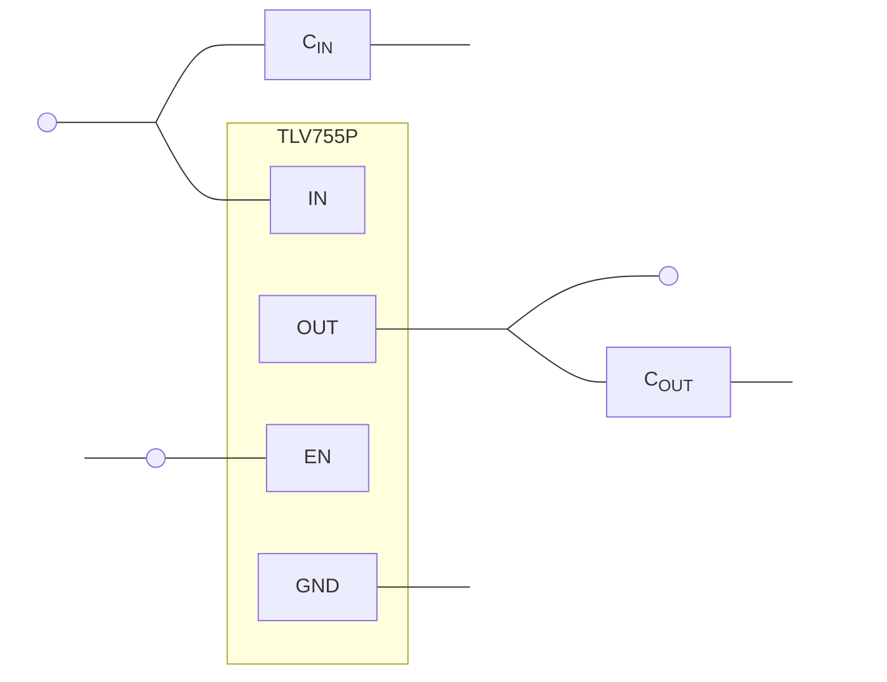
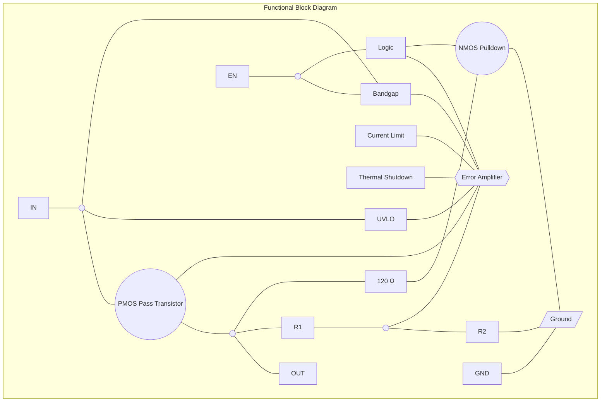
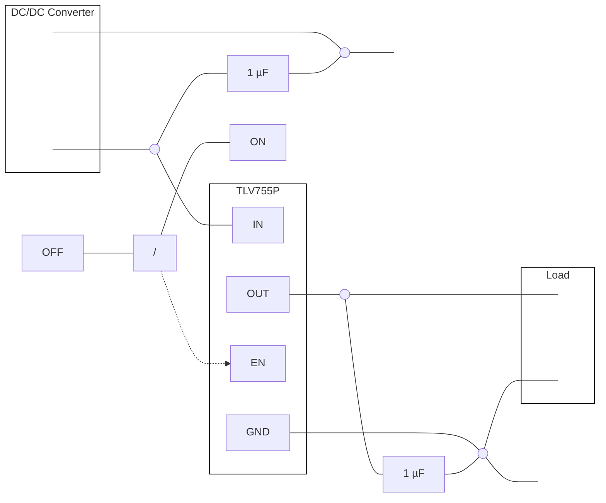

# TLV755P LDO datasheet

<!-- Original PDF: TLV755P.pdf -->


<!-- PDF page 1 -->


# **TLV755P 500mA, Low-I<sub>Q</sub>, Small-Size, Low-Dropout Regulator**

## **1 Features**

* SOT-23-5 package with 60.3°C/W $R_{\theta JA}$ available
* Input voltage range: 1.45V to 5.5V
* Low I<sub>Q</sub>: 25μA (typical)
* Low dropout:
  * 238mV (maximum) at 500mA (3.3V<sub>OUT</sub>)
* Output accuracy: 1% (maximum at 85°C)
* Built-in soft-start with monotonic V<sub>OUT</sub> rise
* Foldback current limit
* Active output discharge
* High PSRR: 46dB at 100kHz
* Stable with a 1µF ceramic output capacitor
* Packages:
  * 2.9mm × 2.8mm SOT-23-5 (DBV)
  * 2.9mm × 2.8mm SOT-23-5 (DYD) with thermal pad
  * 1mm × 1mm X2SON-4 (DQN)
  * 2mm × 2mm WSON-6 (DRV)

## **2 Applications**

* Set-top boxes, TV, and gaming consoles
* Portable and battery-powered equipment
* Desktops, notebooks, and ultrabooks
* Tablets and remote controls
* White goods and appliances
* Grid infrastructure and protection relays
* Camera modules and image sensors

### **Typical Application**



**Typical Application Circuit**

* **TLV755P**: Low-dropout regulator (LDO)
* **C<sub>IN</sub>**: Input capacitor
* **C<sub>OUT</sub>**: Output capacitor
* **EN**: Enable pin, controlled by an ON/<sup>OFF</sup> signal.

### **Start-Up Waveform**

<table>
  <caption>Start-Up Waveform — Voltage (V) and Output Current (mA) vs Time (ms)</caption>
  <thead>
    <tr>
      <th rowspan="2">Time (ms)</th>
      <th colspan="3">Voltage (V)</th>
      <th>Current (mA)</th>
    </tr>
    <tr>
      <th>V<sub>OUT</sub></th>
      <th>V<sub>IN</sub></th>
      <th>V<sub>EN</sub></th>
      <th>I<sub>OUT</sub></th>
    </tr>
  </thead>
  <tbody>
    <tr>
      <th>0</th>
      <td>0.0</td>
      <td>5.0</td>
      <td>0.0</td>
      <td>0</td>
    </tr>
    <tr>
      <th>0.2</th>
      <td>0.0</td>
      <td>5.0</td>
      <td>0.0</td>
      <td>0</td>
    </tr>
    <tr>
      <th>0.4</th>
      <td>0.0</td>
      <td>5.0</td>
      <td>0.0</td>
      <td>0</td>
    </tr>
    <tr>
      <th>0.6</th>
      <td>0.0</td>
      <td>5.0</td>
      <td>0.0</td>
      <td>0</td>
    </tr>
    <tr>
      <th>0.8</th>
      <td>0.0</td>
      <td>5.0</td>
      <td>5.0</td>
      <td>0</td>
    </tr>
    <tr>
      <th>1</th>
      <td>0.0</td>
      <td>5.0</td>
      <td>5.0</td>
      <td>0</td>
    </tr>
    <tr>
      <th>1.2</th>
      <td>1.8</td>
      <td>5.0</td>
      <td>5.0</td>
      <td>60</td>
    </tr>
    <tr>
      <th>1.4</th>
      <td>3.2</td>
      <td>5.0</td>
      <td>5.0</td>
      <td>100</td>
    </tr>
    <tr>
      <th>1.6</th>
      <td>3.3</td>
      <td>5.0</td>
      <td>5.0</td>
      <td>100</td>
    </tr>
    <tr>
      <th>1.8</th>
      <td>3.3</td>
      <td>5.0</td>
      <td>5.0</td>
      <td>100</td>
    </tr>
    <tr>
      <th>2</th>
      <td>3.3</td>
      <td>5.0</td>
      <td>5.0</td>
      <td>100</td>
    </tr>
  </tbody>
</table>

## **3 Description**

The TLV755P is an ultra-small, low quiescent current, low-dropout regulator (LDO) that sources 500mA with good line and load transient performance. The TLV755P is optimized for a wide variety of applications by supporting an input voltage range from 1.45V to 5.5V. To minimize cost and solution size, the device is offered in fixed output voltages ranging from 0.6V to 5V to support the lower core voltages of modern microcontrollers (MCUs). Additionally, the TLV755P has a low I<sub>Q</sub> with enable functionality to minimize standby power. This device features an internal soft-start to lower inrush current, thus providing a controlled voltage to the load and minimizing the input voltage drop during start up. When shutdown, the device actively pulls down the output to quickly discharge the outputs and provide a known start-up state.

The TLV755P is stable with small ceramic output capacitors allowing for a small overall solution size. A precision band-gap and error amplifier provides a typical accuracy of 1%. All device versions have integrated thermal shutdown, current limit, and undervoltage lockout (UVLO). The TLV755P has an internal foldback current limit that helps reduce the thermal dissipation during short-circuit events.

The TLV755 is available in the popular WSON, X2SON, and SOT23-5 (DRV, DQN, and DBV) packages. This device is also available in a thermally enhanced SOT23-5 (DYD) package with a thermal pad that provides significantly reduced thermal resistance compared to a standard SOT23-5 package.

### **Package Information**

<table>
  <thead>
    <tr>
      <th>PART NUMBER</th>
      <th>PACKAGE<sup>(1)</sup></th>
      <th><b>PACKAGE SIZE</b><sup>(2)</sup></th>
    </tr>
  </thead>
  <tbody>
    <tr>
      <td rowspan="4">TLV755P</td>
      <td>DQN (X2SON, 4)</td>
      <td>1mm × 1mm</td>
    </tr>
    <tr>
      <td>DBV (SOT-23, 5)</td>
      <td>2.9mm × 2.8mm</td>
    </tr>
    <tr>
      <td>DYD (SOT-23, 5)</td>
      <td>2.9mm × 2.8mm</td>
    </tr>
    <tr>
      <td>DRV (WSON, 6)</td>
      <td>2mm × 2mm</td>
    </tr>
  </tbody>
</table>

(1) For more information, see the <i>Mechanical, Packaging, and Orderable Information</i>.
(2) The package size (length × width) is a nominal value and includes pins, where applicable.


<!-- PDF page 2 -->


# Table of Contents

<table>
    <tr>
      <td><strong><b>1 Features</b></strong>............................................................................</td>
      <td>1</td>
      <td><strong><b>7 Application and Implementation</b></strong>..................................</td>
      <td>15</td>
    </tr>
    <tr>
      <td><strong><b>2 Applications</b></strong>.....................................................................</td>
      <td>1</td>
      <td>    7.1 Application Information.............................................</td>
      <td>15</td>
    </tr>
    <tr>
      <td><strong><b>3 Description</b></strong>.......................................................................</td>
      <td>1</td>
      <td>    7.2 Typical Application....................................................</td>
      <td>19</td>
    </tr>
    <tr>
      <td><strong><b>4 Pin Configuration and Functions</b></strong>...................................</td>
      <td>3</td>
      <td>    7.3 Power Supply Recommendations.............................</td>
      <td>20</td>
    </tr>
    <tr>
      <td><strong><b>5 Specifications</b></strong>..................................................................</td>
      <td>4</td>
      <td>    7.4 Layout.......................................................................</td>
      <td>21</td>
    </tr>
    <tr>
      <td>    5.1 Absolute Maximum Ratings........................................</td>
      <td>4</td>
      <td><strong><b>8 Device and Documentation Support</b></strong>............................</td>
      <td>23</td>
    </tr>
    <tr>
      <td>    5.2 ESD Ratings...............................................................</td>
      <td>4</td>
      <td>    8.1 Device Support.........................................................</td>
      <td>23</td>
    </tr>
    <tr>
      <td>    5.3 Recommended Operating Conditions.........................</td>
      <td>4</td>
      <td>    8.2 Receiving Notification of Documentation Updates....</td>
      <td>23</td>
    </tr>
    <tr>
      <td>    5.4 Thermal Information ...................................................</td>
      <td>5</td>
      <td>    8.3 Support Resources...................................................</td>
      <td>23</td>
    </tr>
    <tr>
      <td>    5.5 Electrical Characteristics.............................................</td>
      <td>5</td>
      <td>    8.4 Trademarks...............................................................</td>
      <td>23</td>
    </tr>
    <tr>
      <td>    5.6 Typical Characteristics................................................</td>
      <td>7</td>
      <td>    8.5 Electrostatic Discharge Caution................................</td>
      <td>23</td>
    </tr>
    <tr>
      <td><strong><b>6 Detailed Description</b></strong>......................................................</td>
      <td>12</td>
      <td>    8.6 Glossary....................................................................</td>
      <td>23</td>
    </tr>
    <tr>
      <td>    6.1 Overview...................................................................</td>
      <td>12</td>
      <td><strong><b>9 Revision History</b></strong>............................................................</td>
      <td>24</td>
    </tr>
    <tr>
      <td>    6.2 Functional Block Diagram.........................................</td>
      <td>12</td>
      <td rowspan="2"><strong><b>10 Mechanical, Packaging, and Orderable</b><br />Information</strong>....................................................................</td>
      <td rowspan="2">24</td>
    </tr>
    <tr>
      <td>    6.3 Feature Description...................................................</td>
      <td>12</td>
    </tr>
    <tr>
      <td>    6.4 Device Functional Modes..........................................</td>
      <td>14</td>
      <td></td>
      <td></td>
    </tr>
</table>


<!-- PDF page 3 -->


# **4 Pin Configuration and Functions**

```

**Figure 4-1. DQN Package, 4-Pin X2SON (Top View)**
**Figure 4-2. DBV Package, 5-Pin SOT-23 (Top View)**
**Figure 4-3. DYD Package, 5-Pin SOT-23 With Exposed Thermal Pad (Top View)**
NC = no internal connection.
**Figure 4-4. DRV Package, 6-Pin WSON With Exposed Thermal Pad (Top View)**
```

<table>
  <caption>**Table 4-1. Pin Functions**</caption>
  <thead>
    <tr>
      <th></th>
      <th colspan="4"><b>PIN</b></th>
      <th rowspan="2"><b>TYPE</b><sup>(2)</sup></th>
      <th rowspan="2"><b>DESCRIPTION</b></th>
    </tr>
    <tr>
      <th><b>NAME</b></th>
      <th>DQN</th>
      <th>DBV</th>
      <th>DYD</th>
      <th>DRV</th>
    </tr>
  </thead>
  <tbody>
    <tr>
      <td>EN</td>
      <td>3</td>
      <td>3</td>
      <td>3</td>
      <td>4</td>
      <td>I</td>
      <td>Enable pin. Drive EN greater than V<sub>HI</sub> to turn on the regulator. Drive EN less than V<sub>LO</sub> to place the low-dropout regulator (LDO) into shutdown mode.</td>
    </tr>
    <tr>
      <td>GND</td>
      <td>2</td>
      <td>2</td>
      <td>2</td>
      <td>3</td>
      <td>—</td>
      <td>Ground pin.</td>
    </tr>
    <tr>
      <td>IN</td>
      <td>4</td>
      <td>1</td>
      <td>1</td>
      <td>6</td>
      <td>I</td>
      <td>Input pin. A capacitor with a value of 1µF or larger is required from this pin to ground.<sup>(1)</sup> See the <i>Input and Output Capacitor Selection</i> section for more information.</td>
    </tr>
    <tr>
      <td>NC</td>
      <td>—</td>
      <td>4</td>
      <td>4</td>
      <td>2, 5</td>
      <td>—</td>
      <td>No internal connection.</td>
    </tr>
    <tr>
      <td>OUT</td>
      <td>1</td>
      <td>5</td>
      <td>5</td>
      <td>1</td>
      <td>O</td>
      <td>Regulated output voltage pin. A capacitor with a value of 1µF or larger is required from this pin to ground.<sup>(1)</sup> See the <i>Input and Output Capacitor Selection</i> section for more information.</td>
    </tr>
    <tr>
      <td>Thermal pad</td>
      <td>Pad</td>
      <td>—</td>
      <td>Pad</td>
      <td>Pad</td>
      <td>—</td>
      <td>Connect the thermal pad to a large-area ground plane. The thermal pad is internally connected to GND.</td>
    </tr>
  </tbody>
</table>

(1) Make sure the nominal input and output capacitance is greater than 0.47µF. Throughout this document the nominal derating on these capacitors is 50%. Make sure the effective capacitance at the pin is greater than 0.47µF.
(2) I = Input; O = Output


<!-- PDF page 4 -->


# **5 Specifications**

## **5.1 Absolute Maximum Ratings**

over operating free-air temperature range (unless otherwise noted)<sup>(1)</sup>

<table>
<thead>
<tr>
<th></th>
<th>MIN</th>
<th>MAX</th>
<th>UNIT</th>
</tr>
</thead>
<tbody>
<tr>
<td>Supply voltage, V<sub>IN</sub></td>
<td>−0.3</td>
<td>6.0</td>
<td>V</td>
</tr>
<tr>
<td>Enable voltage, V<sub>EN</sub></td>
<td>−0.3</td>
<td>6.0</td>
<td>V</td>
</tr>
<tr>
<td>Output voltage, V<sub>OUT</sub></td>
<td>−0.3</td>
<td>V<sub>IN</sub> + 0.3<sup>(2)</sup></td>
<td>V</td>
</tr>
<tr>
<td>Operating junction temperature T<sub>J</sub></td>
<td>−40</td>
<td>150</td>
<td>°C</td>
</tr>
<tr>
<td>Storage temperature, T<sub>stg</sub></td>
<td>−65</td>
<td>150</td>
<td>°C</td>
</tr>
</tbody>
</table>

(1) Operation outside the <i>Absolute Maximum Ratings</i> may cause permanent device damage. <i>Absolute Maximum Ratings</i> do not imply functional operation of the device at these or any other conditions beyond those listed under <i>Recommended Operating Conditions</i>. If used outside the <i>Recommended Operating Conditions</i> but within the <i>Absolute Maximum Ratings</i>, the device may not be fully functional, and this may affect device reliability, functionality, performance, and shorten the device lifetime.
(2) The absolute maximum rating is V<sub>IN</sub> + 0.3 V or 6.0 V, whichever is smaller.

## **5.2 ESD Ratings**

<table>
  <thead>
    <tr>
      <th colspan="3"></th>
      <th>VALUE</th>
      <th>UNIT</th>
    </tr>
  </thead>
  <tbody>
    <tr>
      <td rowspan="2">V<sub>(ESD)</sub></td>
      <td rowspan="2">Electrostatic discharge</td>
      <td>Human-body model (HBM), per ANSI/ESDA/JEDEC JS-001<sup>(1)</sup></td>
      <td>±1000</td>
      <td rowspan="2">V</td>
    </tr>
    <tr>
      <td>Charged-device model (CDM), per JEDEC specification JESD22-C101<sup>(2)</sup></td>
      <td>±500</td>
    </tr>
  </tbody>
</table>

(1) JEDEC document JEP155 states that 500V HBM allows safe manufacturing with a standard ESD control process. Manufacturing with less than 500V HBM is possible with the necessary precautions.
(2) JEDEC document JEP157 states that 250V CDM allows safe manufacturing with a standard ESD control process. Manufacturing with less than 250V CDM is possible with the necessary precautions.

## **5.3 Recommended Operating Conditions**

over operating free-air temperature range (unless otherwise noted)

<table>
<thead>
<tr>
<th colspan="2"></th>
<th>MIN</th>
<th><b>NOM</b></th>
<th>MAX</th>
<th>UNIT</th>
</tr>
</thead>
<tbody>
<tr>
<td>V<sub>IN</sub></td>
<td>Input voltage</td>
<td>1.45</td>
<td></td>
<td>5.5</td>
<td>V</td>
</tr>
<tr>
<td>V<sub>OUT</sub></td>
<td>Output voltage</td>
<td>0.6</td>
<td></td>
<td>5.0</td>
<td>V</td>
</tr>
<tr>
<td>V<sub>EN</sub></td>
<td>Enable voltage</td>
<td>0</td>
<td></td>
<td>5.5</td>
<td>V</td>
</tr>
<tr>
<td>I<sub>OUT</sub></td>
<td>Output current</td>
<td>0</td>
<td></td>
<td>500</td>
<td>mA</td>
</tr>
<tr>
<td>C<sub>IN</sub></td>
<td>Input capacitor</td>
<td>1</td>
<td></td>
<td></td>
<td>μF</td>
</tr>
<tr>
<td>C<sub>OUT</sub></td>
<td>Output capacitor</td>
<td>1</td>
<td></td>
<td>200</td>
<td>μF</td>
</tr>
<tr>
<td>f<sub>EN</sub></td>
<td>Enable toggle frequency</td>
<td></td>
<td></td>
<td>10</td>
<td>kHz</td>
</tr>
<tr>
<td>T<sub>J</sub></td>
<td>Junction temperature</td>
<td>–40</td>
<td></td>
<td>125</td>
<td>°C</td>
</tr>
</tbody>
</table>


<!-- PDF page 5 -->


## 5.4 Thermal Information

<table>
  <thead>
    <tr>
      <th rowspan="3">PCB</th>
      <th colspan="2" rowspan="3"><b>THERMAL METRIC</b><sup>(1) (2)</sup></th>
      <th colspan="4"><b>TLV755</b></th>
      <th rowspan="3">UNIT</th>
    </tr>
    <tr>
      <th>DYD (SOT-23-5)</th>
      <th>DQN <b>(X2SON)</b></th>
      <th>DBV (SOT-23-5)</th>
      <th>DRV <b>(WSON)</b></th>
    </tr>
    <tr>
      <th>5 PINS</th>
      <th>4 PINS</th>
      <th>5 PINS</th>
      <th>6 PINS</th>
    </tr>
  </thead>
  <tbody>
    <tr>
      <td rowspan="3">EVM</td>
      <td>R<sub>θJA</sub></td>
      <td>Junction-to-ambient thermal resistance</td>
      <td>60.3</td>
      <td>N/A</td>
      <td>100.8</td>
      <td>N/A</td>
      <td rowspan="3">°C/W</td>
    </tr>
    <tr>
      <td>ψ<sub>JT</sub></td>
      <td>Junction-to-top characterization parameter</td>
      <td>14.2</td>
      <td>N/A</td>
      <td>23.3</td>
      <td>N/A</td>
    </tr>
    <tr>
      <td>ψ<sub>JB</sub></td>
      <td>Junction-to-board characterization parameter</td>
      <td>35.9</td>
      <td>N/A</td>
      <td>67.8</td>
      <td>N/A</td>
    </tr>
    <tr>
      <td rowspan="6">JEDEC</td>
      <td>R<sub>θJA</sub></td>
      <td>Junction-to-ambient thermal resistance</td>
      <td>92.5</td>
      <td>168.4</td>
      <td>231.1</td>
      <td>100.2</td>
      <td rowspan="6">°C/W</td>
    </tr>
    <tr>
      <td>R<sub>θJC(top)</sub></td>
      <td>Junction-to-case (top) thermal resistance</td>
      <td>119.8</td>
      <td>139.1</td>
      <td>118.4</td>
      <td>108.5</td>
    </tr>
    <tr>
      <td>R<sub>θJB</sub></td>
      <td>Junction-to-board thermal resistance</td>
      <td>45.8</td>
      <td>101.4</td>
      <td>64.4</td>
      <td>64.3</td>
    </tr>
    <tr>
      <td>ψ<sub>JT</sub></td>
      <td>Junction-to-top characterization parameter</td>
      <td>16.7</td>
      <td>5.6</td>
      <td>28.4</td>
      <td>10.4</td>
    </tr>
    <tr>
      <td>ψ<sub>JB</sub></td>
      <td>Junction-to-board characterization parameter</td>
      <td>44.9</td>
      <td>101.7</td>
      <td>63.8</td>
      <td>64.8</td>
    </tr>
    <tr>
      <td>R<sub>θJC(bot)</sub></td>
      <td>Junction-to-case (bottom) thermal resistance</td>
      <td>34.3</td>
      <td>88.4</td>
      <td>N/A</td>
      <td>34.7</td>
    </tr>
  </tbody>
</table>

(1) For more information about traditional and new thermal metrics, see the Semiconductor and IC Package Thermal Metrics application note.
(2) JEDEC thermal metrics apply to JEDEC standard PCB (2s2p, no vias to internal plane and bottom layer). EVM metrics apply to the LP087A EVM with an exposed pad SOT-23-5 (DYD) layout.

## 5.5 Electrical Characteristics

at operating temperature range ($T_J = –40°C$ to $125°C$), $V_{IN} = V_{OUT(NOM)} + 0.5V$ or $2.0V$ (whichever is greater), $I_{OUT} = 1mA$, $V_{EN} = V_{IN}$, and $C_{IN} = C_{OUT} = 1\mu F$ (unless otherwise noted); all typical values at $T_J = 25°C$

<table><thead><tr><th></th><th><b>PARAMETER</b></th><th><b>PARAMETER</b></th><th><b>TEST CONDITIONS</b></th><th>MIN</th><th>TYP</th><th>MAX</th><th>UNIT</th></tr></thead><tbody><tr><td></td><td>V<sub>IN</sub></td><td>Input voltage</td><td></td><td>1.45</td><td></td><td>5.5</td><td>V</td></tr><tr><td></td><td>V<sub>OUT</sub></td><td>Output voltage</td><td></td><td>0.6</td><td></td><td>5.0</td><td>V</td></tr><tr><td></td><td></td><td>Output accuracy</td><td>−40°C ≤ T<sub>J</sub> ≤ +85°C, DBV and DRV package</td><td>−1</td><td></td><td>1</td><td>%</td></tr><tr><td></td><td></td><td></td><td>V<sub>OUT</sub> ≥ 1.0V, DQN package</td><td>−1.2</td><td></td><td>1.2</td><td>%</td></tr><tr><td></td><td></td><td></td><td>−40°C ≤ T<sub>J</sub> ≤ +85°C; 0.6V ≤ V<sub>OUT</sub> &#x3C; 1.0V</td><td>−10</td><td></td><td>10</td><td>mV</td></tr><tr><td></td><td></td><td></td><td>V<sub>OUT</sub> ≥ 1V</td><td>−1.5</td><td></td><td>1.5</td><td>%</td></tr><tr><td></td><td></td><td></td><td>0.6V ≤ V<sub>OUT</sub> &#x3C; 1V</td><td>−15</td><td></td><td>15</td><td>mV</td></tr><tr><td></td><td>(ΔV<sub>OUT</sub>)ΔV<sub>IN</sub></td><td>Line regulation</td><td>V<sub>OUT</sub> + 0.5V ≤ V<sub>IN</sub> ≤ 5.5V, V<sub>OUT</sub> > 1.5V</td><td></td><td>2</td><td></td><td>mV</td></tr><tr><td></td><td>ΔV<sub>OUT</sub>/ΔI<sub>OUT</sub></td><td>Load regulation</td><td>0.1mA ≤ I<sub>OUT</sub> ≤ 500mA DQN package</td><td></td><td>0.036</td><td></td><td>V/A</td></tr><tr><td></td><td></td><td></td><td>0.1mA ≤ I<sub>OUT</sub> ≤ 500mA DBV and DYD packages</td><td></td><td>0.060</td><td></td><td></td></tr><tr><td></td><td></td><td></td><td>0.1mA ≤ I<sub>OUT</sub> ≤ 500mA DRV package</td><td></td><td>0.044</td><td></td><td></td></tr><tr><td></td><td>I<sub>GND</sub></td><td>Ground current</td><td>T<sub>J</sub> = 25°C, I<sub>OUT</sub> = 0mA</td><td>14</td><td>25</td><td>31</td><td>µA</td></tr><tr><td></td><td></td><td></td><td>−40°C ≤ T<sub>J</sub> ≤ +85°C, I<sub>OUT</sub> = 0mA</td><td></td><td></td><td>33</td><td></td></tr><tr><td></td><td></td><td></td><td>−40°C ≤ T<sub>J</sub> ≤ +125°C, I<sub>OUT</sub> = 0mA</td><td></td><td></td><td>40</td><td></td></tr><tr><td></td><td>I<sub>SHDN</sub></td><td>Shutdown current</td><td>V<sub>EN</sub> ≤ 0.4V, 1.4V ≤ V<sub>IN</sub> ≤ 5.5V, −40°C ≤ T<sub>J</sub> ≤ +125°C</td><td></td><td>0.1</td><td>1</td><td>µA</td></tr><tr><td></td><td>I<sub>CL</sub></td><td>Output current limit</td><td>V<sub>IN</sub> = V<sub>OUT</sub>+ V<sub>DO(MAX)</sub> + 0.25V V<sub>OUT</sub> = V<sub>OUT</sub> - 0.2V, V<sub>OUT</sub> ≤ 1.5V</td><td>560</td><td>720</td><td>865</td><td>mA</td></tr><tr><td></td><td></td><td></td><td>V<sub>IN</sub> = V<sub>OUT</sub>+ V<sub>DO(MAX)</sub> + 0.25V V<sub>OUT</sub> = 0.9 x V<sub>OUT</sub>, 1.5V &#x3C; V<sub>OUT</sub> ≤ 4.5V</td><td>560</td><td>720</td><td>865</td><td></td></tr><tr><td></td><td>I<sub>SC</sub></td><td>Short-circuit current limit</td><td>V<sub>OUT</sub> = 0V</td><td></td><td>355</td><td></td><td>mA</td></tr><tr><td>V<sub>DO</sub></td><td>Dropout voltage</td><td>I<sub>OUT</sub> = 500mA, −40°C ≤ T<sub>J</sub> ≤ +85°C</td><td>0.6V ≤ V<sub>OUT</sub> &#x3C; 0.8V</td><td></td><td>675</td><td>1080</td><td>mV</td></tr><tr><td></td><td></td><td></td><td></td><td>0.8 V ≤ V<sub>OUT</sub> &#x3C; 1.0V</td><td></td><td>600</td><td>930</td></tr><tr><td></td><td></td><td></td><td></td><td>0.8 V ≤ V<sub>OUT</sub> &#x3C; 1.0V, DYD package</td><td></td><td>600</td><td>950</td></tr><tr><td></td><td></td><td></td><td></td><td>1.0V ≤ V<sub>OUT</sub> &#x3C; 1.2V</td><td></td><td>550</td><td>780</td></tr><tr><td></td><td></td><td></td><td></td><td>1.0V ≤ V<sub>OUT</sub> &#x3C; 1.2V, DYD package</td><td></td><td>550</td><td>800</td></tr><tr><td></td><td></td><td></td><td></td><td>1.2V ≤ V<sub>OUT</sub> &#x3C; 1.5V</td><td></td><td>500</td><td>630</td></tr><tr><td></td><td></td><td></td><td></td><td>1.2V ≤ V<sub>OUT</sub> &#x3C; 1.5V, DYD package</td><td></td><td>500</td><td>650</td></tr><tr><td></td><td></td><td></td><td></td><td>1.5V ≤ V<sub>OUT</sub> &#x3C; 1.8V</td><td></td><td>350</td><td>400</td></tr><tr><td></td><td></td><td></td><td></td><td>1.5V ≤ V<sub>OUT</sub> &#x3C; 1.8V, DYD package</td><td></td><td>350</td><td>420</td></tr><tr><td></td><td></td><td></td><td></td><td>1.8V ≤ V<sub>OUT</sub> &#x3C; 2.5V</td><td></td><td>325</td><td>380</td></tr><tr><td></td><td></td><td></td><td></td><td>1.8V ≤ V<sub>OUT</sub> &#x3C; 2.5V, DYD package</td><td></td><td>325</td><td>400</td></tr><tr><td></td><td></td><td></td><td></td><td>2.5V ≤ V<sub>OUT</sub> &#x3C; 3.3V</td><td></td><td>250</td><td>300</td></tr><tr><td></td><td></td><td></td><td></td><td>2.5V ≤ V<sub>OUT</sub> &#x3C; 3.3V, DYD package</td><td></td><td>250</td><td>320</td></tr><tr><td></td><td></td><td></td><td></td><td>3.3V ≤ V<sub>OUT</sub> &#x3C; 5.0V</td><td></td><td>150</td><td>215</td></tr><tr><td></td><td></td><td></td><td></td><td>3.3V ≤ V<sub>OUT</sub> &#x3C; 5.0V, DYD package</td><td></td><td>150</td><td>238</td></tr><tr><td></td><td></td><td></td><td>I<sub>OUT</sub> = 500mA, −40°C ≤ T<sub>J</sub> ≤ +125°C</td><td>0.6V ≤ V<sub>OUT</sub> &#x3C; 0.8V</td><td></td><td></td><td>1140</td></tr><tr><td></td><td></td><td></td><td></td><td>0.8V ≤ V<sub>OUT</sub> &#x3C; 1.0V</td><td></td><td></td><td>985</td></tr><tr><td></td><td></td><td></td><td></td><td>0.8V ≤ V<sub>OUT</sub> &#x3C; 1.0V, DYD package</td><td></td><td></td><td>1005</td></tr><tr><td></td><td></td><td></td><td></td><td>1.0V ≤ V<sub>OUT</sub> &#x3C; 1.2V</td><td></td><td></td><td>825</td></tr><tr><td></td><td></td><td></td><td></td><td>1.0V ≤ V<sub>OUT</sub> &#x3C; 1.2V, DYD package</td><td></td><td></td><td>845</td></tr><tr><td></td><td></td><td></td><td></td><td>1.2V ≤ V<sub>OUT</sub> &#x3C; 1.5V</td><td></td><td></td><td>665</td></tr><tr><td></td><td></td><td></td><td></td><td>1.2V ≤ V<sub>OUT</sub> &#x3C; 1.5V, DYD package</td><td></td><td></td><td>685</td></tr><tr><td></td><td></td><td></td><td></td><td>1.5V ≤ V<sub>OUT</sub> &#x3C; 1.8V</td><td></td><td></td><td>425</td></tr><tr><td></td><td></td><td></td><td></td><td>1.5V ≤ V<sub>OUT</sub> &#x3C; 1.8V, DYD package</td><td></td><td></td><td>445</td></tr><tr><td></td><td></td><td></td><td></td><td>1.8V ≤ V<sub>OUT</sub> &#x3C; 2.5V</td><td></td><td></td><td>400</td></tr><tr><td></td><td></td><td></td><td></td><td>1.8V ≤ V<sub>OUT</sub> &#x3C; 2.5V, DYD package</td><td></td><td></td><td>420</td></tr><tr><td></td><td></td><td></td><td></td><td>2.5V ≤ V<sub>OUT</sub> &#x3C; 3.3V</td><td></td><td></td><td>325</td></tr><tr><td></td><td></td><td></td><td></td><td>2.5V ≤ V<sub>OUT</sub> &#x3C; 3.3V, DYD package</td><td></td><td></td><td>345</td></tr><tr><td></td><td></td><td></td><td></td><td>3.3V ≤ V<sub>OUT</sub> &#x3C; 5.0V</td><td></td><td></td><td>238</td></tr><tr><td></td><td></td><td></td><td></td><td>3.3V ≤ V<sub>OUT</sub> &#x3C; 5.0V, DYD package</td><td></td><td></td><td>258</td></tr><tr><td></td><td>PSRR</td><td>Power-supply rejection ratio</td><td>f = 1kHz, V<sub>IN</sub> = V<sub>OUT</sub> + 1V, I<sub>OUT</sub> = 50mA</td><td></td><td>52</td><td></td><td>dB</td></tr><tr><td></td><td></td><td></td><td>f = 100kHz, V<sub>IN</sub> = V<sub>OUT</sub> + 1V, I<sub>OUT</sub> = 50mA</td><td></td><td>46</td><td></td><td></td></tr><tr><td></td><td></td><td></td><td>f = 1MHz, V<sub>IN</sub> = V<sub>OUT</sub> + 1 V, I<sub>OUT</sub> = 50mA</td><td></td><td>52</td><td></td><td></td></tr><tr><td></td><td>V<sub>N</sub></td><td>Output noise voltage</td><td>BW = 10Hz to 100kHz; V<sub>OUT</sub> = 1.2V, I<sub>OUT</sub> = 50 mA</td><td></td><td>71.5</td><td></td><td>µV<sub>RMS</sub></td></tr><tr><td></td><td>V<sub>UVLO</sub></td><td>Undervoltage lockout</td><td>V<sub>IN</sub> rising</td><td>1.21</td><td>1.3</td><td>1.44</td><td>V</td></tr><tr><td></td><td>V<sub>UVLO,HYST</sub></td><td>Undervoltage lockout hysteresis</td><td>V<sub>IN</sub> falling</td><td></td><td>40</td><td></td><td>mV</td></tr><tr><td></td><td>t<sub>STR</sub></td><td>Startup time</td><td></td><td></td><td>550</td><td></td><td>µs</td></tr><tr><td></td><td>V<sub>HI</sub></td><td>EN pin high voltage (enabled)</td><td></td><td>1</td><td></td><td></td><td>V</td></tr><tr><td></td><td>V<sub>LO</sub></td><td>EN pin low voltage (enabled)</td><td></td><td></td><td></td><td>0.3</td><td>V</td></tr><tr><td></td><td>I<sub>EN</sub></td><td>Enable pin current</td><td>EN = 5.5V</td><td></td><td>10</td><td></td><td>nA</td></tr><tr><td></td><td>T<sub>SD</sub></td><td>Thermal shutdown</td><td>Shutdown, temperature increasing</td><td></td><td>165</td><td></td><td>°C</td></tr><tr><td></td><td></td><td></td><td>Reset, temperature decreasing</td><td></td><td>155</td><td></td><td></td></tr><tr><td></td><td>R<sub>PULLDOWN</sub></td><td>Pulldown resistance</td><td>V<sub>IN</sub> = 5.5V</td><td></td><td>120</td><td></td><td>Ω</td></tr></tbody></table>


<!-- PDF page 6 -->


## **5.5 Electrical Characteristics (continued)**

at operating temperature range ($T_J = -40^\circ\text{C}$ to $125^\circ\text{C}$), $V_{IN} = V_{OUT(NOM)} + 0.5\text{V}$ or $2.0\text{V}$ (whichever is greater), $I_{OUT} = 1\text{mA}$, $V_{EN} = V_{IN}$, and $C_{IN} = C_{OUT} = 1\mu\text{F}$ (unless otherwise noted); all typical values at $T_J = 25^\circ\text{C}$


<!-- PDF page 7 -->


## **5.6 Typical Characteristics**

at operating temperature $T_J = 25^\circ\text{C}$, $V_{IN} = V_{OUT(NOM)} + 0.5\text{V}$ or $1.45\text{V}$ (whichever is greater), $I_{OUT} = 1\text{mA}$, $V_{EN} = V_{IN}$, and $C_{IN} = C_{OUT} = 1\mu\text{F}$ (unless otherwise noted)

<table>
  <caption>Figure 5-1. PSRR vs Frequency and I<sub>OUT</sub>; V<sub>IN</sub> = 4.3V, V<sub>OUT</sub> = 3.3V, C<sub>OUT</sub> = 1µF</caption>
  <thead>
    <tr>
      <th>Frequency (Hz)</th>
      <th>I<sub>OUT</sub> = 10 mA (dB)</th>
      <th>I<sub>OUT</sub> = 50 mA (dB)</th>
      <th>I<sub>OUT</sub> = 100 mA (dB)</th>
      <th>I<sub>OUT</sub> = 500 mA (dB)</th>
    </tr>
  </thead>
  <tbody>
    <tr>
      <th>10</th>
      <td>67</td>
      <td>67</td>
      <td>67</td>
      <td>66</td>
    </tr>
    <tr>
      <th>20</th>
      <td>68</td>
      <td>68</td>
      <td>68</td>
      <td>66</td>
    </tr>
    <tr>
      <th>50</th>
      <td>67</td>
      <td>67</td>
      <td>67</td>
      <td>70</td>
    </tr>
    <tr>
      <th>100</th>
      <td>65</td>
      <td>66</td>
      <td>68</td>
      <td>68</td>
    </tr>
    <tr>
      <th>200</th>
      <td>65</td>
      <td>65</td>
      <td>65</td>
      <td>62</td>
    </tr>
    <tr>
      <th>500</th>
      <td>58</td>
      <td>58</td>
      <td>58</td>
      <td>56</td>
    </tr>
    <tr>
      <th>1k</th>
      <td>52</td>
      <td>52</td>
      <td>52</td>
      <td>51</td>
    </tr>
    <tr>
      <th>2k</th>
      <td>50</td>
      <td>50</td>
      <td>50</td>
      <td>49</td>
    </tr>
    <tr>
      <th>5k</th>
      <td>48</td>
      <td>48</td>
      <td>48</td>
      <td>48</td>
    </tr>
    <tr>
      <th>10k</th>
      <td>48</td>
      <td>48</td>
      <td>48</td>
      <td>49</td>
    </tr>
    <tr>
      <th>20k</th>
      <td>48</td>
      <td>48</td>
      <td>48</td>
      <td>51</td>
    </tr>
    <tr>
      <th>50k</th>
      <td>48</td>
      <td>48</td>
      <td>47</td>
      <td>52</td>
    </tr>
    <tr>
      <th>100k</th>
      <td>47</td>
      <td>46</td>
      <td>46</td>
      <td>49</td>
    </tr>
    <tr>
      <th>200k</th>
      <td>42</td>
      <td>41</td>
      <td>41</td>
      <td>42</td>
    </tr>
    <tr>
      <th>500k</th>
      <td>39</td>
      <td>34</td>
      <td>34</td>
      <td>33</td>
    </tr>
    <tr>
      <th>1M</th>
      <td>44</td>
      <td>37</td>
      <td>31</td>
      <td>26</td>
    </tr>
    <tr>
      <th>2M</th>
      <td>53</td>
      <td>45</td>
      <td>39</td>
      <td>33</td>
    </tr>
    <tr>
      <th>4M</th>
      <td>62</td>
      <td>53</td>
      <td>49</td>
      <td>41</td>
    </tr>
    <tr>
      <th>10M</th>
      <td>45</td>
      <td>35</td>
      <td>30</td>
      <td>23</td>
    </tr>
  </tbody>
</table>

<table>
  <caption>Figure 5-2. PSRR vs Frequency and V<sub>IN</sub>; V<sub>OUT</sub> = 3.3V, C<sub>OUT</sub> = 1µF, I<sub>OUT</sub> = 500mA; Power Supply Rejection Ratio (dB) vs Frequency (Hz)</caption>
  <thead>
    <tr>
      <th rowspan="2">Frequency (Hz)</th>
      <th colspan="5">V<sub>IN</sub></th>
    </tr>
    <tr>
      <th>3.8 V</th>
      <th>4 V</th>
      <th>4.3 V</th>
      <th>4.5 V</th>
      <th>5 V</th>
    </tr>
  </thead>
  <tbody>
    <tr>
      <th>10</th>
      <td>62</td>
      <td>60</td>
      <td>61</td>
      <td>58</td>
      <td>59</td>
    </tr>
    <tr>
      <th>20</th>
      <td>64</td>
      <td>74</td>
      <td>68</td>
      <td>62</td>
      <td>64</td>
    </tr>
    <tr>
      <th>50</th>
      <td>65</td>
      <td>67</td>
      <td>71</td>
      <td>76</td>
      <td>66</td>
    </tr>
    <tr>
      <th>100</th>
      <td>63</td>
      <td>66</td>
      <td>68</td>
      <td>68</td>
      <td>66</td>
    </tr>
    <tr>
      <th>200</th>
      <td>59</td>
      <td>61</td>
      <td>62</td>
      <td>62</td>
      <td>61</td>
    </tr>
    <tr>
      <th>500</th>
      <td>52</td>
      <td>55</td>
      <td>56</td>
      <td>57</td>
      <td>56</td>
    </tr>
    <tr>
      <th>1k</th>
      <td>46</td>
      <td>50</td>
      <td>51</td>
      <td>51</td>
      <td>51</td>
    </tr>
    <tr>
      <th>2k</th>
      <td>42</td>
      <td>47</td>
      <td>48</td>
      <td>49</td>
      <td>49</td>
    </tr>
    <tr>
      <th>5k</th>
      <td>40</td>
      <td>46</td>
      <td>48</td>
      <td>48</td>
      <td>48</td>
    </tr>
    <tr>
      <th>10k</th>
      <td>38</td>
      <td>46</td>
      <td>48</td>
      <td>49</td>
      <td>47</td>
    </tr>
    <tr>
      <th>20k</th>
      <td>39</td>
      <td>48</td>
      <td>51</td>
      <td>49</td>
      <td>48</td>
    </tr>
    <tr>
      <th>50k</th>
      <td>44</td>
      <td>69</td>
      <td>51</td>
      <td>49</td>
      <td>47</td>
    </tr>
    <tr>
      <th>100k</th>
      <td>45</td>
      <td>48</td>
      <td>47</td>
      <td>46</td>
      <td>45</td>
    </tr>
    <tr>
      <th>200k</th>
      <td>38</td>
      <td>39</td>
      <td>40</td>
      <td>41</td>
      <td>41</td>
    </tr>
    <tr>
      <th>500k</th>
      <td>28</td>
      <td>30</td>
      <td>31</td>
      <td>32</td>
      <td>33</td>
    </tr>
    <tr>
      <th>1M</th>
      <td>20</td>
      <td>23</td>
      <td>25</td>
      <td>26</td>
      <td>28</td>
    </tr>
    <tr>
      <th>2M</th>
      <td>25</td>
      <td>28</td>
      <td>30</td>
      <td>31</td>
      <td>32</td>
    </tr>
    <tr>
      <th>5M</th>
      <td>42</td>
      <td>44</td>
      <td>45</td>
      <td>46</td>
      <td>46</td>
    </tr>
    <tr>
      <th>10M</th>
      <td>24</td>
      <td>26</td>
      <td>27</td>
      <td>28</td>
      <td>28</td>
    </tr>
  </tbody>
</table>

<table>
  <caption>Figure 5-3. PSRR vs Frequency and C<sub>OUT</sub>; V<sub>IN</sub> = 4.3V, V<sub>OUT</sub> = 3.3V, I<sub>OUT</sub> = 500mA; Power Supply Rejection Ratio (dB) vs Frequency (Hz)</caption>
  <thead>
    <tr>
      <th>Frequency (Hz)</th>
      <th>C<sub>OUT</sub> = 1 µF (dB)</th>
      <th>C<sub>OUT</sub> = 10 µF (dB)</th>
      <th>C<sub>OUT</sub> = 22 µF (dB)</th>
      <th>C<sub>OUT</sub> = 100 µF (dB)</th>
    </tr>
  </thead>
  <tbody>
    <tr>
      <th>10</th>
      <td>66</td>
      <td>64</td>
      <td>62</td>
      <td>67</td>
    </tr>
    <tr>
      <th>20</th>
      <td>65</td>
      <td>70</td>
      <td>66</td>
      <td>68</td>
    </tr>
    <tr>
      <th>30</th>
      <td>68</td>
      <td>68</td>
      <td>70</td>
      <td>78</td>
    </tr>
    <tr>
      <th>50</th>
      <td>72</td>
      <td>72</td>
      <td>73</td>
      <td>74</td>
    </tr>
    <tr>
      <th>100</th>
      <td>65</td>
      <td>65</td>
      <td>65</td>
      <td>65</td>
    </tr>
    <tr>
      <th>200</th>
      <td>58</td>
      <td>58</td>
      <td>59</td>
      <td>59</td>
    </tr>
    <tr>
      <th>500</th>
      <td>53</td>
      <td>53</td>
      <td>53</td>
      <td>53</td>
    </tr>
    <tr>
      <th>1k</th>
      <td>50</td>
      <td>50</td>
      <td>50</td>
      <td>50</td>
    </tr>
    <tr>
      <th>2k</th>
      <td>49</td>
      <td>49</td>
      <td>49</td>
      <td>49</td>
    </tr>
    <tr>
      <th>5k</th>
      <td>48</td>
      <td>48</td>
      <td>48</td>
      <td>48</td>
    </tr>
    <tr>
      <th>10k</th>
      <td>49</td>
      <td>49</td>
      <td>49</td>
      <td>49</td>
    </tr>
    <tr>
      <th>20k</th>
      <td>51</td>
      <td>51</td>
      <td>51</td>
      <td>52</td>
    </tr>
    <tr>
      <th>50k</th>
      <td>51</td>
      <td>51</td>
      <td>51</td>
      <td>53</td>
    </tr>
    <tr>
      <th>100k</th>
      <td>48</td>
      <td>48</td>
      <td>48</td>
      <td>53</td>
    </tr>
    <tr>
      <th>200k</th>
      <td>42</td>
      <td>40</td>
      <td>40</td>
      <td>52</td>
    </tr>
    <tr>
      <th>500k</th>
      <td>34</td>
      <td>36</td>
      <td>38</td>
      <td>59</td>
    </tr>
    <tr>
      <th>1M</th>
      <td>27</td>
      <td>40</td>
      <td>42</td>
      <td>48</td>
    </tr>
    <tr>
      <th>2M</th>
      <td>30</td>
      <td>52</td>
      <td>52</td>
      <td>40</td>
    </tr>
    <tr>
      <th>5M</th>
      <td>44</td>
      <td>34</td>
      <td>32</td>
      <td>28</td>
    </tr>
    <tr>
      <th>10M</th>
      <td>26</td>
      <td>25</td>
      <td>24</td>
      <td>22</td>
    </tr>
  </tbody>
</table>

<table>
  <caption>**Figure 5-4. Output Spectral Noise Density vs Frequency and** C<sub>OUT</sub>; V<sub>OUT</sub> = 3.3V, V<sub>RMS</sub> BW = 10Hz to 100kHz; Noise (µV/√Hz) vs Frequency (Hz)</caption>
  <thead>
    <tr>
      <th rowspan="2">Frequency (Hz)</th>
      <th colspan="4">C<sub>OUT</sub></th>
    </tr>
    <tr>
      <th>1 µF, 143 µV<sub>RMS</sub></th>
      <th>10 µF, 150 µV<sub>RMS</sub></th>
      <th>22 µF, 149 µV<sub>RMS</sub></th>
      <th>100 µF, 146 µV<sub>RMS</sub></th>
    </tr>
  </thead>
  <tbody>
    <tr>
      <th>10</th>
      <td>5.0</td>
      <td>4.5</td>
      <td>5.5</td>
      <td>6.0</td>
    </tr>
    <tr>
      <th>100</th>
      <td>3.5</td>
      <td>3.5</td>
      <td>3.5</td>
      <td>3.5</td>
    </tr>
    <tr>
      <th>1k</th>
      <td>2.0</td>
      <td>2.0</td>
      <td>2.0</td>
      <td>2.0</td>
    </tr>
    <tr>
      <th>10k</th>
      <td>0.6</td>
      <td>0.6</td>
      <td>0.6</td>
      <td>0.6</td>
    </tr>
    <tr>
      <th>100k</th>
      <td>0.1</td>
      <td>0.1</td>
      <td>0.1</td>
      <td>0.08</td>
    </tr>
    <tr>
      <th>1M</th>
      <td>0.06</td>
      <td>0.015</td>
      <td>0.012</td>
      <td>0.012</td>
    </tr>
    <tr>
      <th>10M</th>
      <td>0.012</td>
      <td>0.011</td>
      <td>0.01</td>
      <td>0.013</td>
    </tr>
  </tbody>
</table>

<table>
  <caption>**Figure 5-5. Output Spectral Noise Density vs Frequency and** I<sub>OUT</sub>; V<sub>OUT</sub> = 3.3V, C<sub>OUT</sub> = 1µF, V<sub>RMS</sub> BW = 10Hz to 100kHz; Noise (µV/√Hz) vs Frequency (Hz)</caption>
  <thead>
    <tr>
      <th>Frequency (Hz)</th>
      <th>I<sub>OUT</sub> = 10 mA, 140 µV<sub>RMS</sub></th>
      <th>I<sub>OUT</sub> = 50 mA, 142 µV<sub>RMS</sub></th>
      <th>I<sub>OUT</sub> = 100 mA, 142 µV<sub>RMS</sub></th>
      <th>I<sub>OUT</sub> = 500 mA, 143 µV<sub>RMS</sub></th>
    </tr>
  </thead>
  <tbody>
    <tr>
      <th>10</th>
      <td>4.5</td>
      <td>4.8</td>
      <td>5.0</td>
      <td>4.2</td>
    </tr>
    <tr>
      <th>100</th>
      <td>3.0</td>
      <td>3.0</td>
      <td>3.0</td>
      <td>3.0</td>
    </tr>
    <tr>
      <th>1k</th>
      <td>2.0</td>
      <td>2.0</td>
      <td>2.0</td>
      <td>2.0</td>
    </tr>
    <tr>
      <th>10k</th>
      <td>0.5</td>
      <td>0.5</td>
      <td>0.5</td>
      <td>0.5</td>
    </tr>
    <tr>
      <th>100k</th>
      <td>0.09</td>
      <td>0.09</td>
      <td>0.09</td>
      <td>0.09</td>
    </tr>
    <tr>
      <th>1M</th>
      <td>0.02</td>
      <td>0.08</td>
      <td>0.08</td>
      <td>0.06</td>
    </tr>
    <tr>
      <th>10M</th>
      <td>0.008</td>
      <td>0.008</td>
      <td>0.008</td>
      <td>0.01</td>
    </tr>
  </tbody>
</table>

<table>
  <caption>Figure 5-6. Output Noise Voltage vs V<sub>OUT</sub>; I<sub>OUT</sub> = 500mA, C<sub>OUT</sub> = 1µF, V<sub>RMS</sub> BW = 10Hz to 100kHz</caption>
  <thead>
    <tr>
      <th>Output Voltage (V)</th>
      <th>Output Noise Voltage (µV<sub>RMS</sub>)</th>
    </tr>
  </thead>
  <tbody>
    <tr>
      <th>0.9</th>
      <td>54</td>
    </tr>
    <tr>
      <th>1.0</th>
      <td>60</td>
    </tr>
    <tr>
      <th>1.2</th>
      <td>72</td>
    </tr>
    <tr>
      <th>1.5</th>
      <td>84</td>
    </tr>
    <tr>
      <th>2.0</th>
      <td>102</td>
    </tr>
    <tr>
      <th>2.5</th>
      <td>121</td>
    </tr>
    <tr>
      <th>3.0</th>
      <td>140</td>
    </tr>
    <tr>
      <th>3.5</th>
      <td>159</td>
    </tr>
    <tr>
      <th>4.0</th>
      <td>178</td>
    </tr>
    <tr>
      <th>4.5</th>
      <td>197</td>
    </tr>
    <tr>
      <th>5.0</th>
      <td>216</td>
    </tr>
  </tbody>
</table>


<!-- PDF page 8 -->


## **5.6 Typical Characteristics (continued)**

at operating temperature $T_J = 25°C$, $V_{IN} = V_{OUT(NOM)} + 0.5V$ or 1.45V (whichever is greater), $I_{OUT} = 1mA$, $V_{EN} = V_{IN}$, and $C_{IN} = C_{OUT} = 1µF$ (unless otherwise noted)

<table>
  <caption>Figure 5-7. Line Transient; V<sub>OUT</sub> = 3.3V, C<sub>OUT</sub> = 1µF, V<sub>IN</sub> slew rate = 1V/µs</caption>
  <thead>
    <tr>
      <th>Time (ms)</th>
      <th>V<sub>IN</sub> (V)</th>
      <th>V<sub>OUT</sub> (V)</th>
    </tr>
  </thead>
  <tbody>
    <tr>
      <th>0</th>
      <td>3.85</td>
      <td>3.300</td>
    </tr>
    <tr>
      <th>5</th>
      <td>3.85</td>
      <td>3.300</td>
    </tr>
    <tr>
      <th>5.1</th>
      <td>5.50</td>
      <td>3.322</td>
    </tr>
    <tr>
      <th>6</th>
      <td>5.50</td>
      <td>3.297</td>
    </tr>
    <tr>
      <th>8</th>
      <td>5.50</td>
      <td>3.307</td>
    </tr>
    <tr>
      <th>10</th>
      <td>5.50</td>
      <td>3.308</td>
    </tr>
    <tr>
      <th>15</th>
      <td>5.50</td>
      <td>3.305</td>
    </tr>
    <tr>
      <th>20</th>
      <td>5.50</td>
      <td>3.303</td>
    </tr>
    <tr>
      <th>25</th>
      <td>5.50</td>
      <td>3.302</td>
    </tr>
    <tr>
      <th>30</th>
      <td>5.50</td>
      <td>3.302</td>
    </tr>
    <tr>
      <th>30.1</th>
      <td>3.85</td>
      <td>3.290</td>
    </tr>
    <tr>
      <th>32</th>
      <td>3.85</td>
      <td>3.293</td>
    </tr>
    <tr>
      <th>35</th>
      <td>3.85</td>
      <td>3.295</td>
    </tr>
    <tr>
      <th>40</th>
      <td>3.85</td>
      <td>3.297</td>
    </tr>
    <tr>
      <th>45</th>
      <td>3.85</td>
      <td>3.298</td>
    </tr>
    <tr>
      <th>50</th>
      <td>3.85</td>
      <td>3.298</td>
    </tr>
  </tbody>
</table>

**Figure 5-7. Line Transient**

<table>
  <caption>Figure 5-8. 3.3V, 1mA to 500mA Load Transient; V<sub>IN</sub> = 5V, V<sub>OUT</sub> = 3.3V, C<sub>OUT</sub> = 1µF, I<sub>OUT</sub> slew rate = 1A/µs</caption>
  <thead>
    <tr>
      <th>Time (µs)</th>
      <th>Output Voltage (V)</th>
      <th>Output Current (A)</th>
    </tr>
  </thead>
  <tbody>
    <tr>
      <th>0</th>
      <td>3.300</td>
      <td>1</td>
    </tr>
    <tr>
      <th>40</th>
      <td>3.300</td>
      <td>1</td>
    </tr>
    <tr>
      <th>80</th>
      <td>3.300</td>
      <td>1</td>
    </tr>
    <tr>
      <th>120</th>
      <td>3.300</td>
      <td>1</td>
    </tr>
    <tr>
      <th>160</th>
      <td>3.300</td>
      <td>1</td>
    </tr>
    <tr>
      <th>180</th>
      <td>3.300</td>
      <td>1</td>
    </tr>
    <tr>
      <th>185</th>
      <td>3.240</td>
      <td>500</td>
    </tr>
    <tr>
      <th>200</th>
      <td>3.245</td>
      <td>500</td>
    </tr>
    <tr>
      <th>240</th>
      <td>3.265</td>
      <td>500</td>
    </tr>
    <tr>
      <th>280</th>
      <td>3.270</td>
      <td>500</td>
    </tr>
    <tr>
      <th>285</th>
      <td>3.370</td>
      <td>1</td>
    </tr>
    <tr>
      <th>320</th>
      <td>3.325</td>
      <td>1</td>
    </tr>
    <tr>
      <th>340</th>
      <td>3.285</td>
      <td>1</td>
    </tr>
    <tr>
      <th>360</th>
      <td>3.295</td>
      <td>1</td>
    </tr>
    <tr>
      <th>400</th>
      <td>3.300</td>
      <td>1</td>
    </tr>
    <tr>
      <th>440</th>
      <td>3.300</td>
      <td>1</td>
    </tr>
    <tr>
      <th>480</th>
      <td>3.300</td>
      <td>1</td>
    </tr>
  </tbody>
</table>

**Figure 5-8. 3.3V, 1mA to 500mA Load Transient**

<table>
  <caption>Figure 5-9. V<sub>IN</sub> = V<sub>EN</sub> Power-Up — Voltage (V) vs Time (ms)</caption>
  <thead>
    <tr>
      <th>Time (ms)</th>
      <th>V<sub>IN</sub> (V)</th>
      <th>V<sub>OUT</sub> (V)</th>
    </tr>
  </thead>
  <tbody>
    <tr>
      <th>0</th>
      <td>0.0</td>
      <td>0.0</td>
    </tr>
    <tr>
      <th>0.5</th>
      <td>0.0</td>
      <td>0.0</td>
    </tr>
    <tr>
      <th>1</th>
      <td>0.0</td>
      <td>0.0</td>
    </tr>
    <tr>
      <th>1.5</th>
      <td>0.0</td>
      <td>0.0</td>
    </tr>
    <tr>
      <th>2</th>
      <td>5.0</td>
      <td>0.0</td>
    </tr>
    <tr>
      <th>2.5</th>
      <td>5.0</td>
      <td>3.2</td>
    </tr>
    <tr>
      <th>3</th>
      <td>5.0</td>
      <td>3.3</td>
    </tr>
    <tr>
      <th>3.5</th>
      <td>5.0</td>
      <td>3.3</td>
    </tr>
    <tr>
      <th>4</th>
      <td>5.0</td>
      <td>3.3</td>
    </tr>
    <tr>
      <th>4.5</th>
      <td>5.0</td>
      <td>3.3</td>
    </tr>
    <tr>
      <th>5</th>
      <td>5.0</td>
      <td>3.3</td>
    </tr>
  </tbody>
</table>

**Figure 5-9. $V_{IN} = V_{EN}$ Power-Up**

<table>
  <caption>Figure 5-10. V<sub>IN</sub> = V<sub>EN</sub> Shutdown — Voltage (V) vs Time (ms)</caption>
  <thead>
    <tr>
      <th>Time (ms)</th>
      <th>V<sub>IN</sub> (V)</th>
      <th>V<sub>OUT</sub> (V)</th>
    </tr>
  </thead>
  <tbody>
    <tr>
      <th>0</th>
      <td>5.0</td>
      <td>3.3</td>
    </tr>
    <tr>
      <th>1</th>
      <td>5.0</td>
      <td>3.3</td>
    </tr>
    <tr>
      <th>2</th>
      <td>5.0</td>
      <td>3.3</td>
    </tr>
    <tr>
      <th>3</th>
      <td>5.0</td>
      <td>3.3</td>
    </tr>
    <tr>
      <th>4</th>
      <td>5.0</td>
      <td>3.3</td>
    </tr>
    <tr>
      <th>5</th>
      <td>5.0</td>
      <td>3.3</td>
    </tr>
    <tr>
      <th>5.5</th>
      <td>3.0</td>
      <td>2.5</td>
    </tr>
    <tr>
      <th>6</th>
      <td>0.5</td>
      <td>0.0</td>
    </tr>
    <tr>
      <th>7</th>
      <td>0.0</td>
      <td>0.0</td>
    </tr>
    <tr>
      <th>8</th>
      <td>0.0</td>
      <td>0.0</td>
    </tr>
    <tr>
      <th>9</th>
      <td>0.0</td>
      <td>0.0</td>
    </tr>
    <tr>
      <th>10</th>
      <td>0.0</td>
      <td>0.0</td>
    </tr>
  </tbody>
</table>

**Figure 5-10. $V_{IN} = V_{EN}$ Shutdown**

<table>
  <caption>Figure 5-11. EN Start-Up — V<sub>IN</sub> = 5V, I<sub>OUT</sub> = 100mA, V<sub>EN</sub> slew rate = 1V/µs, V<sub>OUT</sub> = 3.3V</caption>
  <thead>
    <tr>
      <th rowspan="2">Time (ms)</th>
      <th colspan="3">Voltage (V)</th>
      <th>Output Current (mA)</th>
    </tr>
    <tr>
      <th>V<sub>IN</sub></th>
      <th>V<sub>EN</sub></th>
      <th>V<sub>OUT</sub></th>
      <th>I<sub>OUT</sub></th>
    </tr>
  </thead>
  <tbody>
    <tr>
      <th>0</th>
      <td>5.0</td>
      <td>0.0</td>
      <td>0.0</td>
      <td>0</td>
    </tr>
    <tr>
      <th>0.2</th>
      <td>5.0</td>
      <td>0.0</td>
      <td>0.0</td>
      <td>0</td>
    </tr>
    <tr>
      <th>0.4</th>
      <td>5.0</td>
      <td>0.0</td>
      <td>0.0</td>
      <td>0</td>
    </tr>
    <tr>
      <th>0.6</th>
      <td>5.0</td>
      <td>0.0</td>
      <td>0.0</td>
      <td>0</td>
    </tr>
    <tr>
      <th>0.8</th>
      <td>5.0</td>
      <td>5.0</td>
      <td>0.0</td>
      <td>0</td>
    </tr>
    <tr>
      <th>1.0</th>
      <td>5.0</td>
      <td>5.0</td>
      <td>0.0</td>
      <td>0</td>
    </tr>
    <tr>
      <th>1.2</th>
      <td>5.0</td>
      <td>5.0</td>
      <td>2.0</td>
      <td>65</td>
    </tr>
    <tr>
      <th>1.4</th>
      <td>5.0</td>
      <td>5.0</td>
      <td>3.3</td>
      <td>100</td>
    </tr>
    <tr>
      <th>1.6</th>
      <td>5.0</td>
      <td>5.0</td>
      <td>3.3</td>
      <td>100</td>
    </tr>
    <tr>
      <th>1.8</th>
      <td>5.0</td>
      <td>5.0</td>
      <td>3.3</td>
      <td>100</td>
    </tr>
    <tr>
      <th>2.0</th>
      <td>5.0</td>
      <td>5.0</td>
      <td>3.3</td>
      <td>100</td>
    </tr>
  </tbody>
</table>

**Figure 5-11. EN Start-Up**

<table>
  <caption>Figure 5-12. Load Regulation vs I<sub>OUT</sub> — Change in Output Voltage (mV) vs Output Current (mA) at various temperatures</caption>
  <thead>
    <tr>
      <th>Output Current (mA)</th>
      <th>-40°C (mV)</th>
      <th>0°C (mV)</th>
      <th>25°C (mV)</th>
      <th>85°C (mV)</th>
      <th>125°C (mV)</th>
    </tr>
  </thead>
  <tbody>
    <tr>
      <th>0</th>
      <td>6.0</td>
      <td>2.0</td>
      <td>0.0</td>
      <td>-0.5</td>
      <td>1.0</td>
    </tr>
    <tr>
      <th>50</th>
      <td>3.6</td>
      <td>-0.5</td>
      <td>-2.5</td>
      <td>-3.2</td>
      <td>-2.0</td>
    </tr>
    <tr>
      <th>100</th>
      <td>1.2</td>
      <td>-3.0</td>
      <td>-5.0</td>
      <td>-6.0</td>
      <td>-5.0</td>
    </tr>
    <tr>
      <th>150</th>
      <td>-1.2</td>
      <td>-5.5</td>
      <td>-7.5</td>
      <td>-8.8</td>
      <td>-8.0</td>
    </tr>
    <tr>
      <th>200</th>
      <td>-3.6</td>
      <td>-8.0</td>
      <td>-10.0</td>
      <td>-11.5</td>
      <td>-11.0</td>
    </tr>
    <tr>
      <th>250</th>
      <td>-6.0</td>
      <td>-10.5</td>
      <td>-12.5</td>
      <td>-14.2</td>
      <td>-14.0</td>
    </tr>
    <tr>
      <th>300</th>
      <td>-8.4</td>
      <td>-13.0</td>
      <td>-15.0</td>
      <td>-17.0</td>
      <td>-17.0</td>
    </tr>
    <tr>
      <th>350</th>
      <td>-10.8</td>
      <td>-15.5</td>
      <td>-17.5</td>
      <td>-19.8</td>
      <td>-20.0</td>
    </tr>
    <tr>
      <th>400</th>
      <td>-13.2</td>
      <td>-18.0</td>
      <td>-20.0</td>
      <td>-22.5</td>
      <td>-23.0</td>
    </tr>
    <tr>
      <th>450</th>
      <td>-15.6</td>
      <td>-20.5</td>
      <td>-22.5</td>
      <td>-25.2</td>
      <td>-26.0</td>
    </tr>
    <tr>
      <th>500</th>
      <td>-18.0</td>
      <td>-23.0</td>
      <td>-25.0</td>
      <td>-28.0</td>
      <td>-29.0</td>
    </tr>
  </tbody>
</table>

**Figure 5-12. Load Regulation vs $I_{OUT}$**


<!-- PDF page 9 -->


## **5.6 Typical Characteristics (continued)**

at operating temperature $T_J = 25^\circ C$, $V_{IN} = V_{OUT(NOM)} + 0.5V$ or $1.45V$ (whichever is greater), $I_{OUT} = 1mA$, $V_{EN} = V_{IN}$, and $C_{IN} = C_{OUT} = 1\mu F$ (unless otherwise noted)

<table>
  <caption>Figure 5-13. 3.3V Dropout Voltage vs I<sub>OUT</sub>; Dropout Voltage (mV) vs Output Current (mA) at various temperatures</caption>
  <thead>
    <tr>
      <th>Output Current (mA)</th>
      <th>-40°C</th>
      <th>0°C</th>
      <th>25°C</th>
      <th>85°C</th>
      <th>125°C</th>
    </tr>
  </thead>
  <tbody>
    <tr>
      <th>0</th>
      <td>0</td>
      <td>0</td>
      <td>0</td>
      <td>0</td>
      <td>0</td>
    </tr>
    <tr>
      <th>10</th>
      <td>25</td>
      <td>26</td>
      <td>27</td>
      <td>28</td>
      <td>28</td>
    </tr>
    <tr>
      <th>50</th>
      <td>31</td>
      <td>32</td>
      <td>32</td>
      <td>34</td>
      <td>35</td>
    </tr>
    <tr>
      <th>100</th>
      <td>36</td>
      <td>37</td>
      <td>38</td>
      <td>43</td>
      <td>47</td>
    </tr>
    <tr>
      <th>150</th>
      <td>45</td>
      <td>47</td>
      <td>50</td>
      <td>58</td>
      <td>65</td>
    </tr>
    <tr>
      <th>200</th>
      <td>54</td>
      <td>58</td>
      <td>61</td>
      <td>73</td>
      <td>82</td>
    </tr>
    <tr>
      <th>250</th>
      <td>64</td>
      <td>69</td>
      <td>74</td>
      <td>88</td>
      <td>100</td>
    </tr>
    <tr>
      <th>300</th>
      <td>74</td>
      <td>81</td>
      <td>87</td>
      <td>104</td>
      <td>118</td>
    </tr>
    <tr>
      <th>350</th>
      <td>85</td>
      <td>93</td>
      <td>101</td>
      <td>120</td>
      <td>136</td>
    </tr>
    <tr>
      <th>400</th>
      <td>97</td>
      <td>106</td>
      <td>116</td>
      <td>137</td>
      <td>154</td>
    </tr>
    <tr>
      <th>450</th>
      <td>109</td>
      <td>120</td>
      <td>132</td>
      <td>154</td>
      <td>172</td>
    </tr>
    <tr>
      <th>500</th>
      <td>122</td>
      <td>134</td>
      <td>148</td>
      <td>172</td>
      <td>188</td>
    </tr>
  </tbody>
</table>

**Figure 5-13. 3.3V Dropout Voltage vs I<sub>OUT</sub>**

<table>
  <caption>Figure 5-14. 5.0V Dropout Voltage vs I<sub>OUT</sub> — Dropout Voltage (mV) vs Output Current (mA) at various temperatures</caption>
  <thead>
    <tr>
      <th rowspan="2">Output Current (mA)</th>
      <th colspan="5">Dropout Voltage (mV) at Temperature (T<sub>J</sub>)</th>
    </tr>
    <tr>
      <th>-40°C</th>
      <th>0°C</th>
      <th>25°C</th>
      <th>85°C</th>
      <th>125°C</th>
    </tr>
  </thead>
  <tbody>
    <tr>
      <th>0</th>
      <td>0</td>
      <td>0</td>
      <td>0</td>
      <td>0</td>
      <td>0</td>
    </tr>
    <tr>
      <th>10</th>
      <td>25</td>
      <td>25</td>
      <td>25</td>
      <td>26</td>
      <td>26</td>
    </tr>
    <tr>
      <th>50</th>
      <td>30</td>
      <td>30</td>
      <td>31</td>
      <td>33</td>
      <td>34</td>
    </tr>
    <tr>
      <th>100</th>
      <td>36</td>
      <td>37</td>
      <td>38</td>
      <td>43</td>
      <td>47</td>
    </tr>
    <tr>
      <th>150</th>
      <td>52</td>
      <td>53</td>
      <td>54</td>
      <td>60</td>
      <td>65</td>
    </tr>
    <tr>
      <th>200</th>
      <td>68</td>
      <td>69</td>
      <td>71</td>
      <td>78</td>
      <td>84</td>
    </tr>
    <tr>
      <th>250</th>
      <td>84</td>
      <td>85</td>
      <td>87</td>
      <td>96</td>
      <td>103</td>
    </tr>
    <tr>
      <th>300</th>
      <td>100</td>
      <td>101</td>
      <td>104</td>
      <td>114</td>
      <td>122</td>
    </tr>
    <tr>
      <th>350</th>
      <td>116</td>
      <td>117</td>
      <td>120</td>
      <td>132</td>
      <td>141</td>
    </tr>
    <tr>
      <th>400</th>
      <td>132</td>
      <td>133</td>
      <td>137</td>
      <td>150</td>
      <td>160</td>
    </tr>
    <tr>
      <th>450</th>
      <td>148</td>
      <td>149</td>
      <td>153</td>
      <td>168</td>
      <td>179</td>
    </tr>
    <tr>
      <th>500</th>
      <td>164</td>
      <td>165</td>
      <td>169</td>
      <td>178</td>
      <td>191</td>
    </tr>
  </tbody>
</table>

**Figure 5-14. 5.0V Dropout Voltage vs I<sub>OUT</sub>**

<table>
  <caption>Figure 5-15. 3.3V Regulation vs V<sub>IN</sub> (Line Regulation) — V<sub>OUT</sub> = 3.3V, I<sub>OUT</sub> = 1mA; Accuracy (%) vs Input Voltage (V) at various temperatures</caption>
  <thead>
    <tr>
      <th rowspan="2">Input Voltage (V)</th>
      <th colspan="5">Accuracy (%) at Temperature</th>
    </tr>
    <tr>
      <th>-40°C</th>
      <th>0°C</th>
      <th>25°C</th>
      <th>85°C</th>
      <th>125°C</th>
    </tr>
  </thead>
  <tbody>
    <tr>
      <th>3.8</th>
      <td>0.17</td>
      <td>0.05</td>
      <td>0.02</td>
      <td>0.00</td>
      <td>0.04</td>
    </tr>
    <tr>
      <th>4.0</th>
      <td>0.17</td>
      <td>0.05</td>
      <td>0.02</td>
      <td>0.00</td>
      <td>0.04</td>
    </tr>
    <tr>
      <th>4.25</th>
      <td>0.18</td>
      <td>0.05</td>
      <td>0.02</td>
      <td>0.00</td>
      <td>0.05</td>
    </tr>
    <tr>
      <th>4.5</th>
      <td>0.18</td>
      <td>0.06</td>
      <td>0.03</td>
      <td>0.01</td>
      <td>0.05</td>
    </tr>
    <tr>
      <th>4.75</th>
      <td>0.18</td>
      <td>0.06</td>
      <td>0.03</td>
      <td>0.01</td>
      <td>0.06</td>
    </tr>
    <tr>
      <th>5.0</th>
      <td>0.19</td>
      <td>0.07</td>
      <td>0.04</td>
      <td>0.02</td>
      <td>0.07</td>
    </tr>
    <tr>
      <th>5.25</th>
      <td>0.20</td>
      <td>0.08</td>
      <td>0.05</td>
      <td>0.03</td>
      <td>0.08</td>
    </tr>
    <tr>
      <th>5.5</th>
      <td>0.21</td>
      <td>0.09</td>
      <td>0.06</td>
      <td>0.04</td>
      <td>0.08</td>
    </tr>
  </tbody>
</table>

$V_{OUT} = 3.3V, I_{OUT} = 1mA$
**Figure 5-15. 3.3V Regulation vs V<sub>IN</sub> (Line Regulation)**

<table>
  <caption>Figure 5-16. 5.0V Accuracy vs V<sub>IN</sub> (Line Regulation) — I<sub>OUT</sub> = 1mA, V<sub>OUT</sub> = 5V; Accuracy (%) vs Input Voltage (V)</caption>
  <thead>
    <tr>
      <th rowspan="2">Input Voltage (V)</th>
      <th colspan="5">Accuracy (%) at Junction Temperature (T<sub>J</sub>)</th>
    </tr>
    <tr>
      <th>-40°C</th>
      <th>0°C</th>
      <th>25°C</th>
      <th>85°C</th>
      <th>125°C</th>
    </tr>
  </thead>
  <tbody>
    <tr>
      <th>5.1</th>
      <td>0.15</td>
      <td>0.01</td>
      <td>-0.05</td>
      <td>-0.10</td>
      <td>-0.10</td>
    </tr>
    <tr>
      <th>5.2</th>
      <td>0.16</td>
      <td>0.01</td>
      <td>-0.05</td>
      <td>-0.09</td>
      <td>-0.09</td>
    </tr>
    <tr>
      <th>5.3</th>
      <td>0.16</td>
      <td>0.02</td>
      <td>-0.04</td>
      <td>-0.09</td>
      <td>-0.09</td>
    </tr>
    <tr>
      <th>5.4</th>
      <td>0.17</td>
      <td>0.03</td>
      <td>-0.03</td>
      <td>-0.08</td>
      <td>-0.08</td>
    </tr>
    <tr>
      <th>5.5</th>
      <td>0.18</td>
      <td>0.03</td>
      <td>-0.03</td>
      <td>-0.08</td>
      <td>-0.08</td>
    </tr>
  </tbody>
</table>

$I_{OUT} = 1mA, V_{OUT} = 5V$
**Figure 5-16. 5.0V Accuracy vs V<sub>IN</sub> (Line Regulation)**

<table><caption>Figure 5-17. IGND vs IOUT — GND Pin Current (µA) vs Output Current (mA) at various temperatures</caption><thead><tr><th>Output Current (mA)</th><th>-40°C (µA)</th><th>0°C (µA)</th><th>25°C (µA)</th><th>85°C (µA)</th><th>125°C (µA)</th></tr></thead><tbody><tr><th>0</th><td>115</td><td>120</td><td>125</td><td>140</td><td>150</td></tr><tr><th>50</th><td>355</td><td>360</td><td>365</td><td>355</td><td>350</td></tr><tr><th>100</th><td>435</td><td>440</td><td>445</td><td>440</td><td>435</td></tr><tr><th>150</th><td>495</td><td>500</td><td>505</td><td>505</td><td>500</td></tr><tr><th>200</th><td>545</td><td>550</td><td>555</td><td>560</td><td>560</td></tr><tr><th>250</th><td>590</td><td>595</td><td>605</td><td>610</td><td>615</td></tr><tr><th>300</th><td>630</td><td>640</td><td>650</td><td>655</td><td>660</td></tr><tr><th>350</th><td>670</td><td>680</td><td>690</td><td>700</td><td>710</td></tr><tr><th>400</th><td>705</td><td>715</td><td>725</td><td>735</td><td>745</td></tr><tr><th>450</th><td>740</td><td>750</td><td>760</td><td>775</td><td>785</td></tr><tr><th>500</th><td>775</td><td>785</td><td>795</td><td>810</td><td>825</td></tr><tr><th>Input Voltage (V)</th><th>Quiescent Current (µA)<br />-40°C</th><th>Quiescent Current (µA)<br />0°C</th><th>Quiescent Current (µA)<br />25°C</th><th>Quiescent Current (µA)<br />85°C</th><th>Quiescent Current (µA)<br />125°C</th></tr><tr><th>0</th><td>0</td><td>0</td><td>0</td><td>0</td><td>0</td></tr><tr><th>0.5</th><td>0</td><td>0</td><td>0</td><td>0</td><td>0</td></tr><tr><th>1.0</th><td>5</td><td>6</td><td>7</td><td>8</td><td>10</td></tr><tr><th>1.3</th><td>10</td><td>12</td><td>14</td><td>18</td><td>22</td></tr><tr><th>1.4</th><td>100</td><td>100</td><td>100</td><td>100</td><td>100</td></tr><tr><th>1.5</th><td>120</td><td>125</td><td>130</td><td>135</td><td>140</td></tr><tr><th>2.0</th><td>150</td><td>175</td><td>190</td><td>225</td><td>225</td></tr><tr><th>2.5</th><td>165</td><td>190</td><td>210</td><td>245</td><td>265</td></tr><tr><th>3.0</th><td>175</td><td>205</td><td>220</td><td>260</td><td>280</td></tr><tr><th>3.2</th><td>182</td><td>210</td><td>225</td><td>265</td><td>288</td></tr><tr><th>3.3</th><td>155</td><td>155</td><td>155</td><td>155</td><td>155</td></tr><tr><th>3.4</th><td>25</td><td>26</td><td>27</td><td>28</td><td>29</td></tr><tr><th>4.0</th><td>25</td><td>26</td><td>27</td><td>28</td><td>29</td></tr><tr><th>5.0</th><td>25</td><td>26</td><td>27</td><td>28</td><td>29</td></tr><tr><th>6.0</th><td>25</td><td>26</td><td>27</td><td>28</td><td>29</td></tr></tbody></table>

**Figure 5-17. I<sub>GND</sub> vs I<sub>OUT</sub>**

<table>
  <caption>Figure 5-18. I<sub>GND</sub> vs V<sub>IN</sub> — V<sub>OUT</sub> = 3.3V, I<sub>OUT</sub> = 1mA; GND Pin Current (µA) vs Input Voltage (V)</caption>
  <thead>
    <tr>
      <th>Input Voltage (V)</th>
      <th>-40°C (µA)</th>
      <th>0°C (µA)</th>
      <th>25°C (µA)</th>
      <th>85°C (µA)</th>
      <th>125°C (µA)</th>
    </tr>
  </thead>
  <tbody>
    <tr>
      <th>0</th>
      <td>5</td>
      <td>8</td>
      <td>10</td>
      <td>50</td>
      <td>115</td>
    </tr>
    <tr>
      <th>0.5</th>
      <td>2</td>
      <td>3</td>
      <td>5</td>
      <td>20</td>
      <td>50</td>
    </tr>
    <tr>
      <th>1</th>
      <td>5</td>
      <td>8</td>
      <td>12</td>
      <td>25</td>
      <td>50</td>
    </tr>
    <tr>
      <th>1.3</th>
      <td>15</td>
      <td>20</td>
      <td>45</td>
      <td>50</td>
      <td>200</td>
    </tr>
    <tr>
      <th>1.35</th>
      <td>90</td>
      <td>95</td>
      <td>100</td>
      <td>105</td>
      <td>600</td>
    </tr>
    <tr>
      <th>1.5</th>
      <td>115</td>
      <td>120</td>
      <td>125</td>
      <td>130</td>
      <td>140</td>
    </tr>
    <tr>
      <th>2</th>
      <td>145</td>
      <td>165</td>
      <td>185</td>
      <td>200</td>
      <td>205</td>
    </tr>
    <tr>
      <th>2.5</th>
      <td>160</td>
      <td>185</td>
      <td>205</td>
      <td>240</td>
      <td>260</td>
    </tr>
    <tr>
      <th>3</th>
      <td>175</td>
      <td>200</td>
      <td>220</td>
      <td>255</td>
      <td>280</td>
    </tr>
    <tr>
      <th>3.2</th>
      <td>180</td>
      <td>210</td>
      <td>225</td>
      <td>265</td>
      <td>285</td>
    </tr>
    <tr>
      <th>3.4</th>
      <td>100</td>
      <td>90</td>
      <td>80</td>
      <td>55</td>
      <td>40</td>
    </tr>
    <tr>
      <th>3.5</th>
      <td>155</td>
      <td>150</td>
      <td>145</td>
      <td>100</td>
      <td>80</td>
    </tr>
    <tr>
      <th>4</th>
      <td>150</td>
      <td>148</td>
      <td>145</td>
      <td>140</td>
      <td>120</td>
    </tr>
    <tr>
      <th>5</th>
      <td>145</td>
      <td>143</td>
      <td>142</td>
      <td>140</td>
      <td>135</td>
    </tr>
    <tr>
      <th>5.5</th>
      <td>145</td>
      <td>143</td>
      <td>142</td>
      <td>140</td>
      <td>135</td>
    </tr>
  </tbody>
</table>

$V_{OUT} = 3.3V, I_{OUT} = 1mA$
**Figure 5-18. I<sub>GND</sub> vs V<sub>IN</sub>**


<!-- PDF page 10 -->


## **5.6 Typical Characteristics (continued)**

at operating temperature T<sub>J</sub> = 25°C, V<sub>IN</sub> = V<sub>OUT(NOM)</sub> + 0.5V or 1.45V (whichever is greater), I<sub>OUT</sub> = 1mA, V<sub>EN</sub> = V<sub>IN</sub>, and C<sub>IN</sub> = C<sub>OUT</sub> = 1µF (unless otherwise noted)

<table>
  <caption>Figure 5-20. I<sub>SHDN</sub> vs V<sub>IN</sub>; V<sub>EN</sub> = 0V; Shutdown Current (nA) vs Input Voltage (V) for various temperatures</caption>
  <thead>
    <tr>
      <th rowspan="2">Input Voltage (V)</th>
      <th colspan="5">Shutdown Current (nA)</th>
    </tr>
    <tr>
      <th>-40°C</th>
      <th>0°C</th>
      <th>25°C</th>
      <th>85°C</th>
      <th>125°C</th>
    </tr>
  </thead>
  <tbody>
    <tr>
      <th>0</th>
      <td>0</td>
      <td>0</td>
      <td>0</td>
      <td>0</td>
      <td>0</td>
    </tr>
    <tr>
      <th>0.1</th>
      <td>1</td>
      <td>1</td>
      <td>1</td>
      <td>2</td>
      <td>73</td>
    </tr>
    <tr>
      <th>0.5</th>
      <td>2</td>
      <td>2</td>
      <td>3</td>
      <td>10</td>
      <td>117</td>
    </tr>
    <tr>
      <th>1.0</th>
      <td>3</td>
      <td>4</td>
      <td>6</td>
      <td>13</td>
      <td>128</td>
    </tr>
    <tr>
      <th>1.5</th>
      <td>4</td>
      <td>5</td>
      <td>7</td>
      <td>15</td>
      <td>140</td>
    </tr>
    <tr>
      <th>2.0</th>
      <td>6</td>
      <td>7</td>
      <td>9</td>
      <td>18</td>
      <td>152</td>
    </tr>
    <tr>
      <th>2.5</th>
      <td>7</td>
      <td>8</td>
      <td>10</td>
      <td>20</td>
      <td>165</td>
    </tr>
    <tr>
      <th>3.0</th>
      <td>8</td>
      <td>9</td>
      <td>11</td>
      <td>22</td>
      <td>178</td>
    </tr>
    <tr>
      <th>3.5</th>
      <td>9</td>
      <td>10</td>
      <td>12</td>
      <td>25</td>
      <td>192</td>
    </tr>
    <tr>
      <th>4.0</th>
      <td>10</td>
      <td>11</td>
      <td>13</td>
      <td>28</td>
      <td>210</td>
    </tr>
    <tr>
      <th>4.5</th>
      <td>11</td>
      <td>12</td>
      <td>14</td>
      <td>32</td>
      <td>232</td>
    </tr>
    <tr>
      <th>5.0</th>
      <td>12</td>
      <td>13</td>
      <td>15</td>
      <td>38</td>
      <td>265</td>
    </tr>
    <tr>
      <th>5.5</th>
      <td>15</td>
      <td>16</td>
      <td>19</td>
      <td>52</td>
      <td>300</td>
    </tr>
    <tr>
      <th>6.0</th>
      <td>18</td>
      <td>19</td>
      <td>23</td>
      <td>73</td>
      <td>335</td>
    </tr>
  </tbody>
</table>

<table>
  <caption>Figure 5-21. I<sub>SHDN</sub> vs Temperature; V<sub>EN</sub> = 0V; Shutdown Current (nA) vs Temperature (°C)</caption>
  <thead>
    <tr>
      <th>Temperature (°C)</th>
      <th>Shutdown Current (nA)</th>
    </tr>
  </thead>
  <tbody>
    <tr>
      <th>-40</th>
      <td>8</td>
    </tr>
    <tr>
      <th>-20</th>
      <td>8</td>
    </tr>
    <tr>
      <th>0</th>
      <td>8</td>
    </tr>
    <tr>
      <th>25</th>
      <td>10</td>
    </tr>
    <tr>
      <th>40</th>
      <td>14</td>
    </tr>
    <tr>
      <th>60</th>
      <td>18</td>
    </tr>
    <tr>
      <th>80</th>
      <td>23</td>
    </tr>
    <tr>
      <th>85</th>
      <td>25</td>
    </tr>
    <tr>
      <th>100</th>
      <td>85</td>
    </tr>
    <tr>
      <th>120</th>
      <td>160</td>
    </tr>
    <tr>
      <th>125</th>
      <td>173</td>
    </tr>
  </tbody>
</table>

<table>
  <caption>**Figure 5-22. Enable Threshold vs Temperature**; Enable Threshold (mV) vs Temperature (°C) for EN Negative and EN Positive</caption>
  <thead>
    <tr>
      <th>Temperature (°C)</th>
      <th>EN Negative (mV)</th>
      <th>EN Positive (mV)</th>
    </tr>
  </thead>
  <tbody>
    <tr>
      <th>-40</th>
      <td>748</td>
      <td>766</td>
    </tr>
    <tr>
      <th>-25</th>
      <td>732</td>
      <td>751</td>
    </tr>
    <tr>
      <th>0</th>
      <td>705</td>
      <td>726</td>
    </tr>
    <tr>
      <th>25</th>
      <td>678</td>
      <td>701</td>
    </tr>
    <tr>
      <th>50</th>
      <td>650</td>
      <td>675</td>
    </tr>
    <tr>
      <th>75</th>
      <td>621</td>
      <td>649</td>
    </tr>
    <tr>
      <th>100</th>
      <td>592</td>
      <td>623</td>
    </tr>
    <tr>
      <th>125</th>
      <td>562</td>
      <td>597</td>
    </tr>
  </tbody>
</table>

<table>
  <caption>Figure 5-23. I<sub>EN</sub> vs V<sub>IN</sub>; V<sub>EN</sub> = 5.5V; Enable Current (µA) vs Input Voltage (V) for various temperatures</caption>
  <thead>
    <tr>
      <th rowspan="2">Input Voltage (V)</th>
      <th colspan="5">Enable Current (µA)</th>
    </tr>
    <tr>
      <th>-40°C</th>
      <th>0°C</th>
      <th>25°C</th>
      <th>85°C</th>
      <th>125°C</th>
    </tr>
  </thead>
  <tbody>
    <tr>
      <th>0</th>
      <td>232</td>
      <td>223</td>
      <td>218</td>
      <td>210</td>
      <td>204</td>
    </tr>
    <tr>
      <th>1</th>
      <td>185</td>
      <td>178</td>
      <td>174</td>
      <td>167</td>
      <td>162</td>
    </tr>
    <tr>
      <th>2</th>
      <td>138</td>
      <td>133</td>
      <td>130</td>
      <td>124</td>
      <td>120</td>
    </tr>
    <tr>
      <th>3</th>
      <td>90</td>
      <td>87</td>
      <td>85</td>
      <td>81</td>
      <td>78</td>
    </tr>
    <tr>
      <th>4</th>
      <td>42</td>
      <td>40</td>
      <td>39</td>
      <td>37</td>
      <td>35</td>
    </tr>
    <tr>
      <th>5</th>
      <td>0</td>
      <td>0</td>
      <td>0</td>
      <td>0</td>
      <td>0</td>
    </tr>
    <tr>
      <th>6</th>
      <td></td>
      <td></td>
      <td></td>
      <td></td>
      <td></td>
    </tr>
  </tbody>
</table>

<table>
  <caption>**Figure 5-24. UVLO Threshold vs Temperature**; UVLO Threshold (V) vs Temperature (°C); series: UVLO Negative, UVLO Positive</caption>
  <thead>
    <tr>
      <th>Temperature (°C)</th>
      <th>UVLO Negative (V)</th>
      <th>UVLO Positive (V)</th>
    </tr>
  </thead>
  <tbody>
    <tr>
      <th>-50</th>
      <td>1.275</td>
      <td>1.305</td>
    </tr>
    <tr>
      <th>-25</th>
      <td>1.277</td>
      <td>1.309</td>
    </tr>
    <tr>
      <th>0</th>
      <td>1.279</td>
      <td>1.313</td>
    </tr>
    <tr>
      <th>25</th>
      <td>1.281</td>
      <td>1.317</td>
    </tr>
    <tr>
      <th>50</th>
      <td>1.282</td>
      <td>1.321</td>
    </tr>
    <tr>
      <th>75</th>
      <td>1.284</td>
      <td>1.325</td>
    </tr>
    <tr>
      <th>100</th>
      <td>1.285</td>
      <td>1.329</td>
    </tr>
    <tr>
      <th>125</th>
      <td>1.286</td>
      <td>1.334</td>
    </tr>
  </tbody>
</table>


<!-- PDF page 11 -->


## **5.6 Typical Characteristics (continued)**

at operating temperature $T_J = 25°C$, $V_{IN} = V_{OUT(NOM)} + 0.5V$ or $1.45V$ (whichever is greater), $I_{OUT} = 1mA$, $V_{EN} = V_{IN}$, and $C_{IN} = C_{OUT} = 1µF$ (unless otherwise noted)

<table>
  <caption>Figure 5-25. V<sub>OUT</sub> vs I<sub>OUT</sub> Pulldown Resistor — Output Voltage (mV) vs Output Current (mA) at various temperatures</caption>
  <thead>
    <tr>
      <th rowspan="2">Output Current (mA)</th>
      <th colspan="5">Output Voltage (mV)</th>
    </tr>
    <tr>
      <th>-40°C</th>
      <th>0°C</th>
      <th>25°C</th>
      <th>85°C</th>
      <th>125°C</th>
    </tr>
  </thead>
  <tbody>
    <tr>
      <th>0</th>
      <td>0</td>
      <td>0</td>
      <td>0</td>
      <td>0</td>
      <td>0</td>
    </tr>
    <tr>
      <th>1</th>
      <td>93</td>
      <td>97</td>
      <td>100</td>
      <td>107</td>
      <td>113</td>
    </tr>
    <tr>
      <th>2</th>
      <td>186</td>
      <td>194</td>
      <td>200</td>
      <td>214</td>
      <td>226</td>
    </tr>
    <tr>
      <th>3</th>
      <td>279</td>
      <td>291</td>
      <td>300</td>
      <td>321</td>
      <td>339</td>
    </tr>
    <tr>
      <th>4</th>
      <td>372</td>
      <td>388</td>
      <td>400</td>
      <td>428</td>
      <td>452</td>
    </tr>
    <tr>
      <th>5</th>
      <td>465</td>
      <td>485</td>
      <td>500</td>
      <td>535</td>
      <td>565</td>
    </tr>
  </tbody>
</table>

<table>
  <caption>Figure 5-26. 3.3V Foldback Current Limit, V<sub>OUT</sub> vs I<sub>OUT</sub>; Output Voltage (mV) vs Output Current (mA) at various temperatures</caption>
  <thead>
    <tr>
      <th rowspan="2">Output Current (mA)</th>
      <th colspan="5">Output Voltage (mV)</th>
    </tr>
    <tr>
      <th>-40°C</th>
      <th>0°C</th>
      <th>25°C</th>
      <th>85°C</th>
      <th>125°C</th>
    </tr>
  </thead>
  <tbody>
    <tr>
      <th>0</th>
      <td>3.30</td>
      <td>3.30</td>
      <td>3.30</td>
      <td>3.30</td>
      <td>3.30</td>
    </tr>
    <tr>
      <th>100</th>
      <td>3.29</td>
      <td>3.29</td>
      <td>3.29</td>
      <td>3.29</td>
      <td>3.29</td>
    </tr>
    <tr>
      <th>200</th>
      <td>3.28</td>
      <td>3.28</td>
      <td>3.28</td>
      <td>3.28</td>
      <td>3.28</td>
    </tr>
    <tr>
      <th>300</th>
      <td>3.27</td>
      <td>3.27</td>
      <td>3.27</td>
      <td>3.27</td>
      <td>3.27</td>
    </tr>
    <tr>
      <th>400</th>
      <td>3.26</td>
      <td>3.26</td>
      <td>3.26</td>
      <td>3.26</td>
      <td>3.26</td>
    </tr>
    <tr>
      <th>500</th>
      <td>3.25</td>
      <td>3.25</td>
      <td>3.25</td>
      <td>3.25</td>
      <td>3.25</td>
    </tr>
    <tr>
      <th>600</th>
      <td>3.23</td>
      <td>3.23</td>
      <td>3.23</td>
      <td>3.22</td>
      <td>3.21</td>
    </tr>
    <tr>
      <th>650</th>
      <td>3.20</td>
      <td>3.19</td>
      <td>3.18</td>
      <td>3.16</td>
      <td>3.14</td>
    </tr>
    <tr>
      <th>660</th>
      <td>3.18</td>
      <td>3.15</td>
      <td>3.10</td>
      <td>2.50</td>
      <td>2.00</td>
    </tr>
    <tr>
      <th>670</th>
      <td>3.15</td>
      <td>2.50</td>
      <td>2.00</td>
      <td>1.65</td>
      <td>1.55</td>
    </tr>
    <tr>
      <th>680</th>
      <td>2.00</td>
      <td>1.65</td>
      <td>1.55</td>
      <td>1.45</td>
      <td>1.40</td>
    </tr>
    <tr>
      <th>600</th>
      <td>1.30</td>
      <td>1.25</td>
      <td>1.20</td>
      <td>1.15</td>
      <td>1.10</td>
    </tr>
    <tr>
      <th>500</th>
      <td>1.00</td>
      <td>0.95</td>
      <td>0.90</td>
      <td>0.80</td>
      <td>0.70</td>
    </tr>
    <tr>
      <th>400</th>
      <td>0.80</td>
      <td>0.75</td>
      <td>0.70</td>
      <td>0.60</td>
      <td>0.55</td>
    </tr>
    <tr>
      <th>350</th>
      <td>0.70</td>
      <td>0.65</td>
      <td>0.60</td>
      <td>0.50</td>
      <td>0.45</td>
    </tr>
    <tr>
      <th>300</th>
      <td>0.65</td>
      <td>0.60</td>
      <td>0.55</td>
      <td>0.45</td>
      <td>0.40</td>
    </tr>
    <tr>
      <th>290</th>
      <td>0.00</td>
      <td></td>
      <td></td>
      <td></td>
      <td></td>
    </tr>
    <tr>
      <th>300</th>
      <td></td>
      <td>0.00</td>
      <td></td>
      <td></td>
      <td></td>
    </tr>
    <tr>
      <th>310</th>
      <td></td>
      <td></td>
      <td>0.00</td>
      <td></td>
      <td></td>
    </tr>
    <tr>
      <th>320</th>
      <td></td>
      <td></td>
      <td></td>
      <td>0.00</td>
      <td></td>
    </tr>
    <tr>
      <th>330</th>
      <td></td>
      <td></td>
      <td></td>
      <td></td>
      <td>0.00</td>
    </tr>
  </tbody>
</table>


<!-- PDF page 12 -->


# **6 Detailed Description**

## **6.1 Overview**

The TLV755P low-dropout regulator (LDO) consumes low quiescent current and delivers excellent line and load transient performance. The TLV755P is optimized for a wide variety of applications by supporting an input voltage range from 1.45V to 5.5V. To minimize cost and solution size, the device is offered in fixed output voltages ranging from 0.6V to 5V to support the lower core voltages of modern microcontrollers (MCUs).

This regulator offers foldback current limit, shutdown, and thermal protection. The operating junction temperature is –40°C to +125°C.

## **6.2 Functional Block Diagram**



R<sub>2</sub> = 550kΩ, R<sub>1</sub> = adjustable.

## **6.3 Feature Description**

### **6.3.1 *Undervoltage Lockout (UVLO)***

An undervoltage lockout (UVLO) circuit disables the output until the input voltage is greater than the rising UVLO voltage (V<sub>UVLO</sub>). This circuit makes sure the device does not exhibit unpredictable behavior when the supply voltage is lower than the operational range of the internal circuitry. When V<sub>IN</sub> is less than V<sub>UVLO</sub>, the output is connected to ground with a 120Ω pulldown resistor.

### **6.3.2 *Enable (EN)***

The enable pin (EN) is active high. Enable the device by forcing the EN pin to exceed V<sub>HI</sub>. Turn off the device by forcing the EN pin below V<sub>LO</sub>. If shutdown capability is not required, connect EN to IN.

The device has an internal pulldown that connects a 120Ω resistor to ground when the device is disabled. The discharge time after disabling depends on the output capacitance (C<sub>OUT</sub>) and the load resistance (R<sub>L</sub>) in parallel ~~with the 120Ω pulldown~~ resistor. Equation 1 calculates the time constant τ:

$$ \tau = \frac{120 \cdot R_L}{120 + R_L} \cdot C_{OUT} $$ (1)


<!-- PDF page 13 -->


The EN pin is independent of the input pin (IN), but if the EN pin is driven to a higher voltage than V<sub>IN</sub>, the current into the EN pin increases. This effect is illustrated in Figure 5-23. When the EN voltage is higher than the input voltage there is an increased current flow into the EN pin. If this increased flow causes problems in the application, sequence the EN pin after V<sub>IN</sub> is high, or to tie EN to V<sub>IN</sub> to prevent this flow increase from happening. If EN is driven to a higher voltage than V<sub>IN</sub>, limit the frequency on EN to below 10kHz.

### **6.3.3 *Internal Foldback Current Limit***

The TLV755P has an internal current limit that protects the regulator during fault conditions. The current limit is a hybrid scheme with brick wall until the output voltage is less than 0.4V × V<sub>OUT(NOM)</sub>. When the voltage drops below 0.4V × V<sub>OUT(NOM)</sub>, a foldback current limit is implemented that scales back the current as the output voltage approaches GND. When the output shorts, the LDO supplies a typical current of I<sub>SC</sub>. The output voltage is not regulated when the device is in current limit. In this condition, the output voltage is the product of the regulated current and the load resistance. When the device output shorts, the PMOS pass transistor dissipates power [(V<sub>IN</sub> − V<sub>OUT</sub>) × I<sub>SC</sub>] until thermal shutdown is triggered and the device turns off. After the device cools down, the internal thermal shutdown circuit turns the device back on. If the fault condition continues, the device cycles between current limit and thermal shutdown.

The foldback current-limit circuit limits the current that is allowed through the device to current levels lower than the minimum current limit at nominal V<sub>OUT</sub> current limit (I<sub>CL</sub>) during start-up. See Figure 5-26 for typical current limit values. If the output is loaded by a constant-current load during start-up, or if the output voltage is negative when the device is enabled, then the load current demanded by the load potentially exceeds the foldback current limit and the device does not rise to the full output voltage. For constant-current loads, disable the output load until the output rises to the nominal voltage.

Excess inductance causes the current limit to oscillate. Minimize the inductance to keep the current limit from oscillating during a fault condition.

### **6.3.4 *Thermal Shutdown***

Thermal shutdown protection disables the output when the junction temperature rises to approximately 165°C. Disabling the device eliminates the power dissipated by the device, allowing the device to cool. When the junction temperature cools to approximately 155°C, the output circuitry is enabled again. Depending on power dissipation, thermal resistance, and ambient temperature, the thermal protection circuit cycles on and off. This cycling limits regulator dissipation that protects the circuit from damage as a result of overheating.

Activating the thermal shutdown feature typically indicates excessive power dissipation as a result of the product of the (V<sub>IN</sub> − V<sub>OUT</sub>) voltage and the load current. For reliable operation, limit junction temperature to a maximum of 125°C. To estimate the margin of safety in a complete design, increase the ambient temperature until the thermal protection is triggered; use worst-case loads and signal conditions.

The internal protection circuitry protects against overload conditions but is not intended to be activated in normal operation. Continuously running the device into thermal shutdown degrades device reliability.


<!-- PDF page 14 -->


# **6.4 Device Functional Modes**

Table 6-1 lists a comparison between the normal, dropout, and disabled modes of operation.

<table>
  <caption>**Table 6-1. Device Functional Modes Comparison**</caption>
  <thead>
    <tr>
      <th rowspan="2"><b>OPERATING MODE</b></th>
      <th colspan="4"><b>PARAMETER</b></th>
    </tr>
    <tr>
      <th>V<sub>IN</sub></th>
      <th>EN</th>
      <th>I<sub>OUT</sub></th>
      <th>T<sub>J</sub></th>
    </tr>
  </thead>
  <tbody>
    <tr>
      <td>Normal<sup>(1)</sup></td>
      <td>V<sub>IN</sub> > V<sub>OUT(NOM)</sub> + V<sub>DO</sub></td>
      <td>V<sub>EN</sub> > V<sub>HI</sub></td>
      <td>I<sub>OUT</sub> &#x3C; I<sub>CL</sub></td>
      <td>T<sub>J</sub> &#x3C; T<sub>SD</sub></td>
    </tr>
    <tr>
      <td>Dropout<sup>(1)</sup></td>
      <td>V<sub>IN</sub> &#x3C; V<sub>OUT(NOM)</sub> + V<sub>DO</sub></td>
      <td>V<sub>EN</sub> > V<sub>HI</sub></td>
      <td>—</td>
      <td>T<sub>J</sub> &#x3C; T<sub>SD</sub></td>
    </tr>
    <tr>
      <td>Disabled<sup>(2)</sup></td>
      <td>V<sub>IN</sub> &#x3C; V<sub>UVLO</sub></td>
      <td>V<sub>EN</sub> &#x3C; V<sub>LO</sub></td>
      <td>—</td>
      <td>T<sub>J</sub> > T<sub>SD</sub></td>
    </tr>
  </tbody>
</table>

(1) Make sure all table conditions are met.
(2) The device is disabled when any condition is met.

## ***6.4.1 Normal Operation***

The device regulates to the nominal output voltage when all of the following conditions are met.

• The input voltage is greater than the nominal output voltage plus the dropout voltage (V<sub>OUT(NOM)</sub> + V<sub>DO</sub>)
• The enable voltage has previously exceeded the enable rising threshold voltage and has not decreased below the enable falling threshold
• The output current is less than the current limit (I<sub>OUT</sub> < I<sub>CL</sub>)
• The device junction temperature is less than the thermal shutdown temperature (T<sub>J</sub> < T<sub>SD</sub>)

## ***6.4.2 Dropout Operation***

If the input voltage is lower than the nominal output voltage plus the specified dropout voltage, but all other conditions are met for normal operation, the device operates in dropout. In this mode, the output voltage tracks the input voltage. During this mode, the transient performance of the device degrades because the pass transistor is in a triode state and no longer controls the output voltage of the LDO. Line or load transients in dropout result in large output voltage deviations.

When the device is in a steady dropout state (defined as when the device is in dropout, V<sub>IN</sub> < V<sub>OUT(NOM)</sub> + V<sub>DO</sub>, right after being in a normal regulation state, but not during start-up), the pass transistor is driven as hard as possible when the control loop is out of balance. During the normal time required for the device to regain regulation, V<sub>IN</sub> ≥ V<sub>OUT(NOM)</sub> + V<sub>DO</sub>, V<sub>OUT</sub> overshoots V<sub>OUT(NOM)</sub> during fast transients.

## ***6.4.3 Disabled***

The output is shut down by forcing the enable pin below V<sub>LO</sub>. When disabled, the pass transistor is turned off, internal circuits are shut down, and the output voltage is actively discharged to ground by an internal switch from the output to ground. The active pulldown is on when sufficient input voltage is provided.


<!-- PDF page 15 -->


# **7 Application and Implementation**

**Note**

## Information in the following applications sections is not part of the TI component specification, and TI does not warrant its accuracy or completeness. TI’s customers are responsible for determining suitability of components for their purposes, as well as validating and testing their design implementation to confirm system functionality.

## **7.1 Application Information**

### ***7.1.1 Input and Output Capacitor Selection***

The TLV755P requires an output capacitance of 0.47µF or larger for stability. Use X5R- and X7R-type ceramic capacitors because these capacitors have minimal variation in capacitance value and equivalent series resistance (ESR) over temperature. When selecting a capacitor for a specific application, consider the DC bias characteristics for the capacitor. Higher output voltages cause a significant derating of the capacitor. Generally, derate ceramic capacitors by 50%. For best performance, use a maximum output capacitance value of 200µF.

Place a 1µF or greater capacitor on the input pin of the LDO. Some input supplies have a high impedance. Placing a capacitor on the input supply reduces the input impedance. The input capacitor counteracts reactive input sources and improves transient response and PSRR. If the input supply has a high impedance over a large range of frequencies, several input capacitors are used in parallel to lower the impedance over frequency. Use a higher-value capacitor if large, fast, rise-time load transients are expected, or if the device is located several inches from the input power source.

### ***7.1.2 Dropout Voltage***

The TLV755P uses a PMOS pass transistor to achieve low dropout. When (V<sub>IN</sub> – V<sub>OUT</sub>) is less than the dropout voltage (V<sub>DO</sub>), the PMOS pass transistor is in the linear region of operation and the input-to-output resistance is the R<sub>DS(ON)</sub> of the PMOS pass transistor. V<sub>DO</sub> scales linearly with the output current because the PMOS transistor functions like a resistor in dropout mode. As with any linear regulator, PSRR and transient response degrade as (V<sub>IN</sub> – V<sub>OUT</sub>) approaches dropout operation. See Figure 5-13 and Figure 5-14 for typical dropout values.

### ***7.1.3 Exiting Dropout***

Some applications have transients that place the LDO into dropout, such as slower ramps on V<sub>IN</sub> during start-up. As with other LDOs, the output overshoots on recovery from these conditions. A ramping input supply causes an LDO to overshoot on start-up when the slew rate and voltage levels are in the correct range; see Figure 7-1. Use an enable signal to avoid this condition.


<!-- PDF page 16 -->


![line_chart: Timing diagram showing Input Voltage and Output Voltage curves over time. The Y-axis is labeled Voltage and the X-axis is labeled Time. A horizontal dashed line marks $V_{IN} = V_{OUT(nom)} + V_{DO}$. The Input Voltage curve rises linearly and then levels off. The Output Voltage curve follows the Input Voltage with a vertical offset labeled "Dropout $V_{OUT} = V_{IN} - V_{DO}$", then continues to rise after the Input Voltage levels off, then falls linearly with the label "Load current discharges output voltage.", and finally levels off at a lower value labeled "Output Voltage in normal regulation.". Horizontal double-headed arrows indicate the "Response time for LDO to get back into regulation."](page_16_image_2_v2.jpg)

**Figure 7-1. Start-Up Into Dropout**

Line transients out of dropout can also cause overshoot on the output of the regulator. These overshoots are caused by the error amplifier having to drive the gate capacitance of the pass transistor and bring the gate back to the correct voltage for proper regulation. Figure 7-2 illustrates what is happening internally with the gate voltage and how overshoot is caused during operation. When the LDO is placed in dropout, the gate voltage (VGS) is pulled all the way down to ground to give the pass transistor the lowest on-resistance as possible. However, if a line transient occurs when the device is in dropout, the loop is not in regulation and causes the output to overshoot until the loop responds and the output current pulls the output voltage back down into regulation. If these transients are not acceptable, then continue to add input capacitance in the system until the transient is slow enough to reduce the overshoot.


<!-- PDF page 17 -->


This timing diagram illustrates the relationship between Input Voltage, Output Voltage, and Gate Voltage for an LDO during a dropout event and recovery.

### Voltage vs. Time Diagram

**Axes:**

* **Y-axis:** Voltage
* **X-axis:** Time

**Waveforms and Annotations:**

* **Input Voltage:** Shown as a solid line that dips and then recovers to its original level.
* **Output Voltage:**
  * Follows the Input Voltage during the dip when in dropout.
  * **Dropout:** $V_{OUT} = V_{IN} - V_{DO}$
  * **$V_{DO}$:** Indicated as the voltage difference between $V_{IN}$ and $V_{OUT}$ during the transition into dropout.
  * **Transient response time of the LDO:** The time interval between the input voltage recovery and the start of the output voltage recovery.
  * **Load current discharges output voltage:** The period where the output voltage decreases while the LDO recovers.
  * **Output Voltage in normal regulation:** The stable output level after recovery.
* **Gate Voltage:**
  * **$V_{GS}$ voltage for normal operation:** The differential voltage between Input Voltage and Gate Voltage during stable regulation.
  * **$V_{GS}$ voltage in dropout (pass device fully on):** The increased differential voltage when the pass device is fully conducting to maintain output.
  * **$V_{GS}$ voltage (pass device fully off):** A small differential voltage shown during the transient recovery phase.

**Figure 7-2. Line Transients From Dropout**

## *7.1.4 Reverse Current*

As with most LDOs, excessive reverse current potentially damages this device.

Reverse current flows through the body diode on the pass transistor instead of the normal conducting channel. At high magnitudes, this current flow degrades the long-term reliability of the device, as a result of one of the following conditions:

* Degradation caused by electromigration
* Excessive heat dissipation
* Potential for a latch-up condition

Conditions where reverse current occur are outlined in this section, all of which exceed the absolute maximum rating of V<sub>OUT</sub> > V<sub>IN</sub> + 0.3V:

* If the device has a large C<sub>OUT</sub> and the input supply collapses with little or no load current
* The output is biased when the input supply is not established
* The output is biased above the input supply


<!-- PDF page 18 -->


If reverse current flow is expected in the application, use external protection to protect the device. Figure 7-3 shows one approach of protecting the device.


**Figure 7-3. Example Circuit for Reverse Current Protection Using a Schottky Diode**

## ***7.1.5 Power Dissipation (P<sub>D</sub>)***

Circuit reliability demands that proper consideration be given to device power dissipation, location of the circuit on the printed circuit board (PCB), and correct sizing of the thermal plane. Make sure the PCB area around the regulator is as free of other heat-generating devices as possible that cause added thermal stresses.

As a first-order approximation, power dissipation in the regulator depends on the input-to-output voltage difference and load conditions. Use Equation 2 to approximate $P_D$:

$$P_D = (V_{IN} - V_{OUT}) \times I_{OUT} \text{ (2)}$$

Minimize power dissipation to achieve greater efficiency. This minimizing process is achieved by selecting the correct system voltage rails. Proper selection helps obtain the minimum input-to-output voltage differential. The low dropout of the device allows for maximum efficiency across a wide range of output voltages.

The main heat-conduction path for the device is through the thermal pad on the package. As such, solder the thermal pad to a copper pad area under the device. This pad area contains an array of plated vias that conduct heat to inner plane areas or to a bottom-side copper plane.

The maximum allowable junction temperature ($T_J$) determines the maximum power dissipation for the device. According to Equation 3, power dissipation and junction temperature are most often related by the junction-to-ambient thermal resistance ($R_{\theta JA}$) of the combined PCB, device package, and the temperature of the ambient air ($T_A$).

$$T_J = T_A + R_{\theta JA} \times P_D \text{ (3)}$$

Unfortunately, this thermal resistance ($R_{\theta JA}$) is dependent on the heat-spreading capability built into the particular PCB design, and therefore varies according to the total copper area, copper weight, and location of the planes. The $R_{\theta JA}$ value is only used as a relative measure of package thermal performance. $R_{\theta JA}$ is the sum of the package junction-to-case (bottom) thermal resistance ($R_{\theta JCbot}$) plus the thermal resistance contribution by the PCB copper.


<!-- PDF page 19 -->


### **7.1.5.1 Estimating Junction Temperature**

The JEDEC standard recommends the use of psi ($\Psi$) thermal metrics to estimate the junction temperatures of the LDO when in-circuit on a typical PCB board application. These metrics are not thermal resistances, but offer practical and relative means of estimating junction temperatures. These psi metrics are independent of the copper-spreading area. The key thermal metrics ($\Psi_{JT}$ and $\Psi_{JB}$) are used in accordance with Equation 4 and are described in the *Thermal Information* table.

$$
\begin{aligned}
\Psi_{JT} &: T_J = T_T + \Psi_{JT} \times P_D \\
\Psi_{JB} &: T_J = T_B + \Psi_{JB} \times P_D
\end{aligned} \tag{4}
$$

where:

* $P_D$ is the power dissipated as shown in Equation 2
* $T_T$ is the temperature at the center-top of the device package
* $T_B$ is the PCB surface temperature measured 1mm from the device package and centered on the package edge

## **7.2 Typical Application**



Figure 7-4. TLV755P Typical Application

**Figure 7-4. TLV755P Typical Application**

### *7.2.1 Design Requirements*

Table 7-1 lists the design requirements for this application.

<table>
  <caption>**Table 7-1. Design Parameters**</caption>
  <thead>
    <tr>
      <th><b>PARAMETER</b></th>
      <th><b>DESIGN REQUIREMENT</b></th>
    </tr>
  </thead>
  <tbody>
    <tr>
      <td>Input voltage</td>
      <td>4.3V</td>
    </tr>
    <tr>
      <td>Output voltage</td>
      <td>3.3V</td>
    </tr>
    <tr>
      <td>Input current</td>
      <td>500mA (maximum)</td>
    </tr>
    <tr>
      <td>Output load</td>
      <td>250mA DC</td>
    </tr>
    <tr>
      <td>Maximum ambient temperature</td>
      <td>70°C</td>
    </tr>
  </tbody>
</table>


<!-- PDF page 20 -->


### *7.2.2 Detailed Design Procedure*

#### **7.2.2.1 Input Current**

During normal operation, the input current to the LDO is approximately equal to the output current of the LDO. During start-up, the input current is higher as a result of the inrush current charging the output capacitor. Use Equation 5 to calculate the current through the input.

$$I_{OUT(t)} = \left[ \frac{C_{OUT} \times dV_{OUT}(t)}{dt} \right] + \left[ \frac{V_{OUT}(t)}{R_{LOAD}} \right] \text{ (5)}$$

where:

* $V_{OUT}(t)$ is the instantaneous output voltage of the turn-on ramp
* $dV_{OUT}(t) / dt$ is the slope of the $V_{OUT}$ ramp
* $R_{LOAD}$ is the resistive load impedance

#### **7.2.2.2 Thermal Dissipation**

Junction temperature is determined using the junction-to-ambient thermal resistance ($R_{\theta JA}$) and the total power dissipation ($P_D$). Use Equation 6 to calculate the power dissipation. Multiply $P_D$ by $R_{\theta JA}$ as Equation 7 shows and add the ambient temperature ($T_A$) to calculate the junction temperature ($T_J$).

$$P_D = (I_{GND} + I_{OUT}) \times (V_{IN} - V_{OUT}) \text{ (6)}$$

$$T_J = R_{\theta JA} \times P_D + T_A \text{ (7)}$$

Calculate the maximum ambient temperature as Equation 8 shows if the ($T_{J(MAX)}$) value does not exceed 125°C. Equation 9 calculates the maximum ambient temperature with a value of 99.95°C.

$$T_{A(MAX)} = T_{J(MAX)} - R_{\theta JA} \times P_D \text{ (8)}$$

$$T_{A(MAX)} = 125°C - 100.2°C/W \times (4.3V - 3.3V) \times (0.25A) = 99.95°C \text{ (9)}$$

### *7.2.3 Application Curve*

<table>
  <caption>**Figure 7-5. PSRR vs Frequency (4.3V to 3.3V)**; V<sub>IN</sub> = 4.3V, V<sub>OUT</sub> = 3.3V; Power Supply Rejection Ratio (dB) vs Frequency (Hz)</caption>
  <thead>
    <tr>
      <th>Frequency (Hz)</th>
      <th>I<sub>OUT</sub> = 10 mA (dB)</th>
      <th>I<sub>OUT</sub> = 50 mA (dB)</th>
      <th>I<sub>OUT</sub> = 100 mA (dB)</th>
      <th>I<sub>OUT</sub> = 500 mA (dB)</th>
    </tr>
  </thead>
  <tbody>
    <tr>
      <th>10</th>
      <td>67</td>
      <td>67</td>
      <td>66</td>
      <td>66</td>
    </tr>
    <tr>
      <th>20</th>
      <td>68</td>
      <td>69</td>
      <td>67</td>
      <td>65</td>
    </tr>
    <tr>
      <th>50</th>
      <td>68</td>
      <td>68</td>
      <td>68</td>
      <td>68</td>
    </tr>
    <tr>
      <th>100</th>
      <td>66</td>
      <td>67</td>
      <td>68</td>
      <td>71</td>
    </tr>
    <tr>
      <th>200</th>
      <td>65</td>
      <td>66</td>
      <td>68</td>
      <td>66</td>
    </tr>
    <tr>
      <th>500</th>
      <td>58</td>
      <td>58</td>
      <td>57</td>
      <td>55</td>
    </tr>
    <tr>
      <th>1k</th>
      <td>52</td>
      <td>52</td>
      <td>52</td>
      <td>51</td>
    </tr>
    <tr>
      <th>2k</th>
      <td>50</td>
      <td>50</td>
      <td>49</td>
      <td>49</td>
    </tr>
    <tr>
      <th>5k</th>
      <td>48</td>
      <td>48</td>
      <td>48</td>
      <td>48</td>
    </tr>
    <tr>
      <th>10k</th>
      <td>48</td>
      <td>48</td>
      <td>48</td>
      <td>48</td>
    </tr>
    <tr>
      <th>20k</th>
      <td>48</td>
      <td>48</td>
      <td>48</td>
      <td>50</td>
    </tr>
    <tr>
      <th>50k</th>
      <td>48</td>
      <td>48</td>
      <td>48</td>
      <td>52</td>
    </tr>
    <tr>
      <th>100k</th>
      <td>47</td>
      <td>47</td>
      <td>47</td>
      <td>50</td>
    </tr>
    <tr>
      <th>200k</th>
      <td>44</td>
      <td>44</td>
      <td>44</td>
      <td>44</td>
    </tr>
    <tr>
      <th>500k</th>
      <td>39</td>
      <td>36</td>
      <td>35</td>
      <td>34</td>
    </tr>
    <tr>
      <th>1M</th>
      <td>44</td>
      <td>34</td>
      <td>31</td>
      <td>27</td>
    </tr>
    <tr>
      <th>2M</th>
      <td>52</td>
      <td>42</td>
      <td>38</td>
      <td>32</td>
    </tr>
    <tr>
      <th>4M</th>
      <td>62</td>
      <td>53</td>
      <td>49</td>
      <td>41</td>
    </tr>
    <tr>
      <th>10M</th>
      <td>45</td>
      <td>36</td>
      <td>31</td>
      <td>23</td>
    </tr>
  </tbody>
</table>

## **7.3 Power Supply Recommendations**

Connect a low output impedance power supply directly to the IN pin of the TLV755P. If the input source is reactive, consider using multiple input capacitors in parallel with the 1µF input capacitor to lower the input supply impedance over frequency.


<!-- PDF page 21 -->


## **7.4 Layout**

### ***7.4.1 Layout Guidelines***

* Place input and output capacitors as close as possible to the device.
* Use copper planes for device connections to optimize thermal performance.
* Place thermal vias around the device to distribute the heat.
* For packages with thermal pads, solder the thermal pad to copper to achieve best thermal resistance. Thermal resistance increases significantly when the thermal pad is not soldered.

### ***7.4.2 Layout Examples***


● Represents via used for application specific connections

**Figure 7-6. Layout Example for the DQN Package**


● Represents via used for application specific connections

**Figure 7-7. Layout Example for the DBV Package**


● Represents via used for application specific connections

**Figure 7-8. Layout Example for the DRV Package**


<!-- PDF page 22 -->


● Represents via used for application specific connections

**Figure 7-9. Layout Example for the DYD Package**


<!-- PDF page 23 -->


# **8 Device and Documentation Support**

## **8.1 Device Support**

### **8.1.1 *Device Nomenclature***

<table>
	<caption>**Table 8-1. Device Nomenclature**</caption>
	<thead>
		<tr>
			<th><b>PRODUCT</b><sup>(1) (2)</sup></th>
			<th><b>DESCRIPTION</b></th>
		</tr>
	</thead>
	<tbody>
		<tr>
			<td>TLV755<b><b>xx(x)Pyyyz(M3)</b></b></td>
			<td><b><b>xx(x)</b></b> is the nominal output voltage. For output voltages with a resolution of 100mV, two digits are used in the ordering number; otherwise, three digits are used (for example, 28 = 2.8V; 125 = 1.25V).<br /><b>P</b> indicates an active output discharge feature. All members of the TLV755P family actively discharge the output when the device is disabled.<br /><b><b>yyy</b></b> is the package designator.<br /><b>z</b> is the package quantity. R is for reel (3000 pieces), T is for tape (250 pieces).<br /><b>M3</b> is a suffix designator for devices that only use the latest manufacturing flow.</td>
		</tr>
	</tbody>
</table>

(1) For the most current package and ordering information see the Package Option Addendum at the end of this document, or visit the device product folder on [www.ti.com](http://www.ti.com).
(2) Output voltages from 0.6V to 5V in 50mV increments are available. Contact the factory for details and availability.

## **8.2 Receiving Notification of Documentation Updates**

To receive notification of documentation updates, navigate to the device product folder on ti.com. Click on *Notifications* to register and receive a weekly digest of any product information that has changed. For change details, review the revision history included in any revised document.

## **8.3 Support Resources**

TI E2E™ support forums are an engineer's go-to source for fast, verified answers and design help — straight from the experts. Search existing answers or ask your own question to get the quick design help you need.

Linked content is provided "AS IS" by the respective contributors. They do not constitute TI specifications and do not necessarily reflect TI's views; see TI's Terms of Use.

## **8.4 Trademarks**

TI E2E™ is a trademark of Texas Instruments.
All trademarks are the property of their respective owners.

## **8.5 Electrostatic Discharge Caution**


This integrated circuit can be damaged by ESD. Texas Instruments recommends that all integrated circuits be handled with appropriate precautions. Failure to observe proper handling and installation procedures can cause damage.

ESD damage can range from subtle performance degradation to complete device failure. Precision integrated circuits may be more susceptible to damage because very small parametric changes could cause the device not to meet its published specifications.

## **8.6 Glossary**

TI Glossary This glossary lists and explains terms, acronyms, and definitions.


<!-- PDF page 24 -->


# 9 Revision History

NOTE: Page numbers for previous revisions may differ from page numbers in the current version.

<table>
  <thead>
    <tr>
      <th><b>Changes from Revision C (March 2024) to Revision D (September 2024)</b></th>
      <th>Page</th>
    </tr>
  </thead>
  <tbody>
    <tr>
      <td>• Updated the numbering format for tables, figures, and cross-references throughout the document..................</td>
      <td>1</td>
    </tr>
    <tr>
      <td>• Changed <i>3.3V, 1mA to 500mA Load Transient</i> and <i>Load Regulation vs I<sub>OUT</sub></i> curves.........................................</td>
      <td>7</td>
    </tr>
    <tr>
      <td>• Added M3 information to <i>Device Nomenclature</i> table.......................................................................................</td>
      <td>23</td>
    </tr>
  </tbody>
</table>

<table>
  <thead>
    <tr>
      <th><strong><b>Changes from Revision B (November 2023) to Revision C (March 2024)</b></strong></th>
      <th><strong>Page</strong></th>
    </tr>
  </thead>
  <tbody>
    <tr>
      <td>• Changed SOT-23 (DYD) from <i>Advance Information</i> to <i>Production Data</i> ...........................................................</td>
      <td>1</td>
    </tr>
    <tr>
      <td>• Added SOT-23 (DYD) <i>Features</i> package bullet.................................................................................................</td>
      <td>1</td>
    </tr>
    <tr>
      <td>• Added last bullet item to <i>Layout Guidelines</i> ....................................................................................................</td>
      <td>21</td>
    </tr>
    <tr>
      <td>• Added <i>Layout Example for the DYD Package</i> figure........................................................................................</td>
      <td>21</td>
    </tr>
  </tbody>
</table>

# 10 Mechanical, Packaging, and Orderable Information

The following pages include mechanical, packaging, and orderable information. This information is the most current data available for the designated devices. This data is subject to change without notice and revision of this document. For browser-based versions of this data sheet, refer to the left-hand navigation.


<!-- PDF page 25 -->


## **PACKAGING INFORMATION**

<table><thead><tr><th>Orderable part number</th><th>Status<br /><sup>(1)</sup></th><th><b>Material type</b><br /><sup>(2)</sup></th><th>Package | Pins</th><th>Package qty | Carrier</th><th>RoHS<br /><sup>(3)</sup></th><th><b>Lead finish/</b><br /><b>Ball material</b><br /><sup>(4)</sup></th><th><b>MSL rating/</b><br /><b>Peak reflow</b><br /><sup>(5)</sup></th><th><b>Op temp (°C)</b></th><th><b>Part marking</b><br /><sup>(6)</sup></th></tr></thead><tbody><tr><td>TLV755075PDQNR</td><td>Active</td><td>Production</td><td>X2SON (DQN) | 4</td><td>3000 | LARGE T&#x26;R</td><td>Yes</td><td>NIPDAU</td><td>Level-1-260C-UNLIM</td><td>-40 to 105</td><td>DJ</td></tr><tr><td>TLV755075PDQNR.A</td><td>Active</td><td>Production</td><td>X2SON (DQN) | 4</td><td>3000 | LARGE T&#x26;R</td><td>Yes</td><td>NIPDAU</td><td>Level-1-260C-UNLIM</td><td>-40 to 125</td><td>DJ</td></tr><tr><td>TLV75507PDQNR</td><td>Active</td><td>Production</td><td>X2SON (DQN) | 4</td><td>3000 | LARGE T&#x26;R</td><td>Yes</td><td>NIPDAU | NIPDAUAG</td><td>Level-1-260C-UNLIM</td><td>-40 to 125</td><td>KD</td></tr><tr><td>TLV75507PDQNR.A</td><td>Active</td><td>Production</td><td>X2SON (DQN) | 4</td><td>3000 | LARGE T&#x26;R</td><td>Yes</td><td>NIPDAU</td><td>Level-1-260C-UNLIM</td><td>-40 to 125</td><td>KD</td></tr><tr><td>TLV75507PDQNT</td><td>Active</td><td>Production</td><td>X2SON (DQN) | 4</td><td>250 | SMALL T&#x26;R</td><td>Yes</td><td>NIPDAU | NIPDAUAG</td><td>Level-1-260C-UNLIM</td><td>-40 to 125</td><td>KD</td></tr><tr><td>TLV75507PDQNT.A</td><td>Active</td><td>Production</td><td>X2SON (DQN) | 4</td><td>250 | SMALL T&#x26;R</td><td>Yes</td><td>NIPDAU</td><td>Level-1-260C-UNLIM</td><td>-40 to 125</td><td>KD</td></tr><tr><td>TLV75509PDBVR</td><td>Active</td><td>Production</td><td>SOT-23 (DBV) | 5</td><td>3000 | LARGE T&#x26;R</td><td>Yes</td><td>NIPDAU | SN</td><td>Level-1-260C-UNLIM</td><td>-40 to 125</td><td>1HAF</td></tr><tr><td>TLV75509PDBVR.A</td><td>Active</td><td>Production</td><td>SOT-23 (DBV) | 5</td><td>3000 | LARGE T&#x26;R</td><td>Yes</td><td>NIPDAU</td><td>Level-1-260C-UNLIM</td><td>-40 to 125</td><td>1HAF</td></tr><tr><td>TLV75509PDQNR</td><td>Active</td><td>Production</td><td>X2SON (DQN) | 4</td><td>3000 | LARGE T&#x26;R</td><td>Yes</td><td>NIPDAU | NIPDAUAG</td><td>Level-1-260C-UNLIM</td><td>-40 to 125</td><td>AX</td></tr><tr><td>TLV75509PDQNR.A</td><td>Active</td><td>Production</td><td>X2SON (DQN) | 4</td><td>3000 | LARGE T&#x26;R</td><td>Yes</td><td>NIPDAU</td><td>Level-1-260C-UNLIM</td><td>-40 to 125</td><td>AX</td></tr><tr><td>TLV75509PDQNT</td><td>Active</td><td>Production</td><td>X2SON (DQN) | 4</td><td>250 | SMALL T&#x26;R</td><td>Yes</td><td>NIPDAU | NIPDAUAG</td><td>Level-1-260C-UNLIM</td><td>-40 to 125</td><td>AX</td></tr><tr><td>TLV75509PDQNT.A</td><td>Active</td><td>Production</td><td>X2SON (DQN) | 4</td><td>250 | SMALL T&#x26;R</td><td>Yes</td><td>NIPDAU</td><td>Level-1-260C-UNLIM</td><td>-40 to 125</td><td>AX</td></tr><tr><td>TLV75509PDRVR</td><td>Active</td><td>Production</td><td>WSON (DRV) | 6</td><td>3000 | LARGE T&#x26;R</td><td>Yes</td><td>NIPDAU</td><td>Level-1-260C-UNLIM</td><td>-40 to 125</td><td>1HDH</td></tr><tr><td>TLV75509PDRVR.A</td><td>Active</td><td>Production</td><td>WSON (DRV) | 6</td><td>3000 | LARGE T&#x26;R</td><td>Yes</td><td>NIPDAU</td><td>Level-1-260C-UNLIM</td><td>-40 to 125</td><td>1HDH</td></tr><tr><td>TLV75509PDYDR</td><td>Active</td><td>Production</td><td>SOT-23 (DYD) | 5</td><td>3000 | LARGE T&#x26;R</td><td>Yes</td><td>SN</td><td>Level-1-260C-UNLIM</td><td>-40 to 125</td><td>3DPH</td></tr><tr><td>TLV75509PDYDR.A</td><td>Active</td><td>Production</td><td>SOT-23 (DYD) | 5</td><td>3000 | LARGE T&#x26;R</td><td>Yes</td><td>SN</td><td>Level-1-260C-UNLIM</td><td>-40 to 125</td><td>3DPH</td></tr><tr><td>TLV75510PDBVR</td><td>Active</td><td>Production</td><td>SOT-23 (DBV) | 5</td><td>3000 | LARGE T&#x26;R</td><td>Yes</td><td>NIPDAU | SN</td><td>Level-1-260C-UNLIM</td><td>-40 to 125</td><td>1FPF</td></tr><tr><td>TLV75510PDBVR.A</td><td>Active</td><td>Production</td><td>SOT-23 (DBV) | 5</td><td>3000 | LARGE T&#x26;R</td><td>Yes</td><td>NIPDAU</td><td>Level-1-260C-UNLIM</td><td>-40 to 125</td><td>1FPF</td></tr><tr><td>TLV75510PDBVRG4</td><td>Active</td><td>Production</td><td>SOT-23 (DBV) | 5</td><td>3000 | LARGE T&#x26;R</td><td>Yes</td><td>NIPDAU</td><td>Level-1-260C-UNLIM</td><td>-40 to 125</td><td>1FPF</td></tr><tr><td>TLV75510PDBVRG4.A</td><td>Active</td><td>Production</td><td>SOT-23 (DBV) | 5</td><td>3000 | LARGE T&#x26;R</td><td>Yes</td><td>NIPDAU</td><td>Level-1-260C-UNLIM</td><td>-40 to 125</td><td>1FPF</td></tr><tr><td>TLV75510PDQNR</td><td>Active</td><td>Production</td><td>X2SON (DQN) | 4</td><td>3000 | LARGE T&#x26;R</td><td>Yes</td><td>NIPDAU | NIPDAUAG</td><td>Level-1-260C-UNLIM</td><td>-40 to 125</td><td>KE</td></tr><tr><td>TLV75510PDQNR.A</td><td>Active</td><td>Production</td><td>X2SON (DQN) | 4</td><td>3000 | LARGE T&#x26;R</td><td>Yes</td><td>NIPDAUAG</td><td>Level-1-260C-UNLIM</td><td>-40 to 125</td><td>KE</td></tr><tr><td>TLV75510PDQNRM3</td><td>Active</td><td>Production</td><td>X2SON (DQN) | 4</td><td>3000 | LARGE T&#x26;R</td><td>Yes</td><td>NIPDAU</td><td>Level-1-260C-UNLIM</td><td>-40 to 125</td><td>KE</td></tr><tr><td>TLV75510PDQNRM3.A</td><td>Active</td><td>Production</td><td>X2SON (DQN) | 4</td><td>3000 | LARGE T&#x26;R</td><td>Yes</td><td>NIPDAU</td><td>Level-1-260C-UNLIM</td><td>-40 to 125</td><td>KE</td></tr><tr><td>TLV75510PDQNT</td><td>Active</td><td>Production</td><td>X2SON (DQN) | 4</td><td>250 | SMALL T&#x26;R</td><td>Yes</td><td>NIPDAU | NIPDAUAG</td><td>Level-1-260C-UNLIM</td><td>-40 to 125</td><td>KE</td></tr><tr><td>TLV75510PDQNT.A</td><td>Active</td><td>Production</td><td>X2SON (DQN) | 4</td><td>250 | SMALL T&#x26;R</td><td>Yes</td><td>NIPDAUAG</td><td>Level-1-260C-UNLIM</td><td>-40 to 125</td><td>KE</td></tr><tr><td>TLV75510PDRVR</td><td>Active</td><td>Production</td><td>WSON (DRV) | 6</td><td>3000 | LARGE T&#x26;R</td><td>Yes</td><td>NIPDAU</td><td>Level-1-260C-UNLIM</td><td>-40 to 125</td><td>1GUH</td></tr><tr><td>TLV75510PDRVR.A</td><td>Active</td><td>Production</td><td>WSON (DRV) | 6</td><td>3000 | LARGE T&#x26;R</td><td>Yes</td><td>NIPDAU</td><td>Level-1-260C-UNLIM</td><td>-40 to 125</td><td>1GUH</td></tr><tr><td>TLV75510PDRVRG4</td><td>Active</td><td>Production</td><td>WSON (DRV) | 6</td><td>3000 | LARGE T&#x26;R</td><td>Yes</td><td>NIPDAU</td><td>Level-1-260C-UNLIM</td><td>-40 to 125</td><td>1GUH</td></tr><tr><td>TLV75510PDRVRG4.A</td><td>Active</td><td>Production</td><td>WSON (DRV) | 6</td><td>3000 | LARGE T&#x26;R</td><td>Yes</td><td>NIPDAU</td><td>Level-1-260C-UNLIM</td><td>-40 to 125</td><td>1GUH</td></tr><tr><td><u><mark>TLV75511PDQNR</mark></u></td><td>Active</td><td>Production</td><td>X2SON (DQN) | 4</td><td>3000 | LARGE T&#x26;R</td><td>Yes</td><td>NIPDAU</td><td>Level-1-260C-UNLIM</td><td>-40 to 125</td><td>E8</td></tr><tr><td>TLV75511PDQNR.A</td><td>Active</td><td>Production</td><td>X2SON (DQN) | 4</td><td>3000 | LARGE T&#x26;R</td><td>Yes</td><td>NIPDAU</td><td>Level-1-260C-UNLIM</td><td>-40 to 125</td><td>E8</td></tr><tr><td><u><mark>TLV75512PDBVR</mark></u></td><td>Active</td><td>Production</td><td>SOT-23 (DBV) | 5</td><td>3000 | LARGE T&#x26;R</td><td>Yes</td><td>NIPDAU | SN</td><td>Level-1-260C-UNLIM</td><td>-40 to 125</td><td>1FQF</td></tr><tr><td>TLV75512PDBVR.A</td><td>Active</td><td>Production</td><td>SOT-23 (DBV) | 5</td><td>3000 | LARGE T&#x26;R</td><td>Yes</td><td>NIPDAU</td><td>Level-1-260C-UNLIM</td><td>-40 to 125</td><td>1FQF</td></tr><tr><td>TLV75512PDBVRG4</td><td>Active</td><td>Production</td><td>SOT-23 (DBV) | 5</td><td>3000 | LARGE T&#x26;R</td><td>Yes</td><td>NIPDAU</td><td>Level-1-260C-UNLIM</td><td>-40 to 125</td><td>1FQF</td></tr><tr><td>TLV75512PDBVRG4.A</td><td>Active</td><td>Production</td><td>SOT-23 (DBV) | 5</td><td>3000 | LARGE T&#x26;R</td><td>Yes</td><td>NIPDAU</td><td>Level-1-260C-UNLIM</td><td>-40 to 125</td><td>1FQF</td></tr><tr><td><u><mark>TLV75512PDQNR</mark></u></td><td>Active</td><td>Production</td><td>X2SON (DQN) | 4</td><td>3000 | LARGE T&#x26;R</td><td>Yes</td><td>NIPDAU | NIPDAUAG</td><td>Level-1-260C-UNLIM</td><td>-40 to 125</td><td>AG</td></tr><tr><td>TLV75512PDQNR.A</td><td>Active</td><td>Production</td><td>X2SON (DQN) | 4</td><td>3000 | LARGE T&#x26;R</td><td>Yes</td><td>NIPDAUAG</td><td>Level-1-260C-UNLIM</td><td>-40 to 125</td><td>AG</td></tr><tr><td><u><mark>TLV75512PDQNRM3</mark></u></td><td>Active</td><td>Production</td><td>X2SON (DQN) | 4</td><td>3000 | LARGE T&#x26;R</td><td>Yes</td><td>NIPDAU</td><td>Level-1-260C-UNLIM</td><td>-40 to 125</td><td>AG</td></tr><tr><td>TLV75512PDQNRM3.A</td><td>Active</td><td>Production</td><td>X2SON (DQN) | 4</td><td>3000 | LARGE T&#x26;R</td><td>Yes</td><td>NIPDAU</td><td>Level-1-260C-UNLIM</td><td>-40 to 125</td><td>AG</td></tr><tr><td><u><mark>TLV75512PDQNT</mark></u></td><td>Active</td><td>Production</td><td>X2SON (DQN) | 4</td><td>250 | SMALL T&#x26;R</td><td>Yes</td><td>NIPDAU | NIPDAUAG</td><td>Level-1-260C-UNLIM</td><td>-40 to 125</td><td>AG</td></tr><tr><td>TLV75512PDQNT.A</td><td>Active</td><td>Production</td><td>X2SON (DQN) | 4</td><td>250 | SMALL T&#x26;R</td><td>Yes</td><td>NIPDAUAG</td><td>Level-1-260C-UNLIM</td><td>-40 to 125</td><td>AG</td></tr><tr><td><u><mark>TLV75512PDRVR</mark></u></td><td>Active</td><td>Production</td><td>WSON (DRV) | 6</td><td>3000 | LARGE T&#x26;R</td><td>Yes</td><td>NIPDAU</td><td>Level-1-260C-UNLIM</td><td>-40 to 125</td><td>1GVH</td></tr><tr><td>TLV75512PDRVR.A</td><td>Active</td><td>Production</td><td>WSON (DRV) | 6</td><td>3000 | LARGE T&#x26;R</td><td>Yes</td><td>NIPDAU</td><td>Level-1-260C-UNLIM</td><td>-40 to 125</td><td>1GVH</td></tr><tr><td><u><mark>TLV75512PDYDR</mark></u></td><td>Active</td><td>Production</td><td>SOT-23 (DYD) | 5</td><td>3000 | LARGE T&#x26;R</td><td>Yes</td><td>SN</td><td>Level-1-260C-UNLIM</td><td>-40 to 125</td><td>3DQH</td></tr><tr><td>TLV75512PDYDR.A</td><td>Active</td><td>Production</td><td>SOT-23 (DYD) | 5</td><td>3000 | LARGE T&#x26;R</td><td>Yes</td><td>SN</td><td>Level-1-260C-UNLIM</td><td>-40 to 125</td><td>3DQH</td></tr><tr><td><u><mark>TLV75515PDBVR</mark></u></td><td>Active</td><td>Production</td><td>SOT-23 (DBV) | 5</td><td>3000 | LARGE T&#x26;R</td><td>Yes</td><td>NIPDAU | SN</td><td>Level-1-260C-UNLIM</td><td>-40 to 125</td><td>1FRF</td></tr><tr><td>TLV75515PDBVR.A</td><td>Active</td><td>Production</td><td>SOT-23 (DBV) | 5</td><td>3000 | LARGE T&#x26;R</td><td>Yes</td><td>NIPDAU</td><td>Level-1-260C-UNLIM</td><td>-40 to 125</td><td>1FRF</td></tr><tr><td><u><mark>TLV75515PDQNR</mark></u></td><td>Active</td><td>Production</td><td>X2SON (DQN) | 4</td><td>3000 | LARGE T&#x26;R</td><td>Yes</td><td>NIPDAU | NIPDAUAG</td><td>Level-1-260C-UNLIM</td><td>-40 to 125</td><td>KF</td></tr><tr><td>TLV75515PDQNR.A</td><td>Active</td><td>Production</td><td>X2SON (DQN) | 4</td><td>3000 | LARGE T&#x26;R</td><td>Yes</td><td>NIPDAU</td><td>Level-1-260C-UNLIM</td><td>-40 to 125</td><td>KF</td></tr><tr><td><u><mark>TLV75515PDQNT</mark></u></td><td>Active</td><td>Production</td><td>X2SON (DQN) | 4</td><td>250 | SMALL T&#x26;R</td><td>Yes</td><td>NIPDAU | NIPDAUAG</td><td>Level-1-260C-UNLIM</td><td>-40 to 125</td><td>KF</td></tr><tr><td>TLV75515PDQNT.A</td><td>Active</td><td>Production</td><td>X2SON (DQN) | 4</td><td>250 | SMALL T&#x26;R</td><td>Yes</td><td>NIPDAU</td><td>Level-1-260C-UNLIM</td><td>-40 to 125</td><td>KF</td></tr><tr><td><u><mark>TLV75515PDRVR</mark></u></td><td>Active</td><td>Production</td><td>WSON (DRV) | 6</td><td>3000 | LARGE T&#x26;R</td><td>Yes</td><td>NIPDAU</td><td>Level-1-260C-UNLIM</td><td>-40 to 125</td><td>1GWH</td></tr><tr><td>TLV75515PDRVR.A</td><td>Active</td><td>Production</td><td>WSON (DRV) | 6</td><td>3000 | LARGE T&#x26;R</td><td>Yes</td><td>NIPDAU</td><td>Level-1-260C-UNLIM</td><td>-40 to 125</td><td>1GWH</td></tr><tr><td><u><mark>TLV755185PDQNR</mark></u></td><td>Active</td><td>Production</td><td>X2SON (DQN) | 4</td><td>3000 | LARGE T&#x26;R</td><td>Yes</td><td>NIPDAU</td><td>Level-1-260C-UNLIM</td><td>-40 to 125</td><td>EZ</td></tr><tr><td>TLV755185PDQNR.A</td><td>Active</td><td>Production</td><td>X2SON (DQN) | 4</td><td>3000 | LARGE T&#x26;R</td><td>Yes</td><td>NIPDAU</td><td>Level-1-260C-UNLIM</td><td>-40 to 125</td><td>EZ</td></tr><tr><td><u><mark>TLV755185PDQNRM3</mark></u></td><td>Active</td><td>Production</td><td>X2SON (DQN) | 4</td><td>3000 | LARGE T&#x26;R</td><td>Yes</td><td>NIPDAU</td><td>Level-1-260C-UNLIM</td><td>-40 to 125</td><td>EZ</td></tr><tr><td>TLV755185PDQNRM3.A</td><td>Active</td><td>Production</td><td>X2SON (DQN) | 4</td><td>3000 | LARGE T&#x26;R</td><td>Yes</td><td>NIPDAU</td><td>Level-1-260C-UNLIM</td><td>-40 to 125</td><td>EZ</td></tr><tr><td><u><mark>TLV75518PDBVR</mark></u></td><td>Active</td><td>Production</td><td>SOT-23 (DBV) | 5</td><td>3000 | LARGE T&#x26;R</td><td>Yes</td><td>NIPDAU | SN</td><td>Level-1-260C-UNLIM</td><td>-40 to 125</td><td>1FSF</td></tr><tr><td>TLV75518PDBVR.A</td><td>Active</td><td>Production</td><td>SOT-23 (DBV) | 5</td><td>3000 | LARGE T&#x26;R</td><td>Yes</td><td>NIPDAU</td><td>Level-1-260C-UNLIM</td><td>-40 to 125</td><td>1FSF</td></tr><tr><td><u>TLV75518PDQNR</u></td><td>Active</td><td>Production</td><td>X2SON (DQN) | 4</td><td>3000 | LARGE T&#x26;R</td><td>Yes</td><td>NIPDAU | NIPDAUAG</td><td>Level-1-260C-UNLIM</td><td>-40 to 125</td><td>AI</td></tr><tr><td>TLV75518PDQNR.A</td><td>Active</td><td>Production</td><td>X2SON (DQN) | 4</td><td>3000 | LARGE T&#x26;R</td><td>Yes</td><td>NIPDAU</td><td>Level-1-260C-UNLIM</td><td>-40 to 125</td><td>AI</td></tr><tr><td>TLV75518PDQNRG4</td><td>Active</td><td>Production</td><td>X2SON (DQN) | 4</td><td>3000 | LARGE T&#x26;R</td><td>Yes</td><td>NIPDAU</td><td>Level-1-260C-UNLIM</td><td>-40 to 125</td><td>AI</td></tr><tr><td>TLV75518PDQNRG4.A</td><td>Active</td><td>Production</td><td>X2SON (DQN) | 4</td><td>3000 | LARGE T&#x26;R</td><td>Yes</td><td>NIPDAU</td><td>Level-1-260C-UNLIM</td><td>-40 to 125</td><td>AI</td></tr><tr><td><u>TLV75518PDQNT</u></td><td>Active</td><td>Production</td><td>X2SON (DQN) | 4</td><td>250 | SMALL T&#x26;R</td><td>Yes</td><td>NIPDAU | NIPDAUAG</td><td>Level-1-260C-UNLIM</td><td>-40 to 125</td><td>AI</td></tr><tr><td>TLV75518PDQNT.A</td><td>Active</td><td>Production</td><td>X2SON (DQN) | 4</td><td>250 | SMALL T&#x26;R</td><td>Yes</td><td>NIPDAU</td><td>Level-1-260C-UNLIM</td><td>-40 to 125</td><td>AI</td></tr><tr><td><u>TLV75518PDRVR</u></td><td>Active</td><td>Production</td><td>WSON (DRV) | 6</td><td>3000 | LARGE T&#x26;R</td><td>Yes</td><td>NIPDAU</td><td>Level-1-260C-UNLIM</td><td>-40 to 125</td><td>1GXH</td></tr><tr><td>TLV75518PDRVR.A</td><td>Active</td><td>Production</td><td>WSON (DRV) | 6</td><td>3000 | LARGE T&#x26;R</td><td>Yes</td><td>NIPDAU</td><td>Level-1-260C-UNLIM</td><td>-40 to 125</td><td>1GXH</td></tr><tr><td><u>TLV75518PDYDR</u></td><td>Active</td><td>Production</td><td>SOT-23 (DYD) | 5</td><td>3000 | LARGE T&#x26;R</td><td>Yes</td><td>SN</td><td>Level-1-260C-UNLIM</td><td>-40 to 125</td><td>3DRH</td></tr><tr><td>TLV75518PDYDR.A</td><td>Active</td><td>Production</td><td>SOT-23 (DYD) | 5</td><td>3000 | LARGE T&#x26;R</td><td>Yes</td><td>SN</td><td>Level-1-260C-UNLIM</td><td>-40 to 125</td><td>3DRH</td></tr><tr><td><u>TLV75519PDBVR</u></td><td>Active</td><td>Production</td><td>SOT-23 (DBV) | 5</td><td>3000 | LARGE T&#x26;R</td><td>Yes</td><td>NIPDAU | SN</td><td>Level-1-260C-UNLIM</td><td>-40 to 125</td><td>1HBF</td></tr><tr><td>TLV75519PDBVR.A</td><td>Active</td><td>Production</td><td>SOT-23 (DBV) | 5</td><td>3000 | LARGE T&#x26;R</td><td>Yes</td><td>NIPDAU</td><td>Level-1-260C-UNLIM</td><td>-40 to 125</td><td>1HBF</td></tr><tr><td><u>TLV75519PDQNR</u></td><td>Active</td><td>Production</td><td>X2SON (DQN) | 4</td><td>3000 | LARGE T&#x26;R</td><td>Yes</td><td>NIPDAU | NIPDAUAG</td><td>Level-1-260C-UNLIM</td><td>-40 to 125</td><td>B5</td></tr><tr><td>TLV75519PDQNR.A</td><td>Active</td><td>Production</td><td>X2SON (DQN) | 4</td><td>3000 | LARGE T&#x26;R</td><td>Yes</td><td>NIPDAU</td><td>Level-1-260C-UNLIM</td><td>-40 to 125</td><td>B5</td></tr><tr><td>TLV75519PDQNRG4</td><td>Active</td><td>Production</td><td>X2SON (DQN) | 4</td><td>3000 | LARGE T&#x26;R</td><td>Yes</td><td>NIPDAU</td><td>Level-1-260C-UNLIM</td><td>-40 to 125</td><td>B5</td></tr><tr><td>TLV75519PDQNRG4.A</td><td>Active</td><td>Production</td><td>X2SON (DQN) | 4</td><td>3000 | LARGE T&#x26;R</td><td>Yes</td><td>NIPDAU</td><td>Level-1-260C-UNLIM</td><td>-40 to 125</td><td>B5</td></tr><tr><td><u>TLV75519PDQNT</u></td><td>Active</td><td>Production</td><td>X2SON (DQN) | 4</td><td>250 | SMALL T&#x26;R</td><td>Yes</td><td>NIPDAU | NIPDAUAG</td><td>Level-1-260C-UNLIM</td><td>-40 to 125</td><td>B5</td></tr><tr><td>TLV75519PDQNT.A</td><td>Active</td><td>Production</td><td>X2SON (DQN) | 4</td><td>250 | SMALL T&#x26;R</td><td>Yes</td><td>NIPDAU</td><td>Level-1-260C-UNLIM</td><td>-40 to 125</td><td>B5</td></tr><tr><td><u>TLV75519PDRVR</u></td><td>Active</td><td>Production</td><td>WSON (DRV) | 6</td><td>3000 | LARGE T&#x26;R</td><td>Yes</td><td>NIPDAU | SN</td><td>Level-1-260C-UNLIM</td><td>-40 to 125</td><td>1HEH</td></tr><tr><td>TLV75519PDRVR.A</td><td>Active</td><td>Production</td><td>WSON (DRV) | 6</td><td>3000 | LARGE T&#x26;R</td><td>Yes</td><td>NIPDAU</td><td>Level-1-260C-UNLIM</td><td>-40 to 125</td><td>1HEH</td></tr><tr><td><u>TLV75525PDBVR</u></td><td>Active</td><td>Production</td><td>SOT-23 (DBV) | 5</td><td>3000 | LARGE T&#x26;R</td><td>Yes</td><td>NIPDAU | SN</td><td>Level-1-260C-UNLIM</td><td>-40 to 125</td><td>1FTF</td></tr><tr><td>TLV75525PDBVR.A</td><td>Active</td><td>Production</td><td>SOT-23 (DBV) | 5</td><td>3000 | LARGE T&#x26;R</td><td>Yes</td><td>NIPDAU</td><td>Level-1-260C-UNLIM</td><td>-40 to 125</td><td>1FTF</td></tr><tr><td><u>TLV75525PDQNR</u></td><td>Active</td><td>Production</td><td>X2SON (DQN) | 4</td><td>3000 | LARGE T&#x26;R</td><td>Yes</td><td>NIPDAU | NIPDAUAG</td><td>Level-1-260C-UNLIM</td><td>-40 to 125</td><td>AJ</td></tr><tr><td>TLV75525PDQNR.A</td><td>Active</td><td>Production</td><td>X2SON (DQN) | 4</td><td>3000 | LARGE T&#x26;R</td><td>Yes</td><td>NIPDAU</td><td>Level-1-260C-UNLIM</td><td>-40 to 125</td><td>AJ</td></tr><tr><td><u>TLV75525PDQNT</u></td><td>Active</td><td>Production</td><td>X2SON (DQN) | 4</td><td>250 | SMALL T&#x26;R</td><td>Yes</td><td>NIPDAU | NIPDAUAG</td><td>Level-1-260C-UNLIM</td><td>-40 to 125</td><td>AJ</td></tr><tr><td>TLV75525PDQNT.A</td><td>Active</td><td>Production</td><td>X2SON (DQN) | 4</td><td>250 | SMALL T&#x26;R</td><td>Yes</td><td>NIPDAU</td><td>Level-1-260C-UNLIM</td><td>-40 to 125</td><td>AJ</td></tr><tr><td><u>TLV75525PDRVR</u></td><td>Active</td><td>Production</td><td>WSON (DRV) | 6</td><td>3000 | LARGE T&#x26;R</td><td>Yes</td><td>NIPDAU</td><td>Level-1-260C-UNLIM</td><td>-40 to 125</td><td>1GZH</td></tr><tr><td>TLV75525PDRVR.A</td><td>Active</td><td>Production</td><td>WSON (DRV) | 6</td><td>3000 | LARGE T&#x26;R</td><td>Yes</td><td>NIPDAU</td><td>Level-1-260C-UNLIM</td><td>-40 to 125</td><td>1GZH</td></tr><tr><td>TLV75525PDRVRG4</td><td>Active</td><td>Production</td><td>WSON (DRV) | 6</td><td>3000 | LARGE T&#x26;R</td><td>Yes</td><td>NIPDAU</td><td>Level-1-260C-UNLIM</td><td>-40 to 125</td><td>1GZH</td></tr><tr><td>TLV75525PDRVRG4.A</td><td>Active</td><td>Production</td><td>WSON (DRV) | 6</td><td>3000 | LARGE T&#x26;R</td><td>Yes</td><td>NIPDAU</td><td>Level-1-260C-UNLIM</td><td>-40 to 125</td><td>1GZH</td></tr><tr><td><u>TLV75525PDYDR</u></td><td>Active</td><td>Production</td><td>SOT-23 (DYD) | 5</td><td>3000 | LARGE T&#x26;R</td><td>Yes</td><td>SN</td><td>Level-1-260C-UNLIM</td><td>-40 to 125</td><td>3DSH</td></tr><tr><td>TLV75525PDYDR.A</td><td>Active</td><td>Production</td><td>SOT-23 (DYD) | 5</td><td>3000 | LARGE T&#x26;R</td><td>Yes</td><td>SN</td><td>Level-1-260C-UNLIM</td><td>-40 to 125</td><td>3DSH</td></tr><tr><td>TLV75528PDBVR</td><td>Active</td><td>Production</td><td>SOT-23 (DBV) | 5</td><td>3000 | LARGE T&#x26;R</td><td>Yes</td><td>NIPDAU | SN</td><td>Level-1-260C-UNLIM</td><td>-40 to 125</td><td>1FUF</td></tr><tr><td>TLV75528PDBVR.A</td><td>Active</td><td>Production</td><td>SOT-23 (DBV) | 5</td><td>3000 | LARGE T&#x26;R</td><td>Yes</td><td>NIPDAU</td><td>Level-1-260C-UNLIM</td><td>-40 to 125</td><td>1FUF</td></tr><tr><td>TLV75528PDQNR</td><td>Active</td><td>Production</td><td>X2SON (DQN) | 4</td><td>3000 | LARGE T&#x26;R</td><td>Yes</td><td>NIPDAU | NIPDAUAG</td><td>Level-1-260C-UNLIM</td><td>-40 to 125</td><td>KG</td></tr><tr><td>TLV75528PDQNR.A</td><td>Active</td><td>Production</td><td>X2SON (DQN) | 4</td><td>3000 | LARGE T&#x26;R</td><td>Yes</td><td>NIPDAU</td><td>Level-1-260C-UNLIM</td><td>-40 to 125</td><td>KG</td></tr><tr><td>TLV75528PDQNT</td><td>Active</td><td>Production</td><td>X2SON (DQN) | 4</td><td>250 | SMALL T&#x26;R</td><td>Yes</td><td>NIPDAU | NIPDAUAG</td><td>Level-1-260C-UNLIM</td><td>-40 to 125</td><td>KG</td></tr><tr><td>TLV75528PDQNT.A</td><td>Active</td><td>Production</td><td>X2SON (DQN) | 4</td><td>250 | SMALL T&#x26;R</td><td>Yes</td><td>NIPDAU</td><td>Level-1-260C-UNLIM</td><td>-40 to 125</td><td>KG</td></tr><tr><td>TLV75528PDRVR</td><td>Active</td><td>Production</td><td>WSON (DRV) | 6</td><td>3000 | LARGE T&#x26;R</td><td>Yes</td><td>NIPDAU</td><td>Level-1-260C-UNLIM</td><td>-40 to 125</td><td>1H1H</td></tr><tr><td>TLV75528PDRVR.A</td><td>Active</td><td>Production</td><td>WSON (DRV) | 6</td><td>3000 | LARGE T&#x26;R</td><td>Yes</td><td>NIPDAU</td><td>Level-1-260C-UNLIM</td><td>-40 to 125</td><td>1H1H</td></tr><tr><td>TLV75528PDYDR</td><td>Active</td><td>Production</td><td>SOT-23 (DYD) | 5</td><td>3000 | LARGE T&#x26;R</td><td>Yes</td><td>SN</td><td>Level-1-260C-UNLIM</td><td>-40 to 125</td><td>3DTH</td></tr><tr><td>TLV75528PDYDR.A</td><td>Active</td><td>Production</td><td>SOT-23 (DYD) | 5</td><td>3000 | LARGE T&#x26;R</td><td>Yes</td><td>SN</td><td>Level-1-260C-UNLIM</td><td>-40 to 125</td><td>3DTH</td></tr><tr><td>TLV75529PDBVR</td><td>Active</td><td>Production</td><td>SOT-23 (DBV) | 5</td><td>3000 | LARGE T&#x26;R</td><td>Yes</td><td>SN</td><td>Level-1-260C-UNLIM</td><td>-40 to 125</td><td>1HCF</td></tr><tr><td>TLV75529PDBVR.A</td><td>Active</td><td>Production</td><td>SOT-23 (DBV) | 5</td><td>3000 | LARGE T&#x26;R</td><td>Yes</td><td>SN</td><td>Level-1-260C-UNLIM</td><td>-40 to 125</td><td>1HCF</td></tr><tr><td>TLV75529PDRVR</td><td>Active</td><td>Production</td><td>WSON (DRV) | 6</td><td>3000 | LARGE T&#x26;R</td><td>Yes</td><td>NIPDAU | SN</td><td>Level-1-260C-UNLIM</td><td>-40 to 125</td><td>1HFH</td></tr><tr><td>TLV75529PDRVR.A</td><td>Active</td><td>Production</td><td>WSON (DRV) | 6</td><td>3000 | LARGE T&#x26;R</td><td>Yes</td><td>SN</td><td>Level-1-260C-UNLIM</td><td>-40 to 125</td><td>1HFH</td></tr><tr><td>TLV75530PDBVR</td><td>Active</td><td>Production</td><td>SOT-23 (DBV) | 5</td><td>3000 | LARGE T&#x26;R</td><td>Yes</td><td>NIPDAU | SN</td><td>Level-1-260C-UNLIM</td><td>-40 to 125</td><td>1FVF</td></tr><tr><td>TLV75530PDBVR.A</td><td>Active</td><td>Production</td><td>SOT-23 (DBV) | 5</td><td>3000 | LARGE T&#x26;R</td><td>Yes</td><td>NIPDAU</td><td>Level-1-260C-UNLIM</td><td>-40 to 125</td><td>1FVF</td></tr><tr><td>TLV75530PDQNR</td><td>Active</td><td>Production</td><td>X2SON (DQN) | 4</td><td>3000 | LARGE T&#x26;R</td><td>Yes</td><td>NIPDAU | NIPDAUAG</td><td>Level-1-260C-UNLIM</td><td>-40 to 125</td><td>KI</td></tr><tr><td>TLV75530PDQNR.A</td><td>Active</td><td>Production</td><td>X2SON (DQN) | 4</td><td>3000 | LARGE T&#x26;R</td><td>Yes</td><td>NIPDAU</td><td>Level-1-260C-UNLIM</td><td>-40 to 125</td><td>KI</td></tr><tr><td>TLV75530PDQNT</td><td>Active</td><td>Production</td><td>X2SON (DQN) | 4</td><td>250 | SMALL T&#x26;R</td><td>Yes</td><td>NIPDAU | NIPDAUAG</td><td>Level-1-260C-UNLIM</td><td>-40 to 125</td><td>KI</td></tr><tr><td>TLV75530PDQNT.A</td><td>Active</td><td>Production</td><td>X2SON (DQN) | 4</td><td>250 | SMALL T&#x26;R</td><td>Yes</td><td>NIPDAU</td><td>Level-1-260C-UNLIM</td><td>-40 to 125</td><td>KI</td></tr><tr><td>TLV75530PDQNTG4</td><td>Active</td><td>Production</td><td>X2SON (DQN) | 4</td><td>250 | SMALL T&#x26;R</td><td>Yes</td><td>NIPDAU</td><td>Level-1-260C-UNLIM</td><td>-40 to 125</td><td>KI</td></tr><tr><td>TLV75530PDQNTG4.A</td><td>Active</td><td>Production</td><td>X2SON (DQN) | 4</td><td>250 | SMALL T&#x26;R</td><td>Yes</td><td>NIPDAU</td><td>Level-1-260C-UNLIM</td><td>-40 to 125</td><td>KI</td></tr><tr><td>TLV75530PDRVR</td><td>Active</td><td>Production</td><td>WSON (DRV) | 6</td><td>3000 | LARGE T&#x26;R</td><td>Yes</td><td>NIPDAU</td><td>Level-1-260C-UNLIM</td><td>-40 to 125</td><td>1H2H</td></tr><tr><td>TLV75530PDRVR.A</td><td>Active</td><td>Production</td><td>WSON (DRV) | 6</td><td>3000 | LARGE T&#x26;R</td><td>Yes</td><td>NIPDAU</td><td>Level-1-260C-UNLIM</td><td>-40 to 125</td><td>1H2H</td></tr><tr><td>TLV75532PDQNR</td><td>Active</td><td>Production</td><td>X2SON (DQN) | 4</td><td>3000 | LARGE T&#x26;R</td><td>Yes</td><td>SN</td><td>Level-1-260C-UNLIM</td><td>-40 to 125</td><td>TD</td></tr><tr><td>TLV75533PDBVR</td><td>Active</td><td>Production</td><td>SOT-23 (DBV) | 5</td><td>3000 | LARGE T&#x26;R</td><td>Yes</td><td>SN</td><td>Level-1-260C-UNLIM</td><td>-40 to 125</td><td>1FWF</td></tr><tr><td>TLV75533PDBVR.A</td><td>Active</td><td>Production</td><td>SOT-23 (DBV) | 5</td><td>3000 | LARGE T&#x26;R</td><td>Yes</td><td>SN</td><td>Level-1-260C-UNLIM</td><td>-40 to 125</td><td>1FWF</td></tr><tr><td>TLV75533PDQNR</td><td>Active</td><td>Production</td><td>X2SON (DQN) | 4</td><td>3000 | LARGE T&#x26;R</td><td>Yes</td><td>NIPDAU | NIPDAUAG</td><td>Level-1-260C-UNLIM</td><td>-40 to 125</td><td>AN</td></tr><tr><td>TLV75533PDQNR.A</td><td>Active</td><td>Production</td><td>X2SON (DQN) | 4</td><td>3000 | LARGE T&#x26;R</td><td>Yes</td><td>NIPDAUAG</td><td>Level-1-260C-UNLIM</td><td>-40 to 125</td><td>AN</td></tr><tr><td>TLV75533PDQNRG4</td><td>Active</td><td>Production</td><td>X2SON (DQN) | 4</td><td>3000 | LARGE T&#x26;R</td><td>Yes</td><td>NIPDAU</td><td>Level-1-260C-UNLIM</td><td>-40 to 125</td><td>AN</td></tr><tr><td>TLV75533PDQNRG4.A</td><td>Active</td><td>Production</td><td>X2SON (DQN) | 4</td><td>3000 | LARGE T&#x26;R</td><td>Yes</td><td>NIPDAU</td><td>Level-1-260C-UNLIM</td><td>-40 to 125</td><td>AN</td></tr><tr><td>TLV75533PDQNRM3</td><td>Active</td><td>Production</td><td>X2SON (DQN) | 4</td><td>3000 | LARGE T&#x26;R</td><td>Yes</td><td>NIPDAU</td><td>Level-1-260C-UNLIM</td><td>-40 to 125</td><td>AN</td></tr><tr><td>TLV75533PDQNRM3.A</td><td>Active</td><td>Production</td><td>X2SON (DQN) | 4</td><td>3000 | LARGE T&#x26;R</td><td>Yes</td><td>NIPDAU</td><td>Level-1-260C-UNLIM</td><td>-40 to 125</td><td>AN</td></tr><tr><td>TLV75533PDQNT</td><td>Active</td><td>Production</td><td>X2SON (DQN) | 4</td><td>250 | SMALL T&#x26;R</td><td>Yes</td><td>NIPDAU | NIPDAUAG</td><td>Level-1-260C-UNLIM</td><td>-40 to 125</td><td>AN</td></tr><tr><td>TLV75533PDQNT.A</td><td>Active</td><td>Production</td><td>X2SON (DQN) | 4</td><td>250 | SMALL T&#x26;R</td><td>Yes</td><td>NIPDAUAG</td><td>Level-1-260C-UNLIM</td><td>-40 to 125</td><td>AN</td></tr><tr><td>TLV75533PDRVR</td><td>Active</td><td>Production</td><td>WSON (DRV) | 6</td><td>3000 | LARGE T&#x26;R</td><td>Yes</td><td>NIPDAU</td><td>Level-1-260C-UNLIM</td><td>-40 to 125</td><td>1H3H</td></tr><tr><td>TLV75533PDRVR.A</td><td>Active</td><td>Production</td><td>WSON (DRV) | 6</td><td>3000 | LARGE T&#x26;R</td><td>Yes</td><td>NIPDAU</td><td>Level-1-260C-UNLIM</td><td>-40 to 125</td><td>1H3H</td></tr><tr><td>TLV75533PDRVRG4</td><td>Active</td><td>Production</td><td>WSON (DRV) | 6</td><td>3000 | LARGE T&#x26;R</td><td>Yes</td><td>NIPDAU</td><td>Level-1-260C-UNLIM</td><td>-40 to 125</td><td>1H3H</td></tr><tr><td>TLV75533PDRVRG4.A</td><td>Active</td><td>Production</td><td>WSON (DRV) | 6</td><td>3000 | LARGE T&#x26;R</td><td>Yes</td><td>NIPDAU</td><td>Level-1-260C-UNLIM</td><td>-40 to 125</td><td>1H3H</td></tr><tr><td>TLV75533PDYDR</td><td>Active</td><td>Production</td><td>SOT-23 (DYD) | 5</td><td>3000 | LARGE T&#x26;R</td><td>Yes</td><td>SN</td><td>Level-1-260C-UNLIM</td><td>-40 to 125</td><td>3DUH</td></tr><tr><td>TLV75533PDYDR.A</td><td>Active</td><td>Production</td><td>SOT-23 (DYD) | 5</td><td>3000 | LARGE T&#x26;R</td><td>Yes</td><td>SN</td><td>Level-1-260C-UNLIM</td><td>-40 to 125</td><td>3DUH</td></tr><tr><td>TLV755345PDQNR</td><td>Active</td><td>Production</td><td>X2SON (DQN) | 4</td><td>3000 | LARGE T&#x26;R</td><td>Yes</td><td>NIPDAU</td><td>Level-1-260C-UNLIM</td><td>-40 to 125</td><td>DK</td></tr><tr><td>TLV755345PDQNR.A</td><td>Active</td><td>Production</td><td>X2SON (DQN) | 4</td><td>3000 | LARGE T&#x26;R</td><td>Yes</td><td>NIPDAU</td><td>Level-1-260C-UNLIM</td><td>-40 to 125</td><td>DK</td></tr></tbody></table>


<!-- PDF page 26 -->


# **PACKAGE OPTION ADDENDUM**

[www.ti.com](http://www.ti.com)
22-Oct-2026


<!-- PDF page 27 -->


# **PACKAGE OPTION ADDENDUM**

[www.ti.com](http://www.ti.com)

22-Oct-2026


<!-- PDF page 28 -->


# **PACKAGE OPTION ADDENDUM**

[www.ti.com](http://www.ti.com)
22-Oct-2026


<!-- PDF page 29 -->


# **PACKAGE OPTION ADDENDUM**

[www.ti.com](http://www.ti.com)
22-Oct-2026

**(1) Status:** For more details on status, see our product life cycle.

**(2) Material type:** When designated, preproduction parts are prototypes/experimental devices, and are not yet approved or released for full production. Testing and final process, including without limitation quality assurance, reliability performance testing, and/or process qualification, may not yet be complete, and this item is subject to further changes or possible discontinuation. If available for ordering, purchases will be subject to an additional waiver at checkout, and are intended for early internal evaluation purposes only. These items are sold without warranties of any kind.

**(3) RoHS values:** Yes, No, RoHS Exempt. See the TI RoHS Statement for additional information and value definition.

**(4) Lead finish/Ball material:** Parts may have multiple material finish options. Finish options are separated by a vertical ruled line. Lead finish/Ball material values may wrap to two lines if the finish value exceeds the maximum column width.

**(5) MSL rating/Peak reflow:** The moisture sensitivity level ratings and peak solder (reflow) temperatures. In the event that a part has multiple moisture sensitivity ratings, only the lowest level per JEDEC standards is shown. Refer to the shipping label for the actual reflow temperature that will be used to mount the part to the printed circuit board.

**(6) Part marking:** There may be an additional marking, which relates to the logo, the lot trace code information, or the environmental category of the part.

Multiple part markings will be inside parentheses. Only one part marking contained in parentheses and separated by a "\~" will appear on a part. If a line is indented then it is a continuation of the previous line and the two combined represent the entire part marking for that device.


<!-- PDF page 30 -->


**Important Information and Disclaimer:** The information provided on this page represents TI's knowledge and belief as of the date that it is provided. TI bases its knowledge and belief on information provided by third parties, and makes no representation or warranty as to the accuracy of such information. Efforts are underway to better integrate information from third parties. TI has taken and continues to take reasonable steps to provide representative and accurate information but may not have conducted destructive testing or chemical analysis on incoming materials and chemicals. TI and TI suppliers consider certain information to be proprietary, and thus CAS numbers and other limited information may not be available for release.

In no event shall TI's liability arising out of such information exceed the total purchase price of the TI part(s) at issue in this document sold by TI to Customer on an annual basis.


<!-- PDF page 31 -->


[www.ti.com](http://www.ti.com)
9-Sep-2026

## **TAPE AND REEL INFORMATION**

### REEL DIMENSIONS


### TAPE DIMENSIONS


<table>
<thead>
<tr>
<th align="left"></th>
<th align="left"></th>
</tr>
</thead>
<tbody>
<tr>
<td align="left">A0</td>
<td align="left">Dimension designed to accommodate the component width</td>
</tr>
<tr>
<td align="left">B0</td>
<td align="left">Dimension designed to accommodate the component length</td>
</tr>
<tr>
<td align="left">K0</td>
<td align="left">Dimension designed to accommodate the component thickness</td>
</tr>
<tr>
<td align="left">W</td>
<td align="left">Overall width of the carrier tape</td>
</tr>
<tr>
<td align="left">P1</td>
<td align="left">Pitch between successive cavity centers</td>
</tr>
</tbody>
</table>

### **QUADRANT ASSIGNMENTS FOR PIN 1 ORIENTATION IN TAPE**


\*All dimensions are nominal

\*All dimensions are nominal

<table><thead><tr><th>Device</th><th>Package Type</th><th>Package Drawing</th><th>Pins</th><th>SPQ</th><th>Reel <u>Diameter</u> (mm)</th><th>Reel Width W1 (mm)</th><th>A0 (mm)</th><th>B0 (mm)</th><th>K0 (mm)</th><th>P1 (mm)</th><th>W (mm)</th><th>Pin1 Quadrant</th></tr></thead><tbody><tr><td>TLV755075PDQNR</td><td>X2SON</td><td>DQN</td><td>4</td><td>3000</td><td>180.0</td><td>8.4</td><td>1.16</td><td>1.16</td><td>0.5</td><td>4.0</td><td>8.0</td><td>Q2</td></tr><tr><td>TLV75507PDQNR</td><td>X2SON</td><td>DQN</td><td>4</td><td>3000</td><td>180.0</td><td>8.4</td><td>1.16</td><td>1.16</td><td>0.5</td><td>4.0</td><td>8.0</td><td>Q2</td></tr><tr><td>TLV75507PDQNT</td><td>X2SON</td><td>DQN</td><td>4</td><td>250</td><td>180.0</td><td>8.4</td><td>1.16</td><td>1.16</td><td>0.5</td><td>4.0</td><td>8.0</td><td>Q2</td></tr><tr><td>TLV75509PDBVR</td><td>SOT-23</td><td>DBV</td><td>5</td><td>3000</td><td>178.0</td><td>9.0</td><td>3.3</td><td>3.2</td><td>1.4</td><td>4.0</td><td>8.0</td><td>Q3</td></tr><tr><td>TLV75509PDBVR</td><td>SOT-23</td><td>DBV</td><td>5</td><td>3000</td><td>178.0</td><td>8.4</td><td>3.2</td><td>3.2</td><td>1.4</td><td>4.0</td><td>8.0</td><td>Q3</td></tr><tr><td>TLV75509PDBVR</td><td>SOT-23</td><td>DBV</td><td>5</td><td>3000</td><td>180.0</td><td>8.4</td><td>3.2</td><td>3.2</td><td>1.4</td><td>4.0</td><td>8.0</td><td>Q3</td></tr><tr><td>TLV75509PDBVR</td><td>SOT-23</td><td>DBV</td><td>5</td><td>3000</td><td>180.0</td><td>8.4</td><td>3.2</td><td>3.2</td><td>1.4</td><td>4.0</td><td>8.0</td><td>Q3</td></tr><tr><td>TLV75509PDQNR</td><td>X2SON</td><td>DQN</td><td>4</td><td>3000</td><td>180.0</td><td>8.4</td><td>1.16</td><td>1.16</td><td>0.5</td><td>4.0</td><td>8.0</td><td>Q2</td></tr><tr><td>TLV75509PDQNT</td><td>X2SON</td><td>DQN</td><td>4</td><td>250</td><td>180.0</td><td>8.4</td><td>1.16</td><td>1.16</td><td>0.63</td><td>4.0</td><td>8.0</td><td>Q2</td></tr><tr><td>TLV75509PDQNT</td><td>X2SON</td><td>DQN</td><td>4</td><td>250</td><td>180.0</td><td>9.5</td><td>1.16</td><td>1.16</td><td>0.5</td><td>4.0</td><td>8.0</td><td>Q2</td></tr><tr><td>TLV75509PDQNT</td><td>X2SON</td><td>DQN</td><td>4</td><td>250</td><td>180.0</td><td>8.4</td><td>1.16</td><td>1.16</td><td>0.5</td><td>4.0</td><td>8.0</td><td>Q2</td></tr><tr><td>TLV75509PDRVR</td><td>WSON</td><td>DRV</td><td>6</td><td>3000</td><td>180.0</td><td>8.4</td><td>2.3</td><td>2.3</td><td>1.15</td><td>4.0</td><td>8.0</td><td>Q2</td></tr><tr><td>TLV75509PDYDR</td><td>SOT-23</td><td>DYD</td><td>5</td><td>3000</td><td>180.0</td><td>8.4</td><td>3.2</td><td>3.2</td><td>1.4</td><td>4.0</td><td>8.0</td><td>Q3</td></tr><tr><td>TLV75510PDBVR</td><td>SOT-23</td><td>DBV</td><td>5</td><td>3000</td><td>180.0</td><td>8.4</td><td>3.2</td><td>3.2</td><td>1.4</td><td>4.0</td><td>8.0</td><td>Q3</td></tr><tr><td>TLV75510PDBVR</td><td>SOT-23</td><td>DBV</td><td>5</td><td>3000</td><td>180.0</td><td>8.4</td><td>3.2</td><td>3.2</td><td>1.4</td><td>4.0</td><td>8.0</td><td>Q3</td></tr><tr><td>TLV75510PDBVRG4</td><td>SOT-23</td><td>DBV</td><td>5</td><td>3000</td><td>180.0</td><td>8.4</td><td>3.2</td><td>3.2</td><td>1.4</td><td>4.0</td><td>8.0</td><td>Q3</td></tr><tr><td>TLV75510PDQNR</td><td>X2SON</td><td>DQN</td><td>4</td><td>3000</td><td>180.0</td><td>8.4</td><td>1.16</td><td>1.16</td><td>0.63</td><td>4.0</td><td>8.0</td><td>Q2</td></tr><tr><td>TLV75510PDQNR</td><td>X2SON</td><td>DQN</td><td>4</td><td>3000</td><td>180.0</td><td>9.5</td><td>1.16</td><td>1.16</td><td>0.5</td><td>4.0</td><td>8.0</td><td>Q2</td></tr><tr><td>TLV75510PDQNRM3</td><td>X2SON</td><td>DQN</td><td>4</td><td>3000</td><td>180.0</td><td>8.4</td><td>1.16</td><td>1.16</td><td>0.5</td><td>4.0</td><td>8.0</td><td>Q2</td></tr><tr><td>TLV75510PDQNT</td><td>X2SON</td><td>DQN</td><td>4</td><td>250</td><td>180.0</td><td>8.4</td><td>1.16</td><td>1.16</td><td>0.63</td><td>4.0</td><td>8.0</td><td>Q2</td></tr><tr><td>TLV75510PDQNT</td><td>X2SON</td><td>DQN</td><td>4</td><td>250</td><td>180.0</td><td>9.5</td><td>1.16</td><td>1.16</td><td>0.5</td><td>4.0</td><td>8.0</td><td>Q2</td></tr><tr><td>TLV75510PDRVR</td><td>WSON</td><td>DRV</td><td>6</td><td>3000</td><td>180.0</td><td>8.4</td><td>2.3</td><td>2.3</td><td>1.15</td><td>4.0</td><td>8.0</td><td>Q2</td></tr><tr><td>TLV75510PDRVRG4</td><td>WSON</td><td>DRV</td><td>6</td><td>3000</td><td>180.0</td><td>8.4</td><td>2.3</td><td>2.3</td><td>1.15</td><td>4.0</td><td>8.0</td><td>Q2</td></tr><tr><td>TLV75511PDQNR</td><td>X2SON</td><td>DQN</td><td>4</td><td>3000</td><td>180.0</td><td>8.4</td><td>1.16</td><td>1.16</td><td>0.5</td><td>4.0</td><td>8.0</td><td>Q2</td></tr><tr><td>TLV75512PDBVR</td><td>SOT-23</td><td>DBV</td><td>5</td><td>3000</td><td>178.0</td><td>8.4</td><td>3.2</td><td>3.2</td><td>1.4</td><td>4.0</td><td>8.0</td><td>Q3</td></tr><tr><td>TLV75512PDBVRG4</td><td>SOT-23</td><td>DBV</td><td>5</td><td>3000</td><td>180.0</td><td>8.4</td><td>3.2</td><td>3.2</td><td>1.4</td><td>4.0</td><td>8.0</td><td>Q3</td></tr><tr><td>TLV75512PDQNR</td><td>X2SON</td><td>DQN</td><td>4</td><td>3000</td><td>180.0</td><td>9.5</td><td>1.16</td><td>1.16</td><td>0.5</td><td>4.0</td><td>8.0</td><td>Q2</td></tr><tr><td>TLV75512PDQNRM3</td><td>X2SON</td><td>DQN</td><td>4</td><td>3000</td><td>180.0</td><td>8.4</td><td>1.16</td><td>1.16</td><td>0.5</td><td>4.0</td><td>8.0</td><td>Q2</td></tr><tr><td>TLV75512PDQNT</td><td>X2SON</td><td>DQN</td><td>4</td><td>250</td><td>180.0</td><td>9.5</td><td>1.16</td><td>1.16</td><td>0.5</td><td>4.0</td><td>8.0</td><td>Q2</td></tr><tr><td>TLV75512PDQNT</td><td>X2SON</td><td>DQN</td><td>4</td><td>250</td><td>180.0</td><td>8.4</td><td>1.16</td><td>1.16</td><td>0.63</td><td>4.0</td><td>8.0</td><td>Q2</td></tr><tr><td>TLV75512PDRVR</td><td>WSON</td><td>DRV</td><td>6</td><td>3000</td><td>178.0</td><td>8.4</td><td>2.25</td><td>2.25</td><td>1.0</td><td>4.0</td><td>8.0</td><td>Q2</td></tr><tr><td>TLV75512PDRVR</td><td>WSON</td><td>DRV</td><td>6</td><td>3000</td><td>178.0</td><td>8.4</td><td>2.3</td><td>2.3</td><td>1.15</td><td>4.0</td><td>8.0</td><td>Q2</td></tr><tr><td>TLV75512PDYDR</td><td>SOT-23</td><td>DYD</td><td>5</td><td>3000</td><td>180.0</td><td>8.4</td><td>3.2</td><td>3.2</td><td>1.4</td><td>4.0</td><td>8.0</td><td>Q3</td></tr><tr><td>TLV75515PDBVR</td><td>SOT-23</td><td>DBV</td><td>5</td><td>3000</td><td>180.0</td><td>8.4</td><td>3.2</td><td>3.2</td><td>1.4</td><td>4.0</td><td>8.0</td><td>Q3</td></tr><tr><td>TLV75515PDBVR</td><td>SOT-23</td><td>DBV</td><td>5</td><td>3000</td><td>180.0</td><td>8.4</td><td>3.2</td><td>3.2</td><td>1.4</td><td>4.0</td><td>8.0</td><td>Q3</td></tr><tr><td>TLV75515PDQNR</td><td>X2SON</td><td>DQN</td><td>4</td><td>3000</td><td>180.0</td><td>8.4</td><td>1.16</td><td>1.16</td><td>0.5</td><td>4.0</td><td>8.0</td><td>Q2</td></tr><tr><td>TLV75515PDQNT</td><td>X2SON</td><td>DQN</td><td>4</td><td>250</td><td>180.0</td><td>8.4</td><td>1.16</td><td>1.16</td><td>0.5</td><td>4.0</td><td>8.0</td><td>Q2</td></tr><tr><td>TLV75515PDQNT</td><td>X2SON</td><td>DQN</td><td>4</td><td>250</td><td>180.0</td><td>9.5</td><td>1.16</td><td>1.16</td><td>0.5</td><td>4.0</td><td>8.0</td><td>Q2</td></tr><tr><td>TLV75515PDQNT</td><td>X2SON</td><td>DQN</td><td>4</td><td>250</td><td>180.0</td><td>8.4</td><td>1.16</td><td>1.16</td><td>0.63</td><td>4.0</td><td>8.0</td><td>Q2</td></tr><tr><td>TLV75515PDRVR</td><td>WSON</td><td>DRV</td><td>6</td><td>3000</td><td>180.0</td><td>8.4</td><td>2.3</td><td>2.3</td><td>1.15</td><td>4.0</td><td>8.0</td><td>Q2</td></tr><tr><td>TLV755185PDQNR</td><td>X2SON</td><td>DQN</td><td>4</td><td>3000</td><td>180.0</td><td>9.5</td><td>1.16</td><td>1.16</td><td>0.5</td><td>4.0</td><td>8.0</td><td>Q2</td></tr><tr><td>TLV755185PDQNRM3</td><td>X2SON</td><td>DQN</td><td>4</td><td>3000</td><td>180.0</td><td>8.4</td><td>1.16</td><td>1.16</td><td>0.5</td><td>4.0</td><td>8.0</td><td>Q2</td></tr><tr><td>TLV75518PDBVR</td><td>SOT-23</td><td>DBV</td><td>5</td><td>3000</td><td>178.0</td><td>8.4</td><td>3.2</td><td>3.2</td><td>1.4</td><td>4.0</td><td>8.0</td><td>Q3</td></tr><tr><td>TLV75518PDQNR</td><td>X2SON</td><td>DQN</td><td>4</td><td>3000</td><td>180.0</td><td>8.4</td><td>1.16</td><td>1.16</td><td>0.5</td><td>4.0</td><td>8.0</td><td>Q2</td></tr><tr><td>TLV75518PDQNR</td><td>X2SON</td><td>DQN</td><td>4</td><td>3000</td><td>180.0</td><td>9.5</td><td>1.16</td><td>1.16</td><td>0.5</td><td>4.0</td><td>8.0</td><td>Q2</td></tr><tr><td>TLV75518PDQNRG4</td><td>X2SON</td><td>DQN</td><td>4</td><td>3000</td><td>180.0</td><td>8.4</td><td>1.16</td><td>1.16</td><td>0.5</td><td>4.0</td><td>8.0</td><td>Q2</td></tr><tr><td>TLV75518PDQNT</td><td>X2SON</td><td>DQN</td><td>4</td><td>250</td><td>180.0</td><td>8.4</td><td>1.16</td><td>1.16</td><td>0.63</td><td>4.0</td><td>8.0</td><td>Q2</td></tr><tr><td>TLV75518PDQNT</td><td>X2SON</td><td>DQN</td><td>4</td><td>250</td><td>180.0</td><td>8.4</td><td>1.16</td><td>1.16</td><td>0.5</td><td>4.0</td><td>8.0</td><td>Q2</td></tr><tr><td>TLV75518PDQNT</td><td>X2SON</td><td>DQN</td><td>4</td><td>250</td><td>180.0</td><td>9.5</td><td>1.16</td><td>1.16</td><td>0.5</td><td>4.0</td><td>8.0</td><td>Q2</td></tr><tr><td>TLV75518PDRVR</td><td>WSON</td><td>DRV</td><td>6</td><td>3000</td><td>180.0</td><td>8.4</td><td>2.3</td><td>2.3</td><td>1.15</td><td>4.0</td><td>8.0</td><td>Q2</td></tr><tr><td>TLV75518PDYDR</td><td>SOT-23</td><td>DYD</td><td>5</td><td>3000</td><td>180.0</td><td>8.4</td><td>3.2</td><td>3.2</td><td>1.4</td><td>4.0</td><td>8.0</td><td>Q3</td></tr><tr><td>TLV75519PDBVR</td><td>SOT-23</td><td>DBV</td><td>5</td><td>3000</td><td>180.0</td><td>8.4</td><td>3.2</td><td>3.2</td><td>1.4</td><td>4.0</td><td>8.0</td><td>Q3</td></tr><tr><td>TLV75519PDBVR</td><td>SOT-23</td><td>DBV</td><td>5</td><td>3000</td><td>180.0</td><td>8.4</td><td>3.2</td><td>3.2</td><td>1.4</td><td>4.0</td><td>8.0</td><td>Q3</td></tr><tr><td>TLV75519PDQNR</td><td>X2SON</td><td>DQN</td><td>4</td><td>3000</td><td>180.0</td><td>8.4</td><td>1.16</td><td>1.16</td><td>0.5</td><td>4.0</td><td>8.0</td><td>Q2</td></tr><tr><td>TLV75519PDQNRG4</td><td>X2SON</td><td>DQN</td><td>4</td><td>3000</td><td>180.0</td><td>8.4</td><td>1.16</td><td>1.16</td><td>0.5</td><td>4.0</td><td>8.0</td><td>Q2</td></tr><tr><td>TLV75519PDQNT</td><td>X2SON</td><td>DQN</td><td>4</td><td>250</td><td>180.0</td><td>8.4</td><td>1.16</td><td>1.16</td><td>0.5</td><td>4.0</td><td>8.0</td><td>Q2</td></tr><tr><td>TLV75519PDQNT</td><td>X2SON</td><td>DQN</td><td>4</td><td>250</td><td>180.0</td><td>9.5</td><td>1.16</td><td>1.16</td><td>0.5</td><td>4.0</td><td>8.0</td><td>Q2</td></tr><tr><td>TLV75519PDQNT</td><td>X2SON</td><td>DQN</td><td>4</td><td>250</td><td>180.0</td><td>8.4</td><td>1.16</td><td>1.16</td><td>0.63</td><td>4.0</td><td>8.0</td><td>Q2</td></tr><tr><td>TLV75519PDRVR</td><td>WSON</td><td>DRV</td><td>6</td><td>3000</td><td>178.0</td><td>8.4</td><td>2.3</td><td>2.3</td><td>1.15</td><td>4.0</td><td>8.0</td><td>Q2</td></tr><tr><td>TLV75525PDBVR</td><td>SOT-23</td><td>DBV</td><td>5</td><td>3000</td><td>178.0</td><td>8.4</td><td>3.2</td><td>3.2</td><td>1.4</td><td>4.0</td><td>8.0</td><td>Q3</td></tr><tr><td>TLV75525PDQNR</td><td>X2SON</td><td>DQN</td><td>4</td><td>3000</td><td>180.0</td><td>8.4</td><td>1.16</td><td>1.16</td><td>0.5</td><td>4.0</td><td>8.0</td><td>Q2</td></tr><tr><td>TLV75525PDQNT</td><td>X2SON</td><td>DQN</td><td>4</td><td>250</td><td>180.0</td><td>8.4</td><td>1.16</td><td>1.16</td><td>0.63</td><td>4.0</td><td>8.0</td><td>Q2</td></tr><tr><td>TLV75525PDQNT</td><td>X2SON</td><td>DQN</td><td>4</td><td>250</td><td>180.0</td><td>8.4</td><td>1.16</td><td>1.16</td><td>0.5</td><td>4.0</td><td>8.0</td><td>Q2</td></tr><tr><td>TLV75525PDQNT</td><td>X2SON</td><td>DQN</td><td>4</td><td>250</td><td>180.0</td><td>9.5</td><td>1.16</td><td>1.16</td><td>0.5</td><td>4.0</td><td>8.0</td><td>Q2</td></tr><tr><td>TLV75525PDRVR</td><td>WSON</td><td>DRV</td><td>6</td><td>3000</td><td>180.0</td><td>8.4</td><td>2.3</td><td>2.3</td><td>1.15</td><td>4.0</td><td>8.0</td><td>Q2</td></tr><tr><td>TLV75525PDRVR</td><td>WSON</td><td>DRV</td><td>6</td><td>3000</td><td>178.0</td><td>8.4</td><td>2.25</td><td>2.25</td><td>1.0</td><td>4.0</td><td>8.0</td><td>Q2</td></tr><tr><td>TLV75525PDRVRG4</td><td>WSON</td><td>DRV</td><td>6</td><td>3000</td><td>180.0</td><td>8.4</td><td>2.3</td><td>2.3</td><td>1.15</td><td>4.0</td><td>8.0</td><td>Q2</td></tr><tr><td>TLV75525PDYDR</td><td>SOT-23</td><td>DYD</td><td>5</td><td>3000</td><td>180.0</td><td>8.4</td><td>3.2</td><td>3.2</td><td>1.4</td><td>4.0</td><td>8.0</td><td>Q3</td></tr><tr><td>TLV75528PDBVR</td><td>SOT-23</td><td>DBV</td><td>5</td><td>3000</td><td>180.0</td><td>8.4</td><td>3.2</td><td>3.2</td><td>1.4</td><td>4.0</td><td>8.0</td><td>Q3</td></tr><tr><td>TLV75528PDBVR</td><td>SOT-23</td><td>DBV</td><td>5</td><td>3000</td><td>180.0</td><td>8.4</td><td>3.2</td><td>3.2</td><td>1.4</td><td>4.0</td><td>8.0</td><td>Q3</td></tr><tr><td>TLV75528PDQNR</td><td>X2SON</td><td>DQN</td><td>4</td><td>3000</td><td>180.0</td><td>8.4</td><td>1.16</td><td>1.16</td><td>0.5</td><td>4.0</td><td>8.0</td><td>Q2</td></tr><tr><td>TLV75528PDQNT</td><td>X2SON</td><td>DQN</td><td>4</td><td>250</td><td>180.0</td><td>8.4</td><td>1.16</td><td>1.16</td><td>0.63</td><td>4.0</td><td>8.0</td><td>Q2</td></tr><tr><td>TLV75528PDQNT</td><td>X2SON</td><td>DQN</td><td>4</td><td>250</td><td>180.0</td><td>8.4</td><td>1.16</td><td>1.16</td><td>0.5</td><td>4.0</td><td>8.0</td><td>Q2</td></tr><tr><td>TLV75528PDQNT</td><td>X2SON</td><td>DQN</td><td>4</td><td>250</td><td>180.0</td><td>9.5</td><td>1.16</td><td>1.16</td><td>0.5</td><td>4.0</td><td>8.0</td><td>Q2</td></tr><tr><td>TLV75528PDRVR</td><td>WSON</td><td>DRV</td><td>6</td><td>3000</td><td>180.0</td><td>8.4</td><td>2.3</td><td>2.3</td><td>1.15</td><td>4.0</td><td>8.0</td><td>Q2</td></tr><tr><td>TLV75528PDYDR</td><td>SOT-23</td><td>DYD</td><td>5</td><td>3000</td><td>180.0</td><td>8.4</td><td>3.2</td><td>3.2</td><td>1.4</td><td>4.0</td><td>8.0</td><td>Q3</td></tr><tr><td>TLV75529PDBVR</td><td>SOT-23</td><td>DBV</td><td>5</td><td>3000</td><td>178.0</td><td>8.4</td><td>3.2</td><td>3.2</td><td>1.4</td><td>4.0</td><td>8.0</td><td>Q3</td></tr><tr><td>TLV75529PDRVR</td><td>WSON</td><td>DRV</td><td>6</td><td>3000</td><td>180.0</td><td>8.4</td><td>2.3</td><td>2.3</td><td>1.15</td><td>4.0</td><td>8.0</td><td>Q2</td></tr><tr><td>TLV75530PDBVR</td><td>SOT-23</td><td>DBV</td><td>5</td><td>3000</td><td>180.0</td><td>8.4</td><td>3.2</td><td>3.2</td><td>1.4</td><td>4.0</td><td>8.0</td><td>Q3</td></tr><tr><td>TLV75530PDBVR</td><td>SOT-23</td><td>DBV</td><td>5</td><td>3000</td><td>180.0</td><td>8.4</td><td>3.2</td><td>3.2</td><td>1.4</td><td>4.0</td><td>8.0</td><td>Q3</td></tr><tr><td>TLV75530PDQNR</td><td>X2SON</td><td>DQN</td><td>4</td><td>3000</td><td>180.0</td><td>8.4</td><td>1.16</td><td>1.16</td><td>0.5</td><td>4.0</td><td>8.0</td><td>Q2</td></tr><tr><td>TLV75530PDQNT</td><td>X2SON</td><td>DQN</td><td>4</td><td>250</td><td>180.0</td><td>8.4</td><td>1.16</td><td>1.16</td><td>0.63</td><td>4.0</td><td>8.0</td><td>Q2</td></tr><tr><td>TLV75530PDQNT</td><td>X2SON</td><td>DQN</td><td>4</td><td>250</td><td>180.0</td><td>9.5</td><td>1.16</td><td>1.16</td><td>0.5</td><td>4.0</td><td>8.0</td><td>Q2</td></tr><tr><td>TLV75530PDQNT</td><td>X2SON</td><td>DQN</td><td>4</td><td>250</td><td>180.0</td><td>8.4</td><td>1.16</td><td>1.16</td><td>0.5</td><td>4.0</td><td>8.0</td><td>Q2</td></tr><tr><td>TLV75530PDQNTG4</td><td>X2SON</td><td>DQN</td><td>4</td><td>250</td><td>180.0</td><td>8.4</td><td>1.16</td><td>1.16</td><td>0.5</td><td>4.0</td><td>8.0</td><td>Q2</td></tr><tr><td>TLV75530PDRVR</td><td>WSON</td><td>DRV</td><td>6</td><td>3000</td><td>180.0</td><td>8.4</td><td>2.3</td><td>2.3</td><td>1.15</td><td>4.0</td><td>8.0</td><td>Q2</td></tr><tr><td>TLV75532PDQNR</td><td>X2SON</td><td>DQN</td><td>4</td><td>3000</td><td>180.0</td><td>8.4</td><td>1.16</td><td>1.16</td><td>0.5</td><td>4.0</td><td>8.0</td><td>Q2</td></tr><tr><td>TLV75533PDBVR</td><td>SOT-23</td><td>DBV</td><td>5</td><td>3000</td><td>178.0</td><td>8.4</td><td>3.2</td><td>3.2</td><td>1.4</td><td>4.0</td><td>8.0</td><td>Q3</td></tr><tr><td>TLV75533PDQNR</td><td>X2SON</td><td>DQN</td><td>4</td><td>3000</td><td>180.0</td><td>9.5</td><td>1.16</td><td>1.16</td><td>0.5</td><td>4.0</td><td>8.0</td><td>Q2</td></tr><tr><td>TLV75533PDQNRG4</td><td>X2SON</td><td>DQN</td><td>4</td><td>3000</td><td>180.0</td><td>9.5</td><td>1.16</td><td>1.16</td><td>0.5</td><td>4.0</td><td>8.0</td><td>Q2</td></tr><tr><td>TLV75533PDQNRM3</td><td>X2SON</td><td>DQN</td><td>4</td><td>3000</td><td>180.0</td><td>8.4</td><td>1.16</td><td>1.16</td><td>0.5</td><td>4.0</td><td>8.0</td><td>Q2</td></tr><tr><td>TLV75533PDQNT</td><td>X2SON</td><td>DQN</td><td>4</td><td>250</td><td>180.0</td><td>8.4</td><td>1.16</td><td>1.16</td><td>0.63</td><td>4.0</td><td>8.0</td><td>Q2</td></tr><tr><td>TLV75533PDQNT</td><td>X2SON</td><td>DQN</td><td>4</td><td>250</td><td>180.0</td><td>9.5</td><td>1.16</td><td>1.16</td><td>0.5</td><td>4.0</td><td>8.0</td><td>Q2</td></tr><tr><td>TLV75533PDRVR</td><td>WSON</td><td>DRV</td><td>6</td><td>3000</td><td>178.0</td><td>8.4</td><td>2.3</td><td>2.3</td><td>1.15</td><td>4.0</td><td>8.0</td><td>Q2</td></tr><tr><td>TLV75533PDRVRG4</td><td>WSON</td><td>DRV</td><td>6</td><td>3000</td><td>180.0</td><td>8.4</td><td>2.3</td><td>2.3</td><td>1.15</td><td>4.0</td><td>8.0</td><td>Q2</td></tr><tr><td>TLV75533PDYDR</td><td>SOT-23</td><td>DYD</td><td>5</td><td>3000</td><td>180.0</td><td>8.4</td><td>3.2</td><td>3.2</td><td>1.4</td><td>4.0</td><td>8.0</td><td>Q3</td></tr><tr><td>TLV755345PDQNR</td><td>X2SON</td><td>DQN</td><td>4</td><td>3000</td><td>180.0</td><td>8.4</td><td>1.16</td><td>1.16</td><td>0.5</td><td>4.0</td><td>8.0</td><td>Q2</td></tr></tbody></table>


<!-- PDF page 32 -->


# **PACKAGE MATERIALS INFORMATION**

[www.ti.com](http://www.ti.com) <span style="float: right;">9-Sep-2026</span>


<!-- PDF page 33 -->


<!-- PDF page 34 -->


# **PACKAGE MATERIALS INFORMATION**

[www.ti.com](http://www.ti.com) <span style="float: right;">9-Sep-2026</span>

## **TAPE AND REEL BOX DIMENSIONS**

**TAPE AND REEL BOX DIMENSIONS**


\*All dimensions are nominal

<table><thead><tr><th>Device</th><th>Package Type</th><th>Package Drawing</th><th>Pins</th><th>SPQ</th><th>Length (mm)</th><th><b><i>Width (mm)</i></b></th><th>Height (mm)</th></tr></thead><tbody><tr><td>TLV755075PDQNR</td><td>X2SON</td><td>DQN</td><td>4</td><td>3000</td><td>210.0</td><td>185.0</td><td>35.0</td></tr><tr><td>TLV75507PDQNR</td><td>X2SON</td><td>DQN</td><td>4</td><td>3000</td><td>210.0</td><td>185.0</td><td>35.0</td></tr><tr><td>TLV75507PDQNT</td><td>X2SON</td><td>DQN</td><td>4</td><td>250</td><td>210.0</td><td>185.0</td><td>35.0</td></tr><tr><td>TLV75509PDBVR</td><td>SOT-23</td><td>DBV</td><td>5</td><td>3000</td><td>180.0</td><td>180.0</td><td>18.0</td></tr><tr><td>TLV75509PDBVR</td><td>SOT-23</td><td>DBV</td><td>5</td><td>3000</td><td>208.0</td><td>191.0</td><td>35.0</td></tr><tr><td>TLV75509PDBVR</td><td>SOT-23</td><td>DBV</td><td>5</td><td>3000</td><td>210.0</td><td>185.0</td><td>35.0</td></tr><tr><td>TLV75509PDBVR</td><td>SOT-23</td><td>DBV</td><td>5</td><td>3000</td><td>210.0</td><td>185.0</td><td>35.0</td></tr><tr><td>TLV75509PDQNR</td><td>X2SON</td><td>DQN</td><td>4</td><td>3000</td><td>210.0</td><td>185.0</td><td>35.0</td></tr><tr><td>TLV75509PDQNT</td><td>X2SON</td><td>DQN</td><td>4</td><td>250</td><td>183.0</td><td>183.0</td><td>20.0</td></tr><tr><td>TLV75509PDQNT</td><td>X2SON</td><td>DQN</td><td>4</td><td>250</td><td>184.0</td><td>184.0</td><td>19.0</td></tr><tr><td>TLV75509PDQNT</td><td>X2SON</td><td>DQN</td><td>4</td><td>250</td><td>210.0</td><td>185.0</td><td>35.0</td></tr><tr><td>TLV75509PDRVR</td><td>WSON</td><td>DRV</td><td>6</td><td>3000</td><td>210.0</td><td>185.0</td><td>35.0</td></tr><tr><td>TLV75509PDYDR</td><td>SOT-23</td><td>DYD</td><td>5</td><td>3000</td><td>210.0</td><td>185.0</td><td>35.0</td></tr><tr><td>TLV75510PDBVR</td><td>SOT-23</td><td>DBV</td><td>5</td><td>3000</td><td>210.0</td><td>185.0</td><td>35.0</td></tr><tr><td>TLV75510PDBVR</td><td>SOT-23</td><td>DBV</td><td>5</td><td>3000</td><td>210.0</td><td>185.0</td><td>35.0</td></tr><tr><td>TLV75510PDBVRG4</td><td>SOT-23</td><td>DBV</td><td>5</td><td>3000</td><td>210.0</td><td>185.0</td><td>35.0</td></tr><tr><td>TLV75510PDQNR</td><td>X2SON</td><td>DQN</td><td>4</td><td>3000</td><td>183.0</td><td>183.0</td><td>20.0</td></tr><tr><td>TLV75510PDQNR</td><td>X2SON</td><td>DQN</td><td>4</td><td>3000</td><td>184.0</td><td>184.0</td><td>19.0</td></tr><tr><td>TLV75510PDQNRM3</td><td>X2SON</td><td>DQN</td><td>4</td><td>3000</td><td>210.0</td><td>185.0</td><td>35.0</td></tr><tr><td>TLV75510PDQNT</td><td>X2SON</td><td>DQN</td><td>4</td><td>250</td><td>183.0</td><td>183.0</td><td>20.0</td></tr><tr><td>TLV75510PDQNT</td><td>X2SON</td><td>DQN</td><td>4</td><td>250</td><td>184.0</td><td>184.0</td><td>19.0</td></tr><tr><td>TLV75510PDRVR</td><td>WSON</td><td>DRV</td><td>6</td><td>3000</td><td>210.0</td><td>185.0</td><td>35.0</td></tr><tr><td>TLV75510PDRVRG4</td><td>WSON</td><td>DRV</td><td>6</td><td>3000</td><td>210.0</td><td>185.0</td><td>35.0</td></tr><tr><td>TLV75511PDQNR</td><td>X2SON</td><td>DQN</td><td>4</td><td>3000</td><td>210.0</td><td>185.0</td><td>35.0</td></tr><tr><td>TLV75512PDBVR</td><td>SOT-23</td><td>DBV</td><td>5</td><td>3000</td><td>208.0</td><td>191.0</td><td>35.0</td></tr><tr><td>TLV75512PDBVRG4</td><td>SOT-23</td><td>DBV</td><td>5</td><td>3000</td><td>210.0</td><td>185.0</td><td>35.0</td></tr><tr><td>TLV75512PDQNR</td><td>X2SON</td><td>DQN</td><td>4</td><td>3000</td><td>184.0</td><td>184.0</td><td>19.0</td></tr><tr><td>TLV75512PDQNRM3</td><td>X2SON</td><td>DQN</td><td>4</td><td>3000</td><td>210.0</td><td>185.0</td><td>35.0</td></tr><tr><td>TLV75512PDQNT</td><td>X2SON</td><td>DQN</td><td>4</td><td>250</td><td>184.0</td><td>184.0</td><td>19.0</td></tr><tr><td>TLV75512PDQNT</td><td>X2SON</td><td>DQN</td><td>4</td><td>250</td><td>183.0</td><td>183.0</td><td>20.0</td></tr><tr><td>TLV75512PDRVR</td><td>WSON</td><td>DRV</td><td>6</td><td>3000</td><td>205.0</td><td>200.0</td><td>33.0</td></tr><tr><td>TLV75512PDRVR</td><td>WSON</td><td>DRV</td><td>6</td><td>3000</td><td>208.0</td><td>191.0</td><td>35.0</td></tr><tr><td>TLV75512PDYDR</td><td>SOT-23</td><td>DYD</td><td>5</td><td>3000</td><td>210.0</td><td>185.0</td><td>35.0</td></tr><tr><td>TLV75515PDBVR</td><td>SOT-23</td><td>DBV</td><td>5</td><td>3000</td><td>210.0</td><td>185.0</td><td>35.0</td></tr><tr><td>TLV75515PDBVR</td><td>SOT-23</td><td>DBV</td><td>5</td><td>3000</td><td>210.0</td><td>185.0</td><td>35.0</td></tr><tr><td>TLV75515PDQNR</td><td>X2SON</td><td>DQN</td><td>4</td><td>3000</td><td>210.0</td><td>185.0</td><td>35.0</td></tr><tr><td>TLV75515PDQNT</td><td>X2SON</td><td>DQN</td><td>4</td><td>250</td><td>210.0</td><td>185.0</td><td>35.0</td></tr><tr><td>TLV75515PDQNT</td><td>X2SON</td><td>DQN</td><td>4</td><td>250</td><td>184.0</td><td>184.0</td><td>19.0</td></tr><tr><td>TLV75515PDQNT</td><td>X2SON</td><td>DQN</td><td>4</td><td>250</td><td>183.0</td><td>183.0</td><td>20.0</td></tr><tr><td>TLV75515PDRVR</td><td>WSON</td><td>DRV</td><td>6</td><td>3000</td><td>210.0</td><td>185.0</td><td>35.0</td></tr><tr><td>TLV755185PDQNR</td><td>X2SON</td><td>DQN</td><td>4</td><td>3000</td><td>184.0</td><td>184.0</td><td>19.0</td></tr><tr><td>TLV755185PDQNRM3</td><td>X2SON</td><td>DQN</td><td>4</td><td>3000</td><td>210.0</td><td>185.0</td><td>35.0</td></tr><tr><td>TLV75518PDBVR</td><td>SOT-23</td><td>DBV</td><td>5</td><td>3000</td><td>208.0</td><td>191.0</td><td>35.0</td></tr><tr><td>TLV75518PDQNR</td><td>X2SON</td><td>DQN</td><td>4</td><td>3000</td><td>210.0</td><td>185.0</td><td>35.0</td></tr><tr><td>TLV75518PDQNR</td><td>X2SON</td><td>DQN</td><td>4</td><td>3000</td><td>184.0</td><td>184.0</td><td>19.0</td></tr><tr><td>TLV75518PDQNRG4</td><td>X2SON</td><td>DQN</td><td>4</td><td>3000</td><td>210.0</td><td>185.0</td><td>35.0</td></tr><tr><td>TLV75518PDQNT</td><td>X2SON</td><td>DQN</td><td>4</td><td>250</td><td>183.0</td><td>183.0</td><td>20.0</td></tr><tr><td>TLV75518PDQNT</td><td>X2SON</td><td>DQN</td><td>4</td><td>250</td><td>210.0</td><td>185.0</td><td>35.0</td></tr><tr><td>TLV75518PDQNT</td><td>X2SON</td><td>DQN</td><td>4</td><td>250</td><td>184.0</td><td>184.0</td><td>19.0</td></tr><tr><td>TLV75518PDRVR</td><td>WSON</td><td>DRV</td><td>6</td><td>3000</td><td>210.0</td><td>185.0</td><td>35.0</td></tr><tr><td>TLV75518PDYDR</td><td>SOT-23</td><td>DYD</td><td>5</td><td>3000</td><td>210.0</td><td>185.0</td><td>35.0</td></tr><tr><td>TLV75519PDBVR</td><td>SOT-23</td><td>DBV</td><td>5</td><td>3000</td><td>210.0</td><td>185.0</td><td>35.0</td></tr><tr><td>TLV75519PDBVR</td><td>SOT-23</td><td>DBV</td><td>5</td><td>3000</td><td>210.0</td><td>185.0</td><td>35.0</td></tr><tr><td>TLV75519PDQNR</td><td>X2SON</td><td>DQN</td><td>4</td><td>3000</td><td>210.0</td><td>185.0</td><td>35.0</td></tr><tr><td>TLV75519PDQNRG4</td><td>X2SON</td><td>DQN</td><td>4</td><td>3000</td><td>210.0</td><td>185.0</td><td>35.0</td></tr><tr><td>TLV75519PDQNT</td><td>X2SON</td><td>DQN</td><td>4</td><td>250</td><td>210.0</td><td>185.0</td><td>35.0</td></tr><tr><td>TLV75519PDQNT</td><td>X2SON</td><td>DQN</td><td>4</td><td>250</td><td>184.0</td><td>184.0</td><td>19.0</td></tr><tr><td>TLV75519PDQNT</td><td>X2SON</td><td>DQN</td><td>4</td><td>250</td><td>183.0</td><td>183.0</td><td>20.0</td></tr><tr><td>TLV75519PDRVR</td><td>WSON</td><td>DRV</td><td>6</td><td>3000</td><td>208.0</td><td>191.0</td><td>35.0</td></tr><tr><td>TLV75525PDBVR</td><td>SOT-23</td><td>DBV</td><td>5</td><td>3000</td><td>208.0</td><td>191.0</td><td>35.0</td></tr><tr><td>TLV75525PDQNR</td><td>X2SON</td><td>DQN</td><td>4</td><td>3000</td><td>210.0</td><td>185.0</td><td>35.0</td></tr><tr><td>TLV75525PDQNT</td><td>X2SON</td><td>DQN</td><td>4</td><td>250</td><td>183.0</td><td>183.0</td><td>20.0</td></tr><tr><td>TLV75525PDQNT</td><td>X2SON</td><td>DQN</td><td>4</td><td>250</td><td>210.0</td><td>185.0</td><td>35.0</td></tr><tr><td>TLV75525PDQNT</td><td>X2SON</td><td>DQN</td><td>4</td><td>250</td><td>184.0</td><td>184.0</td><td>19.0</td></tr><tr><td>TLV75525PDRVR</td><td>WSON</td><td>DRV</td><td>6</td><td>3000</td><td>210.0</td><td>185.0</td><td>35.0</td></tr><tr><td>TLV75525PDRVR</td><td>WSON</td><td>DRV</td><td>6</td><td>3000</td><td>205.0</td><td>200.0</td><td>33.0</td></tr><tr><td>TLV75525PDRVRG4</td><td>WSON</td><td>DRV</td><td>6</td><td>3000</td><td>210.0</td><td>185.0</td><td>35.0</td></tr><tr><td>TLV75525PDYDR</td><td>SOT-23</td><td>DYD</td><td>5</td><td>3000</td><td>210.0</td><td>185.0</td><td>35.0</td></tr><tr><td>TLV75528PDBVR</td><td>SOT-23</td><td>DBV</td><td>5</td><td>3000</td><td>210.0</td><td>185.0</td><td>35.0</td></tr><tr><td>TLV75528PDBVR</td><td>SOT-23</td><td>DBV</td><td>5</td><td>3000</td><td>210.0</td><td>185.0</td><td>35.0</td></tr><tr><td>TLV75528PDQNR</td><td>X2SON</td><td>DQN</td><td>4</td><td>3000</td><td>210.0</td><td>185.0</td><td>35.0</td></tr><tr><td>TLV75528PDQNT</td><td>X2SON</td><td>DQN</td><td>4</td><td>250</td><td>183.0</td><td>183.0</td><td>20.0</td></tr><tr><td>TLV75528PDQNT</td><td>X2SON</td><td>DQN</td><td>4</td><td>250</td><td>210.0</td><td>185.0</td><td>35.0</td></tr><tr><td>TLV75528PDQNT</td><td>X2SON</td><td>DQN</td><td>4</td><td>250</td><td>184.0</td><td>184.0</td><td>19.0</td></tr><tr><td>TLV75528PDRVR</td><td>WSON</td><td>DRV</td><td>6</td><td>3000</td><td>210.0</td><td>185.0</td><td>35.0</td></tr><tr><td>TLV75528PDYDR</td><td>SOT-23</td><td>DYD</td><td>5</td><td>3000</td><td>210.0</td><td>185.0</td><td>35.0</td></tr><tr><td>TLV75529PDBVR</td><td>SOT-23</td><td>DBV</td><td>5</td><td>3000</td><td>208.0</td><td>191.0</td><td>35.0</td></tr><tr><td>TLV75529PDRVR</td><td>WSON</td><td>DRV</td><td>6</td><td>3000</td><td>210.0</td><td>185.0</td><td>35.0</td></tr><tr><td>TLV75530PDBVR</td><td>SOT-23</td><td>DBV</td><td>5</td><td>3000</td><td>210.0</td><td>185.0</td><td>35.0</td></tr><tr><td>TLV75530PDBVR</td><td>SOT-23</td><td>DBV</td><td>5</td><td>3000</td><td>210.0</td><td>185.0</td><td>35.0</td></tr><tr><td>TLV75530PDQNR</td><td>X2SON</td><td>DQN</td><td>4</td><td>3000</td><td>210.0</td><td>185.0</td><td>35.0</td></tr><tr><td>TLV75530PDQNT</td><td>X2SON</td><td>DQN</td><td>4</td><td>250</td><td>183.0</td><td>183.0</td><td>20.0</td></tr><tr><td>TLV75530PDQNT</td><td>X2SON</td><td>DQN</td><td>4</td><td>250</td><td>184.0</td><td>184.0</td><td>19.0</td></tr><tr><td>TLV75530PDQNT</td><td>X2SON</td><td>DQN</td><td>4</td><td>250</td><td>210.0</td><td>185.0</td><td>35.0</td></tr><tr><td>TLV75530PDQNTG4</td><td>X2SON</td><td>DQN</td><td>4</td><td>250</td><td>210.0</td><td>185.0</td><td>35.0</td></tr><tr><td>TLV75530PDRVR</td><td>WSON</td><td>DRV</td><td>6</td><td>3000</td><td>210.0</td><td>185.0</td><td>35.0</td></tr><tr><td>TLV75532PDQNR</td><td>X2SON</td><td>DQN</td><td>4</td><td>3000</td><td>210.0</td><td>185.0</td><td>35.0</td></tr><tr><td>TLV75533PDBVR</td><td>SOT-23</td><td>DBV</td><td>5</td><td>3000</td><td>208.0</td><td>191.0</td><td>35.0</td></tr><tr><td>TLV75533PDQNR</td><td>X2SON</td><td>DQN</td><td>4</td><td>3000</td><td>184.0</td><td>184.0</td><td>19.0</td></tr><tr><td>TLV75533PDQNRG4</td><td>X2SON</td><td>DQN</td><td>4</td><td>3000</td><td>184.0</td><td>184.0</td><td>19.0</td></tr><tr><td>TLV75533PDQNRM3</td><td>X2SON</td><td>DQN</td><td>4</td><td>3000</td><td>210.0</td><td>185.0</td><td>35.0</td></tr><tr><td>TLV75533PDQNT</td><td>X2SON</td><td>DQN</td><td>4</td><td>250</td><td>183.0</td><td>183.0</td><td>20.0</td></tr><tr><td>TLV75533PDQNT</td><td>X2SON</td><td>DQN</td><td>4</td><td>250</td><td>184.0</td><td>184.0</td><td>19.0</td></tr><tr><td>TLV75533PDRVR</td><td>WSON</td><td>DRV</td><td>6</td><td>3000</td><td>208.0</td><td>191.0</td><td>35.0</td></tr><tr><td>TLV75533PDRVRG4</td><td>WSON</td><td>DRV</td><td>6</td><td>3000</td><td>210.0</td><td>185.0</td><td>35.0</td></tr><tr><td>TLV75533PDYDR</td><td>SOT-23</td><td>DYD</td><td>5</td><td>3000</td><td>210.0</td><td>185.0</td><td>35.0</td></tr><tr><td>TLV755345PDQNR</td><td>X2SON</td><td>DQN</td><td>4</td><td>3000</td><td>210.0</td><td>185.0</td><td>35.0</td></tr></tbody></table>

\*All dimensions are nominal


<!-- PDF page 35 -->


# **PACKAGE MATERIALS INFORMATION**

[www.ti.com](http://www.ti.com) <span style="float: right;">9-Sep-2026</span>


<!-- PDF page 36 -->


# **PACKAGE MATERIALS INFORMATION**

[www.ti.com](http://www.ti.com) <span style="float: right;">9-Sep-2026</span>


<!-- PDF page 37 -->


# **PACKAGE OUTLINE**

## **SOT-23 <u>- 1.45 mm max height**</u>

SMALL OUTLINE TRANSISTOR


<table><thead><tr><th>Top View</th><th>Top View</th></tr></thead><tbody><tr><td></td><td>**PIN 1 INDEX AREA**: Indicated by a shaded region.</td></tr><tr><td></td><td>**Pin Labels**: 1, 2, 3 on the left; 4, 5 on the right.</td></tr><tr><td></td><td>**Dimensions**:</td></tr><tr><td></td><td>* Overall width: $\frac{3.0}{2.6}$</td></tr><tr><td></td><td>* Body width: $\frac{1.75}{1.45}$ (referenced to datum **B**)</td></tr><tr><td></td><td>* Overall height: $\frac{3.05}{2.75}$ (referenced to datum **A**)</td></tr><tr><td></td><td>* Pin pitch: $2 \times 0.95$ (total $1.9$)</td></tr><tr><td></td><td>* Pin width: $5 \times \frac{0.5}{0.3}$</td></tr><tr><td></td><td>* Positional tolerance: $\bigoplus \ 0.2 \text{(M)} \ C \ A \ B$</td></tr><tr><td>Small feature dimensions: $(0.1)$ and $(0.15)$ near Pin</td><td>4.</td></tr><tr><td></td><td>* **NOTE 5**: Points to a small feature on the right side.</td></tr><tr><td>Side View</td><td></td></tr><tr><td></td><td>**Datum C**: Indicated at the seating plane.</td></tr><tr><td></td><td>**Profile Tolerance**: $\text{D} \ 0.1 \ C$</td></tr><tr><td></td><td>**Dimensions**:</td></tr><tr><td></td><td>* Total height: $\frac{1.45}{0.90}$</td></tr><tr><td></td><td>* Body height: $(1.1)$</td></tr><tr><td></td><td>* Stand-off: $\frac{0.15}{0.00} \text{ TYP}$</td></tr><tr><td></td><td>* Draft angle: $4 \times 0^\circ - 15^\circ$</td></tr><tr><td>Front View</td><td></td></tr><tr><td></td><td>**GAGE PLANE**: $0.25$</td></tr><tr><td></td><td>**SEATING PLANE**: Indicated at the bottom of the leads.</td></tr><tr><td></td><td>**Dimensions**:</td></tr><tr><td></td><td>* Lead thickness: $\frac{0.22}{0.08} \text{ TYP}$</td></tr><tr><td></td><td>* Lead length: $\frac{0.6}{0.3} \text{ TYP}$</td></tr><tr><td></td><td>* Lead angle: $\frac{8^\circ}{0^\circ} \text{ TYP}$</td></tr><tr><td></td><td>* Draft angle: $4 \times 4^\circ - 15^\circ$</td></tr><tr><td>NOTES:</td><td></td></tr><tr><td>1. All linear dimensions are in millimeters. Any dimensions in parenthesis are for reference only. Dimensioning and tolerancing per ASME Y14.5M.</td><td></td></tr><tr><td>2. This drawing is subject to change without notice.</td><td></td></tr><tr><td>3. Refernce JEDEC MO-178.</td><td></td></tr><tr><td>4. Body dimensions do not include mold flash, protrusions, or gate burrs. Mold flash, protrusions, or gate burrs shall not exceed 0.25 mm per side.</td><td></td></tr><tr><td>5. Support pin may differ or may not be present.</td><td></td></tr><tr><td>Label</td><td>Dimension / Description</td></tr><tr><td>1, 2, 3, 4, 5</td><td>Pin identifiers</td></tr><tr><td>5X (1.1)</td><td>Pad width</td></tr><tr><td>5X (0.6)</td><td>Pad height</td></tr><tr><td>2X (0.95)</td><td>Vertical pitch between pads 1-2 and 2-3</td></tr><tr><td>(1.9)</td><td>Total vertical distance between pad centers 1 and 3 (or 5 and 4)</td></tr><tr><td>(2.6)</td><td>Horizontal distance between pad centers</td></tr><tr><td>(R0.05) TYP</td><td>Typical corner radius for pads</td></tr><tr><td>PKG ℄</td><td>Package centerline (vertical)</td></tr><tr><td>SYMM ℄</td><td>Symmetry centerline (horizontal)</td></tr></tbody></table>


<!-- PDF page 38 -->


SMALL OUTLINE TRANSISTOR


**LAND PATTERN EXAMPLE**
EXPOSED METAL SHOWN
SCALE: 15X


**SOLDER MASK DETAILS**

<table>
<thead>
<tr>
<th align="left">NON SOLDER MASK DEFINED (PREFERRED)</th>
<th align="left">SOLDER MASK DEFINED</th>
</tr>
</thead>
<tbody>
<tr>
<td align="left"><strong>SOLDER MASK OPENING</strong> (outer boundary)</td>
<td align="left"><strong>METAL UNDER SOLDER MASK</strong> (outer boundary)</td>
</tr>
<tr>
<td align="left"><strong>METAL</strong> (inner boundary)</td>
<td align="left"><strong>SOLDER MASK OPENING</strong> (inner boundary)</td>
</tr>
<tr>
<td align="left"><strong>EXPOSED METAL</strong> (center area)</td>
<td align="left"><strong>EXPOSED METAL</strong> (center area)</td>
</tr>
<tr>
<td align="left"><strong>0.07 MAX AROUND</strong> (clearance)</td>
<td align="left"><strong>0.07 MIN AROUND</strong> (overlap)</td>
</tr>
</tbody>
</table>

4214839/K 08/2024

NOTES: (continued)

6. Publication IPC-7351 may have alternate designs.
7. Solder mask tolerances between and around signal pads can vary based on board fabrication site.


<!-- PDF page 39 -->


# **DBV0005A**

## **SOT-23 <u>- 1.45 mm max height**</u>

SMALL OUTLINE TRANSISTOR


### SOLDER PASTE EXAMPLE

BASED ON 0.125 mm THICK STENCIL
SCALE:15X

NOTES: (continued)

8. Laser cutting apertures with trapezoidal walls and rounded corners may offer better paste release. IPC-7525 may have alternate design recommendations.
9. Board assembly site may have different recommendations for stencil design.


[www.ti.com](http://www.ti.com)


<!-- PDF page 40 -->


## DRV 6

## WSON - 0.8 mm max height

PLASTIC SMALL OUTLINE - NO LEAD


Images above are just a representation of the package family, actual package may vary.
Refer to the product data sheet for package details.


<!-- PDF page 41 -->


# **PACKAGE OUTLINE**

<table><thead><tr><th>**WSON &#x3C;u>- 0.8 mm max height**&#x3C;/u></th><th>**WSON &#x3C;u>- 0.8 mm max height**&#x3C;/u></th></tr></thead><tbody><tr><td></td><td>Width: $2.1 / 1.9$ (Reference B)</td></tr><tr><td></td><td>Height: $2.1 / 1.9$ (Reference A)</td></tr><tr><td></td><td>PIN 1 INDEX AREA (indicated by shaded region)</td></tr><tr><td></td><td>Total Height: $0.8 / 0.7$</td></tr><tr><td></td><td>SEATING PLANE (Reference C)</td></tr><tr><td></td><td>Flatness tolerance: $\square \ 0.08 \ C$</td></tr><tr><td></td><td>EXPOSED THERMAL PAD: $1 \pm 0.1$ (width) $\times 1.6 \pm 0.1$ (height)</td></tr><tr><td></td><td>Pin 1 ID (OPTIONAL): Chamfered corner on thermal pad</td></tr><tr><td></td><td>Pin pitch: $4X \ 0.65$</td></tr><tr><td></td><td>Pin width: $6X \ 0.35 / 0.25$</td></tr><tr><td></td><td>Pin length: $6X \ 0.3 / 0.2$</td></tr><tr><td></td><td>Pin position tolerance:</td></tr><tr><td></td><td>* $\bigoplus \ 0.1 \textcircled{M} \ C \ A \ B$</td></tr><tr><td></td><td>* $0.05 \textcircled{M} \ C$</td></tr><tr><td></td><td>Pin 1 and Pin 3/4/6 locations indicated.</td></tr><tr><td></td><td>Center-to-center pin distance: $2X \ 1.3$</td></tr><tr><td></td><td>$0.1$ MIN</td></tr><tr><td></td><td>$0.08$ MAX</td></tr><tr><td></td><td>$(0.2)$ TYP</td></tr><tr><td></td><td>$0.05 / 0.00$</td></tr><tr><td>NOTES:</td><td></td></tr><tr><td>1. All linear dimensions are in millimeters. Any dimensions in parenthesis are for reference only. Dimensioning and tolerancing per ASME Y14.5M.</td><td></td></tr><tr><td>2. This drawing is subject to change without notice.</td><td></td></tr><tr><td>3. The package thermal pad must be soldered to the printed circuit board for thermal and mechanical performance.</td><td></td></tr><tr><td>4. Minimum 0.1 mm solder wetting on pin side wall. Available for wettable flank version only.</td><td></td></tr><tr><td>NON SOLDER MASK DEFINED (PREFERRED)</td><td>SOLDER MASK DEFINED</td></tr><tr><td>0.07 MAX ALL AROUND</td><td>0.07 MIN ALL AROUND</td></tr><tr><td>SOLDER MASK OPENING</td><td>METAL UNDER SOLDER MASK</td></tr><tr><td>METAL</td><td>SOLDER MASK OPENING</td></tr></tbody></table>


<!-- PDF page 42 -->


### LAND PATTERN EXAMPLE

SCALE:25X


### SOLDER MASK DETAILS

4222173/C 11/2025

4222173/C 11/2025

NOTES: (continued)

5. This package is designed to be soldered to a thermal pad on the board. For more information, see Texas Instruments literature number SLUA271 ([www.ti.com/lit/slua271](http://www.ti.com/lit/slua271)).
6. Vias are optional depending on application, refer to device data sheet. If some or all are implemented, recommended via locations are shown.


<!-- PDF page 43 -->


# **EXAMPLE STENCIL DESIGN**

## **WSON <u>- 0.8 mm max height**</u>

PLASTIC SMALL OUTLINE - NO LEAD


### SOLDER PASTE EXAMPLE

BASED ON 0.125 mm THICK STENCIL

EXPOSED PAD #7
88% PRINTED SOLDER COVERAGE BY AREA UNDER PACKAGE
SCALE:30X

4222173/C 11/2025

NOTES: (continued)

7. Laser cutting apertures with trapezoidal walls and rounded corners may offer better paste release. IPC-7525 may have alternate design recommendations.


<!-- PDF page 44 -->


## DQN 4

## X2SON - 0.4 mm max height

PLASTIC SMALL OUTLINE - NO LEAD


Images above are just a representation of the package family, actual package may vary.
Refer to the product data sheet for package details.


<!-- PDF page 45 -->


# **PACKAGE OUTLINE**

## **X2SON - 0.4 mm max height**

PLASTIC SMALL OUTLINE - NO LEAD


**TOP VIEW**

* PIN 1 INDEX AREA (shaded region)
* Dimension (horizontal): $1.05 / 0.95$ to datum B
* Dimension (vertical): $1.05 / 0.95$ to datum A

**SIDE VIEW**

* $0.4$ MAX
* NOTE 6 (pointing to lead)
* Flatness: $\square$ $0.08$
* SEATING PLANE (datum C)

**BOTTOM VIEW**

* PIN 1 ID (OPTIONAL) NOTE 4
* Pin numbers: 1, 2, 3, 4
* Center pad: 5 (EXPOSED THERMAL PAD)
* Dimension (square): $\square 0.48^{+0.12}_{-0.1}$
* Dimension (pitch): $2X \boxed{0.65}$
* Dimension (lead width): $4X \frac{0.28}{0.15}$
  * Position tolerance: $\bigoplus \begin{array}{|c|c|c|c|} \hline 0.1 \textcircled{M} & C & A & B \\ \hline 0.05 \textcircled{M} & C & & \\ \hline \end{array}$
* Dimension (lead length): $3X \frac{0.30}{0.15}$
* Dimension (lead offset): $\frac{0.3}{0.2}$
* Dimension (gap): $(0.05)$ TYP
* Dimension (lead edge): $(0.07)$ TYP

**DETAIL VIEW (RIGHT SIDE)**

* Dimension (standoff): $\frac{0.05}{0.00}$
* NOTE 5 (pointing to leads)
* NOTE 6 (pointing to lead feature)
* Dimension (package thickness): $(0.11)$

4215302/E 12/2016

### NOTES:

1. All linear dimensions are in millimeters. Any dimensions in parenthesis are for reference only. Dimensioning and tolerancing per ASME Y14.5M.
2. This drawing is subject to change without notice.
3. The package thermal pad must be soldered to the printed circuit board for optimal thermal and mechanical performance.
4. Features may not exist. Recommend use of pin 1 marking on top of package for orientation purposes.
5. Shape of exposed side leads may differ.
6. Number and location of exposed tie bars may vary.


<!-- PDF page 46 -->


# **EXAMPLE BOARD LAYOUT**

## **X2SON - 0.4 mm max height**

### PLASTIC SMALL OUTLINE - NO LEAD

### LAND PATTERN EXAMPLE

SCALE: 40X


**Dimensions and Callouts:**

* **(0.86)**: Horizontal distance between centers of outer pads.
* **SYMM $\Phi$**: Vertical and horizontal symmetry lines.
* **4X (0.36)**: Width of the four outer pads.
* **4X (0.21)**: Height of the four outer pads.
* **4X (0.03)**: Gap between the central pad and the outer pads.
* **(0.65)**: Vertical distance between centers of outer pads.
* **4X (0.18)**: Horizontal offset for outer pads.
* **($\square$ 0.48)**: Side length of the central diamond-shaped pad (Pad 5).
* **(0.22) TYP EXPOSED METAL CLEARANCE**: Clearance between the central pad and the outer pads.
* **SEE DETAIL**: Callout pointing to the solder mask configuration of Pad 4.
* **Pin Numbers**: 1, 2, 3, 4 (outer pads) and 5 (central pad).

### SOLDER MASK DETAIL


**SOLDER MASK DEFINED**

**Callouts:**

* **0.05 MIN ALL AROUND**: Minimum clearance for the solder mask.
* **EXPOSED METAL**: The inner solid green area.
* **SOLDER MASK OPENING**: The dashed blue line boundary.
* **METAL UNDER SOLDER MASK**: The area between the solid green line and the dashed blue line.

4215302/E 12/2016

NOTES: (continued)

7. This package is designed to be soldered to a thermal pad on the board. For more information, see Texas Instruments literature number SLUA271 ([www.ti.com/lit/slua271](http://www.ti.com/lit/slua271)) .
8. If any vias are implemented, it is recommended that vias under paste be filled, plugged or tented.


<!-- PDF page 47 -->


# **EXAMPLE STENCIL DESIGN**

## **X2SON - 0.4 mm max height**

PLASTIC SMALL OUTLINE - NO LEAD


**SOLDER PASTE EXAMPLE**
BASED ON 0.075 - 0.1mm THICK STENCIL

EXPOSED PAD
88% PRINTED SOLDER COVERAGE BY AREA
SCALE: 60X

4215302/E 12/2016

NOTES: (continued)

9. Laser cutting apertures with trapezoidal walls and rounded corners may offer better paste release. IPC-7525 may have alternate design recommendations.


<!-- PDF page 48 -->


# **PACKAGE OUTLINE**

## **SOT-23 <u>- 1.25 mm max height**</u>

SMALL OUTLINE TRANSISTOR

This is a technical mechanical drawing of a SOT-23 package.

<table><thead><tr><th>Top View</th><th>Top View</th></tr></thead><tbody><tr><td></td><td>Dimensions (Horizontal):</td></tr><tr><td>Total width: 2.95 /</td><td>2.75</td></tr><tr><td>Body width: 1.75 /</td><td>1.45</td></tr><tr><td></td><td>* Datum B is located on the right edge of the body.</td></tr><tr><td></td><td>Dimensions (Vertical):</td></tr><tr><td>Total length: 3.05 /</td><td>2.75</td></tr><tr><td></td><td>* Datum A is located at the top edge.</td></tr><tr><td></td><td>* Pin pitch: 2X 0.95 (total 1.9) on the left; 1.9 on the right.</td></tr><tr><td></td><td>Pin Configuration:</td></tr><tr><td></td><td>* Pins 1, 2, 3 on the left.</td></tr><tr><td></td><td>* Pins 4, 5 on the right.</td></tr><tr><td></td><td>* **PIN 1 INDEX AREA** is indicated by a shaded region in the top-left corner.</td></tr><tr><td>**Pin Width:** 5X 0.5 /</td><td>0.3</td></tr><tr><td></td><td>**Tolerance:** $\phi$ 0.2(M) C A B</td></tr><tr><td>Side View (Right)</td><td></td></tr><tr><td></td><td>Dimensions:</td></tr><tr><td>Total height: 1.25 /</td><td>0.90</td></tr><tr><td></td><td>* Lead thickness: 0.13 / 0.00 TYP</td></tr><tr><td></td><td>* Flatness tolerance: 0.1 C</td></tr><tr><td></td><td>* **SEATING PLANE** is indicated by Datum C.</td></tr><tr><td>Front View</td><td></td></tr><tr><td></td><td>Dimensions:</td></tr><tr><td></td><td>* Draft angle: 4X 4° - 15°</td></tr><tr><td></td><td>* Lead height from seating plane: 0.22 / 0.08 TYP</td></tr><tr><td>GAGE PLANE:</td><td>0.25</td></tr><tr><td></td><td>* Lead foot length: 0.56 / 0.30 TYP</td></tr><tr><td></td><td>* Lead angle: 8° / 0° TYP</td></tr><tr><td>Bottom View (Internal Details)</td><td></td></tr><tr><td></td><td>Horizontal Dimensions:</td></tr><tr><td>1.034 /</td><td>0.834</td></tr><tr><td>*</td><td>(0.207)</td></tr><tr><td>2X</td><td>(0.286)</td></tr><tr><td>0.748 /</td><td>0.550</td></tr><tr><td></td><td>Vertical Dimensions:</td></tr><tr><td>2X</td><td>(0.575)</td></tr><tr><td>1.8 /</td><td>1.6</td></tr><tr><td>0.65 /</td><td>0.45</td></tr><tr><td></td><td>Notes:</td></tr><tr><td>4X (0.15) NOTE</td><td>5</td></tr><tr><td>4X (0.08) NOTE</td><td>5</td></tr><tr><td></td><td>**PKG $\mathbb{E}$:** Centerline of the package.</td></tr><tr><td>NOTES</td><td></td></tr><tr><td>1. All linear dimensions are in millimeters. Any dimensions in parenthesis are for reference only. Dimensioning and tolerancing per ASME Y14.5M.</td><td></td></tr><tr><td>2. This drawing is subject to change without notice.</td><td></td></tr><tr><td>3. Reference JEDEC MO-178.</td><td></td></tr><tr><td>4. Body dimensions do not include mold flash, protrusions, or gate burrs. Mold flash, protrusions, or gate burrs shall not exceed 0.25 mm per side.</td><td></td></tr><tr><td>5. Features may differ or may not be present.</td><td></td></tr><tr><td>NON SOLDER MASK DEFINED (PREFERRED)</td><td>SOLDER MASK DEFINED</td></tr><tr><td>engineering_drawing: Non solder mask defined detail</td><td>engineering_drawing: Solder mask defined detail</td></tr><tr><td>SOLDER MASK OPENING points to outer boundary.</td><td>SOLDER MASK OPENING points to inner boundary.</td></tr><tr><td>METAL points to inner boundary.</td><td>METAL UNDER SOLDER MASK points to outer boundary.</td></tr><tr><td>EXPOSED METAL points to center.</td><td>EXPOSED METAL points to center.</td></tr><tr><td>0.07 MAX AROUND gap between metal and mask.</td><td>0.07 MIN AROUND overlap of mask over metal.</td></tr></tbody></table>


<!-- PDF page 49 -->


# **EXAMPLE BOARD LAYOUT**

## **SOT-23 <u>- 1.25 mm max height**</u>

### SMALL OUTLINE TRANSISTOR


### LAND PATTERN EXAMPLE

EXPOSED METAL SHOWN
SCALE: 20X

**Dimensions and Labels:**

* **PKG $\Phi$**: Centerline indicator.
* **SYMM $\Phi$**: Horizontal symmetry line.
* **Pin Numbers**: 1, 2, 3, 4, 5.
* **5X (0.865)**: Width of the five rectangular pads.
* **5X (0.6)**: Height of the five rectangular pads.
* **(0.207)**: Offset from center to the first vertical guide.
* **($\varnothing$ 0.2) TYP**: Diameter of circular features.
* **2X (0.575)**: Vertical distance between pads 5 and the symmetry line.
* **(1.7)**: Vertical distance between pads 5 and 4.
* **(1.9)**: Total vertical span between outer pad edges.
* **2X (0.95)**: Vertical distance between pads 1, 2, and 3.
* **(1.1)**: Vertical distance from symmetry line to pad 3.
* **(R0.05) TYP**: Corner radius for pads.
* **2X (0.286)**: Width of the central thermal pad sections.
* **(0.934)**: Width of the main central pad area.
* **(1.5)**: Total width of the central pad structure.
* **(2.565)**: Total horizontal span between outer pad centers.

### SOLDER MASK DETAILS

4228946/C 06/2026

NOTES: (continued)

6. Publication IPC-7351 may have alternate designs.
7. Solder mask tolerances between and around signal pads can vary based on board fabrication site.


<!-- PDF page 50 -->


<table>
  <caption>
    SOLDER PASTE EXAMPLE<br />
    BASED ON 0.125 mm THICK STENCIL<br />
    SCALE:20X
  </caption>
  <thead>
    <tr>
      <th>STENCIL<br />THICKNESS</th>
      <th>SOLDER STENCIL<br />OPENING</th>
    </tr>
  </thead>
  <tbody>
    <tr>
      <td>0.100</td>
      <td>1.044 X 1.901</td>
    </tr>
    <tr>
      <td>0.125</td>
      <td>0.934 X 1.700 (SHOWN)</td>
    </tr>
    <tr>
      <td>0.150</td>
      <td>0.853 X 1.552</td>
    </tr>
    <tr>
      <td>0.175</td>
      <td>0.789 X 1.437</td>
    </tr>
  </tbody>
</table>

4228946/C 06/2026

NOTES: (continued)

8. Laser cutting apertures with trapezoidal walls and rounded corners may offer better paste release. IPC-7525 may have alternate design recommendations.
9. Board assembly site may have different recommendations for stencil design.


<!-- PDF page 51 -->


## **IMPORTANT NOTICE AND DISCLAIMER**

TI PROVIDES TECHNICAL AND RELIABILITY DATA (INCLUDING DATASHEETS), DESIGN RESOURCES (INCLUDING REFERENCE DESIGNS), APPLICATION OR OTHER DESIGN ADVICE, WEB TOOLS, SAFETY INFORMATION, AND OTHER RESOURCES “AS IS” AND WITH ALL FAULTS, AND DISCLAIMS ALL WARRANTIES, EXPRESS AND IMPLIED, INCLUDING WITHOUT LIMITATION ANY IMPLIED WARRANTIES OF MERCHANTABILITY, FITNESS FOR A PARTICULAR PURPOSE OR NON-INFRINGEMENT OF THIRD PARTY INTELLECTUAL PROPERTY RIGHTS.

These resources are intended for skilled developers designing with TI products. You are solely responsible for (1) selecting the appropriate TI products for your application, (2) designing, validating and testing your application, and (3) ensuring your application meets applicable standards, and any other safety, security, regulatory or other requirements.

These resources are subject to change without notice. TI grants you permission to use these resources only for development of an application that uses the TI products described in the resource. Other reproduction and display of these resources is prohibited. No license is granted to any other TI intellectual property right or to any third party intellectual property right. TI disclaims responsibility for, and you fully indemnify TI and its representatives against any claims, damages, costs, losses, and liabilities arising out of your use of these resources.

TI’s products are provided subject to <u>TI’s Terms of Sale, TI’s General Quality Guidelines,</u> or other applicable terms available either on <u>ti.com</u> or provided in conjunction with such TI products. TI’s provision of these resources does not expand or otherwise alter TI’s applicable warranties or warranty disclaimers for TI products. Unless TI explicitly designates a product as custom or customer-specified, TI products are standard, catalog, general purpose devices.

TI objects to and rejects any additional or different terms you may propose.

Copyright © 2026, Texas Instruments Incorporated

Last updated 10/2025
