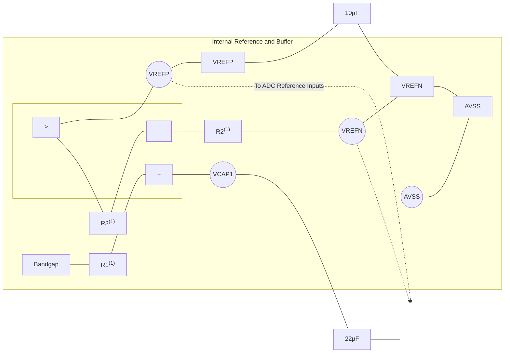
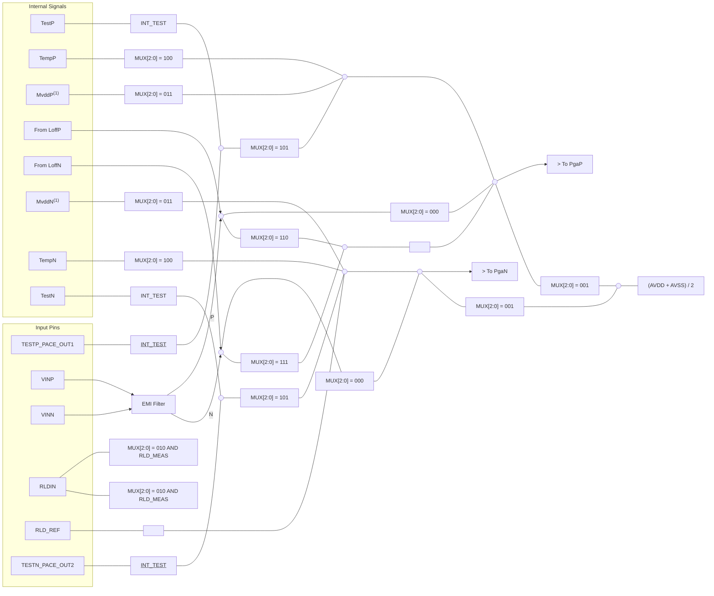
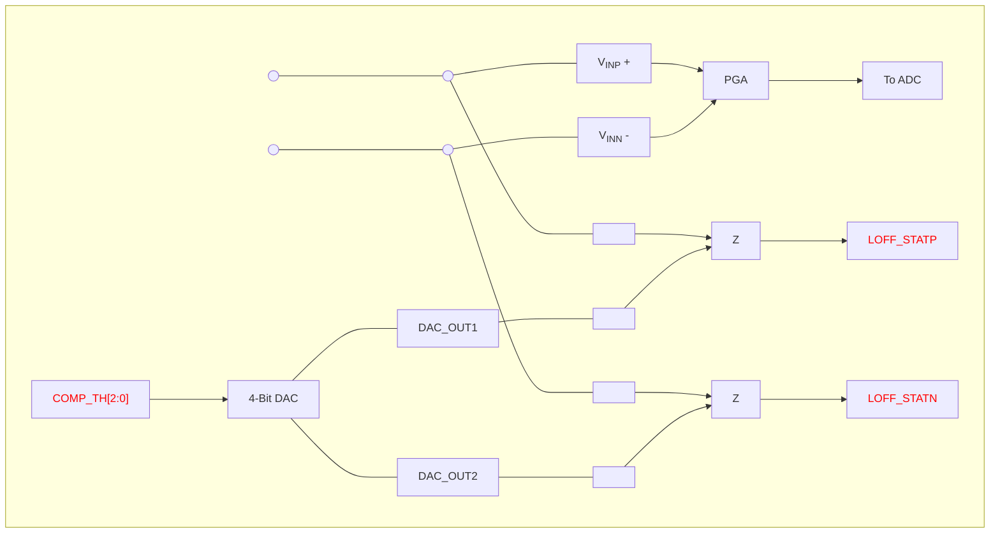
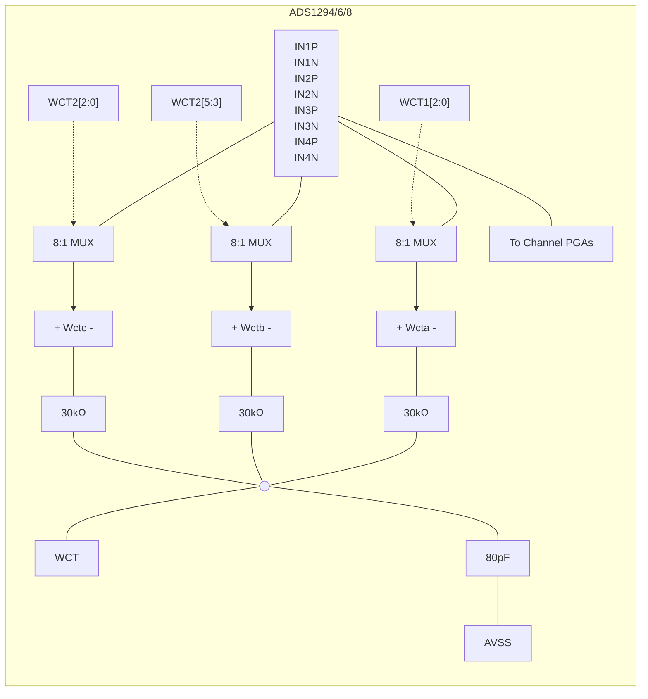
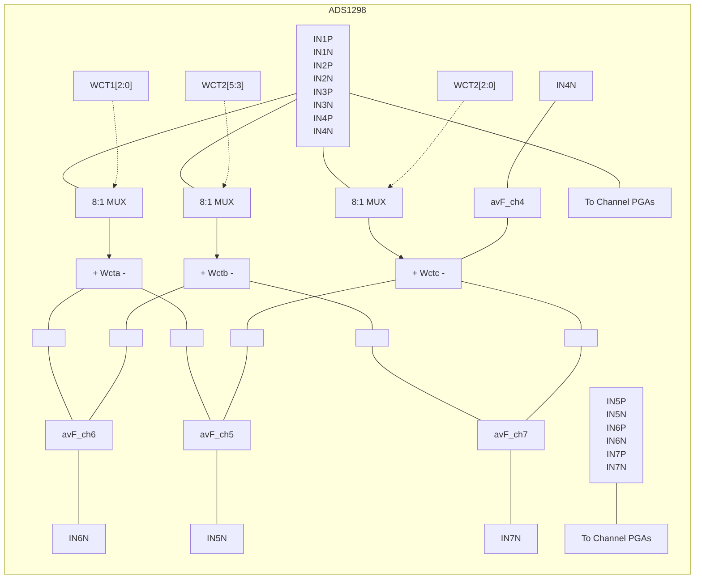
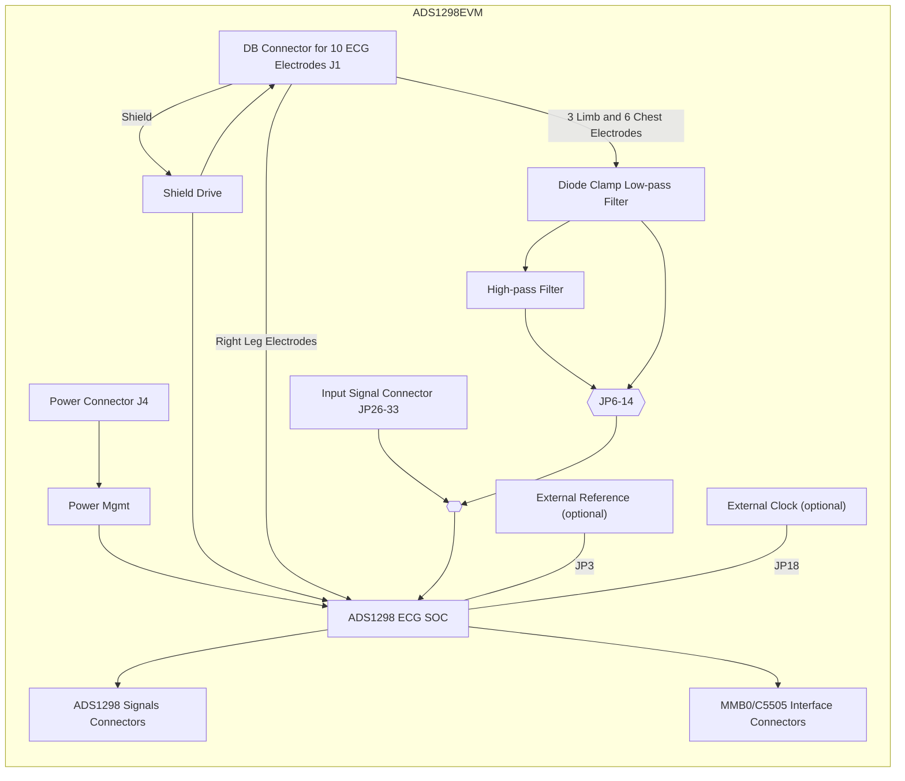
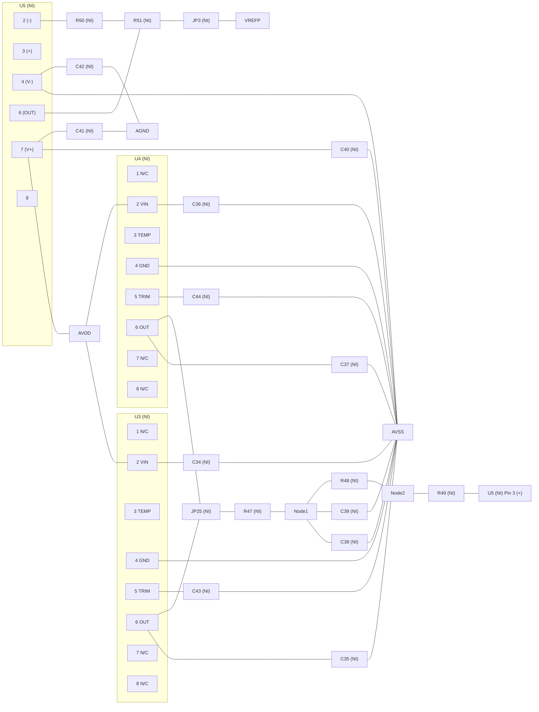

# ADS1298 ECG FE PDK user guide

<!-- Original PDF: ADS1298-EVM.pdf -->


<!-- PDF page 1 -->


# **ADS1298ECG-FE/ADS1198ECG-FE**

This user's guide describes the characteristics, operation, and use of the ADS1298ECG-FE and ADS1198ECG-FE. The ADS1298ECG-FE and ADS1198ECG-FE are evaluation modules for the ADS1298, an eight-channel, 24-bit, and ADS1198, an eight-channel, 16-bit, analog-to digital converter (ADC). Both devices provide low-power, integrated analog front-end (AFE) designs for patient monitoring and portable and high-end electrocardiogram (ECG) and electroencephalogram (EEG) applications. This user's guide includes a complete circuit description, schematic diagram, and bill of materials.

The following related documents are available through the Texas Instruments web site at [www.ti.com](http://www.ti.com).

<table>
  <thead>
    <tr>
      <th><b>Device</b></th>
      <th><b>Literature Number</b></th>
    </tr>
  </thead>
  <tbody>
    <tr>
      <td>ADS1298</td>
      <td>SBAS459</td>
    </tr>
    <tr>
      <td>ADS1198</td>
      <td>SBAS471</td>
    </tr>
  </tbody>
</table>

## **Contents**

<table>
    <tr>
      <td>1</td>
      <td>ADS1298ECG-FE/ADS1198ECG-FE Overview .........................................................................</td>
      <td>3</td>
    </tr>
    <tr>
      <td></td>
      <td>1.1    Important Disclaimer Information .................................................................................</td>
      <td>3</td>
    </tr>
    <tr>
      <td></td>
      <td>1.2    Introduction ..........................................................................................................</td>
      <td>4</td>
    </tr>
    <tr>
      <td></td>
      <td>1.3    Supported Features ................................................................................................</td>
      <td>4</td>
    </tr>
    <tr>
      <td></td>
      <td>1.4    Features Not Supported in Current Version.....................................................................</td>
      <td>4</td>
    </tr>
    <tr>
      <td></td>
      <td>1.5    ADS1x98ECG-FE Hardware ......................................................................................</td>
      <td>5</td>
    </tr>
    <tr>
      <td></td>
      <td>1.6    Minimum System Requirements for ADS1x98ECG-FE Evaluation Software ...............................</td>
      <td>5</td>
    </tr>
    <tr>
      <td>2</td>
      <td>Quick Start ....................................................................................................................</td>
      <td>6</td>
    </tr>
    <tr>
      <td></td>
      <td>2.1    Default Jumper/Switch Configuration ............................................................................</td>
      <td>6</td>
    </tr>
    <tr>
      <td></td>
      <td>2.2    ADS1x98ECG-FE Operation ......................................................................................</td>
      <td>7</td>
    </tr>
    <tr>
      <td>3</td>
      <td>Using the ADS1298ECG-FE Software ....................................................................................</td>
      <td>8</td>
    </tr>
    <tr>
      <td></td>
      <td>3.1    Application User Menu .............................................................................................</td>
      <td>9</td>
    </tr>
    <tr>
      <td></td>
      <td>3.2    Top-Level Application Controls ...................................................................................</td>
      <td>9</td>
    </tr>
    <tr>
      <td></td>
      <td>3.3    About Tab ..........................................................................................................</td>
      <td>10</td>
    </tr>
    <tr>
      <td></td>
      <td>3.4    ADC Register Tab .................................................................................................</td>
      <td>11</td>
    </tr>
    <tr>
      <td></td>
      <td>3.5    Analysis Tab .......................................................................................................</td>
      <td>19</td>
    </tr>
    <tr>
      <td></td>
      <td>3.6    Save Tab ...........................................................................................................</td>
      <td>27</td>
    </tr>
    <tr>
      <td>4</td>
      <td>ADS1x98ECG-FE Input Signals..........................................................................................</td>
      <td>29</td>
    </tr>
    <tr>
      <td></td>
      <td>4.1    Input Short Testing ................................................................................................</td>
      <td>29</td>
    </tr>
    <tr>
      <td></td>
      <td>4.2    Internal Test Signals Input ......................................................................................</td>
      <td>29</td>
    </tr>
    <tr>
      <td></td>
      <td>4.3    Temperature Sensor ..............................................................................................</td>
      <td>30</td>
    </tr>
    <tr>
      <td></td>
      <td>4.4    Normal Electrode Input ..........................................................................................</td>
      <td>31</td>
    </tr>
    <tr>
      <td></td>
      <td>4.5    MV<sub>DD</sub> Input, RLD Measurement, RLD Positive Electrode Driver, and RLD Negative Electrode Driver</td>
      <td>31</td>
    </tr>
    <tr>
      <td></td>
      <td>4.6    Lead Derivation....................................................................................................</td>
      <td>32</td>
    </tr>
    <tr>
      <td></td>
      <td>4.7    Wilson Center Terminal (WCT)..................................................................................</td>
      <td>32</td>
    </tr>
    <tr>
      <td></td>
      <td>4.8    Right Leg Drive ....................................................................................................</td>
      <td>32</td>
    </tr>
    <tr>
      <td></td>
      <td>4.9    PACE Detection ...................................................................................................</td>
      <td>33</td>
    </tr>
    <tr>
      <td>5</td>
      <td>ADS1298ECG-FE/ADS1198ECG-FE Hardware Details ..............................................................</td>
      <td>35</td>
    </tr>
    <tr>
      <td></td>
      <td>5.1    Jumper Description ...............................................................................................</td>
      <td>36</td>
    </tr>
    <tr>
      <td></td>
      <td>5.2    Power Supply ......................................................................................................</td>
      <td>37</td>
    </tr>
    <tr>
      <td></td>
      <td>5.3    Clock ................................................................................................................</td>
      <td>38</td>
    </tr>
    <tr>
      <td></td>
      <td>5.4    Reference ..........................................................................................................</td>
      <td>38</td>
    </tr>
    <tr>
      <td></td>
      <td>5.5    Analog Output Signals............................................................................................</td>
      <td>39</td>
    </tr>
</table>


<!-- PDF page 2 -->


<table>
    <tr>
      <td>5.6</td>
      <td>Digital Signals......................................................................................................</td>
      <td>39</td>
    </tr>
    <tr>
      <td>5.7</td>
      <td>Analog Input Signals ..............................................................................................</td>
      <td>39</td>
    </tr>
    <tr>
      <td>Appendix A</td>
      <td>Schematics, BOM, Layout, and ECG Cable Details ..........................................................</td>
      <td>41</td>
    </tr>
    <tr>
      <td>Appendix B</td>
      <td>External Optional Hardware......................................................................................</td>
      <td>47</td>
    </tr>
    <tr>
      <td>Appendix C</td>
      <td>Software Installation ..............................................................................................</td>
      <td>50</td>
    </tr>
</table>

<table><caption>**List of Figures**</caption><tr><td>1</td><td>ADS1x98ECG-FE Kit........................................................................................................</td><td>5</td></tr><tr><td>2</td><td>ADS1x98ECG-FE Default Jumper Locations ............................................................................</td><td>6</td></tr><tr><td>3</td><td>Software Start Screen/About Tab .........................................................................................</td><td>8</td></tr><tr><td>4</td><td>User Menu - File Item .......................................................................................................</td><td>9</td></tr><tr><td>5</td><td>User Menu - Help Item ......................................................................................................</td><td>9</td></tr><tr><td>6</td><td>Top Level Controls ..........................................................................................................</td><td>9</td></tr><tr><td>7</td><td>Lead-Off Status Registers Display Window ............................................................................</td><td>10</td></tr><tr><td>8</td><td>Channel Registers Tab ....................................................................................................</td><td>11</td></tr><tr><td>9</td><td>Internal Reference and Buffer Connections ............................................................................</td><td>12</td></tr><tr><td>10</td><td>Lead-Off Excitation Options...............................................................................................</td><td>13</td></tr><tr><td>11</td><td>Input Multiplexer for a Single Channel ..................................................................................</td><td>13</td></tr><tr><td>12</td><td>LOFF and RLD Tab ........................................................................................................</td><td>14</td></tr><tr><td>13</td><td>LOFF_STATP and LOFF_STATN Comparators .......................................................................</td><td>15</td></tr><tr><td>14</td><td>GPIO and OTHER Register Tab .........................................................................................</td><td>16</td></tr><tr><td>15</td><td>Wilson Central and Augmented Lead Routing Diagrams .............................................................</td><td>17</td></tr><tr><td>16</td><td>Device Registers Settings.................................................................................................</td><td>18</td></tr><tr><td>17</td><td>Scope Tool Features.......................................................................................................</td><td>19</td></tr><tr><td>18</td><td>Scope Analysis Tab (Noise Levels for Each Channel Shown).......................................................</td><td>19</td></tr><tr><td>19</td><td>Zoom Tool Options.........................................................................................................</td><td>20</td></tr><tr><td>20</td><td>Histogram Bins for 12-Lead ECG Signal................................................................................</td><td>21</td></tr><tr><td>21</td><td>Statistics for the Signal Amplitude of Eight ECG Channels ..........................................................</td><td>21</td></tr><tr><td>22</td><td>FFT Graph of Normal Electrode Configuration.........................................................................</td><td>22</td></tr><tr><td>23</td><td>AC Analysis Parameters: Windowing Options .........................................................................</td><td>22</td></tr><tr><td>24</td><td>FFT Analysis: Input Short Condition .....................................................................................</td><td>23</td></tr><tr><td>25</td><td>Changing the User-Defined Dynamic Range for Channel 1..........................................................</td><td>23</td></tr><tr><td>26</td><td>FFT Plot Using Zoom Tool ................................................................................................</td><td>24</td></tr><tr><td>27</td><td>ECG Display Tab Showing LEAD I-III and Augmented Leads .......................................................</td><td>25</td></tr><tr><td>28</td><td>ECG Signal Zoom Feature for Six Leads ...............................................................................</td><td>26</td></tr><tr><td>29</td><td>ECG Signal Zoom Feature for Lead 1...................................................................................</td><td>26</td></tr><tr><td>30</td><td>Save Tab ....................................................................................................................</td><td>28</td></tr><tr><td>31</td><td>Example of Internal Test Signals Viewed on the ECG Display Tab .................................................</td><td>29</td></tr><tr><td>32</td><td>Internal Temperature Sensor .............................................................................................</td><td>30</td></tr><tr><td>33</td><td>Eight-Channel Read of Internal Temperature ..........................................................................</td><td>30</td></tr><tr><td>34</td><td>Normal Electrode ECG Connection in ECG Display Tab .............................................................</td><td>31</td></tr><tr><td>35</td><td>Digitization of PACE Signal Using ADS1298 ...........................................................................</td><td>34</td></tr><tr><td>36</td><td>ADS1298ECG-FE Front-End Block Diagram...........................................................................</td><td>35</td></tr><tr><td>37</td><td>Fluke Simulator Configuration ............................................................................................</td><td>40</td></tr><tr><td>38</td><td>Top Component Placement...............................................................................................</td><td>44</td></tr><tr><td>39</td><td>Top Layer ...................................................................................................................</td><td>44</td></tr><tr><td>40</td><td>Bottom Component Placement ...........................................................................................</td><td>44</td></tr><tr><td>41</td><td>Bottom Layer................................................................................................................</td><td>44</td></tr><tr><td>42</td><td>Internal Ground Plane (Layer 2)..........................................................................................</td><td>44</td></tr><tr><td>43</td><td>Internal Power Plane (Layer 3) ...........................................................................................</td><td>44</td></tr><tr><td>44</td><td>ECG Cable Schematic.....................................................................................................</td><td>46</td></tr><tr><td>45</td><td>15-Pin, Shielded Connector from Biometric Cables ...................................................................</td><td>47</td></tr><tr><td>46</td><td>15-Pin, Twisted Wire Cable to Banana Jacks ..........................................................................</td><td>47</td></tr><tr><td>47</td><td>15-Pin, Twisted Wire Cable...............................................................................................</td><td>47</td></tr><tr><td>48</td><td>Cardiosim ECG Simulator Tool...........................................................................................</td><td>48</td></tr><tr><td>49</td><td>Recommended Power Supply for ADS1x98ECG-FE..................................................................</td><td>49</td></tr><tr><td>50</td><td>Initialization of ADS1x98ECG-FE ........................................................................................</td><td>50</td></tr><tr><td>51</td><td>License Agreement ........................................................................................................</td><td>50</td></tr><tr><td>52</td><td>Installation Process ........................................................................................................</td><td>50</td></tr><tr><td>53</td><td>Completion of ADS1x98ECG-FE Software Installation................................................................</td><td>50</td></tr></table>


<!-- PDF page 3 -->


<table>
<caption>**List of Tables**</caption>
<tr>
<td>1</td>
<td>ADS1x98ECG-FE Default Jumper/Switch Configuration ...............................................................</td>
<td>7</td>
</tr>
<tr>
<td>2</td>
<td>ADS1298 Lead Measurements...........................................................................................</td>
<td>32</td>
</tr>
<tr>
<td>3</td>
<td>Derived Lead Calculations ................................................................................................</td>
<td>32</td>
</tr>
<tr>
<td>4</td>
<td>RLD Jumper Options ......................................................................................................</td>
<td>33</td>
</tr>
<tr>
<td>5</td>
<td>ADS1x98ECG-FE Default Jumper/Switch Configuration .............................................................</td>
<td>36</td>
</tr>
<tr>
<td>6</td>
<td>Power-Supply Test Points.................................................................................................</td>
<td>37</td>
</tr>
<tr>
<td>7</td>
<td>Analog Supply Configurations (AVDD/AVSS) ..........................................................................</td>
<td>38</td>
</tr>
<tr>
<td>8</td>
<td>Digital Supply Configurations (DVDD/DGND) ..........................................................................</td>
<td>38</td>
</tr>
<tr>
<td>9</td>
<td>CLK Jumper Options.......................................................................................................</td>
<td>38</td>
</tr>
<tr>
<td>10</td>
<td>External Reference Jumper Options.....................................................................................</td>
<td>39</td>
</tr>
<tr>
<td>11</td>
<td>Test Signals.................................................................................................................</td>
<td>39</td>
</tr>
<tr>
<td>12</td>
<td>Serial Interface Pinout .....................................................................................................</td>
<td>39</td>
</tr>
<tr>
<td>13</td>
<td>Bill of Materials: ADS1x98ECG-FE .....................................................................................</td>
<td>42</td>
</tr>
</table>

## **Trademarks**

Pentium III, Celeron are registered trademarks of Intel Corporation.
Microsoft, Windows are registered trademarks of Microsoft Corporation.
SPI is a trademark of Motorola Inc.
All other trademarks are the property of their respective owners.

# **1    ADS1298ECG-FE/ADS1198ECG-FE Overview**

## **1.1  *Important Disclaimer Information***

**CAUTION**

**NOTICE:** The ADS1298ECG-FE and ADS1198ECG-FE are intended for feasibility and evaluation testing only in laboratory and development environments. This product is not for diagnostic use. This product is not for use with a defibrillator.

The ADS1298ECG-FE/ADS1198ECG-FE is to be used only under these conditions:

* The ADS1298ECG-FE/ADS1198ECG-FE is intended only for ***electrical*** evaluation of the features of the ADS1298 device in a laboratory, simulation, or development environment.
* The ADS1298ECG-FE/ADS1198ECG-FE is ***not*** intended for direct interface with a patient, patient diagnostics, or with a defibrillator.
* The ADS1298ECG-FE/ADS1198ECG-FE is intended for development purposes **ONLY**. It is not intended to be used as all or part of an end equipment application.


<!-- PDF page 4 -->


* The ADS1298ECG-FE/ADS1198ECG-FE should be used only by qualified engineers and technicians who are familiar with the risks associated with handling electrical and mechanical components, systems, and subsystems.
* The user is responsible for the safety of themselves, fellow employees and contractors, and co-workers when using or handling the ADS1298ECG-FE/ADS1198ECG-FE. Furthermore, the user is fully responsible for the contact interface between the human body and electronics; consequently, the user is responsible for preventing electrical hazards such as shock, electrostatic discharge, and electrical overstress of electric circuit components.

## **1.2 Introduction**

The ADS1x98ECG-FE is intended for evaluating the **ADS1298** and **ADS1198** for ECG and EEG applications. The digital SPI<sup>TM</sup> control interface is provided by the MMB0 Modular EVM motherboard that connects to the ADS1x98ECG FE evaluation board. The ADS1x98ECG-FE (see **Figure 1**) is **NOT** a reference design for ECG and EEG applications; rather, its purpose is to expedite evaluation and system development. The output of the ADS1298 yields a raw, unfiltered ECG signal.

The MMB0 motherboard allows the ADS1x98 to be connected to the computer via an available USB port. This manual shows how to use the MMB0 as part of the ADS1x98ECG-FE, but does not provide technical details about the MMB0 itself.

This document covers the operation of the ADS1x98ECG-FE evaluation system. Throughout the document, the abbreviation *EVM* and the term *evaluation module* are synonymous with the ADS1x98ECG-FE. For clarity of reading, this manual will refer only to the ADS1298ECG-FE or ADS1x98ECG-FE, but operation of the ADS1198ECG-FE is identical, unless otherwise noted.

### **CAUTION**

Many of the components on the ADS1x98ECG-FE are susceptible to damage by electrostatic discharge (ESD). Customers are advised to observe proper ESD handling precautions when unpacking and handling the EVM, including the use of a grounded wrist strap, bootstraps, or mats at an approved ESD workstation. An electrostatic smock and safety glasses should also be worn.

## **1.3 Supported Features**

### **Hardware Features:**

* Configurable for bipolar or unipolar supply operation
* Configurable for internal and external clock and reference via jumper settings
* Configurable for AC- or DC-coupled inputs
* Configurable for up to 12 standard ECG leads
* External Right Leg Drive (RLD) Reference ($V_{CC} - V_{EE}$)/2
* External Wilson central voltage
* Easy connectivity to popular ECG simulators

### **Software Features:**

* Designed to display 12 lead ECG data
* Analysis tools including a virtual oscilloscope, histogram, FFT, and ECG display
* File printing for post-processing of raw ECG data
* Sets the ADS1298/ADS1198 register settings via easy-to-use graphic user interface (GUI) software
* Post-processing of ECG data using high-pass, low-pass, and 50/60Hz notch filters

## **1.4 Features Not Supported in Current Version**

* Real-time data processing
* AC lead-off detection filters


<!-- PDF page 5 -->


* QRS detection algorithms
* Software PACE detection algorithms

## 1.5 ***ADS1x98ECG-FE Hardware***

Figure 1 shows the hardware included in the ADS1x98ECG-FE kit. Contact the factory if any component is missing. The latest software is available for download on the TI website at http://www.ti.com.


<a name="figure-1"></a>**Figure 1. ADS1x98ECG-FE Kit**

The complete kit includes the following items:

* ADS1x98ECG-FE printed circuit board (PCB)
* MMB0 (Modular EVM motherboard)

## 1.6 ***Minimum System Requirements for ADS1x98ECG-FE Evaluation Software***

The minimum system requirements for using the ADS1x98ECG-FE software application are:

* Pentium III®/Celeron® processor, 866MHz or equivalent
* Minimum 256MB of RAM (512MB or greater recommended)
* USB 1.1-compatible input
* Hard disk drive with at least 200MB free space
* Microsoft® Windows® XP operating system with SP2 or Windows 7 operating systems (Windows Vista not tested)
* Mouse or other pointing device
* 1280 x 960 minimum display resolution


<!-- PDF page 6 -->


# 2 **Quick Start**

This section provides a QuickStart guide to quickly begin evaluating the EVM using the ADS1x98ECG-FE software.

## 2.1 ***Default Jumper/Switch Configuration***

Figure 2 shows the jumpers found on the ADS1x98ECG-FE EVM and the respective factory default conditions for each.


**Figure 2. ADS1x98ECG-FE Default Jumper Locations**

Table 1 lists the jumpers and switches and the factory default conditions.


<!-- PDF page 7 -->


**Table 1. ADS1x98ECG-FE Default Jumper/Switch Configuration**

<table>
  <thead>
    <tr>
      <th>Jumper</th>
      <th>Default Position</th>
      <th>Description</th>
    </tr>
  </thead>
  <tbody>
    <tr>
      <td>JP1</td>
      <td>Installed</td>
      <td>RLD feedback</td>
    </tr>
    <tr>
      <td>JP2</td>
      <td>Installed 1-2</td>
      <td>AVDD selected for bipolar supply operation selected (AVDD = +2.5V)</td>
    </tr>
    <tr>
      <td>JP3</td>
      <td>Header Not Installed</td>
      <td>External Vref buffer not connected</td>
    </tr>
    <tr>
      <td>JP4</td>
      <td>Installed</td>
      <td>EVM +5V provided from J4 (power header)</td>
    </tr>
    <tr>
      <td>JP5</td>
      <td>Open</td>
      <td><s>PWDN</s> pin controlled from J5 header (pulled up to DVDD)</td>
    </tr>
    <tr>
      <td>JP6 to JP14</td>
      <td>Header Not Installed (Pins 1-2<br />shorted on PCB)</td>
      <td>DC-coupled input signals</td>
    </tr>
    <tr>
      <td>JP15</td>
      <td>Installed 2-3</td>
      <td>Shield drive is open</td>
    </tr>
    <tr>
      <td>JP16</td>
      <td>Installed</td>
      <td>Wilson Central Terminal (WCT) connected to INM for CH1 and CH4-8</td>
    </tr>
    <tr>
      <td>JP17</td>
      <td>Header Not Installed</td>
      <td>ECG shield drive</td>
    </tr>
    <tr>
      <td>JP18</td>
      <td>Installed 2-3</td>
      <td><b>CLK</b> connected to OSC1</td>
    </tr>
    <tr>
      <td>JP19</td>
      <td>Installed 1-2</td>
      <td>OSC1 enabled</td>
    </tr>
    <tr>
      <td>JP20</td>
      <td>Installed 2-3</td>
      <td>AVSS selected for bipolar supply operation (AVSS = -2.5V)</td>
    </tr>
    <tr>
      <td>JP21</td>
      <td>Installed 1-2</td>
      <td><b><s>CS</s></b> connected to DSP via J3.1</td>
    </tr>
    <tr>
      <td>JP22</td>
      <td>Installed 2-3</td>
      <td><b>START</b> comes from J3.14</td>
    </tr>
    <tr>
      <td>JP23</td>
      <td>Installed 1-2</td>
      <td><b>CLKSEL</b> set to 0 (ADS1198 uses Ext Master Clock (OSC1))</td>
    </tr>
    <tr>
      <td>JP24</td>
      <td>Installed 2-3</td>
      <td>DVDD supply = 3.3V</td>
    </tr>
    <tr>
      <td>JP25</td>
      <td>Header Not Installed</td>
      <td>No external reference selected</td>
    </tr>
    <tr>
      <td rowspan="2">JP26</td>
      <td>Installed 1-2 (top)</td>
      <td>WCT connected to CH8- input</td>
    </tr>
    <tr>
      <td>Installed 3-4 (bottom)</td>
      <td>ECG_V1 connected to CH8+ input</td>
    </tr>
    <tr>
      <td rowspan="2">JP27</td>
      <td>Installed 1-2 (top)</td>
      <td>WCT connected to CH7- input</td>
    </tr>
    <tr>
      <td>Installed 3-4 (bottom)</td>
      <td>ECG_V5 connected to CH7+ input</td>
    </tr>
    <tr>
      <td rowspan="2">JP28</td>
      <td>Installed 1-2 (top)</td>
      <td>WCT connected to CH6- input</td>
    </tr>
    <tr>
      <td>Installed 3-4 (bottom)</td>
      <td>ECG_V3 connected to CH5+ input</td>
    </tr>
    <tr>
      <td rowspan="2">JP29</td>
      <td>Installed 1-2 (top)</td>
      <td>WCT connected to CH5- input</td>
    </tr>
    <tr>
      <td>Installed 3-4 (bottom)</td>
      <td>ECG_V4 connected to CH6+ input</td>
    </tr>
    <tr>
      <td rowspan="2">JP30</td>
      <td>Installed 1-2 (top)</td>
      <td>WCT connected to CH4- input</td>
    </tr>
    <tr>
      <td>Installed 3-4 (bottom)</td>
      <td>ECG_V2 connected to CH4+ input</td>
    </tr>
    <tr>
      <td rowspan="2">JP31</td>
      <td>Installed 1-2 (top)</td>
      <td>ECG_RA connected to CH3- input</td>
    </tr>
    <tr>
      <td>Installed 3-4 (bottom)</td>
      <td>ECG_LL connected to CH3+ input</td>
    </tr>
    <tr>
      <td rowspan="2">JP32</td>
      <td>Installed 1-2 (top)</td>
      <td>ECG_RA connected to CH2- input</td>
    </tr>
    <tr>
      <td>Installed 3-4 (bottom)</td>
      <td>ECG_ LA connected to CH2+ input</td>
    </tr>
    <tr>
      <td rowspan="2">JP33</td>
      <td>Installed 1-2 (top)</td>
      <td>WCT connected to CH1- input</td>
    </tr>
    <tr>
      <td>Installed 3-4 (bottom)</td>
      <td>ECG_V6 connected to CH1+ input</td>
    </tr>
  </tbody>
</table>

## **2.2  *ADS1x98ECG-FE Operation***

To prepare to evaluate the ADS1298 with the ADS1298ECG-FE, complete the following steps:

1. Verify the jumpers on the ADS1298ECG-FE are as shown in Figure 2 (note that these settings are the factory-configured settings for the board).
2. Verify that the jumpers on the MMB0 motherboard are configured as shown below:
   * MMB0 J13A → Open
   * MMB0 J13B → Open
   * Refer to Section B.2 for details about the MMB0 power supply.
3. Install the ADS1298ECG-FE software using the latest software version. The latest software can be downloaded from the ADS1298ECG-FE product page or ADS1198ECG-FE product page. Double click the installer and follow the instruction to complete the software installation. For detailed installation information and screenshots, see Appendix C.


<!-- PDF page 8 -->


# 3 **Using the ADS1298ECG-FE Software**

The ADS1298ECG-FE software provides complete control over all the settings of the ADS1298. By using the user interface (UI), the ADS1298 control registers can be manipulated to evaluate the various options available on the device. Figure 3 shows the starting UI screen of the software. The UI consists of a user menu (Section 3.1), a few top-level controls (Section 3.2), and a tabbed interface, with different functions available on the different tabs. The tabs are:

* About (Section 3.3)
* ADC Register (Section 3.4.3)
* Analysis (Section 3.5)
* Save (Section 3.6)

<table>
<thead>
<tr>
<th align="left">ADS1298/8R EVM Evaluation Software</th>
<th align="left">_ □ x</th>
</tr>
</thead>
<tbody>
<tr>
<td align="left">File Help</td>
<td align="left"></td>
</tr>
</tbody>
</table>

<table>
<thead>
<tr>
<th align="left">ADS1298ECG-FE</th>
<th align="left">Sync Complete...Ready</th>
</tr>
</thead>
</table>

<table>
<thead>
<tr>
<th align="left">Data Rate</th>
<th align="left">Progress</th>
<th align="left">Samples/CH</th>
<th align="left">[ ACQUIRE ] [ CONTINUOUS ]</th>
<th align="left">[x] Analysis Data is input referred</th>
<th align="left">( ) Show/Poll Lead Off Status</th>
<th></th>
</tr>
</thead>
<tbody>
<tr>
<td align="left">[ 500SPS ]</td>
<td align="left">[</td>
<td align="left">0% ]</td>
<td align="left">[ 1000 ]</td>
<td align="left"></td>
<td align="left"></td>
<td></td>
</tr>
</tbody>
</table>

<table>
<thead>
<tr>
<th align="left"></th>
<th align="left"></th>
</tr>
</thead>
<tbody>
<tr>
<td align="left"><strong>About</strong></td>
<td align="left">### <strong>Product Safety Warnings, Restrictions and Disclaimers</strong></td>
</tr>
<tr>
<td align="left">ADC Register</td>
<td align="left">The following Evaluation Board ADS1298/8RECG-FE set-up, use and application requirements must be followed:</td>
</tr>
<tr>
<td align="left">Analysis</td>
<td align="left">1. <strong>NOT</strong> for diagnostic use.</td>
</tr>
<tr>
<td align="left">Save</td>
<td align="left">2. <strong>NOT</strong> for direct use with, or use in proximity of, an energized Defibrillator.</td>
</tr>
<tr>
<td align="left"></td>
<td align="left">3. <strong>ONLY</strong> for Feasibility Evaluation in Laboratory/Development Environments.</td>
</tr>
<tr>
<td align="left"></td>
<td align="left">4. The ADS1298/8RECG-FE intended application is <strong>solely</strong> for use in a laboratory/development environment, restricted to feasibility evaluation and development purposes, and <strong>not</strong> for diagnostic purposes and/or interface with human beings and/or animals.</td>
</tr>
<tr>
<td align="left"></td>
<td align="left">5. <strong>ONLY</strong> for use by qualified engineers and technicians familiar with the potential electrical shock, fire and personal injury risks associated in handling subassembly electrical and mechanical components.</td>
</tr>
<tr>
<td align="left"></td>
<td align="left">6. Use in conjunction with and/or adjacent to a defibrillator is strictly prohibited; application interface electronics shall not exceed their intended ratings. Refer to user instructions and the ADS1298/8RECG-FE for further interface details.</td>
</tr>
<tr>
<td align="left"></td>
<td align="left"></td>
</tr>
<tr>
<td align="left"></td>
<td align="left">For further information on application safety, refer to the standard TI terms and conditions documentation XXXXXXXXX</td>
</tr>
<tr>
<td align="left"></td>
<td align="left"></td>
</tr>
<tr>
<td align="left"></td>
<td align="left">Device ID [ ADS1298 ] Motherboard: MMB0</td>
</tr>
<tr>
<td align="left"></td>
<td align="left">Texas Instruments Inc (c) 2012</td>
</tr>
<tr>
<td align="left"></td>
<td align="left">Firmware Version [ 0.2.31 ]</td>
</tr>
</tbody>
</table>

**Figure 3. Software Start Screen/About Tab**

The user can adjust the settings when the software is not acquiring data. During acquisition, all controls are disabled and settings may not be changed. When a setting is changed via a control, the settings are immediately updated on the device and EVM. Settings in the software correspond to settings described in the ADS1298 product data sheet.


<!-- PDF page 9 -->


## **3.1 *Application User Menu***

The application user menu is located along the top of the application menu. It consists of two items: *File* and *Help*.

**File** Menu (see Figure 4)
The *File* menu provides several options:

* **Capture Screen** takes a screen capture of the current view of the application and saves it as to a file specified by the user.
* **Save Configuration Settings** saves the current states of the ADS1298 control registers for reloading at a later time. This file is different from the save register on the **Save** tab (see Section 3.6), which saves the current register map to a tab-delimited text file.
* **Load Configuration Settings** loads a previously save configuration setting file and initializes the hardware and software to the settings within the configuration file. The configuration file must be a file saved previously from this application using the **Save Configuration Settings** command, not a file from the **Save** tab.
* **Exit** closes the application.

**Help** Menu (see Figure 5)
The *Help* menu provides the *About* option, which display the software and firmware version that is currently being used. Please have this information if you need to request assistance or have a question regarding the software or hardware.

```

**Figure 4. User Menu - File Item**
**Figure 5. User Menu - Help Item**
```

## **3.2 *Top-Level Application Controls***

Several controls/indicators are located along the top of the UI screen (see Figure 6). The controls and indicators are described below.


**Figure 6. Top Level Controls**

The **Data Rate** indicator displays the current data rate of the ADS1298. The data rate can be configured in CONFIG1 control register (see Section 3.4.2.1).

The **Progress** indicator will display the current progress of data transfer to the PC during acquisition cycles.

The **Samples/CH** control allows for the selection of the number of points, per channel, to collect during an acquisition cycle. Keep in mind the value entered into this control in relation to the current data rate. Large numbers of samples, coupled with slower data rates, can take time to acquire.

The **ACQUIRE** control starts the acquisition process. When pressed, the software will collect the requested number of samples from the ADS1298. All points collected during an acquisition process will be contiguous points.


<!-- PDF page 10 -->


The **CONTINUOUS** control starts a repeated acquisition process. This function acquires the requested samples and repeats the data acquisition until the button is turned off. Within a single acquisition cycle, the points will be contiguous, but from acquisition to acquisition, there may be points missing.

The **Analysis Data input referred** checkbox changes the displayed data that is read from the ADC. Checking the box displays the data input referred, while not checking displays the data as converted.

The **Show/Poll Lead Off Status** displays a window (see Figure 7) that shows the status of the Lead-Off status registers, *LOFF STATP* and *LOFF STATN*, of the ADS1298. When the lead for the channel is disconnected, the corresponding channel LED changes from green to red.

### Lead-Off Status Registers

<table>
<thead>
<tr>
<th align="left">Positive Electrode</th>
<th align="center">Channel</th>
<th align="left">Negative Electrode</th>
</tr>
</thead>
<tbody>
<tr>
<td align="left">LEAD ON</td>
<td align="center"><strong>IN8x</strong></td>
<td align="left">LEAD OFF</td>
</tr>
<tr>
<td align="left">LEAD ON</td>
<td align="center"><strong>IN7x</strong></td>
<td align="left">LEAD ON</td>
</tr>
<tr>
<td align="left">LEAD ON</td>
<td align="center"><strong>IN6x</strong></td>
<td align="left">LEAD OFF</td>
</tr>
<tr>
<td align="left">LEAD ON</td>
<td align="center"><strong>IN5x</strong></td>
<td align="left">LEAD OFF</td>
</tr>
<tr>
<td align="left">LEAD ON</td>
<td align="center"><strong>IN4x</strong></td>
<td align="left">LEAD ON</td>
</tr>
<tr>
<td align="left">LEAD ON</td>
<td align="center"><strong>IN3x</strong></td>
<td align="left">LEAD ON</td>
</tr>
<tr>
<td align="left">LEAD ON</td>
<td align="center"><strong>IN2x</strong></td>
<td align="left">LEAD ON</td>
</tr>
<tr>
<td align="left">LEAD ON</td>
<td align="center"><strong>IN1x</strong></td>
<td align="left">LEAD ON</td>
</tr>
</tbody>
</table>

**Figure 7. Lead-Off Status Registers Display Window**

## 3.3 *About Tab*

The *About* tab provides software information to the user. Important safety warning, restrictions, and disclaimers for the software and hardware are shown and should be followed during the evaluation of this product. Additional indicators are present to provide device information (**Device ID** and **Rev**) and software information (**Firmware Version**). The *About* tab should be the first screen displayed at startup (see Figure 3).


<!-- PDF page 11 -->


## **3.4 *ADC Register Tab***

The **ADC Register** tab provides controls to manipulate ADC control registers of the ADS1298. Details of the control registers are provided in the product datasheet. The **ADC Register** tab consists of a few controls and several sub-tabs that further divide the control registers into different functions groups. The sub-tabs are:

* Channel Registers tab (Section 3.4.2)
* LOFF and RLD tab (Section 3.3)
* GPIO and Other Registers tab (Section 3.4.4)
* Register Map tab (Section 3.4.5)

<table>
<thead>
<tr>
<th align="left">Tab</th>
</tr>
</thead>
<tbody>
<tr>
<td align="left">About</td>
</tr>
<tr>
<td align="left"><strong>ADC Register</strong></td>
</tr>
<tr>
<td align="left">Analysis</td>
</tr>
<tr>
<td align="left">Save</td>
</tr>
</tbody>
</table>

<table>
<thead>
<tr>
<th align="left">Sub-Tab</th>
</tr>
</thead>
<tbody>
<tr>
<td align="left">Channel Registers</td>
</tr>
<tr>
<td align="left">LOFF and RLD</td>
</tr>
<tr>
<td align="left">GPIO and OTHER Registers</td>
</tr>
<tr>
<td align="left">Register Map</td>
</tr>
</tbody>
</table>

### Global Channel Registers

Configuration Register 1 (CONFIG1)

<table>
<thead>
<tr>
<th align="left">High Resolution/Low Power Mode</th>
<th align="left">Daisy-chain/Multiple Readback Mode</th>
<th align="left">CLKOUT Connection</th>
<th align="left">Output Data Rate</th>
</tr>
</thead>
<tbody>
<tr>
<td align="left">High Resolution Mode</td>
<td align="left">Daisy Chain Mode</td>
<td align="left">Output Disabled</td>
<td align="left">f(MOD) /1024</td>
</tr>
</tbody>
</table>

Configuration Register 2 (CONFIG2)

<table>
<thead>
<tr>
<th align="left">TEST Source</th>
<th align="left">Test Signal Amplitude</th>
<th align="left">Test Signal Frequency</th>
</tr>
</thead>
<tbody>
<tr>
<td align="left">Generated Internally</td>
<td align="left">(VREFP-VREFN)/2.4</td>
<td align="left">f(CLK)/2^21</td>
</tr>
</tbody>
</table>

Configuration Register 3 (CONFIG3)

<table>
<thead>
<tr>
<th align="left">Power-down Reference Buffer</th>
<th align="left">Reference Voltage</th>
<th align="left">RLD Measurement</th>
<th align="left">RLDREF Signal Source</th>
<th align="left">RLD Buffer Power</th>
</tr>
</thead>
<tbody>
<tr>
<td align="left">Enabled</td>
<td align="left">VREFP = 2.4V</td>
<td align="left">RLD_IN Routed</td>
<td align="left">RLDREF = AVDD/2</td>
<td align="left">Enabled</td>
</tr>
</tbody>
</table>

Lead-Off Control Register (LOFF)

<table>
<thead>
<tr>
<th align="left">Comparator Threshold</th>
<th align="left">Lead-off Detection Mode</th>
<th align="left">Lead-off Current Magnitude</th>
<th align="left">Lead-off Frequency</th>
</tr>
</thead>
<tbody>
<tr>
<td align="left">Positive - 95% : Negative - 5%</td>
<td align="left">Current Mode</td>
<td align="left">6nA</td>
<td align="left">DC Lead-off Detection ON</td>
</tr>
</tbody>
</table>

### Channel Control Registers

Globally Set Channels

<table>
<thead>
<tr>
<th align="left">Power-down</th>
<th align="left">PGA Gain</th>
<th align="left">Channel Input</th>
</tr>
</thead>
<tbody>
<tr>
<td align="left">Normal Operation</td>
<td align="left">6</td>
<td align="left">Normal Electrode</td>
</tr>
</tbody>
</table>

<table>
<thead>
<tr>
<th align="left">Channel 1 Control Register (CH1SET)</th>
<th align="left">Channel 2 Control Register (CH2SET)</th>
</tr>
</thead>
<tbody>
<tr>
<td align="left"><strong>Power-down</strong>: Normal Operation</td>
<td align="left"><strong>Power-down</strong>: Normal Operation</td>
</tr>
<tr>
<td align="left"><strong>PGA Gain</strong>: 6</td>
<td align="left"><strong>PGA Gain</strong>: 6</td>
</tr>
<tr>
<td align="left"><strong>Channel Input</strong>: Normal Electrode</td>
<td align="left"><strong>Channel Input</strong>: Normal Electrode</td>
</tr>
</tbody>
</table>

<table>
<thead>
<tr>
<th align="left">Channel 3 Control Register (CH3SET)</th>
<th align="left">Channel 4 Control Register (CH4SET)</th>
</tr>
</thead>
<tbody>
<tr>
<td align="left"><strong>Power-down</strong>: Normal Operation</td>
<td align="left"><strong>Power-down</strong>: Normal Operation</td>
</tr>
<tr>
<td align="left"><strong>PGA Gain</strong>: 6</td>
<td align="left"><strong>PGA Gain</strong>: 6</td>
</tr>
<tr>
<td align="left"><strong>Channel Input</strong>: Normal Electrode</td>
<td align="left"><strong>Channel Input</strong>: Normal Electrode</td>
</tr>
</tbody>
</table>

<table>
<thead>
<tr>
<th align="left">Channel 5 Control Register (CH5SET)</th>
<th align="left">Channel 6 Control Register (CH6SET)</th>
</tr>
</thead>
<tbody>
<tr>
<td align="left"><strong>Power-down</strong>: Normal Operation</td>
<td align="left"><strong>Power-down</strong>: Normal Operation</td>
</tr>
<tr>
<td align="left"><strong>PGA Gain</strong>: 6</td>
<td align="left"><strong>PGA Gain</strong>: 6</td>
</tr>
<tr>
<td align="left"><strong>Channel Input</strong>: Normal Electrode</td>
<td align="left"><strong>Channel Input</strong>: Normal Electrode</td>
</tr>
</tbody>
</table>

<table>
<thead>
<tr>
<th align="left">Channel 7 Control Register (CH7SET)</th>
<th align="left">Channel 8 Control Register (CH8SET)</th>
</tr>
</thead>
<tbody>
<tr>
<td align="left"><strong>Power-down</strong>: Normal Operation</td>
<td align="left"><strong>Power-down</strong>: Normal Operation</td>
</tr>
<tr>
<td align="left"><strong>PGA Gain</strong>: 6</td>
<td align="left"><strong>PGA Gain</strong>: 6</td>
</tr>
<tr>
<td align="left"><strong>Channel Input</strong>: Normal Electrode</td>
<td align="left"><strong>Channel Input</strong>: Normal Electrode</td>
</tr>
</tbody>
</table>

### Controls


 Standby

**Reset Options**


 Reset
**Reset Mode**
( ) Device Defaults
(•) Programmed Defaults

**Figure 8. Channel Registers Tab**

### **3.4.1 Standby and Reset Controls**

The **Standby** control allows the user to place the ADS1298 in standby.

The **Reset** control allows the user to reset the ADS1298. The **Reset Mode** determines which mode is executed when the **Reset** control is pressed. *Device Defaults* resets the device to the device defaults; *Programmed Defaults* resets the device, then writes the default values for using this software application.


<!-- PDF page 12 -->


### **3.4.2 Channel Registers Tab (ADC Register)**

The **Channel Register** tab provides access to control registers that control different properties/settings for the ADC channels. The control register are grouped into two groups: Global Channel Registers and Channel Control Registers.

#### **3.4.2.1 *Global Channel Registers***

The *Global Channel Registers* box includes Configuration Register 1 (CONFIG1), Configuration Register 2 (CONFIG2), Configuration Register 3 (CONFIG3), and Lead Off Control Register (LOFF). The upper half of Figure 8 shows the section of the UI panel that allows manipulation and control of these registers.

**Configuration Register 1** enables the user to control the resolution mode, enable the daisy-chain configuration options, and program the data rate.

## **NOTE:** Since the **HR** bit is not available in the ADS1198, the Configuration Register 1 control will not show this control when testing the ADS1198.

**Configuration Register 2** enables the user to select an internal square wave test source amplitude of ±1mV or ±2mV and a frequency of DC, 2Hz ($f_{CLK}/2^{21}$), or 4Hz ($f_{CLK}/2^{20}$).

**Configuration Register 3** controls the bandgap reference (illustrated in Figure 9) and right leg drive (RLD) options. This register enables the user to select between an external or internal reference voltage, enable/disable the internal reference buffer, toggle between a 2.4V or a 4.0V output voltage, and to enable/disable the RLD as well as choose whether the RLD voltage is provided internally or externally.



**Figure 9. Internal Reference and Buffer Connections**

The **Lead-Off Control Register** allows the user to configure the threshold for the lead-off comparator, resistive pull-up or current-source excitation, the lead-off current magnitude, and DC or AC detection. Figure 10 illustrates a simplified diagram of the resistive pull-up and excitation options for the lead-off detect feature.


<!-- PDF page 13 -->


**Figure 10. Lead-Off Excitation Options**

### 3.4.2.2  *Channel Control Registers*

The *Channel Control Registers* box allows the user to uniquely configure the front-end MUX for each ADC channel. Additionally, at the top of the *Channel Control Registers* box (see Figure 8) is the option to globally set all channels to the same setting. The channel-specific MUX is illustrated in Figure 11.

### ADS129x MUX



**Figure 11. Input Multiplexer for a Single Channel**


<!-- PDF page 14 -->


### 3.4.3 **LOFF and RLD Tab (ADC Register)**

The *LOFF and RLD* tab provides control over the Lead-Off Detection and Current Control Registers and the Right Leg Derivation Control Registers. The tab and controls are shown in Figure 12.

<table>
<thead>
<tr>
<th align="left">Tab</th>
</tr>
</thead>
<tbody>
<tr>
<td align="left">Channel Registers</td>
</tr>
<tr>
<td align="left"><strong>LOFF and RLD</strong></td>
</tr>
<tr>
<td align="left">GPIO and OTHER Registers</td>
</tr>
<tr>
<td align="left">Register Map</td>
</tr>
</tbody>
</table>

### Lead-Off Detection and Current Direction Control Registers

<table>
<thead>
<tr>
<th align="left">Control</th>
<th align="left">State</th>
<th align="left">Bit Indicators (8 to 1)</th>
<th align="left">Label</th>
</tr>
</thead>
<tbody>
<tr>
<td align="left">Set All LOFFP Bits</td>
<td align="left"><strong>ENABLED</strong></td>
<td align="left">LOFFP8, LOFFP7, LOFFP6, LOFFP5, LOFFP4, LOFFP3, LOFFP2, LOFFP1 (All Green)</td>
<td align="left">Lead Off Sense Positive Electrode</td>
</tr>
<tr>
<td align="left">Set All LOFFN Bits</td>
<td align="left"><strong>DISABLED</strong></td>
<td align="left">LOFFN8, LOFFN7, LOFFN6, LOFFN5, LOFFN4, LOFFN3, LOFFN2 (Dark), LOFFN1 (Green)</td>
<td align="left">Lead Off Sense Negative Electrode</td>
</tr>
<tr>
<td align="left">Set All LOFF FLIP Bits</td>
<td align="left"><strong>DISABLED</strong></td>
<td align="left">LOFF_FLIP8, LOFF_FLIP7, LOFF_FLIP6, LOFF_FLIP5, LOFF_FLIP4, LOFF_FLIP3, LOFF_FLIP2, LOFF_FLIP1 (All Dark)</td>
<td align="left">Lead Off Current Direction</td>
</tr>
</tbody>
</table>

### Right Leg Drive Derivation Control Registers

<table>
<thead>
<tr>
<th align="left">Control</th>
<th align="left">State</th>
<th align="left">Bit Indicators (8 to 1)</th>
<th align="left">Label</th>
</tr>
</thead>
<tbody>
<tr>
<td align="left">Set All RLD_SENSP Bits</td>
<td align="left"><strong>DISABLED</strong></td>
<td align="left">RLDP8, RLDP7, RLDP6, RLDP5, RLDP4, RLDP3, RLDP2, RLDP1 (All Dark)</td>
<td align="left">Right Leg Drive Sense Positive Electrode</td>
</tr>
<tr>
<td align="left">Set All RLD_SENSN Bits</td>
<td align="left"><strong>DISABLED</strong></td>
<td align="left">RLDN8, RLDN7, RLDN6, RLDN5, RLDN4, RLDN3, RLDN2, RLDN1 (All Dark)</td>
<td align="left">Right Leg Drive Sense Negative Electrode</td>
</tr>
</tbody>
</table>

**Figure 12. LOFF and RLD Tab**

#### 3.4.3.1 ***Lead-Off Detection and Current Direction Control Registers***

The first two arrays of controls (Lead Off Sense) enable lead-off detection for both the positive and negative channels, *LOFF_SENSP* and *LOFF_SENSN*. By pressing the buttons, lead-off detection is enabled for each channel individually and for each input (positive and negative). **Set All LOFFP Bits** and **Set All LOFFN Bits** allow the user to turn on or off all the enable bits at once instead of clicking each individual channel control.

The third array of controls (Lead Off Current Direction) determines the current direction used for lead-off detection when an excitation signal is selected as a pull-up/pull-down resistor. Each channel is controlled individually by selecting the button that corresponds to the desired channel to manipulate. When the button is not illuminated, LOFF_FLIP = 0 (INP is pulled-up to AVDD and INN is pulled-down to ground). When the button is pressed/illuminated, LOFF_FLIP = 1 (INP is pulled-down to ground and INN is pulled up to AVDD). Further details of these registers and lead-off function are located in the Applications Section of the device data sheet.


<!-- PDF page 15 -->


Figure 10 describes the mode for Lead-Off Detection (that is, resistive or current source) and the 4-bit DAC settings to configure the lead-off threshold. Figure 13 illustrates the connections from the positive and negative inputs to the lead-off comparators. The output of the comparators is viewed by using **Show/Poll Lead Off Status** control as described in Section 3.2



**Figure 13. LOFF_STATP and LOFF_STATN Comparators**

### 3.4.3.2 *Right Leg Drive Derivation Control Registers*

The Right Leg Drive Derivation Control Registers enable the user to set any combination of positive and/or negative electrodes to derive the RLD voltage that is fed to the internal right leg drive amplifier.


<!-- PDF page 16 -->


### **3.4.4 GPIO and OTHER Registers Tab (ADC Register)**

The **GPIO and Other Registers** tab, located under the **Analysis** tab, includes controls for GPIO1 through GPIO4, respiration phase and frequency, routing of the Wilson amplifiers, and derivation of the Goldberger terminals. Figure 14 shows the **GPIO and OTHER Registers** tab and all controls contained on the tab.

### GPIO and OTHER Registers

<table>
<thead>
<tr>
<th align="left">Tab Selection (Vertical)</th>
</tr>
</thead>
<tbody>
<tr>
<td align="left">Channel Registers</td>
</tr>
<tr>
<td align="left">LOFF and RLD</td>
</tr>
<tr>
<td align="left"><strong>GPIO and OTHER Registers</strong></td>
</tr>
<tr>
<td align="left">Register Map</td>
</tr>
</tbody>
</table>

#### General-Purpose I/O Register (GPIO)

<table>
<thead>
<tr>
<th align="left"></th>
<th align="center">GPIO1</th>
<th align="center">GPIO2</th>
<th align="center">GPIO3</th>
<th align="center">GPIO4</th>
</tr>
</thead>
<tbody>
<tr>
<td align="left"><strong>Input</strong> GPIOCx</td>
<td align="center"></td>
<td align="center"></td>
<td align="center"></td>
<td align="center"></td>
</tr>
<tr>
<td align="left"><strong>Output</strong> GPIODx</td>
<td align="center"></td>
<td align="center"></td>
<td align="center"></td>
<td align="center"></td>
</tr>
</tbody>
</table>

[ Read GPIO ]

#### PACE Detect Register (PACE)

<table>
<thead>
<tr>
<th align="left">PACE_OUT2 Even</th>
<th align="left">PACE_OUT1 Odd</th>
<th align="left">Pace Detect Buffer Enable</th>
</tr>
</thead>
<tbody>
<tr>
<td align="left">CH2</td>
<td align="left">CH1</td>
<td align="left">Buffer Off</td>
</tr>
</tbody>
</table>

#### Configuration Register 4 (CONFIG4)

<table>
<thead>
<tr>
<th align="left">Respiration Frequency</th>
<th align="left">WCT to RLD Connection</th>
<th align="left">Lead-off Comparator Power-down</th>
</tr>
</thead>
<tbody>
<tr>
<td align="left">32kHz</td>
<td align="left">Connection ON</td>
<td align="left">Enable</td>
</tr>
</tbody>
</table>

#### Respiration Control Register (RESP)

<table>
<thead>
<tr>
<th align="left">Respiration Demodulation on CH1</th>
<th align="left">Respiration Modulation on CH1</th>
<th align="left">Respiration Phase</th>
<th align="left">Respiration Control</th>
</tr>
</thead>
<tbody>
<tr>
<td align="left">Enable</td>
<td align="left">Enable</td>
<td align="left">112.5 deg</td>
<td align="left">Mode Disabled</td>
</tr>
</tbody>
</table>

#### Wilson Center Terminal and Augmented Lead Register (WCT1)

<table>
<thead>
<tr>
<th align="left">Left Leg (aVF) to CH6</th>
<th align="left">Left Arm (aVL) to CH5</th>
<th align="left">Right Arm (aVR) to CH7</th>
<th align="left">Right Arm (aVR) to CH4</th>
<th align="left">Power-down WCTA</th>
<th align="left">WCT Amplifier Channel A</th>
</tr>
</thead>
<tbody>
<tr>
<td align="left">Disable</td>
<td align="left">Disable</td>
<td align="left">Disable</td>
<td align="left">Disable</td>
<td align="left">Powered on</td>
<td align="left">CH2 Positive Input</td>
</tr>
</tbody>
</table>

#### Wilson Center Terminal Register (WCT2)

<table>
<thead>
<tr>
<th align="left">Power-down WCTB</th>
<th align="left">Power-down WCTC</th>
<th align="left">WCT Amplifier B</th>
<th align="left">WCT Amplifier C</th>
</tr>
</thead>
<tbody>
<tr>
<td align="left">Powered on</td>
<td align="left">Powered on</td>
<td align="left">CH3 Positive Input</td>
<td align="left">CH2 Negative Input</td>
</tr>
</tbody>
</table>

**Figure 14. GPIO and OTHER Register Tab**

The **General-Purpose I/O Register (GPIO)** controls the four general-purpose I/O pins. Each GPIO can be set as an input or an output via **GPIOCx** controls. If the output is selected, the **GPIODx** control is enabled allowing the user to set the value to output. If the GPIO is selected as an input, the **GPIODx** control is disabled and shows the value of the GPIO. If any of the GPIOs are selected as inputs, the **Read GPIO** control is enabled which allows the **GPIODx** values to be updated to the current GPIO value.

The **PACE Detect Register** does not enable a special PACE measurement mode. The register allows for enabling and configuration of the PACE amplifiers. PACE Amplifier 1 can connect to input channels 1-4 and Pace Amplifier 2 can connect to input channels 5-8.

The **Configuration 4 Register** allows control over the Respiration Frequency, WCT connection to the RLD and lead-off comparator enable status.

## **NOTE:** The Respiration Frequency control is disable since the functionality is not available on the ADS1298 and ADS1198.

The **Respiration Control Register** is disabled for the ADS1298 and not available for the ADS1198.


<!-- PDF page 17 -->


### **3.4.4.1 *Wilson Central and Augmented Lead Registers***

The Wilson Central Voltage (an average voltage between the right arm [RA], left arm [LA], and left leg [LL] connections) can be derived from any combination of positive and negative terminals from channels 1-4 and routed to the WCT pin. Likewise, the Augmented Leads (AVF, AVL, AVR) may be derived from channels 1-4 and routed to the negative terminal of channels 5, 6, and 7. Figure 15 shows these configurations; Figure 15a illustrates the central lead routing, and Figure 15b shows the augmented lead routing.

### (a) Wilson Central Lead Routing



### (b) Wilson Augmented Lead Routing



**Figure 15. Wilson Central and Augmented Lead Routing Diagrams**


<!-- PDF page 18 -->


### 3.4.5 **Register Map (ADC Register)**

The *Register Map* tab is a helpful debug feature that allows the user to view the state of all the internal registers. This tab is illustrated in Figure 16. **Refresh Registers** control updates the register map values with the current register settings of the ADS1298.

**NOTE:** Figure 16 shows registers for ADS1298. The RESP register is not present for the ADS1198.

<table>
  <caption>Device Registers</caption>
  <thead>
    <tr>
      <th>Register</th>
      <th>Address</th>
      <th>Value</th>
      <th>D7</th>
      <th>D6</th>
      <th>D5</th>
      <th>D4</th>
      <th>D3</th>
      <th>D2</th>
      <th>D1</th>
      <th>D0</th>
    </tr>
  </thead>
  <tbody>
    <tr>
      <td>ID</td>
      <td>0x00</td>
      <td>0x52</td>
      <td>0</td>
      <td>1</td>
      <td>0</td>
      <td>1</td>
      <td>0</td>
      <td>0</td>
      <td>1</td>
      <td>0</td>
    </tr>
    <tr>
      <td>CONFIG1</td>
      <td>0x01</td>
      <td>0x86</td>
      <td>1</td>
      <td>0</td>
      <td>0</td>
      <td>0</td>
      <td>0</td>
      <td>1</td>
      <td>1</td>
      <td>0</td>
    </tr>
    <tr>
      <td>CONFIG2</td>
      <td>0x02</td>
      <td>0x10</td>
      <td>0</td>
      <td>0</td>
      <td>0</td>
      <td>1</td>
      <td>0</td>
      <td>0</td>
      <td>0</td>
      <td>0</td>
    </tr>
    <tr>
      <td>CONFIG3</td>
      <td>0x03</td>
      <td>0xDC</td>
      <td>1</td>
      <td>1</td>
      <td>0</td>
      <td>1</td>
      <td>1</td>
      <td>1</td>
      <td>0</td>
      <td>0</td>
    </tr>
    <tr>
      <td>LOFF</td>
      <td>0x04</td>
      <td>0x03</td>
      <td>0</td>
      <td>0</td>
      <td>0</td>
      <td>0</td>
      <td>0</td>
      <td>0</td>
      <td>1</td>
      <td>1</td>
    </tr>
    <tr>
      <td>CH1SET</td>
      <td>0x05</td>
      <td>0x01</td>
      <td>0</td>
      <td>0</td>
      <td>0</td>
      <td>0</td>
      <td>0</td>
      <td>0</td>
      <td>0</td>
      <td>1</td>
    </tr>
    <tr>
      <td>CH2SET</td>
      <td>0x06</td>
      <td>0x01</td>
      <td>0</td>
      <td>0</td>
      <td>0</td>
      <td>0</td>
      <td>0</td>
      <td>0</td>
      <td>0</td>
      <td>1</td>
    </tr>
    <tr>
      <td>CH3SET</td>
      <td>0x07</td>
      <td>0x01</td>
      <td>0</td>
      <td>0</td>
      <td>0</td>
      <td>0</td>
      <td>0</td>
      <td>0</td>
      <td>0</td>
      <td>1</td>
    </tr>
    <tr>
      <td>CH4SET</td>
      <td>0x08</td>
      <td>0x01</td>
      <td>0</td>
      <td>0</td>
      <td>0</td>
      <td>0</td>
      <td>0</td>
      <td>0</td>
      <td>0</td>
      <td>1</td>
    </tr>
    <tr>
      <td>CH5SET</td>
      <td>0x09</td>
      <td>0x01</td>
      <td>0</td>
      <td>0</td>
      <td>0</td>
      <td>0</td>
      <td>0</td>
      <td>0</td>
      <td>0</td>
      <td>1</td>
    </tr>
    <tr>
      <td>CH6SET</td>
      <td>0x0A</td>
      <td>0x01</td>
      <td>0</td>
      <td>0</td>
      <td>0</td>
      <td>0</td>
      <td>0</td>
      <td>0</td>
      <td>0</td>
      <td>1</td>
    </tr>
    <tr>
      <td>CH7SET</td>
      <td>0x0B</td>
      <td>0x01</td>
      <td>0</td>
      <td>0</td>
      <td>0</td>
      <td>0</td>
      <td>0</td>
      <td>0</td>
      <td>0</td>
      <td>1</td>
    </tr>
    <tr>
      <td>CH8SET</td>
      <td>0x0C</td>
      <td>0x01</td>
      <td>0</td>
      <td>0</td>
      <td>0</td>
      <td>0</td>
      <td>0</td>
      <td>0</td>
      <td>0</td>
      <td>0</td>
      <td>1</td>
    </tr>
    <tr>
      <td>RLD_SENSP</td>
      <td>0x0D</td>
      <td>0x00</td>
      <td>0</td>
      <td>0</td>
      <td>0</td>
      <td>0</td>
      <td>0</td>
      <td>0</td>
      <td>0</td>
      <td>0</td>
    </tr>
    <tr>
      <td>RLD_SENSN</td>
      <td>0x0E</td>
      <td>0x00</td>
      <td>0</td>
      <td>0</td>
      <td>0</td>
      <td>0</td>
      <td>0</td>
      <td>0</td>
      <td>0</td>
      <td>0</td>
    </tr>
    <tr>
      <td>LOFF_SENSP</td>
      <td>0x0F</td>
      <td>0xFF</td>
      <td>1</td>
      <td>1</td>
      <td>1</td>
      <td>1</td>
      <td>1</td>
      <td>1</td>
      <td>1</td>
      <td>1</td>
    </tr>
    <tr>
      <td>LOFF_SENSN</td>
      <td>0x10</td>
      <td>0x02</td>
      <td>0</td>
      <td>0</td>
      <td>0</td>
      <td>0</td>
      <td>0</td>
      <td>0</td>
      <td>1</td>
      <td>0</td>
    </tr>
    <tr>
      <td>LOFF_FLIP</td>
      <td>0x11</td>
      <td>0x00</td>
      <td>0</td>
      <td>0</td>
      <td>0</td>
      <td>0</td>
      <td>0</td>
      <td>0</td>
      <td>0</td>
      <td>0</td>
    </tr>
    <tr>
      <td>LOFF_STATP</td>
      <td>0x12</td>
      <td>0xFF</td>
      <td>1</td>
      <td>1</td>
      <td>1</td>
      <td>1</td>
      <td>1</td>
      <td>1</td>
      <td>1</td>
      <td>1</td>
    </tr>
    <tr>
      <td>LOFF_STATN</td>
      <td>0x13</td>
      <td>0x06</td>
      <td>0</td>
      <td>0</td>
      <td>0</td>
      <td>0</td>
      <td>0</td>
      <td>1</td>
      <td>1</td>
      <td>0</td>
    </tr>
    <tr>
      <td>GPIO</td>
      <td>0x14</td>
      <td>0x00</td>
      <td>0</td>
      <td>0</td>
      <td>0</td>
      <td>0</td>
      <td>0</td>
      <td>0</td>
      <td>0</td>
      <td>0</td>
    </tr>
    <tr>
      <td>PACE</td>
      <td>0x15</td>
      <td>0x00</td>
      <td>0</td>
      <td>0</td>
      <td>0</td>
      <td>0</td>
      <td>0</td>
      <td>0</td>
      <td>0</td>
      <td>0</td>
    </tr>
    <tr>
      <td>RESP</td>
      <td>0x16</td>
      <td>0x00</td>
      <td>0</td>
      <td>0</td>
      <td>0</td>
      <td>0</td>
      <td>0</td>
      <td>0</td>
      <td>0</td>
      <td>0</td>
    </tr>
    <tr>
      <td>CONFIG4</td>
      <td>0x17</td>
      <td>0x02</td>
      <td>0</td>
      <td>0</td>
      <td>0</td>
      <td>0</td>
      <td>0</td>
      <td>0</td>
      <td>1</td>
      <td>0</td>
    </tr>
    <tr>
      <td>WCT1</td>
      <td>0x18</td>
      <td>0x0A</td>
      <td>0</td>
      <td>0</td>
      <td>0</td>
      <td>0</td>
      <td>1</td>
      <td>0</td>
      <td>1</td>
      <td>0</td>
    </tr>
    <tr>
      <td>WCT2</td>
      <td>0x19</td>
      <td>0xE3</td>
      <td>1</td>
      <td>1</td>
      <td>1</td>
      <td>0</td>
      <td>0</td>
      <td>0</td>
      <td>1</td>
      <td>1</td>
    </tr>
  </tbody>
</table>

**Refresh Registers** (automatically updates if coming from another page)

**Figure 16. Device Registers Settings**


<!-- PDF page 19 -->


## **3.5 *Analysis Tab***

The **Analysis** tab provides access to the different analysis options that are available using the software. The different analyses are grouped by sub-tabs:

* Scope tab (Section 3.5.1)
* Histogram tab (Section 3.5.2)
* FFT tab (Section 3.5.3)
* ECG tab (Section 3.5.4)

### **3.5.1 Scope Tab (Anaysis)**

The Scope tool is useful for examining the exact amplitude of the measured input signals from each channel. Additionally, users can determine the noise contribution from each channel at a given resolution, and review the sampling rate, the PGA gain, and the input signal amplitude. Figure 17 illustrates the Scope tool features.


* **Output displayed in *Volts***: Callout pointing to the Y-axis of the waveform plot.
* **Click this button to enable a *Grab* tool or the option to examine waveforms at a higher resolution**: Callout pointing to the zoom/pan tool palette located at the bottom right of the plot.
* **Clicking on *Scope Analysis* tab opens detailed channel noise display in Mean (V), V<sub>RMS</sub>, and V<sub>PP</sub>.**: Callout pointing to the **Scope Analysis** button.
* **Clicking on *All Channels* allows user to select all channels or one specific channel for analysis**: Callout pointing to the **Plot: All Channels** dropdown menu.

### Scope Tool Interface Details

**Tabs (Left Sidebar):**

* Scope
* Histogram
* FFT
* ECG Display

**Waveform Plot:**

* **Y-axis (Volts):** Ranges from -0.00045 to 0.000225.
* **X-axis (Sample (Time)):** Ranges from 0 to 1000.
* **Legend (Right Sidebar):** CH1 through CH8 with corresponding color-coded waveform icons.

**Controls (Bottom Right):**

* Tool Palette: Includes a crosshair, magnifying glass (zoom), and hand (grab) icon.
* **Scope Analysis** button.
* **Plot** dropdown menu: Currently set to **All Channels**.

**Figure 17. Scope Tool Features**

In the *Scope Analysis* window, as Figure 18 illustrates, the different noise levels are displayed when the MUX is selected as *Input Short*, PGA gain is set to 6 (default), and the sample rate is set to 500 samples per second (SPS).

<table>
  <caption>Scope Analysis</caption>
  <thead>
    <tr>
      <th></th>
      <th>Channel 1</th>
      <th>Channel 2</th>
      <th>Channel 3</th>
      <th>Channel 4</th>
      <th>Channel 5</th>
      <th>Channel 6</th>
      <th>Channel 7</th>
      <th>Channel 8</th>
    </tr>
  </thead>
  <tbody>
    <tr>
      <td>Mean (V)</td>
      <td>-92.05E-6</td>
      <td>139.17E-6</td>
      <td>-341.48E-6</td>
      <td>44.15E-6</td>
      <td>13.13E-6</td>
      <td>-92.33E-6</td>
      <td>-90.01E-6</td>
      <td>-3.58E-6</td>
    </tr>
    <tr>
      <td>Vrms</td>
      <td>92.05E-6</td>
      <td>139.17E-6</td>
      <td>341.48E-6</td>
      <td>44.15E-6</td>
      <td>13.14E-6</td>
      <td>92.34E-6</td>
      <td>90.01E-6</td>
      <td>3.63E-6</td>
    </tr>
    <tr>
      <td>Vpp</td>
      <td>3.81E-6</td>
      <td>3.43E-6</td>
      <td>3.48E-6</td>
      <td>3.72E-6</td>
      <td>3.91E-6</td>
      <td>3.39E-6</td>
      <td>4.10E-6</td>
      <td>3.34E-6</td>
    </tr>
  </tbody>
</table>

**Figure 18. Scope Analysis Tab (Noise Levels for Each Channel Shown)**


<!-- PDF page 20 -->


### **3.5.1.1 *Zoom Tool***

The zoom tool allows the user to zoom in either on all channels simultaneously or on a single channel. Figure 19 shows an example of the waveform examination tool with the magnifying glass zoomed in on Channel 2. In this case, the tool makes it much easier to determine that the noise seen on the ECG waveform is a result of 50Hz/60Hz line cycle noise.

<table>
  <caption>**Figure 19. Zoom Tool Options**. Multi-channel line chart showing ECG waveforms (Volts vs Sample (Time)). Note: Click on the magnifying glass icon to give a different zoom option for closer examination of the digitized waveform.</caption>
  <thead>
    <tr>
      <th>Sample (Time)</th>
      <th>CH2 (Volts)</th>
    </tr>
  </thead>
  <tbody>
    <tr><th>141</th><td>0.00013</td></tr>
    <tr><th>160</th><td>0.00021</td></tr>
    <tr><th>180</th><td>0.00022</td></tr>
    <tr><th>200</th><td>0.00010</td></tr>
    <tr><th>220</th><td>0.00009</td></tr>
    <tr><th>240</th><td>0.00009</td></tr>
    <tr><th>260</th><td>0.00009</td></tr>
    <tr><th>280</th><td>0.00009</td></tr>
    <tr><th>300</th><td>0.00009</td></tr>
    <tr><th>320</th><td>0.00009</td></tr>
    <tr><th>340</th><td>0.00015</td></tr>
    <tr><th>360</th><td>0.00017</td></tr>
    <tr><th>380</th><td>0.00011</td></tr>
    <tr><th>400</th><td>0.00010</td></tr>
    <tr><th>420</th><td>0.00005</td></tr>
    <tr><th>430</th><td>0.00077</td></tr>
    <tr><th>440</th><td>0.00006</td></tr>
    <tr><th>460</th><td>0.00010</td></tr>
    <tr><th>480</th><td>0.00010</td></tr>
    <tr><th>500</th><td>0.00012</td></tr>
    <tr><th>520</th><td>0.00018</td></tr>
    <tr><th>540</th><td>0.00020</td></tr>
    <tr><th>560</th><td>0.00018</td></tr>
    <tr><th>580</th><td>0.00010</td></tr>
    <tr><th>600</th><td>0.00009</td></tr>
    <tr><th>620</th><td>0.00009</td></tr>
    <tr><th>640</th><td>0.00009</td></tr>
    <tr><th>660</th><td>0.00009</td></tr>
    <tr><th>680</th><td>0.00009</td></tr>
    <tr><th>700</th><td>0.00009</td></tr>
    <tr><th>721</th><td>0.00009</td></tr>
  </tbody>
</table>


<!-- PDF page 21 -->


### 3.5.2 **Histogram Tab (Analysis)**

The Histogram tool is used primarily to see the bin separation of the different amplitudes of the ECG waveform harmonics. Figure 20 illustrates the histogram output for a 12-lead signal. The same ECG Signal Zoom analysis may be used on the histogram plots for a more detailed examination of the amplitude bins.

<table>
  <caption>Figure 20. Histogram Bins for 12-Lead ECG Signal — Count vs Values (Bins)</caption>
  <thead>
    <tr>
      <th>Values (Bins)</th>
      <th>CH1 (White)</th>
      <th>CH2 (Red)</th>
      <th>CH3 (Green)</th>
      <th>CH4 (Light Blue)</th>
      <th>CH5 (Yellow)</th>
      <th>CH6 (Purple)</th>
      <th>CH7 (Orange)</th>
      <th>CH8 (Dark Blue)</th>
    </tr>
  </thead>
  <tbody>
    <tr>
      <th>-0.00075</th>
      <td>0</td>
      <td>0</td>
      <td>0</td>
      <td>0</td>
      <td>0</td>
      <td>0</td>
      <td>0</td>
      <td>0</td>
    </tr>
    <tr>
      <th>-0.000625</th>
      <td>0</td>
      <td>0</td>
      <td>0</td>
      <td>5</td>
      <td>0</td>
      <td>0</td>
      <td>0</td>
      <td>0</td>
    </tr>
    <tr>
      <th>-0.0005</th>
      <td>0</td>
      <td>0</td>
      <td>0</td>
      <td>0</td>
      <td>0</td>
      <td>0</td>
      <td>0</td>
      <td>5</td>
    </tr>
    <tr>
      <th>-0.000375</th>
      <td>0</td>
      <td>0</td>
      <td>0</td>
      <td>5</td>
      <td>0</td>
      <td>0</td>
      <td>0</td>
      <td>0</td>
    </tr>
    <tr>
      <th>-0.00025</th>
      <td>0</td>
      <td>0</td>
      <td>0</td>
      <td>10</td>
      <td>0</td>
      <td>0</td>
      <td>0</td>
      <td>0</td>
    </tr>
    <tr>
      <th>-0.000125</th>
      <td>0</td>
      <td>0</td>
      <td>0</td>
      <td>10</td>
      <td>0</td>
      <td>10</td>
      <td>0</td>
      <td>10</td>
    </tr>
    <tr>
      <th>0</th>
      <td>10</td>
      <td>0</td>
      <td>190</td>
      <td>200</td>
      <td>10</td>
      <td>190</td>
      <td>155</td>
      <td>210</td>
    </tr>
    <tr>
      <th>0.000125</th>
      <td>0</td>
      <td>115</td>
      <td>645</td>
      <td>205</td>
      <td>215</td>
      <td>390</td>
      <td>280</td>
      <td>280</td>
    </tr>
    <tr>
      <th>0.00025</th>
      <td>0</td>
      <td>710</td>
      <td>120</td>
      <td>405</td>
      <td>395</td>
      <td>390</td>
      <td>390</td>
      <td>0</td>
    </tr>
    <tr>
      <th>0.000375</th>
      <td>0</td>
      <td>135</td>
      <td>15</td>
      <td>405</td>
      <td>290</td>
      <td>325</td>
      <td>0</td>
      <td>0</td>
    </tr>
    <tr>
      <th>0.0005</th>
      <td>150</td>
      <td>15</td>
      <td>0</td>
      <td>325</td>
      <td>0</td>
      <td>0</td>
      <td>0</td>
      <td>0</td>
    </tr>
    <tr>
      <th>0.000625</th>
      <td>145</td>
      <td>10</td>
      <td>0</td>
      <td>35</td>
      <td>0</td>
      <td>0</td>
      <td>0</td>
      <td>0</td>
    </tr>
    <tr>
      <th>0.00075</th>
      <td>370</td>
      <td>10</td>
      <td>0</td>
      <td>0</td>
      <td>60</td>
      <td>0</td>
      <td>0</td>
      <td>0</td>
    </tr>
    <tr>
      <th>0.000875</th>
      <td>270</td>
      <td>0</td>
      <td>10</td>
      <td>0</td>
      <td>0</td>
      <td>0</td>
      <td>0</td>
      <td>0</td>
    </tr>
    <tr>
      <th>0.001</th>
      <td>40</td>
      <td>0</td>
      <td>10</td>
      <td>0</td>
      <td>0</td>
      <td>10</td>
      <td>0</td>
      <td>0</td>
    </tr>
    <tr>
      <th>0.001125</th>
      <td>10</td>
      <td>0</td>
      <td>10</td>
      <td>0</td>
      <td>0</td>
      <td>10</td>
      <td>0</td>
      <td>0</td>
    </tr>
    <tr>
      <th>0.00125</th>
      <td>10</td>
      <td>0</td>
      <td>10</td>
      <td>0</td>
      <td>0</td>
      <td>10</td>
      <td>0</td>
      <td>0</td>
    </tr>
    <tr>
      <th>0.001375</th>
      <td>10</td>
      <td>0</td>
      <td>10</td>
      <td>0</td>
      <td>10</td>
      <td>10</td>
      <td>0</td>
      <td>0</td>
    </tr>
    <tr>
      <th>0.0015</th>
      <td>10</td>
      <td>0</td>
      <td>0</td>
      <td>0</td>
      <td>0</td>
      <td>10</td>
      <td>0</td>
      <td>0</td>
    </tr>
    <tr>
      <th>0.001625</th>
      <td>0</td>
      <td>0</td>
      <td>0</td>
      <td>0</td>
      <td>0</td>
      <td>0</td>
      <td>0</td>
      <td>0</td>
    </tr>
  </tbody>
</table>

<table>
  <caption>Histogram Controls</caption>
  <thead>
    <tr>
      <th>Control</th>
      <th>Setting/Action</th>
    </tr>
  </thead>
  <tbody>
    <tr>
      <th>Histogram Bins</th>
      <td>10</td>
    </tr>
    <tr>
      <th>Histogram Analysis</th>
      <td>[Button]</td>
    </tr>
    <tr>
      <th>Plot</th>
      <td>All Channels</td>
    </tr>
  </tbody>
</table>

**Figure 20. Histogram Bins for 12-Lead ECG Signal**

Figure 21 shows the *Histogram Analysis* window that is displayed when the **Histogram Analysis** button (at the bottom of the screen in Figure 20) is clicked. The analysis window shows the mean, V<sub>RMS</sub>, and V<sub>PP</sub> channel amplitude bins.

<table>
  <caption>Histogram Analysis</caption>
  <thead>
    <tr>
      <th></th>
      <th>Channel 1</th>
      <th>Channel 2</th>
      <th>Channel 3</th>
      <th>Channel 4</th>
      <th>Channel 5</th>
      <th>Channel 6</th>
      <th>Channel 7</th>
      <th>Channel 8</th>
    </tr>
  </thead>
  <tbody>
    <tr>
      <td>Mean (V)</td>
      <td>-92.05E-6</td>
      <td>139.17E-6</td>
      <td>-341.48E-6</td>
      <td>44.15E-6</td>
      <td>13.13E-6</td>
      <td>-92.33E-6</td>
      <td>-90.01E-6</td>
      <td>-3.58E-6</td>
    </tr>
    <tr>
      <td>Vrms (stddev)</td>
      <td>594.31E-9</td>
      <td>562.54E-9</td>
      <td>576.88E-9</td>
      <td>559.99E-9</td>
      <td>551.55E-9</td>
      <td>569.16E-9</td>
      <td>568.22E-9</td>
      <td>554.06E-9</td>
    </tr>
    <tr>
      <td>Vpp</td>
      <td>3.81E-6</td>
      <td>3.43E-6</td>
      <td>3.48E-6</td>
      <td>3.72E-6</td>
      <td>3.91E-6</td>
      <td>3.39E-6</td>
      <td>4.10E-6</td>
      <td>3.34E-6</td>
    </tr>
  </tbody>
</table>

**Figure 21. Statistics for the Signal Amplitude of Eight ECG Channels**


<!-- PDF page 22 -->


# **3.5.3 FFT Tab**

The FFT tool allows the user to examine the channel-specific spectrum as well as typical figures of merit such as SNR, THD, ENOB, and CMRR. Each feature is numbered below and described in detail in the following subsections. Figure 22 illustrates an FFT plot for a normal electrode configuration.

This is a screenshot of the FFT tab in the ADS1298ECG-FE software, showing frequency analysis and control parameters.

### FFT Magnitude Plot (dB)

The main chart displays Magnitude (dB) on the Y-axis (ranging from -190.0 to 20.0) versus Frequency (Hz) on the X-axis (ranging from 0 to 500). Multiple traces are shown, corresponding to the channel selection on the right.

**Channel Selection Legend:**

* CH1: White trace
* CH2: Red trace
* CH3: Green trace
* CH4: Blue trace
* CH5: Yellow trace
* CH6: Purple trace
* CH7: Orange trace
* CH8: Dark Blue trace

A callout shows the plot manipulation tools (zoom, pan, and cursor controls).

### Control Panels

#### 1. Coherent Frequency Calculator

* **Desired Ain Frequency:** 60.000Hz
* **Ideal Ain Frequency:** 60.111111Hz

#### 2. AC Analysis Parameters

* **Number of Harmonics:** 6
* **DC Leakage Bins:** 5
* **Harmonic Leakage Bins:** 3
* **Fundamental Leakage Bins:** 15
* **Windowing:** None
* **Reference:** dBFS

#### 3. FFT Analysis

* [FFT Analysis] Button

#### 4. User Defined Dynamic Range

* **Low Frequency:** 50.000Hz
* **High Frequency:** 100.000Hz

#### 5. Input Amplitude

* **Input Amplitude (Vpp):** 0.500

#### 6. Plot Controls

* **Plot:** All Channels
* Toolbar with zoom and cursor icons.

#### Dynamic Range Table

<table>
<thead>
<tr>
<th align="left">Frequency Range (Hz)</th>
<th align="left">SNR (dBFS)</th>
</tr>
</thead>
<tbody>
<tr>
<td align="left"></td>
<td align="left"></td>
</tr>
<tr>
<td align="left"></td>
<td align="left"></td>
</tr>
<tr>
<td align="left"></td>
<td align="left"></td>
</tr>
</tbody>
</table>

**Figure 22. FFT Graph of Normal Electrode Configuration**

## **1 - Coherent Frequency Calculator**

Coherent sampling in an FFT is defined as $F_{AIN}/F_{SAMPLE} = N_{WINDOW}/N_{TOTAL}$, where:

* $F_{AIN}$ is the input frequency
* $F_{SAMPLE}$ is the sampling frequency of the ADS1298
* $N_{WINDOW}$ is the number of odd integer cycles during a given sampling period
* $N_{TOTAL}$ is the number of data points (in powers of 2) that is used to create the FFT

If the conditions for coherent sampling can be met, the FFT results for a periodic signal will be optimized. The *Ideal AIN Frequency* is a value that is calculated based on the sampling rate, such that the coherent sampling criteria can be met.

## **2 - AC Analysis Parameters**

This section of the tool allows the user to dictate the number of harmonics, DC leakage bins, harmonic leakage bins, and fundamental leakage bins that are used in the creation of various histograms. Pressing the *Windowing* button, illustrated in Figure 23, allows the user to evaluate the FFT graph under a variety of different windows. Note that pressing the **Reference** button toggles between dBFS (decibels, full-scale) and dBc (decibels to carrier).

### AC Analysis Parameters

<table>
<thead>
<tr>
<th align="left">Parameter</th>
<th align="left">Value</th>
</tr>
</thead>
<tbody>
<tr>
<td align="left">Number of Harmonics</td>
<td align="left">6</td>
</tr>
<tr>
<td align="left">DC Leakage Bins</td>
<td align="left">5</td>
</tr>
<tr>
<td align="left">Harmarminc Leakage Bins</td>
<td align="left">3</td>
</tr>
<tr>
<td align="left">Fundamental Leakage Bins</td>
<td align="left">15</td>
</tr>
</tbody>
</table>

**Windowing**

* ✓ None
* Hanning
* Hamming
* Blackman-Harris
* Exact Blackman
* Blackman
* Flat Top
* 4 Term B-Harris
* 7 Term B-Harris
* Low Sidelobe

#### Coherent Frequency Calculator

<table>
<thead>
<tr>
<th align="left">Parameter</th>
<th align="left">Value</th>
</tr>
</thead>
<tbody>
<tr>
<td align="left">Desired Ain Frequency</td>
<td align="left">60.000Hz</td>
</tr>
<tr>
<td align="left">Ideal Ain Frequency</td>
<td align="left">60.222222Hz</td>
</tr>
</tbody>
</table>

**Figure 23. AC Analysis Parameters: Windowing Options**


<!-- PDF page 23 -->


### **3 - FFT Analysis**

Pressing the **FFT Analysis** button pulls up the *FFT Analysis* window shown in Figure 24. This window provides calculated parameters obtained from the collected data that may be useful during evaluation. One of the values included in this analysis is the channel-to-channel noise.

<table>
    <caption>FFT Analysis</caption>
    <thead>
        <tr>
            <th></th>
            <th>Channel 1</th>
            <th>Channel 2</th>
            <th>Channel 3</th>
            <th>Channel 4</th>
            <th>Channel 5</th>
            <th>Channel 6</th>
            <th>Channel 7</th>
            <th>Channel 8</th>
        </tr>
    </thead>
    <tbody>
        <tr>
            <td>SNR (dBFS)</td>
            <td>-12.34</td>
            <td>-15.84</td>
            <td>-13.95</td>
            <td>-10.83</td>
            <td>-10.77</td>
            <td>-10.56</td>
            <td>-12.10</td>
            <td>-13.52</td>
        </tr>
        <tr>
            <td>SNRD(dB)</td>
            <td>-12.64</td>
            <td>-16.22</td>
            <td>-14.39</td>
            <td>-11.30</td>
            <td>-11.07</td>
            <td>-10.86</td>
            <td>-12.44</td>
            <td>-13.88</td>
        </tr>
        <tr>
            <td>THD (dBc)</td>
            <td>0.45</td>
            <td>-3.71</td>
            <td>-2.30</td>
            <td>0.74</td>
            <td>2.96</td>
            <td>3.37</td>
            <td>0.76</td>
            <td>-1.50</td>
        </tr>
        <tr>
            <td>SFDR (dBc)</td>
            <td>5.72</td>
            <td>2.26</td>
            <td>4.51</td>
            <td>6.75</td>
            <td>8.43</td>
            <td>8.69</td>
            <td>6.02</td>
            <td>3.25</td>
        </tr>
        <tr>
            <td>ENOB</td>
            <td>-2.39</td>
            <td>-2.99</td>
            <td>-2.68</td>
            <td>-2.17</td>
            <td>-2.13</td>
            <td>-2.10</td>
            <td>-2.36</td>
            <td>-2.60</td>
        </tr>
        <tr>
            <td>enob</td>
            <td>-2.34</td>
            <td>-2.92</td>
            <td>-2.61</td>
            <td>-2.09</td>
            <td>-2.08</td>
            <td>-2.05</td>
            <td>-2.30</td>
            <td>-2.54</td>
        </tr>
        <tr>
            <td># of Harmonics (SNR)</td>
            <td>0.00</td>
            <td>0.00</td>
            <td>0.00</td>
            <td>0.00</td>
            <td>0.00</td>
            <td>0.00</td>
            <td>0.00</td>
            <td>0.00</td>
        </tr>
        <tr>
            <td>Worst Spur (dB)</td>
            <td>17.11</td>
            <td>14.01</td>
            <td>10.90</td>
            <td>0.97</td>
            <td>10.15</td>
            <td>0.17</td>
            <td>16.76</td>
            <td>6.92</td>
        </tr>
        <tr>
            <td>2nd HD (dBc)</td>
            <td>7.62</td>
            <td>2.26</td>
            <td>5.01</td>
            <td>10.77</td>
            <td>13.41</td>
            <td>9.53</td>
            <td>8.51</td>
            <td>3.25</td>
        </tr>
        <tr>
            <td>3rd HD (dBc)</td>
            <td>5.72</td>
            <td>3.88</td>
            <td>4.51</td>
            <td>6.75</td>
            <td>9.03</td>
            <td>18.37</td>
            <td>9.14</td>
            <td>6.22</td>
        </tr>
        <tr>
            <td>4th HD (dBc)</td>
            <td>8.68</td>
            <td>3.37</td>
            <td>6.87</td>
            <td>7.63</td>
            <td>10.15</td>
            <td>10.50</td>
            <td>6.02</td>
            <td>10.24</td>
        </tr>
        <tr>
            <td>5th HD (dBc)</td>
            <td>8.01</td>
            <td>4.70</td>
            <td>6.96</td>
            <td>8.58</td>
            <td>10.74</td>
            <td>12.12</td>
            <td>8.60</td>
            <td>9.03</td>
        </tr>
        <tr>
            <td>Fundamental (dB)</td>
            <td>-100.74</td>
            <td>-101.21</td>
            <td>-101.21</td>
            <td>-101.39</td>
            <td>-101.21</td>
            <td>-100.47</td>
            <td>-100.97</td>
            <td>-101.76</td>
        </tr>
        <tr>
            <td>PGA Setting</td>
            <td>12</td>
            <td>12</td>
            <td>12</td>
            <td>12</td>
            <td>12</td>
            <td>12</td>
            <td>12</td>
            <td>12</td>
        </tr>
        <tr>
            <td>CMRR</td>
            <td>165.70</td>
            <td>161.35</td>
            <td>161.37</td>
            <td>150.92</td>
            <td>159.06</td>
            <td>149.57</td>
            <td>164.26</td>
            <td>155.70</td>
        </tr>
    </tbody>
</table>

Close

**Figure 24. FFT Analysis: Input Short Condition**

### **4 - User-Defined Dynamic Range**

This section enables the user to examine the SNR of a specific channel within a given frequency band defined by *Low Frequency* and *High Frequency*. The SNR displayed in this window shows under the *Dynamic Range* heading as Figure 25 illustrates.

<table>
<thead>
<tr>
<th align="left">FFT Analysis</th>
<th align="left">Plot [ Channel 1 ▾ ]</th>
</tr>
</thead>
</table>

<table>
<thead>
<tr>
<th align="left">Input Amplitude(Vpp)</th>
<th align="left">User Defined Dynamic Range</th>
<th align="left">Dynamic Range</th>
</tr>
</thead>
<tbody>
<tr>
<td align="left">[ 0.500 ]</td>
<td align="left">Low Frequency[ 50.000Hz ]High Frequency[ 65.000Hz ]</td>
<td align="left">Frequency Range (Hz)SNR (dBFS)0.00 - 250.00-15.2650.00 - 65.00-1.24Fundamental (dB)-135.15</td>
</tr>
</tbody>
</table>

**Figure 25. Changing the User-Defined Dynamic Range for Channel 1**

### **5 - Input Amplitude**

This field is a user input that is important for accurately calculating the CMRR of each channel.

### **6 - Zoom Tool**

As with the Analysis, Histogram, and Scope tool, this zoom function allows a closer examination of the FFT at frequencies of interest, as shown in Figure 26.


<!-- PDF page 24 -->


### FFT Magnitude Plot (dB)


**Axis Labels:**

* **Y-Axis:** Magnitude (dB)
  * Range: -17.6 to -190.0
* **X-Axis:** Frequency (Hz)
  * Range: 109.467495 to 112.67697

**UI Elements:**

* A callout box (outlined in red) highlights the graph's zoom and pan tools.
* A red arrow points from the zoom tool icon in the bottom right toolbar to the enlarged tool palette.
* The tool palette includes options for:
  * Box zoom
  * X-axis zoom
  * Y-axis zoom
  * Zoom out
  * Zoom in
  * Pan (hand tool)

**Figure 26. FFT Plot Using Zoom Tool**


<!-- PDF page 25 -->


### 3.5.4 **ECG Tab (Analysis)**

This tool allows the user to examine the input signal according to the different lead configurations. For a detailed description of the lead configurations, see Table 2 in Section 4.6. Figure 27 shows Leads I-III and the Augmented Lead outputs with the input MUX configured in *Normal Electrode* mode. Figure 27 also shows numerical annotations 1 to 4, which highlight the different features of this tool. These features are described in detail in the following subsections.

This structural crop is a screenshot of a software interface for ECG analysis.

### Navigation Tabs (Left)

* Scope
* Histogram
* FFT
* ECG Display (Active)

### Main Plot Area

The main display shows multiple ECG waveforms plotted against **Sample (Time)** from 0 to 2047.

* **LEAD I**: Purple waveform
* **LEAD II**: Yellow waveform
* **LEAD III**: Blue waveform
* **aVR**: Green waveform
* **aVL**: Red waveform
* **aVF**: White waveform

A legend on the top right correlates the lead names with their respective waveform colors and icons.

### Control Panels (Bottom)

**1. Plot Set Selection**

* (•) Limbs & Augmented Leads
* ( ) Chest Leads

**2. ECG separation**

* [ 2mV ] (Dropdown menu)

**3. Post Processing Filters**

* **LPF Enable** (Unchecked)
  * Filter Order: 3
  * Cutoff Freq: 0.1000Hz
* **Notch Enable** (Unchecked)
  * Filter Order: 2
  * Notch Freq: 60Hz
* **HPF Enable** (Unchecked)
  * Filter Order: 3
  * Cutoff Freq: 0.1000Hz

**4. Zoom and Voltage Controls**

* Plot manipulation toolbar:   
* **Voltage Major Increment**: 500.00uV
* **Voltage Minor Increment**: 100.00uV

**Figure 27. ECG Display Tab Showing LEAD I-III and Augmented Leads**

#### 1 - **Plot Set Selection Feature**

The **Plot Set Selection** control allows the user to change the visual selection between:

• *Limbs and Augmented Leads* displays LEAD I, LEAD II, LEAD III, aVR, aVL, and AVF signals,
• *Chest Leads* displays V1 - V6 signals.

**NOTE:** For display that shows 6 leads combined, the ECG signals have any DC offset removed and a different offset added to the signal to display the signals as shown. To see the raw ECG data, you can select the individual signals as described below in the Zoom feature (box 4).

#### 2 - **ECG Separation Feature**

The **ECG separation** control toggles the vertical distance between the input plots. This capability is useful when ECG signals are large and require more separation to avoid overlap, or to collapse the range between signals when the ECG signals are small.

#### 3 - **Post Processing Filters Feature**

The **Post Processing Filters Features** controls provides a low-pass, a 50Hz/60Hz notch, and a high pass digital filters for post-processing the data from the ADS1298. To activate each filter, the **Enable** checkbox should be checked. To disable the filter, the **Enable** checkbox should be unchecked. Any combination of the three digital filters can be used by enabling the respective filter.


<!-- PDF page 26 -->


The low-pass filter controls a digital low-pass filter, whose order and cutoff frequency are controlled using the **Filter Order** and **Cutoff Freq** controls in the low-pass filter part of the Post Processing Filters group (left side of the box).

The notch filter provides a 50Hz/60Hz notch filter, whose order and 50Hz/60Hz notch selection are controlled using the **Filter Order** and **Notch Freq** controls in the low-pass filter part of the Post Processing Filters group (center of the box).

The high-pass filter controls a digital high-pass filter, whose order and cutoff frequency are controlled using the **Filter Order** and **Cutoff Freq** controls in the high-pass filter part of the Post Processing Filters group (right side of the box).

## **NOTE:** The digital filters are not part of the ADS1298. These are digital filters implemented in the UI to aid in the evaluation of the ADS1298ECG-FE.

## **4 - Zoom Feature**

The zoom feature is available to allow the user to navigate and view all signals at the same time, as shown in Figure 28. This tool allows the user to zoom in/out on the horizontal or vertical axis and pan left or right while viewing all ECG signals simultaneously.


**Figure 28. ECG Signal Zoom Feature for Six Leads**

Additionally, each ECG signal can be zoomed individually by moving the mouse (which appears as a plus icon) over the lead of interest and clicking on it. A new window opens showing the raw ECG data as read from the ADS1298. This window provides controls in the lower right corner to zoom in/out or pan right/left to provide a more detailed inspection of the individual ECG signal.


**Figure 29. ECG Signal Zoom Feature for Lead 1**


<!-- PDF page 27 -->


## **3.6 Save Tab**

The **Save** tab provides the user the ability to save the collected data for a record of the evaluation or further analysis. Reference the previous sections for the list of the anlaysis data available for each analysis.

The *Analysis to Save* group allows the user to save the different analysis calculations that were performed on the data.

* **Scope Analysis** saves the scope analysis data available from the scope analysis pop-up window
* **FFT Analysis** saves the FFT analysis data available from the FFT analysis pop-up window.
* **Histogram Analysis** saves the histogram analysis data available from the histogram analysis pop-up window.
* **Register Settings** saves the current settings from the register map and can be useful to obtain the register values for your specific device configuration. Saving the register map in this format is not be confused with saving your register settings for reloading into the software at another time (see Section 3.1).

Each item will be saved if the corresponding checkbox is checked.

The *Data to Save* group allows the user to save the various data sets collected from the ADS1298. The **CH x** controls allow the user to specify which channels will be saved for each of the data selections made.

* **Data - Codes** selects the raw data (in codes format) to be saved to a file.
* Data - Volts selects the raw data (converted to voltage) to be saved to a file.
* FFT Data selects the calculated FFT data to be saved to a file. Note: This is not raw data; it is the frequency bin and magnitude data that was calculated by the UI.
* Histogram Data selected the calculated Histogram data to be saved to a file. Note: This is not raw data; it is the code bin and number of occurrences data that was calculated by the UI.

The User Comments/Notes group allows the user to indicate a **Record Number** and **User Comments** that are saved with each file. This data permits the user to distinguish different data sets from one another.

The **Directory to Save Files** is the directory where all the saved files will be placed. The user can select a directory by pressing the folder button (located to the right of the control). Each data file that is saved is automatically named to prevent overwriting of files.

The **Save To File** button saves all the data files that were selected using the checkboxes to the selected directory.


<!-- PDF page 28 -->


<table>
<thead>
<tr>
<th align="left">Tab</th>
</tr>
</thead>
<tbody>
<tr>
<td align="left">About</td>
</tr>
<tr>
<td align="left">ADC Register</td>
</tr>
<tr>
<td align="left">Analysis</td>
</tr>
<tr>
<td align="left"><strong>Save</strong></td>
</tr>
</tbody>
</table>

### Analysis to Save:

* [ ] Scope Analysis
* [ ] FFT Analysis
* [ ] Histogram Analysis
* [ ] Register Settings

### Data to Save:

* [ ] Data - Codes
* [ ] Data - Volts
* [ ] FFT Data
* [ ] Histogram Data

### Channels to Save

* [x] CH 1
* [x] CH 2
* [x] CH 3
* [x] CH 4
* [x] CH 5
* [x] CH 6
* [x] CH 7
* [x] CH 8

### User Comments/Notes

**Record Number**
`0`

User Comments

<table>
<thead>
<tr>
<th align="left"></th>
</tr>
</thead>
<tbody>
<tr>
<td align="left"></td>
</tr>
</tbody>
</table>

**Directory to Save Files**
`C:\Program Files\ADS1298ECG-FE\saved` 


[ Save to File ]

**Figure 30. Save Tab**


<!-- PDF page 29 -->


# 4 **ADS1x98ECG-FE Input Signals**

**NOTE:** Before evaluating specific ECG functions, it is recommended that the user acquire data with inputs shorted internally. This configuration ensures that the board is operating properly.

## 4.1 ***Input Short Testing***

By default, the EVM powers up with the individual channels to an internal short with a data rate of 500SPS and a PGA gain of 6. Once the **Acquire** button is pressed, the Scope Analysis should reflect input-referred V<sub>PP</sub> values less than 5µV<sub>PP</sub>

## 4.2 ***Internal Test Signals Input***

**Configuration Register 2** controls the signal amplitude and frequency of an internally-generated square wave test signal. The primary purpose of this test signal is to verify the functionality of the front-end MUX, the PGA, and the ADC. The test signals may be viewed on the *ECG Display* tab, as Figure 31 shows. Detailed instructions for using the *ECG Display* tab are provided in Section 3.5.4.

<table>
<thead>
<tr>
<th align="left">Scope</th>
<th align="left">Histogram</th>
<th align="left">FFT</th>
<th align="left">ECG Display</th>
</tr>
</thead>
</table>


<table>
<thead>
<tr>
<th align="left">Label</th>
<th align="left">Waveform</th>
</tr>
</thead>
<tbody>
<tr>
<td align="left">LEAD I</td>
<td align="left">(Purple square wave)</td>
</tr>
<tr>
<td align="left">LEAD II</td>
<td align="left">(Green square wave)</td>
</tr>
<tr>
<td align="left">LEAD III</td>
<td align="left">(Blue square wave)</td>
</tr>
<tr>
<td align="left">aVR</td>
<td align="left">(Green flat line)</td>
</tr>
<tr>
<td align="left">aVL</td>
<td align="left">(Red square wave)</td>
</tr>
<tr>
<td align="left">aVF</td>
<td align="left">(White square wave)</td>
</tr>
</tbody>
</table>

**X-axis:** Sample (Time) [0 to 999]

**Legend:**

* Plot 0: (Purple)
* Plot 1: (Red)
* Plot 2: (Green)
* Plot 3: (Blue)
* Plot 4: (Yellow)
* Plot 5: (Purple)
* Plot 6: (Green)
* Plot 7: (Blue)

**Controls:**

* **Plot Set Selection**
  * (•) Limbs & Augmented Leads
  * ( ) Chest Leads
* **Notch Filter**
  * [ 60Hz ]
  * [ ] Filter Enable
* **ECG separation** [ 5mV ]
* [ 1.00mV ] **Voltage Major Increment**
* [ 250.00uV ] **Voltage Minor Increment**

**Figure 31. Example of Internal Test Signals Viewed on the ECG Display Tab**


<!-- PDF page 30 -->


## **4.3 *Temperature Sensor***

The internal temperature sensor on the ADS1298 is shown in Figure 32. When the internal MUX is routed to the temperature sensor input, the ADC internal temperature is calculated from the ADC output voltage using Equation 1.


**Figure 32. Internal Temperature Sensor**

$$ \text{Temperature (°C)} = \left[ \frac{\text{Temperature Reading (μV)} - 145,300\text{μV}}{490\text{μV/°C}} \right] + 25\text{°C} \quad (1) $$

The ADC can be configured to give a temperature reading by selecting the *Temperature Sensor* option on the Channel Control Registers GUI (see Section 3.4.2.2) and verified using the *Scope* tab as shown in Figure 33. The number ***0.1447V*** (on the y-axis) can be calculated as a temperature using Equation 1:

Temperature = (0.1447 – 0.145300) / 0.00049 + 25 = 23.78°C
A more detailed description of the *Scope* tab is provided in Section 3.5.1.

<table>
  <caption>Figure 33. Eight-Channel Read of Internal Temperature — Volts by Sample (Time)</caption>
  <thead>
    <tr>
      <th>Sample (Time)</th>
      <th>Channel 1 (White) [Volts]</th>
      <th>Channel 2 (Light Blue) [Volts]</th>
      <th>Channel 3 (Yellow) [Volts]</th>
      <th>Channel 4 (Purple) [Volts]</th>
      <th>Channel 5 (Green) [Volts]</th>
      <th>Channel 6 (Orange) [Volts]</th>
      <th>Channel 7 (Blue) [Volts]</th>
      <th>Channel 8 (Red) [Volts]</th>
    </tr>
  </thead>
  <tbody>
    <tr>
      <th>0</th>
      <td>0.145200</td>
      <td>0.144910</td>
      <td>0.144835</td>
      <td>0.144820</td>
      <td>0.144770</td>
      <td>0.144700</td>
      <td>0.144690</td>
      <td>0.144520</td>
    </tr>
    <tr>
      <th>50</th>
      <td>0.145205</td>
      <td>0.144915</td>
      <td>0.144840</td>
      <td>0.144825</td>
      <td>0.144775</td>
      <td>0.144705</td>
      <td>0.144695</td>
      <td>0.144525</td>
    </tr>
    <tr>
      <th>100</th>
      <td>0.145205</td>
      <td>0.144910</td>
      <td>0.144835</td>
      <td>0.144820</td>
      <td>0.144770</td>
      <td>0.144700</td>
      <td>0.144690</td>
      <td>0.144520</td>
    </tr>
    <tr>
      <th>150</th>
      <td>0.145200</td>
      <td>0.144905</td>
      <td>0.144830</td>
      <td>0.144815</td>
      <td>0.144765</td>
      <td>0.144695</td>
      <td>0.144685</td>
      <td>0.144515</td>
    </tr>
    <tr>
      <th>200</th>
      <td>0.145205</td>
      <td>0.144910</td>
      <td>0.144835</td>
      <td>0.144820</td>
      <td>0.144770</td>
      <td>0.144700</td>
      <td>0.144690</td>
      <td>0.144520</td>
    </tr>
    <tr>
      <th>250</th>
      <td>0.145200</td>
      <td>0.144910</td>
      <td>0.144835</td>
      <td>0.144820</td>
      <td>0.144770</td>
      <td>0.144700</td>
      <td>0.144690</td>
      <td>0.144520</td>
    </tr>
    <tr>
      <th>300</th>
      <td>0.145200</td>
      <td>0.144910</td>
      <td>0.144835</td>
      <td>0.144820</td>
      <td>0.144770</td>
      <td>0.144700</td>
      <td>0.144690</td>
      <td>0.144520</td>
    </tr>
    <tr>
      <th>350</th>
      <td>0.145205</td>
      <td>0.144910</td>
      <td>0.144835</td>
      <td>0.144820</td>
      <td>0.144770</td>
      <td>0.144700</td>
      <td>0.144690</td>
      <td>0.144520</td>
    </tr>
    <tr>
      <th>400</th>
      <td>0.145205</td>
      <td>0.144910</td>
      <td>0.144835</td>
      <td>0.144820</td>
      <td>0.144770</td>
      <td>0.144700</td>
      <td>0.144690</td>
      <td>0.144520</td>
    </tr>
    <tr>
      <th>450</th>
      <td>0.145200</td>
      <td>0.144910</td>
      <td>0.144835</td>
      <td>0.144820</td>
      <td>0.144770</td>
      <td>0.144700</td>
      <td>0.144690</td>
      <td>0.144520</td>
    </tr>
    <tr>
      <th>500</th>
      <td>0.145200</td>
      <td>0.144910</td>
      <td>0.144835</td>
      <td>0.144820</td>
      <td>0.144770</td>
      <td>0.144700</td>
      <td>0.144690</td>
      <td>0.144520</td>
    </tr>
    <tr>
      <th>550</th>
      <td>0.145200</td>
      <td>0.144910</td>
      <td>0.144835</td>
      <td>0.144820</td>
      <td>0.144770</td>
      <td>0.144700</td>
      <td>0.144690</td>
      <td>0.144520</td>
    </tr>
    <tr>
      <th>600</th>
      <td>0.145200</td>
      <td>0.144910</td>
      <td>0.144835</td>
      <td>0.144820</td>
      <td>0.144770</td>
      <td>0.144700</td>
      <td>0.144690</td>
      <td>0.144520</td>
    </tr>
    <tr>
      <th>650</th>
      <td>0.145200</td>
      <td>0.144910</td>
      <td>0.144835</td>
      <td>0.144820</td>
      <td>0.144770</td>
      <td>0.144700</td>
      <td>0.144690</td>
      <td>0.144520</td>
    </tr>
    <tr>
      <th>700</th>
      <td>0.145200</td>
      <td>0.144910</td>
      <td>0.144835</td>
      <td>0.144820</td>
      <td>0.144770</td>
      <td>0.144700</td>
      <td>0.144690</td>
      <td>0.144520</td>
    </tr>
    <tr>
      <th>750</th>
      <td>0.145200</td>
      <td>0.144910</td>
      <td>0.144835</td>
      <td>0.144820</td>
      <td>0.144770</td>
      <td>0.144700</td>
      <td>0.144690</td>
      <td>0.144520</td>
    </tr>
    <tr>
      <th>800</th>
      <td>0.145200</td>
      <td>0.144910</td>
      <td>0.144835</td>
      <td>0.144820</td>
      <td>0.144770</td>
      <td>0.144700</td>
      <td>0.144690</td>
      <td>0.144520</td>
    </tr>
    <tr>
      <th>850</th>
      <td>0.145200</td>
      <td>0.144910</td>
      <td>0.144835</td>
      <td>0.144820</td>
      <td>0.144770</td>
      <td>0.144700</td>
      <td>0.144690</td>
      <td>0.144520</td>
    </tr>
    <tr>
      <th>900</th>
      <td>0.145200</td>
      <td>0.144910</td>
      <td>0.144835</td>
      <td>0.144820</td>
      <td>0.144770</td>
      <td>0.144700</td>
      <td>0.144690</td>
      <td>0.144520</td>
    </tr>
    <tr>
      <th>950</th>
      <td>0.145200</td>
      <td>0.144910</td>
      <td>0.144835</td>
      <td>0.144820</td>
      <td>0.144770</td>
      <td>0.144700</td>
      <td>0.144690</td>
      <td>0.144520</td>
    </tr>
    <tr>
      <th>1000</th>
      <td>0.145200</td>
      <td>0.144910</td>
      <td>0.144835</td>
      <td>0.144820</td>
      <td>0.144770</td>
      <td>0.144700</td>
      <td>0.144690</td>
      <td>0.144520</td>
    </tr>
  </tbody>
</table>

**Figure 33. Eight-Channel Read of Internal Temperature**


<!-- PDF page 31 -->


## 4.4 *Normal Electrode Input*

The *Normal Electrode* input on the MUX routes the inputs (VINP and VINN) differentially to the internal PGA, as Figure 11 illustrates. In this mode, an ECG, sine wave, or pulse generator may be connected to test the ADS1298.

Figure 34 shows a typical six-lead output when connected to a 5mV<sub>PEAK</sub>, 80BPM ECG signal.

<table>
<thead>
<tr>
<th align="left">Scope</th>
<th align="left">Histogram</th>
<th align="left">FFT</th>
<th align="left"><strong>ECG Display</strong></th>
</tr>
</thead>
</table>


<table>
<thead>
<tr>
<th align="left">Legend</th>
<th align="left"></th>
</tr>
</thead>
<tbody>
<tr>
<td align="left">Plot 0</td>
<td align="left"></td>
</tr>
<tr>
<td align="left">Plot 1</td>
<td align="left"></td>
</tr>
<tr>
<td align="left">Plot 2</td>
<td align="left"></td>
</tr>
<tr>
<td align="left">Plot 3</td>
<td align="left"></td>
</tr>
<tr>
<td align="left">Plot 4</td>
<td align="left"></td>
</tr>
<tr>
<td align="left">Plot 5</td>
<td align="left"></td>
</tr>
<tr>
<td align="left">Plot 6</td>
<td align="left"></td>
</tr>
<tr>
<td align="left">Plot 7</td>
<td align="left"></td>
</tr>
</tbody>
</table>

**Plot Set Selection**

* (•) Limbs & Augmented Leads
* ( ) Chest Leads

**Notch Filter**

* [ 60Hz ]
* [ ] Filter Enable

**ECG separation** [ 5mV ]

**2.00mV** Voltage Major Increment
**500.00uV** Voltage Minor Increment

**Figure 34. Normal Electrode ECG Connection in ECG Display Tab**

### 4.4.1 **Capturing 12-Lead ECG Signals**

To capture signals from external inputs:

1. Configure the **Channel Input** control in *Globally Set Channels* to *Normal Electrode*.
2. Connect the 10 ECG electrodes from the Fluke simulator to the EVM through the DB15 connector (J1). Refer to Section A.5 for the ECG cable details. The ECG electrode signals are passed through a single pole RC filter followed by the lead configuration. For ECG signal processing, the electrode signals are routed through J5 to the ADS1298 input. The signal path in the board can be chosen by jumper settings, depending on the application.

## 4.5 **MVDD Input, RLD Measurement, RLD Positive Electrode Driver, and RLD Negative Electrode Driver**

The MV<sub>DD</sub> input option allows the measurement of the supply voltage V<sub>S</sub> = (AV<sub>DD</sub> + AVSS)/2 for channels 1, 2, 5, 6, 7, and 8; however, the supply voltage for channel 3 will be DV<sub>DD</sub>/2. As an example, in bipolar supply mode, AV<sub>DD</sub> = 3.0V and AV<sub>SS</sub> = –2.5V. Therefore, with the PGA gain = 1, the output voltage measured by the ADC will be approximately 0.25V.

The RLD measurement takes the voltage at the RLDIN pin and measures it on the PGA with respect to (AV<sub>DD</sub> + AVSS)/2. This feature is beneficial if the user would like to optimize the gain of the RLD loop.


<!-- PDF page 32 -->


The voltage used to derive the right leg drive for both the positive and negative electrodes may also be measured with respect to (AV<sub>DD</sub> + AV<sub>SS</sub>)/2.

## **4.6**  ***Lead Derivation***

The EVM is configured to generate the 12 ECG signals using 10 electrodes connected to the eight ADC channels. Lead I, Lead II, and V1-V6 are computed in the analog domain, while the augmented leads and Lead III are computed digitally. The channel assignments are described in Table 2.

* LA = Left Arm
* LL = Left Leg
* RA = Right Arm

**Table 2. ADS1298 Lead Measurements**

<table>
  <caption>Table 2. ADS1298 Lead Measurements</caption>
  <thead>
    <tr>
      <th><b>ADS1298 Input Channels</b></th>
      <th>Lead<sup>(1)</sup></th>
    </tr>
  </thead>
  <tbody>
    <tr>
      <td>1</td>
      <td>V6 = V6 – WCT</td>
    </tr>
    <tr>
      <td>2</td>
      <td>LEAD I = LA – RA</td>
    </tr>
    <tr>
      <td>3</td>
      <td>LEAD II = LL – RA</td>
    </tr>
    <tr>
      <td>4</td>
      <td>V2 = V2 – WCT</td>
    </tr>
    <tr>
      <td>5</td>
      <td>V3 = V3 – WCT</td>
    </tr>
    <tr>
      <td>6</td>
      <td>V4 = V4 – WCT</td>
    </tr>
    <tr>
      <td>7</td>
      <td>V5 = V5 – WCT</td>
    </tr>
    <tr>
      <td>8</td>
      <td>V1 = V1 – WCT</td>
    </tr>
  </tbody>
</table>

<sup>(1)</sup> WCT = (LA + RA + LL)/3

**Table 3. Derived Lead Calculations**

<table>
  <caption>Table 3. Derived Lead Calculations</caption>
  <thead>
    <tr>
      <th><b>Derived Lead</b></th>
      <th><b><b>Formula Used to Calculate</b></b></th>
    </tr>
  </thead>
  <tbody>
    <tr>
      <td>LEAD III</td>
      <td>LL - RA - LA = LEAD II - LEAD I</td>
    </tr>
    <tr>
      <td>aVR</td>
      <td>RA - (LA + LL) / 2 = - (LEAD I + LEAD II) / 2</td>
    </tr>
    <tr>
      <td>aVL</td>
      <td>LA - (RA +LL) / 2 = LEAD I - LEAD II / 2</td>
    </tr>
    <tr>
      <td>aVF</td>
      <td>LL - (RA + LA) / 2 = LEAD II - LEAD I /2</td>
    </tr>
  </tbody>
</table>

## **4.7**  ***Wilson Center Terminal (WCT)***

The Wilson Center Terminal voltage is internally generated by the ADS1298 device. The *WCT1* and *WCT2* registers provide controls to select any of the eight inputs (CH1P to CH4P, CH1M to CH4M) for routing to the three integrated WCT amplifiers.

The ADS1298ECG-FE is configured for 12-lead ECG inputs, with the limb electrodes connected as shown in Table 2. During EVM power-up, the firmware configures the device to route CH2P, CH2M, and CH3P (RA, LA, LL) to the internal buffers. This configuration generates a signal at the WCT pin equal to (RA + LA + LL)/3. By installing JP16, the WCT is routed to the single-ended channels to achieve the desired signals.

## **4.8**  ***Right Leg Drive***

The RL electrode is driven directly by the RLD signal generated on-chip by the ADS1298. The bandwidth of the RLD loop is determined by R8 (392kΩ) and C20 (10nF). Users can change these values to set the bandwidth based on their specific application. The loop stability is determined by the user’s specific system. Therefore, adjustment of the feedback component values may be required to ensure stability if additional filtering components and long cables are added before the ADS1298ECG-FE.

In a typical application, the RLD signal is implemented as the average of RA, LA, and LL. For system flexibility, the ADS1298 allows the user to select any combination of the electrodes to generate the RLD (see ADS1298 data sheet or ADS1198 data sheet for more details).


<!-- PDF page 33 -->


### 4.8.1 **RLD Common Mode Voltage**

The RLD common mode voltage can be set to (AVDD+AVSS)/2 or to an externally provided source. If the application requires the common mode to be set to any voltage other than mid-supply, this can be accomplished by setting the appropriate bit in the Configuration 3 Register. On the ADS1298ECG-FE, the external RLDREF voltage is set using resistor R1 and adjustable resistor R2 (R1 and R2 are not installed by default).

During power-up, the firmware configures the device for internal RLDREF operation. To configure the RLD circuitry manually, use the following steps and the controls found on the **ADC Register** tab.

1. Verify that the **Channel Input** is set to the *Normal Electrode* mode for all channels (**Channel Registers** tab).
2. In *CONFIG3* control register (**Channel Registers** tab):
   * Enable the RLD Buffer (**RLD Buffer Power** = *Enable*)
   * Set the internal RLD reference (**RLDREF Signal Source**)
3. Select the electrodes for the RLD loop from the *Right Leg Drive Derivation Control Registers* controls (**LOFF and RLD** tab)

Once these steps are completed, measure and verify that the voltage on either side of R38 is close to mid-supply. This measurement confirms whether the RLD loop is functional.

The on-chip RLD signal can be fed back into the ADS1298 by shorting JP1. This RLD signal can then be sent to the ADC (to measure for debug purposes) or to other electrodes for driving (to change the reference drive in case the RL electrode falls off). Refer to the ADS1298 product data sheet or ADS1198 data sheet for additional details.

### 4.8.2 **Driving the RLD Cable Shield**

Apart from the RLD signal, the ADS1298ECG-FE also offers three options to drive the cable shield:

* In-phase RLD signal
* Out-of-phase RLD signal
* Board AGND

Table 4 summarizes the configuration of JP15 and JP17 for each of the options.

<table>
  <caption>**Table 4. RLD Jumper Options**</caption>
  <thead>
    <tr>
      <th><b>ECG Cable</b><br />ELEC_SHD signal</th>
      <th>JP15</th>
      <th>JP17</th>
    </tr>
  </thead>
  <tbody>
    <tr>
      <td>AGND</td>
      <td>1-2</td>
      <td>Don't Care</td>
    </tr>
    <tr>
      <td>RLD (0: In phase)</td>
      <td>2-3</td>
      <td>2-3</td>
    </tr>
    <tr>
      <td>RLD (180: Out of phase)</td>
      <td>2-3</td>
      <td>1-2</td>
    </tr>
  </tbody>
</table>

### 4.9 *4.9 PACE Detection*

The ADS1298 supports data rates up to 32kSPS for software PACE detection, which typically requires a data rate of at least 8kSPS.

**NOTE:** The ADS1298ECG-FE does **not** include software PACE detection algorithms.

The ADS1298 provides the user the flexibility of doing hardware **PACE** detection with external circuitry. PACE detection can be done simultaneously on two channels: one from the odd channels and one from the even channels. Refer to the ADS1298 product data sheet or ADS1198 product data sheet for additional details.

To turn on the PACE buffer and select the channels, set the **PACE** Register from the **GPIO and OTHER Registers** tab. The PGA outputs of the selected channels are available at connector J5, pins 1 and 2.


<!-- PDF page 34 -->


Figure 35 shows an example waveform created by a Fluke Medsim 300B processed by the ADS1298 at a data rate of 8kSPS. Using higher data rates increases power consumption because all channels must sample at this data rate simultaneously; thus, the PACE buffers offer the flexibility to process PACE signals separately from the ADS1298. The signal must be AC coupled to obtain the waveform shown below.

<table>
<thead>
<tr>
<th align="left">ECG Signal Zoom</th>
<th align="center">[X]</th>
</tr>
</thead>
</table>

**ECG Waveform**


<table>
<thead>
<tr>
<th align="left">ECG Signal</th>
<th align="left">LEAD I</th>
</tr>
</thead>
</table>

[ Close ]

**Figure 35. Digitization of PACE Signal Using ADS1298**


<!-- PDF page 35 -->


# **5 ADS1298ECG-FE/ADS1198ECG-FE Hardware Details**

The ADS1298 ECG front-end evaluation board is configured to be used with the TI MMB0 data converter evaluation platform. The ADS1298ECG-FE board is a four-layer circuit board. The board schematic and layout are provided in Appendix A.

The ADS1298ECG-FE can be used as a demonstration board for standard, 12-lead ECG applications with an input configuration of 10 electrodes. Users can also bypass the 12-lead configuration and provide any type of signal directly to the ADS1298 through a variety of hardware jumper settings (JP26-33; see Section A.4). External support circuits are provided for testing purposes such as external references, clocks, lead-off resistors, and shield drive amplifiers.

Figure 36 shows the functional block diagram with important jumper names for the board.

# ADS1298EVM



**Figure 36. ADS1298ECG-FE Front-End Block Diagram**


<!-- PDF page 36 -->


## 5.1 *Jumper Description*

Table 5 shows the jumpers on the ADS1298ECG-FE and options available for each jumper.

<table><caption>**Table 5. ADS1x98ECG-FE Default Jumper/Switch Configuration**</caption><thead><tr><th>Jumper</th><th>Function</th><th><b>Settings</b></th></tr></thead><tbody><tr><td>JP1</td><td>Installed</td><td>RLD feedback</td></tr><tr><td>JP2</td><td>AVDD supply source</td><td>1-2: AVDD selected for bipolar supply operation (AVDD = +2.5V)<br />2-3: AVDD selected for single supply operation (AVDD = +3.0V)</td></tr><tr><td>JP3</td><td>External Reference Connection<br />(Header Not Installed)<sup>(1)</sup></td><td>Open: External reference not connected<br />Installed: External reference connected</td></tr><tr><td>JP4</td><td>Connect EVM +5V rail to<br />J4(power header)</td><td>Open: EVM +5V must be supplied externally<br />Installed: EVM +5V supplied from J4 (power header)</td></tr><tr><td>JP5</td><td><s>PWDN</s> source</td><td>Open: <s>PWDN</s> pin controlled from J5 header (pulled up to DVDD)<br />Installed: Device is powered down (<s>PWDN</s> pin = AGND)</td></tr><tr><td>JP6 to<br />JP114</td><td>Input signal DC/AC couples<br />(Header Not Installed)</td><td>1-2: DC-coupled input signals (Pins 1-2 shorted on PCB)<br />2-3: AC-coupled input signals (Requires installation of header and cutting PCB<br />short of pin 1-2)</td></tr><tr><td>JP15</td><td>ECG shield drive connected</td><td>1-2: ECG shield is grounded (AGND)<br />2-3: ECG shield is connected to buffer (required U2 installation, otherwise shield<br />connection is open)</td></tr><tr><td>JP16</td><td>Wilson Central Terminal (<b>WCT</b>)<br />connection</td><td>Open: <b>WCT</b> NOT connected to JP26-30 and JP33<br />Installed: <b>WCT</b> connected to JP26-30 and JP33 for connection to CH1 and CH4-8<br />IN-</td></tr><tr><td>JP17</td><td>ECG shield drive buffer<br />input(Header Not Installed)<sup>(2)</sup></td><td>1-2: ECG shield drive connected to <b><b>RLDOUT</b></b><br />2-3: ECG shield drive connected to <b><b>RLDINV</b></b></td></tr><tr><td>JP18</td><td><b>CLK</b> connection</td><td>1-2: <b>CLK</b> connected to DSP (J3.17)<br />2-3: <b>CLK</b> connected to OSC1</td></tr><tr><td>JP19</td><td>OSC1 Enable</td><td>1-2: OSC1 enabled<br />2-3: OSC1 disabled</td></tr><tr><td>JP20</td><td>AVSS supply source</td><td>1-2: AVSS selected for single supply operation (AVSS = 0V (AGND))<br />2-3: AVSS selected for bipolar supply operation (AVSS = -2.5V)</td></tr><tr><td>JP21</td><td><s><b>CS</b></s> source</td><td>1-2: <s><b>CS</b></s> connected to DSP via J3.1<br />2-3: <s><b>CS</b></s> connected to DSP via J3.7</td></tr><tr><td>JP22</td><td><b>START</b> source</td><td>1-2: <b>START</b> comes from J3.1<br />2-3: <b>START</b> comes from J3.14</td></tr><tr><td>JP23</td><td><b>CLKSEL</b> source</td><td>1-2: External Master Clock<br />2-3: Internal Master Clock (<b>CLKSEL</b> controlled by J3.2 (pulled up to DVDD))</td></tr><tr><td>JP24</td><td>DVDD Supply Select</td><td>1-2: DVDD supply = 1.8V<br />2-3: DVDD supply = 3.3V</td></tr><tr><td>JP25</td><td>External Reference Selection<br />(Header Not Installed)<sup>(3)</sup></td><td>1-2: Select U4 as reference source<br />2-3: Selected U3 as reference source</td></tr><tr><td>JP26</td><td>CH8- connection</td><td>Open: Channel input not connected<br />Installed: Channel input connected to <b>WCT</b> (requires JP16 to be installed)</td></tr><tr><td></td><td>CH8+ connection</td><td>Open: Channel input not connected<br />Installed: Channel input connected to ECG_V1</td></tr><tr><td>JP27</td><td>CH7- connection</td><td>Open: Channel input not connected<br />Installed:Channel input connected to <b>WCT</b> (requires JP16 to be installed)</td></tr><tr><td></td><td>CH7+ connection</td><td>Open: Channel input not connected<br />Installed: Channel input connected to ECG_V5</td></tr><tr><td>JP28</td><td>CH6- connection</td><td>Open: Channel input not connected<br />Installed: Channel input connected to <b>WCT</b> (requires JP16 to be installed)</td></tr><tr><td></td><td>CH6+ connection</td><td>Open: Channel input not connected<br />Installed: Channel input connected to ECG_V4</td></tr><tr><td>JP29</td><td>CH5- connection</td><td>Open: Channel input not connected<br />Installed: Channel input connected to <b>WCT</b> (requires JP16 to be installed)</td></tr><tr><td></td><td>CH5+ connection</td><td>Open: Channel input not connected<br />Installed: Channel input connected to ECG_V3</td></tr><tr><td>JP30</td><td>CH4- connection</td><td>Open: Channel input not connected<br />Installed: Channel input connected to <b>WCT</b> (requires JP16 to be installed)</td></tr><tr><td></td><td>CH4+ connection</td><td>Open: Channel input not connected<br />Installed: Channel input connected to ECG_V2</td></tr><tr><td>JP31</td><td>CH3- connection</td><td>Open: Channel input not connected<br />Installed: Channel input is connected to ECG_RA</td></tr><tr><td></td><td>CH3+ connection</td><td>Open: Channel input not connected<br />Installed: Channel input is connected to ECG_LL</td></tr><tr><td>JP32</td><td>CH2- connection</td><td>Open: Channel input not connected<br />Installed: Channel input is connected to ECG_RA</td></tr><tr><td></td><td>CH2+ connection</td><td>Open: Channel input not connected<br />Installed: Channel input is connected to ECG_ LA</td></tr><tr><td>JP33</td><td>CH1- connection</td><td>Open: Channel input not connected<br />Installed: Channel input connected to <b>WCT</b> (requires JP16 to be installed)</td></tr><tr><td></td><td>CH1+ connection</td><td>Open: Channel input not connected<br />Installed: Channel input connected to ECG_V6</td></tr></tbody></table>

<sup>(1)</sup> Requires installation of JP25 and references U3/U4 <sup>(2)</sup> Requires installation of U2 <sup>(3)</sup> Requires installation of JP3 and references U3/U4


<!-- PDF page 37 -->


## 5.2 *Power Supply*

The ADS1x98EVM mounts on the MMB0 EVM with connectors J2, J3 and J4. The main power supplies (+5V, +3V and +1.8V) for the front-end board are supplied by the host board, MMB0, through connector J4. All other power supplies needed for the front-end board are generated on board by power management devices. The EVM is shipped in +3V unipolar supply configuration.

The ADS1298 can operate in a single supply with +3.0V to +5.0V analog supply (AVDD/AVSS) or bipolar mode supply (±1.5V to ±2.5V). An additional digital supply of and +1.8V to +3.0V digital supply (DVDD) is required for operation. The ADS1298EVM power consumption can be measured by removing the JP4 jumper and JP24 jumper to connect an ammeter. By shorting JP5, the ADS1298 can be placed in powerdown mode for low power consumption.

Test points TP5, TP6, TP7, TP8, TP9, TP10, and TP14 are provided to verify the power supplies voltages are correct. The test points and voltages are shown in Table 6.

<table>
  <caption>**Table 6. Power-Supply Test Points**</caption>
  <thead>
    <tr>
      <th><strong><b>Test Point</b></strong></th>
      <th><strong><b>Voltage</b></strong></th>
    </tr>
  </thead>
  <tbody>
    <tr>
      <td>TP7</td>
      <td>+5.0V</td>
    </tr>
    <tr>
      <td>TP9</td>
      <td>+1.8V</td>
    </tr>
    <tr>
      <td>TP10</td>
      <td>+3.3V</td>
    </tr>
    <tr>
      <td>TP5</td>
      <td>+3.0V</td>
    </tr>
    <tr>
      <td>TP13</td>
      <td>+2.5V</td>
    </tr>
    <tr>
      <td>TP6</td>
      <td>–2.5V</td>
    </tr>
    <tr>
      <td>TP8</td>
      <td>GND</td>
    </tr>
  </tbody>
</table>

The front-end board must be properly configured in order to achieve the various power-supply schemes. The default power-supply setting for the ADS1298ECG-FE is a bipolar analog supply of ±2.5V and DVDD of either +3V or +1.8V. Table 7 shows the board and component configurations for each analog power supply scheme and Table 8 shows the board configurations for the digital supply.


<!-- PDF page 38 -->


<table>
  <caption>**Table 7. Analog Supply Configurations (AVDD/AVSS)**</caption>
  <thead>
    <tr>
      <th></th>
      <th colspan="2"><b>Unipolar Analog Supply</b></th>
      <th colspan="2"><b>Bipolar Analog Supply</b></th>
    </tr>
    <tr>
      <th>AVDD/AVSS</th>
      <th>3V</th>
      <th>5V</th>
      <th><b>±1.5V</b></th>
      <th><b>±2.5V</b></th>
    </tr>
  </thead>
  <tbody>
    <tr>
      <td>JP20</td>
      <td>1-2</td>
      <td>1-2</td>
      <td>2-3</td>
      <td>2-3</td>
    </tr>
    <tr>
      <td>JP2</td>
      <td>2-3</td>
      <td>2-3</td>
      <td>1-2</td>
      <td>1-2</td>
    </tr>
    <tr>
      <td>U7</td>
      <td>TPS73230</td>
      <td>TPS73250</td>
      <td>Don't Care</td>
      <td>Don't Care</td>
    </tr>
    <tr>
      <td>U9</td>
      <td>Don't Care</td>
      <td>Don't Care</td>
      <td>TPS73201</td>
      <td>TPS73201</td>
    </tr>
    <tr>
      <td>U8</td>
      <td>Don't Care</td>
      <td>Don't Care</td>
      <td>TPS72301</td>
      <td>TPS72301</td>
    </tr>
    <tr>
      <td>R52</td>
      <td>Don't Care</td>
      <td>Don't Care</td>
      <td>21kΩ</td>
      <td>47.5kΩ</td>
    </tr>
    <tr>
      <td>R53</td>
      <td>Don't Care</td>
      <td>Don't Care</td>
      <td>78.7kΩ</td>
      <td>43kΩ</td>
    </tr>
    <tr>
      <td>R56</td>
      <td>Don't Care</td>
      <td>Don't Care</td>
      <td>23.3kΩ</td>
      <td>49.9kΩ</td>
    </tr>
    <tr>
      <td>R57</td>
      <td>Don't Care</td>
      <td>Don't Care</td>
      <td>95.3kΩ</td>
      <td>46.4kΩ</td>
    </tr>
    <tr>
      <td>C87, C67, C62</td>
      <td>Not Installed</td>
      <td>Not Installed</td>
      <td>Not Installed</td>
      <td>Not Installed</td>
    </tr>
  </tbody>
</table>

<table>
  <caption>**Table 8. Digital Supply Configurations (DVDD/DGND)**</caption>
  <thead>
    <tr>
      <th>DVDD</th>
      <th>+3.0V</th>
      <th>+1.8V</th>
    </tr>
  </thead>
  <tbody>
    <tr>
      <td>JP24</td>
      <td>1-2</td>
      <td>2-3</td>
    </tr>
  </tbody>
</table>

## 5.3  *Clock*

The ADS1298 has an on-chip oscillator circuit that generates a 2.048MHz clock (nominal). This clock can vary by ±5% over temperature. For applications that require higher accuracy, the ADS1298 also accepts an external clock signal. The ADS1298ECG-FE provides an option to test both internal and external clock configurations. For the external signal, circuitry is available to generate the external clock from an on-board oscillator or from an externally connected source.

The external oscillator included on the EVM is powered from DVDD, the same supply as the ADS1298. Care must be taken to ensure that the externally supplied clock oscillator can operate either with +1.8V or +3.0V, depending on the DVDD supply configuration. Table 9 shows the jumper settings for the three options for the ADS1298 clocks.

<table>
  <caption>**Table 9. CLK Jumper Options**</caption>
  <thead>
    <tr>
      <th><b>ADS1298 Clock</b></th>
      <th><b>Internal Clock</b></th>
      <th><b>External OSC Clock</b></th>
      <th><b>External Clock</b></th>
    </tr>
  </thead>
  <tbody>
    <tr>
      <td>JP18</td>
      <td>Not Installed</td>
      <td>2-3</td>
      <td>1-2</td>
    </tr>
    <tr>
      <td rowspan="2">JP19</td>
      <td rowspan="2">Don't Care</td>
      <td>1-2 (Disable)</td>
      <td rowspan="2">Don't Care</td>
    </tr>
    <tr>
      <td>2-3 (Enable)</td>
    </tr>
  </tbody>
</table>

A 2.048MHz oscillator installed on the EVM for +3V DVDD operation is FXO-HC735-2.048MHz. If operation at +1.8V DVDD is desired, the oscillator will need to be replaced. SiT8002AC-34-18E-2.048 is a possible oscillator for +1.8V DVDD operation. The EVM is shipped with the external oscillator enabled.

## 5.4  *Reference*

The ADS1298 has an on-chip internal reference circuit that provides reference voltages to the device. Alternatively, the internal reference can be powered down and VREFP can be applied externally. This configuration is achieved with the external reference generators (U3 and U4) and driver buffer. **NOTE:** U3, U4, and driver buffer are not installed. The externally provided reference voltage can be set to either 4.096V or 2.5V, depending on the analog supply voltage. Measure TP3 to make sure the external reference is correct. The settings for the external reference is described in Table 10.


<!-- PDF page 39 -->


<table>
  <caption>**Table 10. External Reference Jumper Options**</caption>
  <thead>
    <tr>
      <th></th>
      <th><b>Internal Reference</b></th>
      <th colspan="2">External Reference</th>
    </tr>
    <tr>
      <th><b>ADS1298 Reference</b></th>
      <th>VREF = 2.5V</th>
      <th>VREFP = 4.096V</th>
      <th>VREFP = 2.5V</th>
    </tr>
  </thead>
  <tbody>
    <tr>
      <td>JP25</td>
      <td>Don't Care</td>
      <td>2-3</td>
      <td>1-2</td>
    </tr>
    <tr>
      <td>JP3</td>
      <td>Not Installed</td>
      <td>Installed</td>
      <td>Installed</td>
    </tr>
  </tbody>
</table>

The software uses the V<sub>REF</sub> value from the **Reference Voltage** control (*CONFIG3* register) in Section 3.4.2.1 to calculate the input-referred voltage value for all the tests. The default value is 2.5V. If the user is using an alternative value, the control must be updated to display the collected data to the proper scale.

## 5.5 *Analog Output Signals*

Several output signals from the ADS1298 are provided on the J5 header. Table 11 lists the various test signals and their location on the header. The PACEOUT pins can also be used as an auxiliary differential input channel. Alternatively with appropriate user configuration, these pins may provide PACE detection for use with external PACE detection circuitry (see PACE Detect Register in Section 3.4.4).

<table>
  <caption>**Table 11. Test Signals**</caption>
  <thead>
    <tr>
      <th>Signal</th>
      <th colspan="2"><b>J5 Pin Number</b></th>
      <th>Signal</th>
    </tr>
  </thead>
  <tbody>
    <tr>
      <td>PACEOUT2</td>
      <td>1</td>
      <td>2</td>
      <td>PACEOUT1</td>
    </tr>
    <tr>
      <td>NOT CONNECTED</td>
      <td>3</td>
      <td>4</td>
      <td>NOT CONNECTED</td>
    </tr>
    <tr>
      <td>PWDNB</td>
      <td>5</td>
      <td>6</td>
      <td>GPIO4</td>
    </tr>
    <tr>
      <td>DAISY_IN</td>
      <td>7</td>
      <td>8</td>
      <td>GPIO3</td>
    </tr>
    <tr>
      <td>GND</td>
      <td>9</td>
      <td>10</td>
      <td>NOT CONNECTED</td>
    </tr>
  </tbody>
</table>

## 5.6 *Digital Signals*

The ADS1298 digital signals (including SPI interface signals, some GPIO signals, and some of the control signals) are available at connector J3. These signals are used to interface to the MMB0 board DSP. The pinout for this connector is given in Table 12.

<table>
  <caption>**Table 12. Serial Interface Pinout**</caption>
  <thead>
    <tr>
      <th>Signal</th>
      <th colspan="2"><b>J3 Pin Number</b></th>
      <th>Signal</th>
    </tr>
  </thead>
  <tbody>
    <tr>
      <td>START/<u>CS</u></td>
      <td>1</td>
      <td>2</td>
      <td>CLKSEL</td>
    </tr>
    <tr>
      <td>CLK</td>
      <td>3</td>
      <td>4</td>
      <td>GND</td>
    </tr>
    <tr>
      <td>NC</td>
      <td>5</td>
      <td>6</td>
      <td>GPIO1</td>
    </tr>
    <tr>
      <td><u>CS</u></td>
      <td>7</td>
      <td>8</td>
      <td>RESETB</td>
    </tr>
    <tr>
      <td>NC</td>
      <td>9</td>
      <td>10</td>
      <td>GND</td>
    </tr>
    <tr>
      <td>DIN</td>
      <td>11</td>
      <td>12</td>
      <td>GPIO2</td>
    </tr>
    <tr>
      <td>DOUT</td>
      <td>13</td>
      <td>14</td>
      <td>NC/START</td>
    </tr>
    <tr>
      <td>DRDYB</td>
      <td>15</td>
      <td>16</td>
      <td>NC</td>
    </tr>
    <tr>
      <td>NC</td>
      <td>17</td>
      <td>18</td>
      <td>GND</td>
    </tr>
    <tr>
      <td>NC</td>
      <td>19</td>
      <td>20</td>
      <td>NC</td>
    </tr>
  </tbody>
</table>

## 5.7 *Analog Input Signals*

The ADS1298ECG-FE provides users the option to feed in standard ECG signals from a patient simulator to the DB15 connector (J1), or to feed inputs from any arbitrary signal source directly to the ADS1298.


<!-- PDF page 40 -->


### **5.7.1 Patient Simulator Input**

The output from any typical patient simulator can be directly fed into the DB15 connector (J1). For all measurements in this user guide, a Fluke medSim 300B simulator was used as the ECG signal source (Figure 37) . The simulator is capable of generating ECG signals down to 50µV of amplitude. Particular attention must be given to the common-mode value of the input signal for proper data capture. Refer to the ADS1298 product data sheet or ADS1198 product data sheet for the common-mode range for various programmable gain amplifier (PGA) gain settings. Section 4.4.1 explains the process used to capture 12-lead ECG data.


**Figure 37. Fluke Simulator Configuration**

### **5.7.2 Arbitrary Input Signals**

Arbitrary input signals can be connected to the ADS1298 by bypassing the DB15 connector and feeding the signal directly at jumpers JP26-JP33. This requires the removal of the 16 jumpers at JP26-JP33. The input signal must be connected differentially since each ADC channel input is differential. If it is desired to connect single-ended signals, bias the negative input of the channels to a mid-supply voltage.

**NOTE:** Ensure that the single-ended signal has an offset equal to the voltage supplied at the negative input of the channel.


<!-- PDF page 41 -->


# ***Schematics, BOM, Layout, and ECG Cable Details***

## ***A.1 Overview***

This section contains the complete bill of materials, printed circuit board (PCB) layouts, and schematic diagrams for the ADS1x98ECG-FE.

**NOTE:** Board layouts are not to scale. These are intended to show how the board is laid out; they are not intended to be used for manufacturing ADS1298ECG-FE PCBs.

## ***A.2 ADS1x98ECG-FE Front-End Board Schematics***

The ADS1x98ECG-FE schematic is appended to this document.


<!-- PDF page 42 -->


## **A.3**   ***Bill of Materials***

Table 13 lists the bill of materials for the ADS1x98ECG-FE.

<table><caption>**Table 13. Bill of Materials: ADS1x98ECG-FE**</caption><thead><tr><th>Count</th><th>RefDes</th><th>Description</th><th>Size</th><th>Part Number</th><th>MFR</th></tr></thead><tbody><tr><td>1</td><td>NA</td><td>Printed wiring board</td><td></td><td>6514709</td><td>TI</td></tr><tr><td>15</td><td>C1, C2, C3, C4, C5,<br />C6, C11, C17, C47,<br />C48, C49, C52, C58,<br />C76, C77</td><td>Capacitor, ceramic 1μF 25V 10% X5R</td><td>0603</td><td>GRM188R61E105KA12D</td><td>Murata</td></tr><tr><td>0</td><td>C7, C8, C15, C19,<br />C21, C22, C25, C27,<br />C34, C36, C38, C40,<br />C41, C42, C43, C44,<br />C56, C62, C67, C78,<br />C79, C81, C83, C85,<br />C87, C89</td><td>Not installed</td><td></td><td></td><td></td></tr><tr><td>1</td><td>C9</td><td>Capacitor, ceramic 22μF 6.3V 10% X5R</td><td>0805</td><td>JMK212BJ226KG-T</td><td>Taiyo Yuden</td></tr><tr><td>11</td><td>C10, C45, C46, C50,<br />C51, C54, C55, C60,<br />C61, C65, C66</td><td>Capacitor, ceramic 10μF 10V 10% X5R</td><td>0805</td><td>GRM219R61A106KE44D</td><td>Murata</td></tr><tr><td>10</td><td>C12, C13, C14, C16,<br />C18, C57, C69, C70,<br />C94, C95</td><td>Capacitor, ceramic 0.1μF 50V 10% X7R</td><td>0603</td><td>GRM188R71H104KA93D</td><td>Murata</td></tr><tr><td>1</td><td>C20</td><td>Capacitor, ceramic 10nF 50V 10% X7R</td><td>0603</td><td>GRM188R71H103KA01D</td><td>Murata</td></tr><tr><td>20</td><td>C23, C24, C26, C28,<br />C29, C30, C31, C32,<br />C72, C73, C74, C75,<br />C80, C82, C84, C86,<br />C88, C91, C92, C93</td><td>Capacitor, ceramic 47pF 50V 5% C0G</td><td>0603</td><td>GRM1885C1H470JA01D</td><td>Murata</td></tr><tr><td>0</td><td>C33, C35, C37</td><td>Not installed</td><td></td><td></td><td></td></tr><tr><td>0</td><td>C39</td><td>Not installed</td><td></td><td></td><td></td></tr><tr><td>4</td><td>C53, C59, C63, C64</td><td>Capacitor, ceramic 2.2μF 6.3V 10% X5R</td><td>0603</td><td>GRM185R60J225KE26D</td><td>Murata</td></tr><tr><td>2</td><td>C68, C71</td><td>Capacitor, ceramic 100μF 10V 20% X5R</td><td>1210</td><td>LMK325BJ107MM-T</td><td>Taiyo Yuden</td></tr><tr><td>1</td><td>C90</td><td>Capacitor, ceramic 1000pF 50V 5% X7R</td><td>0603</td><td>C1608X7R1H102J</td><td>TDK</td></tr><tr><td>0</td><td>D1 - D10</td><td>Not installed</td><td></td><td></td><td></td></tr><tr><td>1</td><td>J1</td><td>Connector, DSUB Rcpt 15-position R/A PCB SLD</td><td></td><td>D15S13A4GV00LF</td><td>FCI</td></tr><tr><td>2</td><td>J2, J3</td><td>10x2x0.1 female (installed from bottom side)</td><td></td><td>SSW-110-21-FM-D</td><td>Samtec</td></tr><tr><td>1</td><td>J4</td><td>5x2x0.1 female (installed from bottom side)</td><td></td><td>SSW-105-21-FM-D</td><td>Samtec</td></tr><tr><td>0</td><td>J5</td><td>Not installed</td><td></td><td></td><td></td></tr><tr><td>4</td><td>JP1, JP4, JP5, JP16</td><td>2-position jumper 0 .1" spacing</td><td></td><td>TSW-102-07-T-S</td><td>Samtec</td></tr><tr><td>0</td><td>JP3</td><td>Not installed</td><td></td><td></td><td></td></tr><tr><td>0</td><td>JP6, JP7, JP8, JP9,<br />JP10, JP11, JP12,<br />JP13, JP14, JP17,<br />JP25</td><td>Not installed</td><td></td><td></td><td></td></tr><tr><td>9</td><td>JP2, JP15, JP18,<br />JP19, JP20, JP21,<br />JP22, JP23, JP24</td><td>3-position jumper 0.1" spacing</td><td></td><td>TSW-103-07-T-S</td><td>Samtec</td></tr><tr><td>8</td><td>JP26, JP27, JP28,<br />JP29, JP30, JP31,<br />JP32, JP33</td><td>2x2x0.1, 2-pin dual row header</td><td></td><td>TSW-102-07-T-D</td><td>Samtec</td></tr><tr><td>5</td><td>L1 - L5</td><td>Ferrite bead 470Ω</td><td>0805</td><td>BK2125HM471-T</td><td>Taiyo Yuden</td></tr><tr><td>0</td><td>R1, R4, R5, R11,<br />R12, R15, R16, R19,<br />R20, R23, R24, R27,<br />R28, R31, R32, R35,<br />R36, R41, R42, R45 -<br />R51, R54, R55, R58 -<br />R66, R68, R69, R70</td><td>Not installed</td><td></td><td></td><td></td></tr><tr><td>0</td><td>R2</td><td>Not installed</td><td></td><td></td><td></td></tr><tr><td>5</td><td>R3, R71, R72, R73,<br />R74</td><td>Resistor, 0.0Ω 1/10W 5% SMD</td><td>0603</td><td>RC0603JR-070RL</td><td>Yageo</td></tr><tr><td>14</td><td>R6, R7, R10, R14,<br />R18, R22, R26, R30,<br />R34, R38, R40, R44,<br />R67, R75</td><td>Resistor, 10.0kΩ 1/10W 1% SMD</td><td>0603</td><td>RC0603FR-0710KL</td><td>Yageo</td></tr><tr><td>1</td><td>R8</td><td>Resistor, 392kΩ 1/10W 1% SMD</td><td>0603</td><td>RC0603FR-07392KL</td><td>Yageo</td></tr><tr><td>10</td><td>R9, R13, R17, R21,<br />R25, R29, R33, R37,<br />R39, R43</td><td>Resistor, 22.1kΩ 1/10W 1% SMD</td><td>0603</td><td>RC0603FR-0722K1L</td><td>Yageo</td></tr><tr><td>1</td><td>R52</td><td>Resistor, 47.5kΩ 1/10W 1% SMD</td><td>0603</td><td>RC0603FR-0747K5L</td><td>Yageo</td></tr><tr><td>1</td><td>R53</td><td>Resistor, 43.2kΩ 1/10W 1% SMD</td><td>0603</td><td>RC0603FR-0743K2L</td><td>Yageo</td></tr><tr><td>1</td><td>R56</td><td>Resistor, 49.9kΩ 1/10W 1% SMD</td><td>0603</td><td>RC0603FR-0749K9L</td><td>Yageo</td></tr><tr><td>1</td><td>R57</td><td>Resistor, 46.4kΩ 1/10W 1% SMD</td><td>0603</td><td>RC0603FR-0746K4L</td><td>Yageo</td></tr><tr><td>5</td><td>TP1, TP2, TP8, TP11,<br />TP12</td><td>Test point PC Mini .040"D BLACK</td><td></td><td>5001</td><td>Keystone</td></tr><tr><td>8</td><td>TP3, TP4, TP5, TP6,<br />TP7, TP9, TP10,<br />TP13</td><td>Test point PC Mini .040"D RED</td><td></td><td>5000</td><td>Keystone</td></tr><tr><td>1</td><td>U1<sup>(1)</sup></td><td>IC ADC 24BIT SPI 32KSPS</td><td>64TQFP</td><td>ADS1298IPAG</td><td>TI</td></tr><tr><td></td><td></td><td>IC ADC 16BIT SPI 8KSPS</td><td>64TQFP</td><td>ADS1198IPAG</td><td>TI</td></tr><tr><td>0</td><td>U2</td><td>Not Installed</td><td></td><td></td><td></td></tr><tr><td>0</td><td>U3, U4, U5</td><td>Not installed</td><td></td><td></td><td></td></tr><tr><td>1</td><td>U6</td><td>IC UNREG CHRG PUMP V INV</td><td>SOT23-5</td><td>TPS60403DBVR</td><td>TI</td></tr><tr><td>1</td><td>U7</td><td>IC LDO REG 250MA 3.0V</td><td>SOT23-5</td><td>TPS73230DBVT</td><td>TI</td></tr><tr><td>1</td><td>U8</td><td>IC LDO REG NEG 200MA ADJ</td><td>SOT23-5</td><td>TPS72301DBVT</td><td>TI</td></tr><tr><td>1</td><td>U9</td><td>IC LDO REG 250MA ADJ-V</td><td>SOT23-5</td><td>TPS73201DBV</td><td>TI</td></tr><tr><td>1</td><td>U10</td><td>IC EEPROM 256KBIT 400KHZ</td><td>8TSSOP</td><td>24AA256-I/ST</td><td>Microchip</td></tr><tr><td>1</td><td>OSC1</td><td>OSC 2.0480 MHz 3.3V HCMOS SMT</td><td></td><td>FXO-HC735-2.048MHZ</td><td>Fox</td></tr></tbody></table>


<!-- PDF page 43 -->


<sup>(1)</sup> Installed device is determined by *Installed Device* checkbox located near lower left corner of the board.


<!-- PDF page 44 -->


## **A.4 *Printed Circuit Board Layout***

Figure 38 through Figure 43 show the ADS1x98ECG-FE PCB layouts.


**Figure 38. Top Component Placement**


**Figure 39. Top Layer**

![drawing: Bottom Component Placement diagram showing PCB layout with component designators including C57, D10, C22, R2, R1, R5, C6, C15, C14, C4, C18, C19, C2, C1, R74, C71, C33, R51, R50, C42, C40, C41, U5, R47, R49, R48, C39, C38, 4.096v, 2.5v, C35, C37, U3, C43, U4, C44, C34, C36, R70, R69, R68, and a vertical column of components D9, D6, D5, D2, D1, D7, D4, D3, D8 with associated resistors R31, R32, R60, R23, R24, R61, R19, R20, R62, R15, R16, R63, R11, R12, R64, R35, R36, R65, R45, R46, R66, R41, R42, R58, R27, R28, R59.](page_44_image_5_v2.jpg)

**Figure 40. Bottom Component Placement**


**Figure 41. Bottom Layer**


<!-- PDF page 45 -->


**Figure 42. Internal Ground Plane (Layer 2)**


**Figure 43. Internal Power Plane (Layer 3)**


<!-- PDF page 46 -->


# A.5   ***ECG Cable Details***

Figure 44 shows the details of the recommended ECG cable.

**Cable details:**

* 10-lead ECG cable for Philips/HP-snap, button (Part No: 010302013); http://www.biometriccables.com/index.php?productID=692
* 10-lead ECG cable for Philips/HP-Clip-on type (Part No: 010303013A); http://www.biometriccables.com/index.php?productID=693

Another compatible cable for the ADS1298ECG-FE: HP/Philips/Agilent-compatible 10-lead ECG cable.


**Notes:**

1. **Lead ID Colour Part No:**
   * RA - 24087011001
   * RL - 24087011002
   * LA - 24087011003
   * LL - 24087011004
   * C1 - 24087011005
   * C2 - 24087011006
   * C3 - 24087011007
   * C4 - 24087011008
   * C5 - 24087011009
   * C6 - 24087011010

2. **15 Male D Type Connector** - 200211001

3. **12 Core Cable (Length 2m)** - 200112001

4. **M/C End Connector (Inner)** - ABS

5. **M/C End Connector (Outer)** - PVC

6. **Molded Junction Sub-Assy Parts**
   * I - Molded Junction Inner Cover (ABS) - 2318
   * II - Molded Junction Outer (PVC) - 2423
   * III - Wire Gripper (Leads Side) ABS - 3831
   * IV - Wire Gripper (Main Trunk Side) ABS - 3832

<table>
<thead>
<tr>
<th align="left">IT No</th>
<th align="left">PART NAME</th>
<th align="left">PART NO.</th>
<th align="left">QTY</th>
<th align="left">MATERIAL</th>
<th align="left">REMARKS</th>
</tr>
</thead>
<tbody>
<tr>
<td align="left">15</td>
<td align="left"></td>
<td align="left"></td>
<td align="left"></td>
<td align="left"></td>
<td align="left"></td>
</tr>
<tr>
<td align="left">14</td>
<td align="left">Clip On Spring</td>
<td align="left">2204151105</td>
<td align="left">10</td>
<td align="left">S.S/PB</td>
<td align="left"></td>
</tr>
<tr>
<td align="left">13</td>
<td align="left">Clip On Bottom Cover</td>
<td align="left">3834</td>
<td align="left">10</td>
<td align="left">ABS</td>
<td align="left"></td>
</tr>
<tr>
<td align="left">12</td>
<td align="left">Clip On Top Cover</td>
<td align="left">3833</td>
<td align="left">10</td>
<td align="left">ABS</td>
<td align="left"></td>
</tr>
<tr>
<td align="left">11</td>
<td align="left">Molded Clip On</td>
<td align="left">2424</td>
<td align="left">10</td>
<td align="left">ABS</td>
<td align="left"></td>
</tr>
<tr>
<td align="left">10</td>
<td align="left">Resistor</td>
<td align="left">200411010</td>
<td align="left">10</td>
<td align="left"></td>
<td align="left">22K</td>
</tr>
<tr>
<td align="left">9</td>
<td align="left">Clip On</td>
<td align="left">230101003</td>
<td align="left">10</td>
<td align="left">PB</td>
<td align="left"></td>
</tr>
<tr>
<td align="left">8</td>
<td align="left">Screw M/C End Connector(HP)</td>
<td align="left">3817</td>
<td align="left">1 Set</td>
<td align="left"></td>
<td align="left"></td>
</tr>
<tr>
<td align="left">7</td>
<td align="left">Single Core Cable</td>
<td align="left">200101001</td>
<td align="left">6</td>
<td align="left">PVC Flexible</td>
<td align="left">Length 0.65m</td>
</tr>
<tr>
<td align="left">6</td>
<td align="left">Sticker Bottom</td>
<td align="left">221113001</td>
<td align="left">1</td>
<td align="left">PC</td>
<td align="left"></td>
</tr>
<tr>
<td align="left">5</td>
<td align="left">Sticker Top</td>
<td align="left">221113001</td>
<td align="left">1</td>
<td align="left">PC</td>
<td align="left"></td>
</tr>
<tr>
<td align="left">4</td>
<td align="left">PCB</td>
<td align="left">220103002</td>
<td align="left">1</td>
<td align="left"></td>
<td align="left"></td>
</tr>
<tr>
<td align="left">3</td>
<td align="left">Single Core Cable</td>
<td align="left">200101001</td>
<td align="left">4</td>
<td align="left">PVC Flexible</td>
<td align="left">Length 1m</td>
</tr>
<tr>
<td align="left">2</td>
<td align="left">Molded Junction Box</td>
<td align="left">**</td>
<td align="left">1</td>
<td align="left"></td>
<td align="left">Sub Assy See Notes</td>
</tr>
<tr>
<td align="left">1</td>
<td align="left">M/C End Assy(HP)</td>
<td align="left">**</td>
<td align="left">1 Set</td>
<td align="left"></td>
<td align="left">Sub Assy See Notes</td>
</tr>
</tbody>
</table>

<table>
<thead>
<tr>
<th align="left">UNSPECIFIED TOLERANCES</th>
<th align="left">DESIGNED</th>
<th align="left"></th>
<th align="left"></th>
<th align="left">PART NAME: 10 LEAD ECG CABLE (DATA SHEET)</th>
<th></th>
</tr>
</thead>
<tbody>
<tr>
<td align="left">LINEAR</td>
<td align="left">ANGULAR</td>
<td align="left">DRAWN</td>
<td align="left">V.Srinath</td>
<td align="left">01.04.05</td>
<td></td>
</tr>
<tr>
<td align="left">FOR 1 DEC. X.X ±0.1</td>
<td align="left"></td>
<td align="left">CHECKED</td>
<td align="left">V.Srinath</td>
<td align="left">01.04.05</td>
<td>PART NO: 010303013A</td>
</tr>
<tr>
<td align="left">FOR 2 DEC. X.XX ±0.01</td>
<td align="left">±0°30'</td>
<td align="left">APPRO.</td>
<td align="left"></td>
<td align="left"></td>
<td></td>
</tr>
<tr>
<td align="left">FOR 3 DEC. X.XXX ±0.005</td>
<td align="left"></td>
<td align="left">REVISION</td>
<td align="left">V.Srinath</td>
<td align="left">13.4.10</td>
<td>MODEL: HP (HEWLETT PACKARD)</td>
</tr>
</tbody>
</table>

**BIOMETRIC CABLES**
ALL DIMENSIONS ARE IN MM
SCALE: NTS
SHT OF: 1/1

**Figure 44. ECG Cable Schematic**


<!-- PDF page 47 -->


## **B.1 *Optional External Hardware (Not Included)***

The input of the ADS1x98ECG-FE requires a DB15 connector. Figure 45 illustrates the most optimal cable connection to the ADS1298ECG-FE. Figure 46 and Figure 47 show two alternate ways that cables can be constructed to interface with the ADS1x98ECG-FE. Figure 48 shows an alternate testing tool to the instrument used in the tests for this user guide (refer to Section 5.7.1).


**Figure 45. 15-Pin, Shielded Connector from Biometric Cables**


<!-- PDF page 48 -->


**Figure 46. 15-Pin, Twisted Wire Cable to Banana Jacks**


**Figure 47. 15-Pin, Twisted Wire Cable**

**CARDIOSIM II ECG SIMULATOR**

### Control Panel

* **Power Switch:** O / —
* **Indicator:** QRS (with LED)
* **Battery Indicator:** 
* **Selection:** Two-digit thumbwheel switch (currently set to `0 0`) labeled **SELECT**

### Connection Terminals and Settings

The simulator features ten metal terminals, each associated with a specific ECG lead and diagnostic setting.

<table>
<thead>
<tr>
<th align="left">Lead Label</th>
<th align="left">Settings / Diagnostic Codes</th>
<th align="left">Lead Label</th>
</tr>
</thead>
<tbody>
<tr>
<td align="left"><strong>RA</strong> (Red)</td>
<td align="left"><strong>00 - 60</strong><strong>01 - 30</strong><strong>02 - 45</strong><strong>03 - 60</strong></td>
<td align="left"><strong>V2</strong> (Yellow)</td>
</tr>
<tr>
<td align="left"><strong>LA</strong> (Yellow)</td>
<td align="left"><strong>04 - 75</strong><strong>05 - 90</strong><strong>06 - 105</strong><strong>07 - 120</strong></td>
<td align="left"><strong>V3</strong> (Green)</td>
</tr>
<tr>
<td align="left"><strong>LL</strong> (Green)</td>
<td align="left"><strong>08 - 135</strong><strong>09 - 150</strong><strong>10 - 180</strong></td>
<td align="left"><strong>V4</strong> (Red)</td>
</tr>
<tr>
<td align="left"><strong>RL</strong> (Black)</td>
<td align="left">11 - AFIB12 - AV2BLK113 - RBBB</td>
<td align="left"><strong>V5</strong> (Black)</td>
</tr>
<tr>
<td align="left"></td>
<td align="left">14 - PAC15 - PVC16 - PVC R ON T</td>
<td align="left"></td>
</tr>
<tr>
<td align="left"><strong>V1</strong> (Red)</td>
<td align="left">17 - MFPVC18 - BIGEMINY19 - RUN 5 PVC</td>
<td align="left"><strong>V6</strong> (Purple)</td>
</tr>
<tr>
<td align="left"></td>
<td align="left">20 - V TACH21 - V FIB</td>
<td align="left"></td>
</tr>
</tbody>
</table>

### Central Diagram


**CARDIOSIM II**
**ECG SIMULATOR**

**Figure 48. Cardiosim ECG Simulator Tool**


<!-- PDF page 49 -->


## **B.2 *ADS1x98ECG-FE Power-Supply Recommendations***

If you chose to power the MMB0 board through the wall adapter jack, it must comply with the following requirements:

* Output voltage: 5.5 VDC to 15 VDC
* Maximum output current: 500 mA
* Output connector: barrel plug (positive center), 2.5-mm I.D. x 5.5-mm O.D. (9-mm insertion depth)
* Complies with applicable regional safety standards

Figure 49 shows a +6V power-supply cable (not provided in the EVM kit) connected to a battery pack with four 1.5V batteries connected in series. Connecting to a wall-powered source makes the ADS1x98ECG-FE more susceptible to 50Hz/60Hz noise pickup; therefore, for best performance, it is recommended to power the ADS1x98ECG-FE with a battery source. This configuration minimizes the amount of noise pickup seen at the digitized output of the ADS1298.


**Figure 49. Recommended Power Supply for ADS1x98ECG-FE**


<!-- PDF page 50 -->


# ***Software Installation***

### **C.1 *Minimum Requirements***

Before installing the software, verify that the PC meets the minimum requirements outlined below.

* Pentium III®/Celeron® processor, 866MHz or equivalent
* Minimum 256MB of RAM (512MB or greater recommended)
* USB 1.1-compatible input
* Hard disk drive with at least 200MB free space
* Microsoft® Windows® XP operating system with SP2 or Windows 7 operating systems (Windows Vista not tested)
* Mouse or other pointing device
* 1280 x 960 minimum display resolution

### **C.2 *Installing the Software***

**CAUTION**

Do not connect the ADS1x98ECG-FE before installing the software on a suitable PC. Failure to observe this caution may cause Microsoft Windows to not recognize the ADS1x98ECG-FE.

The latest software is available from the ADS1x98ECGFE-PDK product folder on the TI web site. Check the TI web site regularly for updated versions.

**To install the ADS1298 software:**

* Download the software from the ADS1298ECG-FE product page
* Click on the executable file **ads129xecg-fe-*y.y.y*.exe**, where *y.y.y* represents the version number of the software installer.

**To install the ADS1198 software:**

* Download the software from the ADS1198ECG-FE product page
* Click on the executable file **ads1198ecg-fe-*y.y.y*.exe**, where *y.y.y* represents the version number of the software installer.

Then follow the prompts illustrated in Figure 50 through Figure 53.

You must accept the license agreement (shown in Figure 51) before proceeding with the installation.


<!-- PDF page 51 -->


[www.ti.com](http://www.ti.com)


# ADS1298ECG-FE


## Welcome to the ADS1298ECG-FE

## Setup Wizard

This wizard will guide you through the installation of
ADS1298ECG-FE.

It is recommended that you close all other applications
before starting Setup. This will make it possible to update
relevant system files without having to reboot your
computer.

Click Next to continue.

[ Next > ]

[ Cancel ]

**Figure 50. Initialization of ADS1x98ECG-FE**

\#


 ADS1298ECG-FE

## **License Agreement**


Please review the license terms before installing ADS1298ECG-FE.

Press Page Down to see the rest of the agreement.

Common Public License Version 1.0

THE ACCOMPANYING PROGRAM IS PROVIDED UNDER THE TERMS OF THIS COMMON PUBLIC
LICENSE ("AGREEMENT"). ANY USE, REPRODUCTION OR DISTRIBUTION OF THE PROGRAM
CONSTITUTES RECIPIENT'S ACCEPTANCE OF THIS AGREEMENT.

1. DEFINITIONS

"Contribution" means:

If you accept the terms of the agreement, click I Agree to continue. You must accept the agreement to install ADS1298ECG-FE.

ADS1298ECG-FE ——————————————————————————————————————————————————————————————————————————————————————

<table>
<thead>
<tr>
<th align="left">&#x3C; Back</th>
<th align="left">I Agree</th>
<th align="left">Cancel</th>
</tr>
</thead>
</table>

**Figure 51. License Agreement**

**Figure 51. License Agreement**

**ADS1298ECG-FE**

**Installing**
Please wait while ADS1298ECG-FE is being installed.

Extract: Downhill Simplex nD.vi

[ Show details ]

ADS1298ECG-FE ________________________________________________________________________________

[ < Back ] [ Next > ] [ Cancel ]

**Figure 52. Installation Process**

# ADS1298ECG-FE

## Completing the ADS1298ECG-FE Setup Wizard

ADS1298ECG-FE has been installed on your computer.

Click Finish to close this wizard.

[checked] Run ADS1298ECG-FE

< Back | Finish | Cancel

**Figure 53. Completion of ADS1x98ECG-FE Software Installation**


<!-- PDF page 52 -->


This is a circuit schematic for the ADS1298 ECG Front End (FE).

### Schematic Components and Connections

The schematic consists of multiple input protection and filtering stages for ECG signals (V1-V6, RA, LA, LL, RL). Each channel typically includes:

* Series resistors (e.g., 22.1kΩ, 10kΩ).
* Filtering capacitors to AGND (e.g., 47pF).
* Protection diodes connected to AVDD and AVSS.
* Jumpers (JP) for signal routing.
* Output labels (e.g., `ECG_V1` through `ECG_V6`, `ECG_RA`, `ECG_LA`, `ECG_LL`, `ECG_RL`).

A DB15 connector (**J1**) serves as the main electrode interface with the following pinout:

* 1: ELEC_V2
* 2: ELEC_V3
* 3: ELEC_V4
* 4: ELEC_V5
* 5: ELEC_V6
* 6: ELEC_SHD
* 9: ELEC_RA
* 10: ELEC_LA
* 11: ELEC_LL
* 12: ELEC_V1
* 13: ELEC_RL

### Title Block

<table>
<thead>
<tr>
<th align="left">Field</th>
<th align="left">Value</th>
</tr>
</thead>
<tbody>
<tr>
<td align="left"><strong>Logo</strong></td>
<td align="left"></td>
</tr>
<tr>
<td align="left"><strong>Address</strong></td>
<td align="left">12500 TI Boulevard. Dallas, Texas 75243</td>
</tr>
<tr>
<td align="left"><strong>Title</strong></td>
<td align="left"><strong>ADS1298 ECG FE</strong></td>
</tr>
<tr>
<td align="left"><strong>Engineer</strong></td>
<td align="left">Tom Hendrick</td>
</tr>
<tr>
<td align="left"><strong>Drawn By</strong></td>
<td align="left">Tom Hendrick</td>
</tr>
<tr>
<td align="left"><strong>DOCUMENTCONTROL #</strong></td>
<td align="left"></td>
</tr>
<tr>
<td align="left"><strong>REV</strong></td>
<td align="left"><strong>C</strong></td>
</tr>
<tr>
<td align="left"><strong>FILE</strong></td>
<td align="left"></td>
</tr>
<tr>
<td align="left"><strong>DATE</strong></td>
<td align="left">25-Aug-2010</td>
</tr>
<tr>
<td align="left"><strong>SIZE</strong></td>
<td align="left"></td>
</tr>
<tr>
<td align="left"><strong>SHEET</strong></td>
<td align="left">1 OF: 5</td>
</tr>
</tbody>
</table>


<!-- PDF page 53 -->


This is a circuit schematic for the ADS1298 ECG Front End.

### Main Components and Connections

**U1: ADS1198 (ADC)**

* **Analog Inputs (IN1P/N to IN8P/N):** Connected to ECG signals (ECG_V1 to ECG_V6, ECG_LA, ECG_RA, ECG_LL) through a series of jumpers (JP28-JP33).
* **Digital Interface:**
  * `SPI_DRDY` (/DRDY)
  * `SPI_OUT` (DOUT)
  * `SPI_CLK` (SCLK)
  * `SPI_CS` (/CS)
  * `SPI_START` (START)
  * `SPI_IN` (DIN)
* **Power/Reference:** Connected to AVDD, AVSS, DVDD, DGND, VREFP, VREFN, VCAP1-VCAP4.
* **Control Pins:** `CLKSEL`, `GPIO1-GPIO4`, `/RESET`, `/PWDN`.

**U2: Operational Amplifier (Shield Drive)**

* Configured for `ECG_SHD_DRV`.
* Components: R1 (NI), R4 (NI), C21 (NI), C22 (NI).

**OSC1: Crystal Oscillator**

* Model: HC735-2.048MHZ.
* Connected to `CLK` via JP18 and JP19.

**J5: Header Connector**

* Pins for `<u>PACEOUT1</u>`, `PACEOUT2`, `GPIO4`, `GPIO3`, `/PWDN`, `DAISY_IN`.

**Power Supply Decoupling:**

* Multiple capacitor networks (C1-C19, C33, C90, C95) filtering AVDD, DVDD, and AVSS.

### Title Block

<table>
<thead>
<tr>
<th align="left">Field</th>
<th align="left">Value</th>
</tr>
</thead>
<tbody>
<tr>
<td align="left"><strong>Title</strong></td>
<td align="left"><strong>ADS1298 ECG FE</strong></td>
</tr>
<tr>
<td align="left"><strong>Engineer</strong></td>
<td align="left">Tom Hendrick</td>
</tr>
<tr>
<td align="left"><strong>Drawn By</strong></td>
<td align="left">Tom Hendrick</td>
</tr>
<tr>
<td align="left"><strong>Date</strong></td>
<td align="left">25-Aug-2010</td>
</tr>
<tr>
<td align="left"><strong>REV</strong></td>
<td align="left">C</td>
</tr>
<tr>
<td align="left"><strong>SHEET</strong></td>
<td align="left">2 OF: 5</td>
</tr>
<tr>
<td align="left"><strong>Company</strong></td>
<td align="left"> 12500 TI Boulevard. Dallas, Texas 75243</td>
</tr>
</tbody>
</table>

### Additional Labels and Components

* **Jumpers:** JP1, JP5, JP16, JP17, JP18, JP19, JP26-JP33.
* **Test Points:** TP1, TP2, TP3, TP11, TP12.
* **Resistors:** R1-R8, R58-R66, R75 (10K).
* **Capacitors:** Various values including 0.1uF, 1uF, 10uF, 22uF, 100pF.
* **Signals:** `ECG_RL`, `WCT`, `RLDINV`, `RLDOUT`, `RLDIN`, `VBG`, `EXT_CLK`.


<!-- PDF page 54 -->


### External Reference

#### External Reference Drivers



**NOT INSTALLED**


<table>
<thead>
<tr>
<th align="left"></th>
<th align="left"></th>
</tr>
</thead>
<tbody>
<tr>
<td align="left"><strong>Title:</strong></td>
<td align="left"><strong>ADS1298 ECG FE</strong></td>
</tr>
<tr>
<td align="left"><strong>Engineer:</strong></td>
<td align="left">Tom Hendrick</td>
</tr>
<tr>
<td align="left"><strong>Drawn By:</strong></td>
<td align="left">Tom Hendrick</td>
</tr>
<tr>
<td align="left"><strong>DOCUMENTCONTROL #</strong></td>
<td align="left"></td>
</tr>
<tr>
<td align="left"><strong>REV:</strong></td>
<td align="left">C</td>
</tr>
<tr>
<td align="left"><strong>DATE:</strong></td>
<td align="left">25-Aug-2010</td>
</tr>
<tr>
<td align="left"><strong>SHEET:</strong></td>
<td align="left">3 OF: 5</td>
</tr>
</tbody>
</table>


<!-- PDF page 55 -->


**ECG Power Supplies**

### ECG Power Supplies

#### VCC_-5v Generation

* **U6 (TPS60403):** Charge Pump Inverter
  * **IN (Pin 2):** Connected to `VCC_5v` via inductor **L1** (3.3uH).
  * **CFLY+ (Pin 5) / CFLY- (Pin 3):** Connected to flying capacitor **C48** (1uF).
  * **OUT (Pin 1):** Output filtered by inductor **L2** (3.3uH) and capacitors **C49** (1uF), **C50** (10uF), and **C51** (10uF) to create `VCC_-5v`.
  * **GND (Pin 4):** Connected to `AGND`.
  * **Input Filtering:** **C45** (10uF), **C46** (10uF), and **C47** (1uF) on the `VCC_5v` rail.
  * **Test Point:** **TP4** on the `VCC_-5v` rail.

#### AVDD (+3.0V) Generation

* **U7 (TPS73230):** 3.0V LDO Regulator
  * **IN (Pin 1):** Connected to `VCC_5v` filtered by **C52** (1uF).
  * **EN (Pin 3):** Connected to `IN`.
  * **OUT (Pin 5):** Output filtered by inductor **L3** (3.3uH) and capacitors **C53** (2.2uF), **C54** (10uF), and **C55** (10uF) to create `AVDD`.
  * **NR/FB (Pin 4):** Connected to `AGND` via **C56** (NI) and **R55** (NI). **R54** (NI) is also in the feedback path.
  * **GND (Pin 2):** Connected to `AGND`.
  * **Test Point:** **TP5** on the +3.0V rail.
  * **Jumper:** **JP2** connects the regulator output to the `AVDD` net.

#### +2.5V Generation

* **U9 (TPS73201):** Adjustable LDO Regulator
  * **IN (Pin 1):** Connected to `VCC_5v` filtered by **C58** (1uF).
  * **EN (Pin 3):** Connected to `IN`.
  * **OUT (Pin 5):** Output filtered by inductor **L5** (3.3uH) and capacitors **C59** (2.2uF), **C60** (10uF), and **C61** (10uF).
  * **NR/FB (Pin 4):** Feedback network consisting of **R56** (49.9K) and **R57** (46.4K) to `AGND`. **C62** (NI) is in parallel with **R57**.
  * **GND (Pin 2):** Connected to `AGND`.
  * **Test Point:** **TP13** on the +2.5V rail.

#### AVSS (-2.5V) Generation

* **U8 (TPS72301):** Negative Adjustable LDO Regulator
  * **IN (Pin 2):** Connected to `VCC_-5v` filtered by **C63** (2.2uF).
  * **EN (Pin 3):** Connected to `IN`.
  * **OUT (Pin 5):** Output filtered by inductor **L4** (3.3uH) and capacitors **C64** (2.2uF), **C65** (10uF), and **C66** (10uF) to create `AVSS`.
  * **NR/FB (Pin 4):** Feedback network consisting of **R52** (47.5K) and **R53** (43.2K) to `AGND`. **C67** (NI) is in parallel with **R53**.
  * **GND (Pin 1):** Connected to `AGND`.
  * **Test Point:** **TP6** on the -2.5V rail.
  * **Jumper:** **JP20** connects the regulator output to the `AVSS` net.

#### Additional Components

* **C57 (0.1uF):** Decoupling capacitor between `AVDD` and `AVSS`.


12500 TI Boulevard. Dallas, Texas 75243

<table>
<thead>
<tr>
<th align="left">Title: ADS1298 ECG FE</th>
<th align="left"></th>
<th></th>
<th></th>
</tr>
</thead>
<tbody>
<tr>
<td align="left"><strong>Engineer:</strong> Tom Hendrick</td>
<td align="left"><strong>DOCUMENTCONTROL #</strong></td>
<td></td>
<td></td>
</tr>
<tr>
<td align="left"><strong>Drawn By:</strong> Tom Hendrick</td>
<td align="left"><strong>REV:</strong> C</td>
<td></td>
<td></td>
</tr>
<tr>
<td align="left"><strong>FILE:</strong></td>
<td align="left"><strong>DATE:</strong> 25-Aug-2010</td>
<td><strong>SIZE:</strong></td>
<td><strong>SHEET:</strong> 4 <strong>OF:</strong> 5</td>
</tr>
</tbody>
</table>

<table>
<thead>
<tr>
<th align="left"></th>
<th align="left"></th>
<th></th>
<th></th>
</tr>
</thead>
<tbody>
<tr>
<td align="left"></td>
<td align="left"><strong>ti</strong></td>
<td></td>
<td></td>
</tr>
<tr>
<td align="left"></td>
<td align="left">12500 TI Boulevard. Dallas, Texas 75243</td>
<td></td>
<td></td>
</tr>
<tr>
<td align="left"></td>
<td align="left">Title: <strong>ADS1298 ECG FE</strong></td>
<td></td>
<td></td>
</tr>
<tr>
<td align="left">Engineer: <strong>Tom Hendrick</strong></td>
<td align="left">DOCUMENTCONTROL #</td>
<td></td>
<td></td>
</tr>
<tr>
<td align="left">Drawn By: <strong>Tom Hendrick</strong></td>
<td align="left">DATE: 25-Aug-2010</td>
<td>SIZE:</td>
<td>REV: <strong>C</strong></td>
</tr>
<tr>
<td align="left">FILE:</td>
<td align="left">SHEET: <strong>4</strong> OF: <strong>5</strong></td>
<td></td>
<td></td>
</tr>
</tbody>
</table>


<!-- PDF page 56 -->


### MDK Interface Connectors


**NOTE: J2, J3, J4 female connectors should be populated from the bottom side !**

### ECG MDK Board Interface Adapter

<table>
<thead>
<tr>
<th align="left"></th>
<th align="left">12500 TI Boulevard. Dallas, Texas 75243</th>
<th></th>
<th></th>
</tr>
</thead>
<tbody>
<tr>
<td align="left"><strong>Title:</strong></td>
<td align="left"><strong>ADS1298 ECG FE</strong></td>
<td></td>
<td></td>
</tr>
<tr>
<td align="left"><strong>Engineer:</strong> Tom Hendrick</td>
<td align="left"><strong>DOCUMENTCONTROL #</strong></td>
<td><strong>REV: C</strong></td>
<td></td>
</tr>
<tr>
<td align="left"><strong>Drawn By:</strong> Tom Hendrick</td>
<td align="left"><strong>DATE:</strong> 25-Aug-2010</td>
<td><strong>SIZE:</strong></td>
<td><strong>SHEET: 5 OF: 5</strong></td>
</tr>
<tr>
<td align="left"><strong>FILE:</strong></td>
<td align="left"></td>
<td></td>
<td></td>
</tr>
</tbody>
</table>

**NOTE: J2, J3, J4 female connectors should be populated from the bottom side !**


<!-- PDF page 57 -->


## **IMPORTANT NOTICE AND DISCLAIMER**

TI PROVIDES TECHNICAL AND RELIABILITY DATA (INCLUDING DATASHEETS), DESIGN RESOURCES (INCLUDING REFERENCE DESIGNS), APPLICATION OR OTHER DESIGN ADVICE, WEB TOOLS, SAFETY INFORMATION, AND OTHER RESOURCES “AS IS” AND WITH ALL FAULTS, AND DISCLAIMS ALL WARRANTIES, EXPRESS AND IMPLIED, INCLUDING WITHOUT LIMITATION ANY IMPLIED WARRANTIES OF MERCHANTABILITY, FITNESS FOR A PARTICULAR PURPOSE OR NON-INFRINGEMENT OF THIRD PARTY INTELLECTUAL PROPERTY RIGHTS.

These resources are intended for skilled developers designing with TI products. You are solely responsible for (1) selecting the appropriate TI products for your application, (2) designing, validating and testing your application, and (3) ensuring your application meets applicable standards, and any other safety, security, regulatory or other requirements.

These resources are subject to change without notice. TI grants you permission to use these resources only for development of an application that uses the TI products described in the resource. Other reproduction and display of these resources is prohibited. No license is granted to any other TI intellectual property right or to any third party intellectual property right. TI disclaims responsibility for, and you fully indemnify TI and its representatives against any claims, damages, costs, losses, and liabilities arising out of your use of these resources.

TI’s products are provided subject to <u>TI’s Terms of Sale, TI’s General Quality Guidelines,</u> or other applicable terms available either on <u>ti.com</u> or provided in conjunction with such TI products. TI’s provision of these resources does not expand or otherwise alter TI’s applicable warranties or warranty disclaimers for TI products. Unless TI explicitly designates a product as custom or customer-specified, TI products are standard, catalog, general purpose devices.

TI objects to and rejects any additional or different terms you may propose.

Copyright © 2026, Texas Instruments Incorporated

Last updated 10/2025
