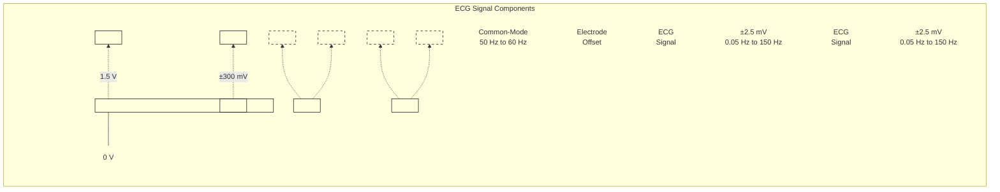
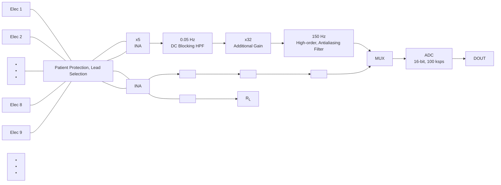
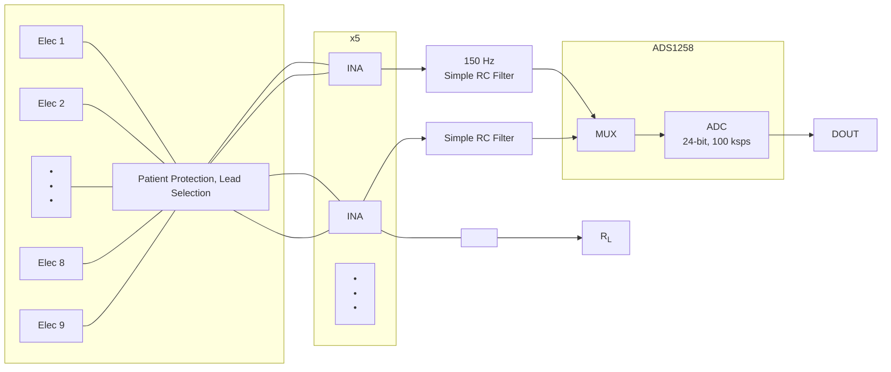
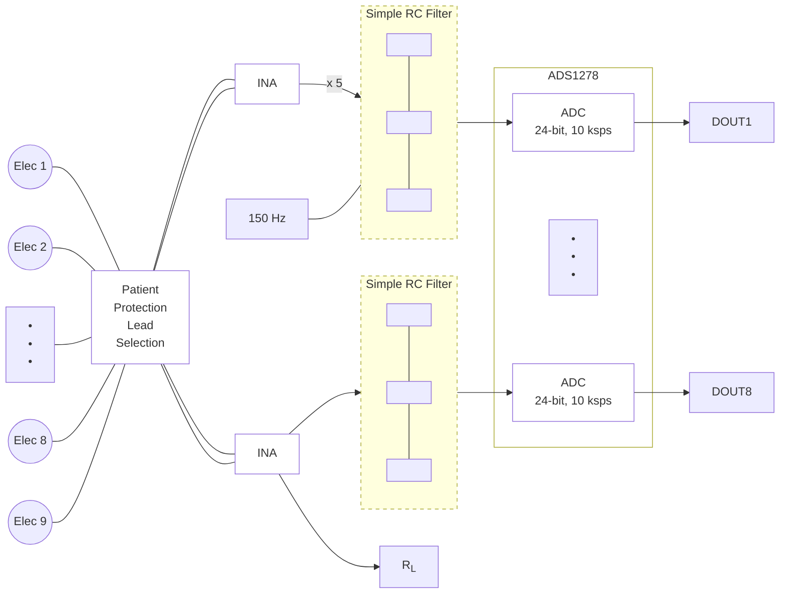
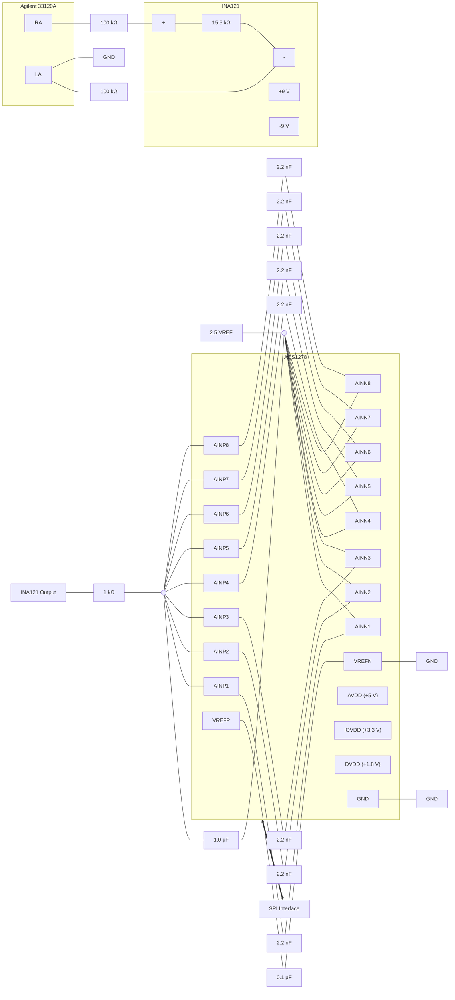

# Analog front-end design for ECG with delta-sigma ADCs

<!-- Original PDF: SBAA160.pdf -->

<!-- PDF page 1 -->

# **Analog Front-End Design for ECG Systems Using Delta-Sigma ADCs**

*Karthik Soundarapandian, Mark Berarducci* | *Data Acquisition Products*

### **ABSTRACT**

This document discusses the characteristics of electrocardiogram (ECG) signals and different front-end approaches for ECG signal acquisition. The tradeoffs between different approaches and the effects on overall system design are discussed. The report also includes descriptions of potential implementations of the front-end architecture using the <u>ADS1258</u> and <u>ADS1278</u> and respective noise measurement results.

<table>
  <caption>**Contents**</caption>
    <tr>
      <td>1</td>
      <td>Introduction ..................................................................................................................</td>
      <td>1</td>
    </tr>
    <tr>
      <td>2</td>
      <td>Nature of the ECG Signal and System Design Implications ..........................................................</td>
      <td>2</td>
    </tr>
    <tr>
      <td>3</td>
      <td>System Approaches ........................................................................................................</td>
      <td>3</td>
    </tr>
    <tr>
      <td>4</td>
      <td>ECG AFE with Low-Resolution (≤ 16-bit) ADCs ........................................................................</td>
      <td>4</td>
    </tr>
    <tr>
      <td>5</td>
      <td>Simplified Low-Cost ECG AFE with 24-bit Delta-Sigma ADCs .......................................................</td>
      <td>5</td>
    </tr>
    <tr>
      <td>6</td>
      <td>Sequential Sampling Measurements with the ADS1258 ..............................................................</td>
      <td>7</td>
    </tr>
    <tr>
      <td>7</td>
      <td>Simultaneous Sampling Measurements with the ADS1278 ...........................................................</td>
      <td>9</td>
    </tr>
    <tr>
      <td>8</td>
      <td>References .................................................................................................................</td>
      <td>10</td>
    </tr>
</table>

<table>
  <caption>**List of Figures**</caption>
    <tr>
      <td>1</td>
      <td>ECG Signal Characteristics................................................................................................</td>
      <td>2</td>
    </tr>
    <tr>
      <td>2</td>
      <td>System Approaches Based on ADC Resolution ........................................................................</td>
      <td>3</td>
    </tr>
    <tr>
      <td>3</td>
      <td>Typical SAR-Based ECG Signal Chain (Sequential Sampling).......................................................</td>
      <td>4</td>
    </tr>
    <tr>
      <td>4</td>
      <td>ΔΣ-Based, Low-Cost ECG Signal Chain (Sequential Sampling) .....................................................</td>
      <td>5</td>
    </tr>
    <tr>
      <td>5</td>
      <td>ΔΣ-Based, Low-Cost ECG Signal Chain (Simultaneous Sampling)..................................................</td>
      <td>6</td>
    </tr>
    <tr>
      <td>6</td>
      <td>Test Setup Using the ADS1258...........................................................................................</td>
      <td>7</td>
    </tr>
    <tr>
      <td>7</td>
      <td>Measured Time Domain Data .............................................................................................</td>
      <td>8</td>
    </tr>
    <tr>
      <td>8</td>
      <td>Test Setup Using the ADS1278...........................................................................................</td>
      <td>9</td>
    </tr>
    <tr>
      <td>9</td>
      <td>ADS1278 with Simulated 2-mV Cardiac Test Input ...................................................................</td>
      <td>10</td>
    </tr>
</table>

## **1 Introduction**

Electrocardiogram (ECG) system analog front-end (AFE) devices are typically designed with discrete off-the-shelf components from various semiconductor vendors or custom-designed as application-specific integrated circuits (ASICs). The costs of an ASIC design could run into millions of dollars by the time the device reaches full production, and may not be practical for many small- and medium-sized companies. The primary components of a traditional discrete ECG AFE include instrumentation amplifiers, operational amplifiers that implement active filters, and analog-to-digital converters (ADCs).

All trademarks are the property of their respective owners.

<!-- PDF page 2 -->

Recent technology advancements have resulted in ADCs with a combination of speeds, resolution, and power that were impossible before. At the same time, the necessity for low-cost and low-power ECG machines has increased, imposing constraints on engineers and designers to make systems more and more affordable. This article examines how to use the latest high-performance delta-sigma (ΔΣ) ADCs from Texas Instruments as components of an ECG AFE system, and discusses how to optimize the cost of an ECG AFE from a system design perspective.

## 2 **Nature of the ECG Signal and System Design Implications**

The first step in any system design is to fully understand the signal that is to be processed by the system. This step is espeically true for an ECG AFE system. Figure 1 shows the widely accepted details of the ECG signal as it appears at the input of the ECG measurement system (see Ref 1). It consists of three components: the actual (differential) ECG signal, the differential electrode offset, and the common-mode signal.

The actual differential ECG signal that appears between the electrodes in any lead configuration is limited to ±5 mV in magnitude and 0.05 Hz to 150 Hz in frequency. The magnitude of this actual ECG signal, together with the resolution required from the ECG signal, determines the dynamic range requirement of the front-end. The frequency content of this signal determines the bandwidth requirements of the analog front-end.

The skin-electrode interface gives an additional dc offset of approximately 300 mV. This offset must be manipulated such that the signal chain is not saturated. There are two ways of managing this offset, depending on the type of ADC used in the system: either eliminate it completely or preserve it. This application note analyzes the advantages and disadvantages of both methods.

**Figure 1. ECG Signal Characteristics**

In addition to these two signals, the human body can pick up large interference signals from power lines, fluorescent lights, and so forth. This interference can manifest itself as either a normal-mode signal or a common-mode signal. Normal-mode interference can be mitigated by a software-implemented, 50-Hz/60-Hz notch filter. Common-mode interference, on the other hand, is generally countered in one of three ways:

* Increasing the isolation of the ground of the front-end electronics from the earth ground as much as possible;
* Increasing the common-mode rejection of the signal processing circuitry (on the order of 100 dB);
* Driving the patient body with an out-of-phase common-mode signal (also called as the *right leg drive*).

One of the <u>primary</u> specifications of an ECG front-end is the input-referred noise. It is typically specified to be less than 30 μVRMS for the entire system <u>over a</u> bandwidth of 150 Hz (IEC60601-2-51,27). The frequency content of the signal determines the 3-dB cutoff frequencies required for the system filters.

<!-- PDF page 3 -->

Apart from these issues, the signal from the ECG electrodes usually have motion artifacts and pacer pulses. These additional sources of interference must be removed by using appropriate filtering, either in the analog domain (before the ADC) or in the digital domain (after the ADC). Typically, ECG machines have a means to detect the presence of pacemakers. Pacer detection can be done either by using dedicated hardware or by using software. The software approach requires the front-end to have higher bandwidth and the ADC to have a higher sampling rate. However, one of the advantages of using software pace detection is that as pacemaker devices evolve, the detection thresholds can be dynamically changed via software, instead of having to modify the system hardware.

# **3 System Approaches**

## **3.1 *Low-Resolution (≤ 16-bit) ADCs vs High-Resolution (24-bit) ADCs***

Based on the resolution of the ADC used in the signal chain, there are two different approaches to processing the ECG signal. One approach is to use low-noise amplifiers and to gain the input signal significantly (approximately 500), and thus use a low-resolution (approximately 16-bit) ADC, as shown in Figure 2a. In this case, care must be taken so that the noise of the amplifier that gets amplified does not dominate the overall system noise. The other approach would be to use a lower gain (approximately 5) and a high-resolution (approximately 24-bit) ADC, as shown in Figure 2b. In both approaches, the noise-free dynamic range at the ADC output remains the same.

<table>
<thead>
<tr>
<th align="center">(a)</th>
<th align="center"><strong>(b)</strong></th>
</tr>
</thead>
<tbody>
<tr>
<td align="center"></td>
<td align="center"></td>
</tr>
</tbody>
</table>

**Figure 2. System Approaches Based on ADC Resolution**

The other way to consider this result is that the system noise referred to the input is the same in both cases. Therefore, the recorded signal quality would not be compromised. However, a decision about using one of these approaches significantly affects the specifications of the individual components of the system, and consequently the overall cost, as explained in the next section. The high-resolution ADC approach significantly reduces the required hardware, which implies both a lower cost and lower power requirements.

## **3.2 *Sequential Sampling vs Simultaneous Sampling***

Two different solutions can be envisioned based on the speed of the available ADCs with the required resolution. One approach is to use a dedicated ADC for each channel, thereby sampling all leads simultaneously. The other approach is to multiplex the lead signals so that a single ADC can be used to digitize all the leads sequentially. Sequential sampling, as it sounds, should reduce the amount of front-end hardware. It becomes quite obvious, though, that the speed of the ADC in a sequential sampling architecture should be significantly higher than in a simultaneous sampling approach. Higher-speed ADCs, in turn, tend to consume much more power. As a result, it is not necessary that the sequential sampling solution be optimized for power. The settling time of the multiplexer in front of the ADC also plays a significant role in determining the required speed of the ADCs in this approach. One must be aware, however, that when using a sequential sampling approach, the samples from different channels are skewed in time. Software algorithms are then used to interpolate the acquired data between sampling for waveform re-construction.

<!-- PDF page 4 -->

To summarize, the analog front-end hardware for an ECG system could be minimized if there was an ADC with a very high resolution (approximately 24 bits) and a high-speed (approximately 100 ksps). Fortunately, such a solution is feasible using the latest high-speed, high-resolution delta-sigma ADC offerings from Texas Instruments. The next section explains the differences and savings in hardware by using a 24-bit, delta-sigma ADC.

## 4 **ECG AFE with Low-Resolution (≤ 16-bit) ADCs**

Figure 3 shows a typical ECG AFE with sequential sampling using a 16-bit converter.

**Figure 3. Typical SAR-Based ECG Signal Chain (Sequential Sampling)**

The first block is intended for patient protection and defibrillation pulse clamping, which could include high-value resistors or any other kind of isolation circuitry. The lead selection circuitry determines the various electrode combinations to be measured based on the Eindhoven triangle and Wilson central terminal (see Ref 1 for more information). The ECG electrodes are high-impedance signal sources; therefore, they are fed into the instrumentation amplifiers, which have a very high CMRR (greater than 100 dB) and a high input impedance (greater than 10 MΩ). Before the ECG signal is passed to the ADC, it must be amplified so that the entire dynamic range of the ADC is used, as illustrated in Figure 2a.

A typical ADC full-scale voltage is approximately 2.5 V, which implies a gain of 500 (assuming a 5-mV input signal). The total gain is distributed between the instrumentation amplifier (INA) and an additional gain amplifier. Gain is added to the INA in such a way that the electrode dc offset does not saturate the INA. The actual value of this gain depends on the operating voltage of the INA. With the latest trends of analog supply voltage at 5 V, the maximum INA gain can be in the range of 5 to 10. At this point, the dc component must be removed before any further gain can be introduced. Thus, a high-pass filter (HPF) with a corner frequency of 0.05 Hz is added. Once the dc component is removed, the signal is gained up again with another amplifier. It should be noted that the amplifiers used for these gain stages must be very low noise, so that they do not dominate the noise of the system. Additionally, these amplifiers must be low power (for battery-powered systems). This combination requirement for low power and low noise increases the cost of the precision amps required by the system. This gain stage is followed by an antialiasing filter. Nyquist rate converters such as successive approximation register (SAR) ADCs must have a very sharp antialiasing filter to avoid aliasing out-of-band noise. Typically, a fourth order or higher active low-pass filter (LPF) is used. The LPF block is followed by a multiplexer block (mux) that feeds into the ADC.

It can be seen in this type of system that there is a significant amount of analog signal processing that ~~occurs~~ before the signal is digitized, including gain and filtering. Additionally, signal processing in the analog domain limits flexibility. Often, the gain, bandwidth, and dc tracking (that is, baseline wandering) are required to be optimized, and are better served in the digital domain. Since digital signal processing is relatively lower cost and provides a great deal of flexibility, it is beneficial to move the signal processing to the digital domain. The system described in the next section follows this approach.

<!-- PDF page 5 -->

# 5 **Simplified Low-Cost ECG AFE with 24-bit Delta-Sigma ADCs**

Figure 4 shows the same ECG front-end with a delta-sigma converter implemented. Delta-sigma converters are known to give very high-resolution performance (greater than 20 bits) using oversampling and noise-shaping principles (see Ref 2). Traditionally, delta-sigma ADC speeds have been restricted to sampling rates of several kilohertz. Recent technology advancements have led to delta-sigma ADCs with excellent ac and dc performance, with sampling rates up to hundreds of kilohertz (see Ref 3, for example).

**Figure 4. ΔΣ-Based, Low-Cost ECG Signal Chain (Sequential Sampling)**

Figure 4 shows such a delta-sigma ADC (the <u>**ADS1258**)</u> used for the ECG front-end. The **ADS1258** is an industry-leading, 24-bit converter from Texas Instruments that offers an impressive combination of low latency, high speed, and noise performance. The **ADS1258** provides 1.8 kSPS per channel with 21.6 effective bits, making it an ideal fit for ECG applications. By comparing Figure 3 and Figure 4, it can be seen that there is a significant reduction in hardware, which implies both lower cost and lower power. Three blocks (including the high-pass filter, dc blocking filter, gain stage, and a steep, active low-pass filter) are eliminated. The **ADS1258** has an integrated mux as well, allowing up to eight differential inputs and thereby eliminating the need for an external mux. In addition to offering the advantage of higher resolution, the delta-sigma ADCs significantly relax the antialiasing requirements before the ADC. The complicated active antialiasing filters, which could require several amplifiers to implement, can be replaced by a simple, single-pole RC filter. The dc blocking high-pass filter is eliminated as well, because the inherent noise of the ADC is significantly lower than the previous solution (Figure 2b). In this way, the dc information is not lost, and the various filters can also be implemented digitally. Digital filter implementation also gives the designer flexibility to use adaptive dc removal filters for overall faster response and better rejection of baseline wandering.

The noise of the **ADS1258**, when referred to the input of the system, gives $1\ \mu V_{RMS}$ to $3\ \mu V_{RMS}$ depending on the output data rate, with an INA gain of 4. This noise is well within commercial ECG requirements.

<!-- PDF page 6 -->

Being a sequential solution, the ADS1258-based AFE has a skew of 42 $\mu\text{s}$ between channels. For most applications this skew may be acceptable; however, for certain applications such as electroencephalography (EEG) and vector imaging systems, the required skew is less than 25 $\mu\text{s}$. In these applications, a simultaneous sampling, high-resolution **ADC** approach is a good fit. Figure 5 shows the signal chain for simultaneous sampling with **ADS1278**. The **ADS1278** is a unique device in Texas Instruments' $\Delta\Sigma$ portfolio, offering a very high level of integration. It integrates eight dedicated 24-bit delta-sigma ADCs and eight digital decimation filters in a single, 64-pin, TQFP package.

**Figure 5. ΔΣ-Based, Low-Cost ECG Signal Chain (Simultaneous Sampling)**

<!-- PDF page 7 -->

# **6 Sequential Sampling Measurements with the ADS1258**

A test configuration as shown in Figure 6 is used to evaluate the ADS1258 for ECG measurement applications. The measurement results are summarized in Table 1.

**Figure 6. Test Setup Using the ADS1258**

This circuit diagram illustrates an ECG measurement system using an INA121 instrumentation amplifier and an ADS1258 24-bit ADC.

### Component Details

**Input Source**

* **Dynatech Nevada Model ECG-100**
  * RA output connected through a $100\text{ k}\Omega$ resistor to the negative input of the INA121.
  * LA output connected through a $100\text{ k}\Omega$ resistor to the positive input of the INA121.
  * $R_L$ connected to ground.

**Instrumentation Amplifier: INA121**

* **Gain ($G$):** 4 (set by a $15.5\text{ k}\Omega$ resistor).
* **Power Supply:** $+9\text{ V}$ and $-9\text{ V}$.
* **Output:** Connected through a low-pass filter ($10\text{ k}\Omega$ resistor and $0.1\text{ }\mu\text{F}$ capacitor to ground) to the ADS1258.
* **Bandwidth (BW):** $150\text{ Hz}$.
* **Reference ($V_{REF}$):** Connected to ground.

**Analog-to-Digital Converter: ADS1258**

* **Analog Inputs:**
  * AIN0 is connected to the filtered output of the INA121.
  * AIN1 through AIN15 and AINCOM are tied together and connected to ground.
* **Power Supplies:**
  * AVDD: $+2.5\text{ V}$
  * AVSS: $-2.5\text{ V}$
  * DVDD: $+3.3\text{ V}$
* **Voltage Reference:**
  * VREFP and VREFN are connected to a **Low-Noise 2.5-V Reference** module.
* **Multiplexer Outputs/ADC Inputs:**
  * MUXOUTN and MUXOUTP are routed through an external buffer.
  * ADCINN and ADCINP are the buffered inputs, with a $0.1\text{ }\mu\text{F}$ capacitor between them.
* **Digital Interface (To Microcontroller):**
  * CLKIO: $15\text{ MHz}$ clock input.
  * $\overline{\text{CS}}$ (Chip Select)
  * $\overline{\text{DRDY}}$ (Data Ready)
  * SCLK (Serial Clock)
  * DIN (Data In)
  * DOUT (Data Out)
  * START
  * $\overline{\text{RESET}}$
  * $\overline{\text{PWDN}}$ (Power Down)

**Buffer Amplifier: OPA227**

* Configured as a differential buffer between the MUXOUT and ADCIN pins of the ADS1258.
* **Power Supply:** $+9\text{ V}$ and $-9\text{ V}$.
* Includes decoupling capacitors ($0.1\text{ }\mu\text{F}$) on the supply lines.

### Annotations

* **Note:** If input voltage exceeds supply voltage, use external Schottky diode clamps (BAT549WT1).

**Table 1. Measured Input-Referred Noise Results**

<table>
  <caption>Table 1. Measured Input-Referred Noise Results</caption>
  <thead>
    <tr>
      <th colspan="4">ADS1258 (1)</th>
    </tr>
    <tr>
      <th><b>DRATE [1:0]</b></th>
      <th>Data Rate (SPS)</th>
      <th>Effective Data Rate (16-Channel SPS)</th>
      <th>Noise (μVRMS, input lead-referred)</th>
    </tr>
  </thead>
  <tbody>
    <tr>
      <td>11</td>
      <td>17480</td>
      <td>1093</td>
      <td>3</td>
    </tr>
    <tr>
      <td>10</td>
      <td>12372</td>
      <td>773</td>
      <td>2.2</td>
    </tr>
    <tr>
      <td>1</td>
      <td>5704</td>
      <td>357</td>
      <td>1.5</td>
    </tr>
    <tr>
      <td>0</td>
      <td>1807</td>
      <td>113</td>
      <td>1.2</td>
    </tr>
  </tbody>
</table>

(1) ADS1258 parameters: fCLKIN = 16.257 MHz, <u>DLY =</u> 010, CHOP = 0.

<!-- PDF page 8 -->

In this setup, a Dynatech Nevada ECG signal simulator was used as the signal source. The <u>INA121</u> was selected because it offers low current and voltage noise. The 100-kΩ input (safety) resistors were used on the INA121 inputs for all measurements. An <u>OPA227</u> op amp used in the ADS1258 mux output loop provides slightly better noise performance and better offset match between channels compared to a bypass connection (no buffer). The noise data were obtained with shorted inputs of the INA121 with the 100-kΩ series resistors in place. Figure 7 shows the time domain captured at the ADS1258 output.

<table>
  <caption>**Figure 7. Measured Time Domain Data** — Output (µV) vs Time (sec) for CH0 (µV)</caption>
  <thead>
    <tr>
      <th>Time (sec)</th>
      <th>Output (µV)</th>
    </tr>
  </thead>
  <tbody>
    <tr>
      <th>0.0</th>
      <td>16400</td>
    </tr>
    <tr>
      <th>0.1</th>
      <td>24400</td>
    </tr>
    <tr>
      <th>0.2</th>
      <td>16400</td>
    </tr>
    <tr>
      <th>0.3</th>
      <td>19100</td>
    </tr>
    <tr>
      <th>0.4</th>
      <td>16400</td>
    </tr>
    <tr>
      <th>0.5</th>
      <td>16400</td>
    </tr>
    <tr>
      <th>0.6</th>
      <td>16400</td>
    </tr>
    <tr>
      <th>0.7</th>
      <td>16400</td>
    </tr>
    <tr>
      <th>0.8</th>
      <td>16400</td>
    </tr>
    <tr>
      <th>0.9</th>
      <td>17100</td>
    </tr>
    <tr>
      <th>1.0</th>
      <td>16400</td>
    </tr>
    <tr>
      <th>1.1</th>
      <td>24300</td>
    </tr>
    <tr>
      <th>1.2</th>
      <td>16400</td>
    </tr>
    <tr>
      <th>1.3</th>
      <td>19100</td>
    </tr>
    <tr>
      <th>1.4</th>
      <td>16400</td>
    </tr>
    <tr>
      <th>1.5</th>
      <td>16400</td>
    </tr>
    <tr>
      <th>1.6</th>
      <td>16400</td>
    </tr>
    <tr>
      <th>1.7</th>
      <td>16400</td>
    </tr>
    <tr>
      <th>1.8</th>
      <td>16400</td>
    </tr>
    <tr>
      <th>1.9</th>
      <td>17100</td>
    </tr>
    <tr>
      <th>2.0</th>
      <td>16400</td>
    </tr>
    <tr>
      <th>2.1</th>
      <td>24100</td>
    </tr>
    <tr>
      <th>2.2</th>
      <td>16400</td>
    </tr>
    <tr>
      <th>2.3</th>
      <td>19100</td>
    </tr>
    <tr>
      <th>2.4</th>
      <td>16400</td>
    </tr>
    <tr>
      <th>2.5</th>
      <td>16400</td>
    </tr>
    <tr>
      <th>2.6</th>
      <td>16400</td>
    </tr>
    <tr>
      <th>2.7</th>
      <td>16400</td>
    </tr>
    <tr>
      <th>2.8</th>
      <td>16400</td>
    </tr>
    <tr>
      <th>2.9</th>
      <td>17100</td>
    </tr>
    <tr>
      <th>3.0</th>
      <td>16400</td>
    </tr>
    <tr>
      <th>3.1</th>
      <td>24300</td>
    </tr>
    <tr>
      <th>3.2</th>
      <td>16400</td>
    </tr>
    <tr>
      <th>3.3</th>
      <td>19100</td>
    </tr>
    <tr>
      <th>3.4</th>
      <td>16400</td>
    </tr>
    <tr>
      <th>3.5</th>
      <td>16400</td>
    </tr>
    <tr>
      <th>3.6</th>
      <td>16400</td>
    </tr>
    <tr>
      <th>3.7</th>
      <td>16400</td>
    </tr>
    <tr>
      <th>3.8</th>
      <td>16400</td>
    </tr>
    <tr>
      <th>3.9</th>
      <td>17100</td>
    </tr>
    <tr>
      <th>4.0</th>
      <td>16400</td>
    </tr>
    <tr>
      <th>4.1</th>
      <td>24400</td>
    </tr>
    <tr>
      <th>4.2</th>
      <td>16400</td>
    </tr>
    <tr>
      <th>4.3</th>
      <td>19100</td>
    </tr>
    <tr>
      <th>4.4</th>
      <td>16400</td>
    </tr>
    <tr>
      <th>4.5</th>
      <td>16400</td>
    </tr>
    <tr>
      <th>4.6</th>
      <td>16400</td>
    </tr>
    <tr>
      <th>4.7</th>
      <td>16400</td>
    </tr>
    <tr>
      <th>4.8</th>
      <td>16400</td>
    </tr>
    <tr>
      <th>4.9</th>
      <td>17100</td>
    </tr>
    <tr>
      <th>5.0</th>
      <td>16400</td>
    </tr>
  </tbody>
</table>

<!-- PDF page 9 -->

## 7 **Simultaneous Sampling Measurements with the ADS1278**

The test configuration shown in Figure 8 was used to evaluate the ADS1278 for ECG measurements. The Agilent 33120A signal generator sources a 2-mV peak cardiac test waveform. The 100-k$\Omega$ input (safety) resistors are used on the **INA121** inputs for all test measurements. The **INA121** was selected because of the combination of both low voltage and low current noise. The **INA121** gain was set to 4 and the output is bandlimited to 150 Hz before the ADC. The **INA121** reference pin is set to 2.5 V to shift the common-mode of the signal to the mid-supply level of the ADC.

**Figure 8. Test Setup Using the ADS1278**

The negative inputs of the ADCs are likewise shifted ~~to +2.5~~ V, allowing bipolar differential ECG input swings. The **ADS1278** was configured in the Low-Speed Mode (that is, with a data rate equal to 10 kSPS). This mode dissipates only 7 mW/channel with only 8-$\mu V_{RMS}$ noise over the 5-kHz bandwidth. Data were obtained from eight channels simultaneously.

The input resistors contribute 2.9-$\mu V_{RMS}$ noise <u>over the 150-Hz</u> bandwidth (referred to the ADC inputs). The **INA121** adds less than 4-$\mu V_{RMS}$ noise to the input of the ADC. The noise of the input resistors and that of the **INA121** combine with the noise of the **ADS1278**, increasing the ADC output noise from 8 $\mu$V to 9.5 $\mu$V (ADC output-referred noise).

<!-- PDF page 10 -->

The ADS1278 noise data were obtained with all channels simultaneously converting and with the INA121 inputs shorted (with the 100-k$\Omega$ resistors in place). Table 2 shows the input-referred noise of the ADS1278 sampling at 10 kSPS, and also shows the input-referred noise with the ADC data filtered with a simple moving average of x4 and with moving average of x8. Post-filtering the ADC data in this way is straightforward to implement, and reduces the noise approximately by the square root of the averaging factor while reducing the data rate by the same factors of 4 and 8 (decimation in time).

<table>
  <caption><b>**Table 2. ADS1278 Simultaneous Sampling Noise for** **Figure 8 (Shorted Inputs)**</b></caption>
  <thead>
    <tr>
      <th><b>Data Rate</b></th>
      <th>Input-Referred Noise (μVRMS)</th>
      <th>Lead Input-Referred Noise (μVPP)</th>
    </tr>
  </thead>
  <tbody>
    <tr>
      <td>10.0 kSPS</td>
      <td>2.4</td>
      <td>15.7</td>
    </tr>
    <tr>
      <td>2.50 kSPS</td>
      <td>1.4</td>
      <td>9.5</td>
    </tr>
    <tr>
      <td>1.25 kSPS</td>
      <td>1.2</td>
      <td>7.9</td>
    </tr>
  </tbody>
</table>

The input-referred noise of the ADS1278 test circuit with post-filtering is less than 10 $\mu V_{PP}$. This amount of noise is within the customary standards for high-resolution ECG systems.

Figure 9 shows the ADS1278 output data with a simulated 2-mV peak cardiac test input.

<table>
  <caption>**Figure 9. ADS1278 with Simulated 2-mV Cardiac Test Input**</caption>
  <thead>
    <tr>
      <th>Time (sec)</th>
      <th>ADC Output (μV)</th>
    </tr>
  </thead>
  <tbody>
    <tr>
      <th>0.0</th>
      <td>0</td>
    </tr>
    <tr>
      <th>0.1</th>
      <td>1000</td>
    </tr>
    <tr>
      <th>0.2</th>
      <td>1700</td>
    </tr>
    <tr>
      <th>0.3</th>
      <td>1000</td>
    </tr>
    <tr>
      <th>0.4</th>
      <td>0</td>
    </tr>
    <tr>
      <th>0.5</th>
      <td>400</td>
    </tr>
    <tr>
      <th>0.6</th>
      <td>0</td>
    </tr>
    <tr>
      <th>0.7</th>
      <td>1100</td>
    </tr>
    <tr>
      <th>0.8</th>
      <td>0</td>
    </tr>
    <tr>
      <th>0.9</th>
      <td>9100</td>
    </tr>
    <tr>
      <th>1.0</th>
      <td>-2400</td>
    </tr>
    <tr>
      <th>1.1</th>
      <td>0</td>
    </tr>
    <tr>
      <th>1.2</th>
      <td>1000</td>
    </tr>
    <tr>
      <th>1.3</th>
      <td>1700</td>
    </tr>
    <tr>
      <th>1.4</th>
      <td>1000</td>
    </tr>
    <tr>
      <th>1.5</th>
      <td>0</td>
    </tr>
    <tr>
      <th>1.6</th>
      <td>400</td>
    </tr>
    <tr>
      <th>1.7</th>
      <td>0</td>
    </tr>
    <tr>
      <th>1.8</th>
      <td>1100</td>
    </tr>
    <tr>
      <th>1.9</th>
      <td>0</td>
    </tr>
    <tr>
      <th>2.0</th>
      <td>9100</td>
    </tr>
    <tr>
      <th>2.1</th>
      <td>-2400</td>
    </tr>
    <tr>
      <th>2.2</th>
      <td>0</td>
    </tr>
    <tr>
      <th>2.3</th>
      <td>1000</td>
    </tr>
    <tr>
      <th>2.4</th>
      <td>1700</td>
    </tr>
    <tr>
      <th>2.5</th>
      <td>1000</td>
    </tr>
    <tr>
      <th>2.6</th>
      <td>0</td>
    </tr>
    <tr>
      <th>2.7</th>
      <td>400</td>
    </tr>
    <tr>
      <th>2.8</th>
      <td>0</td>
    </tr>
    <tr>
      <th>2.9</th>
      <td>1100</td>
    </tr>
    <tr>
      <th>3.0</th>
      <td>0</td>
    </tr>
    <tr>
      <th>3.1</th>
      <td>9100</td>
    </tr>
    <tr>
      <th>3.2</th>
      <td>-2400</td>
    </tr>
    <tr>
      <th>3.3</th>
      <td>0</td>
    </tr>
    <tr>
      <th>3.4</th>
      <td>1000</td>
    </tr>
    <tr>
      <th>3.5</th>
      <td>1700</td>
    </tr>
    <tr>
      <th>3.6</th>
      <td>1000</td>
    </tr>
    <tr>
      <th>3.7</th>
      <td>0</td>
    </tr>
    <tr>
      <th>3.8</th>
      <td>400</td>
    </tr>
    <tr>
      <th>3.9</th>
      <td>0</td>
    </tr>
    <tr>
      <th>4.0</th>
      <td>1100</td>
    </tr>
    <tr>
      <th>4.1</th>
      <td>0</td>
    </tr>
    <tr>
      <th>4.2</th>
      <td>9100</td>
    </tr>
    <tr>
      <th>4.3</th>
      <td>-2400</td>
    </tr>
    <tr>
      <th>4.4</th>
      <td>0</td>
    </tr>
    <tr>
      <th>4.5</th>
      <td>1000</td>
    </tr>
    <tr>
      <th>4.6</th>
      <td>1700</td>
    </tr>
    <tr>
      <th>4.7</th>
      <td>1000</td>
    </tr>
    <tr>
      <th>4.8</th>
      <td>0</td>
    </tr>
    <tr>
      <th>4.9</th>
      <td>400</td>
    </tr>
    <tr>
      <th>5.0</th>
      <td>0</td>
    </tr>
  </tbody>
</table>

# 8 **References**

1. Webster, J.G. (1998). Medical instrumentation: Application and design (3rd edition). New York: Wiley and Sons.
2. Norsworthy, S.R., Schreier, R.S., and Temes, G.C. (1997). Delta-sigma data converters: Theory, design and simulation. New York: IEEE Press.
3. ADS1258: 16-Channel, 24-Bit Analog-to-Digital Converter. Product data sheet <u>SBAS297C.</u> Available for download at <u>[www.ti.com/ads1258](http://www.ti.com/ads1258).</u>
4. ADS1278: Octal, 128-kHz, Simultaneous Sampling 24-Bit Delta-Sigma Analog-to-Digital Converter. Product data sheet <u>SBAS367C.</u> Available for download at <u>[www.ti.com/ads1278](http://www.ti.com/ads1278).</u>

<!-- PDF page 11 -->

# IMPORTANT NOTICE

Texas Instruments Incorporated and its subsidiaries (TI) reserve the right to make corrections, modifications, enhancements, improvements, and other changes to its products and services at any time and to discontinue any product or service without notice. Customers should obtain the latest relevant information before placing orders and should verify that such information is current and complete. All products are sold subject to TI’s terms and conditions of sale supplied at the time of order acknowledgment.

TI warrants performance of its hardware products to the specifications applicable at the time of sale in accordance with TI’s standard warranty. Testing and other quality control techniques are used to the extent TI deems necessary to support this warranty. Except where mandated by government requirements, testing of all parameters of each product is not necessarily performed.

TI assumes no liability for applications assistance or customer product design. Customers are responsible for their products and applications using TI components. To minimize the risks associated with customer products and applications, customers should provide adequate design and operating safeguards.

TI does not warrant or represent that any license, either express or implied, is granted under any TI patent right, copyright, mask work right, or other TI intellectual property right relating to any combination, machine, or process in which TI products or services are used. Information published by TI regarding third-party products or services does not constitute a license from TI to use such products or services or a warranty or endorsement thereof. Use of such information may require a license from a third party under the patents or other intellectual property of the third party, or a license from TI under the patents or other intellectual property of TI.

Reproduction of TI information in TI data books or data sheets is permissible only if reproduction is without alteration and is accompanied by all associated warranties, conditions, limitations, and notices. Reproduction of this information with alteration is an unfair and deceptive business practice. TI is not responsible or liable for such altered documentation. Information of third parties may be subject to additional restrictions.

Resale of TI products or services with statements different from or beyond the parameters stated by TI for that product or service voids all express and any implied warranties for the associated TI product or service and is an unfair and deceptive business practice. TI is not responsible or liable for any such statements.

TI products are not authorized for use in safety-critical applications (such as life support) where a failure of the TI product would reasonably be expected to cause severe personal injury or death, unless officers of the parties have executed an agreement specifically governing such use. Buyers represent that they have all necessary expertise in the safety and regulatory ramifications of their applications, and acknowledge and agree that they are solely responsible for all legal, regulatory and safety-related requirements concerning their products and any use of TI products in such safety-critical applications, notwithstanding any applications-related information or support that may be provided by TI. Further, Buyers must fully indemnify TI and its representatives against any damages arising out of the use of TI products in such safety-critical applications.

TI products are neither designed nor intended for use in military/aerospace applications or environments unless the TI products are specifically designated by TI as military-grade or "enhanced plastic." Only products designated by TI as military-grade meet military specifications. Buyers acknowledge and agree that any such use of TI products which TI has not designated as military-grade is solely at the Buyer's risk, and that they are solely responsible for compliance with all legal and regulatory requirements in connection with such use.

TI products are neither designed nor intended for use in automotive applications or environments unless the specific TI products are designated by TI as compliant with ISO/TS 16949 requirements. Buyers acknowledge and agree that, if they use any non-designated products in automotive applications, TI will not be responsible for any failure to meet such requirements.

Following are URLs where you can obtain information on other Texas Instruments products and application solutions:

<table>
  <thead>
    <tr>
      <th colspan="2"><strong>Products</strong></th>
      <th colspan="2"><strong><b>Applications</b></strong></th>
    </tr>
  </thead>
  <tbody>
    <tr>
      <td>Amplifiers</td>
      <td><u>amplifier.ti.com</u></td>
      <td>Audio</td>
      <td><u>www.ti.com/audio</u></td>
    </tr>
    <tr>
      <td>Data Converters</td>
      <td><u>dataconverter.ti.com</u></td>
      <td>Automotive</td>
      <td><u>www.ti.com/automotive</u></td>
    </tr>
    <tr>
      <td>DLP® Products</td>
      <td><u>www.dlp.com</u></td>
      <td>Communications and Telecom</td>
      <td><u>www.ti.com/communications</u></td>
    </tr>
    <tr>
      <td>DSP</td>
      <td><u>dsp.ti.com</u></td>
      <td>Computers and Peripherals</td>
      <td><u>www.ti.com/computers</u></td>
    </tr>
    <tr>
      <td>Clocks and Timers</td>
      <td><u>www.ti.com/clocks</u></td>
      <td>Consumer Electronics</td>
      <td><u>www.ti.com/consumer-apps</u></td>
    </tr>
    <tr>
      <td>Interface</td>
      <td><u>interface.ti.com</u></td>
      <td>Energy</td>
      <td><u>www.ti.com/energy</u></td>
    </tr>
    <tr>
      <td>Logic</td>
      <td><u>logic.ti.com</u></td>
      <td>Industrial</td>
      <td><u>www.ti.com/industrial</u></td>
    </tr>
    <tr>
      <td>Power Mgmt</td>
      <td><u>power.ti.com</u></td>
      <td>Medical</td>
      <td><u>www.ti.com/medical</u></td>
    </tr>
    <tr>
      <td>Microcontrollers</td>
      <td><u>microcontroller.ti.com</u></td>
      <td>Security</td>
      <td><u>www.ti.com/security</u></td>
    </tr>
    <tr>
      <td>RFID</td>
      <td><u>www.ti-rfid.com</u></td>
      <td>Space, Avionics &#x26; Defense</td>
      <td><u>www.ti.com/space-avionics-defense</u></td>
    </tr>
    <tr>
      <td>RF/IF and ZigBee® Solutions</td>
      <td><u>www.ti.com/lprf</u></td>
      <td>Video and Imaging</td>
      <td><u>www.ti.com/video</u></td>
    </tr>
    <tr>
      <td></td>
      <td></td>
      <td>Wireless</td>
      <td><u>www.ti.com/wireless-apps</u></td>
    </tr>
  </tbody>
</table>

Mailing Address: Texas Instruments, Post Office Box 655303, Dallas, Texas 75265
Copyright © 2010, Texas Instruments Incorporated
