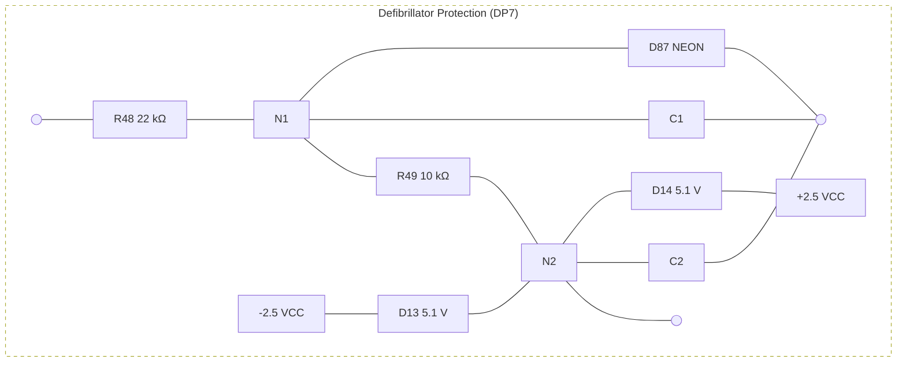

# Thermal noise analysis in ECG applications

<!-- Original PDF: SBAA185.pdf -->

<!-- PDF page 1 -->

# **Thermal Noise Analysis in ECG Applications**

*Jack Li*                                                                    *High-Performance Analog*

## **ABSTRACT**

This article discusses the thermal noise source of electrocardiogram (ECG) applications based on the <u>ADS1298</u> and <u>ADS1298R</u> family of multichannel, simultaneous sampling, 24-bit, delta-sigma (ΔΣ) analog-to-digital converters (ADCs). This report offers several observations on identifying the major sources of thermal noise in an ECG system, and recommends a method to improve thermal noise performance.

### **Contents**

<table>
    <tr>
      <td>1</td>
      <td>Introduction ..................................................................................................................</td>
      <td>1</td>
    </tr>
    <tr>
      <td>2</td>
      <td>Noise in ECG Signal Path .................................................................................................</td>
      <td>2</td>
    </tr>
    <tr>
      <td>3</td>
      <td>Summary .....................................................................................................................</td>
      <td>5</td>
    </tr>
    <tr>
      <td>4</td>
      <td>References ...................................................................................................................</td>
      <td>5</td>
    </tr>
</table>

## **1 Introduction**

The Association for the Advancement of Medical Instrumentation (AAMI) specifications allow 30-μVPP noise at 150-Hz bandwidth during a 10-second recording. The primary sources of thermal noise in an ECG system are generally caused by either resistors or amplifiers. This stochastic noise is specified as *root-mean-square (RMS) noise*, and is proportional to the square root of the noise bandwidth.

Considering that the bulk of the system noise is Gaussian in nature, computed as RMS but specified by AAMI as peak-to-peak, we must develop a scale factor that gives us a confidence level that the peak-to-peak noise will not exceed 30 μV in any 10-second recording (5000 samples at 500 Hz). That level of confidence (1 part in 5000) equates to approximately 8σ. RMS is, by definition, 1σ, so we must have an RMS noise level approximately 1/8 the AAMI peak-to-peak specification, or 3.75-μVRMS.

<!-- PDF page 2 -->

# **2 Noise in ECG Signal Path**

There are three components of the system noise. Each source is analyzed a bit differently. Figure 1 illustrates the ECG signal path based on the ADS1298/98R.

**Figure 1. ECG Signal Path Based on ADS1298/98R**

The primary noise sources are the 10-kΩ defibrillation protection resistors embedded in the patient block.

## **2.1 *AAMI Signal Source (51 kΩ||47 nF)***

The AAMI specification calls for a source impedance of 51 kΩ in parallel with 47 nF. For more information, refer to the skin electrode contact model in Figure 1 as well as Figure 59 in the <u>ADS1298/98R product data sheet.</u> Figure 2 shows the block diagram of the ADS1298/98R analog front-end circuit.

ADS129x

**Figure 2. Analog Front-End Input Circuit**

The schematic diagram illustrates the following components and connections:

* **Patient Interface:**
  * **Patient** connection point.
  * **Skin, Electrode Contact Model:** Consists of parallel RC networks (51kΩ resistor and 47nF capacitor) for two signal lines and the RLD line.
  * **Patient Protection Resistor:** 100kΩ resistors in series with each line.
* **Signal Processing:**
  * **EMI Filter:** Block processing the differential signal lines.
  * **ADS129x Internal Components:**
    * **PGA (Programmable Gain Amplifier):** Receives $V_{INP}$ and $V_{INN}$ signals, outputting to the ADC.
    * **Comparators:** Two comparators (indicated by the Z symbol) monitoring the input lines, outputting `LOFF_STATP` and `LOFF_STATN`.
    * **4-Bit DAC:** Controlled by `COMP_TH[2:0]`, providing reference levels to the comparators.
* **RLD OUT:** Right Leg Drive output connected through the protection and skin model stages.

<!-- PDF page 3 -->

Thermal noise is produced by a random motion of charges. The RMS open-circuit voltage ($e$) across a resistor ($R$) is given by Equation 1.

$$e^2 = 4kTR\Delta f \eqno(1)$$

where:

* $k$ is temperature (Kelvins)
* $R$ is resistance ($\Omega$)
* $\Delta f$ is frequency (Hz)
* $k$ is Boltzmann’s constant ($1.38 \times 10^{-23}$ joule/Kelvins)
* $e$ is voltage ($V_{\text{RMS}}$)

### ***Example 1. Noise in RC Network***

As an example of noise source determination, calculate the noise in a RC network. Figure 3 shows a typical RC network.

**Figure 3. Calculating Noise in an RC Network**

The parallel RC network impedance ($Z$) is given by Equation 2:

$$Z = R \parallel \left( \frac{1}{j\omega C} \right) = \frac{R}{1 + j\omega RC} = \frac{R}{1 + (\omega RC)^2} - j \frac{\omega R^2 C}{1 + (\omega RC)^2} \eqno(2)$$

Given that $\omega = 2\pi f$, the total open-circuit noise voltage is shown in Equation 3:

$$
\begin{aligned}
\overline{v_t^2} &= \int_0^\infty 4kTR\text{e}(Z)df = \int_0^\infty \frac{4kTR}{1 + (2\pi fRC)^2} df \\
&= \frac{2kT}{\pi C} \int_0^\infty \frac{dx}{1 + x^2} = \frac{2kT}{\pi C} [\tan^{-1}x]_0^\infty = \frac{kT}{C}
\end{aligned}
\eqno(3)
$$

Note that $R$ has dropped out of Equation 3, so $e^2$ is independent of $R$. At room temperature, the thermal noise of a 47-nF capacitor is approximately 295.8 $\text{nV}_{\text{RMS}}$ (with $T = 298$ Kelvins, or approximately $+25$ ºC). This noise source occurs twice: once on the measured input and again on the reference ($\text{R}_{\text{A}}$). The noise voltage across a capacitor depends only upon temperature and capacitance. The RMS sum of two such sources is approximately 418.32 $\text{nV}_{\text{RMS}}$.

<!-- PDF page 4 -->

## 2.2   *Thermal Noise from Protection Resistor*

There are 22-kΩ and 10-kΩ current limiting resistors from the electrode to the input of the ADS1298. Here, we calculate the thermal noise for all components in the ECG signal path. Figure 4 illustrates the protection architecture of a defibrillator, for example.

**Figure 4. Defibrillation Protection Part**

The noise units are nV/√Hz. Using Equation 1 we obtain the following data:

•  32-kΩ input resistance (RA): (4 nV/√Hz/ kΩ at +25°C) = 22.94 nV/√Hz

The protection circuit (R48, C1, R49, and C2) is also used as a second-order low-pass filter for anti-aliasing and radio frequency interference (RFI). Furthermore, the patient protection resistor value is limited by the maximum current under the fault conditions specified by AAMI/IEC.

## 2.3  *ADS1298/98R Noise*

Based on the information provided in the <u>ADS1298/98R product data sheet,</u> the noise measurement is taken with an internal reference, which includes the internal reference output noise. If we use a low-noise external reference, such as the <u>REF5025,</u> we can achieve better noise performance with a low gain setting. (The 2.5-V reference of the REF5025 output noise is 7.5 μVPP at 0.1 Hz to 10 Hz; higher frequency noise is filtered by the reference output capacitor.) A minimum of 1000 consecutive readings are then used to calculate the RMS and peak-to-peak noise for each reading.

<table>
  <caption>
    <b>Table 1. ADS1298/ADS1298R Input-Referred Noise (μVRMS/μVPP) in High-Resolution Mode 
    3-V Analog Supply and 2.4-V Reference(1)</b>
  </caption>
  <thead>
    <tr>
      <th><b>DR Bits of</b> CONFIG1 Register</th>
      <th>Output Data Rate (SPS)</th>
      <th>–<b>3dB</b> Bandwidth (Hz)</th>
      <th>PGA Gain = 1</th>
      <th>PGA Gain = 2</th>
      <th>PGA Gain = 3</th>
      <th>PGA Gain = 4</th>
      <th>PGA Gain = 6</th>
      <th>PGA Gain = 8</th>
      <th>PGA Gain = 12</th>
    </tr>
  </thead>
  <tbody>
    <tr>
      <td>000</td>
      <td>32000</td>
      <td>8398</td>
      <td>335/3553</td>
      <td>168/1701</td>
      <td>112/1100</td>
      <td>85/823</td>
      <td>58/529</td>
      <td>42.5/378</td>
      <td>28.6/248</td>
    </tr>
    <tr>
      <td>001</td>
      <td>16000</td>
      <td>4193</td>
      <td>56/613</td>
      <td>28/295</td>
      <td>18.8/188</td>
      <td>14.3/143</td>
      <td>9.7/94</td>
      <td>7.4/69</td>
      <td>5.2/44.3</td>
    </tr>
    <tr>
      <td>010</td>
      <td>8000</td>
      <td>2096</td>
      <td>12.4/111</td>
      <td>6.5/54</td>
      <td>4.5/37.9</td>
      <td>3.5/29.7</td>
      <td>2.6/21.7</td>
      <td>2.2/17.8</td>
      <td>1.8/13.8</td>
    </tr>
    <tr>
      <td>011</td>
      <td>4000</td>
      <td>1048</td>
      <td>6.1/44.8</td>
      <td>3.2/23.3</td>
      <td>2.4/17.1</td>
      <td>1.9/14.0</td>
      <td>1.5/11.1</td>
      <td>1.3/9.7</td>
      <td>1.2/8.5</td>
    </tr>
    <tr>
      <td>100</td>
      <td>2000</td>
      <td>524</td>
      <td>4.1/27.8</td>
      <td>2.2/15.4</td>
      <td>1.6/11.0</td>
      <td>1.3/9.1</td>
      <td>1.1/7.3</td>
      <td>1.0/6.5</td>
      <td>0.9/6.0</td>
    </tr>
    <tr>
      <td>101</td>
      <td>1000</td>
      <td>262</td>
      <td>2.9/19.0</td>
      <td>1.6/10.1</td>
      <td>1.2/7.5</td>
      <td>1.0/6.2</td>
      <td>0.8/5.0</td>
      <td>0.7/4.6</td>
      <td>0.6/4.1</td>
    </tr>
    <tr>
      <td>110</td>
      <td>500</td>
      <td>131</td>
      <td>2.1/12.5</td>
      <td>1.1/6.8</td>
      <td>0.9/5.1</td>
      <td>0.7/4.3</td>
      <td>0.6/3.5</td>
      <td>0.5/3.1</td>
      <td>0.5/2.9</td>
    </tr>
  </tbody>
</table>

(1) At least 1000 consecutive readings were used to calculate the RMS and peak-to-peak noise values in this table.

<!-- PDF page 5 -->

We can see that the RTI noise of the ADS1298/98R is specified as 1.1 $\mu V_{RMS}$ when the PGA gain = 6 and the data rate is 2 kSPS. For simple calculation, presuming that the internal filter is a single-pole filter, the noise bandwidth is $\pi/2$ times the $-3$-dB bandwidth; in this case, that value is approximately 822.68 Hz.

Now, we combine the noise from the AAMI source noise, the protection resistors, and the ADS1298/98R:

* AAMI source noise: 418.32 n$V_{RMS}$
* Protection resistors: 0.93 $\mu V_{RMS}$ (= $22.94nV/\sqrt{Hz} \times \sqrt{822.68  Hz} \times \sqrt{2}$)
* RTI noise of ADS1298/98R: 1.1 $\mu V_{RMS}$
* Total noise: 1.5 $\mu V_{RMS}$

Using our 8$\times$ conversion factor from RMS to peak-to-peak (explained in Section 1), this total noise is then 12 $\mu V_{PP}$, which is much less than the 30 $\mu V_{PP}$.

## **3 Summary**

We can see from this report that we can optimize the protection resistor and reduce the noise bandwidth to achieve better noise performance. The noise factors discussed here only concern the thermal noise of the system, and do not include quantization noise or non-thermal sources (such as digital crosstalk, power-supply noise, and so forth). For electrosurgical interference (ESI), which is not addressed in this report, see Ref 5.

## **4 References**

1. ANSI/AAMI EC11:1991/®2001, Diagnostic Electrocardiographic Devices.
2. Chinese Standard: YY 1079-2008, Electrocardiographic Monitors.
3. Markandey, V. (2009, revised 2010). ECG Implementation on the TMS320VC5505 DSP Medical Development Kit (MDK). Application report. Literature number <u>SPRAB36B</u>.
4. ADS1298 Product data sheet. Literature number <u>SBAS459G</u>.
5. Yelderman, M., Widrow, B., Cioffi, J., Hesler, E., and Leddy, J.E. (1983). ECG enhancement by adaptive cancellation of electrosurgical interference. IEEE Transactions on Biomedical Engineering, Vol. BME-30, No. 7, July 1983.

<!-- PDF page 6 -->

# **IMPORTANT NOTICE**

Texas Instruments Incorporated and its subsidiaries (TI) reserve the right to make corrections, modifications, enhancements, improvements, and other changes to its products and services at any time and to discontinue any product or service without notice. Customers should obtain the latest relevant information before placing orders and should verify that such information is current and complete. All products are sold subject to TI’s terms and conditions of sale supplied at the time of order acknowledgment.

TI warrants performance of its hardware products to the specifications applicable at the time of sale in accordance with TI’s standard warranty. Testing and other quality control techniques are used to the extent TI deems necessary to support this warranty. Except where mandated by government requirements, testing of all parameters of each product is not necessarily performed.

TI assumes no liability for applications assistance or customer product design. Customers are responsible for their products and applications using TI components. To minimize the risks associated with customer products and applications, customers should provide adequate design and operating safeguards.

TI does not warrant or represent that any license, either express or implied, is granted under any TI patent right, copyright, mask work right, or other TI intellectual property right relating to any combination, machine, or process in which TI products or services are used. Information published by TI regarding third-party products or services does not constitute a license from TI to use such products or services or a warranty or endorsement thereof. Use of such information may require a license from a third party under the patents or other intellectual property of the third party, or a license from TI under the patents or other intellectual property of TI.

Reproduction of TI information in TI data books or data sheets is permissible only if reproduction is without alteration and is accompanied by all associated warranties, conditions, limitations, and notices. Reproduction of this information with alteration is an unfair and deceptive business practice. TI is not responsible or liable for such altered documentation. Information of third parties may be subject to additional restrictions.

Resale of TI products or services with statements different from or beyond the parameters stated by TI for that product or service voids all express and any implied warranties for the associated TI product or service and is an unfair and deceptive business practice. TI is not responsible or liable for any such statements.

TI products are not authorized for use in safety-critical applications (such as life support) where a failure of the TI product would reasonably be expected to cause severe personal injury or death, unless officers of the parties have executed an agreement specifically governing such use. Buyers represent that they have all necessary expertise in the safety and regulatory ramifications of their applications, and acknowledge and agree that they are solely responsible for all legal, regulatory and safety-related requirements concerning their products and any use of TI products in such safety-critical applications, notwithstanding any applications-related information or support that may be provided by TI. Further, Buyers must fully indemnify TI and its representatives against any damages arising out of the use of TI products in such safety-critical applications.

TI products are neither designed nor intended for use in military/aerospace applications or environments unless the TI products are specifically designated by TI as military-grade or "enhanced plastic." Only products designated by TI as military-grade meet military specifications. Buyers acknowledge and agree that any such use of TI products which TI has not designated as military-grade is solely at the Buyer's risk, and that they are solely responsible for compliance with all legal and regulatory requirements in connection with such use.

TI products are neither designed nor intended for use in automotive applications or environments unless the specific TI products are designated by TI as compliant with ISO/TS 16949 requirements. Buyers acknowledge and agree that, if they use any non-designated products in automotive applications, TI will not be responsible for any failure to meet such requirements.

Following are URLs where you can obtain information on other Texas Instruments products and application solutions:

<table>
  <thead>
    <tr>
      <th><b>Products</b></th>
      <th></th>
      <th><b><b>Applications</b></b></th>
      <th></th>
    </tr>
  </thead>
  <tbody>
    <tr>
      <td>Audio</td>
      <td><u>www.ti.com/audio</u></td>
      <td>Communications and Telecom</td>
      <td><u>www.ti.com/communications</u></td>
    </tr>
    <tr>
      <td>Amplifiers</td>
      <td><u>amplifier.ti.com</u></td>
      <td>Computers and Peripherals</td>
      <td><u>www.ti.com/computers</u></td>
    </tr>
    <tr>
      <td>Data Converters</td>
      <td><u>dataconverter.ti.com</u></td>
      <td>Consumer Electronics</td>
      <td><u>www.ti.com/consumer-apps</u></td>
    </tr>
    <tr>
      <td>DLP® Products</td>
      <td><u>www.dlp.com</u></td>
      <td>Energy and Lighting</td>
      <td><u>www.ti.com/energy</u></td>
    </tr>
    <tr>
      <td>DSP</td>
      <td><u>dsp.ti.com</u></td>
      <td>Industrial</td>
      <td><u>www.ti.com/industrial</u></td>
    </tr>
    <tr>
      <td>Clocks and Timers</td>
      <td><u>www.ti.com/clocks</u></td>
      <td>Medical</td>
      <td><u>www.ti.com/medical</u></td>
    </tr>
    <tr>
      <td>Interface</td>
      <td><u>interface.ti.com</u></td>
      <td>Security</td>
      <td><u>www.ti.com/security</u></td>
    </tr>
    <tr>
      <td>Logic</td>
      <td><u>logic.ti.com</u></td>
      <td>Space, Avionics and Defense</td>
      <td><u>www.ti.com/space-avionics-defense</u></td>
    </tr>
    <tr>
      <td>Power Mgmt</td>
      <td><u>power.ti.com</u></td>
      <td>Transportation and Automotive</td>
      <td><u>www.ti.com/automotive</u></td>
    </tr>
    <tr>
      <td>Microcontrollers</td>
      <td><u>microcontroller.ti.com</u></td>
      <td>Video and Imaging</td>
      <td><u>www.ti.com/video</u></td>
    </tr>
    <tr>
      <td>RFID</td>
      <td><u>www.ti-rfid.com</u></td>
      <td>Wireless</td>
      <td><u>www.ti.com/wireless-apps</u></td>
    </tr>
    <tr>
      <td>RF/IF and ZigBee® Solutions</td>
      <td><u>www.ti.com/lprf</u></td>
      <td></td>
      <td></td>
    </tr>
    <tr>
      <td></td>
      <td><b><b>TI E2E Community Home Page</b></b></td>
      <td></td>
      <td><u>e2e.ti.com</u></td>
    </tr>
  </tbody>
</table>

Mailing Address: Texas Instruments, Post Office Box 655303, Dallas, Texas 75265
Copyright © 2011, Texas Instruments Incorporated
