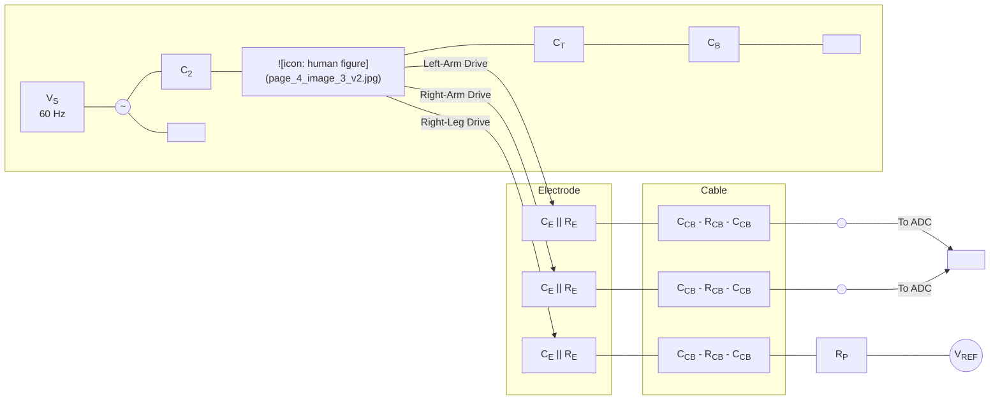
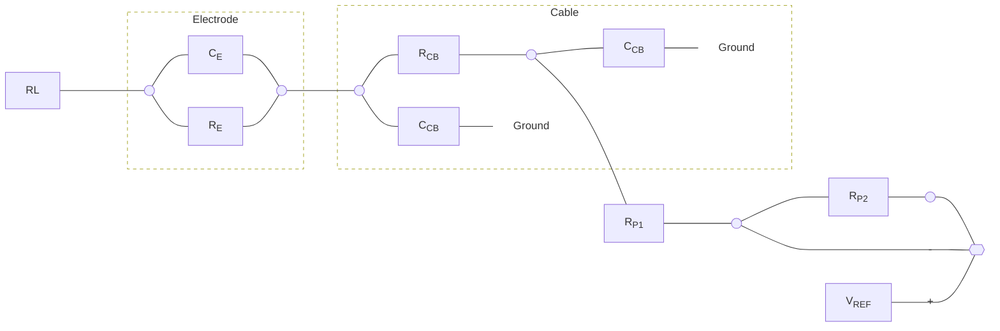
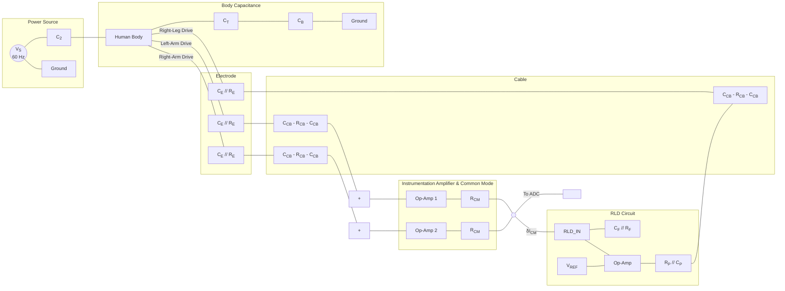
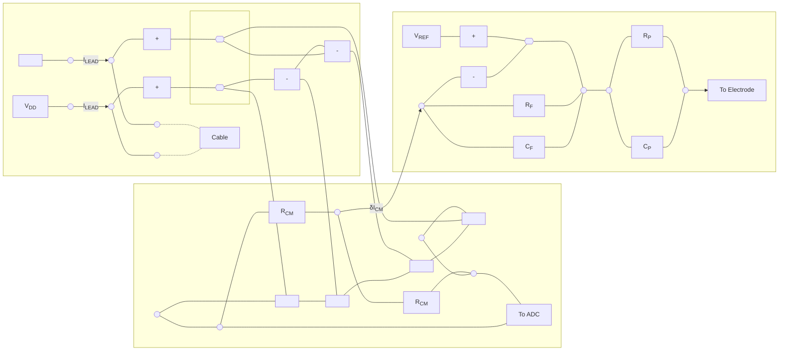
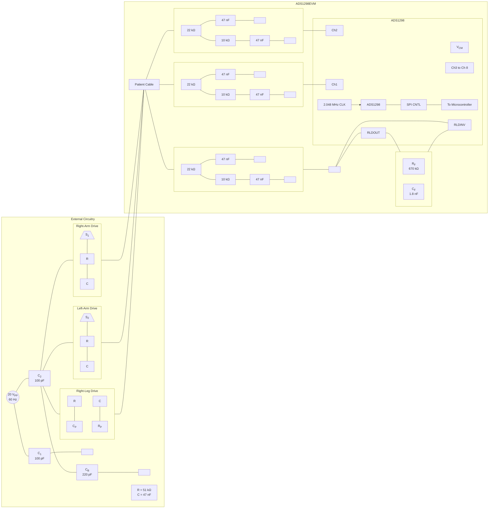

# Improving common-mode rejection using RLD

<!-- Original PDF: SBAA188.pdf -->

<!-- PDF page 1 -->

### *Application Note*

# ***Improving Common-Mode Rejection Using the Right-Leg Drive Amplifier***

*Venkatesh Acharya* *High-Performance Analog*

## **Abstract**

This article discusses the need to improve common-mode rejection (CMR) in electrocardiogram (ECG) subsystem applications. Several different techniques to improve CMR while also considering both patient and operator safety are presented. This report also reviews the implementation of the right-leg drive (RLD) loop technique to improve CMR using the ADS129x family of analog-to-digital converters (including the ADS1298/96/94 and the ADS1198/96/94) and the corresponding performance results.

<table>
  <caption>Table of Contents</caption>
    <tr>
      <td><b><b>1 Introduction</b></b>.............................................................................................................................................................................</td>
      <td>2</td>
    </tr>
    <tr>
      <td><b><b>2 Common</b>-<b>Mode to Differential Signal Conversion</b></b>...............................................................................................................</td>
      <td>3</td>
    </tr>
    <tr>
      <td><b><b>3 Techniques to Improve Common-Mode Rejection</b></b>..............................................................................................................</td>
      <td>4</td>
    </tr>
    <tr>
      <td><b><b>4 Closed-Loop RLD system</b></b>......................................................................................................................................................</td>
      <td>5</td>
    </tr>
    <tr>
      <td><b><b>5 The Effect of Lead</b>-<b>Off Disconnection in an RLD System</b></b>...................................................................................................</td>
      <td>6</td>
    </tr>
    <tr>
      <td><b><b>6 Improving CMR Using the RLD Amplifier with the ADS1298</b></b>..............................................................................................</td>
      <td>7</td>
    </tr>
    <tr>
      <td><b><b>7 Conclusion</b></b>............................................................................................................................................................................</td>
      <td>10</td>
    </tr>
    <tr>
      <td><b><b>8 References</b></b>............................................................................................................................................................................</td>
      <td>10</td>
    </tr>
    <tr>
      <td><b><b>9 Revision History</b></b>...................................................................................................................................................................</td>
      <td>10</td>
    </tr>
</table>

<table>
  <caption>**List of Figures**</caption>
    <tr>
      <td>Figure 1-1. Typical ECG System.................................................................................................................................................</td>
      <td>2</td>
    </tr>
    <tr>
      <td>Figure 2-1. Understanding the Effect of Common-Mode Rejection Mismatch.............................................................................</td>
      <td>3</td>
    </tr>
    <tr>
      <td>Figure 3-1. Applying the Common-Mode Voltage at the Patient’s Body Using RP......................................................................</td>
      <td>4</td>
    </tr>
    <tr>
      <td>Figure 3-2. Technique to Improve CMR with a Large Protection Resistor...................................................................................</td>
      <td>5</td>
    </tr>
    <tr>
      <td>Figure 4-1. Improving CMRR by Completing RLD Feedback Loop.............................................................................................</td>
      <td>6</td>
    </tr>
    <tr>
      <td>Figure 5-1. Analog Front-End of an RLD Subsystem with Lead-Off Currents to Monitor Electrode Snugness...........................</td>
      <td>6</td>
    </tr>
    <tr>
      <td>Figure 6-1. Test Setup with ADS1298EVM with Protection Circuitry Elements...........................................................................</td>
      <td>7</td>
    </tr>
    <tr>
      <td>Figure 6-2. Measurement Setup Using ADS1298EVM................................................................................................................</td>
      <td>8</td>
    </tr>
    <tr>
      <td>Figure 6-3. Output Spectrum Comparison...................................................................................................................................</td>
      <td>9</td>
    </tr>
</table>

## **Trademarks**

All trademarks are the property of their respective owners.

<!-- PDF page 2 -->

# **1 Introduction**

Common-mode rejection, or CMR, is one of the most important performance parameters for ECG system applications. International standards set by organizations such as the Association for the Advancement of Medical Instrumentation (AAMI), the International Electrotechnical Commission (IEC), and various medical authorities of different countries specify the test methodology that must be followed in order to use most ECG systems.

In an ECG system, a large amount of electromagnetic interference (EMI) is coupled to the patient’s body through the skin. EMI can also couple to the ECG system through coupling capacitors $C_2$ and $C_T$ as shown in Figure 1-1. Furthermore, It can be coupled to the system through a power coupling capacitor, $C_C$, and in some cases through the long ECG signal measuring cables and protection circuitry that are usually located in front of the ECG system. There can also be coupling from the ac power supplies through coupling capacitor $C_{CB}$ to the cable. Capacitance $C_B$ is coupled between ac ground and the ground of the ECG subsystem. The value of the entire system CMR depends on the capacitance value of $C_B$. By comparison, in the case of a perfectly isolated system where there is no coupling between the grounds, the system would exhibit very high CMR.

There are also several frequencies of interest, depending on the location and the country of operation. The primary source of interference is the ac main that generally operates at 50 Hz (Europe and Asia) or 60 Hz (US). Apart from these two frequencies, Eastern European railway traction power networks use distributed single-phase ac power at 16⅔ Hz. A frequency of 25 Hz is used for the Austrian railway.

```mermaid
graph LR
    subgraph " "
        direction TB
        AC(("~"))
        AC_Label["120/240 V<sub>AC</sub><br/>50 Hz/60 Hz"]
        AC --- AC_Label
    end

    TopLine --- C2["C<sub>2</sub>"]
    C2 --- Person(( ))
    
    Person --- ECG_Leads["ECG Leads"]
    ECG_Leads -.-> Cables["Cables"]
    Cables --- Isolated_ECG["Isolated ECG Subsystem"]

    TopLine --- CCB1["C<sub>CB</sub>"]
    CCB1 -.-> Cables
    
    TopLine --- CCB2["C<sub>CB</sub>"]
    CCB2 -.-> Cables

    TopLine --- CC["C<sub>C</sub>"]
    CC --- Isolated_ECG

    Person --- CT["C<sub>T</sub>"]
    CT --- Ground1[ ]
    
    BottomLine --- CB["C<sub>B</sub>"]
    CB --- Ground2[ ]

    AC --- TopLine
    AC --- BottomLine
    
    style Person fill:#000,stroke:#000
    style Isolated_ECG stroke:#000,fill:none
    style AC fill:none,stroke:#000
    style AC_Label stroke:none,fill:none
    style Ground1 fill:none,stroke:none
    style Ground2 fill:none,stroke:none
```

**Figure 1-1. Typical ECG System**

<!-- PDF page 3 -->

# **2 Common-Mode to Differential Signal Conversion**

Common-mode to differential mode conversion is a result of the combination of mismatches in electrode impedances, cable impedances (distributed RC impedance), and onboard protection circuitry (typically including resistors, capacitors, and diodes) at the input of the programmable gain amplifiers. For simplicity, consider a non-isolated (that is, the ac ground and system ground are shorted) ECG subsystem with a simple RC filter in the signal path as shown in Figure 2-1.

**Figure 2-1. Understanding the Effect of Common-Mode Rejection Mismatch**

For an ac signal VS, the value of the signal that appears at the patient’s body is given by Equation 1:

$$V_P = \frac{Z_G}{Z_G + \frac{1}{sC_2}} \cdot V_S \tag{1}$$

Where ZG is the effective impedance from the patient’s body to ground. ZG is approximately equal to:

$$Z_G \approx \left[ \left( \frac{1}{sC_T} \right) \parallel \left( \frac{~~1 + sRC~~}{~~s2C~~} \right) \right] \tag{2}$$

This signal VP is a common-mode signal to the system. If the values of R and C modeled in the differential signal are perfectly matched, then the system exhibits a very large CMR. If we assume the mismatch of $\delta R$ and $\delta C$ in resistor R and capacitor C, respectively, the CMR of the entire system can be approximated to Equation 3.

$$CMR = 20\log\left( \frac{\delta R}{R} + \frac{\delta C}{C} \right) + 20\log\left( \frac{f}{f_c} \right) \tag{3}$$

where fC is the –3-dB frequency of the RC filter.

If 1% precision external components are used and the bandwidth of the RC filter is approximately 6 kHz, the system then has only 74 dB of CMR at 60 Hz. In the real world, the front-end of the ECG does not contain only first-order RC filters; it includes electrodes, cables, and second- or third-order RC filters. Considering all of these components, mismatch can easily accumulate, and thus contribute up to 20% or more of the signal. This degree of mismatch degrades the CMR of the system to less than 60 dB at 60 Hz. Therefore, it is necessary to consider different techniques to improve CMR.

It should be noted that there is a tradeoff when choosing the bandwidth of the antialiasing filter to be located in front of the modulator. Considering the mismatch between the discrete components, it is better to select the large bandwidth; at the same time, the upper limit of the bandwidth is determined by the sampling frequency of the modulator.

<!-- PDF page 4 -->

# 3 Techniques to Improve Common-Mode Rejection

In Section 2 we saw that as a consequence of mismatch in both external and internal components in the signal path, there is degradation in CMR performance. There are many different techniques to improve CMR performance, however. Four common techniques are:

## 1. **Faraday Shield**

A Faraday shield is used to cover the ECG front-end and reduces the degree of power-supply interference that enters the system. It also protects the device and components from environmental interference.

## 2. **Isolation Capacitance**

Improving the isolation between the device ground and the patient ground helps to improve the system CMR. For most portable instruments that use batteries, CMR is likely to be very high. Most typical test methodologies to measure CMR, however, specify the minimum isolation capacitance $C_B$ at which the system must pass the required CMR specification.

## 3. **Post-Conversion Processing**

There is a possibility that a residual common-mode signal can be removed from the input after the conversion using finite-impulse response (FIR) adaptive filters. There are also some cases where the common-mode voltage is subtracted digitally. Moreover, there is a possibility of using a notch filter at a frequency of 50 Hz or 60 Hz in the digital domain. However, one must be very careful with such operations so that real-world signals are not compromised with this type of filtering. One must ensure that phase information is not skewed because of the filtering operation. It is worth noting here that most of the standards require that this post-processing be turned off while testing the system CMR.

## 4. **Driving the Common-Mode Voltage through a Resistor**

With this technique, a low-resistance $R_P$ is used to drive the patient’s body (see Ref. 1). Figure 3-1 illustrates this technique; it also shows the models of the electrodes and cable using passive elements.

**Diagram Components:**

* **Patient Model:**
  * A human figure icon represents the patient.
  * An AC voltage source ($V_S$, 60 Hz) is connected to the patient's head through capacitor $C_2$.
  * The patient is connected to ground through capacitors $C_T$ and $C_B$.
* **Electrode Models:**
  * Three identical electrode models for Left-Arm Drive, Right-Arm Drive, and Right-Leg Drive.
  * Each electrode consists of a parallel combination of a capacitor ($C_E$) and a resistor ($R_E$).
* **Cable Models:**
  * Three identical cable models.
  * Each cable consists of a series resistor ($R_{CB}$) with shunt capacitors ($C_{CB}$) to ground on both sides.
* **Connections:**
  * The Left-Arm and Right-Arm signals pass through the electrode and cable models to the ADC.
  * The Right-Leg Drive signal passes through its electrode and cable model, then through a protection resistor ($R_P$) to a reference voltage ($V_{REF}$).

**Figure 3-1. Applying the Common-Mode Voltage at the Patient’s Body Using $R_P$**

<!-- PDF page 5 -->

Intuitively, the resistor that drives the potential comes in parallel with ZG (refer to Section 2), and thus a larger attenuation is achieved. When the value of the resistor used to drive the potential of the body is reduced, CMR of the entire system improves. In the case of a fault condition where the patient’s body is accidentally connected to the system ground, it also provides the path for the current from the reference node VREF through the resistor RP. In accordance with IEC standards (Ref. 2), a maximum of 50 μA *single-fault condition* current is recommended. Depending on the value of the power-supply voltage used for the system, the value of the protection resistor RP is chosen. In a system with VS = 5 V, the minimum value of the resistor needed is 100 kΩ; if a 3-V power supply is used, a 60-kΩ resistor can limit the single fault current to safe current.

The system CMR can be further improved by incorporating the portion of the protection resistor RP2 inside the operational amplifier, as shown in Figure 3-2. The sum of the protection resistors RP1 and RP2 is equal to the resistor RP. In this case, only RP1 comes in parallel with ZG, attenuating the common-mode signal further. But during a single fault condition, both resistors limit the fault current. This added advantage is available at the cost of reduced swing at the output of the operational amplifier because of a voltage drop across resistor RP2. Usually, however, under normal operating conditions, the current at this path is less than 1 μA, making this concern trivial.

**Figure 3-2. Technique to Improve CMR with a Large Protection Resistor**

## 4 Closed-Loop RLD system

CMR can be further improved by sensing the input common-mode voltage at the programmable gain amplifier (PGA) outputs and amplifying the difference using the right-leg drive (RLD) amplifier as Figure 4-1 shows. This feedback loop improves CMR by an amount equal to (1 + A), where *A* is the closed-loop gain of the feedback loop. The value of the closed-loop gain depends on the values of the feedback resistor RF, feedback capacitance CF, and PGA output common-mode sensing resistor RCM.

Quantitatively, the value of the closed-loop gain A at a given frequency f is equal to Equation 4:

$$A = 2 \cdot \frac{Z_F}{R_{CM}} \tag{4}$$

where:

$$Z_F = \frac{R_F}{1 + sR_FC_F} \tag{5}$$

Stability is the major concern in this RLD technique. Note that the protection resistor and the cable impedance form a low-pass filter. Depending on the model of the cable, this pole can be as small as 2 kHz because of the protection resistor and cable. Therefore, capacitor CP is introduced such that it introduces the zero in the RLD path. Closed-loop bandwidth can be controlled by using capacitor CF which is connected across feedback resistor RF; see Figure 4-1.

The closed-loop bandwidth of the RLD loop is approximately equal to:

$$f_{BW} = \frac{1}{2\pi R_FC_F} \tag{6}$$

<!-- PDF page 6 -->

**Figure 4-1. Improving CMRR by Completing RLD Feedback Loop**

# 5 **The Effect of Lead-Off Disconnection in an RLD System**

ECG subsystems usually include lead-off currents as shown in Figure 5-1 to monitor the connectivity of the electrode with the skin. When an electrode is loose or not connected to the skin, the lead-off current drives the electrode potential to either of the rails, either ground or at supply voltage.

**Figure 5-1. Analog Front-End of an RLD Subsystem with Lead-Off Currents to Monitor Electrode Snugness**

<!-- PDF page 7 -->

Consider a situation when the right arm (RA) electrode is open and the left arm (LA) electrode is snug. In this case, the output common-mode of the PGA is driven away from the reference voltage, which causes the RLD feedback loop to fail. This situation can lead to the common-mode voltage of the patient’s body being driven to either of the rails, where it could also hit the rails and subsequently stop the PGA from working altogether. Therefore, one should be very careful when using this RLD feedback technique in cases where there is a high chance of having an electrode lose contact or become disconnected from the patient. Whenever this technique is used, one should continuously monitor the status of the electrode connection; in case of failure, the RLD closed loop should be open. This configuration can be achieved by placing the switch in the path between the PGA output common-mode averaging point and the inverting input terminal of the RLD amplifier. In cases where the RLD feedback technique cannot be used at all as a result of practical limitations, CMR can be further improved by using a splitting resistor technique.

## **6 Improving CMR Using the RLD Amplifier with the ADS1298**

The test setup used to measure the CMR of the ADS1298-based ECG subsystem discussed in the ADS1298ECGFE-PDK User's Guide (see Ref. 3) is shown in Figure 6-1. A snapshot of the measurement setup is also provided; see Figure 6-2. A 20-V peak‐to‐peak sine wave was used as the excitation signal. The value of coupling capacitors $C_2$ and $C_T$ (from the ac main) are equal to 100 pF. 220 pF is value of capacitor $C_B$ that connects the ac ground and the EVM board ground. Electrodes are modeled using resistor R and capacitor C connected in parallel as illustrated. Values of R and C are 51 kΩ and 47 nF, respectively.

**Figure 6-1. Test Setup with **ADS1298EVM** with Protection Circuitry Elements**

<!-- PDF page 8 -->

The standard ECG cable is used in this experiment. This cable includes a 10-kΩ protective resistance. The cable is followed by the onboard protection RC filter. The values of the components used to implement the filter are presented. All measurement results are noted with $S_1$ = open and $S_2$ = closed. This configuration corresponds to complete mismatch in the signal differential path. In accordance with the AAMI and IEC standards (see Ref. 4 and Ref. 5), the system CMR in this complete mismatch condition should be at least 92 dB.

Table 6-1 compares the expected and measured CMR values for different values of the protection resistor $R_P$ with and without the RLD feedback loop. The value of $C_P$ is chosen such that zero as a result of $R_P$ and $C_P$ is approximately 60 Hz. Expected values are obtained by TINA SPICE using Spice modeling of the PGA and RLD amplifier in the ADS1298.

<table>
  <caption>**Table 6-1. Summary of Measurement Results**</caption>
  <thead>
    <tr>
      <th colspan="3"><b>No RLD Feedback</b></th>
    </tr>
    <tr>
      <th>RP</th>
      <th>Measured VPP</th>
      <th><b>Measured CMR</b></th>
    </tr>
  </thead>
  <tbody>
    <tr>
      <td>1 MΩ</td>
      <td>5.9 mVPP</td>
      <td>70.6</td>
    </tr>
    <tr>
      <td>100 kΩ</td>
      <td>1.7 mVPP</td>
      <td>81.1</td>
    </tr>
    <tr>
      <td>75 kΩ</td>
      <td>1.6 mVPP</td>
      <td>82.0</td>
    </tr>
    <tr>
      <td>50 kΩ</td>
      <td>1.36 mVPP</td>
      <td>83.3</td>
    </tr>
    <tr>
      <th colspan="3"><b>With RLD Feedback (1 MΩ || 1.5 nF)</b></th>
    </tr>
    <tr>
      <td>1 MΩ</td>
      <td>N/A</td>
      <td>N/A</td>
    </tr>
    <tr>
      <td>100 kΩ</td>
      <td>0.43 mVPP</td>
      <td>93.3</td>
    </tr>
    <tr>
      <td>75 kΩ</td>
      <td>0.35 mVPP</td>
      <td>94.9</td>
    </tr>
    <tr>
      <td>50 kΩ</td>
      <td>0.316 mVPP</td>
      <td>96.0</td>
    </tr>
  </tbody>
</table>

**Figure 6-2. Measurement Setup Using ADS1298EVM**

<!-- PDF page 9 -->

Figure 6-3 presents the CMR of the ECG subsystem at three different conditions:

* **(a)** RP = 1 MΩ
* **(b)** RP = 100 kΩ
* **(c)** RP = 100 kΩ with RLD feedback

<table>
  <caption>Output Spectrum vs Frequency for Different RP and Feedback Conditions — Peak Values at 60 Hz</caption>
  <thead>
    <tr>
      <th>Panel</th>
      <th>Condition</th>
      <th>Frequency (Hz)</th>
      <th>Peak Value (dB)</th>
    </tr>
  </thead>
  <tbody>
    <tr>
      <th>(a)</th>
      <td>RP = 1 MΩ (No Feedback)</td>
      <td>60</td>
      <td>-70.6</td>
    </tr>
    <tr>
      <th>(b)</th>
      <td>RP = 100 kΩ (No Feedback)</td>
      <td>60</td>
      <td>-81.1</td>
    </tr>
    <tr>
      <th>(c)</th>
      <td>RP = 100 kΩ (with RLD Feedback)</td>
      <td>60</td>
      <td>-99.3</td>
    </tr>
  </tbody>
</table>

### **Figure 6-3. Output Spectrum Comparison**

An inverting gain configuration is achieved using the RLD amplifier available in the ADS1298. In this experiment, the values of RF and CF used are 1 MΩ and 1.5 nF, respectively. The closed-loop gain of the RLD loop depends on the number of channels that are used to detect the common-mode voltage. In this experiment, only one channel is used to sense the common potential of the input. For the given feedback resistor, as the number of channels used to measure the common-mode potential increases, the gain also increases accordingly. The nominal value of RCM used in the ADS1298 is equal to 220 kΩ. The closed-loop bandwidth is approximately 106 Hz.

The ADS1298 provides the option to monitor the value of electrode potential through the lead-off feature. It also supports digital control, which can be used to turn on or turn off averaging of the PGA outputs. These two options can be used efficiently to ensure that whenever there is a loose contact or disconnection of the electrode, the RLD feedback is opened to avoid the railing of the bias potential at the patient’s body.

<!-- PDF page 10 -->

# **7 Conclusion**

This application report explains in detail several techniques to improve the common-mode rejection of an ECG system using a RLD amplifier. Measurement results using the ADS1298EVM board were also presented.

# **8 References**

1. Winter, B.B. and Webster, J.G. (1983). *Driven-right-leg circuit design*. IEEE Transactions on Biomedical Engineering, Vol 30, No 1. Pp. 62 - 66.
2. Safe current limits for electromedical apparatus. ANSI/AAMI ES1-1993.
3. ADS1298ECG-FE Demonstration Kit user guide. Literature number SBAU171A.
4. American National Standard ANSI/AAMI EC11:1991/(R)2001/(R)2007.
5. International Standard IEC 60601-2-27.

# **9 Revision History**

NOTE: Page numbers for previous revisions may differ from page numbers in the current version.

<table>
  <thead>
    <tr>
      <th><b>Changes from Revision A (May 2015) to Revision B (October 2026)</b></th>
      <th>Page</th>
    </tr>
  </thead>
  <tbody>
    <tr>
      <td>• Updated the numbering format for tables, figures, and cross-references throughout the document................</td>
      <td>1</td>
    </tr>
  </tbody>
</table>

<!-- PDF page 11 -->

## **IMPORTANT NOTICE AND DISCLAIMER**

TI PROVIDES TECHNICAL AND RELIABILITY DATA (INCLUDING DATASHEETS), DESIGN RESOURCES (INCLUDING REFERENCE DESIGNS), APPLICATION OR OTHER DESIGN ADVICE, WEB TOOLS, SAFETY INFORMATION, AND OTHER RESOURCES “AS IS” AND WITH ALL FAULTS, AND DISCLAIMS ALL WARRANTIES, EXPRESS AND IMPLIED, INCLUDING WITHOUT LIMITATION ANY IMPLIED WARRANTIES OF MERCHANTABILITY, FITNESS FOR A PARTICULAR PURPOSE OR NON-INFRINGEMENT OF THIRD PARTY INTELLECTUAL PROPERTY RIGHTS.

These resources are intended for skilled developers designing with TI products. You are solely responsible for (1) selecting the appropriate TI products for your application, (2) designing, validating and testing your application, and (3) ensuring your application meets applicable standards, and any other safety, security, regulatory or other requirements.

These resources are subject to change without notice. TI grants you permission to use these resources only for development of an application that uses the TI products described in the resource. Other reproduction and display of these resources is prohibited. No license is granted to any other TI intellectual property right or to any third party intellectual property right. TI disclaims responsibility for, and you fully indemnify TI and its representatives against any claims, damages, costs, losses, and liabilities arising out of your use of these resources.

TI’s products are provided subject to <u>TI’s Terms of Sale, TI’s General Quality Guidelines,</u> or other applicable terms available either on <u>ti.com</u> or provided in conjunction with such TI products. TI’s provision of these resources does not expand or otherwise alter TI’s applicable warranties or warranty disclaimers for TI products. Unless TI explicitly designates a product as custom or customer-specified, TI products are standard, catalog, general purpose devices.

TI objects to and rejects any additional or different terms you may propose.

Copyright © 2026, Texas Instruments Incorporated

Last updated 10/2025
