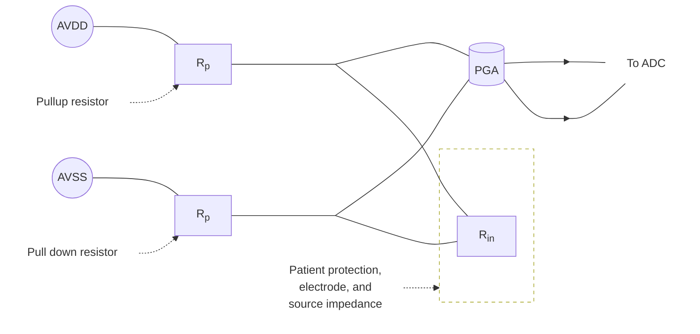
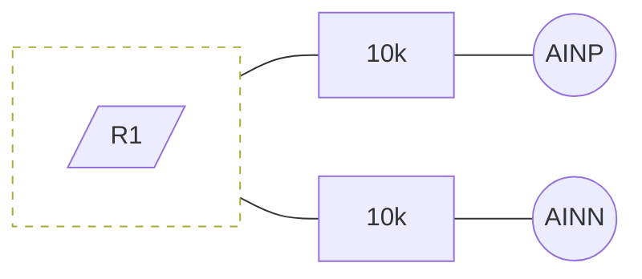

# Understanding lead-off detection in ECG

<!-- Original PDF: SBAA196.pdf -->

<!-- PDF page 1 -->

# **Understanding Lead-Off Detection in ECG**

*Anthony Calabria*                                                                                                *High-Performance Analog*

## **ABSTRACT**

This application report describes various types of lead-off detection in electrocardiogram (ECG) applications, as well as their integration into the ADS1x9x family of devices. The primary goals of this application report are to describe general lead-off functionality and to answer some common questions and challenges that designers must address.

<table>
  <caption>**Contents**</caption>
    <tr>
      <td>1</td>
      <td>Introduction ...................................................................................................................</td>
      <td>2</td>
    </tr>
    <tr>
      <td>2</td>
      <td>DC Lead-Off Detection ......................................................................................................</td>
      <td>3</td>
    </tr>
    <tr>
      <td></td>
      <td>2.1    DC Lead-Off Effects on Offset Voltage ..........................................................................</td>
      <td>4</td>
    </tr>
    <tr>
      <td></td>
      <td>2.2    DC Lead-Off Effects on Noise ....................................................................................</td>
      <td>5</td>
    </tr>
    <tr>
      <td>3</td>
      <td>AC Lead-Off Detection ......................................................................................................</td>
      <td>6</td>
    </tr>
    <tr>
      <td>4</td>
      <td>Verifying Lead-Off Effects with the ADS1298 ............................................................................</td>
      <td>7</td>
    </tr>
    <tr>
      <td></td>
      <td>4.1    Calculation of the Additional Offset Error Using DC Lead-Off ................................................</td>
      <td>7</td>
    </tr>
    <tr>
      <td></td>
      <td>4.2    Measuring Additional Offset Error with DC Lead-Off...........................................................</td>
      <td>8</td>
    </tr>
    <tr>
      <td></td>
      <td>4.3    Monitoring Electrode Connectivity with AC Lead-Off .........................................................</td>
      <td>10</td>
    </tr>
    <tr>
      <td>5</td>
      <td>Conclusion ..................................................................................................................</td>
      <td>11</td>
    </tr>
    <tr>
      <td>Appendix A</td>
      <td>Lead-Off Testing Setup ...........................................................................................</td>
      <td>12</td>
    </tr>
    <tr>
      <td>Appendix B</td>
      <td>Recommended Reading..........................................................................................</td>
      <td>13</td>
    </tr>
    <tr>
      <td>Appendix C</td>
      <td>References .........................................................................................................</td>
      <td>14</td>
    </tr>
</table>

<table>
  <caption>**List of Figures**</caption>
    <tr>
      <td>1</td>
      <td>Wet and Dry Electrode Impedance Variations Over Time..............................................................</td>
      <td>2</td>
    </tr>
    <tr>
      <td>2</td>
      <td>Current Path for DC Lead-Off ..............................................................................................</td>
      <td>3</td>
    </tr>
    <tr>
      <td>3</td>
      <td>ECG System Using Pull-Up and Pull-Down Lead-Off Protection Resistors..........................................</td>
      <td>4</td>
    </tr>
    <tr>
      <td>4</td>
      <td>Simplified ECG Input Structure ............................................................................................</td>
      <td>5</td>
    </tr>
    <tr>
      <td>5</td>
      <td>Effects of AC Lead-Off in Time Domain ..................................................................................</td>
      <td>6</td>
    </tr>
    <tr>
      <td>6</td>
      <td>ECG Result with DC Resistor Pull-Up and Pull-Down Lead-Off.......................................................</td>
      <td>8</td>
    </tr>
    <tr>
      <td>7</td>
      <td>ECG Result with 6-nA DC Current Lead-Off .............................................................................</td>
      <td>9</td>
    </tr>
    <tr>
      <td>8</td>
      <td>Input Structure Test Setup ................................................................................................</td>
      <td>10</td>
    </tr>
    <tr>
      <td>9</td>
      <td>Excitation Signal Amplitude vs Input Impedance ......................................................................</td>
      <td>10</td>
    </tr>
</table>

<!-- PDF page 2 -->

*Introduction* [www.ti.com](http://www.ti.com)

# **1 Introduction**

Detecting the connectivity of an electrode to a patient is essential in any electrocardiogram (ECG) application. Accurate measurement of the ECG signal relies heavily on a low-impedance conductive path from the patient's body to the monitoring device. If there is any disruption between the body and the monitoring device, the reported results may not accurately correspond to the patient's physiology. Monitoring techniques (such as lead-off detection) verify that electrodes are properly connected, and immediately notify the user if a fault is detected. This fault can be configured to alarm when an electrode is completely disconnected or when the connection is weak.

An ECG system is composed of two or more electrodes that monitor the voltage across one or more leads. In addition to these monitoring electrodes, a right-leg drive (RLD) electrode may be required to bias the patient to a set dc operating point in order to ensure that the input at the same potential as the monitoring system. Without a set dc bias point, the ECG input signal has a poorly-defined common mode that may cause it to float in and out of the system operating conditions. Clinical ECG systems have not always made it a priority to monitor electrode status through lead-off detection methods. Advances in design are focused on understanding the details of a patient’s skin layer and signal path of ECG, thus justifying the need for lead-off detection.

The design of a wet electrode relies on the fact that the skin has a dry dielectric outer layer requiring gel compositions and medically-certified electrode pads in order to establish a strong conductive path from the patient to the ECG system. Over time, these gels begin to dry out (as well as possibly cause skin irritation), changing the impedance characteristics between the pad and patient. Air gaps may develop between the electrode and skin, especially if there is hair on the skin surface, increasing the series impedance across the input path. [1]. Figure 1 shows the typical impedance variation of both a wet and dry electrode over a five-hour period when connected to a subject. The impedance of the wet electrode varied by more than 10 kΩ as the conductive gels dried out over time [2].

<table>
  <caption>Impedance over time for wet and dry electrodes — Impedance (kΩ) vs. Measurement Times (Hours)</caption>
  <thead>
    <tr>
      <th>Measurement Times (Hours)</th>
      <th>Wet electrode with skin preparation (kΩ)</th>
      <th>Dry electrode without skin preparation (kΩ)</th>
    </tr>
  </thead>
  <tbody>
    <tr>
      <th>0</th>
      <td>4.5</td>
      <td>8.0</td>
    </tr>
    <tr>
      <th>0.5</th>
      <td>5.5</td>
      <td>7.0</td>
    </tr>
    <tr>
      <th>1</th>
      <td>6.8</td>
      <td>6.8</td>
    </tr>
    <tr>
      <th>1.5</th>
      <td>8.2</td>
      <td>5.0</td>
    </tr>
    <tr>
      <th>2</th>
      <td>8.8</td>
      <td>4.8</td>
    </tr>
    <tr>
      <th>2.5</th>
      <td>10.5</td>
      <td>4.0</td>
    </tr>
    <tr>
      <th>3</th>
      <td>12.8</td>
      <td>5.2</td>
    </tr>
    <tr>
      <th>3.5</th>
      <td>13.0</td>
      <td>5.0</td>
    </tr>
    <tr>
      <th>4</th>
      <td>14.2</td>
      <td>4.8</td>
    </tr>
    <tr>
      <th>4.5</th>
      <td>15.5</td>
      <td>5.2</td>
    </tr>
    <tr>
      <th>5</th>
      <td>16.8</td>
      <td>5.8</td>
    </tr>
  </tbody>
</table>

**Figure 1. Wet and Dry Electrode Impedance Variations Over Time [2]**

Detecting whether or not an electrode or lead is connected can be accomplished with multiple discrete solutions in an ECG system. Generally, the design is focused around using a known excitation signal at the analog front-end and observing how it responds when coming into contact with the electrodes. Creating the excitation signal can either be done through dc or ac methods, each having their own advantages. Regardless of the technique, both methods monitor the leads in two ways: detecting if the electrode is connected, and monitoring the strength of the conductive path between the electrode and patient.

<!-- PDF page 3 -->

# **2 DC Lead-Off Detection** Discrete ECG designs commonly rely on dc methods for lead-off detection because these methods provide continuous monitoring while having a minor effect on the ECG signal. The monitoring process begins by injecting a known dc signal into the analog front-end and monitoring the signal changes when coming into contact with the input load. Changes in the signal can be analyzed by the user to determine the status of the electrodes. Monitoring the behavior of the input signal can be accomplished a couple of ways, depending on the available board space for the design. If adequate space is available, discrete components such as external comparators can be connected to trigger an alert when the input signal exceeds a user-set voltage. If board space is not available, the input signal can be analyzed in the digital domain, after conversion by an analog-to-digital converter (ADC), to monitor the lead status.Using a simple dc current source or passive components in a pull-up or pull-down resistor configuration are common methods for dc lead-off detection. If the electrodes are properly connected, the excitation signal has a minimal impact on the ECG signal data. Over time, the conductive path between the patient and a wet electrode breaks down, causing the input impedance seen at the analog front-end of the ECG system to increase. As the source impedance increases, the excitation signal begins to dominate the inputs, pulling the lines to their respective power supplies. When the electrodes are fully removed, the excitation signal directly feeds the analog front-end, indicating a lead-off event. Use a comparator to compare the analog input voltage to a user-set voltage level designed to alert when the conductivity between the patient and electrode exceeds the ECG system design specifications.The implementation of dc lead-off requires the ECG system to include a return path for the transmitted excitation signal. This return path can come from a coupled secondary electrode or the RLD connection, shown as an example in Figure 2. Failure to properly close the circuit loop can result in a false detection of lead status because the subject and monitoring system do not share the same grounding path.

```mermaid
graph LR
    subgraph " "
        direction LR
        Patient(( ))
        Z1["Z"]
        Z2["Z"]
        Z3["Z"]
        PGA[/"PGA"\]
        ADC[/"ADC"\]
        RLD_Amp[/"RLD Amplifier"\]
        AVDD(( ))
        AVSS(( ))
        CS1(( ))
        CS2(( ))
    end

    %% Connections
    Patient --- Z1
    Patient --- Z2
    Patient --- Z3
    
    Z1 --- PGA
    Z2 --- PGA
    PGA --- ADC
    
    AVDD --- CS1
    CS1 --- Z1
    
    AVSS --- CS2
    CS2 --- Z2
    
    Z3 --- Rp[/"Rp"\]
    Rp --- RLD_Amp
    Ref["Reference signal"] --- RLD_Amp
    RLD_Amp --- Rp

    %% Labels and Annotations
    Patient_Label["Patient"] --> Patient
    Cable_Label["Cable and Electrode impedance"] --> Z1
    Cable_Label --> Z2
    Cable_Label --> Z3
    
    %% Current Paths (Red Dashed Lines)
    CP1["Current Path"] -.-> Patient
    CRP1["Current Return Path"] -.-> Z2
    CRP2["Current Return Path"] -.-> Rp

    %% Styling
    style Patient fill:#000,stroke:#000
    style AVDD fill:none,stroke:#000
    style AVSS fill:none,stroke:#000
    style CS1 fill:none,stroke:#000
    style CS2 fill:none,stroke:#000
    style PGA fill:none,stroke:#000
    style ADC fill:none,stroke:#000
    style RLD_Amp fill:none,stroke:#000
    style Z1 fill:none,stroke:#000
    style Z2 fill:none,stroke:#000
    style Z3 fill:none,stroke:#000
    style Rp fill:none,stroke:none
```

**Figure 2. **Current Path** for DC Lead-Off**

<!-- PDF page 4 -->

## **2.1   *DC Lead-Off Effects on Offset Voltage***

System offset error in a typical ECG design is dominated by the electrode characteristics and the analog front-end design. Depending on the offset amplitude, the gain at the input stage may be restricted to ensure that the ADC input limits are not exceeded. Adding a discrete lead-off solution to the analog front end increases the system input offset voltage. To better understand how the input offset voltage is affected, the analog front-end of a typical ECG system is combined and simplified in this example as one term, Rin. Figure 3 illustrates the configuration of a typical ECG system, showing the pull-up and pull-down resistors as Rp, and the input patient-protection resistors and electrode impedance combined and shown as Rin. This analysis is focused on dc only; therefore, we model the electrode input as purely resistive because all capacitances are treated as open.

**Figure 3. ECG System Using Pull-Up and Pull-Down Lead-Off Protection Resistors**

The inputs to the PGA are seen as high impedance; therefore, the analog front-end simplifies to three resistors across two power-supply voltages. The current created from the pull-up and pull-down resistors combined with the Rin resistance adds to the offset error. Equation 1 shows the additional offset error in terms of the power supplies and resistor values:

$$V_{offset} = \left[ \frac{<u>AVDD</u> - <u>AVSS</u>}{2R_p + R_{in}} \right] \cdot R_{in} \text{ (1)}$$

When current sources are used in place of pull-up and pull-down resistors for lead-off detection, Rp in Figure 3 is replaced with a fixed dc source either sourcing or sinking current. Offset error from current source lead-off follows the same principal, in that the voltage developed across Rin from the excitation signal design creates an offset. However, unlike resistor lead-off, the value of the current remains fixed and does not change with Rin. The offset error calculation is shown in Equation 2:

$$V_{offset} = i_{leadoff} \cdot R_{in}$$

where

* $i_{leadoff}$ is the current source magnitude. (2)

<!-- PDF page 5 -->

## **2.2 DC Lead-Off Effects on Noise**

The design and implementation of the lead-off signal changes the noise characteristics of the ECG system. Using the pull-up and pull-down resistor example in Figure 3, the thermal-noise characteristics increase with the addition of the pull-up or pull-down resistors. Quantifying this noise requires simplifying the input structure and performing small-signal analysis, as shown in Figure 4.

**Figure 4. Simplified ECG Input Structure**

Grounding the dc sources for analysis, we can solve for the noise at the PGA input shown in Equation 3:

$$V_n = \sqrt{\frac{4 \cdot K \cdot T}{R_p}} \cdot (Z_{in})$$

where

* k = The Boltzmann constant of $1.38 \times 10^{-23}$ joules/kelvins (J/K)
* T = temperature in kelvins (K)
* $Z_{in}$ = patient, electrode, and cable impedance as one term
* $R_p$ = pull-up resistor

Noise contribution when using a dc current source excitation signal design is primarily dominated by flicker noise, but does include some thermal-noise components. The design topology of the source itself determines exactly how much system noise is generated by the current sources. Noise amplitude increases with current magnitude, and is one of the few reasons small current sources are recommended. The voltage developed across $Z_{in}$ from the current noise, $I_n$, forms the system noise, as shown in Equation 4:

$$V_n = I_n \cdot Z_{in} \eqno(4)$$

<!-- PDF page 6 -->

# **3 AC Lead-Off Detection**

Advancements in electrode technology have focused on capacitive-based electrodes that stray from basic ECG design. Dry-contact and non-contact electrodes carry large capacitive elements across the skin-electrode path, making lead-off detection a challenge [3]. New system design methods have shifted to favor ac lead-off methods that focus on monitoring the magnitude of an excitation signal frequency to determine lead status. Analog filtering, comparators, and post-processing of ADC results are several techniques for analyzing the signal.

To better understand the concept of ac lead-off and the stringent digital-filter requirement, Figure 5 displays a typical ECG signal with an ac excitation signal layered on top. Data processing allows the user to remove the higher-frequency components from the excitation signal to leave only the ECG signal.

<table>
  <caption>The Effects of Enabling AC Leadoff — Volts; NOTE: Signals plotted out of phase to help display signal details.</caption>
  <thead>
    <tr>
      <th>Sample Index</th>
      <th>AC Leadoff Enabled (Volts)</th>
      <th>AC Leadoff Digitally Filtered (Volts)</th>
    </tr>
  </thead>
  <tbody>
    <tr>
      <th>1</th>
      <td>0.00010</td>
      <td>-0.00008</td>
    </tr>
    <tr>
      <th>51</th>
      <td>-0.00005</td>
      <td>-0.00005</td>
    </tr>
    <tr>
      <th>101</th>
      <td>0.00005</td>
      <td>0.00015</td>
    </tr>
    <tr>
      <th>151</th>
      <td>0.00005</td>
      <td>0.00001</td>
    </tr>
    <tr>
      <th>201</th>
      <td>0.00005</td>
      <td>0.00000</td>
    </tr>
    <tr>
      <th>251</th>
      <td>0.00010</td>
      <td>0.00005</td>
    </tr>
    <tr>
      <th>301</th>
      <td>-0.00010</td>
      <td>0.00000</td>
    </tr>
    <tr>
      <th>351</th>
      <td>0.00005</td>
      <td>0.00000</td>
    </tr>
    <tr>
      <th>401</th>
      <td>0.00015</td>
      <td>-0.00008</td>
    </tr>
    <tr>
      <th>451</th>
      <td>0.00005</td>
      <td>-0.00008</td>
    </tr>
    <tr>
      <th>501</th>
      <td>0.00005</td>
      <td>0.00015</td>
    </tr>
    <tr>
      <th>551</th>
      <td>0.00005</td>
      <td>0.00001</td>
    </tr>
    <tr>
      <th>601</th>
      <td>0.00005</td>
      <td>0.00000</td>
    </tr>
    <tr>
      <th>651</th>
      <td>0.00005</td>
      <td>0.00005</td>
    </tr>
    <tr>
      <th>701</th>
      <td>-0.00010</td>
      <td>0.00000</td>
    </tr>
    <tr>
      <th>751</th>
      <td>0.00005</td>
      <td>0.00000</td>
    </tr>
    <tr>
      <th>801</th>
      <td>0.00015</td>
      <td>-0.00008</td>
    </tr>
    <tr>
      <th>851</th>
      <td>0.00005</td>
      <td>-0.00008</td>
    </tr>
    <tr>
      <th>901</th>
      <td>0.00005</td>
      <td>0.00015</td>
    </tr>
    <tr>
      <th>951</th>
      <td>0.00005</td>
      <td>0.00001</td>
    </tr>
  </tbody>
</table>

**Figure 5. Effects of AC Lead-Off in Time Domain**

Impedance tracking is made possible by using the digital domain for monitoring, allowing the user to understand the strength of connectivity between the patient and ECG system. As the electrode connectivity breaks down, the series impedance increases, thus increasing the excitation signal amplitude seen at the analog front-end.

Depending on the post-processing capabilities of the system, ac lead-off can be accomplished either apart from or during ECG monitoring. When the ac excitation signal is outside the ECG bandwidth, digital band-pass filtering the conversion results isolates the ECG signal from the ac excitation signal and other out-of-band frequencies. This filtering allows the system to monitor for a lead-off event while simultaneously digitizing the ECG signal.

<!-- PDF page 7 -->

## **4 Verifying Lead-Off Effects with the ADS1298**

The <u>ADS1298</u> family incorporates the circuitry needed to perform either dc or ac lead-off without the need for external components.

The dc excitation signal included in the device allows for either pull-up and pull-down resistors, or current-source options. The ADC inputs are monitored by individual internal comparators that run in parallel with the converter and trigger when the specific input exceeds a user-defined dc threshold voltage set by an internal, three-bit, digital-to-analog converter (DAC).

An ac excitation signal can be sourced as a square wave with a frequency set to a fraction of the data rate. AC lead-off requires that post-processing is performed on the result to monitor for the excitation signal.

The following test uses the ADS1298ECGFE board (available from Texas Instruments) to test the effects of lead-off on ECG monitoring. An ECG human body simulator is paired with a 10-lead ECG snap cable to create a functioning ECG system monitoring a simulated patient. Enable and disable the lead-off detection to compare the effects on the output result.

### **4.1 *Calculation of the Additional Offset Error Using DC Lead-Off***

In order to provide a basis for comparison during testing, the theoretical offset error from the lead-off circuitry must be calculated. The ADS1298ECGFE schematic (see the User’s Guide, <u>SBAU171</u>), shows that each input channel includes 32.1 kΩ of series impedance. The simulator and cable impedances are estimated to be 44 kΩ. When these values are combined, the total input impedance seen by the ADC (Rin) is 108.2 kΩ.

For resistor pull-up or pull-down dc lead-off, the ADS1298 uses 10-MΩ internal resistors to pull the input channel to the appropriate supply. The theoretical offset error can be solved using Equation 5. Note that the ADC on the evaluation board is powered from a 3-V supply.

$$V_{offset} = \left[ \frac{<u>AVDD</u> - <u>AVSS</u>}{2R_p + R_{in}} \right] \cdot R_{in} = \left[ \frac{3 V - 0 V}{(2 \times 10 M\Omega + 108.2 k\Omega)} \right] \cdot 108.2 k\Omega = 16.14 mV$$ (5)

Using current sources for dc lead-off, the ADS1298 has four selectable options: 6 nA, 12 nA, 18 nA, and 24 nA. For this example, we are going to select a 6-nA lead-off current magnitude to minimize the error. Equation 6 is used to solve for the theoretical error.

$$V_{offset} = (i_{leadoff} - i_b) \cdot R_{in} = (6 nA - 200 pA) \cdot 108.4 k\Omega = 650.4 \mu V$$ (6)

<!-- PDF page 8 -->

## 4.2   ***Measuring Additional Offset Error with DC Lead-Off***

To characterize the effects of enabling a dc lead-off excitation signal, the offset voltage must be quantified before and after dc lead-off is enabled. To isolate the effects from the input source, an ECG simulator provides a fixed and constant ECG pulse. The controlled ECG signal also allows for an easy comparison of the results.

Figure 6 and Figure 7 show the converted ADC output result of the ECG system with and without dc lead-off detection enabled. While enabling lead-off affects the offset, the integrity of the ECG signal remains fixed from test to test. This result verifies our earlier statement that the lead-off detection can be run in parallel with patient monitoring without disrupting the ECG signal. Tolerances in the pull-up and pull-down resistors and the current sources, as well as variation in the leakage paths from chip to chip, control the exact offset voltage, and account for slight deviations from the theoretical calculation to the actual result.

<table>
  <caption>DC Resistor Leadoff during ECG Monitoring — Volts by Sample</caption>
  <thead>
    <tr>
      <th>Sample</th>
      <th>Leadoff Disabled (Volts)</th>
      <th>Resistor Leadoff Enabled (Volts)</th>
    </tr>
  </thead>
  <tbody>
    <tr>
      <th>1</th>
      <td>-0.0001</td>
      <td>0.0173</td>
    </tr>
    <tr>
      <th>51</th>
      <td>-0.0002</td>
      <td>0.0172</td>
    </tr>
    <tr>
      <th>101</th>
      <td>-0.0002</td>
      <td>0.0173</td>
    </tr>
    <tr>
      <th>151</th>
      <td>-0.0001</td>
      <td>0.0174</td>
    </tr>
    <tr>
      <th>201</th>
      <td>-0.0001</td>
      <td>0.0173</td>
    </tr>
    <tr>
      <th>251</th>
      <td>-0.0001</td>
      <td>0.0173</td>
    </tr>
    <tr>
      <th>301</th>
      <td>-0.0001</td>
      <td>0.0173</td>
    </tr>
    <tr>
      <th>351</th>
      <td>-0.0001</td>
      <td>0.0173</td>
    </tr>
    <tr>
      <th>401</th>
      <td>-0.0001</td>
      <td>0.0173</td>
    </tr>
    <tr>
      <th>451</th>
      <td>-0.0002</td>
      <td>0.0172</td>
    </tr>
    <tr>
      <th>501</th>
      <td>-0.0002</td>
      <td>0.0173</td>
    </tr>
    <tr>
      <th>551</th>
      <td>-0.0001</td>
      <td>0.0174</td>
    </tr>
  </tbody>
</table>

**Figure 6. ECG Result with DC Resistor Pull-Up and Pull-Down Lead-Off**

<!-- PDF page 9 -->

<!--llamaparse-error ordinal="0" mode="chart" box_2d="[113,26,571,973]" code="SPECIALIST_ERROR"-->

**Figure 7. ECG Result with 6-nA DC Current Lead-Off**

<!-- PDF page 10 -->

## **4.3 *Monitoring Electrode Connectivity with AC Lead-Off***

We can simulate the behavior of a weakening conductive path between a patient and electrode by changing the input load impedance.

This test uses a purely resistive path to help illustrate the concept of impedance tracking. The input structure is shown in Figure 8, where R1 is varied to simulate the weakening conductive path.

**Figure 8. Input Structure Test Setup**

Using the ac excitation signal generated by the ADS1298, sweep R1 and monitor the excitation signal amplitude read by the converter. Resistor R1 is swept from 10 Ω to hundreds of MΩ, and the conversion result is plotted in µV peak-to-peak, as shown in Figure 9.

<table>
  <caption>**Figure 9. Excitation Signal Amplitude vs Input Impedance**</caption>
  <thead>
    <tr>
      <th>Input Impedance</th>
      <th>Excitation Signal Amplitude (pk-pk uV)</th>
    </tr>
  </thead>
  <tbody>
    <tr>
      <th>10</th>
      <td>200</td>
    </tr>
    <tr>
      <th>20k</th>
      <td>600</td>
    </tr>
    <tr>
      <th>50k</th>
      <td>1200</td>
    </tr>
    <tr>
      <th>100k</th>
      <td>2300</td>
    </tr>
    <tr>
      <th>200k</th>
      <td>4800</td>
    </tr>
    <tr>
      <th>500k</th>
      <td>12000</td>
    </tr>
    <tr>
      <th>1M</th>
      <td>19000</td>
    </tr>
    <tr>
      <th>Open</th>
      <td>40000</td>
    </tr>
  </tbody>
</table>

<!-- PDF page 11 -->

logo: Texas Instruments | [www.ti.com](http://www.ti.com) *Conclusion*

## **5 Conclusion**

Ensuring that an electrode is properly connected during patient monitoring is vital for ECG systems. Weakness in the electrode- patient conductive path causes a change in the input impedance and must be recognized during signal acquisition. Otherwise, the result may not accurately represent the ECG signal being monitored from the patient. Discrete dc and ac lead-off design techniques are used to monitor and alert when an electrode is off or begins to exhibit a poor contact. Depending on the system design and exact ECG application, each method has advantages and disadvantages.

DC lead-off can be done discretely in the analog domain, with minimal impact on the ECG signal itself; however, the technique contributes additional offset error, as well as a potential increase in the total system noise. AC lead-off requires more post-processing in the digital domain to isolate the ECG signal from the excitation signal, but can track the strength of connectivity between the patient and electrode. Careful attention is necessary to ensure that the frequency of the ac excitation signal does not overlap with either the high-frequency ECG or pacemaker signal components; otherwise, digital filtering cannot be used to isolate the ECG signal from the excitation signal. The ADS1298 family of devices available from Texas Instruments includes the circuitry to make lead-off detection possible. Both dc and ac techniques are available and can be enabled or disabled using the internal registers of the device.

<!-- PDF page 12 -->

# ***Lead-Off Testing Setup***

## **A.1**   ***DC Lead-Off Test Setup***

Testing dc lead-off detection effects on the offset error are performed using the following test setup:

* CardioSIM II ECG Simulator™ running at \~75 BPM with a 15-pin, shielded cable and connector from Biometric Cables™ (part number 010302013). The cable includes a 10-kΩ protective resistance.
* ADS1298ECG-FE evaluation board with MMB0 motherboard running the ADS1298ECG-FE evaluation software [4].
* ADC configuration: continuous conversion, 500 SPS, High-Resolution mode, 2.4-V internal reference, gain = 6, and data are input referred.
* Digital reconstruction of the ECG signal requires that multiple samples are taken sequentially. A set of 600 samples run continuously at 500 SPS. The ECG signal source (simulator) consistently outputs an ideal signal in order to make a firm comparison from test to test.

## **A.2**   ***AC Lead-Off Test Setup***

Testing the ac lead-off detection is performed using the following test setup:

* ADS1298 bench board used for part characterization.
* 8 kSPS, High-Resolution mode, 2.4-V internal reference, gain = 6, and data are input referred.
* AC lead-off excitation signal frequency of fDECICLK/4 or 2 kHz at a 8 kSPS data rate.

<!-- PDF page 13 -->

*Appendix B*

*SBAA196A—May 2012—Revised January 2015*

# ***Recommended Reading***

1. Acharya, Venkatesh, “Improving Common-Mode Rejection Using the Right-Leg-Drive Amplifier.” <u>SBAA118</u>, July 2011. http://www.ti.com/lit/an/sbaa118/sbaa118.pdf

2. Gupta, Amit, “Respiration Rate Measurement Based on Impedance Pneumography.” <u>SBAA181</u>, February 2011. http://www.ti.com/lit/an/sbaa181/sbaa181.pdf

<!-- PDF page 14 -->

### ***References***

1. Anna Karilainen, Stefan Hansen, and Jorg Muller. “Dry and Capacitive Electrodes for Long-Term ECG Monitoring.” 8th Annual Workshop on Semiconductor Advances, 17 Nov 2005.
2. Chin-Teng Lin, Lun-De Liao, Yu-Hang Liu, I-Jan Wang, Bor-Shyh Lin, and Jyh-Yeong Chang, “Novel Dry Polymer Foam Electrodes for Long-Term EEG Measurement.” Biomedical Engineering, IEEE vol 58 no 5, May 2011.
3. Yu M. Chi, Tzyy-Ping Jung, and Gert Cauwenberghs, “Dry-contact and Non-contact Biopotential Sensors.” Biomedical Engineering, IEEE vol. 3, 2010.
4. ADS1298ECG-FE Demonstration Kit user guide. Literature number <u>SBAU171</u>.

<!-- PDF page 15 -->

# **Revision History**

<table>
  <thead>
    <tr>
      <th><b>Changes from Original (May 2012) to A Revision</b></th>
      <th>Page</th>
    </tr>
  </thead>
  <tbody>
    <tr>
      <td>• Changed "patent" to "patient" in second paragraph of <i>Section 2</i> section (typo) ....................................................................................</td>
      <td>3</td>
    </tr>
    <tr>
      <td>• Changed "patent" to "patient" in Figure 3 (typo) ....................................................................................................................................</td>
      <td>4</td>
    </tr>
  </tbody>
</table>

NOTE: Page numbers for previous revisions may differ from page numbers in the current version.

<!-- PDF page 16 -->

# **IMPORTANT NOTICE**

Texas Instruments Incorporated and its subsidiaries (TI) reserve the right to make corrections, enhancements, improvements and other changes to its semiconductor products and services per JESD46, latest issue, and to discontinue any product or service per JESD48, latest issue. Buyers should obtain the latest relevant information before placing orders and should verify that such information is current and complete. All semiconductor products (also referred to herein as “components”) are sold subject to TI’s terms and conditions of sale supplied at the time of order acknowledgment.

TI warrants performance of its components to the specifications applicable at the time of sale, in accordance with the warranty in TI’s terms and conditions of sale of semiconductor products. Testing and other quality control techniques are used to the extent TI deems necessary to support this warranty. Except where mandated by applicable law, testing of all parameters of each component is not necessarily performed.

TI assumes no liability for applications assistance or the design of Buyers’ products. Buyers are responsible for their products and applications using TI components. To minimize the risks associated with Buyers’ products and applications, Buyers should provide adequate design and operating safeguards.

TI does not warrant or represent that any license, either express or implied, is granted under any patent right, copyright, mask work right, or other intellectual property right relating to any combination, machine, or process in which TI components or services are used. Information published by TI regarding third-party products or services does not constitute a license to use such products or services or a warranty or endorsement thereof. Use of such information may require a license from a third party under the patents or other intellectual property of the third party, or a license from TI under the patents or other intellectual property of TI.

Reproduction of significant portions of TI information in TI data books or data sheets is permissible only if reproduction is without alteration and is accompanied by all associated warranties, conditions, limitations, and notices. TI is not responsible or liable for such altered documentation. Information of third parties may be subject to additional restrictions.

Resale of TI components or services with statements different from or beyond the parameters stated by TI for that component or service voids all express and any implied warranties for the associated TI component or service and is an unfair and deceptive business practice. TI is not responsible or liable for any such statements.

Buyer acknowledges and agrees that it is solely responsible for compliance with all legal, regulatory and safety-related requirements concerning its products, and any use of TI components in its applications, notwithstanding any applications-related information or support that may be provided by TI. Buyer represents and agrees that it has all the necessary expertise to create and implement safeguards which anticipate dangerous consequences of failures, monitor failures and their consequences, lessen the likelihood of failures that might cause harm and take appropriate remedial actions. Buyer will fully indemnify TI and its representatives against any damages arising out of the use of any TI components in safety-critical applications.

In some cases, TI components may be promoted specifically to facilitate safety-related applications. With such components, TI’s goal is to help enable customers to design and create their own end-product solutions that meet applicable functional safety standards and requirements. Nonetheless, such components are subject to these terms.

No TI components are authorized for use in FDA Class III (or similar life-critical medical equipment) unless authorized officers of the parties have executed a special agreement specifically governing such use.

Only those TI components which TI has specifically designated as military grade or “enhanced plastic” are designed and intended for use in military/aerospace applications or environments. Buyer acknowledges and agrees that any military or aerospace use of TI components which have *not* been so designated is solely at the Buyer's risk, and that Buyer is solely responsible for compliance with all legal and regulatory requirements in connection with such use.

TI has specifically designated certain components as meeting ISO/TS16949 requirements, mainly for automotive use. In any case of use of non-designated products, TI will not be responsible for any failure to meet ISO/TS16949.

<table>
  <thead>
    <tr>
      <th colspan="2">Products</th>
      <th colspan="2">Applications</th>
    </tr>
  </thead>
  <tbody>
    <tr>
      <td>Audio</td>
      <td><u>www.ti.com/audio</u></td>
      <td>Automotive and Transportation</td>
      <td><u>www.ti.com/automotive</u></td>
    </tr>
    <tr>
      <td>Amplifiers</td>
      <td><u>amplifier.ti.com</u></td>
      <td>Communications and Telecom</td>
      <td><u>www.ti.com/communications</u></td>
    </tr>
    <tr>
      <td>Data Converters</td>
      <td><u>dataconverter.ti.com</u></td>
      <td>Computers and Peripherals</td>
      <td><u>www.ti.com/computers</u></td>
    </tr>
    <tr>
      <td>DLP® Products</td>
      <td><u>www.dlp.com</u></td>
      <td>Consumer Electronics</td>
      <td><u>www.ti.com/consumer-apps</u></td>
    </tr>
    <tr>
      <td>DSP</td>
      <td><u>dsp.ti.com</u></td>
      <td>Energy and Lighting</td>
      <td><u>www.ti.com/energy</u></td>
    </tr>
    <tr>
      <td>Clocks and Timers</td>
      <td><u>www.ti.com/clocks</u></td>
      <td>Industrial</td>
      <td><u>www.ti.com/industrial</u></td>
    </tr>
    <tr>
      <td>Interface</td>
      <td><u>interface.ti.com</u></td>
      <td>Medical</td>
      <td><u>www.ti.com/medical</u></td>
    </tr>
    <tr>
      <td>Logic</td>
      <td><u>logic.ti.com</u></td>
      <td>Security</td>
      <td><u>www.ti.com/security</u></td>
    </tr>
    <tr>
      <td>Power Mgmt</td>
      <td><u>power.ti.com</u></td>
      <td>Space, Avionics and Defense</td>
      <td><u>www.ti.com/space-avionics-defense</u></td>
    </tr>
    <tr>
      <td>Microcontrollers</td>
      <td><u>microcontroller.ti.com</u></td>
      <td>Video and Imaging</td>
      <td><u>www.ti.com/video</u></td>
    </tr>
    <tr>
      <td>RFID</td>
      <td><u>www.ti-rfid.com</u></td>
      <td></td>
      <td></td>
    </tr>
    <tr>
      <td>OMAP Applications Processors</td>
      <td><u>www.ti.com/omap</u></td>
      <td><strong><b>TI E2E Community</b></strong></td>
      <td><u>e2e.ti.com</u></td>
    </tr>
    <tr>
      <td>Wireless Connectivity</td>
      <td><u>www.ti.com/wirelessconnectivity</u></td>
      <td></td>
      <td></td>
    </tr>
  </tbody>
</table>

Mailing Address: Texas Instruments, Post Office Box 655303, Dallas, Texas 75265
Copyright © 2015, Texas Instruments Incorporated
