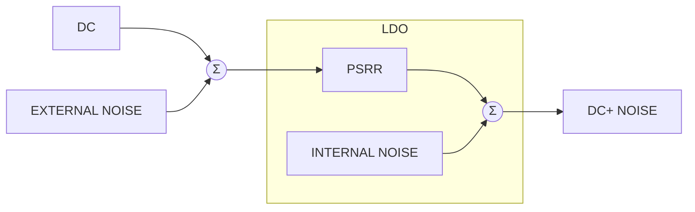

# LDO noise demystified

<!-- Original PDF: SLAA412.pdf -->

<!-- PDF page 1 -->

*Application Report*

# **LDO Noise Demystified**

*Sanjay Pithadia and Ankur Verma* *PMP - LP Linear Regulators*

### **ABSTRACT**

This application report explains the difference between noise and PSRR of an LDO. It also explains the different ways noise is specified in LDO datasheets and which specification should be used in the application. Finally it explains how LDO noise is reduced.

<table>
  <caption>Table of Contents</caption>
    <tr>
      <td><b><b>1 LDO Noise and PSRR</b></b>.............................................................................................................................................................</td>
      <td>2</td>
    </tr>
    <tr>
      <td><b><b>2 LDO Noise Types</b></b>....................................................................................................................................................................</td>
      <td>3</td>
    </tr>
    <tr>
      <td><b><b>3 Noise Specifications in LDO Data Sheets</b></b>............................................................................................................................</td>
      <td>4</td>
    </tr>
    <tr>
      <td><b><b>4 Which Specification is for Your Application?</b></b>......................................................................................................................</td>
      <td>5</td>
    </tr>
    <tr>
      <td><b><b>5 How to Reduce the LDO Noise?</b></b>............................................................................................................................................</td>
      <td>8</td>
    </tr>
    <tr>
      <td><b><b>6 Implications of the LDO Noise</b></b>...............................................................................................................................................</td>
      <td>9</td>
    </tr>
    <tr>
      <td><b><b>7 Revision History</b></b>......................................................................................................................................................................</td>
      <td>9</td>
    </tr>
</table>

<table>
  <caption>**List of Figures**</caption>
    <tr>
      <td>Figure 1-1. PSRR and Noise in LDO...........................................................................................................................................</td>
      <td>2</td>
    </tr>
    <tr>
      <td>Figure 2-1. LDO Noise (types).....................................................................................................................................................</td>
      <td>3</td>
    </tr>
    <tr>
      <td>Figure 3-1. Noise Specified in Two Ways (for TPS717xx LDOs)................................................................................................</td>
      <td>4</td>
    </tr>
    <tr>
      <td>Figure 4-1. Transmit Mask and Sidebands Due to Noise............................................................................................................</td>
      <td>5</td>
    </tr>
    <tr>
      <td>Figure 4-2. Increase in VCO Noise Floor Due to LDO Noise......................................................................................................</td>
      <td>6</td>
    </tr>
    <tr>
      <td>Figure 4-3. LDO Noise Aliasing...................................................................................................................................................</td>
      <td>7</td>
    </tr>
</table>

### **Trademarks**

All other trademarks are the property of their respective owners.

<!-- PDF page 2 -->

# **1 LDO Noise and PSRR**

Low dropout linear regulators (LDOs) are a simple way to regulate an output voltage that is powered from a higher voltage input. Though it is simple to operate, its self generated noise is most of the times confused with its Power Supply Rejection Ratio (PSRR). Many times the two are combined together and loosely called just “noise”. This is not correct. Noise is generated by the transistors and resistors in the LDO’s internal circuitry and by the external components. The type of noise may include thermal, flicker and shot noise. PSRR is a measure of circuit’s power supply rejection expressed as a ratio of output noise to noise at the power supply input. It provides a measure of how well a circuit rejects ripple at various frequencies injected from its input power supply. In the case of a LDO, it is a measure of the output ripple compared to the input ripple over a wide frequency range and is expressed in decibels (dB). The basic equation for PSRR is given in Equation 1:

$$PSRR = 20 \log \frac{\text{Ripple}_{\text{Input}}}{\text{Ripple}_{\text{Output}}} \hfill (1)$$

Figure 1-1 explains how noise and PSRR are different from each other. The noise is something which may be internal and external to the LDO whereas PSRR is an internal parameter of the LDO. LDO users generally concentrate on PSRR and not on the self-generated output noise. PSRR rejects noise coming from outside of LDO but there is always noise generated inside the LDO. So an LDO with high PSRR may not be better for noise rejection. The user should always think of both parameters.

**Figure 1-1. PSRR and Noise in LDO**

<!-- PDF page 3 -->

## **2 LDO Noise Types**

Noise is purely physical phenomenon that occurs with transistors and resistors. Transistors generate shot noise and flicker noise. The resistive element of MOSFETs also generates thermal noise like resistors. Thermal and shot noise is truly random in nature and its power is flat over frequency. It remains flat up to the bandwidth of the amplifier. Flicker noise is the noise due to trapped charges at the gate of the MOSFET. It follows Poisson’s Distribution with 1/f roll-off in power versus frequency hence it is higher at low frequencies. This noise dominates until it becomes smaller than thermal noise. (See Figure 2-1)

<table>
  <caption>Noise Power Spectral Density — panels: Thermal / Shot, Flicker, Flicker+ Thermal; axes: power vs. Log(f)</caption>
  <thead>
    <tr>
      <th>Noise Type</th>
      <th>Frequency Range</th>
      <th>Power Characteristic</th>
      <th>Notes</th>
    </tr>
  </thead>
  <tbody>
    <tr>
      <th rowspan="2">Thermal / Shot</th>
      <td>Low to Mid Frequency</td>
      <td>Constant (Flat)</td>
      <td></td>
    </tr>
    <tr>
      <td>High Frequency</td>
      <td>Decreasing</td>
      <td>Roll-off due to limited amplifier BW</td>
    </tr>
    <tr>
      <th>Flicker</th>
      <td>Full Range</td>
      <td>Decreasing</td>
      <td>1/f noise characteristic</td>
    </tr>
    <tr>
      <th rowspan="3">Flicker+ Thermal</th>
      <td>Low Frequency</td>
      <td>Decreasing</td>
      <td>Dominated by Flicker noise</td>
    </tr>
    <tr>
      <td>Mid Frequency</td>
      <td>Constant (Flat)</td>
      <td>Dominated by Thermal noise floor</td>
    </tr>
    <tr>
      <td>High Frequency</td>
      <td>Decreasing</td>
      <td>Roll-off due to limited amplifier BW</td>
    </tr>
  </tbody>
</table>

**Figure 2-1. LDO Noise (types)**

<!-- PDF page 4 -->

# **3 Noise Specifications in LDO Data Sheets**

Typically noise in an LDO is specified by datasheets in two fashions. One is “Total (Integrated) output noise – in μVrms”, which is RMS value of the spectral noise density integrated over a finite frequency range. The second method is to show a “Spectral Noise density curve – in $\mu\text{V}/\sqrt{\text{Hz}}$”, which is a plot of Noise density vs Frequency. Figure 3-1 shows both the specifications for TPS717xx series LDOs.

<table>
  <caption>OUTPUT SPECTRAL NOISE DENSITY vs OUTPUT CURRENT; COUT = 1 µF, CNR = 10nF; Ultra-High PSRR: 70dB at 1kHz, 67dB at 100kHz and 45dB at **1MHz**; Low Noise: 30µA typical (100Hz to 100 kHz)</caption>
  <thead>
    <tr>
      <th rowspan="2">Frequency (Hz)</th>
      <th colspan="2">Output Noise Density (µV/√Hz)</th>
    </tr>
    <tr>
      <th>IOUT = 10mA</th>
      <th>IOUT = 150mA</th>
    </tr>
  </thead>
  <tbody>
    <tr>
      <th>100</th>
      <td>11.4</td>
      <td>11.4</td>
    </tr>
    <tr>
      <th>110</th>
      <td>10.0</td>
      <td>13.8</td>
    </tr>
    <tr>
      <th>120</th>
      <td>10.4</td>
      <td>10.4</td>
    </tr>
    <tr>
      <th>130</th>
      <td>11.2</td>
      <td>11.2</td>
    </tr>
    <tr>
      <th>140</th>
      <td>9.4</td>
      <td>9.4</td>
    </tr>
    <tr>
      <th>150</th>
      <td>10.0</td>
      <td>10.0</td>
    </tr>
    <tr>
      <th>200</th>
      <td>5.6</td>
      <td>6.4</td>
    </tr>
    <tr>
      <th>300</th>
      <td>3.8</td>
      <td>4.2</td>
    </tr>
    <tr>
      <th>400</th>
      <td>2.8</td>
      <td>3.0</td>
    </tr>
    <tr>
      <th>500</th>
      <td>2.2</td>
      <td>2.4</td>
    </tr>
    <tr>
      <th>600</th>
      <td>1.8</td>
      <td>2.0</td>
    </tr>
    <tr>
      <th>700</th>
      <td>1.6</td>
      <td>1.8</td>
    </tr>
    <tr>
      <th>800</th>
      <td>1.4</td>
      <td>1.6</td>
    </tr>
    <tr>
      <th>900</th>
      <td>1.2</td>
      <td>1.4</td>
    </tr>
    <tr>
      <th>1k</th>
      <td>1.0</td>
      <td>1.2</td>
    </tr>
    <tr>
      <th>2k</th>
      <td>0.6</td>
      <td>0.8</td>
    </tr>
    <tr>
      <th>3k</th>
      <td>0.4</td>
      <td>0.6</td>
    </tr>
    <tr>
      <th>4k</th>
      <td>0.3</td>
      <td>0.5</td>
    </tr>
    <tr>
      <th>5k</th>
      <td>0.3</td>
      <td>0.4</td>
    </tr>
    <tr>
      <th>10k</th>
      <td>0.2</td>
      <td>0.3</td>
    </tr>
    <tr>
      <th>20k</th>
      <td>0.2</td>
      <td>0.2</td>
    </tr>
    <tr>
      <th>50k</th>
      <td>0.1</td>
      <td>0.1</td>
    </tr>
    <tr>
      <th>100k</th>
      <td>0.1</td>
      <td>0.1</td>
    </tr>
  </tbody>
</table>

**Figure 3-1. Noise Specified in Two Ways (for TPS717xx LDOs)**

Since the output noise voltage is specified by a single number, it is very useful for comparison purposes. When noise specifications of different LDOs are compared, it is imperative that the two regulators’ noise measurements be taken over the same frequency range and at the same output voltage and current values.

<!-- PDF page 5 -->

# **4 Which Specification is for Your Application?**

The user should know which noise specification of the LDO is to be used in the application, because there are some application where the Spectral noise density is pertinent and some applications where total (integrated) noise can be used. The following examples explain this.

1. Consider an RF system, where an LDO powers a Voltage Controlled Oscillator (VCO). VCO takes two input signals and mixes them together. If the two signals are sin(ω1t) and sin(ω2)t, then the result is two outputs sin((ω1–ω2)t), sin((ω1+ω2)t) and harmonics. The RF signal chain following the VCO is typically a band-pass system tuned for only one frequency, that means, only higher frequency remains after mixing. Most broadband applications have very tight regulation on the frequency spectrum and the power in each band. For any band, the spurious noise has to be controlled to meet what is called the “transmit mask”. This mask is very important for agency certification of the final product. Any humps in the noise floor at higher frequencies may cause the transmitted signal to be outside of the transmit mask and thus fail the certification testing.

Now if the noise is present on the conductors that are supplying power or in the LDO output then that noise at a frequency, FR, gets mixed with the carrier frequency and produces two sidebands as shown in the Figure 4-1. If the noise is so high that the sideband produced due to noise is out of transmit mask then it results in failure of the system.

<table>
  <caption>Figure 5. Transmit Spectrum and Mask — Amplitude (dBm) vs Frequency (MHz)</caption>
  <thead>
    <tr>
      <th>Frequency Label</th>
      <th>Frequency (MHz)</th>
      <th>Amplitude (dBm)</th>
      <th>Series</th>
    </tr>
  </thead>
  <tbody>
    <tr>
      <th>Fc - FR</th>
      <td></td>
      <td>-44</td>
      <td>Signal Peak</td>
    </tr>
    <tr>
      <th>Fc</th>
      <td>162.02487976</td>
      <td>33.49</td>
      <td>Signal Peak</td>
    </tr>
    <tr>
      <th>Fc + FR</th>
      <td></td>
      <td>-43</td>
      <td>Signal Peak</td>
    </tr>
    <tr>
      <th>Left Baseline</th>
      <td></td>
      <td>-37</td>
      <td>Mask</td>
    </tr>
    <tr>
      <th>Left Shoulder Bottom</th>
      <td></td>
      <td>-37</td>
      <td>Mask</td>
    </tr>
    <tr>
      <th>Left Shoulder Top</th>
      <td></td>
      <td>10</td>
      <td>Mask</td>
    </tr>
    <tr>
      <th>Transmit Channel Left</th>
      <td></td>
      <td>33</td>
      <td>Mask</td>
    </tr>
    <tr>
      <th>Transmit Channel Right</th>
      <td></td>
      <td>33</td>
      <td>Mask</td>
    </tr>
    <tr>
      <th>Right Shoulder Top</th>
      <td></td>
      <td>10</td>
      <td>Mask</td>
    </tr>
    <tr>
      <th>Right Shoulder Bottom</th>
      <td></td>
      <td>-37</td>
      <td>Mask</td>
    </tr>
    <tr>
      <th>Right Baseline</th>
      <td></td>
      <td>-37</td>
      <td>Mask</td>
    </tr>
  </tbody>
</table>

**Figure 4-1. Transmit Mask and Sidebands Due to Noise**

Also, if we assume that the RF system is working at a frequency of 2.4GHz, then LDO noise contributes to the VCO noise spectrum both above and below 2.4GHz with up to bandwidth of LDO. The LDO noise shown in Figure 2-1 adds to the original VCO noise plot which increases the VCO noise floor level around the center frequency.

<!-- PDF page 6 -->

### VCO Phase noise spectrum

**Legend:**

* — VCO phase noise spectrum
* **Fc = 2.4GHz**

**Axes:**

* **Y-axis:** Noise
* **X-axis:** Freq -->
  * Labels: Fc- 10k, Fc- 1k, Fc- 100, Fc, Fc+ 100, Fc+ 1k, Fc+ 10k

**+**

### LDO noise spectrum (Flicker + Thermal)

**Axes:**

* **Y-axis:** Power
* **X-axis:** Log(f)
  * Label: 0

### Resultant spectrum

**Legend:**

* — LDO noise + VCO phase noise
* **Fc = 2.4GHz**

**Annotations:**

* Noise floor increased due to LDO noise (pointing to the green curve)

**Axes:**

* **Y-axis:** Noise
* **X-axis:** Freq -->
  * Labels: Fc- 10k, Fc- 1k, Fc- 100, Fc, Fc+ 100, Fc+ 1k, Fc+ 10k

**Figure 4-2. Increase in VCO Noise Floor Due to LDO Noise**

So in this RF application the user should use Spectral Noise Density curve since the single noise number loses the frequency dependence and would not be an accurate representation of the final output.

2. Consider a system in which LDO is powering an ADC or DAC. Any sampled system causes the high frequency noise to fold to lower frequencies due to aliasing. For example, if the sampling frequency is 100kHz and the noise due to LDO is at 90kHz and 110kHz, 190kHz and 210kHz, etc., then all the noise will fold back to 10kHz which is the beat frequency. This will occur for any frequency of the output noise so that all of the LDO noise folds back to within the bandwidth of the sampling system. This is same as integrating all the noise from DC to bandwidth of the system and computing the total noise. This way, the performance of ADC/DAC suffers if the LDO total (integrated) noise is high. Figure 4-3 below shows how LDO noise aliasing takes place. First graph is for a system powered by ideal LDO, second is for a system powered by LDO with thermal noise that increases noise floor and third is for a system powered by LDO with noise at high frequency that aliases to lower frequency.

<!-- PDF page 7 -->

<!--llamaparse-error ordinal="0" mode="chart" box_2d="[98,34,275,319]" code="SPECIALIST_ERROR"-->

<table>
  <caption>Figure 4-3. LDO Noise Aliasing — Level (dB) vs Frequency (kHz)</caption>
  <thead>
    <tr>
      <th>Frequency (kHz)</th>
      <th>Left Panel: Level (dB)</th>
      <th>Middle Panel: Level (dB)</th>
      <th>Right Panel: Level (dB)</th>
    </tr>
  </thead>
  <tbody>
    <tr>
      <th>0</th>
      <td>-132</td>
      <td>-121</td>
      <td>-131</td>
    </tr>
    <tr>
      <th>1</th>
      <td>-91</td>
      <td>-91</td>
      <td>-90</td>
    </tr>
    <tr>
      <th>2</th>
      <td>-134</td>
      <td>-122</td>
      <td>-132</td>
    </tr>
    <tr>
      <th>4</th>
      <td>-134</td>
      <td>-122</td>
      <td>-131</td>
    </tr>
    <tr>
      <th>6</th>
      <td>-134</td>
      <td>-122</td>
      <td>-130</td>
    </tr>
    <tr>
      <th>8</th>
      <td>-134</td>
      <td>-121</td>
      <td>-129</td>
    </tr>
    <tr>
      <th>10</th>
      <td>-134</td>
      <td>-122</td>
      <td>-128</td>
    </tr>
    <tr>
      <th>12</th>
      <td>-134</td>
      <td>-122</td>
      <td>-127</td>
    </tr>
    <tr>
      <th>14</th>
      <td>-133</td>
      <td>-121</td>
      <td>-126</td>
    </tr>
    <tr>
      <th>16</th>
      <td>-133</td>
      <td>-121</td>
      <td>-120</td>
    </tr>
  </tbody>
</table>

<table>
  <caption>Figure 4-3. LDO Noise Aliasing — Right Panel: Level (dB) vs Frequency (kHz)</caption>
  <thead>
    <tr>
      <th>Frequency (kHz)</th>
      <th>Level (dB)</th>
    </tr>
  </thead>
  <tbody>
    <tr>
      <th>0</th>
      <td>-128</td>
    </tr>
    <tr>
      <th>1</th>
      <td>-90</td>
    </tr>
    <tr>
      <th>2</th>
      <td>-132</td>
    </tr>
    <tr>
      <th>3</th>
      <td>-132</td>
    </tr>
    <tr>
      <th>4</th>
      <td>-131</td>
    </tr>
    <tr>
      <th>5</th>
      <td>-131</td>
    </tr>
    <tr>
      <th>6</th>
      <td>-129</td>
    </tr>
    <tr>
      <th>7</th>
      <td>-129</td>
    </tr>
    <tr>
      <th>8</th>
      <td>-128</td>
    </tr>
    <tr>
      <th>9</th>
      <td>-128</td>
    </tr>
    <tr>
      <th>10</th>
      <td>-128</td>
    </tr>
    <tr>
      <th>11</th>
      <td>-127</td>
    </tr>
    <tr>
      <th>12</th>
      <td>-128</td>
    </tr>
    <tr>
      <th>13</th>
      <td>-127</td>
    </tr>
    <tr>
      <th>14</th>
      <td>-126</td>
    </tr>
    <tr>
      <th>15</th>
      <td>-122</td>
    </tr>
    <tr>
      <th>16</th>
      <td>-120</td>
    </tr>
  </tbody>
</table>

**Figure 4-3. LDO Noise Aliasing**

So in this application, the user can use Total (Integrated) output noise since all of the noise will be folded in frequency and integrated by the system.

<!-- PDF page 8 -->

## **5 How to Reduce the LDO Noise?**

The primary noise source in the LDO is the band gap. The noise in LDO can be reduced using two methods. The following discussion explains both the methods.

One method to reduce the noise is by reducing the bandwidth of the LDO. This can be done by lowering the bandwidth of error amplifier inside the LDO. But if we reduce the bandwidth of error amplifier then it reduces the transient response of the LDO.

Another method is by using a low-pass filter (LPF). As we know, the most dominant source of noise in an LDO is the internal band gap. A LPF can be inserted between the band gap output and the input of the error amplifier. This reduced the band gap noise before it is gained up by the error amplifier. Typically this LPF is formed with a large internal resistor and an external capacitor. The cutoff frequency of this filter is set as low in frequency as possible to filter out nearly all of the noise coming from the band gap.

There is always the question “Why the huge power pass element (mostly FET), which takes up most of the total die area, is not a primary noise contributor?” the answer is the lack of gain. The primary noise source, the band gap, is connected to the input of the error amplifier and thus amplified by the gain of the error amplifier. As we know, the procedure to find the output noise is first refer each noise contributor to the op-amp input; so to find the noise from the pass FET you would first divide the noise contribution by the open-loop gain that exists between it and the error amplifier input. This gain is very large; therefore, the noise contribution from the pass FET is usually negligible.

To summarize, the LDO noise and PSRR both are important specifications to be taken into account when selecting the LDO. There are two ways the LDO noise is specified, and the user should look for the appropriate specification for their application.

<!-- PDF page 9 -->

# **6 Implications of the LDO Noise**

Let us take an example of a DC-DC Converter with integrated LDOs (such as TPS57140-Q1).

The bandgap noise that is internal to the LDO regulator becomes a limiting factor in the rejection of high frequency components. One of the example where its bad affect can be seen is when a a fast-falling input transient is applied at the input of the DC/DC converter. During the fast input falling edge, if the slew rate of the input is higher than a particular value, the internal LDO regulator of the device resets because of the power-supply rejection-ratio (PSRR) limitation. The fast transition corresponds to higher frequencies. The bandgap noise that is internal to the LDO regulator becomes a limiting factor in the rejection of high frequency components. For example, using the TPS57140-Q1 design simulation and bench test measurement, the resulting slew-rate value measured is 1.2 V/μs. If the slew rate is higher than this value, the device gets disabled and regenerates a soft start. Higher ESR of the input capacitor negatively affects the slew rate of the input voltage and the duration of this rate because of high current transient across the ESR according to ESR × C × dV/dt. Therefore, the use of a low-ESR ceramic capacitor is recommended.

Refer to *Design Considerations for DC-DC Converters in Fast-Input Slew Rate Applications* (SLVA693) for more information

# **7 Revision History**

NOTE: Page numbers for previous revisions may differ from page numbers in the current version.

<table>
  <thead>
    <tr>
      <th><strong><b>Changes from Revision A (August 2017) to Revision B (August 2020)</b></strong></th>
      <th><strong>Page</strong></th>
    </tr>
  </thead>
  <tbody>
    <tr>
      <td>• Updated the numbering format for tables, figures and cross-references throughout the document...................</td>
      <td>2</td>
    </tr>
  </tbody>
</table>

<table>
  <thead>
    <tr>
      <th><strong>Changes from Revision * (July 2009) to Revision A (August 2017)</strong></th>
      <th><strong>Page</strong></th>
    </tr>
  </thead>
  <tbody>
    <tr>
      <td>• Added <i>Implications of the LDO Noise</i> section....................................................................................................</td>
      <td>9</td>
    </tr>
  </tbody>
</table>

<!-- PDF page 10 -->

## **IMPORTANT NOTICE AND DISCLAIMER**

TI PROVIDES TECHNICAL AND RELIABILITY DATA (INCLUDING DATA SHEETS), DESIGN RESOURCES (INCLUDING REFERENCE DESIGNS), APPLICATION OR OTHER DESIGN ADVICE, WEB TOOLS, SAFETY INFORMATION, AND OTHER RESOURCES “AS IS” AND WITH ALL FAULTS, AND DISCLAIMS ALL WARRANTIES, EXPRESS AND IMPLIED, INCLUDING WITHOUT LIMITATION ANY IMPLIED WARRANTIES OF MERCHANTABILITY, FITNESS FOR A PARTICULAR PURPOSE OR NON-INFRINGEMENT OF THIRD PARTY INTELLECTUAL PROPERTY RIGHTS.

These resources are intended for skilled developers designing with TI products. You are solely responsible for (1) selecting the appropriate TI products for your application, (2) designing, validating and testing your application, and (3) ensuring your application meets applicable standards, and any other safety, security, regulatory or other requirements.

These resources are subject to change without notice. TI grants you permission to use these resources only for development of an application that uses the TI products described in the resource. Other reproduction and display of these resources is prohibited. No license is granted to any other TI intellectual property right or to any third party intellectual property right. TI disclaims responsibility for, and you will fully indemnify TI and its representatives against, any claims, damages, costs, losses, and liabilities arising out of your use of these resources.

TI's products are provided subject to <u>TI's Terms of Sale</u> or other applicable terms available either on <u>ti.com</u> or provided in conjunction with such TI products. TI's provision of these resources does not expand or otherwise alter TI's applicable warranties or warranty disclaimers for TI products.

TI objects to and rejects any additional or different terms you may have proposed.

Mailing Address: Texas Instruments, Post Office Box 655303, Dallas, Texas 75265
Copyright © 2022, Texas Instruments Incorporated
