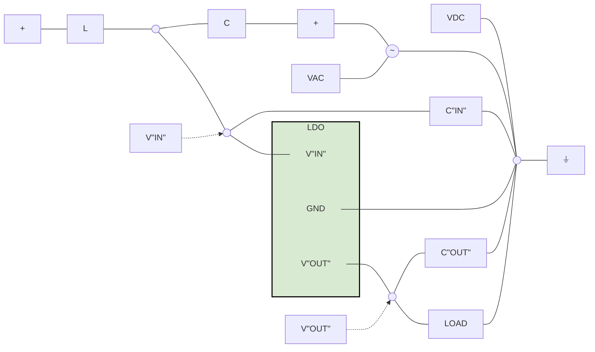
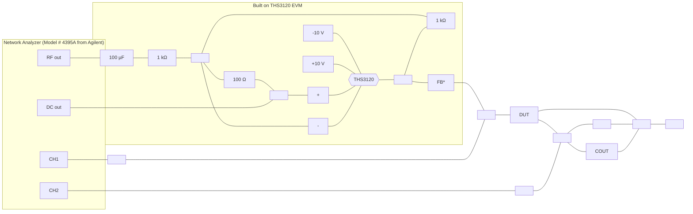

# LDO PSRR measurement simplified

<!-- Original PDF: SLAA414.pdf -->

<!-- PDF page 1 -->

# **LDO PSRR Measurement Simplified**

*Sanjay Pithadia, Scot Lester, and Ankur Verma*
*PMP - LP Linear Regulators*

## **ABSTRACT**

This application report explains different methods of measuring the Power Supply Rejection Ratio (PSRR) of a Low-Dropout (LDO) regulator and includes the pros and cons of these measuring methods.

<table>
  <caption>**Contents**</caption>
    <tr>
      <td>1</td>
      <td>What is PSRR? ..............................................................................................................</td>
      <td>1</td>
    </tr>
    <tr>
      <td>2</td>
      <td>Measuring PSRR of LDO ...................................................................................................</td>
      <td>2</td>
    </tr>
    <tr>
      <td>3</td>
      <td>Measuring PSRR Using Oscilloscope.....................................................................................</td>
      <td>4</td>
    </tr>
    <tr>
      <td>4</td>
      <td>Implications of the LDO Noise .............................................................................................</td>
      <td>5</td>
    </tr>
</table>

<table>
  <caption>**List of Figures**</caption>
    <tr>
      <td>1</td>
      <td>PSRR Graph of TPS717xx LDOs .........................................................................................</td>
      <td>2</td>
    </tr>
    <tr>
      <td>2</td>
      <td>Basic Method of Measuring PSRR of LDO...............................................................................</td>
      <td>2</td>
    </tr>
    <tr>
      <td>3</td>
      <td>Recommended Method of Measuring PSRR of LDO ...................................................................</td>
      <td>3</td>
    </tr>
    <tr>
      <td>4</td>
      <td>PSRR Measured With Recommended Method ..........................................................................</td>
      <td>4</td>
    </tr>
    <tr>
      <td>5</td>
      <td>Input and Output Waveforms for Measuring PSRR Using Oscilloscope .............................................</td>
      <td>5</td>
    </tr>
</table>

<table>
  <caption>**List of Tables**</caption>
</table>

## **Trademarks**

All trademarks are the property of their respective owners.

## **1 What is PSRR?**

Power Supply Rejection Ratio or Power Supply Ripple Rejection (PSRR) is a measure of a circuit’s power supply’s rejection expressed as a log ratio of output noise to input noise. PSRR provides a measure of how well a circuit rejects ripple, of various frequencies, injected at its input. The ripple can be either from the input supply such as a 50Hz/60Hz supply ripple, switching ripple from a DC/DC converter, or ripple due to the sharing of an input supply between different circuit blocks on the board. In the case of LDOs, PSRR is a measure of the regulated output voltage ripple compared to the input voltage ripple over a wide frequency range (10Hz to 1MHz is common) and is expressed in decibels (dB). The PSRR is very critical parameter in many audio and RF applications.

The basic equation for PSRR is:

$$PSRR = 20 \log \frac{\text{Ripple}_{\text{Input}}}{\text{Ripple}_{\text{Output}}}$$ (1)

Historically LDOs have poor high frequency PSRR performance, but currently TI has LDOs with PSRR > 40dB at 5MHz. One important point regarding the PSRR graphs in TI LDO datasheet is that the PSRR axis is inverted (See Figure 1). The PSRR is calculated as rejection so it should be a negative number; however, the graph shows it as positive number so that a higher number denotes higher noise rejection.

<!-- PDF page 2 -->

<table>
  <caption>Figure 1. PSRR Graph of TPS717xx LDOs; COUT = 1 µF, CNR = 10 nF</caption>
  <thead>
    <tr>
      <th rowspan="2">f - Frequency - Hz</th>
      <th colspan="3">PSRR - dB</th>
    </tr>
    <tr>
      <th>10 mA</th>
      <th>75 mA</th>
      <th>150 mA</th>
    </tr>
  </thead>
  <tbody>
    <tr>
      <th>10</th>
      <td>69</td>
      <td>71</td>
      <td>74</td>
    </tr>
    <tr>
      <th>100</th>
      <td>69</td>
      <td>71</td>
      <td>74</td>
    </tr>
    <tr>
      <th>1 k</th>
      <td>69</td>
      <td>71</td>
      <td>74</td>
    </tr>
    <tr>
      <th>10 k</th>
      <td>67</td>
      <td>69</td>
      <td>70</td>
    </tr>
    <tr>
      <th>100 k</th>
      <td>66</td>
      <td>68</td>
      <td>69</td>
    </tr>
    <tr>
      <th>200 k</th>
      <td>63</td>
      <td>66</td>
      <td>68</td>
    </tr>
    <tr>
      <th>300 k</th>
      <td>59</td>
      <td>62</td>
      <td>64</td>
    </tr>
    <tr>
      <th>400 k</th>
      <td>56</td>
      <td>58</td>
      <td>60</td>
    </tr>
    <tr>
      <th>500 k</th>
      <td>53</td>
      <td>55</td>
      <td>56</td>
    </tr>
    <tr>
      <th>600 k</th>
      <td>51</td>
      <td>52</td>
      <td>53</td>
    </tr>
    <tr>
      <th>700 k</th>
      <td>49</td>
      <td>50</td>
      <td>51</td>
    </tr>
    <tr>
      <th>800 k</th>
      <td>47</td>
      <td>48</td>
      <td>49</td>
    </tr>
    <tr>
      <th>900 k</th>
      <td>46</td>
      <td>47</td>
      <td>47</td>
    </tr>
    <tr>
      <th>1 M</th>
      <td>45</td>
      <td>46</td>
      <td>46</td>
    </tr>
    <tr>
      <th>2 M</th>
      <td>53</td>
      <td>45</td>
      <td>44</td>
    </tr>
    <tr>
      <th>3 M</th>
      <td>48</td>
      <td>42</td>
      <td>40</td>
    </tr>
    <tr>
      <th>4 M</th>
      <td>41</td>
      <td>36</td>
      <td>34</td>
    </tr>
    <tr>
      <th>5 M</th>
      <td>38</td>
      <td>32</td>
      <td>30</td>
    </tr>
    <tr>
      <th>6 M</th>
      <td>35</td>
      <td>30</td>
      <td>28</td>
    </tr>
    <tr>
      <th>7 M</th>
      <td>33</td>
      <td>28</td>
      <td>26</td>
    </tr>
    <tr>
      <th>8 M</th>
      <td>31</td>
      <td>27</td>
      <td>25</td>
    </tr>
    <tr>
      <th>9 M</th>
      <td>30</td>
      <td>26</td>
      <td>24</td>
    </tr>
    <tr>
      <th>10 M</th>
      <td>29</td>
      <td>25</td>
      <td>23</td>
    </tr>
  </tbody>
</table>

**Figure 1. PSRR Graph of TPS717xx LDOs**

# 2 **Measuring PSRR of LDO**

The following sections explain different methods of measuring the PSRR of an LDO.

1. Measuring PSRR using LC summing node method:

   The basic method of measuring PSRR is shown in Figure 2. In this method, DC voltage and AC voltages are summed together and applied at the input of the LDO. **VDC** is the operating point bias voltage and **VAC** is the noise source used in the test. Capacitor C prevents **VAC** from shoring **VDC** and inductor L prevents **VDC** from shorting **VAC**. So L and C are used for isolating both the sources, **VDC** and **VAC**, from each other.

   The L and C will create a high pass filter for **VAC** which will limit how low in frequency we can measure the PSRR. The 3dB point of this filter is determined by Equation 2. Frequencies below the 3dB point will start to be attenuated which will make measurements more difficult. The highest frequency that can be measured is determined by the self resonant frequencies of the L and C components.

   $$F_{min} = 1 / 2\pi\sqrt{LC}$$ (2)

   A drawback to this method is that it works well only for mid-range frequencies (approximately 1 kHz to 500 kHz).

Figure 2. Basic Method of Measuring PSRR of LDO

**Figure 2. Basic Method of Measuring PSRR of LDO**

2. Measuring PSRR using summing amplifier

   To improve the measurement of PSRR, a recommended method is described using a high-bandwidth amplifier as summing node to inject the signals and provides the isolation between **VAC** and **VDC**. This method is tested and verified using TPS72715 LDO and THS3120 high-speed amplifier from Texas

<!-- PDF page 3 -->

Instruments. The basic set-up is shown in Figure 3. The PSRR is measured with a no-load condition and the resulting measured PSRR graph corresponds with the datasheet graph of PSRR.

Keep in mind the following while measuring the PSRR using this method:

a. The input capacitor of LDO should be removed before the measurement because this capacitor could cause the high-speed amplifier to go unstable.
b. Vin and Vout should be measured with high-impedance probes (either scope or network analyzer) immediately at the Vin or Vout pins to minimize the set-up inductance effects.
c. There test set-up should not have any long wires since this will add inductance and impact the results.
d. While selecting the values of AC and DC inputs, the following conditions should be considered:
$V_{AC} (max) + V_{DC} < V_{ABS} (max)$ of LDO
$V_{DC} - V_{AC} > V_{UVLO}$ of LDO
Also, the best results will be obtained if:
$V_{DC} - V_{AC} > V_{out} + V_{do} + 0.5$ where $V_{out}$ is the output voltage of the LDO and $V_{do}$ is the specified drop out voltage at the operating point.
e. At very high frequencies, the response of the amplifier will start to attenuate the $V_{AC}$ signal that is applied to the LDO. At some point, the attenuated $V_{AC}$ will be too small to measure on the output of the LDO.
f. As load current increases, the open-loop output impedance of LDO decreases (Since a MOSFET output impedance is inversely proportional to the drain current), thus lowering the gain. Increasing the load current also pushes the output pole to higher frequencies, which increases the feedback loop bandwidth. The net effect of increasing the load is therefore reduced PSRR at lower frequencies (because of reduced gain) along with increased PSRR at higher frequencies.

High Impedance Adapters (Model # 41802A from **Agilent)**

**Notes:**

* **FB\*** $\rightarrow$ Ferrite Bead having impedance of **10 $\Omega$ @ 100 MHz**
* The dashed box represents the circuit **Built on THS3120 EVM**.
* The high impedance adapters are Model # 41802A from Agilent.

**Figure 3. Recommended Method of Measuring PSRR of LDO**

Figure 4 shows the PSRR graph measured with this method.

<!-- PDF page 4 -->

<table>
  <caption>Figure 4. PSRR Measurement With DC Source ON — CH1 A/B log MAG; 10 dB/ REF 0 dB; IF BW 2 Hz; POWER -5 dBm; SWP 376.1 sec; START 100 Hz; STOP 10 MHz</caption>
  <thead>
    <tr>
      <th>Frequency</th>
      <th>PSRR (dB)</th>
      <th>Notes</th>
    </tr>
  </thead>
  <tbody>
    <tr>
      <th>100 Hz</th>
      <td>-25</td>
      <td>START</td>
    </tr>
    <tr>
      <th>200 Hz</th>
      <td>-27</td>
      <td></td>
    </tr>
    <tr>
      <th>300 Hz</th>
      <td>-28</td>
      <td></td>
    </tr>
    <tr>
      <th>500 Hz</th>
      <td>-28</td>
      <td></td>
    </tr>
    <tr>
      <th>1 kHz</th>
      <td>-31</td>
      <td>Marker 0: 1.000894 kHz, -31.164 dB (relative to 40 dB offset)</td>
    </tr>
    <tr>
      <th>2 kHz</th>
      <td>-33</td>
      <td></td>
    </tr>
    <tr>
      <th>5 kHz</th>
      <td>-35</td>
      <td></td>
    </tr>
    <tr>
      <th>10 kHz</th>
      <td>-33</td>
      <td></td>
    </tr>
    <tr>
      <th>20 kHz</th>
      <td>-32</td>
      <td></td>
    </tr>
    <tr>
      <th>50 kHz</th>
      <td>-31</td>
      <td></td>
    </tr>
    <tr>
      <th>100 kHz</th>
      <td>-31</td>
      <td></td>
    </tr>
    <tr>
      <th>200 kHz</th>
      <td>-31</td>
      <td></td>
    </tr>
    <tr>
      <th>500 kHz</th>
      <td>-31</td>
      <td></td>
    </tr>
    <tr>
      <th>1 MHz</th>
      <td>-32</td>
      <td></td>
    </tr>
    <tr>
      <th>2 MHz</th>
      <td>-35</td>
      <td></td>
    </tr>
    <tr>
      <th>5 MHz</th>
      <td>-45</td>
      <td></td>
    </tr>
    <tr>
      <th>10 MHz</th>
      <td>-58</td>
      <td>STOP</td>
    </tr>
  </tbody>
</table>

**Figure 4. PSRR Measured With Recommended Method**

The THS3120 is suitable for measuring PSRR up to VDC = 5V, Frequency = 10MHz and Iload = 400mA.

# 3 **Measuring PSRR Using Oscilloscope**

If the user does not have a network analyzer then there is a simpler but more cumbersome method which uses a signal generator, DC source and oscilloscope to measure the PSRR. An AC signal from signal generator is applied along with DC signal at the input of the LDO, as shown in either of the afore mentioned methods, and the output of the LDO is measured on an oscilloscope at different VAC frequencies. The PSRR is calculated using the Equation 1 where Ripple(input) is the amplitude of the input AC signal and Ripple(output) is the amplitude of output signal. This is then repeated at different frequencies of VAC to generate a piecemeal graph of PSRR.

This method can be used along with the set-ups described in the previous section. But this method is only good for LDOs with lower PSRR values due to resolution and sensitivity of oscilloscopes. Since most oscilloscopes can measure down to the millivolt range, the maximum range of PSRR that could realistically be measured using an oscilloscope is about 40dB–50dB.

Using the TPS78101EVM from Texas Instruments, the PSRR is measured using signal generator and oscilloscope. The input and output waveforms are as shown in Figure 5:

Test conditions are:
a. Vout = 3V
b. Iload = 150mA
c. VAC = 1V (p-p) at 1kHz
d. VDC = 4.3V dc

<!-- PDF page 5 -->

<table>
  <caption>Figure 5. Input and Output Waveforms for Measuring PSRR Using Oscilloscope</caption>
  <thead>
    <tr>
      <th>Measure</th>
      <th>P1:freq(C2)</th>
      <th>P2:max(C2)</th>
      <th>P3:freq(C3)</th>
      <th>P4:max(C3)</th>
      <th>P5: - - -</th>
      <th>P6: - - -</th>
    </tr>
  </thead>
  <tbody>
    <tr>
      <th>value</th>
      <td>1.00152231 kHz</td>
      <td>194 mV</td>
      <td>998.94112 Hz</td>
      <td>984 mV</td>
      <td></td>
      <td></td>
    </tr>
    <tr>
      <th>status</th>
      <td>Warning</td>
      <td>OK</td>
      <td>OK</td>
      <td>OK</td>
      <td></td>
      <td></td>
    </tr>
  </tbody>
</table>

<table>
  <caption>Oscilloscope Channel and Timebase Settings for Figure 5</caption>
  <thead>
    <tr>
      <th>Channel / Setting</th>
      <th>Vertical Scale</th>
      <th>Offset</th>
      <th>Coupling / Bandwidth</th>
    </tr>
  </thead>
  <tbody>
    <tr>
      <th>C2 (Ripple(output))</th>
      <td>200 mV/div</td>
      <td>0.0 mV offset</td>
      <td>BwL AC1M</td>
    </tr>
    <tr>
      <th>C3 (Ripple(input))</th>
      <td>500 mV/div</td>
      <td>0 mV offset</td>
      <td>BwL AC1M</td>
    </tr>
  </tbody>
  <tfoot>
    <tr>
      <th colspan="4">Timebase &#x26; Trigger Settings</th>
    </tr>
    <tr>
      <th>Timebase</th>
      <td colspan="3">0.00 ms; 1.00 ms/div; 2.00 MS; 200 MS/s</td>
    </tr>
    <tr>
      <th>Trigger</th>
      <td colspan="3">C1 DC; 3.00 V; Stop; Edge Positive</td>
    </tr>
  </tfoot>
</table>

**Figure 5. Input and Output Waveforms for Measuring PSRR Using Oscilloscope**

And the PSRR is calculated from waveforms in Figure 5 is:

$Ripple_{(input)} = 984\text{ mV}$
$Ripple_{(output)} = 194\text{ mV}$
$PSRR = 20\text{ }log_{10}(Ripple_{(input)} / Ripple_{(output)}) = 20\text{ }log_{10}(0.984 / 0.194) = 14.10\text{dB}$ which closely matches the PSRR specified in the datasheet of TPS78101.

This application report shows various methods to measure the PSRR of an LDO and also explains different aspects which need to be considered while measuring PSRR.

## 4 Implications of the LDO Noise

Let us take an example of a DC-DC Converter with integrated LDOs (such as TPS57140-Q1).

The bandgap noise that is internal to the LDO regulator becomes a limiting factor in the rejection of high frequency components. One of the example where its bad affect can be seen is when a a fast-falling input transient is applied at the input of the DC/DC converter. During the fast input falling edge, if the slew rate of the input is higher than a particular value, the internal LDO regulator of the device resets because of the power-supply rejection-ratio (PSRR) limitation. The fast transition corresponds to higher frequencies. The bandgap noise that is internal to the LDO regulator becomes a limiting factor in the rejection of high frequency components. For example, using the TPS57140-Q1 design simulation and bench test measurement, the resulting slew-rate value measured is 1.2 V/μs. If the slew rate is higher than this value, the device gets disabled and regenerates a soft start. Higher ESR of the input capacitor negatively affects the slew rate of the input voltage and the duration of this rate because of high current transient across the ESR according to ESR × C × dV/dt. Therefore, the use of a low-ESR ceramic capacitor is recommended.

Refer to *Design Considerations for DC-DC Converters in Fast-Input Slew Rate Applications* (SLVA693) for more information

<!-- PDF page 6 -->

# **Revision History**

NOTE: Page numbers for previous revisions may differ from page numbers in the current version.

<table>
  <thead>
    <tr>
      <th><b>Changes from Original (July 2009) to A Revision</b></th>
      <th>Page</th>
    </tr>
  </thead>
  <tbody>
    <tr>
      <td>• Added <i>Implications of the LDO Noise</i> section ...........................................................................................................</td>
      <td>5</td>
    </tr>
  </tbody>
</table>

<!-- PDF page 7 -->

## **IMPORTANT NOTICE FOR TI DESIGN INFORMATION AND RESOURCES**

Texas Instruments Incorporated (“TI”) technical, application or other design advice, services or information, including, but not limited to, reference designs and materials relating to evaluation modules, (collectively, “TI Resources”) are intended to assist designers who are developing applications that incorporate TI products; by downloading, accessing or using any particular TI Resource in any way, you (individually or, if you are acting on behalf of a company, your company) agree to use it solely for this purpose and subject to the terms of this Notice.

TI’s provision of TI Resources does not expand or otherwise alter TI’s applicable published warranties or warranty disclaimers for TI products, and no additional obligations or liabilities arise from TI providing such TI Resources. TI reserves the right to make corrections, enhancements, improvements and other changes to its TI Resources.

You understand and agree that you remain responsible for using your independent analysis, evaluation and judgment in designing your applications and that you have full and exclusive responsibility to assure the safety of your applications and compliance of your applications (and of all TI products used in or for your applications) with all applicable regulations, laws and other applicable requirements. You represent that, with respect to your applications, you have all the necessary expertise to create and implement safeguards that (1) anticipate dangerous consequences of failures, (2) monitor failures and their consequences, and (3) lessen the likelihood of failures that might cause harm and take appropriate actions. You agree that prior to using or distributing any applications that include TI products, you will thoroughly test such applications and the functionality of such TI products as used in such applications. TI has not conducted any testing other than that specifically described in the published documentation for a particular TI Resource.

You are authorized to use, copy and modify any individual TI Resource only in connection with the development of applications that include the TI product(s) identified in such TI Resource. NO OTHER LICENSE, EXPRESS OR IMPLIED, BY ESTOPPEL OR OTHERWISE TO ANY OTHER TI INTELLECTUAL PROPERTY RIGHT, AND NO LICENSE TO ANY TECHNOLOGY OR INTELLECTUAL PROPERTY RIGHT OF TI OR ANY THIRD PARTY IS GRANTED HEREIN, including but not limited to any patent right, copyright, mask work right, or other intellectual property right relating to any combination, machine, or process in which TI products or services are used. Information regarding or referencing third-party products or services does not constitute a license to use such products or services, or a warranty or endorsement thereof. Use of TI Resources may require a license from a third party under the patents or other intellectual property of the third party, or a license from TI under the patents or other intellectual property of TI.

TI RESOURCES ARE PROVIDED “AS IS” AND WITH ALL FAULTS. TI DISCLAIMS ALL OTHER WARRANTIES OR REPRESENTATIONS, EXPRESS OR IMPLIED, REGARDING TI RESOURCES OR USE THEREOF, INCLUDING BUT NOT LIMITED TO ACCURACY OR COMPLETENESS, TITLE, ANY EPIDEMIC FAILURE WARRANTY AND ANY IMPLIED WARRANTIES OF MERCHANTABILITY, FITNESS FOR A PARTICULAR PURPOSE, AND NON-INFRINGEMENT OF ANY THIRD PARTY INTELLECTUAL PROPERTY RIGHTS.

TI SHALL NOT BE LIABLE FOR AND SHALL NOT DEFEND OR INDEMNIFY YOU AGAINST ANY CLAIM, INCLUDING BUT NOT LIMITED TO ANY INFRINGEMENT CLAIM THAT RELATES TO OR IS BASED ON ANY COMBINATION OF PRODUCTS EVEN IF DESCRIBED IN TI RESOURCES OR OTHERWISE. IN NO EVENT SHALL TI BE LIABLE FOR ANY ACTUAL, DIRECT, SPECIAL, COLLATERAL, INDIRECT, PUNITIVE, INCIDENTAL, CONSEQUENTIAL OR EXEMPLARY DAMAGES IN CONNECTION WITH OR ARISING OUT OF TI RESOURCES OR USE THEREOF, AND REGARDLESS OF WHETHER TI HAS BEEN ADVISED OF THE POSSIBILITY OF SUCH DAMAGES.

You agree to fully indemnify TI and its representatives against any damages, costs, losses, and/or liabilities arising out of your non-compliance with the terms and provisions of this Notice.

This Notice applies to TI Resources. Additional terms apply to the use and purchase of certain types of materials, TI products and services. These include; without limitation, TI’s standard terms for semiconductor products <u>http://www.ti.com/sc/docs/stdterms.htm</u>), <u>evaluation modules</u>, and samples (<u>http://www.ti.com/sc/docs/sampterms.htm</u>).

Mailing Address: Texas Instruments, Post Office Box 655303, Dallas, Texas 75265
Copyright © 2018, Texas Instruments Incorporated
