# Fundamentals of precision ADC noise analysis

<!-- Original PDF: SLYY192.pdf -->


<!-- PDF page 1 -->


# Fundamentals of Precision ADC

# Noise Analysis


<!-- PDF page 2 -->


## **About the author**

photo: Bryan Lizon

Bryan Lizon is a product marketing engineer for the Precision Analog-to-Digital Converter (ADC) team at Texas Instruments (TI). In this role, Bryan has been responsible for the marketing functions for TI’s factory automation and control, test and measurement, medical and automotive ADCs. He joined TI in 2014 as part of the Precision ADC team after receiving his Bachelor of Science degree in electrical engineering from the University of Arizona.

Bryan became interested in the topic of ADC noise soon after joining the ADC team, seeing that many disparate questions seemed like they could be traced back to challenges with noise, precision and resolution. Specifically, he found many customers had difficulty understanding the relationship between noise and gain, as well as how that related to data-sheet performance. To explore this relationship further and provide insight to engineers, Bryan wrote and illustrated a three-part **blog** post series framed as a whodunit mystery. From there, he took a more technical approach and expanded this topic to include multiple noise sources and how they interact with precision ADCs. Bryan turned this content into an internal presentation to educate TI’s sales team, followed by an online series of 12 articles, which TI assembled into this e-book.

### **Other contributors include:**

Christopher Hall, applications engineer, Precision ADCs

Ryan Andrews, applications engineer, Precision ADCs

Joachim Wuerker, systems manager, Precision ADCs


<!-- PDF page 3 -->


When I first began working in the semiconductor industry, I had never heard of a delta-sigma analog-to-digital converter (ADC). My university training focused heavily on digital design, and the only ADCs we used were low-resolution successive-approximation-register (SAR) ADCs integrated into microcontrollers (MCUs). As a result, it was somewhat daunting to be assigned to the Precision ADC team, where digital knowledge is certainly useful, but analog design is king. As my training ramped up, I noticed that despite a variety of issues that engineers raised, many of their challenges arose from what seemed like a very obvious question: How do you get the best noise performance out of a 16-bit, 24-bit or even 32-bit ADC?

Now, I should note that this is a simple question with a complicated answer. And as is typical for most engineering questions, the answer is “It depends.” “Depends on what?” you might ask—and exploring that question is the basis for this e-book. What affects a high-resolution ADC’s noise performance? How does each component contribute noise to the system, and how do these noise sources interact with each other? Which noise source dominates, and how do you apply these principles to your specific application?

If you’ve ever been tasked with designing a signal chain that uses a delta-sigma ADC, you have likely had to ask yourself these questions. Regardless of your efforts to minimize power consumption, decrease board space or reduce cost, noise levels greater than the input signals render any design effectively useless. As a result, this e-book is designed to provide fundamental knowledge to help any analog designer understand signal-chain noise, its effect on analog-to-digital conversion, and how to minimize its impact and maintain high-precision measurements. I will examine common noise sources in a typical signal chain and complement this understanding with methods to mitigate noise and maintain high-precision measurements.

Before continuing, I’d like to mention that this e-book covers precision (noise), not accuracy. While the two terms are often used interchangeably, they refer to different—though related—aspects of signal-chain design. When designing high-performance data-acquisition systems, you must also consider errors due to inaccuracy, such as offset, gain error, integral nonlinearity and drift, in addition to minimizing noise.


<!-- PDF page 4 -->


## Chapter 1: Introduction to ADC noise

Chapter 1 encompasses three sections. In **Section 3.1**, I’ll focus on analog-to-digital converter (ADC) noise fundamentals while answering questions and discussing topics such as:

* What is noise?
* Where does noise come from in a typical signal chain?
* Understanding inherent noise in ADCs.
* How is noise different in high-resolution vs. low-resolution ADCs?

In **Section 3.2**, I’ll shift the focus to these topics:

* Measuring ADC noise.
* Noise specifications in ADC data sheets.
* Absolute vs. relative noise parameters.

In **Section 3.3**, I’ll step through a complete design example, using a resistive bridge to help illustrate how the theories from **Section 3.1** and **Section 3.2** apply to a real-world application.

**Types of ADC noise**  • **ADC noise measurement methods and parameters** • **Defining system noise performance** •


<!-- PDF page 5 -->


## Types of ADC noise

Noise is any undesired signal (typically random) that adds to the desired signal, causing it to deviate from its original value. Noise is inherent in all electrical systems, so there is no such thing as a “noise-free” circuit.

**Figure 1** depicts how you might experience noise in the real world: an image with the noise filtered out and that same image with no filtering. Note the crisp detail in **Figure 1**a, while **Figure 1**b is almost completely obscured. In the analog-to-digital conversion process, the result would be information loss between the analog input and the digital output—much like how the two images in **Figure 1** bear virtually no resemblance to each other.

In electronic circuits, noise comes in many forms, including:

* **Broadband (thermal, Johnson) noise**, which is temperature-dependent noise caused by the physical movement of charge inside electrical conductors.
* **1/f (pink, flicker) noise**, which is low-frequency noise that has a power density inversely proportional to frequency.
* **Popcorn (burst) noise**, which is low frequency in nature and caused by device defects, making it random and mathematically unpredictable.


**(a) High-resolution image example**


**(b) Noisy image example**

**Figure 1.** *A noise-free image (a) and the same image with noise (b)*

These forms of noise may enter the signal chain through multiple sources, including:

* **ADCs**, which contribute a combination of thermal noise and quantization noise.
* **Internal or external amplifiers**, which can add broadband and 1/f noise that the ADC then samples, allowing it to affect the output code result.


<!-- PDF page 6 -->


* **Internal or external voltage references**, which also contribute broadband and 1/f noise that appears in the ADC’s output code.
* **Nonideal power supplies**, which may add noise into the signal you’re trying to measure with several means of coupling.
* **Internal or external clocks**, which contribute jitter that translates into nonuniform sampling. This appears as an additional noise source for sinusoidal input signals and is generally more critical for higher-speed ADCs.
* **Poor printed circuit board (PCB) layouts**, which can couple noise from other parts of the system or environment into sensitive analog circuitry.
* **Sensors**, which can be one of the noisiest components in high-resolution systems.

**Figure 2** depicts these noise sources in a typical signal chain.

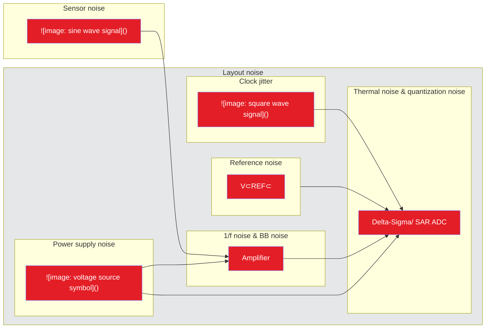

**Figure 2.** *Common noise sources in a typical signal chain*

In the three sections that make up Chapter 1, I’ll focus on inherent ADC noise only. For a more comprehensive understanding of signal-chain noise, Chapters 3–6 discuss sources of noise in the remaining circuit components.

### *Inherent noise in ADCs*

You can categorize total ADC noise into two main sources: quantization noise and thermal noise. These two noise sources are uncorrelated, which enables the root-sum-square method to determine the total ADC noise, $N_{ADC,Total}$, as shown in **Equation 1**:

$$N_{ADC,Total} = \sqrt{N_{ADC,Thermal}^2 + N_{ADC,Quantization}^2} \hfill (1)$$

Each ADC noise source has particular properties that are important when understanding how to mitigate inherent ADC noise.

**Figure 3** depicts the plot of an ADC’s ideal transfer function (unaffected by offset or gain error). The transfer function extends from the minimum input voltage to the maximum input voltage horizontally and is divided into a number of steps based off the total number of ADC codes along the vertical axis. This particular plot has 16 codes (or steps), representing a 4-bit ADC. (Note: An ADC using straight binary code would have a transfer function that only includes the first quadrant.)


<!-- PDF page 7 -->


This is a diagram of an ADC ideal transfer function showing the relationship between input voltage and output code.

* **Y-axis:** Output code
  * Positive values: 0001, 0010, 0011, 0100, 0101, 0110, 0111
  * Negative values: 1111, 1110, 1101, 1100, 1011, 1010, 1001, 1000
* **X-axis:** Input voltage
  * Range: $-FS$ to $+FS$
* **Transfer Function:** A staircase function (teal line) representing the quantization levels.
* **Annotations:**
  * **Code clipped:** Indicated at both the maximum positive and maximum negative output levels.
  * **LSB size:** The width of one step is labeled as $\text{LSB size} = \frac{\text{FSR}}{2^N}$.
  * **Total codes:** A red bracket on the left indicates the full vertical range represents $2^N$ codes.

**Figure 3.** *An ADC’s ideal transfer function*

Quantization noise comes from the process of mapping an infinite number of analog voltages to a finite number of digital codes. As a result, any single digital output can correspond to several analog input voltages that may differ by as much as ½ least significant bit (LSB), which is defined in **Equation 2**:

$$LSB\ size\ (N) = \frac{FSR}{2^N}$$ (2)

where FSR represents the value of the full-scale range (FSR) in volts and N is the ADC’s resolution.

If you map this LSB error relative to a quantized AC signal, you’ll get a plot like the one shown in **Figure 4**. Note the dissimilarity between the quantized, stair-step-shaped digital output and the smooth, sinusoidal analog input. Taking the difference between these two waveforms and plotting the result yields the sawtooth-shaped error shown at the bottom of **Figure 4**. This error varies between ±½ LSB and appears as noise in the result.

<table>
  <caption>Figure 4. Analog input, digital output and LSB error waveforms — panels: Signal (V), LSB error; series: Analog, Digital; x-axis: Sample #</caption>
  <thead>
    <tr>
      <th>Sample #</th>
      <th>Signal (V): Analog</th>
      <th>Signal (V): Digital</th>
      <th>LSB error</th>
    </tr>
  </thead>
  <tbody>
    <tr>
      <th>0</th>
      <td>0.00</td>
      <td>0.00</td>
      <td>0.00</td>
    </tr>
    <tr>
      <th>25</th>
      <td>0.16</td>
      <td>0.25</td>
      <td>0.41</td>
    </tr>
    <tr>
      <th>50</th>
      <td>0.31</td>
      <td>0.25</td>
      <td>-0.28</td>
    </tr>
    <tr>
      <th>75</th>
      <td>0.45</td>
      <td>0.50</td>
      <td>0.23</td>
    </tr>
    <tr>
      <th>100</th>
      <td>0.59</td>
      <td>0.50</td>
      <td>-0.40</td>
    </tr>
    <tr>
      <th>125</th>
      <td>0.71</td>
      <td>0.75</td>
      <td>0.20</td>
    </tr>
    <tr>
      <th>150</th>
      <td>0.81</td>
      <td>0.75</td>
      <td>-0.26</td>
    </tr>
    <tr>
      <th>175</th>
      <td>0.89</td>
      <td>1.00</td>
      <td>0.49</td>
    </tr>
    <tr>
      <th>200</th>
      <td>0.95</td>
      <td>1.00</td>
      <td>0.22</td>
    </tr>
    <tr>
      <th>250</th>
      <td>1.00</td>
      <td>1.00</td>
      <td>0.00</td>
    </tr>
    <tr>
      <th>300</th>
      <td>0.95</td>
      <td>1.00</td>
      <td>-0.22</td>
    </tr>
    <tr>
      <th>325</th>
      <td>0.89</td>
      <td>1.00</td>
      <td>-0.49</td>
    </tr>
    <tr>
      <th>350</th>
      <td>0.81</td>
      <td>0.75</td>
      <td>0.26</td>
    </tr>
    <tr>
      <th>375</th>
      <td>0.71</td>
      <td>0.75</td>
      <td>-0.20</td>
    </tr>
    <tr>
      <th>400</th>
      <td>0.59</td>
      <td>0.50</td>
      <td>0.40</td>
    </tr>
    <tr>
      <th>425</th>
      <td>0.45</td>
      <td>0.50</td>
      <td>-0.23</td>
    </tr>
    <tr>
      <th>450</th>
      <td>0.31</td>
      <td>0.25</td>
      <td>0.28</td>
    </tr>
    <tr>
      <th>475</th>
      <td>0.16</td>
      <td>0.25</td>
      <td>-0.41</td>
    </tr>
    <tr>
      <th>500</th>
      <td>0.00</td>
      <td>0.00</td>
      <td>0.00</td>
    </tr>
    <tr>
      <th>525</th>
      <td>-0.16</td>
      <td>-0.25</td>
      <td>0.41</td>
    </tr>
    <tr>
      <th>550</th>
      <td>-0.31</td>
      <td>-0.25</td>
      <td>-0.28</td>
    </tr>
    <tr>
      <th>575</th>
      <td>-0.45</td>
      <td>-0.50</td>
      <td>0.23</td>
    </tr>
    <tr>
      <th>600</th>
      <td>-0.59</td>
      <td>-0.50</td>
      <td>-0.40</td>
    </tr>
    <tr>
      <th>625</th>
      <td>-0.71</td>
      <td>-0.75</td>
      <td>0.20</td>
    </tr>
    <tr>
      <th>650</th>
      <td>-0.81</td>
      <td>-0.75</td>
      <td>-0.26</td>
    </tr>
    <tr>
      <th>675</th>
      <td>-0.89</td>
      <td>-1.00</td>
      <td>0.49</td>
    </tr>
    <tr>
      <th>700</th>
      <td>-0.95</td>
      <td>-1.00</td>
      <td>0.22</td>
    </tr>
    <tr>
      <th>750</th>
      <td>-1.00</td>
      <td>-1.00</td>
      <td>0.00</td>
    </tr>
    <tr>
      <th>800</th>
      <td>-0.95</td>
      <td>-1.00</td>
      <td>-0.22</td>
    </tr>
    <tr>
      <th>825</th>
      <td>-0.89</td>
      <td>-1.00</td>
      <td>-0.49</td>
    </tr>
    <tr>
      <th>850</th>
      <td>-0.81</td>
      <td>-0.75</td>
      <td>0.26</td>
    </tr>
    <tr>
      <th>875</th>
      <td>-0.71</td>
      <td>-0.75</td>
      <td>-0.20</td>
    </tr>
    <tr>
      <th>900</th>
      <td>-0.59</td>
      <td>-0.50</td>
      <td>0.40</td>
    </tr>
    <tr>
      <th>925</th>
      <td>-0.45</td>
      <td>-0.50</td>
      <td>-0.23</td>
    </tr>
    <tr>
      <th>950</th>
      <td>-0.31</td>
      <td>-0.25</td>
      <td>0.28</td>
    </tr>
    <tr>
      <th>975</th>
      <td>-0.16</td>
      <td>-0.25</td>
      <td>-0.41</td>
    </tr>
    <tr>
      <th>1000</th>
      <td>0.00</td>
      <td>0.00</td>
      <td>0.00</td>
    </tr>
  </tbody>
</table>

**Figure 4.** *Analog input, digital output and LSB error waveforms.*

Similarly, for DC signals, the error associated with quantization varies between ±½ LSB of the input signal. However, since DC signals have no frequency component, quantization “noise” actually appears as an offset error in the ADC output.


<!-- PDF page 8 -->


Finally, an obvious but important result of quantization noise is that the ADC cannot measure beyond its resolution, as it cannot distinguish between sub-LSB changes in the input.

Unlike quantization noise, which is a byproduct of the analog-to-digital (or digital-to-analog) conversion process, thermal noise is a phenomenon inherent in all electrical components as a result of the physical movement of charge inside electrical conductors. Therefore, you can measure thermal noise even without applying an input signal.

Unfortunately, you cannot affect your ADC’s thermal noise because it is a function of the device design. Throughout the rest of this section, I’ll refer to all ADC noise sources other than quantization noise as the ADC’s thermal noise.

**Figure 5** depicts thermal noise in the time domain, which typically has a Gaussian distribution.

<table>
  <caption>Figure 5. Thermal noise in the time domain with Gaussian distribution. — Panel: Noise distribution; Voltage (V) vs. # of samples</caption>
  <thead>
    <tr>
      <th>Voltage (V)</th>
      <th># of samples</th>
    </tr>
  </thead>
  <tbody>
    <tr>
      <th>0.04</th>
      <td>0</td>
    </tr>
    <tr>
      <th>0.03</th>
      <td>10</td>
    </tr>
    <tr>
      <th>0.02</th>
      <td>35</td>
    </tr>
    <tr>
      <th>0.01</th>
      <td>95</td>
    </tr>
    <tr>
      <th>0</th>
      <td>150</td>
    </tr>
    <tr>
      <th>-0.01</th>
      <td>95</td>
    </tr>
    <tr>
      <th>-0.02</th>
      <td>35</td>
    </tr>
    <tr>
      <th>-0.03</th>
      <td>10</td>
    </tr>
    <tr>
      <th>-0.04</th>
      <td>0</td>
    </tr>
  </tbody>
</table>

***Figure 5.** Thermal noise in the time domain with Gaussian distribution.*

Although you cannot affect the ADC’s inherent thermal noise, you can potentially change the ADC’s level of quantization noise due to its dependence on LSB size. Quantifying the significance of this change depends on whether you’re using a “low-resolution” or “high-resolution” ADC, however. Let’s quickly define these two terms so that you can better understand how to use LSB size and quantization noise to your advantage.

### *Low- vs. high-resolution ADCs*

A low-resolution ADC is any device whose total noise is more dependent on quantization noise such that N<sub>ADC,Quantization</sub> >> N<sub>ADC,Thermal</sub>. Conversely, a high-resolution ADC is any device whose total noise is more dependent on thermal noise, such that N<sub>ADC,Quantization</sub> << N<sub>ADC,Thermal</sub>. The transition between low and high resolution typically occurs at the 16-bit level, with anything <16 bits considered low resolution and anything >16 bits considered high resolution. While not always true, I’ll keep this general convention throughout the remainder of this e-book.

Why make the distinction at the 16-bit level? Let’s look at two ADC data sheets to find out. **Table 1**a shows the actual noise tables for the TI **ADS114S08** , a 16-bit delta-sigma ADC, while **Table 1**b shows the noise tables for its 24-bit counterpart, the **ADS124S08** . Other than their resolutions, these ADCs are identical.


<!-- PDF page 9 -->


<table>
  <caption>Table 1. Input-referred noise for the 16-bit ADS114S08 (a) and 24-bit ADS124S08 (b) in µV<sub>RMS</sub> (µV<sub>PP</sub>) at V<sub>REF</sub> = 2.5 V, G = 1 V/V.</caption>
  <thead>
    <tr>
      <th rowspan="2">Data Rate (SPS)</th>
      <th>Gain</th>
      <th rowspan="2">Data Rate (SPS)</th>
      <th>Gain</th>
    </tr>
    <tr>
      <th>1</th>
      <th>1</th>
    </tr>
  </thead>
  <tbody>
    <tr>
      <td>2.5</td>
      <td>76.3 (76.3)</td>
      <td>2.5</td>
      <td>0.32 (1.8)</td>
    </tr>
    <tr>
      <td>5</td>
      <td>76.3 (76.3)</td>
      <td>5</td>
      <td>0.40 (2.4)</td>
    </tr>
    <tr>
      <td>10</td>
      <td>76.3 (76.3)</td>
      <td>10</td>
      <td>0.53 (3.0)</td>
    </tr>
    <tr>
      <td>16.6</td>
      <td>76.3 (76.3)</td>
      <td>16.6</td>
      <td>0.76 (7.2)</td>
    </tr>
    <tr>
      <td>20</td>
      <td>76.3 (76.3)</td>
      <td>20</td>
      <td>0.81 (4.8)</td>
    </tr>
    <tr>
      <td>50</td>
      <td>76.3 (76.3)</td>
      <td>50</td>
      <td>1.3 (7.2)</td>
    </tr>
    <tr>
      <td>60</td>
      <td>76.3 (76.3)</td>
      <td>60</td>
      <td>1.4 (8.0)</td>
    </tr>
    <tr>
      <td>100</td>
      <td>76.3 (76.3)</td>
      <td>100</td>
      <td>1.8 (9.2)</td>
    </tr>
    <tr>
      <td>200</td>
      <td>76.3 (76.3)</td>
      <td>200</td>
      <td>2.4 (13)</td>
    </tr>
    <tr>
      <td>400</td>
      <td>76.3 (76.3)</td>
      <td>400</td>
      <td>3.6 (19)</td>
    </tr>
    <tr>
      <td>800</td>
      <td>76.3 (76.3)</td>
      <td>800</td>
      <td>5.0 (29)</td>
    </tr>
    <tr>
      <td>1000</td>
      <td>76.3 (76.3)</td>
      <td>1000</td>
      <td>6.0 (32)</td>
    </tr>
    <tr>
      <td>2000</td>
      <td>76.3 (76.3)</td>
      <td>2000</td>
      <td>7.8 (45)</td>
    </tr>
    <tr>
      <td>4000</td>
      <td>76.3 (95)</td>
      <td>4000</td>
      <td>15 (95)</td>
    </tr>
    <tr>
      <td colspan="2">(a)</td>
      <td colspan="2">(b)</td>
    </tr>
  </tbody>
</table>

In the noise table for the 16-bit ADS114S08, all of the input-referred noise voltages are the same regardless of data rate. Compare that to the 24-bit ADS124S08’s input-referred noise values, which are all different and decrease/improve with decreasing data rates.

While this doesn’t result in any definitive conclusions by itself, let’s use **Equation 3** and **Equation 4** to calculate the LSB size for each ADC, assuming a 2.5-V reference voltage:

$$LSB_{ADS114S08} = \frac{2 \times V_{REF}}{2^N} = \frac{2 \times 2.5}{2^{16}} = 76.3 \mu V \tag{3}$$

$$LSB_{ADS124S08} = \frac{2 \times V_{REF}}{2^N} = \frac{2 \times 2.5}{2^{24}} = 0.298 \mu V \tag{4}$$

Combining these observations, you can see that the low-resolution (16-bit) ADC’s noise performance as reported in its data sheet is equivalent to its LSB size (maximum quantization noise). On the other hand, the noise reported in the high-resolution (24-bit) ADC’s data sheet is clearly much larger than its LSB size (quantization noise). In this case, the high-resolution ADC’s quantization noise is so low that it’s effectively hidden by the thermal noise. **Figure 6** represents this comparison qualitatively.

<table>
  <caption>Figure 6. Qualitative representation of quantization noise and thermal noise in low- (a) and high-resolution (b) ADCs.</caption>
  <thead>
    <tr>
      <th>ADC Type</th>
      <th>Noise Component</th>
      <th>Qualitative Level</th>
    </tr>
  </thead>
  <tbody>
    <tr>
      <th rowspan="2">Low-resolution ADCs (a)</th>
      <th>Quantization</th>
      <td>High</td>
    </tr>
    <tr>
      <th>Thermal</th>
      <td>Medium</td>
    </tr>
    <tr>
      <th rowspan="2">High-resolution ADCs (b)</th>
      <th>Quantization</th>
      <td>Low</td>
    </tr>
    <tr>
      <th>Thermal</th>
      <td>Medium</td>
    </tr>
  </tbody>
</table>


<!-- PDF page 10 -->


How can you use this result to your advantage? For low-resolution ADCs where quantization noise dominates, you can use a smaller reference voltage to reduce the LSB size, which reduces the quantization noise amplitude. This has the effect of lowering the ADC’s total noise, represented by **Figure 7a**.

For high-resolution ADCs where thermal noise dominates, use a larger reference voltage to increase the input range (dynamic range) of the ADC, while ensuring that the quantization noise level remains below the thermal noise. Assuming no other system changes, this increased reference voltage enables a better signal-to-noise ratio, which you can see in **Figure 7b**.

<table>
  <caption>Figure 7. Adjusting quantization noise in low- (a) and high-resolution (b) ADCs to improve performance.</caption>
  <thead>
    <tr>
      <th rowspan="2">ADC Type</th>
      <th colspan="2">Noise Component</th>
      <th rowspan="2">Adjustment Note</th>
    </tr>
    <tr>
      <th>Quantization</th>
      <th>Thermal</th>
    </tr>
  </thead>
  <tbody>
    <tr>
      <th>(a) Low-resolution ADCs</th>
      <td>High</td>
      <td>Medium</td>
      <td>Quantization noise is reduced to match thermal noise floor</td>
    </tr>
    <tr>
      <th>(b) High-resolution ADCs</th>
      <td>Low</td>
      <td>Medium</td>
      <td>Quantization noise is increased to match thermal noise floor</td>
    </tr>
  </tbody>
</table>

Now that you understand the components of ADC noise and how they vary between high- and low-resolution ADCs, let’s build on that knowledge.

## **Key takeaways**

Here is a summary of important points to better understand types of ADC noise:

1. Noise is inherent in all electrical systems.
2. Noise is introduced via all signal chain components.
3. There are two main types of ADC noise:
   * Quantization noise, which scales with the reference voltage.
   * Thermal noise, which is a fixed value for a given ADC.
4. One type of noise generally dominates depending on the ADC’s resolution:
   * High-resolution ADC characteristics:
     * Thermal noise-dominated.
     * The resolution is typically >1 LSB.
     * Increase the reference voltage to increase the dynamic range.
   * Low-resolution ADC characteristics:
     * Quantization noise-dominated.
     * The resolution is typically limited by LSB size.
     * Decrease the reference voltage to decrease the quantization noise and increase the resolution.


<!-- PDF page 11 -->


## **ADC noise measurement methods and parameters**

Before I explain how ADC noise is measured, it’s important to understand that when you look at ADC data-sheet specifications, the goal is to characterize the ADC, not the system. As a result, the way that ADC manufacturers test ADC noise and the test system itself should demonstrate the capabilities of the ADC, not the limitations of the testing system. Therefore, using the ADC in a different system or under different conditions may lead to noise performance that varies from what the data-sheet reports.

There are two methods ADC manufacturers use to measure ADC noise. The first method shorts the ADC’s inputs together to measure slight variations in output code as a result of thermal noise. The second method involves inputting a sine wave with a specific amplitude and frequency (such as 1 V<sub>PP</sub> at 1 kHz) and reporting how the ADC quantizes the sine wave. **Figure 8** demonstrates these types of noise measurements.

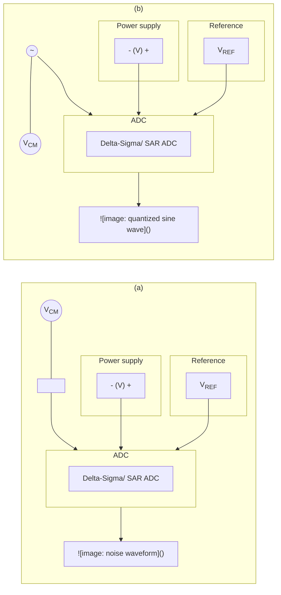

**Figure 8.** *Input-short test setup (a) and sine-wave-input test setup (b).*

Typically, ADC manufacturers choose an individual ADC’s noise measurement method based on its target end application(s). For example, delta-sigma ADCs that measure slow-moving signals such as temperature or weight use the input-short test, which precisely measures performance at DC. Delta-sigma ADCs used in high-speed data-acquisition systems generally rely on the sine-wave-input method, where AC performance is critical. For many ADCs, the data sheet specifies both types of measurements.

For example, the 24-bit **ADS127L01** from TI has a high maximum sampling rate of 512 kSPS and a low pass-band ripple wideband filter, both of which enable high-resolution AC signal sampling for test and measurement equipment. However, these applications often require accurate measurement of the signal’s DC component as well. As a result, TI characterizes not only the ADC’s performance with a range of AC input signals at multiple sample rates, but also the ADS127L01’s DC performance using the input-short test.

### ***Noise specifications in ADC data sheets***

If you look at the ADS127L01’s data sheet—or almost any ADC data sheet, for that matter—you’ll see noise performance reported in two forms: graphically and numerically. *Figure 9* shows a fast Fourier transform (FFT) of the ADS127L01’s noise performance using an input sine wave with an amplitude of –0.5 dbFS and a 4-kHz frequency. This plot makes it possible to calculate and report important AC parameters such as the signal-to-noise ratio (SNR), total harmonic distortion (THD), signal-to-noise ratio and distortion (SINAD) and effective number of bits (ENOB).


<!-- PDF page 12 -->


<table>
  <caption>Figure 9. Example ADS127L01 FFT with a 4-kHz, –0.5-dBFS input signal. Conditions: f<sub>IN</sub> = 4 kHz, V<sub>IN</sub> = –0.5 dBFS, HR mode, WB2, 512 kSPS, 32768 samples.</caption>
  <thead>
    <tr>
      <th>Frequency (kHz)</th>
      <th>Signal (dB)</th>
      <th>Harmonics (dB)</th>
      <th>Noise floor (dB)</th>
    </tr>
  </thead>
  <tbody>
    <tr>
      <th>0</th>
      <td></td>
      <td></td>
      <td>-135</td>
    </tr>
    <tr>
      <th>4</th>
      <td>-0.5</td>
      <td></td>
      <td>-135</td>
    </tr>
    <tr>
      <th>8</th>
      <td></td>
      <td>-125</td>
      <td>-135</td>
    </tr>
    <tr>
      <th>12</th>
      <td></td>
      <td>-122</td>
      <td>-135</td>
    </tr>
    <tr>
      <th>16</th>
      <td></td>
      <td>-130</td>
      <td>-135</td>
    </tr>
    <tr>
      <th>20</th>
      <td></td>
      <td>-124</td>
      <td>-135</td>
    </tr>
    <tr>
      <th>40</th>
      <td></td>
      <td></td>
      <td>-135</td>
    </tr>
    <tr>
      <th>80</th>
      <td></td>
      <td></td>
      <td>-135</td>
    </tr>
    <tr>
      <th>120</th>
      <td></td>
      <td></td>
      <td>-135</td>
    </tr>
    <tr>
      <th>160</th>
      <td></td>
      <td></td>
      <td>-135</td>
    </tr>
    <tr>
      <th>200</th>
      <td></td>
      <td></td>
      <td>-135</td>
    </tr>
    <tr>
      <th>240</th>
      <td></td>
      <td></td>
      <td>-135</td>
    </tr>
  </tbody>
</table>

**Figure 9.** *Example ADS127L01 FFT with a 4-kHz, –0.5-dBFS input signal.*

For DC performance, a noise histogram shows the distribution of output codes for a specific gain setting, filter type and sample rate. This plot makes it possible to calculate and report important DC noise performance parameters such as input-referred noise, effective resolution and noise-free resolution. (Note: Many engineers use the terms “ENOB” and “effective resolution” synonymously to describe an ADC’s DC performance. However, ENOB is purely a dynamic performance specification derived from SINAD and is not meant to convey DC performance. Throughout the rest of this e-book, I will use these terms accordingly. For more comprehensive parameter definitions and equations, see **Table 2** later in this section, Section 1.2.) **Figure 10** shows the noise histogram for the ADS127L01.

<table>
  <caption>Figure 10. Example ADS127L01 noise histogram. Inputs shorted, HR mode, LL, 8 kSPS, 32768 samples.</caption>
  <thead>
    <tr>
      <th>Voltage (μV)</th>
      <th>Number of occurrences</th>
    </tr>
  </thead>
  <tbody>
    <tr>
      <th>-3.9</th>
      <td>0</td>
    </tr>
    <tr>
      <th>-3.5</th>
      <td>10</td>
    </tr>
    <tr>
      <th>-3.1</th>
      <td>30</td>
    </tr>
    <tr>
      <th>-2.8</th>
      <td>60</td>
    </tr>
    <tr>
      <th>-2.5</th>
      <td>150</td>
    </tr>
    <tr>
      <th>-2.2</th>
      <td>250</td>
    </tr>
    <tr>
      <th>-2</th>
      <td>400</td>
    </tr>
    <tr>
      <th>-1.7</th>
      <td>700</td>
    </tr>
    <tr>
      <th>-1.4</th>
      <td>1150</td>
    </tr>
    <tr>
      <th>-1.1</th>
      <td>1800</td>
    </tr>
    <tr>
      <th>-1</th>
      <td>2500</td>
    </tr>
    <tr>
      <th>-0.8</th>
      <td>3300</td>
    </tr>
    <tr>
      <th>-0.5</th>
      <td>4300</td>
    </tr>
    <tr>
      <th>-0.3</th>
      <td>5150</td>
    </tr>
    <tr>
      <th>-0.1</th>
      <td>5900</td>
    </tr>
    <tr>
      <th>0</th>
      <td>6400</td>
    </tr>
    <tr>
      <th>0.1</th>
      <td>6500</td>
    </tr>
    <tr>
      <th>0.3</th>
      <td>6000</td>
    </tr>
    <tr>
      <th>0.5</th>
      <td>5300</td>
    </tr>
    <tr>
      <th>0.8</th>
      <td>4500</td>
    </tr>
    <tr>
      <th>1</th>
      <td>3550</td>
    </tr>
    <tr>
      <th>1.2</th>
      <td>2700</td>
    </tr>
    <tr>
      <th>1.5</th>
      <td>2650</td>
    </tr>
    <tr>
      <th>1.8</th>
      <td>1000</td>
    </tr>
    <tr>
      <th>2</th>
      <td>600</td>
    </tr>
    <tr>
      <th>2.3</th>
      <td>350</td>
    </tr>
    <tr>
      <th>2.5</th>
      <td>200</td>
    </tr>
    <tr>
      <th>2.8</th>
      <td>100</td>
    </tr>
    <tr>
      <th>3.1</th>
      <td>50</td>
    </tr>
    <tr>
      <th>3.4</th>
      <td>20</td>
    </tr>
    <tr>
      <th>3.7</th>
      <td>10</td>
    </tr>
    <tr>
      <th>4.1</th>
      <td>0</td>
    </tr>
  </tbody>
</table>

**Figure 10.** *Example ADS127L01 noise histogram.*

Like the FFT plot, the noise histogram provides important graphical information about DC noise performance. Since the noise histogram has a Gaussian distribution, the definition of average (root mean square [RMS]) noise performance is typically one standard deviation—the red-shaded region in **Figure 11**a.


<!-- PDF page 13 -->


<table>
  <caption>ADS127L01 Noise Histograms — panels: (a) RMS noise, (b) Peak-to-peak noise; Voltage (μV) vs Number of occurrences</caption>
  <thead>
    <tr>
      <th rowspan="2">Voltage (μV)</th>
      <th colspan="2">Number of occurrences</th>
    </tr>
    <tr>
      <th>(a) RMS noise</th>
      <th>(b) Peak-to-peak noise</th>
    </tr>
  </thead>
  <tbody>
    <tr><th>-3.9</th><td>0</td><td>0</td></tr>
    <tr><th>-3.5</th><td>0</td><td>0</td></tr>
    <tr><th>-3.1</th><td>0</td><td>10</td></tr>
    <tr><th>-2.7</th><td>10</td><td>30</td></tr>
    <tr><th>-2.3</th><td>50</td><td>100</td></tr>
    <tr><th>-2</th><td>150</td><td>250</td></tr>
    <tr><th>-1.7</th><td>400</td><td>550</td></tr>
    <tr><th>-1.4</th><td>700</td><td>1150</td></tr>
    <tr><th>-1.1</th><td>1150</td><td>1800</td></tr>
    <tr><th>-1</th><td>1800</td><td>2500</td></tr>
    <tr><th>-0.8</th><td>2500</td><td>3350</td></tr>
    <tr><th>-0.6</th><td>3350</td><td>4350</td></tr>
    <tr><th>-0.4</th><td>4350</td><td>5150</td></tr>
    <tr><th>-0.2</th><td>5150</td><td>5950</td></tr>
    <tr><th>0</th><td>5950</td><td>6400</td></tr>
    <tr><th>0.2</th><td>6400</td><td>6500</td></tr>
    <tr><th>0.4</th><td>6500</td><td>6050</td></tr>
    <tr><th>0.6</th><td>6050</td><td>5350</td></tr>
    <tr><th>0.8</th><td>5350</td><td>4500</td></tr>
    <tr><th>1</th><td>4500</td><td>3550</td></tr>
    <tr><th>1.2</th><td>3550</td><td>2700</td></tr>
    <tr><th>1.4</th><td>2700</td><td>1850</td></tr>
    <tr><th>1.6</th><td>2650</td><td>1000</td></tr>
    <tr><th>1.8</th><td>1000</td><td>550</td></tr>
    <tr><th>2</th><td>600</td><td>250</td></tr>
    <tr><th>2.2</th><td>350</td><td>100</td></tr>
    <tr><th>2.4</th><td>150</td><td>30</td></tr>
    <tr><th>2.7</th><td>50</td><td>10</td></tr>
    <tr><th>3.1</th><td>10</td><td>0</td></tr>
    <tr><th>3.5</th><td>0</td><td>0</td></tr>
    <tr><th>4.1</th><td>0</td><td>0</td></tr>
  </tbody>
</table>

**Figure 11.** *ADS127L01 RMS (a) and peak-to-peak noise (b).*

In **Figure 11**b, the teal-shaded region depicts the peak-to-peak (V<sub>N,PP</sub>) noise performance of the ADC. Peak-to-peak noise is given as 6 or 6.6 standard deviations due to the crest factor of Gaussian noise, which is the ratio of the peak value to the average value. Peak-to-peak noise defines the statistical probability that the measured noise will be within this range. If your input signal also falls in this range, there is a chance that it will be obscured by the noise floor, resulting in code flicker. Additional oversampling will help reduce peak-to-peak noise at the cost of a longer sampling time.

You’ll also find the aforementioned AC and DC specifications numerically in the electrical characteristics section of most ADC data sheets. An exception to this rule involves ADCs with integrated amplifiers, where noise performance varies with gain as well as data rate. In such instances, there is generally a separate noise table for parameters such as input-referred noise (RMS or peak-to-peak), effective resolution, noise-free resolution, ENOB and SNR.

**Table 2** summarizes AC and DC noise parameters, their definitions, the applicable noise test and equations.

*Table 2. Typical ADC noise parameters with definitions and equations.*

<table><thead><tr><th>Noise parameter</th><th>Definition</th><th>Noise test</th><th>Equation (units)</th></tr></thead><tbody><tr><td>Input-referred noise</td><td>Resolution or internal noise of the ADC (plus programmable gain amplifier [PGA] noise for integrated devices) specified as a noise voltage source applied to the ADC’s input pins (before gain).</td><td>n/a</td><td><i>Measured</i> (V<sub>RMS</sub>, V<sub>PP</sub>)</td></tr><tr><td>SNR</td><td>Ratio of the output signal amplitude to the output noise level, not including harmonics or DC.</td><td>Input sine wave (AC)</td><td>$10\log_{10}\left(\frac{V_{Signal(RMS)}}{V_{Noise(RMS)}}\right)$ (dBc)</td></tr><tr><td>THD</td><td>Indication of a circuit’s linearity in terms of its effect on the harmonic content of a signal, given as the ratio of the summed harmonics to the RMS signal amplitude.</td><td>Input sine wave (AC)</td><td>$10\log_{10}\left(\frac{\sum(V_{Harmonics})}{V_{Signal(RMS)}}\right)$ (dBc)</td></tr><tr><td>SINAD</td><td>Ratio of the RMS value of the output signal to the RMS value of all other spectral components, not including DC.</td><td>Input sine wave (AC)</td><td>$10\log_{10}\left(\frac{V_{Signal(RMS)}}{\Sigma(V_{Harmonics}) + V_{Noise(RMS)}}\right)$ (dBC)</td></tr><tr><td>Effective resolution</td><td>Dynamic range figure of merit using the ratio of full-scale range (FSR) to RMS noise voltage to define the noise performance of an ADC.</td><td>DC-input (DC)</td><td>$\log_{2}\left(\frac{FSR}{V_{N, RMS}}\right)$ (bits)</td></tr><tr><td>Noise-free resolution</td><td>Dynamic range figure of merit using the ratio of FSR to peak-to-peak noise voltage to define the maximum number of bits unaffected by peak-to-peak noise.</td><td>DC-input (DC)</td><td>$\log_{2}\left(\frac{FSR}{V_{N, PP}}\right)$ (bits)</td></tr><tr><td>Noise-free counts</td><td>Figure of merit representing the number of noise-free codes (or counts) that you can realize with noise.</td><td>DC-input (DC)</td><td>2<sup>( <i>Noise-free resolution</i> )</sup> <sub>(counts)</sub></td></tr><tr><td>ENOB</td><td>Figure of merit relating the SINAD performance to that of an ideal ADC’s resolution with a certain number of bits (given by the ENOB).</td><td>Input sine wave (AC)</td><td><u>SINAD(<i>dBc</i>) − 1.76<i>dB</i></u><br />~~6.02~~ (bits)</td></tr></tbody></table>


<!-- PDF page 14 -->


## **Absolute vs. relative noise parameters**

An important characteristic of all of the equations in **Table 2** is that they involve some ratio of values. These are "relative parameters." As the name implies, these parameters provide a noise performance metric relative to some absolute value, usually the input signal (decibels relative to carrier [dBc]) or the FSR (decibels relative to full scale [dBFS]).

**Figure 12** shows an output spectrum of the ADS127L01 using an input signal at –0.5 dBFS, where full scale is 2.5 V.

<table>
  <caption>Figure 12. ADS127L01 FFT, with the input voltage (V<sub>IN</sub>) referenced to full scale. f<sub>IN</sub> = 4 kHz, V<sub>IN</sub> = -0.5 dBFS, HR mode, WB2, 512 kSPS, 32768 samples.</caption>
  <thead>
    <tr>
      <th>Frequency (kHz)</th>
      <th>Amplitude (dB)</th>
    </tr>
  </thead>
  <tbody>
    <tr>
      <th>0</th>
      <td>-140</td>
    </tr>
    <tr>
      <th>4</th>
      <td>-0.5</td>
    </tr>
    <tr>
      <th>10</th>
      <td>-120</td>
    </tr>
    <tr>
      <th>20</th>
      <td>-140</td>
    </tr>
    <tr>
      <th>40</th>
      <td>-140</td>
    </tr>
    <tr>
      <th>60</th>
      <td>-140</td>
    </tr>
    <tr>
      <th>80</th>
      <td>-140</td>
    </tr>
    <tr>
      <th>100</th>
      <td>-140</td>
    </tr>
    <tr>
      <th>120</th>
      <td>-140</td>
    </tr>
    <tr>
      <th>140</th>
      <td>-140</td>
    </tr>
    <tr>
      <th>160</th>
      <td>-140</td>
    </tr>
    <tr>
      <th>180</th>
      <td>-140</td>
    </tr>
    <tr>
      <th>200</th>
      <td>-140</td>
    </tr>
    <tr>
      <th>220</th>
      <td>-145</td>
    </tr>
    <tr>
      <th>230</th>
      <td>-160</td>
    </tr>
    <tr>
      <th>240</th>
      <td>-175</td>
    </tr>
    <tr>
      <th>256</th>
      <td>-175</td>
    </tr>
  </tbody>
</table>

If you choose a system input signal that is not referenced to the same full-scale voltage, or if the input signal amplitude varies from the value defined in the data sheet, you should not necessarily expect to achieve data-sheet performance, even if all of your other input conditions are identical.

Similarly, for DC noise parameters, you can see from **Table 2** that effective resolution is relative to the ADC’s input-referred noise performance at the given operating conditions, as well as at the ADC’s FSR. Since FSR depends on the ADC’s reference voltage, using a reference voltage other than what’s listed in the data sheet has an effect on your ADC’s performance metrics.

For high-resolution ADCs, increasing the reference voltage increases the maximum input dynamic range, while input-referred noise stays the same. That is because high-resolution ADC noise performance is largely independent of the reference voltage. For low-resolution ADCs, where noise is dominated by LSB size, increasing the reference voltage actually increases input-referred noise, while the maximum input dynamic range remains approximately the same. **Table 3** on the following page summarizes these effects.


<!-- PDF page 15 -->


*Table 3. Effect of changing reference voltage on ADC noise parameters.*

<table>
  <thead>
    <tr>
      <th>Reference voltage</th>
      <th>Parameter</th>
      <th>Low-resolution ADCs</th>
      <th>High-resolution ADCs</th>
    </tr>
  </thead>
  <tbody>
    <tr>
      <td rowspan="2">Increases</td>
      <td>Dynamic range</td>
      <td>Stays the same</td>
      <td>Increases</td>
    </tr>
    <tr>
      <td>Input-referred noise</td>
      <td>Increases</td>
      <td>Stays the same</td>
    </tr>
    <tr>
      <td rowspan="2">Decreases</td>
      <td>Dynamic range</td>
      <td>Stays the same</td>
      <td>Decreases</td>
    </tr>
    <tr>
      <td>Input-referred noise</td>
      <td>Decreases</td>
      <td>Stays the same</td>
    </tr>
  </tbody>
</table>

Therefore, to characterize an ADC’s maximum dynamic range, most ADC manufacturers specify effective resolution and noise-free resolution, using the assumption that the FSR is maximized. Or, in other words, if your system does not use the maximum FSR (or whatever FSR the manufacturer used to characterize the ADC), you should not expect to achieve the effective or noise-free resolution values specified in the data sheet.

Let’s illustrate this point by using a 1-V reference voltage with an ADC whose data-sheet noise is characterized with a reference voltage of 2.5 V. Continuing with the ADS127L01 as an example, **Table 4** shows that using a 2.5-V reference voltage and a 2-kSPS data rate in very low power mode results in 1.34 $\mu\text{V}_{\text{RMS}}$ of input-referred noise and an effective resolution of 21.83 bits.

*Table 4. ADS127L01 noise performance: low-latency filter, AVDD = 3V, DVDD = 1.8 V and V<sub>REF</sub> = 2.5 V.*

<table>
  <thead>
    <tr>
      <th>Mode</th>
      <th>Data rate (SPS)</th>
      <th>V<sub>RMS_noise</sub> (μV<sub>RMS</sub>)</th>
      <th>ENOB</th>
    </tr>
  </thead>
  <tbody>
    <tr>
      <td rowspan="4">High resolution (HR)</td>
      <td>512,000</td>
      <td>7.40</td>
      <td>19.37</td>
    </tr>
    <tr>
      <td>128,000</td>
      <td>5.12</td>
      <td>19.90</td>
    </tr>
    <tr>
      <td>32,000</td>
      <td>2.74</td>
      <td>20.80</td>
    </tr>
    <tr>
      <td>8,000</td>
      <td>1.41</td>
      <td>21.76</td>
    </tr>
    <tr>
      <td rowspan="4">Low power (LP)</td>
      <td>256,000</td>
      <td>7.22</td>
      <td>19.40</td>
    </tr>
    <tr>
      <td>64,000</td>
      <td>4.97</td>
      <td>19.94</td>
    </tr>
    <tr>
      <td>16,000</td>
      <td>2.65</td>
      <td>20.85</td>
    </tr>
    <tr>
      <td>4,000</td>
      <td>1.37</td>
      <td>21.80</td>
    </tr>
    <tr>
      <td rowspan="4">Very-low power (VLP)</td>
      <td>128,000</td>
      <td>6.97</td>
      <td>19.45</td>
    </tr>
    <tr>
      <td>32,000</td>
      <td>4.80</td>
      <td>19.99</td>
    </tr>
    <tr>
      <td>8,000</td>
      <td>2.57</td>
      <td>20.89</td>
    </tr>
    <tr>
      <td>2,000</td>
      <td>1.34</td>
      <td>21.83</td>
    </tr>
  </tbody>
</table>

However, using a 1-V reference voltage reduces the FSR to 2 V. You can use this 2-V value to calculate the new expected effective resolution (dynamic range), given by **Equation 5**:

$$ \log_2 \left( \frac{FSR}{V_{Noise, RMS}} \right) = \log_2 \left( \frac{2\text{ V}}{1.34 \times 10^{-6}\text{V}} \right) = 20.51\text{ bits} \eqno(5) $$

Changing the reference voltage reduces the ADC’s FSR, which in turn reduces its effective resolution (dynamic range) compared to the data-sheet value by more than 1.3 bits. **Equation 6** generalizes this loss of resolution:

$$ \begin{matrix} \text{resolution (dynamic} \\ \text{range) loss} \end{matrix} = \log_2(\% \text{ utilization}) = \log_2 \left( \frac{2\text{ V}}{5\text{ V}} \right) = -1.32\text{ bits} \eqno(6) $$

where % utilization is simply the ratio of the actual FSR to the FSR at which the ADC’s noise is characterized.

While this apparent resolution loss may seem like a drawback to using high-resolution delta-sigma ADCs, recall that while the FSR is decreasing, the input-referred noise is not. Therefore, I suggest performing ADC noise analysis using


<!-- PDF page 16 -->


an absolute noise parameter, or one that is measured directly. Using an absolute noise parameter eliminates the dependence on the input signal and reference voltage characteristic of relative noise parameters. Additionally, absolute parameters simplify the relationship between ADC noise and system noise.

For ADC noise analysis, I recommend using input-referred noise. I’ve **bolded** this phrase because it’s not common practice to use input-referred noise to define ADC performance. In fact, a majority of engineers speak exclusively in terms of relative parameters such as effective and noise-free resolution, and are deeply concerned when they cannot maximize those values. After all, if you need to use a 24-bit ADC to achieve 16-bit effective resolution, it feels like you’re paying for performance that the ADC cannot actually provide.

However, an effective resolution of 16 bits doesn’t necessarily tell you anything about how much of the FSR you use. You may only need 16 bits of effective resolution, but if the minimum input signal is 50 nV, you will never be able to resolve that with a 16-bit ADC. Therefore, the true benefit of a high-resolution delta-sigma ADC is the low levels of input-referred noise it offers. It does not mean that effective resolution is unimportant—just that it is not the best way to parameterize a system.

Ultimately, if the ADC cannot resolve both the minimum and maximum input signals, maximizing SNR or effective resolution is irrelevant. And unlike effective resolution, you can typically derive the ADC’s required input-referred noise directly and easily from the system specifications. This characteristic makes input-referred noise analysis more flexible to system changes. Additionally, it enables easy comparison between different ADCs in order to choose a specific ADC for any application.

<table><thead><tr><th>&#x3C;span style="color:#0097a5">**Key takeaways**&#x3C;/span></th><th>&#x3C;span style="color:#0097a5">**Key takeaways**&#x3C;/span></th></tr></thead><tbody><tr><td>1. Different measurements quantify different types of noise:</td><td></td></tr><tr><td></td><td>* To measure AC noise performance, use the AC-signal applied test.</td></tr><tr><td></td><td>* To measure DC noise performance, use the input-short test.</td></tr><tr><td></td><td>* ADC end applications typically determine the noise measurement type.</td></tr><tr><td>2. Noise is introduced via all signal-chain components.</td><td></td></tr><tr><td></td><td>* In general, assume that the input signal is equal to the FSR.</td></tr><tr><td>3. There are two types of noise parameters:</td><td></td></tr><tr><td></td><td>* Relative—calculated using a ratio of measured values.</td></tr><tr><td></td><td>* Absolute—measured directly.</td></tr><tr><td>4. Input-referred noise is the absolute measure of an ADC’s resolution (the smallest measurable signal). Noise-free bits and effective resolution are relative parameters that describe the dynamic range of the ADC.</td><td></td></tr><tr><td>&#x3C;span style="color:#0097a5">**Defining system noise performance**&#x3C;/span></td><td></td></tr><tr><td>Parameter</td><td>System specification</td></tr><tr><td>Bridge sensitivity</td><td>2 mV/V</td></tr><tr><td>Excitation/reference voltage</td><td>2.5 V</td></tr><tr><td>Output data date</td><td>5 SPS</td></tr><tr><td>Weight range</td><td>1 kg</td></tr><tr><td>Weight resolution</td><td>50 mg</td></tr></tbody></table>


<!-- PDF page 17 -->


## *System specifications*

I’ll begin the example by defining system specifications for the application, converting these specifications into a target noise-performance parameter, and using that information to compare potential ADCs. As an example, let’s analyze a weigh-scale application that uses a four-wire resistive bridge similar to that shown in **Figure 13**.

```mermaid
graph LR
    subgraph Bridge [" "]
        direction TB
        TopNode(( ))
        LeftNode(( ))
        RightNode(( ))
        BottomNode(( ))

        TopNode --- R1[" "] --- LeftNode
        TopNode --- R2[" "] --- RightNode
        LeftNode --- R3[" "] --- BottomNode
        RightNode --- R4[" "] --- BottomNode
    end

    TopNode --- L1[" "] --- V_EXC_P(( ))
    LeftNode --- L2[" "] --- V_SIG_M(( ))
    RightNode --- L3[" "] --- V_SIG_P(( ))
    BottomNode --- L4[" "] --- V_EXC_M(( ))

    V_EXC_P --- Label1["V<sub>EXCITATION +</sub>"]
    V_SIG_M --- Label2["V<sub>SIGNAL -</sub>"]
    V_SIG_P --- Label3["V<sub>SIGNAL +</sub>"]
    V_EXC_M --- Label4["V<sub>EXCITATION -</sub>"]

    style R1 fill:none,stroke:none
    style R2 fill:none,stroke:none
    style R3 fill:none,stroke:none
    style R4 fill:none,stroke:none
    style L1 fill:none,stroke:none
    style L2 fill:none,stroke:none
    style L3 fill:none,stroke:none
    style L4 fill:none,stroke:none
    style Label1 fill:none,stroke:none
    style Label2 fill:none,stroke:none
    style Label3 fill:none,stroke:none
    style Label4 fill:none,stroke:none
    style Bridge fill:none,stroke:none
```

**Figure 13.** *Typical four-wire resistive bridge.*

For the system specifications, assume a bridge with a sensitivity of 2 mV/V and an excitation voltage of 2.5 V that you want to sample at 5 samples per second (SPS). This provides a maximum output voltage of 5 mV that corresponds to a weight range of 1 kg. Let’s also assume that you want to be able to resolve a minimum applied weight of 50 mg. **Table 5** summarizes these parameters.

Now that you have the system specifications, let’s convert them into common noise parameters to help you choose your ADC.

## *Defining a system noise parameter*

In **Section 3.2**, I strongly recommended using input-referred noise to define system noise parameters and choose an ADC. But let’s begin with the more common approach of using noise-free counts and noise-free resolution. Then you can compare this method to using input-referred noise directly. Equation 7 and Equation 8 calculate your initial noise parameters:

$$noise\text{-}free\ counts\ (NFC) = \frac{max\ signal}{min\ signal} = \frac{1\ kg}{50\ mg} = 20,000\ counts \tag{7}$$

$$noise\text{-}free\ resolution = \log_2(NFC) = \log_2(20,000) = 14.3\ bits \tag{8}$$

With a required noise-free resolution of 14.3 bits, you might quickly conclude that you only need a 16-bit ADC. However, as I explained in **Section 3.2**, the noise-free resolution that a high-resolution delta-sigma ADC can actually provide depends on the percent utilization of the ADC’s full-scale range. In this example, the system uses a 2.5-V reference


<!-- PDF page 18 -->


voltage and the maximum input signal is the product of the excitation voltage (2.5 V) and bridge sensitivity (2 mV/V). **Equation 9** shows the expected resolution loss using **Equation 6** from **Section 3.2**:

$$
\begin{matrix} resolution\ (dynamic \\ range)\ loss \end{matrix} = \log_{2} \left( \frac{2.5\ V \times 2 \frac{mV}{V}}{2 \times 2.5\ V} \right) = -9.96\ bits \hfill (9)
$$

This is a dramatic result. Since you’re only using 0.1% of the available full-scale range, you’ll lose almost 10 bits of resolution. At this level, even a 24-bit ADC would not be sufficient to meet the system requirements. To remedy the issue, you’d need to increase the percent utilization by either changing the system specifications or amplifying the input signal. Assuming that you have little control over what the system requires, you’re left with gaining up the input, an action that absolutely changes the noise performance of the signal chain.

Fortunately, you can continue your analysis without needing a detailed understanding of how amplifier noise affects system performance. Instead, you can use your existing knowledge to analyze the data-sheet noise tables of an ADC with an integrated PGA to determine if it meets the system requirements.

For example, **Table 6** shows the effective and noise-free resolution tables for the 24-bit **ADS124S08** up to 50 SPS, with the target data rate highlighted. Note that the ADS124S08 includes gains from 1 V/V up to 128 V/V.

<table>
  <caption>Table 6. ADS124S08 effective resolution (noise-free resolution) – Sinc3 filter at AVDD = 3.3 V, AVSS = 0 V, PGA enabled, global chop disabled and an internal 2.5-V reference.</caption>
  <thead>
    <tr>
      <th rowspan="2">Data rate<br />(SPS)</th>
      <th colspan="8">Gain</th>
    </tr>
    <tr>
      <th>1</th>
      <th>2</th>
      <th>4</th>
      <th>8</th>
      <th>16</th>
      <th>32</th>
      <th>64</th>
      <th>128</th>
    </tr>
  </thead>
  <tbody>
    <tr>
      <td>2.5</td>
      <td>23.9 (21.4)</td>
      <td>23.9 (21.4)</td>
      <td>23.8 (21.4)</td>
      <td>23.6 (21.2)</td>
      <td>23.0 (20.5)</td>
      <td>22.6 (20.2)</td>
      <td>21.9 (19.1)</td>
      <td>21.0 (18.4)</td>
    </tr>
    <tr>
      <td>5</td>
      <td>23.6 (21.0)</td>
      <td>23.5 (21.2)</td>
      <td>23.4 (21.0)</td>
      <td>23.2 (20.7)</td>
      <td>22.9 (20.0)</td>
      <td>22.2 (19.5)</td>
      <td>21.4 (18.9)</td>
      <td>20.5 (17.6)</td>
    </tr>
    <tr>
      <td>10</td>
      <td>23.2 (20.7)</td>
      <td>23.0 (20.5)</td>
      <td>22.9 (20.4)</td>
      <td>22.8 (20.2)</td>
      <td>22.3 (19.6)</td>
      <td>21.7 (19.2)</td>
      <td>20.9 (18.4)</td>
      <td>20.1 (17.3)</td>
    </tr>
    <tr>
      <td>16.6</td>
      <td>22.6 (20.2)</td>
      <td>22.7 (20.1)</td>
      <td>22.6 (20.0)</td>
      <td>22.4 (19.8)</td>
      <td>22.0 (19.4)</td>
      <td>21.3 (18.8)</td>
      <td>20.5 (17.9)</td>
      <td>19.7 (17.0)</td>
    </tr>
    <tr>
      <td>20</td>
      <td>22.6 (20.0)</td>
      <td>22.5 (20.0)</td>
      <td>22.4 (19.8)</td>
      <td>22.3 (19.8)</td>
      <td>21.9 (19.3)</td>
      <td>21.2 (18.4)</td>
      <td>20.4 (17.7)</td>
      <td>19.6 (17.0)</td>
    </tr>
    <tr>
      <td>50</td>
      <td>21.9 (19.4)</td>
      <td>21.9 (19.4)</td>
      <td>21.9 (19.3)</td>
      <td>21.7 (19.0)</td>
      <td>21.2 (18.6)</td>
      <td>20.5 (17.8)</td>
      <td>19.7 (17.2)</td>
      <td>18.9 (16.2)</td>
    </tr>
  </tbody>
</table>

<table>
  <caption>Table 7. Expected noise-free resolution (bits) using the ADS124S08.</caption>
  <thead>
    <tr>
      <th rowspan="2">Data rate</th>
      <th colspan="8">Gain</th>
    </tr>
    <tr>
      <th>1</th>
      <th>2</th>
      <th>4</th>
      <th>8</th>
      <th>16</th>
      <th>32</th>
      <th>64</th>
      <th>128</th>
    </tr>
  </thead>
  <tbody>
    <tr>
      <td>Data-sheet resolution (bits)</td>
      <td>21.0</td>
      <td>21.2</td>
      <td>21.0</td>
      <td>20.7</td>
      <td>20.0</td>
      <td>19.5</td>
      <td>18.9</td>
      <td>17.6</td>
    </tr>
    <tr>
      <td>Percent utilization</td>
      <td>0.1%</td>
      <td>0.2%</td>
      <td>0.4%</td>
      <td>0.8%</td>
      <td>1.6%</td>
      <td>3.2%</td>
      <td>6.4%</td>
      <td>12.8%</td>
    </tr>
    <tr>
      <td>Resolution loss (bits)</td>
      <td>–9.97</td>
      <td>–8.97</td>
      <td>–7.97</td>
      <td>–6.97</td>
      <td>–5.97</td>
      <td>–4.97</td>
      <td>–3.97</td>
      <td>–2.97</td>
    </tr>
    <tr>
      <td>System resolution (bits)</td>
      <td>11.03</td>
      <td>12.23</td>
      <td>13.03</td>
      <td>13.73</td>
      <td>14.03</td>
      <td>14.53</td>
      <td>14.93</td>
      <td>14.63</td>
    </tr>
  </tbody>
</table>

To determine if this ADC meets your requirements, you need to recalculate the expected resolution loss for each gain setting separately, as each results in a different percent utilization. You then need to add this to each corresponding noise-free resolution value reported in **Table 6** to see if it meets the system specifications. **Table 7** lists these different values as well as the calculated system noise-free resolution in bits using the ADS124S08 at a 5-SPS data rate.

**Table 7** tells you that you can only achieve the required system noise-free resolution of 14.3 bits using a gain of 32, 64 or 128 V/V at 5 SPS. **Table 8** highlights these values in the context of the data-sheet noise tables.


<!-- PDF page 19 -->


One key takeaway from **Table 8** is that there is no simple way to correlate the values in the data sheet to the system-noise parameter without multiple calculations. While this may not be relevant now after calculating the results, what if the system specifications suddenly change?

Suppose you decided to increase the excitation (reference) voltage from 2.5 V to 5 V. You’re also going to increase the bridge sensitivity to 20 mV/V (which means that you cannot use the highest gain settings, since doing so will over-range the ADC). And you’re exploring the option of sampling at 20 SPS instead of 5 SPS. How do these changes affect your ADC noise analysis?

To determine the answer, you would have to calculate a new resolution loss for each gain setting at the new data rate and reference voltage. Additionally, you would have to recreate the table in **Table 6** based off of a 5-V reference voltage, since this figure’s calculations use a reference voltage of 2.5 V. Finally, you would have to recreate **Table 7** by subtracting the calculated resolution losses from the noise-free resolution table that was created using a 5-V reference voltage.

Admittedly, this is a lot of work, and is a direct result of noise-free resolution being a relative parameter. So let’s now switch to using an absolute noise parameter, as I suggested in Section 1.2, and see how the analysis changes.

<table>
  <caption>Table 8. Gain settings that meet the system requirements using the ADS124S08 at a 5-SPS data rate.</caption>
  <thead>
    <tr>
      <th rowspan="2">Data rate (SPS)</th>
      <th colspan="8">Gain</th>
    </tr>
    <tr>
      <th>1</th>
      <th>2</th>
      <th>4</th>
      <th>8</th>
      <th>16</th>
      <th>32</th>
      <th>64</th>
      <th>128</th>
    </tr>
  </thead>
  <tbody>
    <tr>
      <td>2.5</td>
      <td>23.9 (21.4)</td>
      <td>23.9 (21.4)</td>
      <td>23.8 (21.4)</td>
      <td>23.6 (21.2)</td>
      <td>23.0 (20.5)</td>
      <td>22.6 (20.2)</td>
      <td>21.9 (19.1)</td>
      <td>21.0 (18.4)</td>
    </tr>
    <tr>
      <td>5</td>
      <td>23.6 (21.0)</td>
      <td>23.5 (21.2)</td>
      <td>23.4 (21.0)</td>
      <td>23.2 (20.7)</td>
      <td>22.9 (20.0)</td>
      <td>22.2 (19.5)</td>
      <td>21.4 (18.9)</td>
      <td>20.5 (17.6)</td>
    </tr>
    <tr>
      <td>10</td>
      <td>23.2 (20.7)</td>
      <td>23.0 (20.5)</td>
      <td>22.9 (20.4)</td>
      <td>22.8 (20.2)</td>
      <td>22.3 (19.6)</td>
      <td>21.7 (19.2)</td>
      <td>20.9 (18.4)</td>
      <td>20.1 (17.3)</td>
    </tr>
    <tr>
      <td>16.6</td>
      <td>22.6 (20.2)</td>
      <td>22.7 (20.1)</td>
      <td>22.6 (20.0)</td>
      <td>22.4 (19.8)</td>
      <td>22.0 (19.4)</td>
      <td>21.3 (18.8)</td>
      <td>20.5 (17.9)</td>
      <td>19.7 (17.0)</td>
    </tr>
    <tr>
      <td>20</td>
      <td>22.6 (20.0)</td>
      <td>22.5 (20.0)</td>
      <td>22.4 (19.8)</td>
      <td>22.3 (19.8)</td>
      <td>21.9 (19.3)</td>
      <td>21.2 (18.4)</td>
      <td>20.4 (17.7)</td>
      <td>19.6 (17.0)</td>
    </tr>
    <tr>
      <td>50</td>
      <td>21.9 (19.4)</td>
      <td>21.9 (19.4)</td>
      <td>21.9 (19.3)</td>
      <td>21.7 (19.0)</td>
      <td>21.2 (18.6)</td>
      <td>20.5 (17.8)</td>
      <td>19.7 (17.2)</td>
      <td>18.9 (16.2)</td>
    </tr>
  </tbody>
</table>

<table>
  <caption>Table 9. Gain and data-rate combinations providing ≤250 nV<sub>PP</sub> using the ADS124S08. (Note: Table values are given as “noise µV<sub>RMS</sub> (µV<sub>PP</sub>)” using a 2.5-V reference voltage.)</caption>
  <thead>
    <tr>
      <th rowspan="2">Data rate<br />(SPS)</th>
      <th colspan="8">Gain</th>
    </tr>
    <tr>
      <th>1</th>
      <th>2</th>
      <th>4</th>
      <th>8</th>
      <th>16</th>
      <th>32</th>
      <th>64</th>
      <th>128</th>
    </tr>
  </thead>
  <tbody>
    <tr>
      <td>2.5</td>
      <td>0.32 (1.8)</td>
      <td>0.16 (0.89)</td>
      <td>0.085 (0.45)</td>
      <td>0.049 (0.26)</td>
      <td>0.036 (0.20)</td>
      <td>0.025 (0.13)</td>
      <td>0.020 (0.14)</td>
      <td>0.019 (0.11)</td>
    </tr>
    <tr>
      <td>5</td>
      <td>0.40 (2.4)</td>
      <td>0.21 (1.0)</td>
      <td>0.11 (0.60)</td>
      <td>0.066 (0.37)</td>
      <td>0.040 (0.30)</td>
      <td>0.033 (0.20)</td>
      <td>0.029 (0.16)</td>
      <td>0.027 (0.20)</td>
    </tr>
    <tr>
      <td>10</td>
      <td>0.53 (3.0)</td>
      <td>0.29 (1.6)</td>
      <td>0.16 (0.89)</td>
      <td>0.088 (0.52)</td>
      <td>0.061 (0.39)</td>
      <td>0.046 (0.25)</td>
      <td>0.040 (0.23)</td>
      <td>0.036 (0.24)</td>
    </tr>
    <tr>
      <td>16.6</td>
      <td>0.76 (4.2)</td>
      <td>0.36 (2.2)</td>
      <td>0.20 (1.2)</td>
      <td>0.11 (0.67)</td>
      <td>0.077 (0.47)</td>
      <td>0.060 (0.35)</td>
      <td>0.052 (0.32)</td>
      <td>0.046 (0.30)</td>
    </tr>
    <tr>
      <td>20</td>
      <td>0.81 (4.8)</td>
      <td>0.41 (2.4)</td>
      <td>0.22 (1.4)</td>
      <td>0.12 (0.71)</td>
      <td>0.082 (0.48)</td>
      <td>0.064 (0.44)</td>
      <td>0.056 (0.37)</td>
      <td>0.048 (0.30)</td>
    </tr>
    <tr>
      <td>50</td>
      <td>1.3 (7.2)</td>
      <td>0.62 (3.7)</td>
      <td>0.33 (1.9)</td>
      <td>0.18 (1.2)</td>
      <td>0.13 (0.76)</td>
      <td>0.11 (0.69)</td>
      <td>0.091 (0.53)</td>
      <td>0.080 (0.53)</td>
    </tr>
  </tbody>
</table>

### *Using input-referred noise*

Like noise-free resolution, you only need to know a few of your system specifications to determine the required input-referred noise for your bridge. You need to know its maximum output signal, which is 5 mV. You also need to know the weight range to which this maximum signal corresponds, which is 1 kg. And finally, you need to know your weight resolution, which is 50 mg. With these few bits of information, you can use **Equation 10** to determine that your ADC needs to be able to resolve a peak-to-peak signal of 250 nV:

$$\frac{1\ kg}{50\ mg} = \frac{5\ mV}{?}, ? = 250\ nV_{PP} \tag{10}$$


<!-- PDF page 20 -->


One of the benefits of using input-referred noise is that you don’t have to worry about calculating resolution loss. Instead, you can directly compare your calculated value against the input-referred noise table for your ADC to determine which combination of settings offers an equal or lower level of noise performance.

**Table 9** is an abridged version of the input-referred noise table for the ADS124S08. I’ve highlighted any combination of gain and data-rate settings that provides ≤250 nV<sub>PP</sub> of input-referred noise.

If you compare the results in **Table 9** to your analysis using noise-free resolution in **Table 8**, you’ll see that **Table 9** provides the entire range of ADS124S08 settings that meet the system requirements. **Table 8** only provides the values at the data rate selected and requires that you perform new calculations for different data rates, making this approach less adaptable to system specification changes.

### *Effects of system changes*

Let’s now assume that you’ve increased your weight range to 5 kg and your weight resolution to 500 mg, and kept your bridge’s maximum output signal at 5 mV, as in **Equation 11**:

$$\frac{5\ kg}{500\ mg} = \frac{5\ mV}{?}, ? = 500\ nV_{PP} \tag{11}$$

With a quick calculation, you can determine that your system noise requirement has been relaxed to 500 nV<sub>PP</sub>, which makes more gain and data-rate combinations available to you. **Table 10** demonstrates that these relaxed system specifications allow you to sample faster (up to 20 SPS) or decrease your gain (down to 4 V/V) while still achieving the requisite noise performance.

*Table 10. Gain and data-rate combinations providing ≤500 nV<sub>PP</sub> using the ADS124S08. (Note: Table values are given as “noise µV<sub>RMS</sub> (µV<sub>PP</sub>)” using a 2.5-V reference voltage.)*

<table>
  <thead>
    <tr>
      <th rowspan="2">Data rate<br />(SPS)</th>
      <th colspan="8">Gain</th>
    </tr>
    <tr>
      <th>1</th>
      <th>2</th>
      <th>4</th>
      <th>8</th>
      <th>16</th>
      <th>32</th>
      <th>64</th>
      <th>128</th>
    </tr>
  </thead>
  <tbody>
    <tr>
      <td>2.5</td>
      <td>0.32 (1.8)</td>
      <td>0.16 (0.89)</td>
      <td>0.085 (0.45)</td>
      <td>0.049 (0.26)</td>
      <td>0.036 (0.20)</td>
      <td>0.025 (0.13)</td>
      <td>0.020 (0.14)</td>
      <td>0.019 (0.11)</td>
    </tr>
    <tr>
      <td>5</td>
      <td>0.40 (2.4)</td>
      <td>0.21 (1.0)</td>
      <td>0.11 (0.60)</td>
      <td>0.066 (0.37)</td>
      <td>0.040 (0.30)</td>
      <td>0.033 (0.20)</td>
      <td>0.029 (0.16)</td>
      <td>0.027 (0.20)</td>
    </tr>
    <tr>
      <td>10</td>
      <td>0.53 (3.0)</td>
      <td>0.29 (1.6)</td>
      <td>0.16 (0.89)</td>
      <td>0.088 (0.52)</td>
      <td>0.061 (0.39)</td>
      <td>0.046 (0.25)</td>
      <td>0.040 (0.23)</td>
      <td>0.036 (0.24)</td>
    </tr>
    <tr>
      <td>16.6</td>
      <td>0.76 (4.2)</td>
      <td>0.36 (2.2)</td>
      <td>0.20 (1.2)</td>
      <td>0.11 (0.67)</td>
      <td>0.077 (0.47)</td>
      <td>0.060 (0.35)</td>
      <td>0.052 (0.32)</td>
      <td>0.046 (0.30)</td>
    </tr>
    <tr>
      <td>20</td>
      <td>0.81 (4.8)</td>
      <td>0.41 (2.4)</td>
      <td>0.22 (1.4)</td>
      <td>0.12 (0.71)</td>
      <td>0.082 (0.48)</td>
      <td>0.064 (0.44)</td>
      <td>0.056 (0.37)</td>
      <td>0.048 (0.30)</td>
    </tr>
    <tr>
      <td>50</td>
      <td>1.3 (7.2)</td>
      <td>0.62 (3.7)</td>
      <td>0.33 (1.9)</td>
      <td>0.18 (1.2)</td>
      <td>0.13 (0.76)</td>
      <td>0.11 (0.69)</td>
      <td>0.091 (0.53)</td>
      <td>0.080 (0.53)</td>
    </tr>
  </tbody>
</table>

*Table 11. Gain and data-rate combinations providing ≤50 nV<sub>PP</sub> using the ADS1262. (Note: Table values are given as “noise µV<sub>RMS</sub> (µV<sub>PP</sub>)” using a 2.5-V reference voltage.)*

<table><thead><tr><th>Data rate (SPS)</th><th>Filter mode</th><th>Gain</th><th>Gain</th><th>Gain</th><th>Gain</th><th>Gain</th><th>Gain</th></tr><tr><th></th><th></th><th>1</th><th>2</th><th>4</th><th>8</th><th>16</th><th>32</th></tr></thead><tbody><tr><td>2.5</td><td>FIR</td><td>0.145 (0.637)</td><td>0.071 (0.279)</td><td>0.038 (0.149)</td><td>0.023 (0.089)</td><td>0.014 (0.064)</td><td>0.011 (0.051)</td></tr><tr><td></td><td>Sinc1</td><td>0.121 (0.510)</td><td>0.058 (0.249)</td><td>0.033 (0.143)</td><td>0.018 (0.073)</td><td>0.012 (0.054)</td><td>0.008 (0.037)</td></tr><tr><td></td><td>Sinc2</td><td>0.101 (0.437)</td><td>0.055 (0.225)</td><td>0.025 (0.104)</td><td>0.015 (0.064)</td><td>0.010 (0.043)</td><td>0.007 (0.031)</td></tr><tr><td></td><td>Sinc3</td><td>0.080 (0.307)</td><td>0.046 (0.195)</td><td>0.026 (0.116)</td><td>0.013 (0.052)</td><td>0.008 (0.034)</td><td>0.006 (0.023)</td></tr><tr><td></td><td>Sinc4</td><td>0.080 (0.308)</td><td>0.043 (0.180)</td><td>0.020 (0.078)</td><td>0.013 (0.049)</td><td>0.008 (0.031)</td><td>0.007 (0.027)</td></tr><tr><td>5</td><td>FIR</td><td>0.206 (1.007)</td><td>0.098 (0.448)</td><td>0.054 (0.252)</td><td>0.028 (0.123)</td><td>0.020 (0.098)</td><td>0.015 (0.073)</td></tr><tr><td></td><td>Sinc1</td><td>0.161 (0.726)</td><td>0.090 (0.432)</td><td>0.047 (0.246)</td><td>0.026 (0.120)</td><td>0.017 (0.083)</td><td>0.012 (0.057)</td></tr><tr><td></td><td>Sinc2</td><td>0.146 (0.661)</td><td>0.069 (0.308)</td><td>0.038 (0.195)</td><td>0.021 (0.100)</td><td>0.013 (0.061)</td><td>0.011 (0.050)</td></tr><tr><td></td><td>Sinc3</td><td>0.128 (0.611)</td><td>0.067 (0.325)</td><td>0.033 (0.153)</td><td>0.019 (0.095)</td><td>0.012 (0.054)</td><td>0.010 (0.046)</td></tr><tr><td></td><td>Sinc4</td><td>0.122 (0.587)</td><td>0.063 (0.269)</td><td>0.030 (0.144)</td><td>0.017 (0.076)</td><td>0.011 (0.048)</td><td>0.008 (0.039)</td></tr><tr><td>10</td><td>FIR</td><td>0.284 (1.418)</td><td>0.142 (0.753)</td><td>0.077 (0.379)</td><td>0.041 (0.197)</td><td>0.027 (0.156)</td><td>0.023 (0.118)</td></tr><tr><td></td><td>Sinc1</td><td>0.229 (1.220)</td><td>0.123 (0.662)</td><td>0.060 (0.322)</td><td>0.035 (0.177)</td><td>0.023 (0.118)</td><td>0.018 (0.103)</td></tr><tr><td></td><td>Sinc2</td><td>0.193 (1.019)</td><td>0.093 (0.488)</td><td>0.048 (0.254)</td><td>0.028 (0.149)</td><td>0.019 (0.099)</td><td>0.016 (0.079)</td></tr><tr><td></td><td>Sinc3</td><td>0.176 (0.896)</td><td>0.088 (0.452)</td><td>0.043 (0.217)</td><td>0.028 (0.137)</td><td>0.018 (0.091)</td><td>0.014 (0.067)</td></tr><tr><td></td><td>Sinc4</td><td>0.164 (0.788)</td><td>0.076 (0.389)</td><td>0.040 (0.200)</td><td>0.024 (0.119)</td><td>0.016 (0.081)</td><td>0.013 (0.065)</td></tr></tbody></table>


<!-- PDF page 21 -->


What if your weigh scale requires more resolution instead? For example, you keep the 5-kg weight range requirement, but return to the 50-mg weight resolution from the first example. Keeping your maximum bridge output the same (5 mV), you now require 50 nV<sub>PP</sub> of input-referred noise, which is extremely low. Looking at **Table 9** or 10, it’s clear that no combination of ADS124S08 gain and data rates provides this level of performance. But because you can easily perform this same analysis with any ADC, simply choose one with better noise performance.

**Table 11** shows the noise table for the **ADS1262** , a 32-bit ADC that is functionally similar to the ADS124S08 but offers better noise performance. The teal shading in **Table 11** indicates the data-rate and noise combinations that provide ≤50 nV<sub>PP</sub> of input-referred noise, and confirm that the ADS1262 can meet your system’s new resolution requirements.

For the sake of argument, let’s compare the input-referred noise result to a relative parameter. **Table 12** highlights the ADS1262’s noise-free resolution performance at the same data-rate and gain configurations shown in **Table 11**.

<table>
    <caption>Table 12. Effective (noise-free) resolution correlating to ≤50 nV<sub>PP</sub> using the ADS1262 and a 5-V reference voltage.</caption>
    <thead>
        <tr>
            <th rowspan="2">Data rate (SPS)</th>
            <th rowspan="2">Filter mode</th>
            <th colspan="6">Gain</th>
        </tr>
        <tr>
            <th>1 (Bypass)</th>
            <th>2</th>
            <th>4</th>
            <th>8</th>
            <th>16</th>
            <th>32</th>
        </tr>
    </thead>
    <tbody>
        <tr>
            <td rowspan="5">2.5</td>
            <td>FIR</td>
            <td>26.0 (23.9)</td>
            <td>25.9 (23.9)</td>
            <td>25.8 (23.8)</td>
            <td>25.5 (23.6)</td>
            <td>25.4 (23.0)</td>
            <td>24.6 (22.4)</td>
        </tr>
        <tr>
            <td>Sinc1</td>
            <td>26.3 (24.2)</td>
            <td>26.2 (24.1)</td>
            <td>26.0 (23.9)</td>
            <td>25.9 (23.8)</td>
            <td>25.6 (23.3)</td>
            <td>25.0 (22.8)</td>
        </tr>
        <tr>
            <td>Sinc2</td>
            <td>26.6 (24.4)</td>
            <td>26.3 (24.2)</td>
            <td>26.4 (24.3)</td>
            <td>26.1 (24.0)</td>
            <td>25.8 (23.6)</td>
            <td>25.2 (23.1)</td>
        </tr>
        <tr>
            <td>Sinc3</td>
            <td>26.9 (25.0)</td>
            <td>26.5 (24.4)</td>
            <td>26.3 (24.2)</td>
            <td>26.3 (24.3)</td>
            <td>26.1 (23.9)</td>
            <td>25.6 (23.5)</td>
        </tr>
        <tr>
            <td>Sinc4</td>
            <td>26.9 (25.0)</td>
            <td>26.6 (24.5)</td>
            <td>26.7 (24.7)</td>
            <td>26.3 (24.4)</td>
            <td>26.2 (24.1)</td>
            <td>25.2 (23.3)</td>
        </tr>
        <tr>
            <td rowspan="5">5</td>
            <td>FIR</td>
            <td>25.5 (23.2)</td>
            <td>25.4 (23.2)</td>
            <td>25.3 (23.1)</td>
            <td>25.2 (23.1)</td>
            <td>24.8 (22.4)</td>
            <td>24.1 (21.9)</td>
        </tr>
        <tr>
            <td>Sinc1</td>
            <td>25.9 (23.7)</td>
            <td>25.5 (23.3)</td>
            <td>25.5 (23.1)</td>
            <td>25.4 (23.1)</td>
            <td>25.0 (22.7)</td>
            <td>24.4 (22.2)</td>
        </tr>
        <tr>
            <td>Sinc2</td>
            <td>26.0 (23.9)</td>
            <td>25.9 (23.8)</td>
            <td>25.8 (23.4)</td>
            <td>25.7 (23.4)</td>
            <td>25.4 (23.1)</td>
            <td>24.6 (22.4)</td>
        </tr>
        <tr>
            <td>Sinc3</td>
            <td>26.2 (24.0)</td>
            <td>26.0 (23.7)</td>
            <td>26.0 (23.8)</td>
            <td>25.8 (23.5)</td>
            <td>25.6 (23.3)</td>
            <td>24.7 (22.5)</td>
        </tr>
        <tr>
            <td>Sinc4</td>
            <td>26.3 (24.0)</td>
            <td>26.1 (24.0)</td>
            <td>26.1 (22.5)</td>
            <td>25.9 (23.8)</td>
            <td>25.7 (23.5)</td>
            <td>25.0 (22.8)</td>
        </tr>
        <tr>
            <td rowspan="5">10</td>
            <td>FIR</td>
            <td>25.1 (22.7)</td>
            <td>24.9 (22.5)</td>
            <td>24.8 (22.5)</td>
            <td>24.7 (22.4)</td>
            <td>24.4 (21.8)</td>
            <td>23.5 (21.2)</td>
        </tr>
        <tr>
            <td>Sinc1</td>
            <td>25.4 (23.0)</td>
            <td>25.1 (22.7)</td>
            <td>25.1 (22.7)</td>
            <td>24.9 (22.6)</td>
            <td>24.6 (22.2)</td>
            <td>23.8 (21.4)</td>
        </tr>
        <tr>
            <td>Sinc2</td>
            <td>25.6 (23.2)</td>
            <td>25.5 (23.1)</td>
            <td>25.4 (23.0)</td>
            <td>25.2 (22.8)</td>
            <td>24.9 (22.4)</td>
            <td>24.1 (21.7)</td>
        </tr>
        <tr>
            <td>Sinc3</td>
            <td>25.8 (23.4)</td>
            <td>25.6 (23.2)</td>
            <td>25.6 (23.3)</td>
            <td>25.2 (22.9)</td>
            <td>25.0 (22.5)</td>
            <td>24.2 (22.0)</td>
        </tr>
        <tr>
            <td>Sinc4</td>
            <td>25.9 (23.6)</td>
            <td>25.8 (23.4)</td>
            <td>25.7 (23.4)</td>
            <td>25.5 (23.1)</td>
            <td>25.1 (22.7)</td>
            <td>24.4 (22.0)</td>
        </tr>
    </tbody>
</table>

In **Section 3.2**, I pointed out that many engineers were unnecessarily concerned with maximizing their noise-free resolution (dynamic range). Let’s examine this point by calculating your system’s noise-free resolution from the largest highlighted value at the system-required 5-SPS data rate. In **Table 12**, this value is 23.5 bits and is available at a gain of 16 V/V using the Sinc4 filter.


<!-- PDF page 22 -->


Remember from **Table 12**’s caption that the table calculations use a 5-V reference voltage, not the 2.5-V reference voltage that the system specifies. To compensate for this difference, each of the resolution values given in **Table 11** must decrease by one bit. This means that you can only expect a maximum of 22.5 bits of noise-free resolution at the given conditions. You can now calculate the expected resolution loss for the ADS1262 at these settings.

Using the result from **Equation 12**, the system noise-free resolution is only 16.5 bits using a 32-bit ADC:

$$resolution\ (dynamic\ range)\ loss = \log_2 \left( \frac{16 \frac{V}{V} \times 2.5\ V \times 2 \frac{mV}{V}}{2 \times 2.5\ V} \right) = -5.96\ bits \hfill (12)$$

For many, this is a disheartening result that seems to confirm the fear that you are paying for performance the ADC cannot actually provide. However, if you look at the same settings from **Table 11**, you’ll see that you’re actually taking advantage of 48-nV<sub>PP</sub> noise at the given conditions. This is an incredibly small value that no 16-bit ADC and very few 24-bit ADCs can provide.

Ultimately, this is the point I’m trying to make. You need such a high-resolution ADC to achieve 16.5 bits of noise-free resolution (dynamic range) because the system requires extremely low noise performance. That is why it makes sense to define system performance and choose ADCs using input-referred noise.

In **Section 4**, I’ll discuss effective noise bandwidth in detail and delve into topics including how to determine the amount of noise that passes into the system and methods to restrict noise bandwidth.

## Key takeaways

Here is a summary of important points to better understand how to define system noise performance:

1. Use a common process:
   * Convert sensor inputs (temperature, weight, current, resistance, etc.) to voltage.
   * Define system resolution and range.
   * Compare against ADC noise tables.
2. Input-referred noise is best to define system performance:
   * Enables fair comparison between ADCs.
   * Eliminates dependency on voltage reference.
   * Provides a range of applicable-gain and data-rate settings.
3. Focus on resolving smallest and largest signals—maximizing dynamic range is not always important.


<!-- PDF page 23 -->


## **Chapter 2: Effective noise bandwidth**

Understanding analog-to-digital converter (ADC) noise can be challenging—even for the most experienced analog designers. Delta-sigma ADCs have a combination of quantization and thermal noise that varies depending on the ADC’s resolution, reference voltage and output data rate (ODR). At a system level, noise analysis is further complicated by additional signal-chain components, many of which have dissimilar noise characteristics that make them challenging to compare.

If you want to be able to estimate the noise in your system, however, you must understand how much noise each component contributes, how one component’s noise may affect another and which noise sources dominate. Although this may seem like a difficult task, you can use a signal chain’s effective noise bandwidth (ENBW) to help simplify the process.

To that end, Chapter 2 is about noise in **delta-sigma ADCs** , and begins with developing an understanding of basic ENBW topics such as:

* What is ENBW?
* Why is ENBW important?
* What contributes to the system’s ENBW?

I will then continue the ENBW discussion by stepping through a simple design example using a two-stage filter to explore these subjects:

* How to calculate ENBW.
* How system changes affect ENBW.

**Effective noise bandwidth fundamentals** **2.2 Calculating effective noise bandwidth**


<!-- PDF page 24 -->


## Effective noise bandwidth fundamentals

Since ENBW is an abstract concept, let’s use the simple analogy of doors and windows on a cold night to understand it more easily. To reduce your energy costs and save money, you need to keep all of your doors and windows closed as much as possible in order to limit the amount of cold air entering your home. In this case, your home is the system, your doors and windows are the filter, the cold air is noise and ENBW is a measurement of how open (or closed) your openings are. The larger the gap (ENBW), the more cold air (noise) gets into your home (system) and vice versa, as shown in **Figure 14**.

Wide open "door":
wide ENBW,
lots of noise
enters the system


(a)

Barely open "door":
narrow ENBW,
very little noise
enters the system


(b)

*...re noise (a), while a barely open door equals less noise (b).*

In general signal-processing terms, a filter’s ENBW is the cutoff frequency, *f<sub>C</sub>*, of an ideal brick-wall filter whose noise power is approximately equivalent to the noise power of the original filter, *H(f)*. Relating this definition back to the door and window analogy, a system’s ENBW is equivalent to combining the opening widths of each door and window— which may all be different—into one definable value that applies equally to them all. This simplification makes it much easier to understand how much “cold air” is getting in.

As an example, let’s simplify a single-pole, low-pass resistor-capacitor (RC) filter (**Figure 15a**) into an ideal brick-wall filter (**Figure 15b**). To do so, calculate the noise power under the actual filter response using integration. This calculated value is the original filter’s ENBW, which then becomes the cutoff frequency, *f<sub>C</sub>*, of an analogous ideal brick-wall filter.


<!-- PDF page 25 -->


<table>
  <caption>Figure 15. Single-pole RC filter response (a) — Amplitude (dB) vs Frequency (Hz); f<sub>-3dB</sub> = 40Hz</caption>
  <thead>
    <tr>
      <th>Frequency (Hz)</th>
      <th>Amplitude (dB)</th>
      <th>Notes</th>
    </tr>
  </thead>
  <tbody>
    <tr>
      <th>0.1</th>
      <td>0</td>
      <td></td>
    </tr>
    <tr>
      <th>1</th>
      <td>0</td>
      <td></td>
    </tr>
    <tr>
      <th>10</th>
      <td>-1</td>
      <td></td>
    </tr>
    <tr>
      <th>40</th>
      <td>-3</td>
      <td>f<sub>-3dB</sub> = 40Hz</td>
    </tr>
    <tr>
      <th>100</th>
      <td>-9</td>
      <td></td>
    </tr>
    <tr>
      <th>1000</th>
      <td>-28</td>
      <td></td>
    </tr>
    <tr>
      <th>10,000</th>
      <td>-48</td>
      <td></td>
    </tr>
    <tr>
      <th>100,000</th>
      <td>-60</td>
      <td></td>
    </tr>
  </tbody>
</table>

<table>
  <caption>Figure 15. (b) ENBW plot for the RC filter — Amplitude (dB) vs Frequency (Hz); ENBW = f<sub>C(brick-wall filter)</sub> = 63 Hz</caption>
  <thead>
    <tr>
      <th>Frequency (Hz)</th>
      <th>Amplitude (dB)</th>
      <th>Notes</th>
    </tr>
  </thead>
  <tbody>
    <tr>
      <th>0.1</th>
      <td>0</td>
      <td></td>
    </tr>
    <tr>
      <th>1</th>
      <td>0</td>
      <td></td>
    </tr>
    <tr>
      <th>10</th>
      <td>0</td>
      <td></td>
    </tr>
    <tr>
      <th>63</th>
      <td>0</td>
      <td>ENBW cutoff frequency</td>
    </tr>
    <tr>
      <th>63</th>
      <td>-60</td>
      <td>Vertical drop at ENBW cutoff</td>
    </tr>
    <tr>
      <th>100</th>
      <td></td>
      <td>Outside ideal filter passband</td>
    </tr>
    <tr>
      <th>1000</th>
      <td></td>
      <td>Outside ideal filter passband</td>
    </tr>
    <tr>
      <th>10,000</th>
      <td></td>
      <td>Outside ideal filter passband</td>
    </tr>
    <tr>
      <th>100,000</th>
      <td></td>
      <td>Outside ideal filter passband</td>
    </tr>
  </tbody>
</table>

**Figure 15.** *Single-pole RC filter response (a); ENBW plot for the RC filter (b).*

In this case, you can calculate a single-pole, low-pass filter’s ENBW using the direct-integration method, or you can use **Equation 13**, which relates the original RC filter’s 3-dB point to its ENBW:

$$ENBW_{1-pole\ RC\ filter} = 1.57 \times f_{-3\ dB}$$ (13)

For more information about how this formula was derived, see the TI Precision Labs training series on **operational amplifier (op amp) noise**.

With this simple example, ENBW is defined as the transformation from a real-world filter response to an ideal filter response. But let’s discuss the motivation for using this technique and see how it can help simplify your noise analysis calculations.

## *Why is ENBW important?*

To understand why ENBW is important, let’s assume that you want to use an ADC with no filtering to measure low-level resistive-bridge signals whose typical full-scale output can be as low as 10 mV. To accomplish this, you’ll need to add an amplifier at the ADC’s input to gain up your signals of interest above the ADC’s noise floor, as well as widen the ADC’s dynamic range. With no other filtering, the amplifier passes virtually all of its noise to the ADC. In this case, the noise is limited only by the amplifier’s bandwidth, which could be thousands of kilohertz or more.


<!-- PDF page 26 -->


Fortunately, you’ll also need to add an antialiasing filter after the amplifier. This filter performs two functions: first, it limits unwanted signals from folding back into the pass band; second, it reduces the signal chain’s ENBW far more than the amplifier’s bandwidth alone, given that **Equation 14** is generally true:

$$BW_{Filter} \ll BW_{AMP} \hfill (14)$$

**Figure 16** models the new ADC input stage.

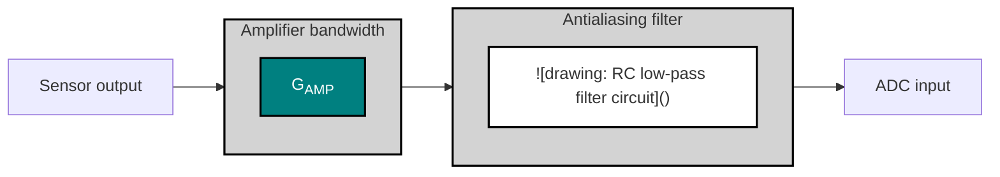

**Figure 16.** *ADC input stage with amplifier and antialiasing filter.*

Given the condition in **Equation 15**, you know that the antialiasing filter limits the amplifier noise passing into the ADC—but how much noise does it remove? Or, more importantly, how much noise still passes through to affect the ADC and the resulting measurement? In order to calculate this, you need to look at the amplifier’s noise characteristics.

$$BW_{Filter} \ll BW_{AMP} \hfill (15)$$

**Figure 17** shows an amplifier’s voltage noise spectral density plot with a large 1/f (flicker) region. Taken by itself, this plot tells you very little about the amplifier’s actual noise contribution (highlighted in teal). In fact, the nonconstant noise density—a common trait of nonchopper-stabilized amplifiers—makes it even more challenging to calculate how much noise passes to the ADC.

<table>
  <caption>Figure 17. Generic amplifier noise density plot with a large 1/f region — Frequency (Hz) vs. Voltage noise density (nV/√Hz)</caption>
  <thead>
    <tr>
      <th>Frequency (Hz)</th>
      <th>Amplifier noise (nV/√Hz)</th>
    </tr>
  </thead>
  <tbody>
    <tr>
      <th>0.1</th>
      <td>45</td>
    </tr>
    <tr>
      <th>1</th>
      <td>20</td>
    </tr>
    <tr>
      <th>10</th>
      <td>11</td>
    </tr>
    <tr>
      <th>100</th>
      <td>8</td>
    </tr>
    <tr>
      <th>1k</th>
      <td>7</td>
    </tr>
    <tr>
      <th>10k</th>
      <td>7</td>
    </tr>
    <tr>
      <th>100k</th>
      <td>7</td>
    </tr>
  </tbody>
</table>

**Figure 17.** *Generic amplifier noise density plot with a large 1/f region.*

To find out how much noise passes to the ADC, you’ll need to calculate the system’s ENBW. Once you’ve determined the ideal brick-wall filter response, you can overlay it on the amplifier’s noise spectral density curve, depicted by the red region in **Figure 18**.


<!-- PDF page 27 -->


<!--llamaparse-error ordinal="0" mode="chart" box_2d="[58,295,268,704]" code="SPECIALIST_ERROR"-->

**Figure 18.** *Amplifier noise-density plot with overlaid ENBW.*

The antialiasing filter in **Figure 18** is designed such that it provides a 200-Hz ENBW, effectively acting as a cutoff for the amplifier’s noise. All that’s left to do is calculate this noise, represented by the dark grey area in Figure 18. When broadband noise dominates, you can use Equation 16 to calculate the root-mean-square (RMS) voltage noise:

$$V_{Noise, Broadband} = V_{Noise\ spectral\ density} \times \sqrt{ENBW} \hfill (16)$$

If the device has a large 1/f noise component, similar to the amplifier shown in **Figure 17** and **Figure 18**, you can use direct integration or simplified formulas to calculate the device’s noise contribution. For more information on each of these methods, please review the TI Precision Labs training module on **op amp noise**.

In this case, the calculated RMS voltage noise passed to the ADC is 100nV<sub>RMS</sub>.

## *What contributes to the system’s ENBW?*

Through this simple amplifier/antialiasing filter analysis, I inadvertently defined two sources that help determine a signal chain’s ENBW. However, multiple filtering sources can exist in any design, and at least some filtering exists in every design. Even printed circuit boards (PCBs) that do not contain traditional filtering have trace impedances and parallel trace capacitances. These parasitics can create an unintentional RC filter, albeit one with a very large bandwidth and therefore little effect on the overall ENBW.

**Figure 19** highlights the most common sources of filtering in a typical data-acquisition (DAQ) system: external filters such as electromagnetic interference (EMI) filters, the amplifier’s bandwidth, antialiasing filters, digital filters of delta-sigma ADCs and/or any post-processing filters created digitally in an MCU or field-programmable gate array. It’s important to note that not all of these filtering sources appear in every signal chain. For example, many delta-sigma-based DAQ systems do not require post-processing filters due to the integrated filters inside these ADCs.

If your signal chain has multiple filter components, you must calculate each component’s ENBW by combining all downstream filters in the signal chain. For example, to calculate the noise contribution of the amplifier in **Figure 19**, you would have to combine the amplifier’s bandwidth with the antialiasing filter, the ADC’s digital filter and any post-processing filters. However, you could ignore the EMI filter.

Fortunately, even if one circuit has multiple sources of filtering, some filter types generally have a greater effect on overall ENBW than others. As a result, you may only need to calculate that component’s ENBW and ignore the other sources of filtering. For example, at lower-output data rates (ODRs), a delta-sigma ADC’s digital filter typically provides


<!-- PDF page 28 -->


the narrowest bandwidth in the signal chain and therefore dominates the system’s ENBW. Conversely, if you were to use a faster ODR with a very wide input-signal bandwidth, the antialiasing filter would generally limit the system’s ENBW.

Now that you understand the fundamentals of ENBW, let’s step through a simple example to help clarify how to apply ENBW to a real-world system.

```mermaid
graph LR
    Input(( )) --> EMI
    
    subgraph EMI ["EMI filter"]
        direction TB
        EMI_IMG["![drawing: low-pass filter response curve]()"]
    end
    
    EMI --> AMP
    
    subgraph AMP ["Amplifier bandwidth"]
        direction TB
        AMP_IMG["![drawing: amplifier symbol with G_AMP label]()"]
    end
    
    AMP --> AA
    
    subgraph AA ["Antialiasing filter"]
        direction TB
        AA_IMG["![drawing: RC filter circuit diagram]()"]
    end
    
    AA --> ADC
    
    subgraph ADC ["ADC digital filter"]
        direction TB
        ADC_IMG["![drawing: digital filter sinc response plot]()"]
    end
    
    ADC --> POST
    
    subgraph POST ["Post-processing"]
        direction TB
        POST_IMG["![drawing: FPGA/MCU block]()"]
    end
    
    POST --> Output(( ))

    style EMI fill:#D3D3D3,stroke:#000
    style AMP fill:#D3D3D3,stroke:#000
    style AA fill:#D3D3D3,stroke:#000
    style ADC fill:#D3D3D3,stroke:#000
    style POST fill:#D3D3D3,stroke:#000
```

**Figure 19.** *Common sources of filtering in delta-sigma ADC DAQ systems.*

### Key takeaways

Here is a summary of important points to better understand ENBW fundamentals:

1. ENBW represents an ideal brick-wall filter’s cutoff frequency for a given generic filter, H(f).
2. You must determine the ENBW for each noise source in the system.
3. To calculate each noise source’s ENBW, combine all downstream filters in the system.
4. ENBW helps determine how much noise each component passes into the system.
5. ENBW is typically dominated by the filter with the smallest cutoff frequency, which is generally an antialiasing filter or digital filter, especially for precision delta-sigma ADCs.

## 2.2 Calculating effective noise bandwidth

Let’s continue to explore ENBW as it relates to delta-sigma ADCs and system-level design, stepping through a simple example using a two-stage filter to understand:

* How to calculate ENBW.
* How system changes affect ENBW.

### How to calculate ENBW

For this example, let’s use a simple, two-stage DAQ system comprising an antialiasing filter followed by a **delta-sigma ADC** with an integrated sinc filter, shown in **Figure 20**. As I previously discussed, I’ll focus on these two filter types because they typically have the greatest impact on the overall ENBW, but this analysis is generally applicable to any type or number of additional filters.

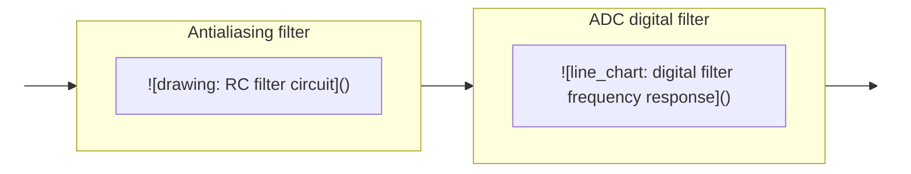

**Figure 20.** *Simplified DAQ system block diagram.*


<!-- PDF page 29 -->


For the antialiasing filter, let’s use a single-pole RC filter, since I already discussed how to calculate its ENBW in Section 2.1 (reiterated below in **Equation 17**). Moreover, a delta-sigma ADC typically only requires a simple RC filter to provide sufficient antialiasing. **Table 1** summarizes the chosen resistor and capacitor values for this example, though other valid combinations exist.

*Table 13. Antialiasing filter component values.*

<table>
  <caption>Table 13. Antialiasing filter component values.</caption>
  <thead>
    <tr>
      <th colspan="2">Antialiasing (RC) filter</th>
    </tr>
  </thead>
  <tbody>
    <tr>
      <td>Resistors (Ω)</td>
      <td>1,000 total (2 × 500)</td>
    </tr>
    <tr>
      <td>Capacitor (nF)</td>
      <td>100</td>
    </tr>
    <tr>
      <td>–3-dB cutoff frequency (Hz)</td>
      <td>1,590</td>
    </tr>
  </tbody>
</table>

With the passive component values selected, calculate the antialiasing filter’s ENBW using **Equation 17**:

$$ENBW_{1-pole\ RC\ filter} = 1.57 \times f_{-3\ dB}$$
$$ENBW_{1-pole\ RC\ filter} = 1.57 \times 1,590\ Hz = 2,500\ Hz$$ (17)

Finally, plot the antialiasing filter’s response as shown in **Figure 21**, with the filter’s ENBW represented by the red-shaded area.

<table>
  <caption>Figure 21. Antialiasing filter response with ENBW highlighted. Filter parameters: R = 2×500 Ω, C = 100 nF, f<sub>-3dB</sub> = 1,590 Hz.</caption>
  <thead>
    <tr>
      <th>Frequency (kHz)</th>
      <th>Magnitude (dB)</th>
      <th>Notes</th>
    </tr>
  </thead>
  <tbody>
    <tr>
      <th>0.01</th>
      <td>0</td>
      <td></td>
    </tr>
    <tr>
      <th>0.1</th>
      <td>0</td>
      <td></td>
    </tr>
    <tr>
      <th>1</th>
      <td>-1</td>
      <td></td>
    </tr>
    <tr>
      <th>1.59 (f<sub>-3dB</sub>)</th>
      <td>-3</td>
      <td>-3dB cutoff frequency</td>
    </tr>
    <tr>
      <th>2.5 (f<sub>ENBW</sub>)</th>
      <td>-7</td>
      <td>f<sub>ENBW</sub> = 1.57 × f<sub>-3dB</sub> = 2,500 Hz</td>
    </tr>
    <tr>
      <th>10</th>
      <td>-16</td>
      <td></td>
    </tr>
    <tr>
      <th>100</th>
      <td>-36</td>
      <td></td>
    </tr>
    <tr>
      <th>1,000</th>
      <td>-56</td>
      <td></td>
    </tr>
    <tr>
      <th>10,000</th>
      <td>-76</td>
      <td></td>
    </tr>
  </tbody>
</table>

**Figure 21.** *Antialiasing filter response with ENBW highlighted.*

With a firm understanding of the antialiasing filter’s frequency response, the next step is to determine the response of the ADC’s sinc filter. For this example, let’s choose the 32-bit, low-noise **ADS1262** from TI, although this analysis is generally applicable to any delta-sigma ADC. In this case, I’ll use the ADS1262’s Sinc4 filter at a data rate of 60 samples per second (SPS). **Figure 22** recreates a data-sheet plot for this filter’s frequency response at these settings (derived from the **ADS1262 calculation tool**).


<!-- PDF page 30 -->


<table>
  <caption>Figure 22. ADS1262 sinc filter response – linear frequency scale, f<sub>max</sub> = 300 Hz; ODR = 60 SPS, Filter = Sinc4, f<sub>-3dB</sub> = 13 Hz</caption>
  <thead>
    <tr>
      <th>Frequency (Hz)</th>
      <th>Magnitude (dB)</th>
    </tr>
  </thead>
  <tbody>
    <tr><th>0</th><td>0</td></tr>
    <tr><th>10</th><td>-2</td></tr>
    <tr><th>20</th><td>-10</td></tr>
    <tr><th>30</th><td>-22</td></tr>
    <tr><th>40</th><td>-40</td></tr>
    <tr><th>50</th><td>-65</td></tr>
    <tr><th>60</th><td>-400</td></tr>
    <tr><th>70</th><td>-65</td></tr>
    <tr><th>80</th><td>-55</td></tr>
    <tr><th>90</th><td>-52</td></tr>
    <tr><th>100</th><td>-55</td></tr>
    <tr><th>110</th><td>-65</td></tr>
    <tr><th>120</th><td>-400</td></tr>
    <tr><th>130</th><td>-75</td></tr>
    <tr><th>140</th><td>-70</td></tr>
    <tr><th>150</th><td>-68</td></tr>
    <tr><th>160</th><td>-70</td></tr>
    <tr><th>170</th><td>-75</td></tr>
    <tr><th>180</th><td>-400</td></tr>
    <tr><th>190</th><td>-85</td></tr>
    <tr><th>200</th><td>-80</td></tr>
    <tr><th>210</th><td>-78</td></tr>
    <tr><th>220</th><td>-80</td></tr>
    <tr><th>230</th><td>-85</td></tr>
    <tr><th>240</th><td>-400</td></tr>
    <tr><th>250</th><td>-95</td></tr>
    <tr><th>260</th><td>-90</td></tr>
    <tr><th>270</th><td>-88</td></tr>
    <tr><th>280</th><td>-90</td></tr>
    <tr><th>290</th><td>-95</td></tr>
    <tr><th>300</th><td>-400</td></tr>
  </tbody>
</table>

**Figure 22.** *ADS1262 sinc filter response – linear frequency scale, $f_{max} = 300$ Hz.*

One subtle but important difference between these two filter response plots is that the sinc filter plot **Figure 22** uses a linear frequency axis, while the antialiasing filter plot **Figure 21** has a logarithmic frequency axis. This disparity results from the slow data rates of most delta-sigma ADCs, where showing multiple frequency decades is generally unnecessary. Unfortunately, this choice complicates the process of combining the filters into the same plot.

Additionally, recall that a sinc filter response repeats indefinitely—it does not simply “stop” at 300 Hz, as it might appear to in **Figure 22**.

If you take both of these issues into consideration and plot the sinc filter response on a logarithmic axis over a much wider frequency range, the result in **Figure 23** is very different from the typical plot in most ADC data sheets.

<table>
  <caption>Figure 23. ADS1262 sinc filter response – logarithmic frequency scale, f<sub>max</sub> = 10 MHz. ODR = 60 SPS, Filter = Sinc4, f<sub>-3dB</sub> = 13 Hz.</caption>
  <thead>
    <tr>
      <th>Frequency (Hz)</th>
      <th>Magnitude (dB)</th>
      <th>Notes</th>
    </tr>
  </thead>
  <tbody>
    <tr>
      <th>0.01</th>
      <td>0</td>
      <td></td>
    </tr>
    <tr>
      <th>0.02</th>
      <td>-2</td>
      <td></td>
    </tr>
    <tr>
      <th>0.04</th>
      <td>-10</td>
      <td></td>
    </tr>
    <tr>
      <th>0.06</th>
      <td>-30</td>
      <td></td>
    </tr>
    <tr>
      <th>0.08</th>
      <td>-100</td>
      <td>First null</td>
    </tr>
    <tr>
      <th>0.1</th>
      <td>-60</td>
      <td></td>
    </tr>
    <tr>
      <th>0.2</th>
      <td>-80</td>
      <td></td>
    </tr>
    <tr>
      <th>0.4</th>
      <td>-100</td>
      <td></td>
    </tr>
    <tr>
      <th>0.6</th>
      <td>-120</td>
      <td></td>
    </tr>
    <tr>
      <th>0.8</th>
      <td>-130</td>
      <td></td>
    </tr>
    <tr>
      <th>1</th>
      <td>-140</td>
      <td></td>
    </tr>
    <tr>
      <th>2</th>
      <td>-170</td>
      <td></td>
    </tr>
    <tr>
      <th>4</th>
      <td>-200</td>
      <td></td>
    </tr>
    <tr>
      <th>6</th>
      <td>-220</td>
      <td></td>
    </tr>
    <tr>
      <th>10</th>
      <td>-240</td>
      <td></td>
    </tr>
    <tr>
      <th>20</th>
      <td>-280</td>
      <td></td>
    </tr>
    <tr>
      <th>40</th>
      <td>-320</td>
      <td></td>
    </tr>
    <tr>
      <th>60</th>
      <td>-340</td>
      <td></td>
    </tr>
    <tr>
      <th>100</th>
      <td>-360</td>
      <td></td>
    </tr>
    <tr>
      <th>200</th>
      <td>-390</td>
      <td></td>
    </tr>
    <tr>
      <th>400</th>
      <td>-400</td>
      <td></td>
    </tr>
    <tr>
      <th>600</th>
      <td>-380</td>
      <td></td>
    </tr>
    <tr>
      <th>800</th>
      <td>-300</td>
      <td>High frequency peaks</td>
    </tr>
    <tr>
      <th>1000</th>
      <td>0</td>
      <td>High frequency peaks</td>
    </tr>
    <tr>
      <th>2000</th>
      <td>0</td>
      <td>High frequency peaks</td>
    </tr>
    <tr>
      <th>4000</th>
      <td>0</td>
      <td>High frequency peaks</td>
    </tr>
    <tr>
      <th>6000</th>
      <td>0</td>
      <td>High frequency peaks</td>
    </tr>
    <tr>
      <th>8000</th>
      <td>0</td>
      <td>High frequency peaks</td>
    </tr>
    <tr>
      <th>10,000</th>
      <td>0</td>
      <td>High frequency peaks</td>
    </tr>
  </tbody>
</table>

**Figure 23.** *ADS1262 sinc filter response – logarithmic frequency scale, $f_{max} = 10$ MHz.*

With a logarithmic axis plotted out to 10 MHz, you can now see the high-frequency peaks indicating the filter response repeating. Why is this important? As a result of this repetition, integrating under the sinc filter’s frequency response curve yields an infinite ENBW (from a mathematical perspective, the sinc filter’s integral diverges at infinity). **Figure 24** depicts a plot of both the antialiasing and sinc filter frequency responses as well as their respective ENBWs.


<!-- PDF page 31 -->


<table>
  <caption>Antialiasing + sinc filter response — Magnitude (dB) vs Frequency (Hz); ENBW<sub>AA-filter</sub> = 2.5 kHz, ENBW<sub>SINC</sub> = ∞ Hz</caption>
  <thead>
    <tr>
      <th>Frequency (Hz)</th>
      <th>Antialiasing Filter Magnitude (dB)</th>
      <th>Sinc Filter Magnitude (dB)</th>
    </tr>
  </thead>
  <tbody>
    <tr>
      <th>0.01</th>
      <td>0</td>
      <td>0</td>
    </tr>
    <tr>
      <th>0.1</th>
      <td>0</td>
      <td>-100</td>
    </tr>
    <tr>
      <th>1</th>
      <td>0</td>
      <td>-150</td>
    </tr>
    <tr>
      <th>10</th>
      <td>-10</td>
      <td>-250</td>
    </tr>
    <tr>
      <th>100</th>
      <td>-30</td>
      <td>-350</td>
    </tr>
    <tr>
      <th>1000</th>
      <td>-55</td>
      <td>0</td>
    </tr>
    <tr>
      <th>10,000</th>
      <td>-75</td>
      <td>-200</td>
    </tr>
  </tbody>
</table>

**Figure 24.** *ENBWs of sinc and antialiasing filters.*

How do you continue this analysis given the sinc filter’s infinite ENBW? You simply need to set limits on the integration. Generally, some multiple (1 or 2) of the modulator clock frequency ($f_{MOD}$) is acceptable, but in this case you can use the antialiasing filter as the limit.

Now that both filters are magnitude plots (in decibels [dB]) with the same x-axis scale, you can simply add them together to determine the overall system ENBW. This yields the filter response shown in **Figure 25**. Integrating the combined RC and digital filter response now results in an ENBW of 14 Hz, orders of magnitude smaller than either filter by itself.

<table>
  <caption>Antialiasing + sinc filter response — Magnitude (dB) vs Frequency (Hz); ENBW<sub>SINC+AA</sub> = 14 Hz</caption>
  <thead>
    <tr>
      <th>Frequency (Hz)</th>
      <th>Magnitude (dB)</th>
      <th>Notes</th>
    </tr>
  </thead>
  <tbody>
    <tr>
      <th>0.01</th>
      <td>0</td>
      <td></td>
    </tr>
    <tr>
      <th>0.02</th>
      <td>-5</td>
      <td></td>
    </tr>
    <tr>
      <th>0.03</th>
      <td>-15</td>
      <td></td>
    </tr>
    <tr>
      <th>0.04</th>
      <td>-35</td>
      <td></td>
    </tr>
    <tr>
      <th>0.05</th>
      <td>-70</td>
      <td>First null</td>
    </tr>
    <tr>
      <th>0.07</th>
      <td>-50</td>
      <td>First sidelobe peak</td>
    </tr>
    <tr>
      <th>0.1</th>
      <td>-70</td>
      <td>Second sidelobe peak</td>
    </tr>
    <tr>
      <th>1</th>
      <td>-130</td>
      <td></td>
    </tr>
    <tr>
      <th>10</th>
      <td>-250</td>
      <td></td>
    </tr>
    <tr>
      <th>14</th>
      <td>-280</td>
      <td>ENBW<sub>SINC+AA</sub></td>
    </tr>
    <tr>
      <th>100</th>
      <td>-380</td>
      <td></td>
    </tr>
    <tr>
      <th>200</th>
      <td>-400</td>
      <td></td>
    </tr>
    <tr>
      <th>1000</th>
      <td>-50</td>
      <td>High-frequency attenuation peak</td>
    </tr>
    <tr>
      <th>2000</th>
      <td>-55</td>
      <td>High-frequency attenuation peak</td>
    </tr>
    <tr>
      <th>3000</th>
      <td>-60</td>
      <td>High-frequency attenuation peak</td>
    </tr>
    <tr>
      <th>4000</th>
      <td>-65</td>
      <td>High-frequency attenuation peak</td>
    </tr>
    <tr>
      <th>5000</th>
      <td>-68</td>
      <td>High-frequency attenuation peak</td>
    </tr>
    <tr>
      <th>6000</th>
      <td>-70</td>
      <td>High-frequency attenuation peak</td>
    </tr>
    <tr>
      <th>7000</th>
      <td>-72</td>
      <td>High-frequency attenuation peak</td>
    </tr>
    <tr>
      <th>8000</th>
      <td>-73</td>
      <td>High-frequency attenuation peak</td>
    </tr>
    <tr>
      <th>9000</th>
      <td>-74</td>
      <td>High-frequency attenuation peak</td>
    </tr>
    <tr>
      <th>10,000</th>
      <td>-75</td>
      <td>High-frequency attenuation peak</td>
    </tr>
  </tbody>
</table>

**Figure 25.** *System response of sinc and antialiasing filters.*

The narrower ENBW results from the antialiasing filter’s attenuation of the sinc filter noise power at higher frequencies, allowing less noise into the system. This also further explains why you don’t necessarily need to account for the infinite frequency response of the sinc filter. The antialiasing filter already removes much of the noise power associated with the high-frequency peaks occurring at multiples of $f_{MOD}$ that would **otherwise fold back into the passband**. Many analog designers assume that the antialiasing filter’s intended purpose is to remove low-frequency noise, which is generally the responsibility of the **delta-sigma ADC’s digital filter**.

If you followed this assumption and attempted to **design an antialiasing filter** with a very low cutoff frequency, you would generally need to use large resistor and capacitor values. However, large passive component values lead to longer signal settling times, which you generally want to avoid. Even if you could accept an additional settling time, ADC input leakage currents can cause significant offset voltages across large filter resistors, leading to system-level inaccuracy.


<!-- PDF page 32 -->


Thus, it is actually to the system’s benefit that you only need to design antialiasing filters for high-frequency noise, as smaller passive components can help avoid the aforementioned issues.

### *How system changes affect ENBW*

Suppose you now want to change the ADC’s sample rate or the antialiasing filter’s cutoff frequency. How does this affect the system ENBW? Intuitively, it would make sense that the filter with the smaller cutoff would dominate the ENBW calculation—as I have already shown—and this is a generally correct assumption. To illustrate this point, **Table 14** lists all available digital filter ODRs of the ADS1262, as well as the corresponding system ENBW for a range of antialiasing cutoff frequencies. **Table 14** also provides the ADC’s 3-dB point, which effectively acts as its cutoff frequency.

<table>
  <caption>Table 14. Effect of ADC data rate and antialiasing filter cutoff frequency on a system’s ENBW.</caption>
  <thead>
    <tr>
      <th rowspan="2">ADS1262 data rate (SPS)</th>
      <th rowspan="2">ADS1262 Sinc4 filter 3 dB (Hz)<sup>(1)</sup></th>
      <th colspan="4">System ENBW (Hz)</th>
    </tr>
    <tr>
      <th>Antialiasing filter (f<sub>C</sub> = 25 Hz)</th>
      <th>Antialiasing filter (f<sub>C</sub> = 250 Hz)</th>
      <th>Antialiasing filter (f<sub>C</sub> = 2,500 Hz)</th>
      <th>Antialiasing filter (f<sub>C</sub> = 25,000 Hz)</th>
    </tr>
  </thead>
  <tbody>
    <tr>
      <td><strong>2.5</strong></td>
      <td>0.58</td>
      <td><strong>0.59</strong></td>
      <td><strong>0.59</strong></td>
      <td><strong>0.59</strong></td>
      <td><strong>0.59</strong></td>
    </tr>
    <tr>
      <td><strong>5</strong></td>
      <td>1.15</td>
      <td><strong>1.19</strong></td>
      <td><strong>1.19</strong></td>
      <td><strong>1.19</strong></td>
      <td><strong>1.19</strong></td>
    </tr>
    <tr>
      <td><strong>10</strong></td>
      <td>2.28</td>
      <td><strong>2.37</strong></td>
      <td><strong>2.39</strong></td>
      <td><strong>2.39</strong></td>
      <td><strong>2.39</strong></td>
    </tr>
    <tr>
      <td><strong>16.7</strong></td>
      <td>3.80</td>
      <td><strong>3.92</strong></td>
      <td><strong>3.98</strong></td>
      <td><strong>3.99</strong></td>
      <td><strong>4.31</strong></td>
    </tr>
    <tr>
      <td><strong>20</strong></td>
      <td>4.63</td>
      <td><strong>4.68</strong></td>
      <td><strong>4.78</strong></td>
      <td><strong>4.78</strong></td>
      <td><strong>4.79</strong></td>
    </tr>
    <tr>
      <td><strong>50</strong></td>
      <td>11</td>
      <td><strong>10.72</strong></td>
      <td><strong>11.96</strong></td>
      <td><strong>11.97</strong></td>
      <td><strong>12.09</strong></td>
    </tr>
    <tr>
      <td><strong>60</strong></td>
      <td>13</td>
      <td><strong>12.40</strong></td>
      <td><strong>14.34</strong></td>
      <td><strong>14.37</strong></td>
      <td><strong>14.40</strong></td>
    </tr>
    <tr>
      <td><strong>100</strong></td>
      <td>22</td>
      <td><strong>17.69</strong></td>
      <td><strong>23.82</strong></td>
      <td><strong>23.96</strong></td>
      <td><strong>24.10</strong></td>
    </tr>
    <tr>
      <td><strong>400</strong></td>
      <td>90</td>
      <td><strong>30.87</strong></td>
      <td><strong>88.83</strong></td>
      <td><strong>95.77</strong></td>
      <td><strong>96.16</strong></td>
    </tr>
    <tr>
      <td><strong>1,200</strong></td>
      <td>272</td>
      <td><strong>36.10</strong></td>
      <td><strong>196.79</strong></td>
      <td><strong>285.11</strong></td>
      <td><strong>288.13</strong></td>
    </tr>
    <tr>
      <td><strong>2,400</strong></td>
      <td>543</td>
      <td><strong>37.62</strong></td>
      <td><strong>267.42</strong></td>
      <td><strong>556.39</strong></td>
      <td><strong>574.60</strong></td>
    </tr>
    <tr>
      <td><strong>4,800</strong></td>
      <td>1,076</td>
      <td><strong>38.42</strong></td>
      <td><strong>319.89</strong></td>
      <td><strong>1,026.41</strong></td>
      <td><strong>1,137.07</strong></td>
    </tr>
    <tr>
      <td><strong>7,200</strong></td>
      <td>1,580</td>
      <td><strong>38.69</strong></td>
      <td><strong>340.86</strong></td>
      <td><strong>1,392.37</strong></td>
      <td><strong>1,676.52</strong></td>
    </tr>
    <tr>
      <td><strong>14,400</strong></td>
      <td>2,930</td>
      <td><strong>38.95</strong></td>
      <td><strong>363.18</strong></td>
      <td><strong>2,048.71</strong></td>
      <td><strong>3,077.72</strong></td>
    </tr>
    <tr>
      <td><strong>19,200</strong></td>
      <td>3,900</td>
      <td><strong>39.03</strong></td>
      <td><strong>370.23</strong></td>
      <td><strong>2.353.61</strong></td>
      <td><strong>4,076.05</strong></td>
    </tr>
  </tbody>
</table>

(1) Derived from the ADS1262 calculator tool.

The colored sections in **Table 13** represent the following situations:

<table>
    <tr>
      <td>### = where f<sub>3 dB (ADC)</sub> ≤ f<sub>C,(AA filter)</sub></td>
      <td>### = where f<sub>3 dB (ADC)</sub> ≥ 10 × f<sub>C,(AA filter)</sub></td>
      <td>### = where f<sub>3 dB (ADC)</sub> &#x3C; 10 × f<sub>C,(AA filter)</sub> AND f<sub>3 dB (ADC)</sub> > f<sub>C,(AA filter)</sub></td>
    </tr>
</table>

These results allow you to approximate the system ENBW instead of performing complex integrations, assuming that one of the conditions expressed in Equation 18 and Equation 19 is true:

$$If\ f_{3\text{ dB}(ADC)} \le f_{C(AA\ filter)} \rightarrow \mathbf{ENBW_{System} \cong f_{3\text{ dB} (ADC)}} \hfill (18)$$

$$If\ f_{3\text{ dB}(ADC)} \ge 10 \times f_{C(AA\ filter)} \rightarrow \mathbf{ENBW_{System} \cong f_{ENBW (AA\ filter)}} \hfill (19)$$

Note that in **Equation 19**, the system ENBW can be approximated as the antialiasing filter’s ENBW, not its cutoff frequency.

If neither **Equation 18** or **Equation 19** is true, such that $f_{3\text{ dB} (ADC)}$ is between $f_{C(AA\ filter)}$ and $10 \times f_{C(AA\ filter)}$, you must determine the combined system bandwidth using integration or other numerical methods. You could also approximate


<!-- PDF page 33 -->


the system bandwidth as just $f_{3 dB}$ (ADC) or $f_{ENBW}$ (AA filter), whichever is smaller. This method overestimates the total noise and provides a worst-case value.

Additionally, these conditions generally apply to any number of additional filter stages, as long as their cutoff frequencies were much larger than that of the ADC or antialiasing filter. In such cases, you wouldn’t have to calculate their ENBWs, making the analysis less complex.

In **Section 5**, I’ll continue the discussion of noise in delta-sigma ADCs by adding both integrated and external amplifiers to the signal chain.

## **Key takeaways**

Here is a summary of important points to better understand ENBW in delta-sigma ADCs:

1. ENBW is dominated by the filter with the smallest cutoff frequency, which is typically an antialiasing filter or digital filter, especially for precision delta-sigma ADCs.
2. Antialiasing filters exist to remove noise at high frequencies, not low frequencies.
3. You can calculate ENBW using direct integration or approximate it in most cases using the ADC’s 3-dB point or the antialiasing filter’s cutoff frequency.


<!-- PDF page 34 -->


## **Chapter 3: Amplifier noise, dynamic range and gain**

In data-acquisition (DAQ) systems, taking precision measurements of low-level input signals is a common design challenge. For example, many factory automation applications use programmable logic controllers (PLCs) to make decisions based on temperature sensor or load cell readings. Similarly, oil-drilling platforms use industrial differential-pressure flow meters to determine—with milliliter precision—how much oil is removed from a well.

To measure these process variables, many types of applications employ analog sensors such as resistance temperature detectors (RTDs), thermocouples or resistive bridges. These sensors typically output very low-level signals that need to be gained up above the DAQ system’s noise floor. Additionally, engineers may use gain to increase the dynamic range by using more of the analog-to-digital converter’s (ADC) full-scale range (FSR). In either case, adding gain to any analog system generally requires an amplifier, which may be a discrete component or integrated into one of the signal-chain components, such as an ADC.

As with the introduction of any component to an electrical system, these amplifiers contribute noise. How does this noise affect the system? Chapter 3 seeks to answer this question by offering an in-depth understanding of amplifier noise and how it affects a typical signal chain.

First, I will focus on these topics as they relate to amplifier noise:

* Output- vs. input-referred noise.
* Adding an amplifier at the input of an ADC.
* Low- vs. high-resolution ADCs.

I’ll then go into a detailed design example using commercially available ADCs and amplifiers to complement and expand on the theories explored.

**How amplifier noise affects delta sigma ADCs** **An amplifier-plus-precision delta-sigma ADC design example**


<!-- PDF page 35 -->


## How amplifier noise affects delta sigma ADCs

Output-referred noise—or noise referred-to-output, $V_{N,RTO}$— is the noise measured at the output of the ADC, as its name implies. Recall from Section 1.2 that one method ADC manufacturers use to characterize ADC noise is to short the device’s inputs together and measure the noise at the output to determine the intrinsic noise of the ADC, as shown in **Figure 26**.

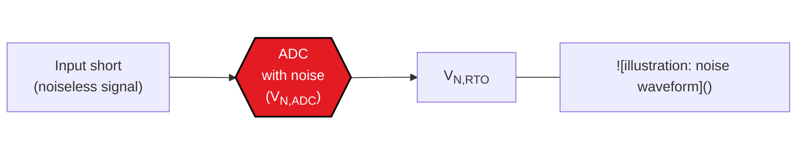

**Figure 26.** *Measuring output-referred noise.*

However, also recall that the value actually reported in the data sheet is typically input-referred. Similar to output noise, input-referred noise—or noise referred-to-input, $V_{N,RTI}$—is the noise at the input of the ADC. Unlike output-referred noise, input-referred noise is calculated, not measured. For an ADC with no integrated gain stage, the input-referred noise is equal to the output-referred noise, as shown in **Equation 20**:

$$V_{N,RTO} = V_{N,RTI} = V_{N,ADC(no\ gain)} \tag{20}$$

Why do ADC manufacturers specify noise as input-referred rather than output-referred? To answer this question, it helps to create an equivalent circuit noise model by separating the ADC from its noise into a “noiseless” ADC, preceded by a voltage source equal to the ADC’s input-referred noise, as shown in **Figure 27**.

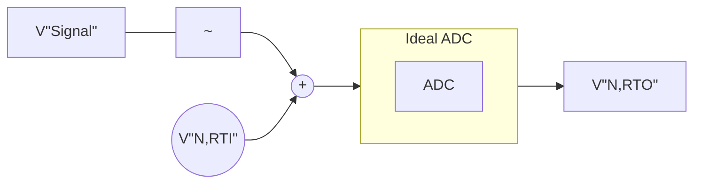

**Figure 27.** *Noiseless ADC preceded by a noise source equal to the ADC’s input-referred noise.*

Now, when you input a real signal into the ADC, it’s easy to see that you want ADC noise to be characterized as input-referred because this defines the system’s input resolution. Effectively, the input signal “competes” with the input-referred noise: If the signal’s amplitude is greater than the input-referred noise, you will be able to observe it; otherwise, the signal is buried in the noise, and you won’t be able to observe it.

Ultimately, if you know the smallest input signal that you need to resolve, the input-referred noise tells you very quickly and easily if a specific ADC can provide the necessary resolution. And while this is less important for stand-alone ADCs where output-referred noise is equal to input-referred noise, what happens if you add an amplifier into the signal path?

### Adding an amplifier to the input of an ADC

To analyze the amplifier’s impact on overall system noise, you can separate it from its noise source just as you did for the ADC. In this case, you can model it as a noiseless amplifier preceded by a voltage source equal to the amplifier’s noise, $V_{N,AMP}$, shown in **Figure 28**. Additionally, you can assume that the input source ($V_{Signal}$) is noiseless, though in practice the gain stage would amplify any sensor noise.


<!-- PDF page 36 -->


**Figure 28.** *Noiseless amplifier and noiseless ADC with separate, referred-to-input noise sources.*

Since you can’t directly measure input-referred noise, you need to first determine the output-referred noise of the system, as shown in **Figure 28**. Assuming that the amplifier and ADC noise are uncorrelated, take the root sum square (RSS) of both values to determine the total output-referred noise.

An unfortunate side effect of gaining up the input signal is that you also gain up the amplifier’s noise. As a result, you first need to scale the amplifier noise by the amplifier’s gain, $G_{AMP}$. **Equation 21** shows the resulting output-referred noise:

$$V_{N, RTO} = \sqrt{(V_{N, AMP} \times G_{AMP})^2 + (V_{N, ADC})^2} (nV_{RMS}) \hfill (21)$$

You can now use this output-referred noise equation and transform it into an equivalent input-referred noise source for the system. To accomplish that, first simplify the circuit diagram in **Figure 28** to one with an equivalent circuit noise model that combines both noise sources into one referred-to-input noise source ($V_{N,RTI}$). This also simplifies your analysis by enabling you to determine whether the simple signal chain (ADC plus amplifier) has enough resolution for your application.


**Figure 29.** *Noiseless components with one total input-referred noise source.*

To calculate the input-referred noise from the output-referred noise, divide each individual noise term by the circuit gain, $G_{AMP}$, as shown in **Equation 22**:

$$V_{N, RTI} = \sqrt{(V_{N, AMP})^2 + (V_{N, ADC} / G_{AMP})^2} (nV_{RMS})$$ (22)

Note the location of the gain term, $G_{AMP}$, in both **Equation 21** and **Equation 22**. In **Equation 21**, the amplifier’s noise is proportional to the gain, while in **Equation 22** the ADC’s noise is proportional to the inverse of the gain. In either case, given a sufficiently large amplifier gain and comparable amplifier noise, the ADC noise becomes negligible. The resulting input-referred noise is then completely dependent on the amplifier’s noise, given by **Equation 23**. This is true whether or not the amplifier is integrated into the ADC or is a discrete component.

$$If\ G_{AMP} \times V_{N,AMP} >> V_{N,ADC}\ then\ V_{N,RTI} = V_{N,AMP}(nV_{RMS}) \eqno(23)$$

What if you add additional amplifiers to the signal chain, as in **Figure 30**? You could add multiple discrete amplifiers or an ADC with an integrated amplifier as well as an external amplifier.


<!-- PDF page 37 -->


**Figure 30.** *Noiseless amplifiers and a noiseless ADC with separate, referred-to-input noise sources.*

As you did previously, combine all of these noise terms into one input-referred noise source with an equivalent circuit noise model, shown in **Figure 31**.


**Figure 31.** *Multiple noiseless amplifiers at the input of an ADC with one total input-referred noise source.*

You can use **Figure 31** and **Equation 21** and **Equation 22** to help determine the input-referred noise for this extended signal chain with *n* number of amplifiers, represented by **Equation 24**:

$$V_{N, RTI} = \sqrt{V_{N, AMP1}^2 + \left( \frac{V_{N, AMP2}}{G_{AMP1}} \right)^2 + ... + \left( \frac{V_{N, ADC}}{G_{AMP1} \times ... \times G_{AMPn}} \right)^2} (nV_{RMS})$$ (24)

As in the previous example, the new input-referred noise equation depends on the noise contributions of all devices in the signal chain. However, each term is scaled by the inverse of the product of **all** amplifier gains, leaving only the initial term—the first amplifier’s voltage noise—independent of gain.

Similar to **Equation 23**, this means that with a large first-stage gain, all other terms in **Equation 24** effectively approach zero, leaving the system’s input-referred noise dependent on the noise of the first amplifier only. Therefore, for best performance in both single- and multi-stage amplifier configurations, choose a low-noise first-stage amplifier with a large gain.

As **Equation 23** implies, the effect of this choice is not equal for all ADCs. In fact, you could pair a lower-resolution ADC with a higher-noise amplifier, or use a larger gain and still meet the required system noise performance. Moreover, a higher-resolution ADC might not see any effect from even a modest gain increase.

Let’s analyze these conclusions further by looking at the 16-bit **ADS114S08** compared to the 24-bit **ADS124S08**. These two ADCs have different resolutions but are otherwise identical, including an integrated programmable gain amplifier (PGA) with the same amplifier noise. Their similarities allow you to analyze how the different ADC resolutions affect system noise as gain changes.

### Low- vs. high-resolution ADCs

**Table 15** shows the input-referred noise for both the ADS114S08 (**Table 15a**) and ADS124S08 (**Table 15b**) at gains of 1 V/V and 2 V/V and for all available data rates. If you choose any data rate—50 SPS, for example—and take the ratio of the input-referred noise at these gains, you will get approximately 2 for both ADCs. In other words, as the gain increases by a factor of 2, the noise simultaneously decreases by a factor of 2. In this case, adding gain improves system noise performance for both the lower- (16-bit) and higher-resolution (24-bit) ADCs.


<!-- PDF page 38 -->


*Table 15. Input-referred noise (µV<sub>RMS</sub> [µV<sub>PP</sub>]) tables for the ADS114S08 (a) and ADS124S08 (b) showing G = 1 and 2 V/V – Sinc3 filter, AVDD = 3.3 V, AVSS = 0 V, PGA enabled, global chop disabled and internal 2.5-V reference.*

<table>
  <caption>16-bit ADS114S08</caption>
  <thead>
    <tr>
      <th rowspan="2">Data rate (SPS)</th>
      <th colspan="2">Gain</th>
    </tr>
    <tr>
      <th>1</th>
      <th>2</th>
    </tr>
  </thead>
  <tbody>
    <tr>
      <td>2.5</td>
      <td>76.3 (76.3)</td>
      <td>38.1 (38.1)</td>
    </tr>
    <tr>
      <td>5</td>
      <td>76.3 (76.3)</td>
      <td>38.1 (38.1)</td>
    </tr>
    <tr>
      <td>10</td>
      <td>76.3 (76.3)</td>
      <td>38.1 (38.1)</td>
    </tr>
    <tr>
      <td>16.6</td>
      <td>76.3 (76.3)</td>
      <td>38.1 (38.1)</td>
    </tr>
    <tr>
      <td>20</td>
      <td>76.3 (76.3)</td>
      <td>38.1 (38.1)</td>
    </tr>
    <tr>
      <td>50</td>
      <td>76.3 (76.3)</td>
      <td>38.1 (38.1)</td>
    </tr>
    <tr>
      <td>60</td>
      <td>76.3 (76.3)</td>
      <td>38.1 (38.1)</td>
    </tr>
    <tr>
      <td>100</td>
      <td>76.3 (76.3)</td>
      <td>38.1 (38.1)</td>
    </tr>
    <tr>
      <td>200</td>
      <td>76.3 (76.3)</td>
      <td>38.1 (38.1)</td>
    </tr>
    <tr>
      <td>400</td>
      <td>76.3 (76.3)</td>
      <td>38.1 (38.1)</td>
    </tr>
    <tr>
      <td>800</td>
      <td>76.3 (76.3)</td>
      <td>38.1 (38.1)</td>
    </tr>
    <tr>
      <td>1,000</td>
      <td>76.3 (76.3)</td>
      <td>38.1 (38.1)</td>
    </tr>
    <tr>
      <td>2,000</td>
      <td>76.3 (76.3)</td>
      <td>38.1 (38.1)</td>
    </tr>
    <tr>
      <td>4,000</td>
      <td>76.3 (95)</td>
      <td>38.1 (45)</td>
    </tr>
  </tbody>
</table>

V<sub>N,G=1</sub> / V<sub>N,G=2</sub> = 76.3 μV<sub>RMS</sub> / 38.1 μV<sub>RMS</sub> = 2

(a)

<table>
  <caption>24-bit ADS124S08</caption>
  <thead>
    <tr>
      <th rowspan="2">Data rate (SPS)</th>
      <th colspan="2">Gain</th>
    </tr>
    <tr>
      <th>1</th>
      <th>2</th>
    </tr>
  </thead>
  <tbody>
    <tr>
      <td>2.5</td>
      <td>0.32 (1.8)</td>
      <td>0.16 (0.89)</td>
    </tr>
    <tr>
      <td>5</td>
      <td>0.40 (2.4)</td>
      <td>0.21 (1.0)</td>
    </tr>
    <tr>
      <td>10</td>
      <td>0.53 (3.0)</td>
      <td>0.29 (1.6)</td>
    </tr>
    <tr>
      <td>16.6</td>
      <td>0.76 (4.2)</td>
      <td>0.36 (2.2)</td>
    </tr>
    <tr>
      <td>20</td>
      <td>0.81 (4.8)</td>
      <td>0.41 (2.4)</td>
    </tr>
    <tr>
      <td>50</td>
      <td>1.3 (7.2)</td>
      <td>0.62 (3.7)</td>
    </tr>
    <tr>
      <td>60</td>
      <td>1.4 (8.0)</td>
      <td>0.70 (4.5)</td>
    </tr>
    <tr>
      <td>100</td>
      <td>1.8 (9.2)</td>
      <td>0.91 (5.8)</td>
    </tr>
    <tr>
      <td>200</td>
      <td>2.4 (13)</td>
      <td>1.2 (7.7)</td>
    </tr>
    <tr>
      <td>400</td>
      <td>3.6 (19)</td>
      <td>1.8 (10)</td>
    </tr>
    <tr>
      <td>800</td>
      <td>5.0 (29)</td>
      <td>2.6 (16)</td>
    </tr>
    <tr>
      <td>1,000</td>
      <td>6.0 (32)</td>
      <td>2.9 (17)</td>
    </tr>
    <tr>
      <td>2,000</td>
      <td>7.8 (45)</td>
      <td>4.2 (26)</td>
    </tr>
    <tr>
      <td>4,000</td>
      <td>15 (95)</td>
      <td>7.3 (45)</td>
    </tr>
  </tbody>
</table>

V<sub>N,G=1</sub> / V<sub>N,G=2</sub> = 1.3 μV<sub>RMS</sub> / 0.62 μV<sub>RMS</sub> = 2.1

(b)

Compare **Table 15** to **Table 16**, which shows the same calculations using the highest gains of 64 V/V and 128 V/V. Here, the lower-resolution ADC has maintained the ratio of 2, while the ratio for the higher-resolution ADC has decreased to approximately 1. In the latter case, increasing gain no longer improves noise performance. What causes this difference?

*Table 16. Input-referred noise (µV<sub>RMS</sub> [µV<sub>PP</sub>]) tables for the ADS114S08 (a) and ADS124S08 (b) showing G = 64 and 128 V/V – Sinc3 filter, AVDD = 3.3 V, AVSS = 0 V, PGA enabled, global chop disabled and internal 2.5-V reference.*

<table>
  <caption>16-bit ADS114S08</caption>
  <thead>
    <tr>
      <th rowspan="2">Data rate (SPS)</th>
      <th colspan="2">Gain</th>
    </tr>
    <tr>
      <th>1</th>
      <th>2</th>
    </tr>
  </thead>
  <tbody>
    <tr>
      <td>2.5</td>
      <td>1.2 (1.2)</td>
      <td>0.60 (0.60)</td>
    </tr>
    <tr>
      <td>5</td>
      <td>1.2 (1.2)</td>
      <td>0.60 (0.60)</td>
    </tr>
    <tr>
      <td>10</td>
      <td>1.2 (1.2)</td>
      <td>0.60 (0.60)</td>
    </tr>
    <tr>
      <td>16.6</td>
      <td>1.2 (1.2)</td>
      <td>0.60 (0.60)</td>
    </tr>
    <tr>
      <td>20</td>
      <td>1.2 (1.2)</td>
      <td>0.60 (0.60)</td>
    </tr>
    <tr>
      <td>50</td>
      <td>1.2 (1.2)</td>
      <td>0.60 (0.60)</td>
    </tr>
    <tr>
      <td>60</td>
      <td>1.2 (1.2)</td>
      <td>0.60 (0.60)</td>
    </tr>
    <tr>
      <td>100</td>
      <td>1.2 (1.2)</td>
      <td>0.60 (0.60)</td>
    </tr>
    <tr>
      <td>200</td>
      <td>1.2 (1.2)</td>
      <td>0.60 (0.90)</td>
    </tr>
    <tr>
      <td>400</td>
      <td>1.2 (1.5)</td>
      <td>0.60 (1.3)</td>
    </tr>
    <tr>
      <td>800</td>
      <td>1.2 (2.2)</td>
      <td>0.60 (2.0)</td>
    </tr>
    <tr>
      <td>1,000</td>
      <td>1.2 (2.4)</td>
      <td>0.60 (2.2)</td>
    </tr>
    <tr>
      <td>2,000</td>
      <td>1.2 (3.5)</td>
      <td>0.60 (2.8)</td>
    </tr>
    <tr>
      <td>4,000</td>
      <td>1.2 (5.0)</td>
      <td>0.80 (4.9)</td>
    </tr>
  </tbody>
</table>

<table>
  <caption>24-bit ADS124S08</caption>
  <thead>
    <tr>
      <th rowspan="2">Data rate (SPS)</th>
      <th colspan="2">Gain</th>
    </tr>
    <tr>
      <th>1</th>
      <th>2</th>
    </tr>
  </thead>
  <tbody>
    <tr>
      <td>2.5</td>
      <td>0.020 (0.13)</td>
      <td>0.019 (0.11)</td>
    </tr>
    <tr>
      <td>5</td>
      <td>0.029 (0.18)</td>
      <td>0.027 (0.16)</td>
    </tr>
    <tr>
      <td>10</td>
      <td>0.04 (0.24)</td>
      <td>0.036 (0.23)</td>
    </tr>
    <tr>
      <td>16.6</td>
      <td>0.052 (0.32)</td>
      <td>0.046 (0.30)</td>
    </tr>
    <tr>
      <td>20</td>
      <td>0.056 (0.37)</td>
      <td>0.048 (0.30)</td>
    </tr>
    <tr>
      <td>50</td>
      <td>0.091 (0.54)</td>
      <td>0.080 (0.53)</td>
    </tr>
    <tr>
      <td>60</td>
      <td>0.10 (0.67)</td>
      <td>0.089 (0.58)</td>
    </tr>
    <tr>
      <td>100</td>
      <td>0.12 (0.72)</td>
      <td>0.11 (0.52)</td>
    </tr>
    <tr>
      <td>200</td>
      <td>0.19 (1.1)</td>
      <td>0.15 (0.95)</td>
    </tr>
    <tr>
      <td>400</td>
      <td>0.25 (1.5)</td>
      <td>0.22 (1.3)</td>
    </tr>
    <tr>
      <td>800</td>
      <td>0.37 (2.2)</td>
      <td>0.34 (2.0)</td>
    </tr>
    <tr>
      <td>1,000</td>
      <td>0.41 (2.3)</td>
      <td>0.37 (2.2)</td>
    </tr>
    <tr>
      <td>2,000</td>
      <td>0.57 (3.5)</td>
      <td>0.54 (2.8)</td>
    </tr>
    <tr>
      <td>4,000</td>
      <td>0.83 (5.1)</td>
      <td>0.80 (5.0)</td>
    </tr>
  </tbody>
</table>

V<sub>N,G=64</sub> / V<sub>N,G=128</sub> = 1.2 μV<sub>RMS</sub> / 0.6 μV<sub>RMS</sub> = 2
(a)

V<sub>N,G=64</sub> / V<sub>N,G=128</sub> = 0.091 μV<sub>RMS</sub> / 0.08 μV<sub>RMS</sub> = 1.1
(b)

For the lower-resolution (quantization-noise-dominant) ADC, the constant ratio between the gains results from the high levels of ADC noise compared to amplifier noise. In this case, the condition stated in **Equation 23** is not met, as the ADC noise is much larger than the amplifier noise. The ADC noise does decrease each time you increase the gain by a factor of 2, but even at its lowest level (G = 128 V/V), ADC noise still dominates compared to amplifier noise. Thus, you never


<!-- PDF page 39 -->


actually “see” the amplifier noise in the measurement, making this specific signal chain less dependent on the amplifier’s performance and enabling you to potentially improve the noise performance using larger gain values.

For higher-resolution (thermal-noise-dominant) ADCs, the opposite is true, even though both ADCs use the same amplifier. In this case, the ADC noise is much lower compared to the amplifier noise multiplied by the gain, and therefore meets the condition in **Equation 23**. As a result, $V_{N,RTI}$ effectively becomes constant, resulting in virtually no change in input-referred noise performance despite increasing gain. In such circumstances, amplifier performance is critical, and in many cases using an amplifier results in worse system resolution than a system with no amplifier at all.

## **Key takeaways**

Here is a summary of important points to better understand how amplifier noise affects delta-sigma ADCs:

1. For signal chains with no gain, output-referred noise equals input-referred noise.
2. Output-referred noise is measured; input-referred noise is calculated.
   * Input-referred noise represents the system’s input resolution.
3. First-stage amplifier noise dominates the system input-referred noise (assuming similar component noise values and a large first-stage gain).
   * Using a high-resolution (low-noise) ADC with a noisy amplifier degrades system performance.
4. For best noise performance, the first stage is generally configured as a low-noise, small-signal-gain amplifier.

## **An amplifier-plus-precision delta-sigma ADC design example**

I have defined output- and input-referred noise, derived equations for each, delved into single- and multi-stage amplifier configurations, and discussed the effects of increasing gain on low- and high-resolution ADCs. I also concluded that you need to more carefully consider the noise performance of high-gain external amplifiers when pairing them with high-resolution ADCs.

Now, I’ll set out to prove this claim using a design example that analyzes how different amplifiers affect the noise of the same high-resolution ADC. I’ll use TI’s 32-bit ADS1262 as a baseline ADC due to its very low noise levels and its integrated PGA. The integrated PGA noise acts as a reference point for the analysis and enables comparison with several different external amplifiers.

### ***Calculating ADC input-referred noise***

The first thing you need to do is determine the baseline input-referred noise of the ADC. To do so, you could theoretically use the equations derived in **Section 5.1**, as well as the equivalent noise model shown in **Figure 32**.

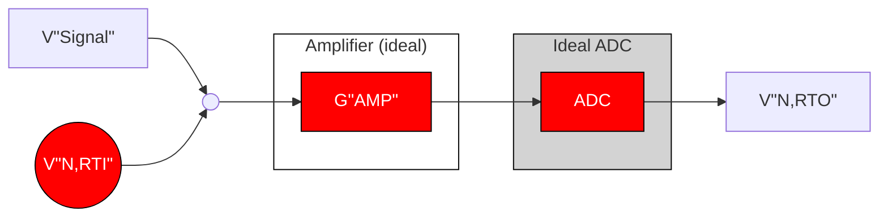

**Figure 32.** *Noiseless components with one total input-referred noise source.*

However, this approach requires the noise spectral densities for both the ADC and PGA, which are not common specifications in an ADC’s data sheet. Instead, you can actually forgo any calculation and simply look up the applicable


<!-- PDF page 40 -->


input-referred noise in the ADC data sheet’s noise tables. This highlights one of the benefits of using ADCs with integrated amplifiers: the ADC manufacturer completes the calculations discussed in **Section 5.1**, simplifying system noise analysis compared to using external amplifiers with an ADC.

*Table 17. ADS1262 input-referred noise in $\mu V_{RMS}$ ($\mu V_{PP}$) for ODR = 60 SPS, Sinc4 filter, $T_A = 25^\circ C$, AVDD = 5 V, AVSS = 0 V, $V_{REF} = 2.5$ V.*

<table>
  <caption>Table 17. ADS1262 input-referred noise in µV<sub>RMS</sub> (µV<sub>PP</sub> ) for ODR = 60 SPS, Sinc4 filter, T<sub>A</sub> = 25°C, AVDD = 5 V, AVSS = 0 V, V<sub>REF</sub> = 2.5 V.</caption>
  <thead>
    <tr>
      <th rowspan="2">Data rate (SPS)</th>
      <th rowspan="2">Filter mode</th>
      <th colspan="6">Gain</th>
    </tr>
    <tr>
      <th>1</th>
      <th>2</th>
      <th>4</th>
      <th>8</th>
      <th>16</th>
      <th>32</th>
    </tr>
  </thead>
  <tbody>
    <tr>
      <td>80</td>
      <td>Sinc4</td>
      <td>0.383 (2.288)</td>
      <td>0.195 (1.174)</td>
      <td>0.105 (0.623)</td>
      <td>0.059 (0.347)</td>
      <td>0.040 (0.242)</td>
      <td>0.031 (0.188)</td>
    </tr>
  </tbody>
</table>

Therefore, the only action left is to choose the ADC’s settings. For this example, I will use the ADS1262 at an output data rate (ODR) of 60 samples per second (SPS) and a Sinc4 filter, although the same methodology applies to any combination of data rates and filter types. **Table 17** shows the input-referred noise values for the ADS1262 at these settings and across all available gains. I will use these values as the baseline input-referred noise throughout the remainder of this analysis.

## *Selecting an external amplifier*

Now that you understand how to determine the ADC’s input-referred noise, the next step is to select an external amplifier and compare it to the baseline performance. Once selected, you can use a modified version of the single-amplifier noise model and input-referred noise equation derived in Section 3.1 to complete the analysis. While you are actually evaluating a multi-stage amplifier circuit, you do not need to use the multi-stage amplifier model from Section 3.1, since the amplifier noise from the ADS1262’s integrated PGA is included in the total input-referred noise reported in **Table 17**. **Figure 33** and **Equation 25** show the modified version of the equivalent noise model and its corresponding input-referred noise equation, respectively.

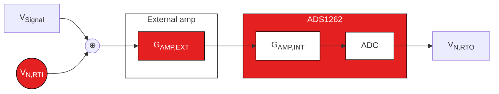

Figure 33. Modified equivalent noise model with ADS1262 ADC and PGA noise combined.

$$V_{N, RTI} = \sqrt{(V_{N, AMP})^2 + (V_{N, ADS1262} / G_{AMP, EXT})^2} (nV_{RMS})$$ (25)

For this analysis, let’s choose the **OPA141**, **OPA211** and **OPA378**, three precision op amps with dissimilar voltage noise characteristics, to demonstrate the benefits and challenges of each. Please note that you can perform this same analysis on any type of external amplifier.

## *Calculating amplifier voltage noise*

The next step is to determine the noise voltage of each amplifier. To do so, you need the voltage noise density plot and noise specifications for each, beginning with the OPA141 in **Figure 34**. Note that the OPA141’s voltage noise density comprises two distinct regions: a low-frequency 1/f (flicker) noise region highlighted in red and a flat broadband region highlighted in teal.


<!-- PDF page 41 -->


<table>
  <caption>Figure 34 (a): Voltage noise density vs. Frequency for OPA141 — 1/f noise and Broadband noise regions; nV/√Hz</caption>
  <thead>
    <tr>
      <th>Frequency (Hz)</th>
      <th>Noise Region</th>
      <th>Voltage noise density (nV/√Hz)</th>
    </tr>
  </thead>
  <tbody>
    <tr>
      <th>0.1</th>
      <td>1/f noise</td>
      <td>45</td>
    </tr>
    <tr>
      <th>0.2</th>
      <td>1/f noise</td>
      <td>32</td>
    </tr>
    <tr>
      <th>0.3</th>
      <td>1/f noise</td>
      <td>26</td>
    </tr>
    <tr>
      <th>0.4</th>
      <td>1/f noise</td>
      <td>23</td>
    </tr>
    <tr>
      <th>0.5</th>
      <td>1/f noise</td>
      <td>21</td>
    </tr>
    <tr>
      <th>0.6</th>
      <td>1/f noise</td>
      <td>19</td>
    </tr>
    <tr>
      <th>0.7</th>
      <td>1/f noise</td>
      <td>18</td>
    </tr>
    <tr>
      <th>0.8</th>
      <td>1/f noise</td>
      <td>17</td>
    </tr>
    <tr>
      <th>0.9</th>
      <td>1/f noise</td>
      <td>16</td>
    </tr>
    <tr>
      <th>1</th>
      <td>1/f noise</td>
      <td>15</td>
    </tr>
    <tr>
      <th>2</th>
      <td>1/f noise</td>
      <td>13</td>
    </tr>
    <tr>
      <th>3</th>
      <td>1/f noise</td>
      <td>12</td>
    </tr>
    <tr>
      <th>4</th>
      <td>1/f noise</td>
      <td>11</td>
    </tr>
    <tr>
      <th>5</th>
      <td>1/f noise</td>
      <td>11</td>
    </tr>
    <tr>
      <th>6</th>
      <td>1/f noise</td>
      <td>10.5</td>
    </tr>
    <tr>
      <th>7</th>
      <td>1/f noise</td>
      <td>10.2</td>
    </tr>
    <tr>
      <th>8</th>
      <td>1/f noise</td>
      <td>10</td>
    </tr>
    <tr>
      <th>9</th>
      <td>1/f noise</td>
      <td>9.8</td>
    </tr>
    <tr>
      <th>10</th>
      <td>Broadband noise</td>
      <td>9.5</td>
    </tr>
    <tr>
      <th>20</th>
      <td>Broadband noise</td>
      <td>8.5</td>
    </tr>
    <tr>
      <th>30</th>
      <td>Broadband noise</td>
      <td>8.0</td>
    </tr>
    <tr>
      <th>40</th>
      <td>Broadband noise</td>
      <td>7.8</td>
    </tr>
    <tr>
      <th>50</th>
      <td>Broadband noise</td>
      <td>7.6</td>
    </tr>
    <tr>
      <th>60</th>
      <td>Broadband noise</td>
      <td>7.4</td>
    </tr>
    <tr>
      <th>70</th>
      <td>Broadband noise</td>
      <td>7.3</td>
    </tr>
    <tr>
      <th>80</th>
      <td>Broadband noise</td>
      <td>7.2</td>
    </tr>
    <tr>
      <th>90</th>
      <td>Broadband noise</td>
      <td>7.1</td>
    </tr>
    <tr>
      <th>100</th>
      <td>Broadband noise</td>
      <td>7.0</td>
    </tr>
    <tr>
      <th>1k</th>
      <td>Broadband noise</td>
      <td>6.5</td>
    </tr>
    <tr>
      <th>10k</th>
      <td>Broadband noise</td>
      <td>6.5</td>
    </tr>
    <tr>
      <th>100k</th>
      <td>Broadband noise</td>
      <td>6.5</td>
    </tr>
  </tbody>
</table>

<table>
  <thead>
    <tr>
      <th>Parameter</th>
      <th>Typ</th>
      <th>Unit</th>
    </tr>
  </thead>
  <tbody>
    <tr>
      <td colspan="3">Input voltage noise</td>
    </tr>
    <tr>
      <td>f = 0.1 Hz to 10 Hz</td>
      <td>250</td>
      <td>nV<sub>PP</sub></td>
    </tr>
    <tr>
      <td>f = 0.1 Hz to 10 Hz</td>
      <td>42</td>
      <td>nV<sub>RMS</sub></td>
    </tr>
    <tr>
      <td colspan="3">Input voltage noise density</td>
    </tr>
    <tr>
      <td>f = 10 Hz</td>
      <td>12</td>
      <td>nV/√<span>Hz</span></td>
    </tr>
    <tr>
      <td>f = 100 Hz</td>
      <td>6.5</td>
      <td>nV/√<span>Hz</span></td>
    </tr>
    <tr>
      <td>f = 1 kHz</td>
      <td>6.5</td>
      <td>nV/√<span>Hz</span></td>
    </tr>
  </tbody>
</table>

(b)

**Figure 34.** *OPA141 voltage noise density plot (a) and table of noise parameters (b) with 1/f (red) and broadband noise (teal) highlighted.*

This nonflat noise density makes calculating the OPA141’s noise contribution a challenge. For narrow bandwidth systems, the 1/f noise will dominate, whereas wide-bandwidth systems will be much more dependent on the amplifier’s broadband noise. Therefore, to determine the amplifier’s noise contribution, you first need to calculate the system effective noise bandwidth (ENBW).

Given the narrow bandwidth of the ADC’s digital filter at the chosen ODR, you can assume that the ADC’s bandwidth dominates the overall signal chain. At the end of Chapter 2, I calculated an effective noise bandwidth of 14 Hz using the ADS1262’s Sinc4 filter at 60 SPS (you could also have approximated the ENBW using the filter’s –3-dB point at this ODR). You can use 14 Hz as the system ENBW and overlay it on the OPA141 plot as an ideal brick-wall filter to determine the amplifier’s noise contribution, highlighted by the teal region in **Figure 35**.

<!--llamaparse-error ordinal="2" mode="chart" box_2d="[668,292,879,707]" code="SPECIALIST_ERROR"-->

**Figure 35.** *OPA141 voltage noise spectral density plot with an ideal brick-wall filter at 14 Hz.*


<!-- PDF page 42 -->


Since the ENBW is small, the OPA141’s noise comes almost entirely from the 1/f region. To determine the actual value of this noise, you can use direct integration or **simplified formulas** that estimate the area under the noise density curve. When you perform these calculations, you’ll find that the OPA141 contributes 45 $nV_{RMS}$ of noise into the system.

How does this compare to the next op amp, the OPA211? **Figure 36** shows the OPA211’s noise parameters as well as its voltage noise spectral density curve, which has a similar shape compared to the OPA141. The teal region highlights the OPA211’s noise contribution given an ENBW of 14 Hz.

<table>
  <caption>Figure 36. OPA211 voltage noise spectral density plot (a) — Frequency (Hz) vs Voltage noise density (nV/√Hz)</caption>
  <thead>
    <tr>
      <th>Frequency (Hz)</th>
      <th>OPA211 Voltage noise density (nV/√Hz)</th>
      <th>Ideal brick-wall filter (nV/√Hz)</th>
      <th>Notes</th>
    </tr>
  </thead>
  <tbody>
    <tr>
      <th>0.1</th>
      <td>22.0</td>
      <td>40.0</td>
      <td>OPA211's noise contribution (teal region) starts</td>
    </tr>
    <tr>
      <th>0.2</th>
      <td>15.0</td>
      <td>40.0</td>
      <td>OPA211's noise contribution (teal region)</td>
    </tr>
    <tr>
      <th>0.3</th>
      <td>12.0</td>
      <td>40.0</td>
      <td>OPA211's noise contribution (teal region)</td>
    </tr>
    <tr>
      <th>0.4</th>
      <td>10.0</td>
      <td>40.0</td>
      <td>OPA211's noise contribution (teal region)</td>
    </tr>
    <tr>
      <th>0.5</th>
      <td>9.0</td>
      <td>40.0</td>
      <td>OPA211's noise contribution (teal region)</td>
    </tr>
    <tr>
      <th>0.6</th>
      <td>8.0</td>
      <td>40.0</td>
      <td>OPA211's noise contribution (teal region)</td>
    </tr>
    <tr>
      <th>0.8</th>
      <td>7.0</td>
      <td>40.0</td>
      <td>OPA211's noise contribution (teal region)</td>
    </tr>
    <tr>
      <th>1</th>
      <td>6.0</td>
      <td>40.0</td>
      <td>OPA211's noise contribution (teal region)</td>
    </tr>
    <tr>
      <th>2</th>
      <td>4.2</td>
      <td>40.0</td>
      <td>OPA211's noise contribution (teal region)</td>
    </tr>
    <tr>
      <th>3</th>
      <td>3.5</td>
      <td>40.0</td>
      <td>OPA211's noise contribution (teal region)</td>
    </tr>
    <tr>
      <th>4</th>
      <td>3.0</td>
      <td>40.0</td>
      <td>OPA211's noise contribution (teal region)</td>
    </tr>
    <tr>
      <th>5</th>
      <td>2.7</td>
      <td>40.0</td>
      <td>OPA211's noise contribution (teal region)</td>
    </tr>
    <tr>
      <th>6</th>
      <td>2.5</td>
      <td>40.0</td>
      <td>OPA211's noise contribution (teal region)</td>
    </tr>
    <tr>
      <th>8</th>
      <td>2.2</td>
      <td>40.0</td>
      <td>OPA211's noise contribution (teal region)</td>
    </tr>
    <tr>
      <th>10</th>
      <td>2.0</td>
      <td>40.0</td>
      <td>OPA211's noise contribution (teal region) ends; Filter cutoff</td>
    </tr>
    <tr>
      <th>20</th>
      <td>1.7</td>
      <td></td>
      <td></td>
    </tr>
    <tr>
      <th>30</th>
      <td>1.6</td>
      <td></td>
      <td></td>
    </tr>
    <tr>
      <th>40</th>
      <td>1.5</td>
      <td></td>
      <td></td>
    </tr>
    <tr>
      <th>50</th>
      <td>1.5</td>
      <td></td>
      <td></td>
    </tr>
    <tr>
      <th>60</th>
      <td>1.4</td>
      <td></td>
      <td></td>
    </tr>
    <tr>
      <th>80</th>
      <td>1.4</td>
      <td></td>
      <td></td>
    </tr>
    <tr>
      <th>100</th>
      <td>1.4</td>
      <td></td>
      <td></td>
    </tr>
    <tr>
      <th>1k</th>
      <td>1.1</td>
      <td></td>
      <td></td>
    </tr>
    <tr>
      <th>10k</th>
      <td>1.1</td>
      <td></td>
      <td></td>
    </tr>
    <tr>
      <th>100k</th>
      <td>1.1</td>
      <td></td>
      <td></td>
    </tr>
  </tbody>
</table>

<table>
  <thead>
    <tr>
      <th>Parameter</th>
      <th>Test conditions</th>
      <th>Min</th>
      <th>Typ</th>
      <th>Max</th>
      <th>Unit</th>
    </tr>
  </thead>
  <tbody>
    <tr>
      <td>Input voltage noise</td>
      <td>f = 0.1 Hz to 10 Hz</td>
      <td></td>
      <td>80</td>
      <td></td>
      <td>nV<sub>PP</sub></td>
    </tr>
    <tr>
      <td rowspan="3">Input voltage<br />noise density</td>
      <td>f = 10 Hz</td>
      <td></td>
      <td>2</td>
      <td></td>
      <td>nV/√<span>Hz</span></td>
    </tr>
    <tr>
      <td>f = 100 Hz</td>
      <td></td>
      <td>1.4</td>
      <td></td>
      <td>nV/√<span>Hz</span></td>
    </tr>
    <tr>
      <td>f = 1 kHz</td>
      <td></td>
      <td>1.1</td>
      <td></td>
      <td>nV/√<span>Hz</span></td>
    </tr>
  </tbody>
</table>

(b)

**Figure 36.** *OPA211 voltage noise spectral density plot (a) and table of noise parameters (b).*

However, this teal region represents only 18.3 $nV_{RMS}$ of noise contributed to the system by the OPA211, considerably less than the OPA141. Therefore, you should never assume anything from the shape of the noise plot or the values in the amplifier’s noise tables. Instead, it’s very important to perform the necessary calculations before making any judgments regarding the noise performance of an external amplifier.

The third op amp, the OPA378, has a different voltage noise spectral density curve compared to the previous two, shown in **Figure 37**. Since the OPA378 is a chopper-stabilized amplifier, its noise spectral density curve is approximately flat, with no significant 1/f component. Therefore, you can use the data sheet’s voltage noise density value (20 $nV/\sqrt{Hz}$) to calculate that approximately 76 $nV_{RMS}$ of voltage noise passes into the system, highlighted in teal.


<!-- PDF page 43 -->


<table>
  <caption>(a) OPA378 Voltage noise density and Current noise vs Frequency</caption>
  <thead>
    <tr>
      <th rowspan="2">Frequency (Hz)</th>
      <th colspan="2">Noise Type</th>
    </tr>
    <tr>
      <th>Voltage noise density (nV/√Hz)</th>
      <th>Current noise (fA/√Hz)</th>
    </tr>
  </thead>
  <tbody>
    <tr>
      <th>1</th>
      <td>20</td>
      <td>200</td>
    </tr>
    <tr>
      <th>10</th>
      <td>20</td>
      <td>200</td>
    </tr>
    <tr>
      <th>100</th>
      <td>20</td>
      <td>200</td>
    </tr>
    <tr>
      <th>1k</th>
      <td>20</td>
      <td>200</td>
    </tr>
    <tr>
      <th>10k</th>
      <td>20</td>
      <td>200</td>
    </tr>
  </tbody>
</table>

<table>
  <caption>(a) OPA378 Noise Contribution and Filter Characteristics</caption>
  <thead>
    <tr>
      <th>Feature</th>
      <th>Frequency Range (Hz)</th>
      <th>Voltage noise density (nV/√Hz)</th>
    </tr>
  </thead>
  <tbody>
    <tr>
      <th>OPA378's voltage noise contribution (shaded area)</th>
      <td>1 to 15</td>
      <td>20</td>
    </tr>
    <tr>
      <th>Ideal brick-wall filter (dashed line)</th>
      <td>1 to 15</td>
      <td>60</td>
    </tr>
  </tbody>
</table>

<table><thead><tr><th>Parameter</th><th>Test conditions</th><th>Typ</th><th>Unit</th></tr></thead><tbody><tr><td>Input voltage noise</td><td>f = 0.1 Hz to 10 Hz, V<sub>S</sub> = +5.5 V</td><td>0.4</td><td>μV<sub>PP</sub></td></tr><tr><td>Input voltage noise density</td><td>f = 1 kHz</td><td>20</td><td>nV/√Hz</td></tr><tr><td>Input current noise</td><td>f = 10 Hz</td><td>200</td><td>fA/√Hz</td></tr><tr><td></td><th>Op amp</th><th>Voltage noise at ENBW = 14 Hz (nV<sub>RMS</sub>)</th><td></td></tr><tr><td></td><td>OPA141</td><td>45</td><td></td></tr><tr><td></td><td>OPA211</td><td>18</td><td></td></tr><tr><td></td><td>OPA378</td><td>76</td><td></td></tr></tbody></table>

(b)

**Figure 37.** *OPA378 voltage noise spectral density plot (a) and table of noise parameters (b).*

With the voltage-noise calculations complete, let’s add these amplifiers to the input of the ADS1262 and see how they impact system noise performance. But first, let’s a take a quick look at one other parameter captured in Figure 37: current noise.

### **A point about current noise**

While my focus has been on voltage noise throughout this section, the OPA378’s noise spectral density curve in **Figure 37** includes a current noise plot as well (in units of femtoamperes per square-root hertz). Using the same ENBW from the voltage noise calculations, you can calculate the OPA378’s current-noise contribution to be 759 fA<sub>RMS</sub>. While this value may seem insignificant compared to the OPA378’s voltage noise, recall that the cumulative effect of current noise depends on the input impedance this component sees. Therefore, it is imperative to understand at what input impedance you can consider the OPA378’s current noise to be significant.

**Figure 38** plots input impedance versus the percentage increase of total noise (voltage plus current) using the OPA378. The figure highlights several different input impedances and their corresponding effect on total noise. For example, an input impedance of 14 kΩ results in a current noise that increases total noise by 1% relative to voltage noise alone. Or, if you could afford a 10% increase in noise budget, your system could tolerate an input impedance of 46 kΩ.


<!-- PDF page 44 -->


<!--llamaparse-error ordinal="0" mode="chart" box_2d="[65,25,265,825]" code="SPECIALIST_ERROR"-->

Therefore, current noise can be important when your signal source/sensor output impedance is large. However, for typical sensor inputs such as RTDs or resistive bridge circuits—whose impedance is generally ≤1 kΩ—current noise would have very little impact on the total noise.

I will ignore current noise in this example under the assumption that the input impedance is small. However, a complete noise analysis always includes current noise calculations, at least to confirm that it is negligible.

Now, let’s complete the analysis by adding the external op amps to the input of the ADS1262 to compare the results.

### External operational amps and precision delta-sigma ADCs

**Table 18** summarizes the noise performance of the three different op amps analyzed thus far.

To compare these external op amps against the ADC’s baseline performance, you can plot the input-referred noise as a function of gain for the ADS1262 using the data-sheet values. Then, using the information in **Table 18**, add each op amp to the input of the ADS1262 and use *Equation 25* to plot the total input-referred noise across all binary gain values up to 512 V/V. In all cases using external op amps, set the ADS1262 gain to 1 V/V. **Figure 39** depicts this plot.

<!--llamaparse-error ordinal="2" mode="chart" box_2d="[670,24,910,925]" code="SPECIALIST_ERROR"-->


<!-- PDF page 45 -->


**Figure 39** provides several interesting conclusions, most notably that the OPA378 and OPA141 actually increase the total input-referred noise—even at the highest gains— compared to using the ADS1262 alone, while the OPA211 decreases the overall system noise.

Additionally, all of the curves in **Figure 39** begin to flatten at some gain, for example at 16 V/V for the OPA378 and at 64 V/V for the OPA211. This transition point acts as a useful gain limit, or the point at which adding more gain has a negligible impact on input-referred noise performance (and therefore no value from a resolution perspective).

As I discussed at the beginning of **Section 5**, increasing gain will result in the first gain stage dominating the overall input-referred noise equation (see **Equation 25**). At this point, the noise-versus-gain relationship essentially becomes constant. Even the ADS1262 by itself experiences this phenomenon at 32 V/V, with the internal PGA becoming the dominant noise source.

In many circumstances, adding an external op amp to the input of a high-resolution delta-sigma ADC will actually hurt your noise performance, as was the case with the OPA141 and OPA378. This is because ADC manufacturers optimize delta-sigma ADCs—and any integrated PGAs, if applicable—for precision and accuracy within a relatively narrow range of input signals. However, even precision amplifiers like those discussed in this section need to allow for a much wider range of input signals, making it more challenging to achieve the same level of performance.

When external amplifiers do improve noise performance, this improvement has a limit (as shown in **Figure 39**). Adding an external op amp can also impact other system performance metrics such as offset, gain error and drift, in addition to increasing cost, board space and power consumption.

Ultimately, it is imperative to carefully consider the purpose of amplifiers in the signal chain when using high-resolution delta-sigma ADCs. In some cases they may be necessary—attenuating high-voltage inputs, for example—so understanding their effect on system noise is critical to a successful design.

## **Key takeaways**

Here is a summary of important points to better understand how amplifier noise affects delta-sigma ADCs:

1. Know how to determine total amplifier noise.
2. Consider the impact of current noise if the source has a high-impedance output.
3. Integrated PGAs offer several benefits:
   * They require less math when designing a DAQ system.
   * They are optimized for resolution and accuracy.
4. Understand that higher gain does not always increase resolution; it depends on the amplifier(s) that you use, the ADC and the system ENBW.
5. Amplifiers can impact other performance metrics in addition to noise (offset, drift, etc.).


<!-- PDF page 46 -->


## **Chapter 4: Voltage reference noise**

Imagine that you need to design a high-resolution sensor-measurement system, such as a precision temperature-sensing unit to control an industrial oven. To accomplish this, you install a thermocouple in the oven to measure the temperature, attach the thermocouple leads to the measurement system, and the analog-to-digital converter (ADC) outputs a digital code. How do you determine the actual temperature to which that code corresponds?

In analog circuit design, you use a voltage reference as a baseline to make analog measurements against. In the context of this example, the nominal voltage of the reference determines the resulting output code, which correlates to a specific temperature. If you changed the reference voltage, the output code would scale as well, while the measured temperature would remain the same.

Since the output code is directly related to the value of the reference voltage, a noisy or inaccurate voltage reference yields measurements that are similarly unreliable. Therefore, for high-resolution systems, choosing an appropriate voltage reference is equally as important as choosing a precision ADC.

To further understand how different noise sources impact precision delta-sigma ADCs, I’ll first discuss these topics as they relate to voltage reference noise:

* Reference noise and ADC noise.
* How gain affects reference noise.

Then, I’ll take the observations from **Section 6.1** and define several ways to reduce reference noise. I’ll also examine how reference noise affects low- and high-resolution ADCs.

**How voltage reference noise affects delta-sigma ADCs** **Reducing reference noise in delta-sigma ADC signal chains**


<!-- PDF page 47 -->


## How voltage reference noise affects delta-sigma ADCs

In **Section 3.2**, I discussed two different types of measurements used to characterize ADC noise: sine-wave input and input short. Sine-wave input, as its name implies, inputs a sine wave with a specific amplitude and frequency to characterize how the ADC quantizes this signal. Conversely, the input-short method determines ADC performance at DC by shorting the device’s inputs and measuring the slight variations in the output code as a result of thermal noise. **Figure 40** illustrates these types of noise measurements.

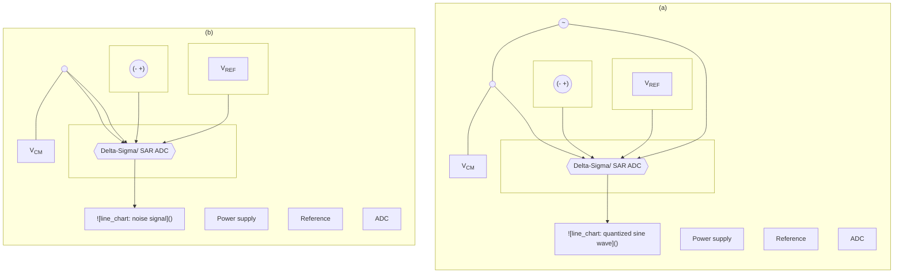

**Figure 40.** *Sine-wave-input test setup (a); input-short test setup (b).*

The ADC’s output code is proportional to the ADC input signal amplitude (V<sub>IN</sub>) divided by the ADC’s reference voltage (V<sub>REF</sub>), as expressed by **Equation 26**:

$$output\ code \propto \frac{V_{IN}}{V_{REF}} \hfill (26)$$

When ADC manufacturers use a nonzero input signal to characterize an ADC—as is the case with the sine-wave-input method—the resulting output code includes some reference noise. While the intent is to characterize only the ADC noise, this reference noise invariably becomes part of the noise parameters reported in the ADC’s data sheet, including signal-to-noise ratio (SNR) and signal-to-noise ratio and distortion (SINAD). Therefore, using a system similar to the ADC’s testing setup allows you to achieve ADC noise performance comparable to what is reported in the data sheet for devices characterized by the sine-wave-input method.

Comparatively, the input-short method uses a 0-V input signal to measure the fluctuations in the ADC output code when no signal is present. In this case, no reference noise appears at the output because the ratio in **Equation 26** always equals zero. The input-short method defines an ADC’s absolute resolution limit, since you cannot expect to reliably measure an input smaller than the ADC’s inherent noise. As a result of the shorted inputs, data-sheet noise parameters, such as input-referred noise and effective resolution, do not include the effects of reference noise. If you want to measure a nonzero input signal with this type of ADC, you should expect the previously unseen voltage reference noise to increase the total noise seen at the output beyond what is stated in the ADC’s data sheet.

To determine how much noise the voltage reference adds, **Figure 41** shows the relationship between ADC noise, reference noise and combined noise as a function of how much of the full-scale range (FSR) is used (percent utilization). **Figure 41**, along with the subsequent discussion, is applicable to cases where the ADC noise is less than the reference noise (N<sub>ADC</sub> < N<sub>REF</sub>). If the opposite were true (N<sub>ADC</sub> > N<sub>REF</sub>), the lower-noise voltage reference would offer little to no benefit due to comparatively higher ADC noise.


<!-- PDF page 48 -->


<table>
  <caption>Figure 41. ADC noise (teal bar chart), reference noise (red bar chart) and combined ADC-plus-reference noise (grey line) as a function of positive FSR utilization. — Input-referred noise (µV<sub>RMS</sub>) vs Full-scale utilization (%)</caption>
  <thead>
    <tr>
      <th>Full-scale utilization (%)</th>
      <th>ADC noise (teal bar) (µV<sub>RMS</sub>)</th>
      <th>Reference noise (red bar) (µV<sub>RMS</sub>)</th>
      <th>Total noise (grey line) (µV<sub>RMS</sub>)</th>
      <th>Notes</th>
    </tr>
  </thead>
  <tbody>
    <tr>
      <th>0</th>
      <td>1.8</td>
      <td>0.0</td>
      <td>1.8</td>
      <td>Point A</td>
    </tr>
    <tr>
      <th>10</th>
      <td>1.8</td>
      <td>0.6</td>
      <td>1.9</td>
      <td></td>
    </tr>
    <tr>
      <th>20</th>
      <td>1.8</td>
      <td>1.2</td>
      <td>2.2</td>
      <td></td>
    </tr>
    <tr>
      <th>30</th>
      <td>1.8</td>
      <td>1.8</td>
      <td>2.5</td>
      <td></td>
    </tr>
    <tr>
      <th>40</th>
      <td>1.8</td>
      <td>2.4</td>
      <td>3.0</td>
      <td></td>
    </tr>
    <tr>
      <th>50</th>
      <td>1.8</td>
      <td>3.0</td>
      <td>3.5</td>
      <td>Point C (at ~45%)</td>
    </tr>
    <tr>
      <th>60</th>
      <td>1.8</td>
      <td>3.6</td>
      <td>4.1</td>
      <td></td>
    </tr>
    <tr>
      <th>70</th>
      <td>1.8</td>
      <td>4.2</td>
      <td>4.6</td>
      <td></td>
    </tr>
    <tr>
      <th>80</th>
      <td>1.8</td>
      <td>4.8</td>
      <td>5.1</td>
      <td></td>
    </tr>
    <tr>
      <th>90</th>
      <td>1.8</td>
      <td>5.4</td>
      <td>5.7</td>
      <td></td>
    </tr>
    <tr>
      <th>100</th>
      <td>1.8</td>
      <td>6.0</td>
      <td>6.3</td>
      <td>Point B</td>
    </tr>
  </tbody>
</table>

**Figure 41.** *ADC noise (teal bar chart), reference noise (red bar chart) and combined ADC-plus-reference noise (grey line) as a function of positive FSR utilization.*

**Figure 41** has three important points:

* **Point A.** This point is the total noise when the input voltage is 0 V. Since Point A uses the same conditions that define the input-short noise measurement test, you can read it directly from the ADC’s data sheet.
* **Point B.** This is the total noise when the input voltage is equal to the reference voltage—that is, a full-scale reading. In general, take the root sum of squares (RSS) of the reference noise and the ADC noise to determine Point B. However, when the reference noise is much larger than the ADC noise—as is the case in **Figure 41**—you can approximate Point B as just the reference noise. Either way, you generally cannot read the value of the voltage reference noise directly from the data sheet, since it depends on several factors including the voltage reference’s noise characteristics. **Figure 42** shows the output noise spectral density for TI’s **REF6025**, a 2.5-V precision voltage reference.

<table>
  <caption>Figure 42. Output noise spectral density plot for the REF6025 — Output noise spectral density (nV/√Hz) vs Frequency (Hz) for different capacitor values (10 µF, 22 µF, 47 µF)</caption>
  <thead>
    <tr>
      <th>Frequency (Hz)</th>
      <th>10 µF (red line)</th>
      <th>22 µF (black line)</th>
      <th>47 µF (grey line)</th>
    </tr>
  </thead>
  <tbody>
    <tr>
      <th>1k</th>
      <td>20.5</td>
      <td>19.5</td>
      <td>19.0</td>
    </tr>
    <tr>
      <th>2k</th>
      <td>12.5</td>
      <td>11.5</td>
      <td>11.5</td>
    </tr>
    <tr>
      <th>3k</th>
      <td>9.0</td>
      <td>8.5</td>
      <td>9.0</td>
    </tr>
    <tr>
      <th>4k</th>
      <td>7.5</td>
      <td>7.5</td>
      <td>7.5</td>
    </tr>
    <tr>
      <th>5k</th>
      <td>6.5</td>
      <td>6.5</td>
      <td>7.0</td>
    </tr>
    <tr>
      <th>6k</th>
      <td>6.0</td>
      <td>5.5</td>
      <td>6.0</td>
    </tr>
    <tr>
      <th>7k</th>
      <td>5.5</td>
      <td>5.0</td>
      <td>5.5</td>
    </tr>
    <tr>
      <th>8k</th>
      <td>5.0</td>
      <td>4.5</td>
      <td>5.0</td>
    </tr>
    <tr>
      <th>9k</th>
      <td>4.8</td>
      <td>4.3</td>
      <td>4.8</td>
    </tr>
    <tr>
      <th>10k</th>
      <td>4.5</td>
      <td>4.0</td>
      <td>4.5</td>
    </tr>
    <tr>
      <th>20k</th>
      <td>4.0</td>
      <td>3.8</td>
      <td>3.8</td>
    </tr>
    <tr>
      <th>30k</th>
      <td>3.8</td>
      <td>3.5</td>
      <td>3.5</td>
    </tr>
    <tr>
      <th>40k</th>
      <td>3.6</td>
      <td>3.4</td>
      <td>3.3</td>
    </tr>
    <tr>
      <th>50k</th>
      <td>3.5</td>
      <td>3.3</td>
      <td>3.2</td>
    </tr>
    <tr>
      <th>60k</th>
      <td>3.4</td>
      <td>3.2</td>
      <td>3.1</td>
    </tr>
    <tr>
      <th>70k</th>
      <td>3.3</td>
      <td>3.1</td>
      <td>3.0</td>
    </tr>
    <tr>
      <th>80k</th>
      <td>3.3</td>
      <td>3.0</td>
      <td>2.9</td>
    </tr>
    <tr>
      <th>90k</th>
      <td>3.2</td>
      <td>2.9</td>
      <td>2.8</td>
    </tr>
    <tr>
      <th>100k</th>
      <td>3.2</td>
      <td>2.8</td>
      <td>2.7</td>
    </tr>
    <tr>
      <th>200k</th>
      <td>3.2</td>
      <td>2.5</td>
      <td>2.2</td>
    </tr>
    <tr>
      <th>300k</th>
      <td>3.3</td>
      <td>2.2</td>
      <td>1.9</td>
    </tr>
    <tr>
      <th>400k</th>
      <td>3.3</td>
      <td>2.0</td>
      <td>1.7</td>
    </tr>
    <tr>
      <th>500k</th>
      <td>3.2</td>
      <td>1.8</td>
      <td>1.5</td>
    </tr>
    <tr>
      <th>600k</th>
      <td>2.8</td>
      <td>1.6</td>
      <td>1.3</td>
    </tr>
    <tr>
      <th>700k</th>
      <td>2.0</td>
      <td>1.4</td>
      <td>1.1</td>
    </tr>
    <tr>
      <th>800k</th>
      <td>1.3</td>
      <td>1.2</td>
      <td>1.0</td>
    </tr>
    <tr>
      <th>900k</th>
      <td>1.3</td>
      <td>1.2</td>
      <td>1.1</td>
    </tr>
    <tr>
      <th>1000k</th>
      <td>1.5</td>
      <td>1.3</td>
      <td>1.2</td>
    </tr>
  </tbody>
</table>

**Figure 42.** *Output noise spectral density plot for the REF6025.*

In **Figure 42**, note the significant increase in noise density at low frequencies (1/f [flicker] noise) compared to the relatively flat noise density at higher frequencies (broadband noise). Like several of the amplifiers analyzed in Section 3.2, reference noise performance is not necessarily constant over frequency.

Fortunately, you can use the same methods to calculate reference noise that you use to calculate amplifier noise, including direct integration or **simplified formulas**. You will also need to calculate the system’s effective noise bandwidth (ENBW) to use these methods, as ENBW provides a cutoff frequency for the reference noise entering the system.


<!-- PDF page 49 -->


* **Point C.** This point is any generic noise value between the extremes of Points A and B. You can calculate Point C using **Equation 27**:

$$V_{Noise\@Point\ C} = \sqrt{Point\ A^2 + (\%FS \times Point\ B)^2} \hfill (27)$$

In **Equation 27**, Point B scales according to the percent utilization of the FSR. In general, you can use **Equation 27** to determine the total noise at any point on the plot in **Figure 41**, including Points A and B.

One important result of **Equation 27** is that given the condition that N<sub>ADC</sub> < N<sub>REF</sub>, there exists a point at which reference noise dominates regardless of percent utilization. At this point, increasing your signal amplitude offers no noise performance benefit, which contradicts the common belief that gaining up the input signal always reduces noise.

Instead, you need to balance increasing gain and FSR utilization to ensure that you meet the system noise requirements. Let’s examine the relationship between gain and reference noise with an example.

### How gain affects reference noise

For this example, let’s continue using the REF6025 shown in **Figure 42** and pair it with the **ADS1261**, a 24-bit delta sigma ADC. This device offers low noise and an integrated programmable gain amplifier (PGA), both of which will make the reference-noise-versus-gain relationship more apparent. Despite these choices, you can apply this analysis to any combination of ADCs and voltage references. **Figure 43** shows the system setup for this example.

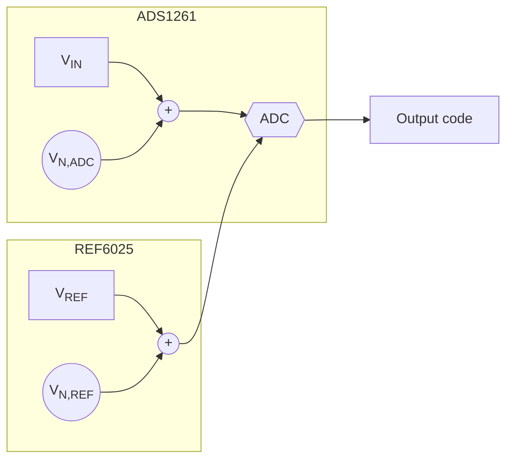

**Figure 43.** System setup using the ADS1261 and REF6025.

Similar to the amplifier noise analysis in Section 3.1, you can separate the components in **Figure 43** into noiseless devices preceded by a voltage source that is equivalent to each component’s noise. The ADC noise (V<sub>N,ADC</sub>) is listed in the ADS1261’s data sheet, while you must calculate the voltage reference noise (V<sub>N,REF</sub>) using the REF6025 data sheet as well as the system ENBW. Fortunately, you can use the approximation methods I detailed in Section 2.2 to determine the system ENBW. In this case, the ENBW is 13 Hz using a 60 samples per second (SPS) output data rate (ODR) as well as the low-latency filter of the ADS1261. This yields approximately 1.2 µV<sub>RMS</sub> of noise using the REF6025. Finally, you need to choose an input signal that allows you to use all available ADC gain options. Using the ADS1261’s maximum gain of 128 V/V enables a maximum differential input voltage of ±19.5 mV using a 2.5-V reference voltage. **Table 19** summarizes the system specifications.


<!-- PDF page 50 -->


*Table 19. System specifications for the ADS1261-plus-REF6025 example.*

<table>
  <thead>
    <tr>
      <th>Parameter</th>
      <th>Value</th>
    </tr>
  </thead>
  <tbody>
    <tr>
      <td>Input signal (mV)</td>
      <td>±19.5</td>
    </tr>
    <tr>
      <td>ENBW (Hz)</td>
      <td>13</td>
    </tr>
    <tr>
      <td>REF6025 noise (μV<sub>RMS</sub>)</td>
      <td>1.2 (at 13 Hz)</td>
    </tr>
    <tr>
      <td>ADC data rate (SPS)</td>
      <td>60</td>
    </tr>
    <tr>
      <td>Filter type</td>
      <td>Sinc4</td>
    </tr>
    <tr>
      <td>ADC gains</td>
      <td>1:128 (binary)</td>
    </tr>
    <tr>
      <td>ADS1261 noise</td>
      <td>(see data sheet)</td>
    </tr>
  </tbody>
</table>

You can now plot the noise of each component as a function of the ADS1261 PGA’s gain to see how gain affects ADC and reference noise. You can also calculate the system’s effective resolution at each step to understand how the introduction of reference noise affects the system’s dynamic range. Note that “effective resolution” in this context is calculated using a 19.5-mV signal and not the maximum possible FSR at each gain setting, as is common in ADC data sheets. **Figure 44** shows the plot for the ADS1261.

<table>
  <caption>Figure 44. ADS1261 noise, reference noise and effective resolution as a function of gain.</caption>
  <thead>
    <tr>
      <th rowspan="2">Gain (V/V)</th>
      <th colspan="2">Input-referred noise (µV<sub>RMS</sub>)</th>
      <th>Effective resolution (bits)</th>
    </tr>
    <tr>
      <th>ADC noise</th>
      <th>REF noise</th>
      <th>Effective resolution</th>
    </tr>
  </thead>
  <tbody>
    <tr>
      <th>1</th>
      <td>0.368</td>
      <td>0.008</td>
      <td>15.7</td>
    </tr>
    <tr>
      <th>2</th>
      <td>0.198</td>
      <td>0.008</td>
      <td>16.5</td>
    </tr>
    <tr>
      <th>4</th>
      <td>0.109</td>
      <td>0.008</td>
      <td>17.4</td>
    </tr>
    <tr>
      <th>8</th>
      <td>0.056</td>
      <td>0.008</td>
      <td>18.3</td>
    </tr>
    <tr>
      <th>16</th>
      <td>0.039</td>
      <td>0.008</td>
      <td>18.9</td>
    </tr>
    <tr>
      <th>32</th>
      <td>0.031</td>
      <td>0.008</td>
      <td>19.2</td>
    </tr>
    <tr>
      <th>64</th>
      <td>0.027</td>
      <td>0.007</td>
      <td>19.3</td>
    </tr>
    <tr>
      <th>128</th>
      <td>0.028</td>
      <td>0.008</td>
      <td>19.3</td>
    </tr>
  </tbody>
</table>

**Figure 44.** *ADS1261 noise, reference noise and effective resolution as a function of gain.*

**Figure 44** shows that the reference noise is almost negligible compared to the ADC noise, even when using 100% of the positive FSR. Changing the gain had no effect on how much reference noise passed into the system due to the very small input voltage, but it did reduce the total noise by reducing the ADC noise (as expected).

Interestingly, both **Figure 41** and **Figure 44** have a useful FSR utilization limit (as was the case with the amplifier noise analysis). Increasing the input signal beyond this point offers no benefit from a system noise perspective. In **Figure 41**, this occurs at a 40% utilization factor. In **Figure 44**, this limit begins at approximately a gain of 32 V/V as the effective resolution curve begins to flatten.

(These limits are specific to this input voltage, noise bandwidth, ADC and reference combination. Different combinations change this system limitation, making it essential to calculate where this point is in any system to avoid degrading noise performance.)

Moreover, **Figure 41** and **Figure 44** demonstrate the importance of matching your ADC noise to your voltage reference noise (as they relate to your circuit parameters). If your input signals are small and cannot be changed, gaining up


<!-- PDF page 51 -->


your input signal reduces your ADC noise and therefore the total system noise. You might also be able to use a noisier reference as a result, since very little reference noise will actually pass into the system.

Comparatively, if your input signals are greater than mid-scale, you can expect the reference noise to dominate. In these cases, you should always make sure that the ADC noise and reference noise are comparable. Otherwise you will be paying for voltage-reference performance that you cannot actually use. Fortunately, there are multiple ways to reduce the effects of reference noise and maintain precision systems.

## **Key takeaways**

Here is a summary of important points to better understand how voltage reference noise affects delta-sigma ADCs:

1. The system noise contribution from the reference voltage scales with FSR utilization.
2. Reference noise can have 1/f and broadband regions similar to amplifiers.
3. Reference noise in a system results in a useful FSR utilization limit, after which it is not possible to improve noise performance further through signal gain.
4. Try to match the reference source’s noise amplitude to the ADC’s noise performance to avoid degrading resolution with nonzero input signals.

## **Reducing reference noise in delta-sigma ADC signal chains**

In **Section 6.1**, I discussed the relationship between ADC noise and reference noise, derived an equation for calculating reference noise and determined the effect that gain has on the level of reference noise in a system.

I’ll conclude the discussion of reference noise by analyzing several different methods for reducing its effect in the overall system. I’ll also examine the difference between the impact of reference noise on low- and high-resolution ADCs.

### ***Reducing the effects of reference noise***

The amount of reference noise that enters a data-acquisition system depends on the reference source’s noise performance as well as the percent utilization of the FSR. To demonstrate this reliance on percent utilization, I plotted ADC noise, reference noise and total noise as a function of the full-scale utilization (input voltage), assuming a 2.5-V reference. **Figure 45** shows a plot of this relationship using the TI **ADS1261**, a 24-bit delta-sigma ADC with an integrated PGA.

<table>
  <caption>Figure 45. ADC noise, reference noise and effective resolution as a function of FSR utilization. — Input-referred noise (µV<sub>RMS</sub>) vs. Full-scale utilization (%)</caption>
  <thead>
    <tr>
      <th>Full-scale utilization (%)</th>
      <th>ADC noise (µV<sub>RMS</sub>)</th>
      <th>Reference noise (µV<sub>RMS</sub>)</th>
      <th>Total noise (µV<sub>RMS</sub>)</th>
      <th>Notes</th>
    </tr>
  </thead>
  <tbody>
    <tr>
      <th>0</th>
      <td>0.9</td>
      <td>0.0</td>
      <td>0.9</td>
      <td>Point A</td>
    </tr>
    <tr>
      <th>10</th>
      <td>0.9</td>
      <td>0.3</td>
      <td>1.0</td>
      <td></td>
    </tr>
    <tr>
      <th>20</th>
      <td>0.9</td>
      <td>0.6</td>
      <td>1.1</td>
      <td></td>
    </tr>
    <tr>
      <th>30</th>
      <td>0.9</td>
      <td>0.9</td>
      <td>1.3</td>
      <td></td>
    </tr>
    <tr>
      <th>40</th>
      <td>0.9</td>
      <td>1.2</td>
      <td>1.5</td>
      <td></td>
    </tr>
    <tr>
      <th>50</th>
      <td>0.9</td>
      <td>1.5</td>
      <td>1.7</td>
      <td>Point C</td>
    </tr>
    <tr>
      <th>60</th>
      <td>0.9</td>
      <td>1.8</td>
      <td>2.0</td>
      <td></td>
    </tr>
    <tr>
      <th>70</th>
      <td>0.9</td>
      <td>2.1</td>
      <td>2.3</td>
      <td></td>
    </tr>
    <tr>
      <th>80</th>
      <td>0.9</td>
      <td>2.4</td>
      <td>2.6</td>
      <td></td>
    </tr>
    <tr>
      <th>90</th>
      <td>0.9</td>
      <td>2.7</td>
      <td>2.8</td>
      <td></td>
    </tr>
    <tr>
      <th>100</th>
      <td>0.9</td>
      <td>3.0</td>
      <td>3.1</td>
      <td>Point B</td>
    </tr>
  </tbody>
</table>

**Figure 45.** *ADC noise, reference noise and effective resolution as a function of FSR utilization.*


<!-- PDF page 52 -->


As in Section 4.1, reference noise begins to dominate the system’s total noise at a utilization factor of 40%, nullifying the noise benefit provided by a high-resolution ADC. To help mitigate this issue and achieve precision systems, here are three techniques to help decrease reference noise and take advantage of the noise-reduction benefits of delta-sigma ADCs:

* **Choose a lower-noise reference.** One of the most obvious ways to reduce the level of reference noise entering a system is to choose a voltage reference with less noise. This has the effect of reducing the level of the red bars in **Figure 45** and extending the useful FSR utilization limit. But as I suggested in Section 4.1, take care to match the level of reference noise to the level of ADC noise for any given input signal. For example, if you sample a 2.5-V input signal using the ADS1261, you could only use a gain of 1 V/V. In those circumstances, choosing a voltage reference with less noise than the REF6025 will likely have little effect on overall system noise, since the FSR utilization is so high in **Figure 45**.
* **Increase the reference voltage.** Another method to potentially reduce the effects of reference noise is to increase the reference voltage, as this affects a change in the percent utilization. For example, doubling the reference voltage decreases the percent utilization by a factor of 2. However, this method only offers a system noise benefit if there is no proportional increase in reference noise, which is not always the case. Many discrete voltage-reference families specify noise in microvolts per volt because the reference noise scales linearly with the reference voltage. In this case, doubling the reference voltage also doubles the reference noise, yielding no system noise benefit despite a decrease in percent utilization.
* **Reduce the system ENBW.** A third option to reduce the amount of reference noise passed into the system is to limit the overall ENBW. One way to limit ENBW is by reducing the antialiasing or reference filter cutoff frequencies. However, TI recommends using C0G-type capacitors for input signal-path filters due to the C0G’s low voltage and temperature coefficients. Typical C0G capacitors used in signal-chain design are only available up to 10 to 15 nF, inherently limiting how low the antialiasing filter cutoff can be. Conversely, reference filters may employ higher-capacitance, X7R-type capacitors due to the voltage reference’s virtually constant DC output voltage. For each filter type, use low-drift, low-impedance resistors (<10 kΩ) because the resistor’s thermal noise increases with impedance and may begin to dominate the signal-chain noise. Another way to reduce the system ENBW is to slow down the ADC’s output data rate. **Figure 46** shows how reducing the ADC’s output data rate decreases both the ADC and reference noise simultaneously. For example, between ENBW = 96 Hz (left) and ENBW = 0.6 Hz (right), the reference noise at 100% utilization has decreased by a factor of 2.3, while the ADC noise has decreased by a factor of 10, resulting in far less total noise.

<table>
  <caption>Input-referred noise vs Full-scale utilization — panels: (a) BW = 0.6 Hz, (b) BW = 24 Hz, (c) BW = 96 Hz; series: ADC noise, REF noise, Total noise; unit: μV<sub>RMS</sub></caption>
  <thead>
    <tr>
      <th rowspan="2">Full-scale utilization</th>
      <th colspan="3">(a) BW = 0.6 Hz</th>
      <th colspan="3">(b) BW = 24 Hz</th>
      <th colspan="3">(c) BW = 96 Hz</th>
    </tr>
    <tr>
      <th>ADC noise</th>
      <th>REF noise</th>
      <th>Total noise</th>
      <th>ADC noise</th>
      <th>REF noise</th>
      <th>Total noise</th>
      <th>ADC noise</th>
      <th>REF noise</th>
      <th>Total noise</th>
    </tr>
  </thead>
  <tbody>
    <tr>
      <th>5%</th>
      <td>0.10</td>
      <td>0.01</td>
      <td>0.10</td>
      <td>0.47</td>
      <td>0.06</td>
      <td>0.47</td>
      <td>0.95</td>
      <td>0.08</td>
      <td>0.95</td>
    </tr>
    <tr>
      <th>15%</th>
      <td>0.10</td>
      <td>0.07</td>
      <td>0.13</td>
      <td>0.47</td>
      <td>0.12</td>
      <td>0.49</td>
      <td>0.95</td>
      <td>0.16</td>
      <td>0.97</td>
    </tr>
    <tr>
      <th>25%</th>
      <td>0.10</td>
      <td>0.14</td>
      <td>0.17</td>
      <td>0.47</td>
      <td>0.24</td>
      <td>0.53</td>
      <td>0.95</td>
      <td>0.32</td>
      <td>1.01</td>
    </tr>
    <tr>
      <th>35%</th>
      <td>0.10</td>
      <td>0.21</td>
      <td>0.23</td>
      <td>0.47</td>
      <td>0.37</td>
      <td>0.60</td>
      <td>0.95</td>
      <td>0.48</td>
      <td>1.07</td>
    </tr>
    <tr>
      <th>45%</th>
      <td>0.10</td>
      <td>0.28</td>
      <td>0.30</td>
      <td>0.47</td>
      <td>0.50</td>
      <td>0.69</td>
      <td>0.95</td>
      <td>0.63</td>
      <td>1.15</td>
    </tr>
    <tr>
      <th>55%</th>
      <td>0.10</td>
      <td>0.35</td>
      <td>0.36</td>
      <td>0.47</td>
      <td>0.63</td>
      <td>0.79</td>
      <td>0.95</td>
      <td>0.79</td>
      <td>1.24</td>
    </tr>
    <tr>
      <th>65%</th>
      <td>0.10</td>
      <td>0.41</td>
      <td>0.42</td>
      <td>0.47</td>
      <td>0.75</td>
      <td>0.89</td>
      <td>0.95</td>
      <td>0.94</td>
      <td>1.34</td>
    </tr>
    <tr>
      <th>75%</th>
      <td>0.10</td>
      <td>0.48</td>
      <td>0.49</td>
      <td>0.47</td>
      <td>0.88</td>
      <td>1.00</td>
      <td>0.95</td>
      <td>1.10</td>
      <td>1.45</td>
    </tr>
    <tr>
      <th>85%</th>
      <td>0.10</td>
      <td>0.55</td>
      <td>0.56</td>
      <td>0.47</td>
      <td>1.01</td>
      <td>1.12</td>
      <td>0.95</td>
      <td>1.26</td>
      <td>1.58</td>
    </tr>
    <tr>
      <th>95%</th>
      <td>0.10</td>
      <td>0.62</td>
      <td>0.63</td>
      <td>0.47</td>
      <td>1.14</td>
      <td>1.24</td>
      <td>0.95</td>
      <td>1.41</td>
      <td>1.70</td>
    </tr>
    <tr>
      <th>100%</th>
      <td>0.10</td>
      <td>0.69</td>
      <td>0.70</td>
      <td>0.47</td>
      <td>1.27</td>
      <td>1.36</td>
      <td>0.95</td>
      <td>1.57</td>
      <td>1.83</td>
    </tr>
  </tbody>
</table>

**Figure 46.** *Limiting the ENBW reduces total noise: 0.6 Hz (a), 24 Hz (b) and 96 Hz (c).*


<!-- PDF page 53 -->


While these three methods can mitigate reference noise for many applications, other systems may have fixed parameters—such as settling time or sensor-output voltage—that make these techniques harder to employ. In such instances, you can reduce the amount of reference noise passing into the system by choosing an appropriate reference configuration: internal, external or ratiometric.

### *Internal references*

Precision ADCs often include integrated precision voltage references that are generally suitable for many applications. An integrated reference eliminates the added cost, area and power consumed by an external reference. In general, however, internal references are lower power and may have higher noise and higher drift compared to precision external references, making them less suitable for some high-precision and high-accuracy systems.

*Figure 47* shows the ADS1261 measuring a resistive bridge while using its integrated voltage reference as the reference source for the measurement.


**Figure 47.** *Measuring a resistive bridge using the ADS1261’s internal reference.*

### *External references*

If the specifications of an integrated voltage reference are insufficient and the ADC allows an external reference source, you can choose an external reference instead. External references generally benefit from lower noise and better drift parameters relative to integrated references. This increased performance comes at the expense of higher power consumption, additional cost and increased printed circuit board (PCB) area. Also, since the ADC and voltage reference do not share the same die, their temperature drift specifications may no longer correlate; that is the case with an integrated reference. Therefore, the ADC and reference can drift independently and in opposite directions, causing greater inaccuracy. To avoid this issue, connect both devices to a good, thermally conductive ground plane.

A helpful hint when connecting an ADC to an external reference source is to route the ADC’s negative external reference input (REFN) back to the ground pin of the external reference instead of connecting REFN directly to the PCB’s ground plane. This makes a “star” ground connection that helps avoid ground plane noise pickup on the negative reference input and maintain precision measurement results.

*Figure 48* shows the same resistive bridge connection diagram as in *Figure 47*, but using a REF6025 voltage reference instead of the ADS1261’s internal reference.


<!-- PDF page 54 -->


***Figure 48.*** *Measuring a resistive bridge using the ADS1261’s internal reference.*

### *Ratiometric references*

Where sensor excitation is necessary, such as measuring resistive bridges or resistance temperature detectors, use a ratiometric configuration. This configuration uses the same excitation source for the analog input and reference voltage. As a result, any noise or drift in the excitation source will affect the measurement and the reference equally. Since the ADC output code is a ratio of the input to the reference, the excitation source noise and drift tend to cancel, resulting in noise performance that is much closer to the shorted-input case. In general, this configuration yields the lowest amount of total noise compared to the other two configurations.

The main disadvantage of the ratiometric reference is that it can only be used for applications where sensor excitation is necessary. As a result, if the system doesn’t require sensor excitation, you must choose one of the other two reference configuration options.

**Figure 49** shows the same circuit as in **Figure 47** and **Figure 48**, but with a ratiometric reference configuration. Note how the 5-V bridge-excitation voltage is also used as the ADS1261’s external differential reference voltage (REFP – REFN).


***Figure 49.*** *Measuring a resistive bridge using the ADS1261 and a ratiometric reference.*

So far, I’ve made the qualitative claim that a ratiometric reference provides better noise performance than an external reference, which provides better noise performance than an internal reference. If you look at the data sheet for TI’s 24-bit **ADS1259**, you can see that this is quantitatively true as well. **Figure 50** shows a plot from the ADS1259’s data sheet that includes measured noise performance for all three configurations.


<!-- PDF page 55 -->


<table><caption>Figure 50. Comparing the total noise increase from internal, external and ratiometric reference configurations with the ADS1259. Data rate = 10 SPS; Noise (µVRMS) vs VIN (V)</caption><thead><tr><th>VIN (V)</th><th>Reference Configuration (Noise in µVRMS)</th><th>Reference Configuration (Noise in µVRMS)</th><th>Reference Configuration (Noise in µVRMS)</th></tr><tr><th></th><th>Internal reference CREFIN = 1 µF</th><th>REF5025</th><th>Ratiometric configuration</th></tr></thead><tbody><tr><th>-2.5</th><td>2.5</td><td>1.3</td><td>0.7</td></tr><tr><th>-2.0</th><td>2.1</td><td>1.1</td><td>0.6</td></tr><tr><th>-1.5</th><td>1.6</td><td>0.9</td><td>0.6</td></tr><tr><th>-1.0</th><td>1.1</td><td>0.7</td><td>0.5</td></tr><tr><th>-0.5</th><td>0.7</td><td>0.6</td><td>0.5</td></tr><tr><th>0</th><td>0.5</td><td>0.5</td><td>0.5</td></tr><tr><th>0.5</th><td>0.7</td><td>0.6</td><td>0.5</td></tr><tr><th>1.0</th><td>1.1</td><td>0.7</td><td>0.5</td></tr><tr><th>1.5</th><td>1.6</td><td>0.9</td><td>0.6</td></tr><tr><th>2.0</th><td>2.1</td><td>1.1</td><td>0.6</td></tr><tr><th>2.5</th><td>2.7</td><td>1.3</td><td>0.7</td></tr><tr><td></td><td></td><th>ADC resolution (bits)</th><th>ADC noise (mV<sub>RMS</sub>) (G = 1, 10 SPS, V<sub>REF</sub> = 2.5 V)</th></tr><tr><td></td><td></td><td>8</td><td>19.5</td></tr><tr><td></td><td></td><td>10</td><td>4.9</td></tr><tr><td></td><td></td><td>12</td><td>1.2</td></tr><tr><td></td><td></td><td>14</td><td>0.3</td></tr><tr><td></td><td></td><td>16</td><td>0.076</td></tr><tr><td></td><td></td><td>18</td><td>0.0029</td></tr><tr><td></td><td></td><td>24</td><td>5.3×10-4</td></tr><tr><td></td><td></td><td>32</td><td>1.76×10-4</td></tr></tbody></table>

**Figure 50.** *Comparing the total noise increase from internal, external and ratiometric reference configurations with the ADS1259.*

At V<sub>IN</sub> = 0 V, the plot in **Figure 50** shows the ADS1259’s inherent noise to be approximately 0.5 µV<sub>RMS</sub>. At 100% utilization (V<sub>IN</sub> = ±2.5 V), the internal reference increases this baseline noise by 400% to 2.5 µV<sub>RMS</sub>, while the external REF5025 increases the total noise by 150% to 1.25 µV<sub>RMS</sub>. Compare those curves to the almost-flat ratiometric reference curve, which increases the total noise by only 50% at 100% utilization. This configuration allows you to use the entire FSR of the ADS1259 without increasing total noise by a significant amount, resulting in the best overall system noise performance.

Can you apply these conclusions equally to all delta-sigma ADCs? So far in this e-book, I have analyzed 24- and 32-bit ADCs to get a better understanding of how voltage reference noise affects the performance of these devices. In general, these high-resolution ADCs offer very low noise such that any reference noise has a noticeable effect on system noise. How does reference noise impact lower-resolution ADCs?

### *Lower- vs. higher-resolution ADCs*

You can apply the same principles used to measure the impact of reference noise on lower-resolution ADCs to higher-resolution ADCs. Using the same setup from the previous examples, let’s connect the REF6025 to ADCs with different resolutions and measure the total noise at 100% utilization. **Figure 51** depicts this setup.

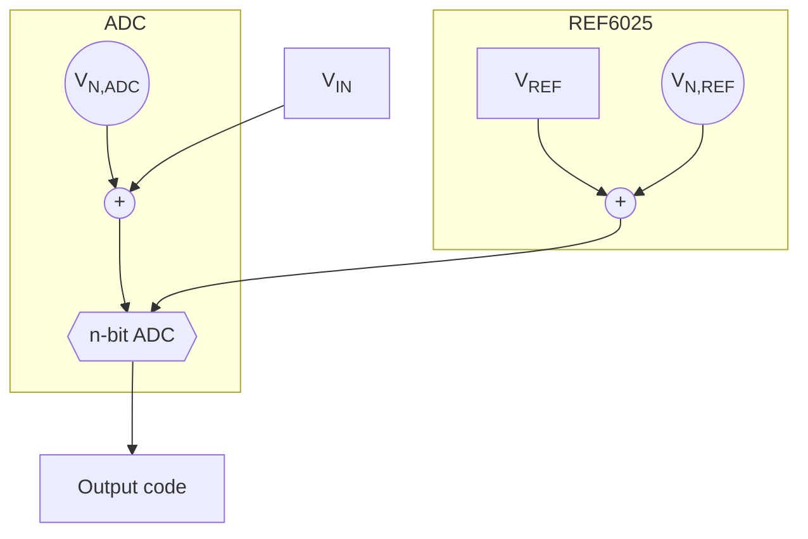

**Figure 51.** *System setup using the ADS1262 and REF6025.*

Let’s choose eight ADCs with different resolutions to act as the *n*-bit ADC in **Figure 51**. **Table 20** provides baseline noise information for each ADC as a function of its resolution.


<!-- PDF page 56 -->


As I discussed in **Section 3.1**, quantization noise usually dominates a lower-resolution ADC’s total noise (<16 bit) such that its value corresponds to the least significant bit (LSB) size. On the contrary, 18-, 24- and 32-bit ADC noise is larger than the corresponding LSB size due to the relatively larger amount of thermal noise in higher-resolution ADCs.

To calculate the combined noise of the ADC and voltage reference, take the RSS of the noise of each component; I assumed 100% utilization. **Table 21** includes the resulting total noise of both components, as well as the percentage noise increase compared to just the ADC’s noise.

<table>
  <caption>Table 21. Total noise and percentage increase by ADC resolution.</caption>
  <thead>
    <tr>
      <th>ADC resolution (bits)</th>
      <th>ADC noise (mV<sub>RMS</sub>) (G = 1, 10 SPS, V<sub>REF</sub> = 2.5 V)</th>
      <th>ADC + REF6025 noise (mV<sub>RMS</sub>) (100% FSR)</th>
      <th>Percentage noise increase (%)</th>
    </tr>
  </thead>
  <tbody>
    <tr>
      <td>8</td>
      <td>19.5</td>
      <td>19.5</td>
      <td>0</td>
    </tr>
    <tr>
      <td>10</td>
      <td>4.9</td>
      <td>4.9</td>
      <td>0</td>
    </tr>
    <tr>
      <td>12</td>
      <td>1.2</td>
      <td>1.2</td>
      <td>0</td>
    </tr>
    <tr>
      <td>14</td>
      <td>0.3</td>
      <td>0.3</td>
      <td>0</td>
    </tr>
    <tr>
      <td>16</td>
      <td>0.076</td>
      <td>0.076</td>
      <td>0.01</td>
    </tr>
    <tr>
      <td>18</td>
      <td>0.0029</td>
      <td>0.00311</td>
      <td>7.40</td>
    </tr>
    <tr>
      <td>24</td>
      <td>5.3×10-4</td>
      <td>0.00125</td>
      <td>136.58</td>
    </tr>
    <tr>
      <td>32</td>
      <td>1.76×10-4</td>
      <td>0.00115</td>
      <td>553.36</td>
    </tr>
  </tbody>
</table>

**Table 21** offers a stark contrast between the effects that reference noise has on lower- and higher-resolution ADCs. Up to approximately the 16-bit level (the red highlighted cells in **Table 21**), the REF6025’s noise has virtually no impact on the total noise of the system, even at 100% utilization. In these cases, the high levels of ADC quantization noise outweigh the lower levels of reference noise. Therefore, the low-noise external reference provides little benefit here, especially when compared against the increased system cost and size. In fact, many lower-resolution ADCs do not include external reference inputs for this reason, instead relying on an integrated reference or even the supply voltage to perform this function.

However, this does not imply that you should never be concerned with reference noise when using lower-resolution ADCs. The cumulative effect depends on the noise of the specific voltage reference, the system bandwidth and the percent utilization. I recommend performing some quick calculations to determine the general effect that any external components might have on the system.

Where reference noise always has a greater impact is on the 18-, 24- and 32-bit higher-resolution ADCs (the teal highlighted cells in **Table 21**). All of these ADCs experience a significant increase in noise relative to the ADC by itself. This result is more pronounced as the ADC resolution increases, with the 32-bit ADC experiencing an incredible 553%


<!-- PDF page 57 -->


increase in noise due to reference noise alone. At the higher-resolution levels, using the noise-reduction methods outlined in this section and choosing an appropriate reference configuration are critical to maintaining precision measurements.

## Key takeaways

Here is a summary of important points to better understand how to reduce the effects of voltage-reference noise on delta-sigma ADCs:

1. To reduce reference noise:
   * Use a low-noise reference.
   * Reduce your ENBW.
   * Increase the reference voltage (as long as the reference noise does not increase proportionally).
   * Use a ratiometric configuration.
2. Optimize system noise performance by choosing a reference configuration that provides reference noise performance similar to your ADC’s noise performance.


<!-- PDF page 58 -->


## **Chapter 5: Clock noise**

All data-acquisition (DAQ) systems require a reference point. At the end of **Section 6**, the reference point was a voltage level that when compared to the analog input signal generated an output code. However, DAQ systems also require another type of reference point, though not one necessarily related to voltage.

In a DAQ system, clocks serve as the time reference such that all components can operate synchronously. For analog-to-digital converters (ADCs), accurate and stable clocks ensure that the host sends commands to the ADC and that the ADC receives commands from the host in the correct order and without corruption. More importantly, the system clock signal enables users to sample the inputs and send data whenever required such that the entire system operates as intended.

Although you may think of clocks as a digital input signals, these components can affect the analog performance of precision DAQ systems. To further understand how clocks affect precision ADCs, I’ll discuss these topics as they relate to clock signals:

* Clock jitter.
* Clock intermodulation.
* The best printed circuit board (PCB) layout practices for clocking.

**How clock signals affect precision ADCs**


<!-- PDF page 59 -->


## How clock signals affect precision ADCs

While you may expect an ADC’s sampling period to be perfectly constant, there is always some deviation from the ideal. “Clock jitter” refers to the variation in a clock waveform’s edges from one period to the next. Since all ADCs use a clock edge to control the sampling point, clock-edge variation results in deviations in the sampling instance. This deviation results in a nonconstant sampling frequency that appears in the conversion result as another source of noise.

Similar to most noise sources discussed so far in this e-book, clock jitter is random and follows a Gaussian distribution. As a result, the sampling uncertainty error is also Gaussian, behaving just like thermal noise. Ultimately, the effect of clock jitter on ADC performance is primarily an increase in the ADC’s noise floor and, subsequently, the total thermal noise of the signal chain. **Figure 52** shows the sampling-edge variation caused by clock jitter on a sinusoidal input signal.

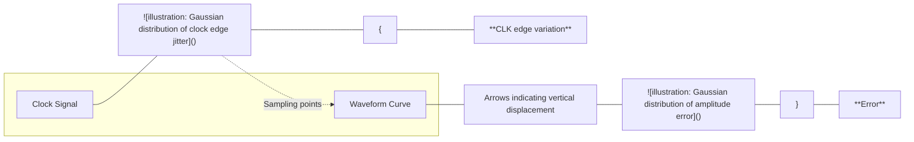

**Figure 52.** *Clock signal showing sampling-edge variation due to jitter.*

The amount by which the thermal noise increases depends on the input signal’s slew rate and the amount of clock jitter in your clock source. You can calculate the theoretical upper limit of the ADC’s signal-to-noise ratio (SNR) using **Equation 28**:

$$SNR_{Upper Limit} = -20 \times \log_{10}(2 \times \pi \times f_{IN} \times t_{JITTER})$$ (28)

where f<sub>IN</sub> is the input signal frequency and t<sub>JITTER</sub> is the clock source’s jitter specification. For signals with higher frequency content, you can expect the input signal slew rate to be higher and the SNR degradation from clock jitter to be worse.

One key benefit to oversampling data converters like delta-sigma ADCs is that the ideal SNR improves when using higher oversampling ratios (OSRs). Oversampling averages multiple conversions over a defined period of time, which in turn averages out some of the sampling variations caused by clock jitter. **Equation 29** quantifies the SNR improvement due to oversampling, which is simply an extension of **Equation 28** that adds a term dependent on the delta-sigma ADC’s OSR:


<!-- PDF page 60 -->


$$SNR_{Upper Limit(Oversampling)} = - 20 \times \log_{10}(2 \times \pi \times f_{IN} \times t_{JITTER}) + 10 \times \log_{10}(OSR) \hfill (29)$$

To visualize the performance difference between an ADC with oversampling and one without, **Figure 53** plots **Equation 28** and **Equation 29** as a function of input signal frequency and jitter. Each plot includes curves for four different clock jitter specifications (0.5 ns, 5 ns, 50 ns and 500 ns). **Figure 53**a represents the SNR for an oversampling ADC, while **Figure 53**b represents the SNR for an ADC without an oversampled architecture.

Given the benefits of oversampling, the four plots in **Figure 53**a offer a 21-dB improvement in SNR compared to the equivalent jitter specification curves in **Figure 53**b. However, both plots illustrate the same effect: As you increase the input signal frequency or amount of clock jitter, the resulting SNR decreases. Therefore, applications with higher SNR targets may require more expensive, higher-power clocking solutions to minimize the jitter.

For example, the **evaluation module** (EVM) for TI’s **ADS127L01** —a 512-kSPS, 24-bit delta-sigma ADC—uses an oscillator with a 5-ps jitter specification (typical). Note that this jitter spec is far lower than any of the jitter specifications plotted in **Figure 53**. However, if you consider the cost vs. performance trade-off for low-jitter oscillators, you might wonder if this choice is necessary or simply overkill.

To help answer this question, **Table 22** compares the data-sheet noise specifications for the ADS127L01 using the “Wideband 1” digital filter setting, with the SNR upper limit calculated for both 5 ps and 500 ps of clock jitter. The SNR upper-limit calculation uses the digital filter passband frequency as “*f*<sub>IN</sub>” to represent the maximum input signal frequency, which is where the effect of clock jitter is most apparent.

*Table 22. TI’s ADS127L01 wideband 1-filter SNR vs. SNR<sub>Upper Limit</sub> with 5 ps and 500 ps of clock jitter.*

<table><thead><tr><th>Operating mode</th><th>Data rate (SPS)</th><th>OSR</th><th>Pass band (kHz)</th><th>ADC SNR (dB)<br />(data sheet)</th><th>SNR<sub>Upper Limit</sub> (dB)<br />(<i>t<sub>JITTER</sub></i> = 5 ps)</th><th>SNR<sub>Upper Limit</sub><br />(dB) (<i>t<sub>JITTER</sub></i> = 500<br />ps)</th></tr></thead><tbody><tr><td>High resolution</td><td>512,000</td><td>32</td><td>230.4</td><td>103.7</td><td>117.9</td><td>77.9</td></tr><tr><td></td><td>256,000</td><td>64</td><td>115.2</td><td>107.3</td><td>126.9</td><td>86.9</td></tr><tr><td></td><td>128,000</td><td>128</td><td>57.6</td><td>110.4</td><td>135.9</td><td>95.9</td></tr><tr><td></td><td>64,000</td><td>256</td><td>28.8</td><td>113.4</td><td>145.0</td><td>105.0</td></tr><tr><td>Low power</td><td>256,000</td><td>32</td><td>115.2</td><td>103.9</td><td>123.9</td><td>83.9</td></tr><tr><td></td><td>128,000</td><td>64</td><td>57.6</td><td>107.6</td><td>132.9</td><td>92.9</td></tr><tr><td></td><td>64,000</td><td>128</td><td>28.8</td><td>110.7</td><td>141.9</td><td>101.9</td></tr><tr><td></td><td>32,000</td><td>256</td><td>14.4</td><td>113.7</td><td>151.0</td><td>111.0</td></tr><tr><td>Very low power</td><td>128,000</td><td>32</td><td>57.6</td><td>104.1</td><td>129.9</td><td>89.9</td></tr><tr><td></td><td>64,000</td><td>64</td><td>28.8</td><td>107.8</td><td>138.9</td><td>98.9</td></tr><tr><td></td><td>32,000</td><td>128</td><td>14.4</td><td>110.9</td><td>148.0</td><td>108.0</td></tr><tr><td></td><td>16,000</td><td>256</td><td>7.2</td><td>113.9</td><td>157.0</td><td>117.0</td></tr><tr><td></td><th>10</th><td>172</td><td></td><td>152</td><td>132</td><td>112</td></tr><tr><td></td><th>20</th><td>166</td><td></td><td>146</td><td>126</td><td>106</td></tr><tr><td></td><th>30</th><td>162</td><td></td><td>142</td><td>122</td><td>102</td></tr><tr><td></td><th>40</th><td>160</td><td></td><td>140</td><td>120</td><td>100</td></tr><tr><td></td><th>50</th><td>158</td><td></td><td>138</td><td>118</td><td>98</td></tr><tr><td></td><th>60</th><td>156</td><td></td><td>136</td><td>116</td><td>96</td></tr><tr><td></td><th>70</th><td>155</td><td></td><td>135</td><td>115</td><td>95</td></tr><tr><td></td><th>80</th><td>154</td><td></td><td>134</td><td>114</td><td>94</td></tr><tr><td></td><th>90</th><td>153</td><td></td><td>133</td><td>113</td><td>93</td></tr><tr><td></td><th>100</th><td>152</td><td></td><td>132</td><td>112</td><td>92</td></tr><tr><td></td><th>200</th><td>146</td><td></td><td>126</td><td>106</td><td>86</td></tr></tbody></table>


<!-- PDF page 61 -->


<table>
  <caption>Other ADC SNR vs. Jitter — Signal-to-noise ratio (dB) by Input frequency, f<sub>IN</sub> (Hz) and Jitter level</caption>
  <thead>
    <tr>
      <th rowspan="2">Input frequency, f<sub>IN</sub> (Hz)</th>
      <th colspan="4">Jitter level</th>
    </tr>
    <tr>
      <th>Jitter = 500 ps</th>
      <th>Jitter = 5 ns</th>
      <th>Jitter = 50 ns</th>
      <th>Jitter = 500 ns</th>
    </tr>
  </thead>
  <tbody>
    <tr>
      <th>10</th>
      <td>151</td>
      <td>131</td>
      <td>111</td>
      <td>91</td>
    </tr>
    <tr>
      <th>20</th>
      <td>145</td>
      <td>125</td>
      <td>105</td>
      <td>85</td>
    </tr>
    <tr>
      <th>30</th>
      <td>141</td>
      <td>121</td>
      <td>101</td>
      <td>81</td>
    </tr>
    <tr>
      <th>40</th>
      <td>139</td>
      <td>119</td>
      <td>99</td>
      <td>79</td>
    </tr>
    <tr>
      <th>50</th>
      <td>137</td>
      <td>117</td>
      <td>97</td>
      <td>77</td>
    </tr>
    <tr>
      <th>60</th>
      <td>135</td>
      <td>115</td>
      <td>95</td>
      <td>75</td>
    </tr>
    <tr>
      <th>70</th>
      <td>134</td>
      <td>114</td>
      <td>94</td>
      <td>74</td>
    </tr>
    <tr>
      <th>80</th>
      <td>133</td>
      <td>113</td>
      <td>93</td>
      <td>73</td>
    </tr>
    <tr>
      <th>90</th>
      <td>132</td>
      <td>112</td>
      <td>92</td>
      <td>72</td>
    </tr>
    <tr>
      <th>100</th>
      <td>131</td>
      <td>111</td>
      <td>91</td>
      <td>71</td>
    </tr>
    <tr>
      <th>200</th>
      <td>125</td>
      <td>105</td>
      <td>85</td>
      <td>65</td>
    </tr>
  </tbody>
</table>

<table>
  <caption>Other ADC SNR vs. Jitter — Signal-to-noise ratio (dB) vs. Input frequency, f<sub>IN</sub> (Hz)</caption>
  <thead>
    <tr>
      <th rowspan="2">Input frequency, f<sub>IN</sub> (Hz)</th>
      <th colspan="4">Signal-to-noise ratio (dB) by Jitter level</th>
    </tr>
    <tr>
      <th>Jitter = 500 ps</th>
      <th>Jitter = 5 ns</th>
      <th>Jitter = 50 ns</th>
      <th>Jitter = 500 ns</th>
    </tr>
  </thead>
  <tbody>
    <tr>
      <th>10</th>
      <td>150</td>
      <td>130</td>
      <td>110</td>
      <td>90</td>
    </tr>
    <tr>
      <th>20</th>
      <td>144</td>
      <td>124</td>
      <td>104</td>
      <td>84</td>
    </tr>
    <tr>
      <th>30</th>
      <td>140</td>
      <td>120</td>
      <td>100</td>
      <td>80</td>
    </tr>
    <tr>
      <th>40</th>
      <td>138</td>
      <td>118</td>
      <td>98</td>
      <td>78</td>
    </tr>
    <tr>
      <th>50</th>
      <td>136</td>
      <td>116</td>
      <td>96</td>
      <td>76</td>
    </tr>
    <tr>
      <th>60</th>
      <td>134</td>
      <td>114</td>
      <td>94</td>
      <td>74</td>
    </tr>
    <tr>
      <th>70</th>
      <td>133</td>
      <td>113</td>
      <td>93</td>
      <td>73</td>
    </tr>
    <tr>
      <th>80</th>
      <td>132</td>
      <td>112</td>
      <td>92</td>
      <td>72</td>
    </tr>
    <tr>
      <th>90</th>
      <td>131</td>
      <td>111</td>
      <td>91</td>
      <td>71</td>
    </tr>
    <tr>
      <th>100</th>
      <td>130</td>
      <td>110</td>
      <td>90</td>
      <td>70</td>
    </tr>
    <tr>
      <th>200</th>
      <td>124</td>
      <td>104</td>
      <td>84</td>
      <td>64</td>
    </tr>
  </tbody>
</table>

**Figure 53.** *SNR plots for oversampling ADCs (a) and other ADCs (b).*

When t<sub>JITTER</sub> = 5 ps, all calculated SNR values (highlighted in teal) are greater than the ADC’s data-sheet SNR specifications. Using this clock source, you could safely assume that the noise from clock jitter would not be your system’s dominant noise source. Compare that to entries highlighted in red representing the SNR values that fall below the ADC’s SNR specifications, all of which are for t<sub>JITTER</sub> = 500 ps. In this case, the noise from clock jitter would actually limit the ADC’s achievable SNR when using the full signal bandwidth.

Another key takeaway from both **Table 22** and **Figure 53** is that increasing the OSR (which is equivalent to slowing down the ADC’s output data rate) improves the SNR performance even further. In general, systems that can support slower output data rates are measuring slower-moving input signals. These systems will experience less noise due to jitter as the slight variations in the clock edges effectively go “unnoticed.”

Finally, one additional way that you can reduce the noise caused by clock jitter is by choosing an ADC that uses an integrated clock divider to produce the modulator sampling clock, such as the ADS131A04. A clock divider acts on only one of the two input clock edges (typically the rising edge) to produce an output clock frequency that is no more than half of the original input clock frequency. Since you can reasonably assume that some jitter exists on both input clock edges, dividing the clock in half effectively reduces the jitter on the output clock. If you continue to divide down the input clock multiple times, you further lessen the effect of the input clock’s jitter on your ADC.

## *Clock intermodulation*

Another way that clock sources affect ADC noise performance and increase system noise is through clock intermodulation. Virtually all DAQ systems have multiple switching components that require a clock input. In some cases, these clock inputs may require different input frequencies derived from separate clock sources.

If these clock sources are discrete and asynchronous, they can potentially couple with each other and produce tones in the frequency spectrum. Given two clock sources at frequencies F1 and F2, the difference or sum of their fundamental frequencies produces intermodulation tones. These are called second-order intermodulation products; see **Figure 54**.


<!-- PDF page 62 -->


<table>
  <caption>Figure 54. Intermodulation products due to asynchronous clock sources.</caption>
  <thead>
    <tr>
      <th>Frequency Component</th>
      <th>Type</th>
      <th>Relative Magnitude (dB)</th>
    </tr>
  </thead>
  <tbody>
    <tr>
      <th>f<sub>2</sub>-f<sub>1</sub></th>
      <td>2nd-order intermodulation products</td>
      <td>-10</td>
    </tr>
    <tr>
      <th>2f<sub>1</sub>-f<sub>2</sub></th>
      <td>3rd-order intermodulation products</td>
      <td>-15</td>
    </tr>
    <tr>
      <th>f<sub>1</sub></th>
      <td>Fundamental</td>
      <td>0</td>
    </tr>
    <tr>
      <th>f<sub>2</sub></th>
      <td>Fundamental</td>
      <td>0</td>
    </tr>
    <tr>
      <th>2f<sub>2</sub>-f<sub>1</sub></th>
      <td>3rd-order intermodulation products</td>
      <td>-15</td>
    </tr>
    <tr>
      <th>2f<sub>1</sub></th>
      <td>Harmonic</td>
      <td>-12</td>
    </tr>
    <tr>
      <th>f<sub>1</sub>+f<sub>2</sub></th>
      <td>2nd-order intermodulation products</td>
      <td>-10</td>
    </tr>
    <tr>
      <th>2f<sub>2</sub></th>
      <td>Harmonic</td>
      <td>-12</td>
    </tr>
    <tr>
      <th>3f<sub>1</sub></th>
      <td>Harmonic</td>
      <td>-18</td>
    </tr>
    <tr>
      <th>2f<sub>1</sub>+f<sub>2</sub></th>
      <td>3rd-order intermodulation products</td>
      <td>-20</td>
    </tr>
    <tr>
      <th>2f<sub>2</sub>+f<sub>1</sub></th>
      <td>3rd-order intermodulation products</td>
      <td>-20</td>
    </tr>
    <tr>
      <th>3f<sub>2</sub></th>
      <td>Harmonic</td>
      <td>-18</td>
    </tr>
  </tbody>
</table>

**Figure 54.** *Intermodulation products due to asynchronous clock sources.*

Moreover, the sum or difference between the fundamental frequencies and other intermodulation products, including their harmonics, produce additional higher-order tones. While these tones may exist beyond your signal bandwidth of interest, they can still alias into the ADC passband and degrade AC specs like SNR and total harmonic distortion.

The fast Fourier transform (FFT) in **Figure 55** illustrates these intermodulation effects. Using an ADC with shorted inputs (a 0-V differential input), the processor clock was set to 12 MHz while the ADC modulator clock was reduced to 11.996 MHz, creating a difference of 4 kHz.

<table><thead><tr><th>Frequency (Hz)</th><th>Magnitude (dB)</th></tr></thead><tbody><tr><td>0</td><td>-82</td></tr><tr><td>4k</td><td>-128</td></tr><tr><td>8k</td><td>-138</td></tr><tr><td>12k</td><td>-124</td></tr><tr><td>16k</td><td>-132</td></tr><tr><td>20k</td><td>-128</td></tr><tr><td></td><td>Jumpers/Test Points:</td></tr><tr><td></td><td>* JP7 (PWDN)</td></tr><tr><td></td><td>* JP5 (CLKEN)</td></tr><tr><td></td><td>* JP11 (1.8V DVDD, 3.3V DVDD)</td></tr><tr><td></td><td>* TP21 (DVDD)</td></tr><tr><td></td><td>* JP6 (HR, LP, VLP)</td></tr><tr><td></td><td>* J6</td></tr><tr><td></td><td>Integrated Circuits:</td></tr><tr><td></td><td>* U23</td></tr><tr><td></td><td>* U24</td></tr><tr><td></td><td>* U25</td></tr><tr><td></td><td>* U26</td></tr><tr><td></td><td>Oscillator:</td></tr><tr><td></td><td>* Y1</td></tr><tr><td></td><td>Passives:</td></tr><tr><td></td><td>* Capacitors: C60, C61, C62, C63, C64, C65, C66, C67, C68, C71, C72, C73, C74, C76, C80, C82</td></tr><tr><td></td><td>* Resistors: R55, R60, R90, R102</td></tr><tr><td></td><td>Debug Header:</td></tr><tr><td></td><td>* DEBUG (Signals: $\overline{\text{CS}}$, SCLK, DIN, DOUT, $\overline{\text{DRDY}}$)</td></tr><tr><td></td><td>Clock Path:</td></tr><tr><td></td><td>* The clock signal originates from **Y1**.</td></tr><tr><td></td><td>* It branches at a node near **U23**.</td></tr><tr><td></td><td>* One path goes through **R55**.</td></tr><tr><td></td><td>* The main path continues down through **JP6**.</td></tr><tr><td></td><td>* From **JP6**, the signal is routed to **U26** (indicated by a solid red arrow).</td></tr><tr><td></td><td>* Alternative paths (indicated by dashed red lines) connect from the LP and VLP positions of **JP6** to **U24/U25**.</td></tr></tbody></table>

**Figure 55.** *FFT showing intermodulation tones at multiples of 4 kHz.*

Due to the difference in the processor and ADC clocks, a second-order intermodulation tone appears in the frequency spectrum at 4 kHz, with additional harmonics produced at multiples of 4 kHz. This illustrates how intermodulation products may fall directly into the pass band of the ADC and contribute noise.

To mitigate this problem, wide-bandwidth applications often use one clock source to generate all other frequencies used in the system to ensure that they are all synchronous. Another useful mitigation technique is to choose clock frequencies and sampling rates that are least likely to produce tones within the signal bandwidth of interest.

### *Best PCB layout practices for clocking*

When designing the PCB layout for your clock source, take care to keep the clock signal as clean as possible. Although it is considered a digital input, treat the clock signal as if it were another important analog signal. Minimize trace impedances, route traces away from Serial Peripheral Interface (SPI) signals and other noisy circuitry, and consider including PCB footprints for a series resistor and shunt capacitor to help handle reflections or overshoot. **Figure 56** shows an example clock layout from the ADS127L01 EVM.


<!-- PDF page 63 -->


### *Figure 56. Example clock layout.*

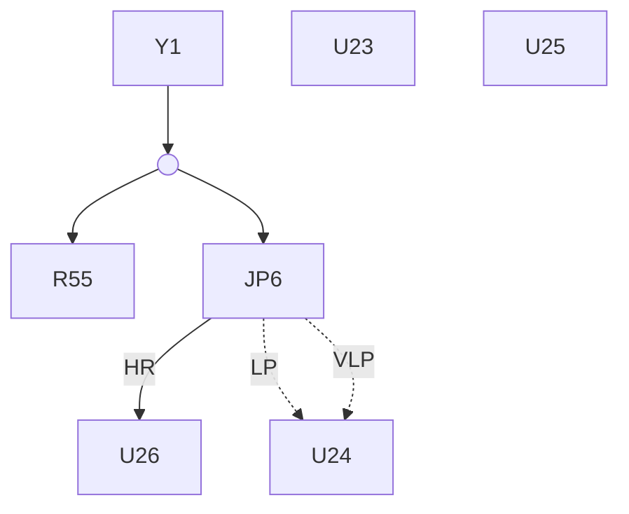

### PCB Components and Labels


<!-- PDF page 64 -->


## ***Additional clocking tips for best performance***

If you follow the clock layout guidelines provided here but still suspect that your clock is degrading your ADC performance, here are some additional clock-related issues to test:

* **The clock signal quality at the ADC input.** If the clock signal at the ADC clock input pin shows excessive overshoot and ringing, you may need to slew the clock edges further by adding or increasing the size of the small series resistor and shunt capacitor (R60 and C76 in **Figure 56**, respectively). Adding these components effectively applies a low-pass filter to the clock input while preserving the fundamental clock frequency. You may also notice what appear to be “shelves” or “steps” in the clock edges. This is caused by reflections of the clock signal as it travels along a trace and runs into a high-impedance input. A series resistor will help dampen these clock reflections.
* **The supply pins on the ADC.** Because both the ADC’s DVDD input and the clock source or clock buffer may share the same digital supply, check these pins for large transients. Transients result from sudden demands in current and may require additional decoupling capacitors to suppress. But take care when choosing the size of your decoupling capacitors: smaller decoupling capacitors have less inductance and can supply the necessary current more quickly, while larger decoupling capacitors help store the bulk of the necessary charge and filter any noise on the supply rail. A combination of both decoupling capacitor sizes may be necessary to keep the digital supplies quiet and stable. Another technique to help reduce transients from coupling into the ADC output is to place a small ferrite bead between the ADC digital supply pin and the clock source or clock buffer supply pins.
* **Split the ground plane.** If your PCB’s size prohibits placing clock circuitry far away from sensitive analog circuitry, it may help to partially split the ground in order to isolate the clock current’s return path. However, always tie back both sides of your ground plane as close to the device as possible to avoid significant ground potential differences between the ADC’s analog and digital sections.

Ultimately, following the practices and procedures recommended in Chapter 5 should help to avoid the most common clocking-related issues and ensure that your clock source is not the biggest contributor of noise to your signal chain.

## **Key takeaways**

Here is a summary of important points to better understand how clock noise affects ADCs:

1. Clock-edge variation results in deviations in the sampling instance. This nonconstant sampling frequency appears in the conversion result as another source of noise.
2. Oversampling ADCs average multiple readings of the input signal, averaging out some of the effect of clock jitter and improving SNR in the process.
3. Use a low-jitter clock source for higher-speed, high-dynamic-range applications.
4. Best PCB layout practices:
   * Minimize trace impedances.
   * Route traces away from SPI signals and other noisy circuitry.
   * Consider a series resistor and shunt capacitor to help handle reflections or overshoot.


<!-- PDF page 65 -->


## **Chapter 6: Power-supply noise**

So far, I’ve focused on noise contributed by analog components that could either be external to, or integrated in, your analog-to-digital converter (ADC). Chapter 6 analyzes noise contributed by power supplies, which must originate outside of your device. Even though some ADCs might integrate power-management features such as a low-dropout (LDO) regulator to clean up noisy supplies or a charge pump to extend the input-voltage range, these features—and the ADC itself—still need power from an external source. And like any other component in mixed-signal data-acquisition systems, power supplies contribute noise.

Fortunately, you can treat power-supply noise analysis similarly to the other noise sources I’ve discussed so far. Assume that your supplies will contribute some noise, although the impact on your system performance depends on the level and type of noise from the source. For example, a 3-V lithium-ion battery used in portable applications will generally be noisier and have more output-voltage variation than the precision bench-top power supply used to characterize an ADC. Once you’ve chosen the supply source and voltage rails for your application, there are methods you can take to reduce the impact that power-supply noise has on your ADC’s performance.

Since I have been focusing on signal-chain design, let’s assume that your power supplies (and subsequent noise contributions) are fixed. In other words, I won’t discuss power-supply design techniques that could change the power-supply noise contribution. Instead, I’ll focus on how this noise affects your ADC’s output by discussing these concepts:

* Types and sources of power-supply noise.
* Measuring and quantifying power-supply noise rejection.
* How noise on each of the ADC’s supplies impacts system performance.

In **Section 8.2**, I’ll use a precision ADC EVM to apply the theory from **Section 8.1** to a real-world example, and discuss power-supply noise-mitigation techniques.

Many thanks to my colleague Ryan Andrews for his contributions to Chapter 6.

**Power-supply noise and its effect on delta-sigma ADCs** • **Reducing power-supply noise in delta-sigma ADCs** •


<!-- PDF page 66 -->


## Power-supply noise and its effect on delta-sigma ADCs

For any analog signal chain, power ultimately comes from one of two sources: batteries or an AC line voltage. Both power-source options are often followed by some form of power-supply conditioning circuitry that regulates power for the rest of the system. The supply source, as well as the active and passive conditioning components, will contribute some level of noise, which manifests itself in the power supply’s output as a variation from the expected voltage. This variation could appear as a steady DC shift in the output or as an AC signal at some frequency and amplitude riding on top of the output.

While the latter may seem specific to line-voltage-powered systems, battery-powered systems may contain AC noise as well. The power-conditioning components themselves can contribute noise that impacts performance. These devices include LDOs, DC/DC converters and switched-mode power supplies (SMPSs). LDOs primarily contribute thermal noise, like all electrical components. Switching devices add large current transients on top of thermal noise. Current transients generally consist of both a lower-frequency ripple (typically in the 100-kHz to 1-MHz range) as well as higher-frequency spikes (+100 MHz) centered on the nominal output voltage. **Figure 57** shows an oscilloscope plot of switching ripple, transient spikes and thermal noise.


* **Transient spikes**: Indicated by red arrows pointing to vertical high-frequency spikes enclosed in red rectangles.
* **Switching ripple**: Indicated by a red bracket showing the peak-to-peak amplitude of the triangular waveform.
* **Thermal noise**: Indicated by a red arrow pointing to the high-frequency fuzziness on the waveform, enclosed in a red rectangle.

**Figure 57.** *SMPS noise (transients, ripple and thermal noise).*

In addition to power-supply conditioning components, AC noise can originate from other switching components that use the same supply—such as clocks and clock buffers—as well as from ambient lighting or other environmental elements.

Ultimately, your ADC power supplies will likely have some combination of both thermal and switching noise, regardless of which power source you use. However, since power-supply noise is external to the ADC, semiconductor manufacturers can only specify how effective an ADC is at rejecting this noise. This specification is called power-supply rejection (PSR).

### Measuring and quantifying power-supply noise rejection

In ADCs, PSR describes the change in the ADC output ($\Delta V_{OUT}$) relative to changes in its power supply ($\Delta V_{SUPPLY}$). PSR is often given as a ratio expressed in decibels. This ratio is referred to as the power-supply rejection ratio (PSRR). Note that the absolute value is conventionally used to describe PSRR, since the negative sign is implied. **Equation 30** calculates PSRR:

$$PSRR = 20 \times \log_{10} \left( \frac{\Delta V_{OUT}}{\Delta V_{SUPPLY}} \right) \hfill (30)$$


<!-- PDF page 67 -->


You’ll find two different methods to specify PSRR in ADC data sheets: PSRR<sub>DC</sub> and PSRR<sub>AC</sub>. PSRR<sub>DC</sub> describes how much the ADC output changes due to a DC shift in its power supply, while PSRR<sub>AC</sub> describes how much power-supply noise appears in the output. Similar to the ADC noise-measurement discussion in **Section 3.2**, the PSRR measurement method used by ADC manufacturers depends on the types of signals the ADC is intended to measure.

For example, low-speed sensor-measurement applications typically use ADCs optimized for DC performance, such as the TI **ADS1261**, a low-noise, 24-bit delta-sigma ADC that can sample up to 40 kSPS. **Table 23** shows the ADS1261’s data-sheet specification for PSRR<sub>DC</sub> since the signal pass band is typically very narrow for this ADC. The data sheet gives a minimum and typical PSRR specification for both the analog and digital power supplies.

<table>
  <caption>Table 23. ADS1261 PSRR for AVDD = 5 V, AVSS = 0 V, DVDD = 3.3 V, V<sub>REF</sub> = 2.5 V, gain = 1 V/V, output data rate = 20 SPS.</caption>
  <thead>
    <tr>
      <th>Parameter</th>
      <th>Test conditions</th>
      <th>Min</th>
      <th>Typ</th>
      <th>Max</th>
      <th>Unit</th>
    </tr>
  </thead>
  <tbody>
    <tr>
      <td rowspan="2">PSRR Power-supply rejection ratio <sup>(1)</sup></td>
      <td>AVDD and AVSS</td>
      <td>90</td>
      <td>100</td>
      <td></td>
      <td rowspan="2">dB</td>
    </tr>
    <tr>
      <td>DVDD</td>
      <td>100</td>
      <td>120</td>
      <td></td>
    </tr>
  </tbody>
</table>

(1) Power-supply rejection ratio specified at dc.

To measure PSRR<sub>DC</sub>, ADC manufacturers short the device’s inputs together, bias them to a common-mode voltage (V<sub>CM</sub>) typically near mid-supply, and measure the offset voltage at the ADC’s output. Then, the supply voltage is changed by 100 mV to see how much the offset voltage changes. **Figure 58** shows a typical PSRR<sub>DC</sub> measurement setup, with the additional 100-mV offset voltage.

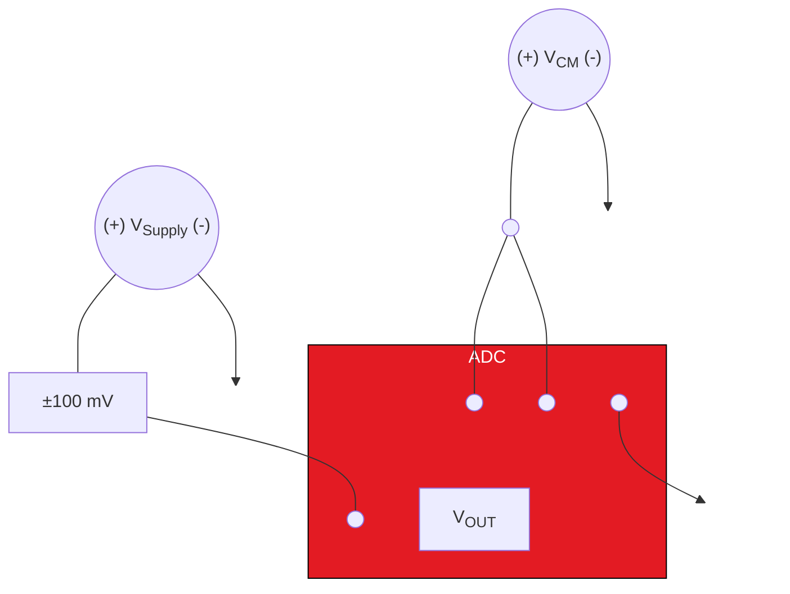

**Figure 58.** *PSRR<sub>DC</sub> measurement setup using ±100-mV offset on AVDD.*

As shown in **Table 23**, the ADS1261’s typical PSRR<sub>DC</sub> is 100 dB for the analog supply, AVDD. You can input a PSRR of –100 dB and a ΔV<sub>SUPPLY</sub> of 100 mV into **Equation 30** and solve for ΔV<sub>OUT</sub> to calculate the expected change in offset. From **Equation 30**, a 100-mV change in AVDD should produce a 1-µV change in offset voltage at the ADC output.

**Figure 59** illustrates the output offset voltage’s variation due to the change in power supply in the time domain. The output offset voltage swing is centered on the ADS1261’s nominal offset voltage of 50 µV, which is specified using the same conditions given in **Table 23**.


<!-- PDF page 68 -->


<table>
  <caption>Offset and Output Voltage Variation Over Time — Offset (V) vs Time (s)</caption>
  <thead>
    <tr>
      <th>Parameter</th>
      <th>Value (µV)</th>
    </tr>
  </thead>
  <tbody>
    <tr>
      <th>Offset</th>
      <td>50</td>
    </tr>
    <tr>
      <th>ΔV<sub>OUT</sub> (Upper Limit)</th>
      <td>51</td>
    </tr>
    <tr>
      <th>ΔV<sub>OUT</sub> (Lower Limit)</th>
      <td>49</td>
    </tr>
  </tbody>
</table>

**Figure 59.** *Change in offset voltage due to a 100-mV change in AVDD using the ADS1261.*

Comparatively, wide-bandwidth applications such as vibration monitoring require a wider signal pass band, and therefore higher-bandwidth ADCs. Such ADCs are more prone to unwanted high-frequency content that may alias or fall directly into the signal bandwidth of interest. For this reason, wideband ADCs generally specify PSR using PSRR<sub>AC</sub>. **Table 24** shows the PSRR specifications for TI’s **ADS127L01** , a 24-bit, high-speed delta-sigma ADC that samples up to 512 kSPS.

<table>
  <caption>Table 24. ADS127L01 PSRR specifications at T<sub>A</sub> = 25°C, AVDD = 3 V, internal LVDD, DVDD = 1.8 V, V<sub>REF</sub> = 2.5 V.</caption>
  <thead>
    <tr>
      <th>Parameter</th>
      <th colspan="2">Test conditions</th>
      <th>Min</th>
      <th>Typ</th>
      <th>Max</th>
      <th>Unit</th>
    </tr>
  </thead>
  <tbody>
    <tr>
      <td rowspan="3">PSRR Power-supply rejection ratio</td>
      <td rowspan="3">f<sub>PS</sub> = 60 Hz</td>
      <td>AVDD</td>
      <td></td>
      <td>90</td>
      <td></td>
      <td rowspan="3">dB</td>
    </tr>
    <tr>
      <td>DVDD</td>
      <td></td>
      <td>85</td>
      <td></td>
    </tr>
    <tr>
      <td>LVDD</td>
      <td></td>
      <td>80</td>
      <td></td>
    </tr>
  </tbody>
</table>

The measurement setup for PSRR<sub>AC</sub> is very similar to PSRR<sub>DC</sub>, such that the ADC’s inputs are shorted together and then biased to a mid-supply common-mode voltage. However, instead of introducing a DC offset to the supply, PSRR<sub>AC</sub> is measured with an AC signal riding on top of the nominal DC supply. This AC signal mimics noise at a particular frequency (for example, the 60-Hz power-line frequency shown in **Table 24**).

**Figure 60** shows a typical PSRR<sub>AC</sub> measurement setup with a 100-mV<sub>P</sub> sine wave on top of the ADC analog supply voltage, AVDD. If your supply voltage was 3 V, you could recreate the test setup in **Figure 60** using a 100-mV<sub>P</sub> sine wave with a 3-V DC offset.

```mermaid
graph TD
    subgraph ADC_Block [" "]
        direction TB
        ADC_Body["ADC"]
    end

    %% Connections to ADC
    V_Supply_Source(("+<br/>-<br/>V<sub>Supply</sub>")) --- AC_Source(("~"))
    AC_Source --- AVDD_Pin
    V_Supply_Source --- Ground1[ ]
    style Ground1 fill:none,stroke:none
    
    V_CM_Source(("+<br/>-<br/>V<sub>CM</sub>")) --- Common_Node(( ))
    Common_Node --- AINP_Pin
    Common_Node --- AINN_Pin
    V_CM_Source --- Ground2[ ]
    style Ground2 fill:none,stroke:none

    AVSS_Pin --- Ground3[ ]
    style Ground3 fill:none,stroke:none

    ADC_Body --> V_OUT["V<sub>OUT</sub>"]

    %% Labels and Styling
    classDef block fill:#E31E24,stroke:#000,color:#fff,font-weight:bold;
    classDef source fill:#fff,stroke:#000;
    classDef ground fill:#000,stroke:#000,width:0px,height:0px;

    class ADC_Body block;
    class V_Supply_Source,AC_Source,V_CM_Source source;

    %% Pin Labels inside the block
    AVDD_Pin["AVDD"]
    AINP_Pin["AINP"]
    AINN_Pin["AINN"]
    AVSS_Pin["AVSS"]

    %% Red text for AC source
    AC_Label["<span style='color:#E31E24; font-weight:bold;'>±100 mV</span>"]
    AC_Label --- AC_Source
    style AC_Label fill:none,stroke:none
    style AC_Source stroke:#E31E24,color:#E31E24
```

**Figure 60.** *PSRR<sub>AC</sub> measurement setup using a 100-mV<sub>P</sub> sine wave.*


<!-- PDF page 69 -->


To calculate PSRR<sub>AC</sub> in the time domain, you can use **Equation 30** just as you did to calculate PSRR<sub>DC</sub>. Using the 100-mV<sub>P</sub> amplitude as your supply ripple (ΔV<sub>SUPPLY</sub>) and the ADS127L01’s AVDD PSRR from **Table 24** (–90 dB), you can expect 3.2 µV<sub>P</sub> of switching ripple at 60 Hz to appear at the ADC output. **Figure 61** shows the ripple on the supply and how it translates to a similar ripple at the output, centered on the ADC’s nominal offset voltage.

<table>
  <caption>Figure 61. Noise in ADC output due to a 100-mV<sub>P</sub> power-supply ripple using the ADS127L01.</caption>
  <thead>
    <tr>
      <th>Signal</th>
      <th>Baseline Offset</th>
      <th>Peak-to-Peak Amplitude</th>
      <th>Unit</th>
    </tr>
  </thead>
  <tbody>
    <tr>
      <th>V<sub>SUPPLY</sub> (Power-supply ripple)</th>
      <td>AVDD</td>
      <td>± 100</td>
      <td>mV</td>
    </tr>
    <tr>
      <th>V<sub>OUT</sub> (ADC output ripple)</th>
      <td>Offset</td>
      <td>± 3.2</td>
      <td>μV</td>
    </tr>
  </tbody>
</table>

***Figure 61.** Noise in ADC output due to a 100-mV<sub>P</sub> power-supply ripple using the ADS127L01.*

You can also calculate PSRR<sub>AC</sub> in the frequency domain by converting the 100-mV<sub>P</sub> supply ripple into decibels using the ADC’s reference voltage. If you use the 2.5-V reference voltage specified in **Table 24**, 100 mV<sub>P</sub> equates to –28 dBFS, or decibels relative to full scale. The PSRR<sub>AC</sub> in this case is the difference in decibels between the supply-ripple amplitude and the tone measured in the frequency spectrum that appears at the supply-ripple frequency (60 Hz). **Figure 62** plots both the supply-ripple amplitude and the noise that appears in the ADC output, where the difference is the direct result of the ADC’s PSRR at that frequency.

<table>
  <caption>Figure 62. ADS127L01 PSRR<sub>AC</sub> in the frequency domain</caption>
  <thead>
    <tr>
      <th>Frequency (Hz)</th>
      <th>Measure</th>
      <th>Magnitude (dB)</th>
      <th>Equivalent Value</th>
    </tr>
  </thead>
  <tbody>
    <tr>
      <th rowspan="3">60</th>
      <th>V<sub>Supply Ripple</sub></th>
      <td>-28</td>
      <td>100 mV</td>
    </tr>
    <tr>
      <th>V<sub>Measured</sub></th>
      <td>-118</td>
      <td>3.2 µV</td>
    </tr>
    <tr>
      <th>PSRR<sub>AC</sub></th>
      <td>-90</td>
      <td></td>
    </tr>
  </tbody>
</table>

***Figure 62.** ADS127L01 PSRR<sub>AC</sub> in the frequency domain.*

## How noise on each of the ADC’s supplies impacts system performance

In the preceding section, I discussed how to measure and specify power-supply noise using the analog supply as an example. While this may be acceptable for those ADCs that only require one supply voltage, higher-resolution ADCs tend to at least have separate analog and digital supplies, with some precision ADCs requiring more. For example, you can see in **Table 24** that the ADS127L01 actually has three different supplies: analog (AVDD), digital (DVDD) and the low-voltage modulator supply (LVDD). **Figure 63** plots the PSRR for each supply as a function of frequency.


<!-- PDF page 70 -->


<table>
  <caption>Figure 63. PSRR (dB) vs f<sub>PS</sub> (kHz) — HR mode, INTLDO = 1; t<sub>A</sub> = 25°C, AVDD = 3.3 V, V<sub>REF</sub> = 2.5 V</caption>
  <thead>
    <tr>
      <th>f<sub>PS</sub> (kHz)</th>
      <th>AVDD (dB)</th>
      <th>LVDD (dB)</th>
      <th>DVDD (dB)</th>
    </tr>
  </thead>
  <tbody>
    <tr>
      <th>0</th>
      <td>99</td>
      <td>84</td>
      <td>93</td>
    </tr>
    <tr>
      <th>10</th>
      <td>98</td>
      <td>82</td>
      <td>94</td>
    </tr>
    <tr>
      <th>20</th>
      <td>98</td>
      <td>85</td>
      <td>90</td>
    </tr>
    <tr>
      <th>30</th>
      <td>98</td>
      <td>85</td>
      <td>91</td>
    </tr>
    <tr>
      <th>40</th>
      <td>97</td>
      <td>81</td>
      <td>87</td>
    </tr>
    <tr>
      <th>50</th>
      <td>97</td>
      <td>78</td>
      <td>86</td>
    </tr>
    <tr>
      <th>60</th>
      <td>98</td>
      <td>76</td>
      <td>84</td>
    </tr>
    <tr>
      <th>80</th>
      <td>98</td>
      <td>76</td>
      <td>86</td>
    </tr>
    <tr>
      <th>100</th>
      <td>98</td>
      <td>77</td>
      <td>90</td>
    </tr>
    <tr>
      <th>120</th>
      <td>98</td>
      <td>77</td>
      <td>90</td>
    </tr>
    <tr>
      <th>140</th>
      <td>99</td>
      <td>77</td>
      <td>91</td>
    </tr>
    <tr>
      <th>160</th>
      <td>99</td>
      <td>77</td>
      <td>91</td>
    </tr>
    <tr>
      <th>180</th>
      <td>101</td>
      <td>78</td>
      <td>91</td>
    </tr>
    <tr>
      <th>200</th>
      <td>103</td>
      <td>79</td>
      <td>91</td>
    </tr>
    <tr>
      <th>210</th>
      <td>108</td>
      <td>83</td>
      <td>100</td>
    </tr>
    <tr>
      <th>220</th>
      <td>107</td>
      <td>87</td>
      <td>106</td>
    </tr>
    <tr>
      <th>230</th>
      <td>109</td>
      <td>91</td>
      <td>110</td>
    </tr>
    <tr>
      <th>240</th>
      <td>118</td>
      <td>94</td>
      <td>124</td>
    </tr>
    <tr>
      <th>250</th>
      <td>153</td>
      <td>124</td>
      <td>133</td>
    </tr>
    <tr>
      <th>300</th>
      <td>158</td>
      <td>158</td>
      <td>158</td>
    </tr>
    <tr>
      <th>400</th>
      <td>159</td>
      <td>160</td>
      <td>159</td>
    </tr>
    <tr>
      <th>500</th>
      <td>150</td>
      <td>150</td>
      <td>150</td>
    </tr>
  </tbody>
</table>

**Figure 63.** *t<sub>A</sub> = 25°C, AVDD = 3.3 V, V<sub>REF</sub> = 2.5 V, high-resolution (HR) mode, $\overline{INTLDO} = 1$.*

You can conclude from **Figure 63** that LVDD is most susceptible to power-supply noise on the ADS127L01. Intuitively, this makes sense, as this supply is directly used by the ADC’s delta-sigma modulator, which samples the input signal. For this specific ADC, then, you would want to apply some power-supply noise-reduction techniques to LVDD to ensure that it has the least amount of noise in order to maximize performance.

Additionally, you can see in **Figure 63** that the PSRR for all three supplies remains relatively constant until the power-supply frequency (f<sub>PS</sub>) is approximately 200 kHz. At this frequency, the PSRR begins to increase to 160 dB for all three supplies. In **Figure 63**, the ADS127L01 operates at 512 kSPS using the Wideband 1 digital filter setting. This filter response sets the ADC passband to approximately 204 kHz. Therefore, the ADS127L01’s digital filter stopband attenuation further rejects the power-supply ripple at frequencies beyond the ADC passband—by about 116 dB. This improves the PSRR for all three supplies at higher frequencies.

These observations from **Figure 63** provide hints about two important questions regarding power-supply noise: first, which ADC supply voltage is most critical when considering your system’s PSR; and second, how can you reduce the overall power-supply noise in your system?

## Key takeaways

Here is a summary of important points to better understand power-supply noise and how it affects ADCs:

1. Power supplies and conditioning components can contribute noise.
2. Power supply noise is a variation from the expected output voltage.
   * This variation could be a steady DC shift in the output or as an AC signal at some frequency and amplitude riding on top of the output.
3. PSR describes the change in the ADC output ($\Delta V_{OUT}$) relative to changes in its power supply ($\Delta V_{SUPPLY}$).
   * $PSRR_{DC}$ describes how much the ADC output changes due to a DC shift in its power supply.
   * $PSRR_{AC}$ describes how much power-supply noise appears in the output.
4. Power supply noise can have a different effect on the ADC’s separate supplies—AVDD, DVDD, LVDD, etc.


<!-- PDF page 71 -->


# Reducing power-supply noise in delta-sigma ADCs

Let’s continue the power-supply noise discussion with a design example using the **ADS127L01 EVM** . This example will help illustrate which supplies are most critical when trying to increase your system’s PSR. Finally, I’ll discuss best practices to maintain low power-supply noise and debugging tips to improve your system’s overall noise performance.

### *AVDD, DVDD or LVDD: Which is most important?*

In Section 6.1, I looked at the PSRR for each of the power supplies used by the TI **ADS127L01** (shown again in **Figure 64**). Like most ADCs, the ADS127L01 uses both an analog and a digital supply (AVDD and DVDD, respectively). I chose this device for our discussion because it also requires a third LVDD supply. LVDD directly powers the delta-sigma modulator in the ADS127L01. The LVDD supply can either be provided from an internal LDO (connected to AVDD) or from an external LVDD supply source. As you’ll see later, driving LVDD externally with a noisy supply will have the most adverse effect on ADC noise performance.

<table>
  <caption>Figure 64. t<sub>A</sub> = 25°C, AVDD = 3.3 V, V<sub>REF</sub> = 2.5 V, HR mode, INTLDO = 1. PSRR (dB) vs f<sub>PS</sub> (kHz) for AVDD, LVDD, and DVDD.</caption>
  <thead>
    <tr>
      <th>f<sub>PS</sub> (kHz)</th>
      <th>AVDD (dB)</th>
      <th>LVDD (dB)</th>
      <th>DVDD (dB)</th>
    </tr>
  </thead>
  <tbody>
    <tr>
      <th>0</th>
      <td>99</td>
      <td>84</td>
      <td>93</td>
    </tr>
    <tr>
      <th>10</th>
      <td>98</td>
      <td>82</td>
      <td>94</td>
    </tr>
    <tr>
      <th>20</th>
      <td>98</td>
      <td>85</td>
      <td>90</td>
    </tr>
    <tr>
      <th>30</th>
      <td>98</td>
      <td>85</td>
      <td>91</td>
    </tr>
    <tr>
      <th>40</th>
      <td>97</td>
      <td>80</td>
      <td>87</td>
    </tr>
    <tr>
      <th>50</th>
      <td>98</td>
      <td>76</td>
      <td>84</td>
    </tr>
    <tr>
      <th>100</th>
      <td>98</td>
      <td>77</td>
      <td>90</td>
    </tr>
    <tr>
      <th>150</th>
      <td>99</td>
      <td>77</td>
      <td>91</td>
    </tr>
    <tr>
      <th>160</th>
      <td>101</td>
      <td>78</td>
      <td>91</td>
    </tr>
    <tr>
      <th>170</th>
      <td>101</td>
      <td>78</td>
      <td>91</td>
    </tr>
    <tr>
      <th>180</th>
      <td>102</td>
      <td>78</td>
      <td>91</td>
    </tr>
    <tr>
      <th>190</th>
      <td>102</td>
      <td>79</td>
      <td>91</td>
    </tr>
    <tr>
      <th>200</th>
      <td>103</td>
      <td>79</td>
      <td>91</td>
    </tr>
    <tr>
      <th>210</th>
      <td>108</td>
      <td>84</td>
      <td>100</td>
    </tr>
    <tr>
      <th>220</th>
      <td>107</td>
      <td>88</td>
      <td>106</td>
    </tr>
    <tr>
      <th>230</th>
      <td>109</td>
      <td>94</td>
      <td>114</td>
    </tr>
    <tr>
      <th>240</th>
      <td>152</td>
      <td>124</td>
      <td>132</td>
    </tr>
    <tr>
      <th>300</th>
      <td>158</td>
      <td>158</td>
      <td>158</td>
    </tr>
    <tr>
      <th>400</th>
      <td>159</td>
      <td>159</td>
      <td>158</td>
    </tr>
    <tr>
      <th>500</th>
      <td>150</td>
      <td>150</td>
      <td>150</td>
    </tr>
  </tbody>
</table>

**Figure 64.** *t<sub>A</sub> = 25°C, AVDD = 3.3 V, V<sub>REF</sub> = 2.5 V, HR mode, $\overline{\text{INTLDO}} = 1$.*

From **Figure 64**, you can see that LVDD is most susceptible to coupling noise into the ADC output because it has the lowest PSRR of the three supplies. LVDD is most sensitive to noise because it directly powers the delta-sigma modulator, which in turn directly controls the analog-input-to-digital-output conversion process. Comparatively, AVDD powers the remaining analog circuitry, including generating the main bias current, but this has less of a direct impact on the conversion results. Powering the ADC’s digital core, DVDD has the least impact on the conversion results because the modulator output is already in binary form when it reaches the digital decimation filter. For devices that require multiple supplies, it’s best to prioritize the supply that most directly powers the delta-sigma modulator, which is typically AVDD.

To illustrate the effects of driving the modulator with a noisy supply in the real world, I conducted an ADC input-short noise measurement on the ADS127L01 EVM under these four conditions:

* Clean supplies on AVDD, LVDD and DVDD (no ripple).
* AVDD = 3 V + 1-kHz, 100-mV<sub>P</sub> ripple, clean LVDD and DVDD.
* LVDD = 1.825 V + 1-kHz, 100-mV<sub>P</sub> ripple, clean AVDD and VDD.
* DVDD = 1.8 V + 1-kHz, 100-mV<sub>P</sub> ripple, clean AVDD and LVDD.


<!-- PDF page 72 -->


In each case, I shorted the ADC inputs together, biased them to mid-supply (1.5 V) and computed the maximum achievable signal-to-noise ratio relative to the ADC full scale. This result is the ADC’s dynamic range. **Table 22** in the **ADS127L01 data sheet** lists the typical noise performance for each of the ADC’s modes of operation and data rate. This test was conducted in very low-power mode with a 4-MHz clock input using the Wideband 2 digital filter setting with an oversampling ratio equal to 256. From **Table 22**, you can expect approximately 114 dB of dynamic range at these settings.

<table>
  <caption>Figure 65. Noise histogram (a) — Vn RTI = 3.71 μVRMS; Output (μV) vs Count</caption>
  <thead>
    <tr>
      <th>Output (μV)</th>
      <th>Count</th>
    </tr>
  </thead>
  <tbody>
    <tr><th>-5.0</th><td>0</td></tr>
    <tr><th>-4.5</th><td>2</td></tr>
    <tr><th>-4.0</th><td>4</td></tr>
    <tr><th>-3.5</th><td>6</td></tr>
    <tr><th>-3.0</th><td>8</td></tr>
    <tr><th>-2.5</th><td>10</td></tr>
    <tr><th>-2.0</th><td>12</td></tr>
    <tr><th>-1.5</th><td>15</td></tr>
    <tr><th>-1.0</th><td>20</td></tr>
    <tr><th>-0.5</th><td>30</td></tr>
    <tr><th>0.0</th><td>50</td></tr>
    <tr><th>0.5</th><td>80</td></tr>
    <tr><th>1.0</th><td>130</td></tr>
    <tr><th>1.5</th><td>70</td></tr>
    <tr><th>2.0</th><td>200</td></tr>
    <tr><th>2.5</th><td>300</td></tr>
    <tr><th>3.0</th><td>180</td></tr>
    <tr><th>3.5</th><td>450</td></tr>
    <tr><th>4.0</th><td>620</td></tr>
    <tr><th>4.5</th><td>320</td></tr>
    <tr><th>5.0</th><td>750</td></tr>
    <tr><th>5.5</th><td>1130</td></tr>
    <tr><th>6.0</th><td>600</td></tr>
    <tr><th>6.5</th><td>1220</td></tr>
    <tr><th>7.0</th><td>1780</td></tr>
    <tr><th>7.5</th><td>830</td></tr>
    <tr><th>8.0</th><td>1750</td></tr>
    <tr><th>8.5</th><td>2180</td></tr>
    <tr><th>9.0</th><td>980</td></tr>
    <tr><th>9.5</th><td>1940</td></tr>
    <tr><th>10.0</th><td>2300</td></tr>
    <tr><th>10.5</th><td>970</td></tr>
    <tr><th>11.0</th><td>1850</td></tr>
    <tr><th>11.5</th><td>2150</td></tr>
    <tr><th>12.0</th><td>810</td></tr>
    <tr><th>12.5</th><td>1540</td></tr>
    <tr><th>13.0</th><td>1630</td></tr>
    <tr><th>13.5</th><td>640</td></tr>
    <tr><th>14.0</th><td>1110</td></tr>
    <tr><th>14.5</th><td>1120</td></tr>
    <tr><th>15.0</th><td>750</td></tr>
    <tr><th>15.5</th><td>340</td></tr>
    <tr><th>16.0</th><td>640</td></tr>
    <tr><th>16.5</th><td>410</td></tr>
    <tr><th>17.0</th><td>180</td></tr>
    <tr><th>17.5</th><td>310</td></tr>
    <tr><th>18.0</th><td>190</td></tr>
    <tr><th>18.5</th><td>60</td></tr>
    <tr><th>19.0</th><td>130</td></tr>
    <tr><th>19.5</th><td>60</td></tr>
    <tr><th>20.0</th><td>20</td></tr>
    <tr><th>20.5</th><td>30</td></tr>
    <tr><th>21.0</th><td>15</td></tr>
    <tr><th>21.5</th><td>5</td></tr>
    <tr><th>22.0</th><td>10</td></tr>
    <tr><th>22.5</th><td>5</td></tr>
    <tr><th>23.0</th><td>5</td></tr>
    <tr><th>23.5</th><td>2</td></tr>
    <tr><th>24.0</th><td>0</td></tr>
    <tr><th>24.5</th><td>0</td></tr>
    <tr><th>25.0</th><td>0</td></tr>
  </tbody>
</table>

<table>
  <caption>Figure 65. (b) FFT for clean supplies on AVDD, LVDD and DVDD; Dynamic range = 113.56 dB</caption>
  <thead>
    <tr>
      <th>Frequency (kHz)</th>
      <th>Magnitude (dB)</th>
    </tr>
  </thead>
  <tbody>
    <tr>
      <th>0</th>
      <td>-158</td>
    </tr>
    <tr>
      <th>1</th>
      <td>-158</td>
    </tr>
    <tr>
      <th>2</th>
      <td>-158</td>
    </tr>
    <tr>
      <th>3</th>
      <td>-158</td>
    </tr>
    <tr>
      <th>4</th>
      <td>-158</td>
    </tr>
    <tr>
      <th>5</th>
      <td>-158</td>
    </tr>
    <tr>
      <th>6</th>
      <td>-158</td>
    </tr>
    <tr>
      <th>7</th>
      <td>-158</td>
    </tr>
    <tr>
      <th>8</th>
      <td>-190</td>
    </tr>
  </tbody>
</table>

**Figure 65.** *Noise histogram (a) and FFT (b) for clean supplies on AVDD, LVDD and DVDD.*

As anticipated, the EVM performs best when using clean voltage supplies for all three ADC supply pins. **Figure 65** shows a noise histogram (**Figure 65a**) and fast Fourier transform (FFT) (**Figure 65b**) under these conditions, resulting in a dynamic range of 113.56 dB, which is very close to the data-sheet specifications.

I then added a 1-kHz, 100-mV<sub>P</sub> sine wave on top of the 3-V AVDD supply. This sine wave mimics power-supply noise, and was applied to the ADC using a signal generator with a DC offset equal to the nominal AVDD supply voltage (3 V). In this case, the internal LDO on the ADS127L01 was still able to reject most of this noise and maintain nominal performance at 113.33 dB, as shown in **Figure 66**. Notice that a small tone appears in the frequency spectrum at 1 kHz with a magnitude of –127 dB. This should correlate to the original input signal level relative to full scale (–28 dB for an ADC using a 2.5-V reference voltage) minus the AVDD PSRR, or about 100 dB.


<!-- PDF page 73 -->


<table>
  <caption>Figure 66. Noise histogram (a) for clean supplies on LVDD and DVDD, ripple on AVDD. Title: Vn RTI = 3.81 µVRMS</caption>
  <thead>
    <tr>
      <th>Output (µV)</th>
      <th>Count</th>
    </tr>
  </thead>
  <tbody>
    <tr><th>-5.0</th><td>0</td></tr>
    <tr><th>-4.5</th><td>0</td></tr>
    <tr><th>-4.0</th><td>0</td></tr>
    <tr><th>-3.5</th><td>0</td></tr>
    <tr><th>-3.0</th><td>0</td></tr>
    <tr><th>-2.5</th><td>5</td></tr>
    <tr><th>-2.0</th><td>10</td></tr>
    <tr><th>-1.5</th><td>25</td></tr>
    <tr><th>-1.0</th><td>20</td></tr>
    <tr><th>-0.5</th><td>50</td></tr>
    <tr><th>0.0</th><td>60</td></tr>
    <tr><th>0.5</th><td>110</td></tr>
    <tr><th>1.0</th><td>80</td></tr>
    <tr><th>1.5</th><td>170</td></tr>
    <tr><th>2.0</th><td>310</td></tr>
    <tr><th>2.5</th><td>380</td></tr>
    <tr><th>3.0</th><td>590</td></tr>
    <tr><th>3.5</th><td>690</td></tr>
    <tr><th>4.0</th><td>1050</td></tr>
    <tr><th>4.5</th><td>510</td></tr>
    <tr><th>5.0</th><td>1120</td></tr>
    <tr><th>5.5</th><td>1570</td></tr>
    <tr><th>6.0</th><td>700</td></tr>
    <tr><th>6.5</th><td>1530</td></tr>
    <tr><th>7.0</th><td>2050</td></tr>
    <tr><th>7.5</th><td>1890</td></tr>
    <tr><th>8.0</th><td>930</td></tr>
    <tr><th>8.5</th><td>2200</td></tr>
    <tr><th>9.0</th><td>930</td></tr>
    <tr><th>9.5</th><td>1900</td></tr>
    <tr><th>10.0</th><td>2150</td></tr>
    <tr><th>10.5</th><td>1660</td></tr>
    <tr><th>11.0</th><td>870</td></tr>
    <tr><th>11.5</th><td>1750</td></tr>
    <tr><th>12.0</th><td>640</td></tr>
    <tr><th>12.5</th><td>1210</td></tr>
    <tr><th>13.0</th><td>1180</td></tr>
    <tr><th>13.5</th><td>930</td></tr>
    <tr><th>14.0</th><td>360</td></tr>
    <tr><th>14.5</th><td>670</td></tr>
    <tr><th>15.0</th><td>490</td></tr>
    <tr><th>15.5</th><td>390</td></tr>
    <tr><th>16.0</th><td>250</td></tr>
    <tr><th>16.5</th><td>190</td></tr>
    <tr><th>17.0</th><td>100</td></tr>
    <tr><th>17.5</th><td>150</td></tr>
    <tr><th>18.0</th><td>100</td></tr>
    <tr><th>18.5</th><td>40</td></tr>
    <tr><th>19.0</th><td>50</td></tr>
    <tr><th>19.5</th><td>40</td></tr>
    <tr><th>20.0</th><td>30</td></tr>
    <tr><th>20.5</th><td>15</td></tr>
    <tr><th>21.0</th><td>10</td></tr>
    <tr><th>21.5</th><td>5</td></tr>
    <tr><th>22.0</th><td>0</td></tr>
    <tr><th>22.5</th><td>0</td></tr>
    <tr><th>23.0</th><td>0</td></tr>
    <tr><th>23.5</th><td>0</td></tr>
    <tr><th>24.0</th><td>0</td></tr>
    <tr><th>24.5</th><td>0</td></tr>
    <tr><th>25.0</th><td>0</td></tr>
  </tbody>
</table>

<table>
  <caption>Figure 66. (b) FFT for clean supplies on LVDD and DVDD, ripple on AVDD; Dynamic range = 113.33 dB</caption>
  <thead>
    <tr>
      <th>Frequency (kHz)</th>
      <th>Magnitude (dB)</th>
      <th>Notes</th>
    </tr>
  </thead>
  <tbody>
    <tr>
      <th>0</th>
      <td>-142</td>
      <td></td>
    </tr>
    <tr>
      <th>0.9999</th>
      <td>-127</td>
      <td>Data callout peak</td>
    </tr>
    <tr>
      <th>1</th>
      <td>-150</td>
      <td></td>
    </tr>
    <tr>
      <th>2</th>
      <td>-150</td>
      <td></td>
    </tr>
    <tr>
      <th>3</th>
      <td>-150</td>
      <td></td>
    </tr>
    <tr>
      <th>4</th>
      <td>-150</td>
      <td></td>
    </tr>
    <tr>
      <th>5</th>
      <td>-150</td>
      <td></td>
    </tr>
    <tr>
      <th>6</th>
      <td>-150</td>
      <td></td>
    </tr>
    <tr>
      <th>7</th>
      <td>-150</td>
      <td></td>
    </tr>
    <tr>
      <th>7.5</th>
      <td>-180</td>
      <td>Roll-off start</td>
    </tr>
    <tr>
      <th>8</th>
      <td>-190</td>
      <td></td>
    </tr>
  </tbody>
</table>

**Figure 66.** *Noise histogram (a) and FFT (b) for clean supplies on LVDD and DVDD, ripple on AVDD.*

<table>
  <caption>Figure 67. Noise histogram (a) for clean supplies on AVDD and DVDD, ripple on LVDD. Title: Vn RTI = 9.37 µVRMS</caption>
  <thead>
    <tr>
      <th>Output (µV)</th>
      <th>Count</th>
    </tr>
  </thead>
  <tbody>
    <tr><th>-14</th><td>2</td></tr>
    <tr><th>-13</th><td>4</td></tr>
    <tr><th>-12</th><td>6</td></tr>
    <tr><th>-11</th><td>10</td></tr>
    <tr><th>-10</th><td>18</td></tr>
    <tr><th>-9</th><td>38</td></tr>
    <tr><th>-8</th><td>48</td></tr>
    <tr><th>-7</th><td>70</td></tr>
    <tr><th>-6</th><td>92</td></tr>
    <tr><th>-5</th><td>186</td></tr>
    <tr><th>-4</th><td>230</td></tr>
    <tr><th>-3</th><td>294</td></tr>
    <tr><th>-2</th><td>584</td></tr>
    <tr><th>-1</th><td>622</td></tr>
    <tr><th>0</th><td>660</td></tr>
    <tr><th>1</th><td>1120</td></tr>
    <tr><th>2</th><td>1004</td></tr>
    <tr><th>3</th><td>1352</td></tr>
    <tr><th>4</th><td>892</td></tr>
    <tr><th>5</th><td>1066</td></tr>
    <tr><th>6</th><td>1244</td></tr>
    <tr><th>7</th><td>900</td></tr>
    <tr><th>8</th><td>942</td></tr>
    <tr><th>9</th><td>1208</td></tr>
    <tr><th>10</th><td>838</td></tr>
    <tr><th>11</th><td>876</td></tr>
    <tr><th>12</th><td>1106</td></tr>
    <tr><th>13</th><td>786</td></tr>
    <tr><th>14</th><td>880</td></tr>
    <tr><th>15</th><td>1174</td></tr>
    <tr><th>16</th><td>782</td></tr>
    <tr><th>17</th><td>1266</td></tr>
    <tr><th>18</th><td>992</td></tr>
    <tr><th>19</th><td>980</td></tr>
    <tr><th>20</th><td>1454</td></tr>
    <tr><th>21</th><td>1190</td></tr>
    <tr><th>22</th><td>1030</td></tr>
    <tr><th>23</th><td>1530</td></tr>
    <tr><th>24</th><td>1106</td></tr>
    <tr><th>25</th><td>904</td></tr>
    <tr><th>26</th><td>1082</td></tr>
    <tr><th>27</th><td>656</td></tr>
    <tr><th>28</th><td>502</td></tr>
    <tr><th>29</th><td>510</td></tr>
    <tr><th>30</th><td>264</td></tr>
    <tr><th>31</th><td>206</td></tr>
    <tr><th>32</th><td>94</td></tr>
    <tr><th>33</th><td>54</td></tr>
    <tr><th>34</th><td>38</td></tr>
    <tr><th>35</th><td>18</td></tr>
    <tr><th>36</th><td>8</td></tr>
    <tr><th>37</th><td>4</td></tr>
    <tr><th>38</th><td>2</td></tr>
  </tbody>
</table>

<table>
  <caption>Figure 67 (b) FFT for clean supplies on AVDD and DVDD, ripple on LVDD — Dynamic range = 105.52 dB</caption>
  <thead>
    <tr>
      <th>Frequency (kHz)</th>
      <th>Magnitude (dB)</th>
      <th>Notes</th>
    </tr>
  </thead>
  <tbody>
    <tr>
      <th>0</th>
      <td>-160</td>
      <td>Noise floor start</td>
    </tr>
    <tr>
      <th>0.9999</th>
      <td>-106.7</td>
      <td>Peak tone</td>
    </tr>
    <tr>
      <th>1</th>
      <td>-155</td>
      <td>Noise floor</td>
    </tr>
    <tr>
      <th>2</th>
      <td>-135</td>
      <td>Harmonic peak</td>
    </tr>
    <tr>
      <th>3</th>
      <td>-155</td>
      <td>Noise floor</td>
    </tr>
    <tr>
      <th>4</th>
      <td>-155</td>
      <td>Noise floor</td>
    </tr>
    <tr>
      <th>5</th>
      <td>-155</td>
      <td>Noise floor</td>
    </tr>
    <tr>
      <th>6</th>
      <td>-155</td>
      <td>Noise floor</td>
    </tr>
    <tr>
      <th>7</th>
      <td>-155</td>
      <td>Noise floor</td>
    </tr>
    <tr>
      <th>7.5</th>
      <td>-180</td>
      <td>Roll-off start</td>
    </tr>
    <tr>
      <th>8</th>
      <td>-190</td>
      <td>Roll-off end</td>
    </tr>
  </tbody>
</table>

**Figure 67.** *Noise histogram (a) and FFT (b) for clean supplies on AVDD and DVDD, ripple on LVDD.*

In the next test, I reverted back to using the default AVDD supply on the EVM and used the signal generator to provide the LVDD supply instead. In this test, I input a 1-kHz, 100-mV<sub>P</sub> sine-wave ripple centered on a 1.825-VDC offset and bypassed the internal LDO. As a result, the LVDD supply noise caused a significant degradation in noise performance (105.52 dB), as shown in **Figure 67**. Also, compared to **Figure 66b**, the 1-kHz tone is much more apparent in the frequency spectrum (–106 dB).

In the last test, I reverted AVDD and LVDD back to the default clean EVM supplies and applied the sine wave to DVDD. In this case, the 1-kHz, 100-mV<sub>P</sub> sine-wave ripple was centered on a 1.8-VDC offset. Interestingly, **Figure 68** shows less dynamic range degradation compared to the LVDD experiment (111.14 dB), even though more harmonics of the 1-kHz ripple were visible in the resulting FFT.


<!-- PDF page 74 -->


<table>
  <caption>Figure 68. Noise histogram (a) — Vn RTI = 4.90 µVRMS; Output (µV) vs Count</caption>
  <thead>
    <tr>
      <th>Output (µV)</th>
      <th>Count</th>
    </tr>
  </thead>
  <tbody>
    <tr><th>-7.5</th><td>0</td></tr>
    <tr><th>-7.0</th><td>2</td></tr>
    <tr><th>-6.5</th><td>5</td></tr>
    <tr><th>-6.0</th><td>10</td></tr>
    <tr><th>-5.5</th><td>20</td></tr>
    <tr><th>-5.0</th><td>20</td></tr>
    <tr><th>-4.5</th><td>15</td></tr>
    <tr><th>-4.0</th><td>45</td></tr>
    <tr><th>-3.5</th><td>70</td></tr>
    <tr><th>-3.0</th><td>25</td></tr>
    <tr><th>-2.5</th><td>115</td></tr>
    <tr><th>-2.0</th><td>145</td></tr>
    <tr><th>-1.5</th><td>80</td></tr>
    <tr><th>-1.0</th><td>230</td></tr>
    <tr><th>-0.5</th><td>155</td></tr>
    <tr><th>0.0</th><td>280</td></tr>
    <tr><th>0.5</th><td>505</td></tr>
    <tr><th>1.0</th><td>480</td></tr>
    <tr><th>1.5</th><td>380</td></tr>
    <tr><th>2.0</th><td>680</td></tr>
    <tr><th>2.5</th><td>770</td></tr>
    <tr><th>3.0</th><td>1000</td></tr>
    <tr><th>3.5</th><td>470</td></tr>
    <tr><th>4.0</th><td>1050</td></tr>
    <tr><th>4.5</th><td>1300</td></tr>
    <tr><th>5.0</th><td>1240</td></tr>
    <tr><th>5.5</th><td>600</td></tr>
    <tr><th>6.0</th><td>1540</td></tr>
    <tr><th>6.5</th><td>690</td></tr>
    <tr><th>7.0</th><td>1330</td></tr>
    <tr><th>7.5</th><td>1630</td></tr>
    <tr><th>8.0</th><td>720</td></tr>
    <tr><th>8.5</th><td>1420</td></tr>
    <tr><th>9.0</th><td>1570</td></tr>
    <tr><th>9.5</th><td>690</td></tr>
    <tr><th>10.0</th><td>1330</td></tr>
    <tr><th>10.5</th><td>1430</td></tr>
    <tr><th>11.0</th><td>630</td></tr>
    <tr><th>11.5</th><td>1180</td></tr>
    <tr><th>12.0</th><td>1370</td></tr>
    <tr><th>12.5</th><td>580</td></tr>
    <tr><th>13.0</th><td>1000</td></tr>
    <tr><th>13.5</th><td>410</td></tr>
    <tr><th>14.0</th><td>1015</td></tr>
    <tr><th>14.5</th><td>770</td></tr>
    <tr><th>15.0</th><td>825</td></tr>
    <tr><th>15.5</th><td>575</td></tr>
    <tr><th>16.0</th><td>485</td></tr>
    <tr><th>16.5</th><td>275</td></tr>
    <tr><th>17.0</th><td>145</td></tr>
    <tr><th>17.5</th><td>280</td></tr>
    <tr><th>18.0</th><td>190</td></tr>
    <tr><th>18.5</th><td>75</td></tr>
    <tr><th>19.0</th><td>135</td></tr>
    <tr><th>19.5</th><td>85</td></tr>
    <tr><th>20.0</th><td>50</td></tr>
    <tr><th>20.5</th><td>25</td></tr>
    <tr><th>21.0</th><td>20</td></tr>
    <tr><th>21.5</th><td>10</td></tr>
    <tr><th>22.0</th><td>10</td></tr>
    <tr><th>22.5</th><td>10</td></tr>
    <tr><th>23.0</th><td>5</td></tr>
    <tr><th>23.5</th><td>5</td></tr>
    <tr><th>24.0</th><td>2</td></tr>
    <tr><th>24.5</th><td>0</td></tr>
  </tbody>
</table>

<table>
  <caption>Figure 68. (b) FFT for clean supplies on AVDD and LVDD, ripple on DVDD. Dynamic range = 111.14 dB.</caption>
  <thead>
    <tr>
      <th>Frequency (kHz)</th>
      <th>Magnitude (dB)</th>
      <th>Notes</th>
    </tr>
  </thead>
  <tbody>
    <tr>
      <th>0</th>
      <td>-150</td>
      <td>Noise floor baseline</td>
    </tr>
    <tr>
      <th>0.9999</th>
      <td>-116.3</td>
      <td>Peak (X: 0.9999, Y: -116.3)</td>
    </tr>
    <tr>
      <th>1</th>
      <td>-155</td>
      <td>Noise floor</td>
    </tr>
    <tr>
      <th>2</th>
      <td>-128</td>
      <td>Harmonic peak</td>
    </tr>
    <tr>
      <th>3</th>
      <td>-124</td>
      <td>Harmonic peak</td>
    </tr>
    <tr>
      <th>4</th>
      <td>-140</td>
      <td>Harmonic peak</td>
    </tr>
    <tr>
      <th>5</th>
      <td>-140</td>
      <td>Harmonic peak</td>
    </tr>
    <tr>
      <th>6</th>
      <td>-145</td>
      <td>Harmonic peak</td>
    </tr>
    <tr>
      <th>7</th>
      <td>-150</td>
      <td>Noise floor</td>
    </tr>
    <tr>
      <th>7.5</th>
      <td>-180</td>
      <td>Roll-off start</td>
    </tr>
    <tr>
      <th>8</th>
      <td>-190</td>
      <td>Roll-off end</td>
    </tr>
  </tbody>
</table>

**Figure 68.** *Noise histogram (a) and FFT (b) for clean supplies on AVDD and LVDD, ripple on DVDD.*

Ultimately, these experiments confirm the results in **Figure 64** while reiterating that some supplies—especially the one that feeds the delta-sigma modulator—are more susceptible to power-supply noise than others, and may require special care to maintain a high PSR.

### *Improving PSRR*

To that end, let’s consider a few ways to maintain a good PSRR in your system using three different techniques, starting with the most critical: layout.

* **Optimize your layout.** Layout optimization is by far the most important technique you can use to improve PSRR and maintain system performance. As I have spent significant time discussing DC/DC switching regulator noise coupling onto your supplies, one specific layout optimization action that you can take is to isolate this noise by placing switching regulators away from sensitive analog inputs. Switching regulators are great for their efficiency, but they can inject large transients on your supplies that couple into surrounding circuitry, including the ADC itself. If the power-conditioning circuits are on the same side of the printed circuit board (PCB) as the digital components, neither of the noisy return currents should ever have to flow through the more sensitive analog circuitry.

However, some PCBs may be restricted by their size or shape such that these types of layout techniques are not feasible. For example, **Figure 69** shows the scale of a PCB compared to a quarter using TI’s **RTD temperature transmitter reference design for 2-wire, 4- to 20- mA current-loop systems**. With such limited space, optimizing your layout can be a challenge.

In these cases—and all PCB layouts, for that matter—ensure that you always use proper supply decoupling. There are two main classifications of decoupling capacitors: bulk and local. Bulk decoupling capacitors are generally placed directly at the output of the supply source. These capacitors help filter the supply output and hold the voltage steady as the load current fluctuates. In addition, most active components will require at least one local decoupling capacitor directly next to each of the main supply pins. Local capacitors are generally an order of magnitude smaller compared to bulk capacitors and are used to provide the instantaneous current demands from the device while filtering out


<!-- PDF page 75 -->


higher-frequency noise. If more than one decoupling capacitor is recommended for a given supply pin—for example, 0.01 µF in parallel with 1 µF—place the smaller capacitor closest to the supply pin.


*Figure 69. Temperature transmitter PCB compared to a quarter using one of TI’s temperature transmitter reference designs.*

Additionally, in Section 6.1, I mentioned that certain active components such as clocks can introduce large transients onto a power supply. You can suppress this noise by using additional decoupling components such as a series ferrite bead. **Figure 70** shows a portion of the ADS127L01 EVM schematic with some extra decoupling components used by the ADC and clock fan-out buffer supplies. This fan-out buffer must be referenced to the same digital input/output level as the ADS127L01 digital core (DVDD), which may allow switching transients to couple onto this supply. To maintain system performance, the EVM uses capacitors and a ferrite to decouple DVDD from the fan-out buffer output supply (VDDO).


*Figure 70. Decoupling components (capacitors and ferrite) for the ADC digital supply (DVDD) and clock buffer output supply (VDDO) on the ADS127L01 EVM schematic.*


(a)

<table>
<thead>
<tr>
<th align="left">Label</th>
<th align="left">Description</th>
</tr>
</thead>
<tbody>
<tr>
<td align="left"><strong>Test point</strong></td>
<td align="left">Arrow pointing to a specific pad on the PCB layout.</td>
</tr>
<tr>
<td align="left"><strong>JP7</strong></td>
<td align="left">Jumper labeled PHON.</td>
</tr>
<tr>
<td align="left"><strong>JP5</strong></td>
<td align="left">Jumper labeled CLKEN.</td>
</tr>
<tr>
<td align="left"><strong>Y1</strong></td>
<td align="left">Crystal oscillator component.</td>
</tr>
<tr>
<td align="left"><strong>C68, C60, C61</strong></td>
<td align="left">Capacitors.</td>
</tr>
<tr>
<td align="left"><strong>U23</strong></td>
<td align="left">Integrated circuit.</td>
</tr>
<tr>
<td align="left"><strong>JP11</strong></td>
<td align="left">Jumper labeled 1.8V DVDD.</td>
</tr>
<tr>
<td align="left"><strong>TP21</strong></td>
<td align="left">Test point labeled 3.3V DVDD.</td>
</tr>
<tr>
<td align="left"><strong>JP6</strong></td>
<td align="left">Jumper.</td>
</tr>
<tr>
<td align="left"><strong>R102</strong></td>
<td align="left">Resistor.</td>
</tr>
<tr>
<td align="left"><strong>HR, LP, ULP</strong></td>
<td align="left">Labels near jumpers/pads.</td>
</tr>
<tr>
<td align="left"><strong>C72, C74, C71, C73</strong></td>
<td align="left">Capacitors.</td>
</tr>
<tr>
<td align="left"><strong>U26</strong></td>
<td align="left">Integrated circuit highlighted in red.</td>
</tr>
<tr>
<td align="left"><strong>CLKSEL</strong></td>
<td align="left">Clock select jumper.</td>
</tr>
<tr>
<td align="left"><strong>J6</strong></td>
<td align="left">Connector.</td>
</tr>
<tr>
<td align="left"><strong>CS, SCLK</strong></td>
<td align="left">Signal labels.</td>
</tr>
<tr>
<td align="left"><strong>R55</strong></td>
<td align="left">Resistor on a red signal path.</td>
</tr>
</tbody>
</table>


(b)

<table>
<thead>
<tr>
<th align="left">Channel</th>
<th align="left">Scale</th>
<th align="left">Coupling/Trigger</th>
</tr>
</thead>
<tbody>
<tr>
<td align="left"><strong>Ch1</strong></td>
<td align="left">20.0mV</td>
<td align="left">AC coupled (indicated by symbol)</td>
</tr>
<tr>
<td align="left"><strong>Ch2</strong></td>
<td align="left">1.00 V</td>
<td align="left">DC coupled</td>
</tr>
<tr>
<td align="left"><strong>Timebase</strong></td>
<td align="left">M 10.0ns</td>
<td align="left"></td>
</tr>
<tr>
<td align="left"><strong>Trigger</strong></td>
<td align="left">A Ch2 $\int$ 1.24 V</td>
<td align="left">Rising edge trigger on Channel 2 at 1.24V</td>
</tr>
</tbody>
</table>

*Figure 71. ADS127L01EVM schematic (a) and voltage measurements at the buffer test point (b).*


<!-- PDF page 76 -->


I previously discussed the ADS127L01 EVM’s clock fan-out buffer—and its clocking circuits in general—in Chapter 5, showing the EVM’s clocking circuit and highlighting the fan-out buffer in teal and the ADC in red in that chapter’s **Figure 61**. **Figure 71**a shows this same image with those same highlights, although now I’ve also highlighted the decoupling components in yellow. The red arrow traces the DVDD supply path to the IOVDD supply.

**Figure 71**a calls out a test point at the IOVDD supply pins, while **Figure 71**b shows an oscilloscope capture of the voltage at this point (Ch1). This screen capture demonstrates the large supply transients produced by the buffer due to each rising and falling edge of the output clock signal (Ch2) as seen across C65.

Without the decoupling circuit shown in **Figure 70**, the transients shown in **Figure 71**a would couple onto DVDD and affect the performance of the ADC, similar to the results seen in **Figure 68**. However, proper decoupling contains these glitches to the output of the clock fan out buffer. This containment is evident by **Figure 72**b, showing an oscilloscope capture at the test point (C73) called out in **Figure 72**a. Note that the transients shown in **Figure 71** are effectively removed from the oscilloscope capture in **Figure 72**, resulting in very little power-supply noise reaching the ADC.

<table>
  <caption>Oscilloscope capture settings — panel (b)</caption>
  <thead>
    <tr>
      <th>Channel / Setting</th>
      <th>Scale / Value</th>
      <th>Unit</th>
    </tr>
  </thead>
  <tbody>
    <tr>
      <th>Ch1 (Dark Blue Trace)</th>
      <td>20.0</td>
      <td>mV</td>
    </tr>
    <tr>
      <th>Ch2 (Light Blue Trace)</th>
      <td>1.00</td>
      <td>V</td>
    </tr>
    <tr>
      <th>M (Time Base)</th>
      <td>10.0</td>
      <td>ns</td>
    </tr>
    <tr>
      <th>A (Trigger Source)</th>
      <td>Ch2</td>
      <td>-</td>
    </tr>
    <tr>
      <th>Trigger Level</th>
      <td>1.24</td>
      <td>V</td>
    </tr>
  </tbody>
</table>

**Figure 72. ADS127L01EVM schematic (a) and voltage measurements at the ADC test point (b).**

Routing is another layout method that you should consider to maintain low power-supply noise. Always route the power traces from the source through the pads of the capacitors and then to the device pins whenever possible. Also, make the traces thicker for supplies that may carry higher amounts of current. And don’t forget that ground is a supply, too. Ground serves as the current return path for both signals and supplies. Using a large ground pour or plane with extra vias reduces the return path inductance and allows return currents to easily make their way back to the source. **Figure 73** demonstrates some of these concepts.


<!-- PDF page 77 -->


This technical diagram illustrates PCB layout and routing for an ADC.

### Component and Pin Connections

**ADC Pinout (Center):**

* **1: REF**: Connected to a reference plane (REF) through a $0.1\ \Omega - 0.47\ \Omega$ resistor and a $10\ \mu\text{F}$ decoupling capacitor to GND.
* **2: AVDD**: Connected to the AVDD power plane (teal) with a $1\ \mu\text{F}$ decoupling capacitor to GND.
* **3: AINP**: Positive differential input, connected via a series resistor and a differential capacitor.
* **4: AINN**: Negative differential input, connected via a series resistor and a differential capacitor.
* **5: GND**: Connected to the main ground plane (red).
* **6: CONVST**: Conversion start signal, connected via a $47\ \Omega$ series resistor.
* **7: SDO**: Serial data output, connected via a $47\ \Omega$ series resistor.
* **8: SCLK**: Serial clock input.
* **9: SDI**: Serial data input.
* **10: DVDD**: Digital power supply, connected to the DVDD plane with a $1\ \mu\text{F}$ decoupling capacitor to GND.

**Differential Inputs:**

* **Positive input**: Path includes a series resistor and a shared differential capacitor between AINP and AINN.
* **Negative input**: Path includes a series resistor and a shared differential capacitor between AINP and AINN.

**Power and Ground Planes:**

* **REF (Grey)**: Reference voltage plane.
* **AVDD (Teal)**: Analog power supply plane.
* **DVDD (Grey)**: Digital power supply plane.
* **GND (Red/Grey)**: Ground planes and connection points.

**Passive Components:**

* **Decoupling Capacitors**:
  * $10\ \mu\text{F}$ on the REF line.
  * $1\ \mu\text{F}$ on the AVDD line.
  * $1\ \mu\text{F}$ on the DVDD line.
* **Resistors**:
  * $0.1\ \Omega - 0.47\ \Omega$ on the REF line.
  * $47\ \Omega$ series resistors on digital signal lines (SDO, CONVST).
  * Unlabeled series resistors on analog input lines (AINP, AINN).

**Figure 73.** *Routing techniques, including thick traces and routing through capacitor pads.*

* **Frequency planning.** Another technique you can use to mitigate power-supply noise employs frequency planning, either for the switching regulator or your ADC. As discussed at the beginning of Chapter 6 and reiterated in **Figure 64**, ADCs can exhibit different PSRR characteristics on each supply. Additionally, all ADC supplies will see a large boost in PSRR at frequencies that fall within the digital filter stop band (see **Figure 64**). In delta-sigma ADCs, the digital filter response repeats at multiples of the modulator frequency (f<sub>MOD</sub>). Therefore, switching noise may still alias into the ADC pass band if this noise happens to fall near the modulator frequency or any multiple thereof.

If possible, choose a switching frequency that falls into one of the nulls of the filter (typically at multiples of the output data rate) to keep these signals from aliasing and improve your system’s PSR. **Figure 74** illustrates the stop band for common ADC filter types: a wideband finite impulse response filter (**Figure 74a**) and a sinc filter (**Figure 74b**). Since the ADC data rate is typically fixed by the system requirements, the regions highlighted by the red arrows are the recommended bands for switching frequencies based on the digital filter response. If your data rate is flexible but your switching frequency is fixed, consider choosing your ADC’s output data rate such that it creates a null at this frequency.

<table>
  <caption>Frequency response and recommended switching frequency (f<sub>SW</sub>) bands — panels (a) and (b); Magnitude (dB) vs Frequency (Hz)</caption>
  <thead>
    <tr>
      <th>Panel</th>
      <th>Frequency (Hz)</th>
      <th>Magnitude (dB)</th>
      <th>Notes</th>
    </tr>
  </thead>
  <tbody>
    <tr>
      <th rowspan="5">(a)</th>
      <td>n*f<sub>MOD</sub></td>
      <td>High</td>
      <td></td>
    </tr>
    <tr>
      <td>Between n*f<sub>MOD</sub> and (2n+1)*f<sub>MOD</sub>/2</td>
      <td>Low</td>
      <td>f<sub>SW</sub> recommended band start</td>
    </tr>
    <tr>
      <td>(2n+1)*f<sub>MOD</sub>/2</td>
      <td>Low</td>
      <td>f<sub>SW</sub> recommended band center</td>
    </tr>
    <tr>
      <td>Between (2n+1)*f<sub>MOD</sub>/2 and (n+1)*f<sub>MOD</sub></td>
      <td>Low</td>
      <td>f<sub>SW</sub> recommended band end</td>
    </tr>
    <tr>
      <td>(n+1)*f<sub>MOD</sub></td>
      <td>High</td>
      <td></td>
    </tr>
    <tr>
      <th rowspan="7">(b)</th>
      <td>n*f<sub>MOD</sub></td>
      <td>High</td>
      <td>Peak</td>
    </tr>
    <tr>
      <td>Between n*f<sub>MOD</sub> and (2n+1)*f<sub>MOD</sub>/2</td>
      <td>Low</td>
      <td>f<sub>SW</sub> recommended at local minimum</td>
    </tr>
    <tr>
      <td>Between n*f<sub>MOD</sub> and (2n+1)*f<sub>MOD</sub>/2</td>
      <td>Low</td>
      <td>f<sub>SW</sub> recommended at local minimum</td>
    </tr>
    <tr>
      <td>(2n+1)*f<sub>MOD</sub>/2</td>
      <td>Low</td>
      <td>f<sub>SW</sub> recommended at local minimum</td>
    </tr>
    <tr>
      <td>Between (2n+1)*f<sub>MOD</sub>/2 and (n+1)*f<sub>MOD</sub></td>
      <td>Low</td>
      <td>f<sub>SW</sub> recommended at local minimum</td>
    </tr>
    <tr>
      <td>Between (2n+1)*f<sub>MOD</sub>/2 and (n+1)*f<sub>MOD</sub></td>
      <td>Low</td>
      <td>f<sub>SW</sub> recommended at local minimum</td>
    </tr>
    <tr>
      <td>(n+1)*f<sub>MOD</sub></td>
      <td>High</td>
      <td>Peak</td>
    </tr>
  </tbody>
</table>

**Figure 74.** *Recommended switching frequency bands using flat pass-band (a) and sinc filters (b).*

* **Adding an LDO.** As I discussed in Section 6.1, you can further improve your system’s PSRR by adding an LDO to suppress unwanted noise. If you intend to use switching power supplies in your system, you should also consider the specific switching frequencies that will work best in your system. You can use this technique for all high-resolution ADC applications, though it is most important for wider-bandwidth applications where noise is more likely to couple or alias into the output. In those cases, choose an LDO that has the most PSR for the switching frequency you plan


<!-- PDF page 78 -->


to use. Or conversely, consider a switching frequency that fits within the highest portion of the PSRR curve for your LDO. **Figure 75** shows a PSRR versus frequency plot for the TI **TPS7A49** LDO. Note that as the switching frequency increases, the PSRR of this LDO decreases.

<table>
  <caption>PSRR (dB) vs Frequency (Hz) — V<sub>OUT</sub> = 5 V, V<sub>IN</sub> = 6.2 V, I<sub>OUT</sub> = 150 mA, C<sub>NR/SS</sub> = 10 nF, C<sub>FF</sub> = 10 nF</caption>
  <thead>
    <tr>
      <th>Frequency (Hz)</th>
      <th>PSRR (dB) for C<sub>OUT</sub> = 10 µF</th>
      <th>PSRR (dB) for C<sub>OUT</sub> = 2.2 µF</th>
    </tr>
  </thead>
  <tbody>
    <tr>
      <th>10</th>
      <td>64</td>
      <td>66</td>
    </tr>
    <tr>
      <th>20</th>
      <td>70</td>
      <td>70</td>
    </tr>
    <tr>
      <th>40</th>
      <td>71</td>
      <td>71</td>
    </tr>
    <tr>
      <th>60</th>
      <td>68</td>
      <td>68</td>
    </tr>
    <tr>
      <th>100</th>
      <td>73</td>
      <td>70</td>
    </tr>
    <tr>
      <th>200</th>
      <td>72</td>
      <td>70</td>
    </tr>
    <tr>
      <th>400</th>
      <td>73</td>
      <td>69</td>
    </tr>
    <tr>
      <th>1k</th>
      <td>72</td>
      <td>69</td>
    </tr>
    <tr>
      <th>2k</th>
      <td>70</td>
      <td>68</td>
    </tr>
    <tr>
      <th>4k</th>
      <td>66</td>
      <td>67</td>
    </tr>
    <tr>
      <th>10k</th>
      <td>58</td>
      <td>62</td>
    </tr>
    <tr>
      <th>20k</th>
      <td>54</td>
      <td>58</td>
    </tr>
    <tr>
      <th>40k</th>
      <td>52</td>
      <td>54</td>
    </tr>
    <tr>
      <th>100k</th>
      <td>54</td>
      <td>48</td>
    </tr>
    <tr>
      <th>200k</th>
      <td>63</td>
      <td>43</td>
    </tr>
    <tr>
      <th>400k</th>
      <td>45</td>
      <td>51</td>
    </tr>
    <tr>
      <th>1M</th>
      <td>32</td>
      <td>38</td>
    </tr>
    <tr>
      <th>2M</th>
      <td>26</td>
      <td>31</td>
    </tr>
    <tr>
      <th>4M</th>
      <td>15</td>
      <td>22</td>
    </tr>
    <tr>
      <th>10M</th>
      <td>2</td>
      <td>7</td>
    </tr>
  </tbody>
</table>

*Figure 75. PSRR vs. frequency plot for the TPS7A49 LDO, C<sub>OUT</sub> = 2.2 µF.*

## How to prevent and debug power-supply issues

When reviewing an ADC’s power-supply design, you can begin by verifying several parameters in order to rule out any potential issues and ensure first-pass success. Start by reviewing key power-supply specifications, such as the output current limits and the input/output voltage range of the components. Make sure to account for the total current consumption of all active components sharing the supply, and budget for extra headroom. Also, check the maximum capacitive load for the supply output, as all of the bulk and local decoupling capacitors on that supply are effectively in parallel and can add up quickly. Too much capacitance may produce slow startup times. Finally, check that the LDO has at least the minimum dropout voltage between the input and the output and consider adding any other recommended noise-reduction (C<sub>NR</sub>) or feed-forward (C<sub>FF</sub>) capacitors for additional filtering, as shown in **Figure 76**.

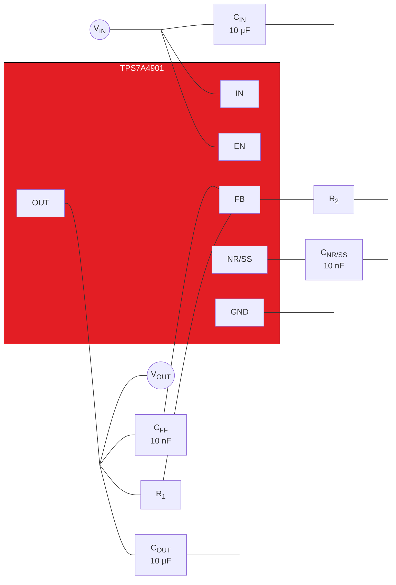

*Figure 76. Filtering capacitors on an LDO.*

Once you’ve confirmed that your power supplies are configured properly, you can try to improve overall noise performance by increasing the size of ADC decoupling capacitors to provide additional filtering. This can be helpful not only on the main supply pins, but also on any internal voltage nodes brought out to a dedicated pin for external decoupling. The ADC manufacturer can usually recommend capacitance values for those as well. Remember to place smaller capacitors closest to the device pins in parallel with larger capacitors for best performance.

Lastly, if you believe the supply-conditioning components themselves are introducing one or more tones into the ADC spectrum, try replacing each of the ADC supplies with an external bench supply, one at a time. If this does not reveal the issue, you can also try replacing the main supply source for your board to determine where the noise is coming from.


<!-- PDF page 79 -->


## **Key takeaways**

Here is a summary of important points to better understand how to reduce power-supply noise effects in delta-sigma ADCs:

1. Prioritize the supply that most directly powers the delta-sigma modulator, which is typically AVDD, for ADCs with multiple supplies.
2. Methods to improve PSRR:
   * Optimize layout.
   * Frequency planning.
3. Debugging:
   * Adding an LDO.
   * Ensure key power-supply specs are met.
   * Increase ADC decoupling capacitors.
   * Replace supplies with a benchtop source one by one.

## ***Conclusion***

And with that, you’ve reached the end of this e-book. I hope you enjoyed expanding your understanding of noise in analog signal-chain design.


<!-- PDF page 80 -->


### ***Additional resources:***

* **TI Precision Labs – ADCs: ADC Noise (training series)**
  * **Introduction to noise in ADC systems**
  * **Types of noise in ADCs**
  * **ADC noise measurement, methods and parameters**
  * **System noise performance for low-speed delta-sigma ADCs**
  * **Calculating the total noise for ADC systems**
  * **Hands-on experiment – ADC noise**
* **Top 10 questions about noise in high-resolution delta sigma ADCs (technical article)**
* **And then there was noise: The mystery of the missing ENOB (technical article)**
* **And then there was noise: The mystery of the missing ENOB (Part 2) (technical article)**
* **And then there was noise: The mystery of the missing ENOB (Part 3) (technical article)**


<!-- PDF page 81 -->


# TI Worldwide Technical Support

## TI Support

Thank you for your business. Find the answer to your support need or get in touch with our support center at
[www.ti.com/support](http://www.ti.com/support)

China: http://www.ti.com.cn/guidedsupport/cn/docs/supporthome.tsp
Japan: http://www.tij.co.jp/guidedsupport/jp/docs/supporthome.tsp

## Technical support forums

Search through millions of technical questions and answers at TI’s E2E™ Community (engineer-to-engineer) at
e2e.ti.com

China: http://www.deyisupport.com/
Japan: http://e2e.ti.com/group/jp/

## TI Training

From technology fundamentals to advanced implementation, we offer on-demand and live training to help bring your
next-generation designs to life. Get started now at training.ti.com

China: http://www.ti.com.cn/general/cn/docs/gencontent.tsp?contentId=71968
Japan: https://training.ti.com/jp


<!-- PDF page 82 -->


**Important Notice:** The products and services of Texas Instruments Incorporated and its subsidiaries described herein are sold subject to TI’s standard terms and conditions of sale. Customers are advised to obtain the most current and complete information about TI products and services before placing orders. TI assumes no liability for applications assistance, customer’s applications or product designs, software performance, or infringement of patents. The publication of information regarding any other company’s products or services does not constitute TI’s approval, warranty or endorsement thereof.

All trademarks are the property of their respective owners.


<!-- PDF page 83 -->


## **IMPORTANT NOTICE AND DISCLAIMER**

TI PROVIDES TECHNICAL AND RELIABILITY DATA (INCLUDING DATA SHEETS), DESIGN RESOURCES (INCLUDING REFERENCE DESIGNS), APPLICATION OR OTHER DESIGN ADVICE, WEB TOOLS, SAFETY INFORMATION, AND OTHER RESOURCES “AS IS” AND WITH ALL FAULTS, AND DISCLAIMS ALL WARRANTIES, EXPRESS AND IMPLIED, INCLUDING WITHOUT LIMITATION ANY IMPLIED WARRANTIES OF MERCHANTABILITY, FITNESS FOR A PARTICULAR PURPOSE OR NON-INFRINGEMENT OF THIRD PARTY INTELLECTUAL PROPERTY RIGHTS.

These resources are intended for skilled developers designing with TI products. You are solely responsible for (1) selecting the appropriate TI products for your application, (2) designing, validating and testing your application, and (3) ensuring your application meets applicable standards, and any other safety, security, regulatory or other requirements.

These resources are subject to change without notice. TI grants you permission to use these resources only for development of an application that uses the TI products described in the resource. Other reproduction and display of these resources is prohibited. No license is granted to any other TI intellectual property right or to any third party intellectual property right. TI disclaims responsibility for, and you will fully indemnify TI and its representatives against, any claims, damages, costs, losses, and liabilities arising out of your use of these resources.

TI’s products are provided subject to <u>TI’s Terms of Sale</u> or other applicable terms available either on <u>ti.com</u> or provided in conjunction with such TI products. TI’s provision of these resources does not expand or otherwise alter TI’s applicable warranties or warranty disclaimers for TI products.

TI objects to and rejects any additional or different terms you may have proposed.

Mailing Address: Texas Instruments, Post Office Box 655303, Dallas, Texas 75265
Copyright © 2025, Texas Instruments Incorporated
