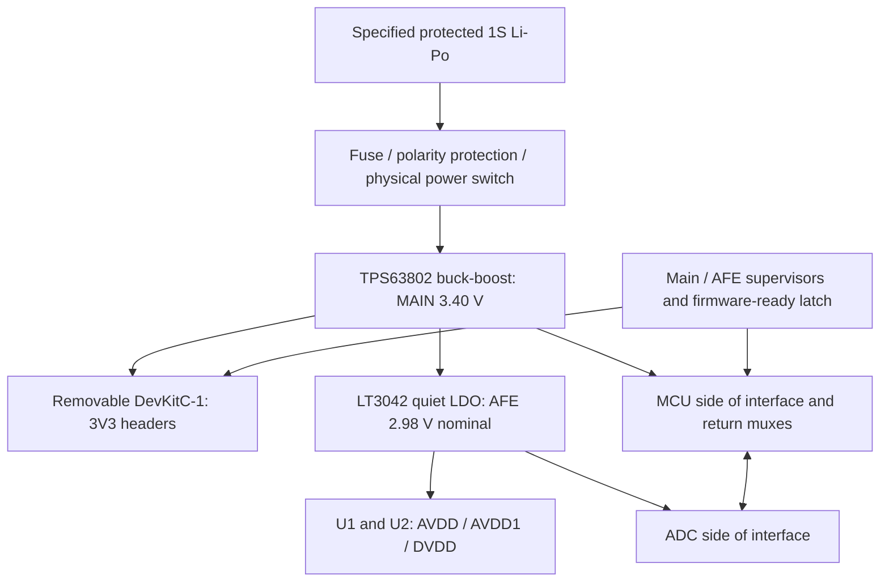

# Open-sEMG-16 V1.3 — Power architecture proposal

**Implementation update:** the original proposal below is preserved as decision history. The implemented circuit uses nominal **3.3 V MAIN plus an independent 4.0 V AFE pre-regulator feeding the 2.98 V LDO**. See [power_implementation.md](power_implementation.md) and section 12 below; the original 3.4 V single-prestage tree is not the delivered schematic.

27 October 2026. **Design review only; no schematic implementation authorized or performed.**

## 1. Recommendation and decisions for review

Use a protected, specified single-cell Li-Po pack, a **buck-boost main supply**, and a **separate quiet supply for both ADS1298s**. Retain the removable ESP32-S3 DevKitC-1. The proposed values are:

- **Main rail: 3.40 V**, TPS63802, supplying the DevKit and the MCU side of the digital interface.
- **AFE rail: 2.98 V nominal**, LT3042, supplying **both AVDD/AVDD1 and DVDD on both ADCs**. Its low current makes post-regulation economical. Separate local analog/digital bypass routes remain necessary.
- Default-disabled, power-off-tolerant digital interface between these domains; separate ADC DOUT paths into a mux. Both ADCs retain their existing clock relationship, independent chip selects, and all 16 differential acquisition channels.
- Battery-only carrier operation. Both DevKit USB sockets are physically inaccessible while the DevKit is seated. USB programming requires disconnecting the battery and removing the DevKit from the carrier. Charge the disconnected pack off the body with a compatible charger.

The slightly unusual voltage choices have a purpose: 3.40 V provides post-LDO headroom while remaining within the ESP32's 3.0–3.6 V range; 2.98 V leaves a small worst-case dropout allowance after regulator tolerances. A nominal 3.3 V main rail followed by a 3.3 V LDO cannot regulate. Neither should a 3.6 V main rail be connected directly to a 3.6 V maximum-rated MCU without tolerance/transient margin.

**The material tradeoff is reduced ADC common-mode headroom compared with the existing intended 3.3 V supply.** This recommendation is conditional on the electrode offset, gain and body-bias requirements fitting the lower rail. Section 6 quantifies that tradeoff. If they do not fit, preserve 3.3 V analog with an independent, low-current boost/buck-boost plus LDO; keep the MCU on its own 3.3 V buck-boost. That costs another converter but avoids boosting the entire RF load to a higher voltage.

This is an architecture and component proposal, not a fabrication-ready BOM or a power-up release. Cell identity, exact DevKit assembly, protection, supervisor/control implementation, PCB, startup captures and noise measurements remain necessary. **Battery-only operation does not establish wearer safety.** F07/F08 body bias, electrode protection and normal/single-fault current verification remain open.

## 2. Source of truth and checks performed

The required historical sources were read in revision order:

1. [Original review](../reviews_v1/full_review.md), including F01–F21 and its supply/current calculations.
2. [V1.1 changes](../reviews_v1.1/updates_from_v1.md), whose historical text calls that revision “V2”.
3. [V1.2 changes](../reviews_v1.2/updates_from_v1.1.md).
4. [V1.2 ERC analysis](../reviews_v1.2/erc_analysis.md).
5. [V1.2 ERC corrections](../reviews_v1.2/erc_corrections.md), which supersede the earlier description of paralleled U4/U5 outputs.

The actual target is `v1.3/open-semg-16-v1.3.kicad_pro` and its matching `.kicad_sch`. The KiCad MCP service reports the correct directory but stale, nonexistent `open-semg-16-v1.2.*` filenames. No MCP design-write or project-selection operation was used. Native KiCad CLI calls explicitly targeted the V1.3 schematic.

Evidence: [native netlist](diagnostics/power_architecture/v1.3-netlist.xml), [derived component/pin/net map](diagnostics/power_architecture/v1.3-connectivity.json), [fresh ERC](diagnostics/power_architecture/v1.3-erc.json), [schematic PDF](diagnostics/power_architecture/v1.3-schematic.pdf), and [power crop](diagnostics/power_architecture/power-view.png). The source parsed/exported successfully; ERC reproduces **7 errors and 4 warnings**. The exported 133 components and 133 net partitions match the final V1.2 cleanup connectivity exactly, despite revision-file text differences. See [comparison](diagnostics/power_architecture/v1.2-net-partition-comparison.json).

Schematic/project snapshots and [pre-analysis hashes](diagnostics/power_architecture/pre-analysis-hashes.json) were saved before analysis. No design file, project setting, shared library, historical revision, manufacturer document, input channel or ERC rule was changed. The final [integrity result](diagnostics/power_architecture/file-integrity.json) records preservation checks. Independent [ADC](diagnostics/power_architecture/adc-evidence.md), [ESP/USB](diagnostics/power_architecture/esp-usb-evidence.md), and [regulator](diagnostics/power_architecture/regulator-evidence.md) notes support this report; the final recommendation here takes precedence over alternatives discussed in those notes.

## 3. Existing power circuit: complete distribution

### 3.1 Sources, regulators and enables

| Element | Actual V1.3 connections | Consequence |
|---|---|---|
| BT1, unspecified battery | Pin 1 → `+3.7V`; pin 2 → `AGND` | The label is a nominal name, not a specified cell voltage range, capacity or protection circuit. |
| Battery input bank | C53 = 1 µF and C56 = 1 µF, both `+3.7V` → AGND; TP5 on battery positive | Both regulator inputs see the same raw battery. No carrier charger, power mux, fuse, reverse-polarity protection or specified low-cell cutoff is present. |
| U4 LP2985-3.3 | VIN1 → battery; GND2 → AGND; ON/OFF3 → `/EN`; BP4 → C55 = 10 nF → AGND | 150 mA family, exact orderable/silicon generation unspecified. C55 has the retained <100 nA leakage requirement. |
| U4 VOUT5 | Only C54.1 = 2.2 µF on `/LP2985_OUT_DISABLED`; C54.2 → AGND | **Isolated from system loads and U5 output.** This fixes F04's original direct parallel connection. U4 does not currently supply an analog rail. |
| U5 TLV75533PDBV | IN1 → battery; GND2 → AGND; EN3 → `/EN`; NC4 unconnected; OUT5 → `+3.3V` | Sole carrier regulator connected to the main load rail; 500 mA rating, DBV package. |
| R38 = fitted 0 Ω | `/EN` → AGND, shared by U4.3 and U5.3 | **Both regulators deliberately OFF.** Do not apply a high enable driver against this strap. |
| U3 DevKitC | 3V3 pins 1/2 → `+3.3V`; grounds 22/23/24/44 → AGND | The complete board, including its internal regulator and loads, is attached to this rail. |
| U3 5V21 | Singleton carrier `+5V` net | No carrier 5 V source; internally it can still become powered through DevKit USB. |

The battery has a valid common return after the earlier F02 repair. **The immediate reason battery-only V1.3 cannot power normally is R38's intentional inhibit**, not the old zero-span ADC wiring or a still-paralleled U4/U5 output pair. Removing R38 alone is not a qualified architecture: dropout, RF demand, capacitance, USB, startup and protection remain unresolved.

### 3.2 Main rail and every ADC power-related terminal

There is presently **one shared regulated load net**, not separate analog/digital regulators. For each U1/U2:

| Function | Physical pins | Current net |
|---|---|---|
| AVDD | 19, 21, 22, 56, 59 | `+3.3V` |
| AVDD1, charge-pump supply | 54 | `+3.3V` |
| DVDD | 48, 50 | `+3.3V` |
| Unused analog auxiliary ties | 17, 18, 62 | Same net as actual AVDD, `+3.3V` |
| AVSS / AVSS1 | 20, 23, 32, 57, 58 / 53 | AGND |
| DGND | 33, 49, 51 | AGND |
| VREFN | 25 | AGND |
| Reserved/input-low ties | RESV1 31; DAISY_IN 41; GPIO 42/44/45/46 | AGND |
| CLKSEL | 52 | U1: `+3.3V`; U2: AGND |
| RLDREF / RLDINV / RLDOUT / WCT | 60 / 61 / 63 / 64 | Individually unconnected; no body-bias circuit |

The original F01–F03 supply/auxiliary wiring fixes remain present. Ground naming does not imply physically separate return planes: battery negative, regulators, MCU and ADC physical grounds share AGND.

| Capacitors/probes | Actual connection and purpose |
|---|---|
| C6 100 nF + C7 10 µF; C32/C33 equivalent | Direct main-to-AGND analog bypass banks, one per ADC |
| C8 100 nF + C9 10 µF; C34/C35 equivalent | Direct main-to-AGND digital bypass banks |
| C57 200 µF | Direct main-to-AGND bulk; technology, ESR and effective capacitance unspecified |
| C19 100 nF + C20 10 µF; C45/C46 equivalent | Independent VREFP24 → VREFN25/AGND reference bypasses |
| C23/C49, 22 µF | Each VCAP1 pin 28 → AGND |
| C24/C50, 1 µF | Each VCAP2 pin 30 → AGND |
| C25/C51, 1 µF, ≥10 V requirement | Each VCAP3 pin 55 → AGND |
| C26/C52, 1 µF | Each VCAP4 pin 26 → AGND |
| TP4/TP5/TP6 | Main rail / battery / AGND |
| TP7–TP16 | Independent references and all eight VCAP nodes |
| 32 × 620 pF input capacitors | Each acquisition input node → AGND, after its 2 kΩ series resistor; these are signal-filter components, not supply bulk |

Direct load-rail capacitance is **200 + 4 × (10 + 0.1) = 240.4 µF nominal**, before the DevKit. The isolated U4 branch retains 2.2 µF. Reference and VCAP capacitors are not directly parallel output capacitance, although charging them contributes startup load. A net label or capacitor cannot generate a supply/reference voltage.

### 3.3 Current startup, brownout and external-source behavior

R33/R34/R35 pull START/RESET/PWDN low through 10 kΩ; R36/R37 pull DIN/SCLK low. These define high-impedance states but cannot override driven MCU boot glitches. CS1/CS2 have no external defaults or gates. Both DOUT43 pins are directly shorted to `/MISO`, U3.19. That is supported for normal exclusive-CS operation; simultaneous low selects during startup still need a contract. U1 CLK37 and U2 CLK37 share ADC_CLK, but U1's CLK_EN resets off.

U5's typical disabled output-discharge resistance is 120 Ω: an externally held 3.3 V output could draw approximately **27.5 mA** through that path. This is a conditional calculation, not a guaranteed sink specification. U5 OUT absolute maximum depends on VIN (`min(VIN + 0.3 V, 6 V)`); battery removal with charged capacitors or USB-fed output needs explicit reverse-current analysis. U4 is parked, so its output is no longer directly exposed to the DevKit rail. [TLV755P §§5.1, 6.3, 7.1](../../docs/datasheets/originals/components/TLV755P.pdf).

No hardware system undervoltage supervisor, deliberate restart hysteresis, ADC rail-good gating or coordinated shutdown is implemented. The actual firmware/brownout configuration is absent. Resetting the MCU does not discharge the battery, qualify ADC supplies, or guarantee safe GPIO states.

## 4. Manufacturer constraints

### 4.1 Battery window and existing LDO limits — F15/F16

For comparison only, assume a conventional **4.20 V charge-limit 1S Li-Po**, with a provisional loaded operating cutoff near **3.2 V**. Some cells use different charge limits and discharge policies. No pack datasheet was supplied; these are design assumptions to replace with the selected pack's limits, impedance, temperature curves and protection thresholds.

| Battery voltage | Nominal headroom above a 3.3 V LDO output |
|---:|---:|
| 4.20 V | 0.90 V |
| 3.70 V | 0.40 V |
| 3.50 V | 0.20 V |
| 3.30 V | 0 V |
| 3.20 V | −0.10 V |

For the selected **TLV755 DBV**, maximum dropout at 500 mA is 215 mV through 85 °C or 238 mV through 125 °C: simple nominal screens are 3.515/3.538 V at its input, before output tolerance and battery/wiring droop. LP2985 legacy versus new silicon at 150 mA has markedly different full-temperature dropout, 575 versus 254 mV; at 50 mA, 225 versus 184 mV. Do not transfer one generation's capacitance/dropout rules to the other. These additions are headroom screens, not guarantees of nominal voltage at a dropout boundary. [Local TLV755P electrical tables](../../docs/datasheets/originals/components/TLV755P.pdf), [local LP2985 tables](../../docs/datasheets/originals/components/LP2985.pdf).

A low-current analog LDO is more manageable than the RF LDO, but two ordinary fixed 3.3 V LDOs cannot sustain 3.3 V through a cell falling below that voltage. A high cutoff sacrifices usable capacity and is chemistry/load dependent. **Converter input UVLO is not cell protection**: a buck-boost capable of operating far below 3 V still needs a suitable battery cutoff.

### 4.2 ADS1298 — F13/F14 and sequencing

The [local TI ADS1298 SBAS459K](../../docs/datasheets/originals/components/ADS1298.pdf), printed pp.10–17 and §11 pp.96–99, establishes:

- Analog span 2.7–5.25 V; DVDD 1.65–3.6 V; recommended AVDD−DVDD −2.1 to +3.6 V. Equal approximately 3 V supplies are permitted. Figure 106 is a unipolar example with 3 V analog/1.8 V digital; it is not evidence that every illustrated rail must be copied.
- Digital pins must stay within their own supply-relative limits; analog auxiliary ties must follow **actual AVDD**, including when rails are separated. RESET/PWDN do not make unpowered inputs tolerant of a powered MCU.
- With RLD/WCT/PACE off, typical analog current is 2.75 mA/device in HR or 1.8 mA in LP. The separate 3 V digital-current row is 0.5 mA/device. Thus two devices give an approximate **6.5 mA** benchmark. The table conditions include 500 SPS, gain 6 and an external 2.048 MHz clock; these are not guaranteed maxima at the eventual EMG rate, clock loading or support-amplifier configuration.
- Bypass supplies locally with 1 µF and 100 nF as recommended; AVDD1/AVSS1 need short, dedicated charge-pump supply/return routing. Preserve general 10 µF/100 nF banks and add explicit local bypassing where pins require it. A common low-impedance ground with controlled return paths is appropriate; disconnected “analog” and “digital” ground islands are not the solution.
- Preserve each independent reference and VCAP network. VCAP1 = 22 µF, VCAP2/3/4 = 1 µF nominal. VCAP3 is approximately AVDD + 1.9 V relative to AVSS: about **4.88 V** in the proposal; retain ≥10 V parts with adequate effective capacitance. Figure 106 also shows 100 nF at VCAP3. VCAP1 capacitor microphonics/leakage require care in a moving wrist assembly.
- Internal reference resets off. Enable the **2.4 V** reference on each ADC and wait for settling; do not use 4 V reference mode on an approximately 3 V supply. The two references must remain independent.

TI requires controlled low inputs through supply stabilization. After stabilization and valid clock, wait **2¹⁸ clock cycles and VCAP1 >1.1 V**, whichever is later, then apply reset for at least two clock periods and wait 18 clock periods before commands. At 2.048 MHz these are 128 ms, 0.977 µs and 8.79 µs. U2's clock-dependent wait starts only when U1 actually exports its clock. No guaranteed ADS brownout threshold/recovery sequence was established; reinitialize after rail failure.

The analog-input-low recommendation is not solved by digital buffers: initial tests need unpowered, ground-referenced dummy inputs. Power-on while electrodes are attached remains part of F07/F08 bias/protection design. Do not assume wearer voltages or electrode offsets are zero.

### 4.3 ESP32-S3 and DevKit — F16/F17

The [local WROOM-1/-1U datasheet v1.8, pp.27–28](../../docs/datasheets/originals/components/ESP32-S3-WROOM-1.pdf) specifies **3.0–3.6 V** and a source capable of **at least 0.5 A**. Listed 3.3 V/25 °C Wi-Fi peak currents include 355 mA for 802.11b/1 Mbps/20.5 dBm, approximately 285–297 mA for the listed g/n TX modes, and 95–97 mA RX. BLE TX reaches 344 mA at the listed +20 dBm condition. These are characterization conditions, not a guaranteed worst-case complete-DevKit budget. Radio duty, CPU, memory and board loads matter; do not add mutually exclusive RF modes together.

Espressif recommends at least 10 µF at the power entrance and controlled CHIP_PU release after supply stabilization; its reset timing includes at least 50 µs supply stabilization and reset assertion. Slow/unstable rails can need external supervision. [Hardware design checklist](https://docs.espressif.com/projects/esp-hardware-design-guidelines/en/latest/esp32s3/schematic-checklist.html).

The [DevKit guide](https://docs.espressif.com/projects/esp-dev-kits/en/latest/esp32s3/esp32-s3-devkitc-1/user_guide_v1.1.html#power-supply-options) makes USB, 5 V-header and 3V3-header supply methods mutually exclusive. The [official v1.1 schematic](https://dl.espressif.com/dl/schematics/SCH_ESP32-S3-DevKitC-1_V1.1_20221130.pdf) has an SGM2212 regulator, USB-UART bridge, LEDs and onboard reset network. USB can reach its regulator and then the external 3V3 headers. An unconnected carrier 5 V header or USB GPIO NC does not interrupt those board-internal paths.

The [SGM2212 datasheet](https://www.sg-micro.com/rect/assets/54089b71-cc25-4f36-af2e-34b07f00a108/SGM2212.pdf) does not establish reverse blocking for this use. Direct external header supply is nevertheless an official DevKit mode when other sources are excluded. A carrier ideal diode alone cannot stop a mounted, USB-powered DevKit from energizing the common carrier rail. Firmware brownout detection should remain enabled, but its actual thresholds/build are unknown and it does not monitor the AFE. See [ESP-IDF configuration](https://docs.espressif.com/projects/esp-idf/en/stable/esp32s3/api-reference/kconfig-reference.html#config-esp-brownout-det).

Before adopting 3.40 V, identify the actual board/module and all board loads. The [CP2102N datasheet, Table 3.1](https://www.silabs.com/documents/public/data-sheets/cp2102n-datasheet.pdf) permits VDD 3.0–3.6 V, with additional VREGIN/VIO wiring conditions. RGB identity and supply routing are unverified; generic LED names do not qualify its voltage/current. Keep RGB disabled and review/depopulate an unsuitable fitted load during an authorized implementation. The reference DevKit's CHIP_PU 10 kΩ/1 µF network is not proof of brownout supervision on an unidentified assembly.

## 5. Architecture comparison

A, B and C overlap: a buck-boost can feed either one shared rail or separate regulated domains. The relevant choice is both conversion topology and load partitioning.

| Criterion | A — one 3.3 V stage, analog filtering | B — separate battery-fed analog/digital LDOs | C — buck-boost, with optional quiet post-regulation |
|---|---|---|---|
| Feasibility/window | Single LDO works only above its load-dependent dropout. A single buck-boost can cover the chosen cell window. | Separates loads, but fixed 3.3 V rails still lose regulation at low battery. Analog at a lower voltage helps only its own branch. | Handles input above/below output. Preferred for a useful 1S discharge window. |
| Required source | ≥0.5 A module capability plus board/AFE margin; load-step response, current limit and suitable output C. | Digital source needs RF capability; analog LDO needs noise, PSRR, capacitor compatibility and reverse-current assessment. | Guaranteed deliverable current at minimum input, suitable inductor, input/output C, defined MODE/EN, UVLO, startup and reverse-flow behavior. Switch-current rating is not output-current rating. |
| Efficiency | LDO ideal ≈79% at 4.2 V, 89% at 3.7 V; buck-boost efficiency must come from curves/measurement. | Similar digital LDO losses; extra analog quiescent load is usually small relative to radio. | Use 85/90/95% as sensitivity assumptions, not promises. Quiet post-LDO loss on roughly 10 mA is small. |
| Noise | Lowest component count. RC/bead filter attenuates rail noise but cannot remove ground/RF coupling. RC DC drop and bead resonance matter. | Keeps RF supply current out of analog regulator. Shared battery/ground still couples noise; PSRR falls near dropout. | Adds switching noise; careful layout and post-LDO improve rejection. Forced PWM avoids low-frequency burst behavior but costs light-load power and can permit reverse flow. |
| Complexity | One converter/LDO plus local filtering; still requires startup/interface/source control. | Two LDOs, independent caps/enables and rail sequencing. Keeping U4 requires identified silicon/ESR. | One converter plus quiet LDO is moderate complexity. Two converters preserve higher analog headroom at higher count/cost. |
| USB | No intrinsic solution; DevKit still supplies the header rail from USB. | Separate carrier rails do not isolate the DevKit's internal LDO or powered GPIOs. | Disabled converter load disconnect is not active dual-source isolation. Adopt an explicit USB contract or complete source isolation. |
| Startup/shutdown | Shared supply simplifies relative ramps; filtered rail still lags and stores charge. | Separate rails can back-power one another through interfaces. Need defaults and coordinated ramp/failure handling. | Soft start/current limit plus rail-good controls; assess cutoff rebound, hold-up, discharge and reverse current. |
| Main uncertainty | Whether filter/layout achieves the required sEMG noise during radio activity. | Usable cell capacity before digital dropout and DBV thermal margin. | Actual efficiency/noise across modes and loads, minimum-input peaks, inductor/PCB behavior. |

**A is a viable lower-cost fallback**, especially a single 3.3 V buck-boost with a filtered AFE branch. For example, 10 Ω and 22 µF effective form a nominal 723 Hz pole; 6.5 mA produces 65 mV DC loss. This is an illustrative calculation, not a selected filter or achieved attenuation at MHz frequencies. Ferrite impedance, capacitor ESL/ESR and input load spectra require real models. A shared rail preserves more analog headroom and may be sufficient, but the present evidence does not establish its RF noise performance.

**B alone is not recommended for the desired discharge range.** Reusing U5 digitally also leaves the DBV thermal/transient concerns. Retaining U4 only for AFE current could be electrically reasonable above dropout, but offers no complete low-cell solution and retains silicon/capacitor uncertainty.

**Recommend C with separate MCU and quiet AFE domains.** Both ADC digital cores consume much less current than the radio, so placing them on the quiet AFE supply simplifies their relative sequencing without importing the ESP32 current pulses. Interface translation is required. The LT3042 is selected over an otherwise attractive TPS7A20 chiefly for its documented reverse-current protection during input loss; its approximately 2 mA typical overhead is acceptable here. The [TPS7A20 datasheet](https://www.ti.com/lit/ds/symlink/tps7a20.pdf) requires additional reverse-current handling, so a simple part substitution would reopen shutdown analysis.

Another possible C implementation boosts the cell to 5 V and uses the DevKit's onboard LDO. At 355 mA, that LDO loses approximately `(5−3.3)×0.355 = 0.604 W`; its ideal efficiency is only 66% before boost losses. It retains USB exclusivity and needs board thermal qualification. It is not preferred for this wearable's power/heat budget.

## 6. Proposed tree, parts and calculations

All returns remain one electrically bonded AGND network; use placement and routing to control RF, switcher, digital and analog currents. Put the converter/inductor away from electrode, reference and VCAP nodes. Verify DevKit antenna clearance and the enclosure. A fuse/current limiter protects defined battery/board fault paths; it is not an electrode-current limiter.

### 6.1 Main converter

Candidate **TPS63802DLAR**. DLA pins: VIN10, VOUT6, L1=9, L2=7, GND8, AGND3, FB4, EN1, MODE2, PG5. Use a 0.47 µH inductor meeting effective-inductance/current specifications; local input ≥4 µF effective and output ≥7 µF effective. Start with 10 µF input and 22 µF output nominal, then qualify derating. Its output-capacitance guidance has no upper limit; existing bulk still affects charging and transients. [TI datasheet §§7, 8, 10](https://www.ti.com/lit/ds/symlink/tps63802.pdf).

The 2 A headline uses 3.3 V output and input ≥2.3 V under its stated conditions. It is not a guaranteed 3.4 V output capability over every temperature/layout; qualify the proposed load envelope at the actual setpoint and minimum input.

Use 56.0 kΩ + 2.00 kΩ in series from MAIN to FB, and 10.0 kΩ FB-to-AGND, all 0.1%:

`VMAIN = 0.500 × (1 + 58/10) = 3.400 V`.

Using ±1% FB accuracy, ±100 nA bias and resistor extremes gives an approximate **3.354–3.446 V DC interval**. This is a tolerance screen; layout, temperature coefficients, transient droop/ringing and measurement error are additional. Upper operating margin to 3.6 V is only **154 mV** at that high corner. Require captured extrema below 3.6 V and suitable lower margin under every load/startup case; changing MAIN back to 3.3 V requires recalculating the post-LDO headroom.

Begin acquisition in forced PWM with MODE defined high; compare power-save mode experimentally. Do not promise lower sEMG noise from mode name alone. The converter can conduct reverse current in forced PWM; no other source is allowed to drive MAIN. Select an inductor from the manufacturer's qualified design approach and check saturation against the converter's **maximum current-limit/ripple**, rather than using the 0.75 A system load as its saturation rating. [TI product information](https://www.ti.com/product/TPS63802).

A provisional EN divider of 22.0 kΩ battery-to-EN and 10.0 kΩ EN-to-ground, 0.1%, gives typical falling/rising battery thresholds about **3.20/3.52 V**. With specified threshold extremes and ±0.2 µA leakage, the calculated ranges widen to approximately **3.095–3.305 V falling** and **3.415–3.625 V rising**. This is not a precision 3.2 V cutoff. The physical switch must force EN low or disconnect battery power. Final pack requirements may demand a precision battery supervisor and latched shutdown; validate rebound and RF pulse droop before accepting the divider-only option.

### 6.2 Quiet regulator and analog consequences

Candidate **LT3042IDD#PBF**: IN1/2 → MAIN; OUT10 → AFE; OUTS9 Kelvin sense at local output capacitor; GND8/pad11 → AGND. SET7 uses **29.8 kΩ, 0.1%, and 4.7 µF** to AGND. ILIM5 uses **2.49 kΩ, 1%**, approximately 50 mA limiting. CIN/COUT each start at 10 µF nominal, providing ≥4.7 µF effective locally; output ESR <50 mΩ and ESL <2 nH. EN3 follows defined main-good control; PG4 may be unused, PGFB6 tied to IN to disable fast start for a slow, controlled proposal. Verify the exact package/symbol. [ADI datasheet, pp.2–4, 10–22](https://www.analog.com/media/en/technical-documentation/data-sheets/lt3042.pdf).

Own tolerance screen: `VAFE ≈ ISET×RSET + VOS`; using 98–102 µA, resistor tolerance and ±2 mV yields approximately **2.9155–3.0446 V**. MAIN minimum minus AFE maximum is **309.8 mV**, only about 9.8 mV above the cited 300 mV full-temperature dropout bound at the 1/50 mA test loads. **This is adequate as a candidate DC screen but a tight dropout/rejection margin:** validate at actual load, temperature and supply ripple, or lower AFE slightly/increase headroom with a revised architecture. Do not apply high-headroom PSRR curves unchanged at this boundary. The regulator's protected input-loss behavior and approximately 2 mA nominal ground current are useful here; neither establishes system noise. [ADI product information](https://www.analog.com/en/products/lt3042.html).

Add **2.70 kΩ, 1%, from AFE to AGND**. It draws about 1.10 mA/3.29 mW nominal, and at the calculated AFE low corner draws at least 1.069 mA. This keeps the load above the 1 mA condition used for the cited output-tolerance screen even while both ADCs are powered down, and provides a defined discharge path. Include it in the 20 mA AFE budget. The small residual headroom also means that the fallback single 3.3 V filtered architecture or an independent higher-voltage analog source should remain available if measured rejection is inadequate.

Both ADC domains track the same AFE output, avoiding a separate DVDD load switch and a large AVDD/DVDD ramp difference. Keep analog and digital bypass branches physically separate near the chips. Direct AFE capacitance begins with the existing **40.4 µF** of four banks, plus the local LDO output and new pin bypassing; select the complete network. VCAP/reference startup load is additional. With 52.6 µF effective as an illustration, 2.98 V requires 157 µC: 50 mA would need at least 3.1 ms before any chip load or CSET settling. The 4.7 µF SET network can make startup hundreds of milliseconds; use qualified rail-good and measurements, not a copied small-capacitor startup time.

The ADC reference remains 2.4 V. At gain 6 its nominal differential full-scale remains ±400 mV, but Eq.2 common-mode limits change:

| Maximum differential magnitude | VCM at 3.3 V AVDD | VCM at nominal 2.98 V | VCM using 2.9155 V low corner |
|---:|---:|---:|---:|
| 300 mV | 1.10–2.20 V | 1.10–1.88 V | 1.10–1.8155 V |
| 350 mV | 1.25–2.05 V | 1.25–1.73 V | 1.25–1.6655 V |
| 400 mV | 1.40–1.90 V | 1.40–1.58 V | 1.40–1.5155 V |

These are strict theoretical boundaries, not acceptable operating targets. The nominal midpoint bias moves from 1.65 V to approximately **1.49 V**; it should track the actual AFE rail. F07 must establish that bias deliberately. If offsets/motion/common mode need the former headroom, do not adopt this rail: select the separate 3.3 V analog converter/LDO alternative. Power cleanup alone cannot prevent PGA clipping or restore clipped data.

### 6.3 Current, consumption and thermal budget

| Load | Evidence / planning allowance |
|---|---|
| Two ADS analog cores | 5.5 mA typical HR benchmark; allocate 10 mA pending chosen rate/modes |
| Two ADS digital cores | 1.0 mA typical 3 V benchmark; allocate 2 mA pending clock/rate |
| Seven ADC-side 10 kΩ control pulls | Up to 7×2.98/10k = 2.09 mA if every control high; typical transactions use fewer |
| AFE minimum-load/discharge resistor | Approximately 1.10 mA nominal through 2.70 kΩ |
| AFE-side interface, extra bypass/startup | Remaining allowance to **20 mA AFE continuous design budget**; switching/inrush must be measured |
| LT3042 ground current | Approximately 2 mA typical; reserve **5 mA** in the main budget, based on its 50 mA-load maximum row |
| WROOM source provision | **500 mA capability**, not predicted continuous consumption |
| DevKit extra loads | Provisional **25 mA allowance**, RGB disabled; replace with measured assembly data |
| Main-side interface, monitors, dividers | Provisional **5 mA allowance**; enumerate actual parts and switching currents |
| Main total | **About 555 mA**, round to **0.56 A continuous design load**, **0.75 A transient reserve**; qualify ≥1 A short load-step capability where the chosen converter/input supports it |

Do not add the ADC output power again to the main current: its LDO input current is already in this sum. The 50 mA AFE current limit is not the continuous budget. Internal charge-pump/reference charging and pull loading need startup captures.

For MAIN at 3.4 V, `IBAT ≈ 3.4×IMAIN/(VBAT×η)`, before small input-side monitoring losses:

| Main current | Main power | Battery at 3.7 V, assumed 90% | Battery at 3.2 V, assumed 85% |
|---:|---:|---:|---:|
| 0.10 A | 0.340 W | 0.102 A | 0.125 A |
| 0.20 A | 0.680 W | 0.204 A | 0.250 A |
| 0.40 A | 1.360 W | 0.408 A | 0.500 A |
| 0.56 A | 1.904 W | 0.572 A | 0.700 A |
| 0.75 A | 2.550 W | 0.766 A | 0.938 A |

These are load/efficiency sensitivity calculations, **not predicted operating averages**. A 355 mA characterized module TX condition plus allowances suggests roughly a 0.4 A main-rail scenario, but the real waveform depends on firmware and board. At 0.20 A main average, a hypothetical **1 usable Ah** at an average 3.7 V/90% gives approximately **4.9 h**; at 0.40 A, 2.45 h. Capacity above the cutoff, aging, cold operation and discharge impedance are unknown. Select pack/protection/connector/wiring for at least the approximately 1 A low-cell pulse requirement plus justified margin; charge current is a separate requirement.

Thermal screens:

- Existing U5 at 4.2 V/500 mA: approximately 0.45 W; DBV reference 231.1 °C/W gives **104 °C rise**. At 361.5 mA the original screen is about 75 °C rise. Neither proves actual overheating, but both argue against casually enabling U5 as the RF source.
- Proposed converter at 0.56 A and assumed 85% efficiency: loss about **0.336 W**. With its reference 81 °C/W, rise is about **27 °C**. At 0.75 A, loss 0.450 W, rise about 36 °C. These use reference-board thermal metrics and include no proof of the chosen copper/enclosure. Inductor losses are partly external; assigning all conversion loss to the IC is a screening approximation.
- AFE LDO at 20 mA and 5 mA ground-current allowance: `(3.4−2.98)×0.020 + 3.4×0.005 ≈25 mW`, roughly 1 °C rise with its reference package metric. Overall enclosure heat is dominated by the radio/CPU and conversion, and still needs a surface-temperature requirement.

The new converter removes U5's particular 200 µF recommended-range issue, not the need for F13 qualification. Retaining C57 gives about 680 µC at 3.4 V and stores 1.16 mJ by itself. At 0.3 A load step and 200 µF effective, 100 µs unsupported gives **150 mV downward droop** before ESR: this greatly exceeds the 9.8 mV residual post-LDO dropout screen, although the MCU has a larger voltage allowance. Upward overshoot has a separate 154 mV high-corner limit. Actual loop response, capacitor network and supply impedance must carry the RF load; bulk alone is not a specification.

## 7. Required schematic changes after approval

**None of these changes has been made.** New reference designators/footprints must be assigned during implementation rather than treating the following functional names as existing components.

1. **Remove the old power paths:** remove/DNP U4/U5 and their source/output connections so neither output or discharge path remains attached to a new rail. Remove obsolete C53–C56/C55 branch functions as appropriate to the new design; reuse a capacitor only after its actual MPN is qualified. Remove the obsolete shared EN/R38 inhibit when replacing that block, not as a standalone enable fix. Preserve the backup and historical revisions.
2. **Battery path:** BT1.1 → selected protection/fuse/polarity element/switch → converter VIN10; BT1.2 → AGND. Preserve TP5 on raw battery; add a switched-input probe. Do not connect raw Li-Po to U3.21 or any 3V3/DVDD pin.
3. **Main:** converter VOUT6 → new `MAIN_3V4` → U3.1/.2, C57.1, interface main supplies and LDO IN1/2. Return C57.2 to AGND. Relabel TP4 to identify the actual 3.4 V main rail and add a distinct AFE probe. U3.21 remains externally unsourced and documented as unavailable in seated battery mode.
4. **AFE:** LDO OUT10 → new `AFE_2V98` → each U1/U2 **19/21/22/54/56/59, 48/50, and 17/18/62**. Move C6/C7/C8/C9/C32/C33/C34/C35 positive terminals to that same rail. **U1.52 CLKSEL follows AFE/DVDD**, U2.52 remains AGND. Never leave auxiliary ties or U1 CLKSEL on MAIN. Preserve every AVSS/DGND/VREFN return, reference/VCAP network and all 32 acquisition-input paths.
5. **Local bypassing:** add pin-local supply bypassing, particularly AVDD1/AVSS1, and the Figure 106 VCAP3 100 nF option. Preserve nominal existing VCAP/reference values; choose actual capacitor ratings, effective C and microphonic/leakage behavior. Do not connect internal VCAP nodes to external loads.
6. **Forward digital interface:** insert SN74AXC8T245PWR, VCCA1 = MAIN; VCCB23/24 = AFE; grounds12/13 = AGND; OE22 pulled to MAIN with 10 kΩ. **DIR1 pin2 HIGH, DIR2 pin11 LOW gives all A→B**; both HIGH would reverse the second group. Connect A1–A7 pins3–9 to the MCU signals below; B1–B7 pins21–15 to their ADC receivers. Tie unused A8 low and leave B8 unloaded. Bypass both supply domains. This device provides power-off isolation; OE still needs explicit ramp/reset control. [TI datasheet, Table 7-1](https://www.ti.com/lit/ds/symlink/sn74axc8t245.pdf).

| Buffer channel | Existing MCU terminal | ADC-side receiver(s) |
|---|---|---|
| 1 | U3.17 GPIO11 DIN | U1.34/U2.34 |
| 2 | U3.18 GPIO12 SCLK | U1.40/U2.40 |
| 3 | U3.12 GPIO8 START | U1.38/U2.38 |
| 4 | U3.6 GPIO6 RESET | U1.36/U2.36 |
| 5 | U3.7 GPIO7 PWDN | U1.35/U2.35 |
| 6 | U3.16 GPIO10 CS1 | U1.39 |
| 7 | U3.20 GPIO14 CS2 | U2.39 |

Move R33–R37 to the ADC side and retain 10 kΩ pulldowns; add 10 kΩ pulldowns on both ADC-side CS inputs. Thus all seven driven inputs remain low while isolated. The approximately 20 µA two-ADC leakage benchmark across a 10 kΩ pull is about 0.20 V, below `0.2×2.9155 =0.583 V`, subject to complete buffer leakage/tolerance analysis.

7. **Return interface and startup contention:** split U1.43 and U2.43 into separate nets; use a **Nexperia 74LVC1G157GW** at MAIN: I0 pin3 = U1 DOUT, I1 pin1 = U2 DOUT, S pin6 = MCU-side CS1, Y pin4 = U3.19 MISO, VCC5 = MAIN, GND2 = AGND. Add a second same part for DRDY: both inputs = U1.47/TP2, S = AGND, Y → U3.15 GPIO9. Preserve U2.47/TP3 independently. Add defined weak biases for mux inputs when ADC outputs float; verify loading with ADS output specifications. These parts have Ioff and 2.0 V VIH/0.8 V VIL at MAIN's operating range. At AFE low corner, ADS VOH ≥2.5155 V gives about 0.516 V high margin into the mux at its stated load. [Nexperia datasheet §§6–10](https://assets.nexperia.com/documents/data-sheet/74LVC1G157.pdf). The mux prevents physically shorting the two DOUT drivers while both CS are low; firmware must still address only one device per transaction.
8. **Supervision/control:** add independent MAIN and AFE monitors, targeting approximately **3.15 V MAIN** and **2.80 V AFE** falling thresholds, with worst-case thresholds/delays chosen above minimum operating voltages and below normal rail minima. TPS3808G01DBVR is a candidate: RESET1, GND2, MR3, CT4, SENSE5, VDD6. For its 0.405 V nominal sense reference, 67.8 kΩ/10 kΩ and 59.1 kΩ/10 kΩ give approximately 3.151/2.799 V thresholds; use 0.1% and calculate threshold/bias/timing corners before selection. Power monitors from MAIN, bypass locally; MAIN RESET open drain pulls U3.3 CHIP_PU low alongside the verified onboard network. Do not drive CHIP_PU push-pull. CT/delay must satisfy the full startup/failure timing budget. [TI TPS3808 datasheet](https://www.ti.com/lit/ds/symlink/tps3808.pdf).

These are **electrical operating-floor monitors**, not a guarantee of valid sEMG data between their thresholds and nominal rails. In particular, 2.80 V is below the 2.9155 V corner used in the common-mode table, and 3.15 V MAIN does not preserve the post-LDO headroom. Define a tighter permissible acquisition rail window from the actual common-mode/noise requirements and measured transients; tighten supervision or provide sufficiently fast data invalidation when that window is crossed. This performance requirement must be resolved before implementation, rather than assuming the floor monitors close it.

The required control equation is **interface enabled only when MAIN_GOOD AND AFE_GOOD AND explicit FIRMWARE_READY AND MCU-not-reset**. Use default-disabled hardware logic/latching; any rail fault, external reset or watchdog/system restart clears readiness. Allocate a verified spare, non-strapping GPIO for READY, with external pulldown. Its exact GPIO, reset detection and gate/latch circuit remain implementation details that must be resolved **before writing the implementation**, including software resets that do not toggle CHIP_PU. A timing delay alone or an unqualified GPIO level is insufficient. Until that circuit is designed and checked, F09 remains open.

At each new logic part, provide 100 nF local bypassing, terminate unused inputs, calculate DC/AC loading and check propagation against SPI timing. Initial SPI verification at a conservative clock rate is preferable to assuming added buffers preserve every former timing margin.

## 8. USB/battery mode truth table

| Mode | Pack / switch | DevKit seated? | Either USB socket | Carrier behavior / permission |
|---|---|---|---|---|
| Storage/OFF | Disconnected, or qualified physical OFF | Yes | Physically inaccessible | Rails discharge; no supported external source |
| Battery acquisition / wireless | Connected, ON, adequate cell | Yes | Physically inaccessible | Intended operating mode, initially bench dummy loads only; wearer use requires separate release |
| Low battery / rail fault | Connected; UVLO/fault disable | Yes | Inaccessible | Data invalid, interface isolated/reset, shutdown; no cycling conversions |
| USB program DevKit | Battery disconnected | **No: DevKit removed** | One approved USB connection | USB powers detached DevKit only; no carrier GPIO/power paths |
| Off-body pack charging | Pack removed/disconnected | Irrelevant | No charging connection to carrier | Compatible external charger, pack requirements apply |
| USB with seated carrier, even battery absent/OFF | Any | Yes | Connected | **Unsupported and physically prevented by enclosure/service arrangement**; OFF is not source isolation |
| USB plus active battery converter | ON | Yes | Connected | **Forbidden source combination**; can parallel DevKit LDO with MAIN and backfeed converter |
| External 5 V header source | Any | Yes | Any | Unsupported in this proposal |

This contract requires real socket/enclosure design: both USB connectors must be inaccessible when U3 is seated, with service access requiring removal. A written warning alone is not backfeed protection. If assembled-carrier USB operation is required, this recommendation must change: identify the exact DevKit, disconnect its internal regulator-output path or use a different MCU assembly, then design complete source selection, bridge/native-USB power behavior and absent-supply signal isolation. A VBUS-cut cable alone is not a verified solution. No mounted-USB state is claimed to be fault tolerant here.

## 9. Startup, shutdown and brownout contract

1. **OFF:** converter EN defined low; no USB/charger/debugger connection; interface defaults disabled. All acquisition startup inputs are dummy, ground-referenced for initial tests. Discharge/bleeder values must achieve a measured restart threshold/time without excessive battery loss.
2. **Main startup:** battery above its qualified restart threshold enables conversion; MAIN supervisor holds CHIP_PU low until its rail and delay are satisfied. LDO starts with controlled EN; AFE may take substantially longer. Hardware keeps interface disabled regardless of MCU boot states.
3. **MCU preparation:** initialize DIN/SCLK/START/RESET/PWDN low, both CS high on the MCU side. After stable AFE and MAIN, assert READY through the qualified gate/latch. ADC-side CS then rise high; other controls stay low. Separate DOUT nets prevent contention during the preceding low-CS phase.
4. **ADC master:** release PWDN as required, honor U1's valid internal clock, tPOR and VCAP1 conditions, pulse shared hardware RESET for ≥2 clocks, wait 18 clocks. Select U1 only, stop continuous-read mode as needed, configure U1 and enable CLK_EN. Keep START low.
5. **ADC slave:** verify U2 clock on TP1, wait U2's own tPOR/VCAP1 conditions, then reset/configure it with its individually selected RESET command. **Do not pulse shared hardware RESET after enabling U1 CLK_EN**: that would switch the clock output off again. Honor command-decode delays and reset settling.
6. **Acquisition:** enable/settle both 2.4 V references, read back IDs/registers, match gain/rate, keep PACE/RLD/WCT/rerouting and grounded-GPIO output-high modes disabled, then apply common START. Verify both DRDY signals, frame integrity and alignment. Discard filter/reference settling samples before labeling data valid.
7. **Normal shutdown:** stop data/RF, lower START, assert reset/powerdown, clear READY and isolate the interface before disabling supplies. Disable AFE/main as designed; verify stored charge discharge and return-input Ioff behavior. LT3042 reverse protection does not itself guarantee a desired rail fall time.
8. **Abrupt loss/brownout:** either monitor invalidates acquisition and disables the interface in hardware. MAIN undervoltage also holds ESP reset. Readiness must remain cleared through recovery; repeat the entire clock/reference initialization. Battery hysteresis/latching prevents rebound from repeatedly starting radio bursts. Verify watchdog/software resets as well as battery removal and sag. Do not rely on a graceful firmware shutdown to handle sudden power loss.

Monitor delay and capacitor hold-up require a real timing calculation: available charge before a forbidden voltage is crossed must exceed load×fault-response time, including reset/gate delay and tolerance. Fast input shorts may require additional hardware clamps/protection. No scope captures or simulations yet establish this contract, and no automatic ADS brownout recovery is assumed.

## 10. Verification before hardware power and before a wearer

**Before the first powered prototype:**

1. Identify the pack/protection/charger, cell voltage/current/temperature limits, connector polarity, DevKit revision/SKU and all fitted loads. Confirm the 2.98 V AFE headroom decision against bounded electrode offsets/common mode and planned gain; otherwise choose the 3.3 V analog alternative.
2. Finish supervisor, readiness-latch/reset, cutoff and discharge circuits; calculate all threshold, leakage, timing, dropout, inductor current, fuse/polarity and absent-supply corners. Confirm selected part availability/packages and full temperature-grade specifications. Resolve the tight worst-case post-LDO headroom rather than treating its 9.8 mV residual as a noise guarantee.
3. Select capacitor MPNs from effective-C/ESR/ESL/voltage/leakage/microphonic data. Check the entire MAIN and AFE networks, including DevKit capacitance, charging of VCAP/reference nodes, current limit and slow start. Preserve C25/C51 ≥10 V and all original channel matching requirements.
4. After authorized schematic changes: preserve a backup, validate KiCad syntax, export a fresh netlist, run ERC, verify every supply/control/ground pin and all 16 electrode P/N mappings against this baseline. Review the two intentional DOUT net changes and prove no other input-channel change. Do not silence electrical issues with flags/NCs/severity changes.
5. Complete PCB/DRC/parity review, particularly switcher hot loops/inductor, ground return paths, ADS bypass/reference/VCAP placement, balanced inputs, thermal copper, antenna and probe access. Check assembled resistance/continuity/polarity with sources disconnected.

**Initial powered tests, off body, with current-limited battery emulation and dummy inputs:**

- Test converter and quiet regulator first with representative loads. Sweep 4.2 V down through the cutoff and back up, and test worst low-input pulses, battery/cable resistance and cold/aged-cell emulation. Record actual shutdown/restart thresholds; include cutoff rebound and repeated power cycling.
- Scope MAIN, AFE, converter PG, CHIP_PU, OE/READY, RESET/PWDN/CS, VCAP1 and CLK simultaneously as needed. Confirm voltage extrema, startup timing, no powered-input injection, no shared DOUT contention and deterministic restart after slow ramps, abrupt removal, load steps and watchdog/software resets.
- Exercise main load steps through 0.56/0.75 A and justified short peaks while monitoring converter current, inductor saturation, ringing, AFE excursions, regulator oscillation and input collapse. Measure full-board RF current at maximum intended TX power/throughput and all CPU/memory modes. The stated design loads are test targets, not a substitute for measured demand.
- Check thermal steady state at full cell/high sustained radio duty and hot enclosure conditions. Measure all supply currents and efficiency over battery range; use them to update runtime and pack requirements.
- Verify VREF/VCAP voltages/settling, reference mode, both DRDYs, matching rates and complete data frames. Compare shorted-input and representative-impedance sEMG noise spectra with radio off/on and converter PWM/PFM, including movement/microphonics. Establish an actual acceptable noise/passband requirement before declaring analog performance satisfactory.
- Verify physical USB exclusion. Bench-review any prohibited-source fault only with an appropriate limited-energy fixture and a defined test plan; do not discover backfeed by plugging a host into an uncontrolled prototype.

**Before human-worn testing:** separately close F07/F08 body bias, input/ESD protection, normal and single-fault wearer currents, pack/fault protection, enclosure/temperature, and prevention of USB/charging/debug connections while worn. Account for every electrode and return path, not one resistor in isolation. Battery-only operation and clean ERC are insufficient evidence.

## 11. Finding status and evidence that could change the decision

| Finding | Current V1.3 fact / disposition |
|---|---|
| F04 | Original U4/U5 direct output parallel fault is already fixed. Proposed replacement preserves independent domains and excludes DevKit USB sourcing; no new implementation yet. |
| F05 | Existing R38 establishes OFF, not usable power control. Replacement EN/UVLO/startup policy proposed; remains open pending implementation/verification. |
| F13 | Existing 240.4 µF nominal bank needs qualification; no oscillation established. New converter/LDO rules replace old limits only after actual implementation. |
| F14 | Retain prior passive requirements; complete MPN/derating/leakage/microphonic data still missing. |
| F15 | Buck-boost addresses dropout structurally; actual pack window and precise cutoff remain unspecified. |
| F16 | Current/thermal screens favor a switching main stage; RF transient, layout/enclosure and actual temperature remain unverified. |
| F17 | Concrete removable-DevKit/USB-exclusion contract proposed; no present hardware isolation or approved simultaneous-source state exists. |
| F01–F03 | Prior wiring fixes preserved; future implementation must move every listed supply/auxiliary/strap pin together. |
| F06/F09/F18 | Clock, reset, reference, CS and firmware-ready contract proposed; firmware/hardware timing still required. |
| F07/F08/F10 | Missing body bias/protection and input-range evidence can change the AFE voltage recommendation and block wearer testing. |
| F19/F20/F21 | Actual assembly/BOM/footprints, PCB and accessible probes remain essential. |

The strongest decision-changing evidence would be: a requirement for seated USB operation; measured electrode/common-mode offsets requiring more than the lower AFE rail permits; unusually high sustained RF/board demand; a cell with a different voltage window or poor low-temperature impedance; failure to obtain adequate post-LDO rejection at minimum headroom; or RF noise measurements showing the simpler single-3.3 V filtered architecture already meets the specified performance. No original finding is closed merely by this written proposal. Numerical screens are reproduced in [calculations.json](diagnostics/power_architecture/calculations.json); [independent review dispositions](diagnostics/power_architecture/independent-review.md) record the final technical review.

## 12. Implementation decision — 27 October 2026

The user authorized implementation and explicitly selected a stock DevKit with both USB ports inaccessible when mounted, removed from its carrier for USB service. Focused verification led to three changes to the original proposal:

1. Use **3.3 V MAIN** for Espressif's documented nominal 3V3-header mode. A separate **4.0 V TPS63802 stage** supplies the LT3042, retaining **2.98 V on both ADC analog and digital domains**. The calculated minimum LDO headroom becomes approximately 0.89 V; the original 3.4 V stage's residual margin was too small once resistor drift and transient requirements were considered.
2. Preserve shared-MISO cascade communication using two individually gated return buffers. Add switched low-bias returns so permanent10k loading does not invalidate the translator's light-load VOH guarantee. The raw DOUT outputs are separately isolated before joining MISO.
3. Separate clean POWER_GOOD from the DevKit reset capacitor using an explicit reset sink; qualify the interface with POWER_GOOD, CHIP_PU and firmware READY. Any rail fault demands reinitialization. Electrical-floor monitoring remains distinct from qualified analog acquisition.

The active schematic and local libraries are implemented and pass 966 static checks. ERC is9 (5errors/4warnings), versus11 initially. No analog performance, initial hardware power-up or wearer-safety release follows. The [implementation report](power_implementation.md) supersedes earlier numerical values/component choices where they differ and records exact pins, operating modes, qualifications and evidence.

