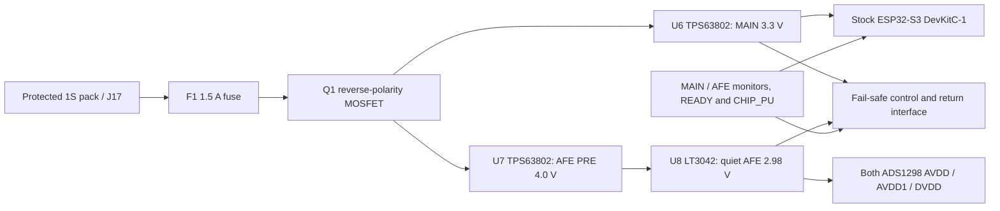

# Open-sEMG-16 V1.3 — Power implementation record

27 October 2026. **Implemented in the V1.3 schematic. Hardware power-up and human-worn testing are not released.**

## 1. Delivered result

The active [V1.3 schematic](../v1.3/open-semg-16-v1.3.kicad_sch) now implements:

U4/U5, their obsolete support branches, and the temporary R38 disable strap are removed. No former independent regulator outputs were rejoined. JP1 is a new **normally open** service inhibit across MAIN_ENABLE and AGND; fitting its shunt holds the main converter off. Unplug the battery for physical OFF and service.

The revision has **204 non-power components and 180 exported nets**. Final native export and **966 pin/net, component-preservation and ERC assertions pass**. All 16 differential acquisition mappings remain intact. The ADC interface retains separate chip selects, a common conversion clock and **shared MISO cascade protocol**; its drivers now pass through controlled isolation.

ERC changed from **7 errors / 4 warnings = 11** to **5 errors / 4 warnings = 9**. The remaining reports and one added source-model condition are explained in section 8. No PWR_FLAG, severity reduction, pin-type weakening or arbitrary NC suppression was used.

## 2. Focused verification and deviations from the proposal

The primary design reference was [power_architecture.md](power_architecture.md), with its original F04/F05/F13–F17 history retained. The [V1.2 corrections](../reviews_v1.2/erc_corrections.md) establish the actual starting point: U4 was already isolated, and R38 deliberately held both old regulators off.

| Check | Result and implementation decision |
|---|---|
| ADS analog voltage/reference | Approximately 2.98 V is inside the 2.7–5.25 V analog range. Use the 2.4 V internal reference, enabled separately on both ADCs; 4 V reference mode is inappropriate. This does not validate an unspecified electrode/gain envelope. |
| Old 3.4 V → 2.98 V LDO margin | Insufficient basis for the claimed worst-case transient regulation margin. The original approximately 9.8 mV residual shrinks to approximately **1 mV** when the assumed 10 ppm/°C resistor drift over 100°C is included. LT3042 dropout is itself defined at an output-regulation loss; the boundary is not a high-PSRR guarantee. |
| Correction selected | Keep the DevKit on its documented nominal **3.3 V header supply**, and supply the quiet LDO from a separate **4.0 V buck-boost**. Minimum calculated LDO headroom becomes approximately **0.89 V**. This avoids raising the stock DevKit supply above nominal and preserves the 2.98 V AFE proposal. |
| ADS DVDD | Both ADCs use the quiet AFE rail for **AVDD and DVDD**, avoiding their relative ramp/sequencing problem. All MCU↔ADC signals cross an appropriate interface; direct 3.3 V GPIO drive into 2.98 V DVDD is not retained. |
| Forward logic levels | A fixed 10 kΩ pulldown loads a HIGH by approximately 0.3 mA, exceeding the translator's 100 µA test condition for its strongest guaranteed VOH. Added U18/U19 switch the bias returns: LOW clamps while disabled, high impedance during communication. The 10 kΩ resistors remain, with explicit 1% selections. |
| DevKit/USB | The user explicitly selected **stock DevKit, both USB ports physically inaccessible while mounted, remove DevKit for USB service**. This permits the official external-3V3-only mode. There is no claim of electrical tolerance to plugging USB into the seated board. |
| Startup/reset | Independent MAIN_PG starts the AFE converters. Rail supervisors provide a clean POWER_GOOD signal. U17/Q2 reset the separate CHIP_PU bus, preventing the onboard reset capacitor from slowing the interface fault signal. READY and CHIP_PU also gate the interface. |

Sources: [local ADS1298 SBAS459K, pp.10–17, 32–33, 96–99](../../docs/datasheets/originals/components/ADS1298.pdf), [LT3042 electrical tables and protection guidance](https://www.analog.com/media/en/technical-documentation/data-sheets/lt3042.pdf), [DevKit official supply modes](https://docs.espressif.com/projects/esp-dev-kits/en/latest/esp32s3/esp32-s3-devkitc-1/user_guide_v1.1.html#power-supply-options), [AXC output levels](https://www.ti.com/lit/ds/symlink/sn74axc8t245.pdf).

The rejected initial USB assessment and the later acceptance of the revised supply/mode contract are both retained in [USB evidence](diagnostics/power_implementation/usb-focused.md) and its [update](diagnostics/power_implementation/usb-focused-update.md). The [regulator note](diagnostics/power_implementation/regulator-focused.md) records the intermediate 3.44 V option and the final separate-converter correction; **3.44 V was not implemented**.

## 3. Exact power changes and component selections

The [selected BOM](diagnostics/power_implementation/selected-bom.md) and [final connectivity](diagnostics/power_implementation/final-connectivity.json) give the complete machine-derived component and pin/net inventory. New local symbols are stored in the active revision's [V13_Power library](../v1.3/V13_Power.kicad_sym) and [Power_Impl library](../v1.3/Power_Impl.kicad_sym), registered through its [sym-lib-table](../v1.3/sym-lib-table). No global or historical library was edited.

### Battery interface

| Part | Selection / physical connection |
|---|---|
| BT1 / J17 | Off-board protected conventional 4.20 V-charge-limit 1S pack. J17 is JST B2B-PH-K-S(LF)(SN): pin1 raw `+3.7V`, pin2 AGND. Verify actual pack wiring; connector appearance does not establish polarity. Pack MPN/capacity remains unselected. |
| F1 | Littelfuse 046601.5NR, 1.5 A, 63 V, 1206; raw battery → BAT_FUSED. Nominal cold resistance 46 mΩ, nominal melting I²t 0.1103 A²s, interrupt rating 50 A at the stated voltage. Fuse/pack fault coordination must be verified. |
| Q1 | AO3401A P-channel reverse-polarity element: **D3 = BAT_FUSED, S2 = SW_BAT_PROT, G1 → R52 100 kΩ → AGND**. This orientation uses its body diode to initiate correct-polarity conduction. It is not a reverse-current blocker while on. |
| JP1 | Normally open two-pin service shunt, MAIN_ENABLE → AGND. Shunting inhibits conversion; it does not disconnect stored charge or authorize seated USB. |

The [input-component evidence](diagnostics/power_implementation/input-component-evidence.md) records primary manufacturer sources and ratings. The [JST PH specification](https://www.jst-mfg.com/product/pdf/eng/ePH.pdf) rates the relevant connector system at 2 A with the specified wire/contact conditions. [AO3401A](https://www.aosmd.com/res/data_sheets/AO3401A.pdf) has maximum RDS(on) 85 mΩ at −2.5 V gate drive/25°C. At 1 A, the fuse plus this MOSFET alone screen to approximately **131 mV drop / 131 mW**, before hot resistance, connector and wire losses. Cutoff is sensed after that path.

### Regulators

**U6 and U7: TPS63802DLAR.** For each: EN1, MODE2, AGND3, FB4, PG5, VOUT6, L2 pin7, GND8, L1 pin9, VIN10. L1/L2 components are Coilcraft XFL4015-471MEC, 0.47 µH, one per converter. MODE is defined high for initial forced-PWM evaluation. VIN10 is SW_BAT_PROT; AGND3/GND8 use the common return. [TI pin/functions and application guidance](https://www.ti.com/lit/ds/symlink/tps63802.pdf).

- **U6 MAIN_3V3:** FB top R39 = 56.0 kΩ, bottom R40 = 10.0 kΩ. MAIN_ENABLE uses R41 = 22.0 kΩ from SW_BAT_PROT and R42 = 10.0 kΩ to AGND. MAIN_PG has R43 = 10 kΩ pullup to MAIN and R50 = 100 kΩ pulldown. U6 PG5 drives U7 EN1 and U8 EN3 independently of the reset bus.
- **U7 AFE_PRE_4V0:** FB top R44 69.8 kΩ + R45 200 Ω in series, bottom R46 10.0 kΩ. PG5 is unused with a true NC. It can buck a fully charged cell and boost a discharged one; a boost-only pass-through assumption is unnecessary.
- C58/C60: 10 µF/16 V input candidates. C59: 22 µF/16 V MAIN local output, plus C57 bulk. C61/C62: **two 22 µF/16 V** PRE output parts. The selected Murata identities and required effective capacitance appear in the schematic/BOM. Verify actual bias/temperature curves; nominal capacitance is not the acceptance criterion.
- Feedback/setpoint resistors are specified 0.1%, 10 ppm/K Vishay TNPW candidates. Including ±0.2% combined initial tolerance/drift for the calculation gives MAIN approximately **3.250–3.350 V** and PRE **3.939–4.061 V**. These are DC screens, not transient guarantees.

**U8: LT3042IMSE#PBF**, MSOP-10 exposed pad: IN1/2 = PRE, EN3 = MAIN_PG, PG4 NC, ILIM5 → R48 2.49 kΩ → AGND, PGFB6 = PRE, SET7 → R47 29.8 kΩ || C65 4.7 µF → AGND, GND8/pad11 = AGND, OUTS9 Kelvin-senses OUT10 = AFE_2V98. PGFB tied to IN disables fast start for this deliberately slow-start proposal. C63/C64 are local 10 µF candidates; each must provide at least 4.7 µF effective. Output ESR/ESL and SET leakage/layout must meet the [LT3042 guidance](https://www.analog.com/en/products/lt3042.html).

R49 = 2.70 kΩ minimum-load/bleeder keeps the AFE load above 1 mA during powerdown, matching the tolerance-table load condition. With ISET 98–102 µA, ±2 mV offset and the resistor drift allowance, AFE screens to **2.9126–3.0477 V**, before additional board/capacitor errors. Thus minimum PRE-to-AFE headroom is **3.9392 − 3.0477 = 0.8915 V**. The 50 mA approximate rail current limit is not a wearer-current limit.

**C57:** changed from unspecified 200 µF to polarized **Panasonic 6SVP220M, 220 µF ±20%, 6.3 V**, MAIN positive pin1, AGND negative pin2. Its manufacturer data gives 25 mΩ maximum ESR at 100 kHz and up to 277 µA leakage. Verify its F8 land pattern, actual temperature/ripple conditions and startup charging. [Panasonic part data](https://industrial.panasonic.com/ww/products/pt/os-con/models/6SVP220M).

Exact TPS63802 DLA0010A and Coilcraft XFL4015 land patterns are **not assigned to guessed generic footprints**. Their schematic fields explicitly require verified footprints before PCB release. The inductor's current figures represent stated inductance-drop criteria, not a hard ideal saturation limit; include tolerance, bias, temperature and converter current limit during final selection.

## 4. ADC supplies, references and input headroom

For **both U1/U2**, AFE_2V98 now supplies AVDD **19/21/22/56/59**, AVDD1 **54**, DVDD **48/50**, and unused auxiliary analog ties **17/18/62**. U1 CLKSEL52 also follows AFE; U2 CLKSEL52 stays AGND. Every physical AVSS/AVSS1/DGND and VREFN return remains AGND. U3 3V3 pins **1/2** and C57/TP4 use MAIN_3V3. U3 grounds **22/23/24/44** remain AGND; 5V21 has no carrier source.

Both ADC domains share the quiet rail, so nominal AVDD−DVDD is zero throughout its ramp. Retained general analog/digital bypasses total 40.4 µF nominal. C112/C113 add local 10 µF nominal AVDD1 bypasses; C114/C115 add 100 nF at the same supply/return pairs. Their PCB placement must implement short charge-pump loops and the manufacturer's AVDD1/AVSS1 routing recommendation.

All original reference and VCAP capacitors remain. C110/C111 add **100 nF C0G/50 V**, Murata GRM31C5C1H104JA01L, at U1.55/U2.55 VCAP3 → AGND, parallel with C25/C51 1 µF. This matches the visually checked [Figure 106](diagnostics/power_implementation/ads1298-figure106.png). VCAP3 is nominally about AVDD +1.9 V, not a guaranteed maximum formula; retained ≥10 V requirements and the new 50 V bypasses must still be qualified at actual bias. Internal VCAP/reference nodes remain independent and unloaded except for their intended capacitors/probes.

At 2.4 V reference and gain 6, nominal ADC differential full-scale is ±400 mV, but PGA headroom imposes the additional condition:

`0.2 + G·|VD|/2 < VCM < AVDD − 0.2 − G·|VD|/2`.

| Differential magnitude, gain 6 | VCM at nominal 2.98 V | VCM at 2.9126 V screen |
|---:|---:|---:|
| 300 mV | 1.10–1.88 V | 1.10–1.8126 V |
| 350 mV | 1.25–1.73 V | 1.25–1.6626 V |
| 400 mV | 1.40–1.58 V | 1.40–1.5126 V |

These strict boundaries include electrode DC offset and artifacts, not just wanted EMG. Body bias should track approximately half the actual AFE rail, but **F07/F08 bias/protection is still unimplemented**. Gain, 2/4 kSPS choice, permissible offsets and common-mode excursion were not supplied, and no firmware was created. Consequently the schematic supports the proposed supply; it does **not** establish qualified acquisition for a wearer. Do not invent an intended configuration or use digital filtering to excuse PGA clipping.

## 5. Digital interface, reset and power sequencing

U9 **SN74AXC8T245PWR**: VCCA1 = MAIN, VCCB23/24 = AFE, grounds12/13, DIR1 pin2 HIGH and DIR2 pin11 LOW. OE22 = AFE_BLOCK. Channels A1–A7 pins3–9 → B1–B7 pins21–15 carry DIN, SCLK, START, RESET, PWDN, CS1 and CS2 respectively. MCU terminals remain **17/18/12/6/7/16/20**, now on `MCU_*` nets; ADC receiver pins remain **34/40/38/36/35/39** on their original functional nets.

Channel8 A8 pin10 carries MCU_ALLOW from U18; B8 pin14 provides ALLOW_AFE. U18 is another SN74LVC1G132 NAND used as an inverter of AFE_BLOCK. U19 **SN74LVC541APWR** has all eight A inputs grounded, both OE pins **1/19 = ALLOW_AFE**, VCC20 = AFE and GND10. Its outputs Y1–Y7 **18/17/16/15/14/13/12** terminate the separate 10 kΩ bias resistors for MOSI/SCLK/START/RESET/PWDN/CS1/CS2. Y8 pin11 is unused/NC. R33–R37 retain 10 kΩ but their returns change from AGND to individual `CLAMP_*` nets; R74/R75 provide the two CS branches. No return branches are tied together. R87 = 36.0 kΩ pulls ALLOW_AFE low if channel8 is high impedance.

This is necessary for a specification-based logic budget:

- During communication U19 is HiZ. Each AXC data output supplies at most the two ADC input leakages plus clamp leakage, approximately **30 µA**, below its 100 µA VOH/VOL test load. Guaranteed HIGH ≥AFE−0.1 V leaves approximately **0.483 V** above ADS VIH at the low rail screen; guaranteed LOW ≤0.1 V is below ADS VIL.
- While disabled, clamp VOL ≤0.2 V plus `(20+8) µA ×10.1 kΩ` screens to **0.483 V**, below `0.2×2.9126 =0.583 V`. This includes two ADC input leakages and AXC HiZ leakage.
- ALLOW_AFE HIGH loading is at most approximately `3.0477/35.64k +10 µA =95.5 µA`; LOW leakage screens to `18 µA×36.36k =0.655 V`, below the clamp-enable VIL of 0.8 V. These use the specified leakage limits, not typical resistor strength.

See [AXC electrical characteristics](https://www.ti.com/lit/ds/symlink/sn74axc8t245.pdf) and [LVC541 electrical characteristics](https://www.ti.com/lit/ds/symlink/sn74lvc541a.pdf). Actual edge settling, switched-bias capacitance and SPI timing still require measurement; the static margins do not authorize maximum clock speed.

U10/U11 **74LVC1G125GW** receive separate `DOUT_ADC1`/`DOUT_ADC2` on A2; Y4 outputs share MISO/U3.19. OE1 is generated by U14 **74LVC2G32DP** as `AFE_BLOCK OR corresponding MCU-side CS`. MCU-side CS is already HIGH before interface release, preventing a startup selection race. U12 **74LVC1G157GW** regenerates DRDY to MAIN levels: inputs1/3 both U1.47/TP2, select6 and ground2 at AGND, output4 → U3.15. U2.47/TP3 stays independent. The return parts have Ioff; the original SPI protocol remains unchanged. Simultaneous active chip selects remain prohibited by firmware.

U15/U16 **TPS3808G01DBVR** monitor MAIN and AFE through 67.8k/10k and 59.1k/10k dividers. Both: MR3/VDD6 = MAIN, GND2, SENSE5, CT4 open, open-drain RESET1 → clean **POWER_GOOD**, pulled up by R76. Nominal floor trips are **3.1509 V MAIN / 2.7986 V AFE**; CT open gives the documented nominal reset delay. Include the actual threshold tolerance, hysteresis, input bias and propagation limits in qualification. [TPS3808 datasheet](https://www.ti.com/lit/ds/symlink/tps3808.pdf).

U13 **SN74HCS20PWR** gates POWER_GOOD pin1, MCU_READY pin2 and CHIP_PU pin4; input5 is MAIN, VCC14, GND7, output6 = AFE_BLOCK. Spare gate inputs are grounded and its output NC. U17 NAND inverts POWER_GOOD to Q2 **AO3400A G1**. Q2 S2 is AGND; D3 pulls **CHIP_PU through R86 2.2 Ω**. R85 biases its gate low. Thus the DevKit's reset capacitor does not load POWER_GOOD directly, and manual CHIP_PU reset also disables the interface through U13. R86 requires verified pulse capability; scope actual reset discharge and rail hold-up. [Schmitt NAND](https://www.ti.com/lit/ds/symlink/sn74hcs20.pdf), [reset MOSFET](https://www.aosmd.com/res/data_sheets/AO3400A.pdf).

U3.4 **GPIO4** becomes MCU_READY with R70 10 kΩ pulldown; its prior NC is removed. GPIO3/U3.13 remains unresolved, untouched. READY must stay low until controls/configuration are prepared, clear before intentional restart, and never be retained through GPIO hold. Watchdog/software-reset behavior must be verified; no unsupported guarantee about every reset class is made.

**Sequence:** battery/bench input → U6 → MAIN_PG → U7/U8 → both rail monitors release → Q2 releases CHIP_PU → MCU boots with READY low → set both CS high and other control values low → assert READY → release ADC PWDN/reset in the TI sequence. Wait each ADC's valid-clock **2¹⁸-cycle POR and VCAP1 >1.1 V**, then reset ≥2 clocks and allow 18 clocks. Initialize U1 first and enable CLK_EN; initialize/reset U2 individually after its clock wait. A later shared hardware reset clears CLK_EN again. Configure/read back both 2.4 V references, rate/gain/modes, settle, then common START.

On a rail fault POWER_GOOD disables the interface independently of firmware and commands ESP reset; READY must return low. PRE enable uses **MAIN_PG**, not POWER_GOOD, avoiding startup deadlock. Normal shutdown clears READY and conversion first, then inhibits/unplugs power. Abrupt loss requires complete reinitialization after recovery. Stored charge/discharge and detection/gate delays must be measured. **Floor monitors protect state management; they do not certify analog data validity or arbitrary fault survival.** Define an acquisition-valid rail/noise/common-mode window and reject data outside it, including transients faster than monitor response.

## 6. Budget and battery limits

| Item | Planning allowance |
|---|---:|
| ESP module source capability | 500 mA MAIN; manufacturer minimum capability, not predicted average |
| DevKit extra loads, RGB disabled | 25 mA provisional |
| MAIN interface/monitor/reset logic | 5 mA provisional |
| MAIN design load | **530 mA**, with **750 mA transient test reserve** |
| Quiet ADC rail including bias/logic/bleeder | **20 mA**; two ADCs alone are about 6.5 mA typical under the datasheet test conditions |
| LDO ground-current reserve | 5 mA; PRE planning load **25 mA** |

The [WROOM data](../../docs/datasheets/originals/components/ESP32-S3-WROOM-1.pdf) lists 3.0–3.6 V and ≥0.5 A source capability, including a 355 mA Wi-Fi TX characterization condition. Actual CPU/memory/radio duty and board loads must replace the allowances. Do not add mutually exclusive RF mode peaks together.

At an **assumed 85% efficiency for both converters**, battery current at SW_BAT_PROT =3.2 V is approximately `(3.3×0.53+4.0×0.025)/(0.85×3.2) =0.680 A`. At the 0.75 A MAIN reserve it is about **0.947 A**; at 3.0 V, about **1.01 A**. Forced-PWM efficiency at the low PRE load is unmeasured; 85% is a calculation assumption, not a guaranteed minimum. A hypothetical 1 usable Ah at average 3.7 V/90%, with 0.20 A MAIN and 25 mA PRE, gives approximately **4.38 h**. No actual runtime is established.

Converter loss screens at the planning loads are about **0.309 W MAIN** and **0.0176 W PRE**, or approximately 25°C/1.4°C rise using the 81°C/W reference metric and assigning total conversion loss to each IC. At 0.75 A MAIN the screen is about 35°C rise. The LDO screen is about **40–43 mW**, roughly 1.4°C using its reference package metric. Actual copper, inductors, enclosure and surface temperature require measurement.

The 22k/10k EN divider gives typical **3.20 V falling / 3.52 V rising** at the protected input; earlier calculated electrical threshold/leakage intervals are approximately **3.095–3.305 / 3.415–3.625 V**, before the complete resistor-drift/path budget. Raw-cell thresholds are higher by fuse/FET/wire drop. This is a conservative prototype cutoff, not a precision cell policy. The converter's approximately 1.25 V internal UVLO is not battery protection.

Select/verify a conventional protected 4.20 V pack with adequate normal/pulse current, temperature limits and protection/fuse coordination; no unprotected cell is authorized. The 1.5 A fuse's continuous derating and cold/hot I²t must cover startup and repeated RF pulses; 1 A is not automatically permissible continuously at elevated temperature. Check available pack fault current against fuse interrupt rating. Use current-limited 3.0–4.2 V battery emulation for initial bench work, with additional margin for the input-path drop.

## 7. USB/battery modes

| Mode | Required physical state | Result |
|---|---|---|
| Battery RUN, initially bench dummy inputs | Stock DevKit seated; both USB sockets inaccessible; no external 5 V/charger/debug source | U6 supplies its official nominal 3V3-header mode. No USB source exists in this permitted state. |
| OFF/service preparation | Unplug pack; wait for discharge | JP1 inhibit alone is not physical source isolation. |
| USB programming | Pack disconnected **and DevKit removed from carrier** | No carrier power or GPIO backfeed path; USB powers detached board only. |
| Charging | Pack disconnected/removed, compatible external charger, off body | Carrier contains no charger. |
| Seated USB or external 5 V header power | **Not supported; physically prevented** | No electrical hotplug/dual-source tolerance is claimed. |

Specify a genuine ESP32-S3-DevKitC-1-N8R2, Rev1.1 matching the [official board schematic](https://dl.espressif.com/dl/schematics/SCH_ESP32-S3-DevKitC-1_V1.1_20221130.pdf); verify the actual assembly before power. The stock board's onboard LDO remains connected to its headers, as in Espressif's permitted external-3V3 mode. Mechanical exclusion is an assembly requirement to verify, not a circuit that detects USB. If either USB port can be reached while seated, this operating-mode condition is not met and power-up is blocked. Do not substitute a VBUS-cut cable or a carrier diode as proof that all onboard source paths are isolated.

## 8. Validation and remaining ERC

Evidence: [initial ERC](diagnostics/power_implementation/initial-erc.json), [final ERC](diagnostics/power_implementation/final-erc.json), [final netlist](diagnostics/power_implementation/final-netlist.xml), [verification](diagnostics/power_implementation/final-verification.json), [schematic PDF](diagnostics/power_implementation/final-schematic.pdf), and [file integrity](diagnostics/power_implementation/file-integrity.json).

| Condition | Initial → final disposition |
|---|---|
| Battery/AGND source models | Retained; passive battery symbol/returns do not declare a power output. |
| Protected converter input source model | **One added error** at U6 VIN10: fuse/MOSFET are passive devices in ERC. Actual source-to-load path is explicitly traced; no flag was added to conceal it. |
| DevKit 5 V header | Retained unsourced report; intentionally unavailable in the accepted mode. |
| CHIP_PU disconnected/undriven | Two errors resolved by actual supervisor/driver connection. |
| Raw shared DOUT output conflict | One error resolved by actual tri-state return isolation; shared-MISO protocol retained. |
| GPIO3 | One error retained pending eFuse/provisioning evidence. |
| Four TEST/PACE supply ties | Four warnings retained, now referenced to U8 OUT. They follow actual AVDD; optional output modes must stay disabled. |

Final: **four power-input source-model errors + one GPIO3 error + four auxiliary warnings =9**. No new floating control, output-output regulator short, dangling wire, label-scope or local-library mismatch remains.

The 966 checks cover every retained original pin against an explicit allowed-change map; all 32 acquisition nets exactly retain their memberships; supply/ground/auxiliary/CLKSEL/reference/VCAP mapping; all new component physical pin contracts; reset bus separation and startup enable independence; each regulator output partition; and isolated raw DOUTs returning to shared MISO. Capacitor removal is limited to the obsolete U4/U5 branches; original ADC bypass/reference/VCAP parts remain. Candidate-only placement mistakes were caught by native connectivity checks and corrected before their application. No failed candidate is the delivered design.

MCP reported V1.3 directory but stale V1.2 filenames. Project selection and plan creation both returned **“MCP tool call requires approval, but approval policy is never.”** No preview/apply was possible without a plan ID; no MCP design write occurred. The user-authorized fallback used [bounded source edits](diagnostics/power_implementation/integrate.py), source backups, strict S-expression/UUID/reference checks, native candidate export/ERC, explicit verification, and atomic replacement of only the V1.3 schematic. Local library registration is the other active-revision configuration change. The `.kicad_pro` ERC settings and all historical revisions/reports remain unchanged. The MCP connection still needs its filenames corrected before future MCP writes.

## 9. Readiness and outstanding tests

**Schematic implementation is complete; initial hardware power-up is not approved by this report.** Before any assembled hardware test:

1. Complete/verify exact TPS DLA and inductor footprints, PCB parity/DRC, return routing, RF/antenna clearance and local decoupler placement. No PCB was supplied or qualified.
2. Confirm actual MLCC effective C/ESR/ESL over bias/tolerance/temperature, SET leakage/microphonics, inductor bias/current-limit behavior, resistor drift/pulse capability and the full BOM temperature range. The selected X5R capacitors do not inherit the semiconductors' 125°C ratings. Nominal MPN selection is not physical qualification.
3. Verify pack identity/polarity/protection, fuse coordination, raw versus protected cutoff, input droop and restart hysteresis. Test no-load, steady load, RF steps, current limit, slow ramps, abrupt removal, inhibit and repeated restart with current-limited battery emulation.
4. Scope MAIN, PRE, AFE, POWER_GOOD, CHIP_PU, READY, AFE_BLOCK/ALLOW_AFE and CS/DOUT behavior. Confirm the reset capacitor is isolated from POWER_GOOD, clamp-release timing, no input injection, stored-charge discharge, watchdog/software resets and full reinitialization. Faster-than-monitor faults require a bounded fault/hold-up analysis; no universal survival guarantee is inferred.
5. Implement firmware READY/CS/clock/POR/reset/reference/readback/settling rules. Begin with conservative SPI timing, then verify the intended data rate and added propagation/RC delays. Both MCU-side CS must be HIGH before READY rises; never select both ADCs.
6. Define the permitted gain/offset/common-mode and acquisition-valid rail/noise window. Measure dummy/shorted-input noise with radio and both converter modes, movement/microphonics, references/VCAPs and both DRDYs. Floor monitoring and ERC do not establish analog performance.
7. Verify the physical USB exclusion/removal arrangement on the selected stock DevKit before powering the mounted carrier.

F04's old direct-LDO parallel fault remains removed. F05/F13/F15/F16/F17 now have implemented schematic mechanisms with the stated qualification gates. F14/F19/F20 still require real parts/layout evidence. F06/F09/F18 require firmware and timing measurements. **F07/F08 wearer bias, protection and fault-current work remain open. No human-worn readiness is claimed.**
