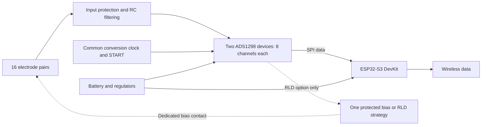

# Open-sEMG-16 — Full design review and engineering guide

**Consolidated review · 27 October 2026 · Diagnostic findings only**

This document merges [analog notes](analog-notes.md), [digital notes](digital-notes.md), the [hardware audit](hardware-audit.md), and [power notes](power-notes.md) into one review. It preserves the technical findings, calculations, evidence, and Amberflow tracking while placing related material together. Explanations introduce the electrical concepts needed to understand the findings.

This is an editorial consolidation of the completed audit, not a new set of measurements or a hardware revision. The existing four documents, diagnostic artifacts, schematic, libraries, and project settings remain unchanged. The only new file is `reviews/full_review.md`.

**The design is not ready for power-up or human-worn testing.** Read Section 1 first. Sections 2–8 explain why; Sections 9–11 collect the findings, diagnostics, and next actions. Manufacturer citations such as **D1 p.12** refer to the source table in Appendix A.

## Contents

1. [Readiness and main conclusions](#1-readiness-and-main-conclusions)
2. [Electrical concepts needed to read this review](#2-electrical-concepts-needed-to-read-this-review)
3. [What was reviewed and what is actually in the design](#3-what-was-reviewed-and-what-is-actually-in-the-design)
4. [Power, grounds, regulators, and decoupling](#4-power-grounds-regulators-and-decoupling)
5. [Analog acquisition: electrodes, range, filters, and noise](#5-analog-acquisition-electrodes-range-filters-and-noise)
6. [Body bias, RLD, and wearer protection](#6-body-bias-rld-and-wearer-protection)
7. [Clocking, SPI, firmware, and ESP32 behavior](#7-clocking-spi-firmware-and-esp32-behavior)
8. [Components, footprints, PCB, and RF concerns](#8-components-footprints-pcb-and-rf-concerns)
9. [Prioritized findings and confirmed correct elements](#9-prioritized-findings-and-confirmed-correct-elements)
10. [ERC, revision comparison, and Amberflow tracking](#10-erc-revision-comparison-and-amberflow-tracking)
11. [Recommended sequence of work](#11-recommended-sequence-of-work)
12. [Appendix A — Sources and document provenance](#appendix-a--sources-and-document-provenance)
13. [Appendix B — Glossary and reading numbers](#appendix-b--glossary-and-reading-numbers)

## 1. Readiness and main conclusions

**Readiness: not ready for initial power-up, fabrication release, or human-worn testing.** The supplied schematic contains fundamental supply and clock connectivity faults. Earlier ADS1298/EVM experiments do not validate these connections.

The most important confirmed findings are:

1. **Both ADS1298 analog supply spans are zero.** U1/U2 AVDD pins 19/21/22/56/59 and AVDD1 pin 54 connect to `AGND`, together with AVSS/AVSS1. The analog core therefore has 0 V rather than the required 2.7–5.25 V. [D1, pp.10–12]
2. **The digital supply and ground network is invalid.** U1/U2 DVDD pins 48/50 connect to the net named `DGND`, while their actual DGND pins 33/49/51 connect to `AGND`. U3's grounds connect to `DGND`; battery negative connects to `AGND`. Those nets have no DC bond. The ADC digital supply and MCU battery return are consequently undefined. This is an electrical connectivity failure, not a choice of analog/digital ground layout.
3. **A powered 3.3 V rail would overstress six auxiliary analog pins.** U1/U2 pins 17, 18 and 62 connect directly to `+3.3V` while actual AVDD is at `AGND`. If that rail reaches 3.3 V, the pins exceed their AVDD + 0.3 V absolute limit by about 3.0 V. Clamp conduction, back-powering, and damage are possible. [D1, §7.1, p.12]
4. **U4 and U5 are both fixed 3.3 V LDOs and their outputs are directly paralleled.** They are not separate analog/digital supplies. Their ratings cannot be added to obtain a 650 mA supply. Their common `/EN` net has only the two enable inputs and no driver or bias.
5. **The intended common ADC clock is not connected.** U1's CLK pin 37 is electrically unconnected; U2's pin 37 has a singleton `ADC_CLK` net. With the present invalid supply network, U2's clock-select logic level is undefined. A corrected design must establish both valid clock selection and a shared timebase; shared START alone is insufficient.
6. **No body-bias/RLD electrode or deliberate DC body-bias path is implemented.** Both RLD outputs and feedback/reference terminals are explicitly disconnected. The acquisition inputs have capacitive AC returns, which do not establish the wearer's DC common mode.

Major additional risks include undefined ADC controls during MCU reset, unresolved USB/DevKit power interactions, unspecified electrode protection and wearer fault-current control, electrode-impedance-induced CMRR loss, DC-offset/PGA saturation, LDO battery headroom and thermal limits, and unspecified capacitor ratings/derating. A nominal 222.4 µF is connected directly across the LDO output/AGND network; actual effective capacitance and stability need qualification against the regulators' documented output-capacitance ranges.

Features verified as correctly connected within their limited scope include all 16 differential electrode mappings, the independent reference capacitor networks, the nominal VCAP values and returns, and a supported **cascade SPI** arrangement with separate chip selects. U3's 44-pad DevKitC symbol/assigned footprint mapping agrees with official DevKit headers. These observations do not make the overall circuit operational.

The development schematic and `.kicad_pro` are **byte-identical to the supplied read-only earlier revision**. Normalized net connectivity and ERC results also match. Demonstrated faults therefore **persist** in this comparison; there are **no substantiated Fixed or New findings**. The historical annotated Amberflow report was not supplied, so this establishes presence in both artifacts, not which faults Amberflow previously identified.

Static analysis establishes connectivity, nominal transfer functions, component identities as specified, and conditional operating margins. It cannot establish real rail transients, oscillation, temperature, achieved CMRR/noise, RF interference, firmware timing, or wearer safety. No PCB, firmware, battery specification, complete passive-component BOM, or new-board measurements were available.

## 2. Electrical concepts needed to read this review

### 2.1 What the complete system is supposed to do

An electrode pair senses a small voltage difference produced by muscle activity. The ADS1298 amplifies that difference and converts it into numbers. The ESP32 retrieves those numbers, keeps track of their timing, and transmits them. The battery and regulators must supply clean, correctly referenced power throughout this process.

The following diagram shows the **intended functional architecture**, not proof that the present connections implement it:

The current circuit is missing the deliberate body-bias implementation and the connected common-clock route. Its supply connections also prevent normal operation. A diagram of desired blocks cannot establish electrical correctness; the pin/net evidence below does that.

### 2.2 Voltage is always measured between two points

A statement such as “this pin is at 3.3 V” is incomplete unless it identifies the reference point. A chip is powered by the voltage **between its supply and return pins**. Connecting both pins to the same wire produces a 0 V supply span, even if a nearby label says `AVDD`.

A **net** is a group of electrically connected terminals. A net label names that connection; it does not generate voltage or change the function of the terminals attached to it. In this design, a net named `DGND` actually reaches the ADC's DVDD supply pins, while the ADC's physical DGND pins reach `AGND`. The names and functions must therefore be examined separately.

**Ground** usually means a chosen circuit reference and current return. A battery circuit can float relative to building earth and still operate normally, provided its internal supply and return paths are correct. Two disconnected return islands inside that circuit are a different situation: they do not provide the intended shared voltage reference or normal DC current path.

### 2.3 Three different meanings of “reference”

| Term | What it controls | What it does not automatically provide |
|---|---|---|
| Circuit ground / return | The reference for supply and signal voltages; return path for current | An earth connection or a safe wearer interface |
| ADC reference, VREFP − VREFN | The voltage scale used to convert an input into a digital code | A bias connection to the wearer |
| Body-bias / reference electrode | A deliberate way to control the wearer's common-mode voltage relative to the circuit | A replacement for correct ADC supply wiring or the ADC voltage reference |

The ADS1298 may use its internal voltage reference while also needing a separate body-bias strategy. Enabling one does not implement the other.

### 2.4 Differential signal and common-mode voltage

For positive and negative input voltages `VP` and `VN`:

- Differential signal: `VD = VP − VN`.
- Common-mode voltage: `VCM = (VP + VN) / 2`.

For an illustrative pair at 1.651 V and 1.649 V, the differential signal is 2 mV while the common mode is 1.650 V. The ADC wants the difference, but its input circuitry still has to accommodate both actual pin voltages and their average. A small difference can be outside the usable range if both pins are near an unsuitable rail.

Environmental interference often moves both electrodes together. Perfectly equal movement is common mode. Unequal electrode impedances or filter components can turn part of that movement into a differential voltage, which the ADC then measures along with EMG.

### 2.5 What “verified,” “calculated,” and “unverified” mean here

| Evidence label | Meaning in this review | Example |
|---|---|---|
| Confirmed static fact | Established from the exported connectivity or a component specification | AVDD and AVSS share the same AGND net |
| Conditional calculation | Follows from stated inputs and a model; its assumptions may not describe a real wearer | A 100 kΩ impedance imbalance gives about 32.6 dB rejection in a simplified model |
| Firmware requirement | Software must establish it; the schematic alone does not show that it happens | Enable the internal reference and select the sample rate |
| Unverified behavior | Needs a component specification, simulation, firmware inspection, layout, or measurement | Actual CMRR, supply dip, oscillation, temperature, or fault current |

A **recommended operating range** describes conditions under which specified operation is expected. An **absolute maximum rating** is a stress limit, not a normal operating target. A circuit can fail to work while remaining below its damage limits; it can also expose an input to damage while another part of the chip is unpowered.

### 2.6 Component and pin notation

`U1` means an IC reference designator; `R1` a resistor; `C1` a capacitor; `E1` an electrode connector. `U1.19` means pin 19 of U1. A label such as `/RESET` in the exported netlist is a signal name; it does not itself prove the input has a defined voltage. ADS CS, RESET, PWDN and DRDY are active-low functions: low voltage asserts the named function.

Finding IDs **F01–F21** remain consistent with the original hardware audit. They let a reader trace the same issue across the explanations, finding table, and action list without treating repeated discussion as a new fault.

## 3. What was reviewed and what is actually in the design

### 3.1 Project and evidence

Active project: `open-semg-16-v1.kicad_pro` / `open-semg-16-v1.kicad_sch` in the authorized development workspace. There is **one root schematic sheet `/`**, no hierarchical sub-sheets, and no `.kicad_pcb` in either supplied design directory. The title block says Version 1.2. The schematic has 111 non-power components: 57 capacitors, 32 resistors, 16 two-terminal electrode connectors, five IC/assembly symbols, and one battery. KiCad exports 134 nets, including deliberately unconnected-pin nets; this is not a count of 134 functional signals.

The configured `kicad` MCP server was queried and confirmed this development directory. Its exposed build-profile tools lacked schematic-reading, netlist-export, and standalone ERC operations. No `kicad_reference` tools were exposed. Read-only inspection therefore used the local **KiCad CLI 10.0.7**, embedded symbol definitions, and native XML netlists. The original design was read and copied into an internal diagnostic snapshot before its CLI diagnostics, so all requested exports/reports stayed inside this workspace. No write-capable design-edit tool was used.

Evidence files:

- [Current native netlist](diagnostics/current-netlist.xml), [derived pin/net map](diagnostics/current-connectivity.json), [readable pin/net map](diagnostics/current-connectivity.txt).
- [Current ERC](diagnostics/current-erc.json), [reference netlist](diagnostics/reference-netlist.xml), [reference ERC](diagnostics/reference-erc.json).
- [Schematic inventory](diagnostics/current-schematic-inventory.json), [schematic SVG](diagnostics/schematic-svg/open-semg-16-v1.svg), and [independent-review checkpoint](diagnostics/independent-review-checkpoint.md).
- [Source integrity verification](diagnostics/design-integrity-verification.json) checks 11 pre-existing development files and 10 reference files: all unchanged. Both schematic SHA-256 hashes are `82295c991bd8b2489c7392b99434aaa4e75e802dbd0d63e46895fe14de1a7cc7`; both project-setting hashes are `dadf14b131c0e799c01831d1e8449fe32a07f413d62e6aa33f9607435a8634f7`. **No pre-existing file was modified.** Files created during the original audit are listed in its [file manifest](diagnostics/audit-file-manifest.txt). That manifest is preserved and does not include this newly created `full_review.md`. The [reproducible static checks](diagnostics/audit-checks.py) and [results](diagnostics/audit-checks.json) independently recheck all 16 mappings, capacitor terminals, key fault nets, reference identity and ERC counts from the exported data; they are not an electrical design pass.

Netlist connectivity takes precedence over visible label text. Embedded power-symbol values include `GND`, `AGND`, `DGND`, and several voltage names; sharing a graphical ground symbol shape does not join differently named nets. Conversely `GND` and `AGND` are actually joined in this schematic. Some supply pins have passive rather than power-input types, reducing ERC's ability to detect a bad supply connection. Hidden/stacked DevKit power pins are included in the exported netlist.

### 3.2 Components and physical definitions

| Reference | Actual schematic identity | Package / footprint and qualification |
|---|---|---|
| U1, U2 | `ADS1298xPAG`, eight differential channels each | `Package_QFP:TQFP-64_10x10mm_P0.5mm`; PAG/TQFP pin map matches D1. Full procurement suffix/grade unspecified. |
| U3 | `ESP32-S3-DevKitC` assembly | `PCM_Espressif:ESP32-S3-DevKitC`, 44 pads; not a bare 40-pad WROOM module. Exact installed DevKit/module SKU and revision unspecified. |
| U4 | `LP2985-3.3`, fixed **3.3 V**, **150 mA** | `Package_TO_SOT_SMD:SOT-23-5`; full orderable MPN, accuracy grade, and legacy/new silicon not specified. |
| U5 | `TLV75533PDBV`, fixed **3.3 V**, **500 mA** | `Package_TO_SOT_SMD:SOT-23-5`, **DBV**, without an exposed thermal pad. Reel suffix unspecified. |
| BT1 | Generic `Battery` | No cell MPN, capacity, protection, current rating, connector or footprint. The user's intended single-cell Li-Po is an operating assumption, not a component specification. |
| E1–E16 | Generic two-pin connectors with value `Electrodes` | 32 acquisition contacts, no instantiated bias contact, no assigned footprints. Gold finish, geometry and mechanical polarity are not established. |

All R1–R32, C1–C57, BT1 and E1–E16 lack footprints: **106 of 111 non-power components**. Their electrical ratings, tolerances and manufacturer parts are also unspecified. The unused `dry_electrode.kicad_sym` and `ref_electrode.kicad_sym` do not instantiate a bias circuit. The active electrode symbols are generic connectors, so flaws in unused custom symbols must not be mistaken for current input shorts.

## 4. Power, grounds, regulators, and decoupling

### 4.1 Read the actual power connections first

The power network is the first dependency to resolve. Noise and sampling calculations describe useful targets only after the ICs have valid supplies. The following inventory records actual nets; voltage labels are not measurements.

| Net | Actual source and connected loads | Electrical conclusion |
|---|---|---|
| `+3.7V` | BT1.1; U4 VIN1 and U5 IN1; C53/C56, each 1 µF to AGND | Battery label only; actual range and droop unknown. |
| `AGND` / merged `GND` | BT1.2, U4/U5 GND2, analog filter/ref/VCAP returns; **all ADC AVDD, AVSS and physical DGND pins** | Defined battery-negative net, but ADC supply pins are incorrectly on it. |
| `DGND` | U3 GND22/23/24/44; **ADC DVDD48/50**; RESV1, DAISY_IN, ADC GPIOs; U2 CLKSEL52; C8/C9/C34/C35 returns | Separate DC island without battery return. Its name is not proof it is the ADC's physical ground. |
| `+3.3V` | U4 VOUT5 **and** U5 OUT5; U3 3V3 pins 1/2; ADC aux 17/18/62, U1 CLKSEL52; rail capacitors | Two direct LDO sources; startup undefined because EN floats. No actual ADC AVDD/DVDD supply pin is connected to this rail. |
| `/EN` | U4 ON/OFF3 and U5 EN3 only | Undriven. No GPIO, resistor, switch or power source. |
| `+5V` | U3 header pin 21 only | No carrier source. Not required if an intact DevKit is intentionally powered via 3V3; external USB/5V states require separate power review. |
| VREFP, separately per ADC | U1.24 → C19 0.1 µF ∥ C20 10 µF → AGND; U2.24 → C45/C46 equivalents | No external reference. Internal reference must be enabled by firmware after valid power. VREFN25 is AGND. |
| VCAP1–4, separately per ADC | U1 pins 28/30/55/26 → C23 22 µF/C24 1 µF/C25 1 µF/C26 1 µF to AGND; U2 C49–C52 | Nominal pin-table values/returns correct. Ratings and physical implementation unknown. |

Regulator pins are verified directly against D2/D3 p.3: both pin 1 input, pin 2 ground, pin 3 enable, pin 5 output; U4 pin 4 BP has C55 10 nF to its ground, whereas U5 pin 4 is intentionally NC. C53/C56 are 1 µF input bypass; C54 is 2.2 µF and C57 is **200 µF**, not 200 nF. No voltage setting was inferred from family names.

### 4.2 Confirmed ADC supply and auxiliary-pin faults — F01–F03

For each ADC, AVDD pins 19/21/22/56/59 and AVDD1 54, AVSS20/23/32/57/58 and AVSS1 53, VREFN25 and actual DGND33/49/51 are all on `AGND`. This directly proves AVDD−AVSS=0 V. The required digital supply is measured from DVDD to the IC's **physical** DGND, so it is `V(net DGND)−V(net AGND)`, which is undefined with the current separated nets. Do not describe it as a measured 0 V. If only the ground islands were bonded, DVDD would then be 0 V; that partial change would still fail.

D1 §7.3 allows analog 2.7–5.25 V and digital 1.65–3.6 V. Its stress ratings are different: analog span−0.3…5.5 V, digital span−0.3…3.9 V, AVSS relative DGND−3…+0.2 V. The 0 V analog span is an operating violation; the auxiliary-pin connection additionally creates a conditional **absolute maximum** violation. If `+3.3V` turns on, aux 17/18/62 are 3.3 V above AVDD, versus the permitted+0.3 V. There is no external current-limiting resistor on these ties.

The manufacturer explicitly permits tying unused 17/18/62 to AVDD (D1 p.10 footnote). A connection to a rail merely labeled AVDD elsewhere does not satisfy this when the actual supply pins are grounded. Pin 18 is named TESTN_PACE_OUT2 by TI; the library's TESTP spelling on pin 18 is a naming discrepancy, not a pin-number reassignment.

C6/C7 and C32/C33 are across +3.3V–AGND, while C8/C9 and C34/C35 are across +3.3V–DGND. None is correctly across an ADS supply pin pair as presently connected. The digital-bank return also has no battery DC return. Required verification: corrected native netlist, unpowered continuity/resistance at every actual IC supply/return pin, then current-limited dummy-load startup and direct pin-voltage measurements. No person should be connected during bring-up.

**Why this matters:** a decoupling capacitor can briefly supply current between the two nets it is connected across. It cannot repair a wire connected to the wrong pin or establish a missing DC return. Similarly, a RESET command cannot fix the voltage between physical supply pins.

The present relationships can be written without interpreting any voltage label:

| Physical ADC terminal | Connected net | Meaning |
|---|---|---|
| AVDD / AVDD1 | AGND | Same net as analog return: no analog supply span |
| AVSS / AVSS1 | AGND | Battery-negative reference |
| Physical DGND | AGND | ADC digital return is on AGND |
| DVDD | DGND | Digital supply is the voltage of this separate island relative to AGND, currently undefined |
| U2 CLKSEL | DGND | Tied to the same net as its DVDD, not to its physical DGND; do not assume logic-low |

This is why simply joining the two nets named ground would be an incomplete repair: it would also force the presently miswired DVDD pins to ground. Every supply and return terminal must be assigned deliberately.

### 4.3 Regulator startup, output sharing, and external power — F04–F05, F13, F15–F17

U4 and U5 have independent control loops. Equal nominal 3.3 V settings do not ensure equal actual voltages or load sharing. The higher setpoint can supply nearly the whole load, exposing U4's 150 mA limit to MCU demand. U5 has a typical 120 Ω **output discharge** when disabled; this is not an EN-input pulldown. One source on while U5 is off can therefore add roughly 27.5 mA discharge load, and output bias/reverse current must be assessed. Simultaneous shared EN does not guarantee identical thresholds, ramps, UVLO or thermal states. Actual damage is not established by static inspection. [D2 §7.1.4; D3 §§6.3.2, 7.1.4]

The `/EN` label has no connection to U3 or a source. D2 requires active termination and recommends ON/OFF→VIN if unused; D3 likewise recommends EN→IN when shutdown is unused. LP2985 full-temperature enable thresholds are ON ≥ 1.6 V and OFF ≤ 0.15 V; TLV755P thresholds are ON ≥ 1.0 V and OFF ≤ 0.3 V. Legacy LP2985 requires an enable slew of at least 40 mV/µs. [D2 pp.7, 16; D3 p.6] No guaranteed EN pulldown is specified for U5. The present state is **undefined**, not demonstrably latched off. Legacy LP2985 additionally specifies an ON/OFF slew condition; identify silicon before choosing a slow RC enable ramp.

The LP2985 value does not establish legacy versus new silicon. D2 p.30 Table 8-1 distinguishes legacy CSO DLN/GF8 from new RFB, with M3 relevant to new orderables. The variants differ in dropout, capacitance/ESR, noise and reverse-current limits. Legacy parts can use ceramic output capacitors within the documented effective-C/ESR region; a blanket “ceramic-only is unstable” diagnosis is unsupported. C57's technology is not even specified. Select actual parts and assess the parallel network's impedance, not only C54 in isolation.

D14's supported USB, 5 V-header and 3V3-header supply choices are mutually exclusive. D15's v1.1 DevKit includes an SGM2212-3.3 regulator and reset/programming circuits. Accordingly, a complete DevKit can introduce another regulator via USB/5 V even though only two LDOs appear as carrier symbols. The actual fitted board revision is unknown. A source-free carrier+5V pin is acceptable for a deliberately direct 3V3-powered DevKit; USB plus battery requires a documented isolation/sequencing solution. Large output capacitance can retain voltage as battery VIN collapses, creating a second reverse-current scenario. Neither backfeed current nor rail overshoot has been measured.

Corrective decision to make before implementation: choose whether the product uses a complete DevKit or a bare module, define valid power sources and return nets, then assign adequately rated separate or single regulated rails. Demonstrate startup/shutdown/hot-plug and full battery-window behavior. Headroom/thermal/transient screens are in the subsystem calculations.

### 4.4 Beginner explanation: what an LDO can and cannot do

An **LDO** is a low-dropout linear regulator. It lowers an input voltage to a selected output voltage. It cannot boost a falling battery back above its input voltage. It also needs extra input voltage called **dropout headroom** to maintain regulation at a given load and temperature.

For a 3.3 V output, a battery at 3.7 V provides only 0.4 V of available headroom before losses. Whether that is enough depends on the exact regulator and current. “The input is within its operating range” and “the output remains regulated at 3.3 V” are separate checks.

The regulator turns the unused voltage into heat: `power ≈ (VIN − VOUT) × current`. A 500 mA rating describes electrical capability under specified conditions; it does not mean any small PCB/enclosure can dissipate the resulting heat continuously. In the calculations, junction temperature means the temperature inside the silicon. RθJA describes a junction-to-ambient thermal relationship under a stated board/test condition; it is not a universal property of every enclosure or PCB.

Two ordinary LDOs with the same printed output voltage do not automatically share current. Their real setpoints and control loops differ. One may carry most of the load, or feed the other's output/discharge path. The present design has no intentional current-sharing or source-isolation circuit.

The **enable** input is a control terminal, not a power source. An undriven enable can have an undefined state. A defined hardware connection is needed before firmware startup can be relied on.

### 4.5 Supply, dropout, current, and thermal calculations

For a 3.3 V fixed LDO, available nominal headroom is `H = Vcell − 3.3 V`:

| Assumed Vcell | H |
|---:|---:|
|4.2 V full-charge example|0.9 V|
|3.7 V nominal label|0.4 V|
|3.3 V low-cell example|0 V|

The exact cell minimum/maximum, temperature, ESR, protection cutoff and wiring loss require its datasheet. At 4.2 V the input is 1.3 V below U5's 5.5 V recommended maximum and 1.8 V below its 6 V absolute maximum. LP2985 recommended input maximum is 16 V. The operating input ranges are LP2985 legacy 2.2–16 V, new 2.5–16 V, and TLV755P 1.45–5.5 V. LP input absolute maxima are 16 V legacy and 18 V new; TLV input absolute maximum is 6 V. These limits are different from dropout and output regulation requirements. [D2/D3 §§5.1, 5.3]

| Part / load | Datasheet maximum dropout used | Approximate 3.3 V + dropout screen | Margin at 3.7 V |
|---|---:|---:|---:|
| U5 **DBV**, 500 mA,≤85°C |215 mV|3.515 V|185 mV|
| U5 **DBV**, 500 mA,≤125°C |238 mV|3.538 V|162 mV|
| U4 legacy, 150 mA,full temperature |575 mV|3.875 V|−175 mV|
| U4 new, 150 mA,full temperature |254 mV|3.554 V|146 mV|
| U4 legacy, 50 mA,full temperature |225 mV|3.525 V|175 mV|
| U4 new, 50 mA,full temperature |184 mV|3.484 V|216 mV|

Sources: D2 pp.6–7 and D3 p.6 electrical tables. LP2985 dropout is defined at 100 mV output loss; these additions are headroom screens, not guaranteed nominal-output accuracy at that boundary. Include output tolerance, load/cell droop and PSRR degradation near dropout. Do not substitute the TLV DYD dropout or thermal row for the selected DBV package. A 3.3 V LDO cannot maintain regulated 3.3 V through a cell falling to 3.3 V or below; usable battery window or supply architecture must reflect this.

D1 p.16, RLD/WCT/PACE off, gives typical per-device HR analog 2.75 mA at 3 V plus digital 0.5 mA at 3 V, about 3.25 mA/device or 6.5 mA for two. LP is about 2.3 mA/device. These are reference-condition estimates, not guaranteed 3.3 V/4 kSPS currents. D4 p.27 requires a module source capable of at least 0.5 A; p.28 lists Wi-Fi TX peak 355 mA for 802.11b at 1 Mbps and 20.5 dBm, BLE 344 mA at 20 dBm/187 mA at 0 dBm and Wi-Fi RX 95–97 mA. DevKit overhead and actual duty are additional. A 150 mA LP2985 is insufficient as the sole assumed RF-module source; two unsanctioned parallel regulators do not solve it.

Illustrative sustained load `I = 355 + 6.5 = 361.5 mA`, excluding DevKit overhead:

`P_LDO ≈ (VIN − VOUT) I = (4.2 − 3.3) × 0.3615 = 0.325 W`.

For U5 DBV, D3 p.5 gives JEDEC `RθJA = 231.1°C/W`, so `ΔTJ ≈ 75.2°C`. This gives about 100°C at 25°C ambient or 125°C at 50°C ambient. At 500 mA: 0.45 W and 104°C rise, about 129°C at 25°C. At 3.7 V/361.5 mA: 0.145 W and 33.4°C rise. These are conditional steady-state screens using reference-board thermal impedance; RF bursts, copper and enclosure can change results substantially. The headline 60.3°C/W refers to another package/EVM condition and does not qualify DBV. No actual overheating is established.

If an independent U4 supplied only 6.5 mA of AFE load at 4.2 V, its pass loss would be about 5.85 mW plus quiescent loss, a modest current/thermal load. The present wiring does not provide that separation.

Ideal LDO efficiency ignoring quiescent current is approximately `VOUT/VIN`: 89.2% at 3.7 V, 78.6% at 4.2 V. Battery current approximately equals regulated load current plus quiescent/assembly overhead. Runtime is `usable Ah / average A`; at the illustrative continuous 0.3615 A it is 2.77 h per usable Ah before overhead and cutoff. No actual battery capacity/runtime or discharge capability can be inferred.

A further conditional comparison from the power notes: if U4 supplied only the illustrative 6.5 mA AFE load, its approximately 5.85 mW pass loss would produce roughly 1.2°C rise using the legacy 205.4°C/W reference thermal metric. That example excludes quiescent loss and assumes separate, corrected rails. It is not the current topology and does not establish an actual board temperature. [D2 §5.4]

The power notes also estimate dropout by scaling the TLV pass-element resistance to an intermediate load. That is only an engineering estimate; it does not add a new guaranteed specification. The manufacturer maximum rows above are the stronger design evidence.

### 4.6 Beginner explanation: capacitors, ESR, and DC-bias derating

A capacitor stores charge. Near an IC, it supplies short current pulses while the regulator and connecting conductors respond. Its placement and return path matter because traces have resistance and inductance.

A real capacitor also has **equivalent series resistance (ESR)**. An LDO is a feedback system, and its stable operation can depend on both capacitance and ESR. “Use more capacitance” and “ceramic is always better” are therefore incomplete rules. Some regulator generations tolerate a different network from others.

An MLCC is a multilayer ceramic capacitor. Some ceramic types lose a substantial fraction of their nominal capacitance under DC voltage. A part marked 1 µF may provide much less than 1 µF at its operating bias. **Voltage rating** asks whether the dielectric can tolerate the voltage; **effective capacitance** asks how much usable capacitance remains. Both must be checked for the selected part.

### 4.7 Output capacitance, startup, transient, and reverse-current calculations

Direct +3.3V–AGND nominal capacitance:

`C6 + C7 + C32 + C33 + C54 + C57 = 0.1 + 10 + 0.1 + 10 + 2.2 + 200 = 222.4 µF`.

The +3.3V–DGND bank adds `C8+C9+C34+C35=20.2 µF` after valid ground bonding, giving 242.6 µF before DevKit capacitors. D3 §5.3 and §7.1.1 specify up to 200 µF; D2 new-chip recommended range also ends at 200 µF. Nominal totals exceed that range, but actual effective capacitance depends on tolerance/bias/technology. Distributed parasitics also affect stability. A proven oscillation or exact effective-C violation cannot be asserted without parts and measurements.

Legacy LP2985 needs effective output capacitance ≥ 2.2 µF and the load-dependent ESR region in Figs 5-36–38; new silicon permits ≥ 1 µF with 0–1 Ω ESR and up to 200 µF. The legacy guidance does not impose that new-chip 200 µF maximum. U5 permits suitable 1 µF ceramics. [D2 §§7.1.1–7.1.3, Figs 5-36–38; D3 §7.1.1] There is no basis to reject ceramic-only output solely from the family name.

Capacitor-only step screen:

`ΔV ≈ ΔI Δt / Ceff + ΔI·ESR`.

At Ceff = 200 µF and ΔI = 0.3 A, a 5% allowance on 3.3 V=165 mV gives unsupported time `CΔV/ΔI ≈110 µs`, before ESR and regulator response. At 100 µF it is 55 µs. This is neither a prediction nor a measurement of a >5% dip.

For 200 µF at 3.3 V: `Q=CV=660 µC`; `E=CV²/2=1.089 mJ`. Charging in 550 µs would require 1.2 A average before load. U5's typical startup measured with a small capacitor cannot be transferred unchanged to this bank; current limit and soft start alter timing. Scope actual startup.

U5's typical output discharge gives `I≈3.3/120=27.5 mA` if externally held high while disabled, conditional on that resistance remaining applicable. D3's absolute OUT limit is `min(VIN+0.3 V,6 V)`; the LP new-chip output limit and reverse-current guidance differ. Battery removal with a charged output bank or USB-fed DevKit must therefore be assessed for output-above-input stress; no reverse-current waveform is available. [D2 §7.1.4; D3 §§5.1, 7.1.4]

The power notes provide two additional component-specific details. For the **new LP2985 silicon**, the output absolute limit is `min(VIN + 0.3 V, 9 V)`; do not substitute the TLV755P's 6 V output limit. U4's C55 bypass network should use a capacitor with leakage below 100 nA according to the LP2985 bypass-capacitor guidance. Both details require the actual procured silicon/capacitor to be identified. [D2 §§5.1,7.1.3–7.1.4]

## 5. Analog acquisition: electrodes, range, filters, and noise

### 5.1 The input signal path

For each channel, two skin contacts connect through two separate series resistors to the ADC's positive and negative inputs. Each ADC-side node also has a small capacitor to AGND. There is no analog high-pass capacitor in series with either signal and no capacitor directly across the pair.

The resistor limits current and forms a low-pass network with the shunt capacitor. The capacitor increasingly conducts AC current as frequency rises. At DC an ideal capacitor is open-circuit, so these shunt capacitors do not deliberately set the body's DC potential.

Electrode terminal 1 consistently feeds P through the odd resistor; terminal 2 feeds N through the even resistor. Each resistor is 2 kΩ. Every listed capacitor is 620 pF from the ADC-side node to AGND. There are no cross-channel shorts or P/N swaps in these 32 input nets.

| System channel | Contact | ADC/channel | P / N pins | P / N resistors | P / N shunt capacitors |
|---|---|---|---|---|---|
| 1 | E1 | U1/1 | 16 / 15 | R1 / R2 | C1 / C2 |
| 2 | E2 | U1/2 | 14 / 13 | R3 / R4 | C3 / C4 |
| 3 | E3 | U1/3 | 12 / 11 | R5 / R6 | C5 / C10 |
| 4 | E4 | U1/4 | 10 / 9 | R7 / R8 | C11 / C12 |
| 5 | E5 | U1/5 | 8 / 7 | R9 / R10 | C13 / C14 |
| 6 | E6 | U1/6 | 6 / 5 | R11 / R12 | C15 / C16 |
| 7 | E7 | U1/7 | 4 / 3 | R13 / R14 | C17 / C18 |
| 8 | E8 | U1/8 | 2 / 1 | R15 / R16 | C21 / C22 |
| 9 | E9 | U2/1 | 16 / 15 | R17 / R18 | C27 / C28 |
| 10 | E10 | U2/2 | 14 / 13 | R19 / R20 | C29 / C30 |
| 11 | E11 | U2/3 | 12 / 11 | R21 / R22 | C31 / C36 |
| 12 | E12 | U2/4 | 10 / 9 | R23 / R24 | C37 / C38 |
| 13 | E13 | U2/5 | 8 / 7 | R25 / R26 | C39 / C40 |
| 14 | E14 | U2/6 | 6 / 5 | R27 / R28 | C41 / C42 |
| 15 | E15 | U2/7 | 4 / 3 | R29 / R30 | C43 / C44 |
| 16 | E16 | U2/8 | 2 / 1 | R31 / R32 | C47 / C48 |

No analog high-pass, differential bridge capacitor, external input clamp, or input bias resistor network is present. The RC transfer is one matched pole for differential signals, not two cascaded poles.

### 5.2 Gain, electrode offsets, and irreversible clipping — F10

The ADS1298's **programmable gain amplifier (PGA)** amplifies the entire input difference: wanted EMG, electrode DC offset, and motion artifact. Increasing gain helps small-signal sensitivity but reduces the differential input range available before clipping.

A dry electrode can produce a steady offset between the two inputs. If that offset consumes most of the input range, even a smaller movement artifact can push the channel beyond an endpoint. A later digital high-pass can remove an offset that was successfully digitized. It cannot reconstruct the part of a waveform that an overloaded analog stage already clipped.

The input has to pass two tests at once: its differential magnitude must fit the gain/reference range, and its common mode must leave the PGA enough output headroom. The equations below make those separate checks explicit. Actual electrode offsets and firmware gain are not supplied.

Using corrected AVDD = 3.3 V, AVSS = 0 V and enabled VREF = 2.4 V:

`VD,FS = ±VREF/G`; total span=`2VREF/G`. [D1 p.32 Eq.3]

| Gain | Nominal differential endpoints |
|---:|---:|
|1|±2.4 V|
|2|±1.2 V|
|3|±0.8 V|
|4|±0.6 V|
|6 (reset gain)|±0.4 V|
|8|±0.3 V|
|12|±0.2 V|

Each input must also remain within its individual voltage limits and satisfy PGA headroom. D1 Eq.2:

`AVSS + 0.2 V + G|VD,max|/2 < VCM < AVDD − 0.2 V − G|VD,max|/2`.

At gain 6:

| Maximum differential magnitude | Allowed VCM for 3.3 V supply |
|---:|---:|
|300 mV|1.10–2.20 V|
|350 mV|1.25–2.05 V|
|400 mV|1.40–1.90 V|

Endpoints in this table are strict headroom boundaries, not recommended operation exactly at the edges. A 300 mV DC offset atgain 6 leaves 100 mV toward the nearer ADC endpoint; actual EMG, motion and gain/reference tolerance must fit. Gain 12 fails for that example. A digital high-pass or DC subtraction cannot restore data clipped in the PGA/modulator.

At gain 6, 24-bit code weight=`(2×2.4/6)/2²⁴=47.68 nV`. This does not mean 47.68 nV effective sensitivity or 24 noise-free bits. D1 Table 1's typical 7.3 µVpp at 2 kSPS/gain 6 corresponds to about`log2(0.8 V/7.3 µV)=16.74` noise-free bits under that test convention, before electrodes or interference. It is a benchmark at the table's 3 V/shorted-input conditions.

### 5.3 ADC voltage reference and internal bypass capacitors

The voltage reference gives the ADC its conversion scale. A reference capacitor is not itself a voltage source. In this design there is no external reference IC, so firmware must turn on the ADS1298's internal reference buffer and wait for it to settle. That buffer resets off; channel gain resets to 6. Use the 2.4 V internal-reference mode with the intended corrected 3.3 V analog supply. The 4 V mode is specified for a 5 V analog supply. [D1 pp.33,69,71]

The actual reference networks are U1 VREFP24 → C19 100 nF in parallel with C20 10 µF → VREFN25/AVSS, and U2's equivalent C45/C46. They are independent; the two reference outputs are not shorted together.

VCAP1–4 are bypass nodes for internal circuitry, not general-purpose outputs for external loads. For each ADC the pin-table values are 22 µF on VCAP1 and 1 µF on VCAP2/3/4, returned to AVSS. U1 uses C23–C26; U2 uses C49–C52. These nominal values and returns match the pin definitions. Ratings, effective capacitance and placement remain unverified. [D1 pp.10–11]

In particular, `VCAP3 − AVSS ≈ (AVDD − AVSS) + 1.9 V`. A corrected 3.3 V analog supply therefore places about 5.2 V across C25/C51. Selecting a capacitor merely because the main rail is 3.3 V could miss this higher internal voltage. Figure 106 also shows 100 nF in parallel at VCAP3; its omission here is a review/optimization item, not proof of instability.

### 5.4 External filtering and effective CMRR — F12

A **cutoff frequency** is where a simple low-pass response falls to about 0.707 of its low-frequency voltage amplitude, or −3 dB. It is not a sharp boundary that passes everything below and blocks everything above.

The nominal 2 kΩ/620 pF pole is near 128 kHz, far above the EMG band. It primarily addresses higher-frequency interference. The ADC's digital filter provides a different frequency response after conversion. Neither of these nominal responses establishes rejection of all RF interference in a physical PCB.

In the equations below, R is resistance in ohms, C is capacitance in farads, f is frequency in hertz, and τ = RC is a time constant in seconds. The symbols s and j are frequency-analysis notation that also tracks phase; the straightforward cutoff calculation `1 / (2πRC)` does not require using complex numbers. HP and HN describe the positive and negative path responses, while Ad describes their response to the wanted differential signal.

**CMRR** describes how strongly common-mode interference is rejected compared with a desired differential signal. Unequal paths can convert interference into a differential voltage before the ADC measures it. The IC cannot distinguish that unwanted differential voltage from muscle activity. This is why matching the IC inputs alone is not enough; the skin contacts and external network are part of the system.

For negligible source impedance and high ADC impedance, each branch is:

`H(s)=1/(1+sRC)`, `τ=2000Ω×620pF=1.24 µs`, `fc=1/(2πRC)=128.35 kHz`.

With equal components the differential transfer is the same H, not H². Odd-mode equivalent 2R and C/2 also gives RC. No differential capacitor bridges P/N.

| Frequency | Ideal external RC gain |
|---:|---:|
|850 Hz|−0.000190 dB|
|256 kHz (LP fMOD)|about −6.97 dB|
|512 kHz (HR fMOD)|about −12.28 dB|

D1 p.32 gives fMOD=fCLK/8 LP or fCLK/4 HR, with nominal fCLK = 2.048 MHz. D1 p.49 states digital passbands repeat at multiples of fMOD; the modest external suppression there requires an interference/alias budget. Do not extrapolate an ideal lumped RC to claim 2.4 GHz attenuation; parasitics and rectification dominate at RF.

Per 620 pF shunt, `|ZC|=1/(2πfC)` gives 5.13 MΩ at 50 Hz, 4.28 MΩ at 60 Hz, 302 kΩ at 850 Hz. D1's 20 pF typical input capacitance and 1 GΩ DC input impedance do not remove this external AC loading. With an illustrative 100 kΩ real electrode source, `(R+Ze)C` lowers fc to 2.52 kHz and gives about −0.47 dB at 850 Hz; 1 MΩ gives approximately 256 Hz and −10.8 dB. Real electrodes are complex, frequency dependent, and unmeasured.

For a simple independent-branch model:

`HP=1/[1+jωCP(RP+ZP)]`, `HN=1/[1+jωCN(RN+ZN)]`.

`Ad=(HP+HN)/2`, common-to-differential gain=`HP−HN`; hence `CMRRext=20log10(|Ad|/|HP−HN|)`.

At low frequency with matched C, imbalance dominated by real ΔZ gives approximately `CMRRext≈−20log10(2πfC|ΔZ|)`. At 60 Hz: ΔZ = 10 kΩ→52.6 dB; 100 kΩ→32.6 dB. For the latter case, 1 V common mode produces about 23.4 mV differential in this illustrative model. Body/electrode capacitance and shared-channel interactions are omitted; this is a sensitivity calculation, not actual wrist CMRR.

Component-only example with ideal electrodes: a 2% leg-to-leg time-constant mismatch gives about 100.6 dB at 60 Hz; 4% gives 94.6 dB; 12% gives 85.0 dB. ±1% resistors on opposing extremes create 2% R mismatch; ±5% capacitors create 10% C mismatch, potentially about 12% total. **Those tolerances are examples; none are specified.** D5 p.3 supports this common-to-differential mechanism. Intrinsic ADC typical 115 dB CMRR (D1 p.14, specified test conditions) cannot cancel a differential voltage already generated by external mismatch.

Additional examples retained from the analog notes:

- With the same simplified 100 kΩ real-impedance imbalance, the estimated external rejection is approximately **34.21 dB at 50 Hz**, compared with 32.63 dB at 60 Hz. These are model results, not measured contact impedances or achieved system CMRR.
- Assuming otherwise ideal electrodes, two ±1% 2 kΩ resistors at opposite limits can differ by **40 Ω**, giving about **100.58 dB** filter-only CMRR at 60 Hz. Two ±5% 620 pF capacitors at opposite limits can differ by **62 pF**, giving about **86.60 dB** when that capacitor mismatch is considered alone. Combining mismatches is a separate case. These component tolerances are examples, not specified BOM values.
- The ADS input capacitance is about **20 pF typical**, and the analog notes identify the internal EMI-filter bandwidth near **3 MHz**. That internal network should not be treated as a universally valid extra lumped capacitor across the external 620 pF. Its actual input structure and frequency-dependent loading matter. [D1 pp.13,26]

A practical CMRR test therefore needs a defined common-mode stimulus, representative impedance imbalance, valid bias, and known gain/rate settings. A good-looking quiet trace does not by itself establish a high CMRR figure.

### 5.5 Sampling rate, the digital filter, and noise — F11

A sample rate of 2 kSPS means each channel produces 2,000 output samples per second. Its Nyquist frequency is 1,000 Hz, the theoretical upper boundary for uniquely representing a band-limited signal at that rate. Nyquist does not say the ADC has flat gain all the way to that boundary.

The ADS1298 oversamples internally and then applies a digital **sinc³ decimation filter** to produce the chosen output rate. This filter attenuates high frequencies before its Nyquist boundary. At 850 Hz, −8.26 dB corresponds to about 39% of the low-frequency voltage amplitude; −1.97 dB corresponds to about 80%. These percentages are calculated voltage ratios, not percentages of retained physiological information.

“24-bit” describes the output code format and resolution capability. Noise, offsets, interference and reference uncertainty determine how many of those steps carry useful information. A finely marked ruler does not remove vibration from the measurement.

D1 p.49 Eq.5:

`|HADC(f)| = |sin(Nπf/fMOD) / [N sin(πf/fMOD)]|³`, `N=fMOD/fDR`.

For large N this approaches `|sin(πf/fDR)/(πf/fDR)|³`. The approximate gains below differ negligibly from the exact HR expression at nominal 2.048 MHz.

| Per-channel fDR | D1−3 dB bandwidth | At 100 Hz | At 500 Hz | At 850 Hz |
|---:|---:|---:|---:|---:|
|2 kSPS|524 Hz|−0.107 dB|−2.736 dB|−8.262 dB|
|4 kSPS|1048 Hz|−0.0268 dB|−0.673 dB|−1.965 dB|

Nyquist alone is insufficient to define useful EMG bandwidth. The sinc³ also does not provide a 50/60 Hz notch at either rate; those frequencies are in the passband. Digital filtering may reduce residual interference but cannot repair PGA saturation or recreate aliased signal.

For two uncorrelated 2 kΩ resistors at 300 K:

`en = √[4kT(RP+RN)] = √[4×1.380649e−23×300×4000] = 8.14 nV/√Hz`.

Integrated over an ideal rectangular 20–850 Hz band: `vn=en√830=0.235 µVrms`. This is a density-to-band integral, not 8.14 nV RMS. Including the sinc³ weighting within 20–850 Hz gives approximately 0.183 µVrms at 2 kSPS or 0.218 µVrms at 4 kSPS, by numerical integration of `en²|HRC|²|HADC|²`. It excludes noise that aliases from other bands and does not model electrode noise. D6 p.3 gives the resistor-noise relation; the actual digital filter from D1 is used rather than a single-pole π/2 ENBW shortcut.

If both electrode real impedances were 100 kΩ throughout the same rectangular band, their pair's thermal noise would be about 1.66 µVrms **before frequency-dependent loading/filter weighting**. This is an illustrative resistive model; contact/excess noise and complex impedances are unknown. A 200 pA input bias through 100 kΩ develops 20 µV DC; actual differential bias error depends on both currents and impedances. D1 p.13 lists ±200 pA at 25°C, up to ±1.2 nA over industrial temperature under its specified conditions. DC lead-off adds further offset/noise.

D1 p.22 typical shorted-input noise, 3 V analog/2.4 V reference:

| Gain | HR 2 kSPS | HR 4 kSPS |
|---:|---:|---:|
|1|4.1 µVrms|6.1 µVrms|
|4|1.3 µVrms|1.9 µVrms|
|6|1.1 µVrms|1.5 µVrms|
|12|0.9 µVrms|1.2 µVrms|

LP/gain 6 is 1.4 µVrms at 2 kSPS and 2.4 µVrms at 4 kSPS. These are integrated converter-output-band values, not densities or identically post-filtered 20–850 Hz values. They must not simply be RSS-added to the 830 Hz resistor calculation as a “system noise” result. A valid budget needs all sources under the same transfer function and alias assumptions. LDO output noise is not automatically input-referred ADC noise: use frequency-dependent PSRR/reference coupling and actual rail measurements. [D9/D10]

At the Nyquist frequency itself, the large-decimation sinc³ response is approximately **−11.77 dB** at either sample rate. This is another reason to choose a passband tolerance rather than treating the Nyquist limit as a flat-band specification. [D1 p.49 Eq.5]

**How to read the noise numbers:** nV/√Hz is a noise density, while µVrms is noise integrated over a stated bandwidth. To compare or combine sources fairly, give them the same filter and bandwidth. Independent sources combine by root-sum-square, not by adding their amplitudes directly, and only after that bandwidth consistency is established. Electrode contact and motion noise need not behave like ideal white resistor noise.

### 5.6 Lead-off detection and data validity — F18

Lead-off detection tests whether electrodes appear connected. It does not automatically run merely because the ADC supports it. The channel-enable registers reset disabled; no supplied firmware establishes a lead-off configuration. A numerical ADC sample can still look plausible when the contact is disconnected and the input collects interference.

DC lead-off can use internal 10 MΩ pull-up/down paths or small current sources. It changes input loading and can introduce offset/noise, so its return path and impedance model must be included. With AC lead-off, the ADS1298 excitation is `fDR / 4`: **500 Hz at 2 kSPS** lies inside the requested 20–850 Hz band; **1 kHz at 4 kSPS** is above 850 Hz but still needs rejection/leakage evaluation. [D1 pp.13,39–40,74–75; D7]

The firmware policy should define when diagnostics run, which samples are valid, and how poor contact, clipping and missing samples are flagged. A status field should only be interpreted after the corresponding function has been configured and checked.

## 6. Body bias, RLD, and wearer protection

### 6.1 Why the body needs a deliberate DC operating point

The differential signal is the small voltage between two contacts. It does not, by itself, fix the body's average voltage relative to the battery-powered circuit. Input bias currents, accumulated charge, movement and environmental coupling can move that average.

A **body-bias electrode** provides a deliberate reference path. It need not be connected to earth, and should not be treated as an unprotected short to circuit ground. An absent or disconnected contact does not clamp the body to zero volts. The small input capacitors only provide AC paths and cannot establish the DC point.

**Right-leg drive (RLD)** is the historical ECG name for a feedback circuit that senses common mode and drives a bias contact to reduce it. For a wrist device, the name does not require a literal leg connection. A passive protected bias and an active RLD loop are different design choices; either needs a documented electrical and safety rationale.

### 6.2 Actual RLD/bias connections

U1/U2 RLDREF60, RLDINV61, RLDOUT63, and WCT64 have explicit no-connect markers. RLDIN62 is tied to `+3.3V`. There is no RLD feedback R/C, series drive resistor, passive midpoint bias, or bias-electrode connector. Thus there are no connected dual RLD drivers and no implemented feedback loop whose capacitive loading or phase margin could be assessed. Optional WCT output disconnection is reasonable for differential sEMG. Both RLD amplifiers must remain off in this topology. [D1, pp.41–42, 69]

### 6.3 Failure mechanism, stability, and safety limits — F07–F08

Without a body-bias contact or deliberate input DC-return network, input bias/leakage currents and accumulated charge can move the body's potential until another uncontrolled leakage/clamp path limits it. The 620 pF capacitors provide AC coupling to AGND but are open at DC. A disconnected bias electrode would have the same absence of deliberate DC control; it would not be equivalent to a grounded body. D7 p.2 and D1 §10.1.2 p.86 explain the need for establishing common mode.

Choose either a protected passive bias or **one** compensated RLD loop with an appropriate bias contact and sensing configuration. Keep the other RLD amplifier off. A future RLD design must include output current limiting, adequate output swing, expected electrode/body/cable capacitance, lead disconnection, loop gain/phase margin and recovery. There is currently no pair of active RLD outputs tied together and no implemented RLD loop to call unstable. Its absence cannot establish the stability of a proposed replacement.

The only explicit acquisition input series elements are 2 kΩ. There are no specified external low-leakage clamps, ESD protection network, isolated external-power interface, or protected-cell/charging design. This does not prove a particular regulatory leakage limit is exceeded; it does mean the design lacks evidence for safe human use. An internal pin-to-rail fault, a shorted shunt capacitor, multiple simultaneous contact paths, charging equipment and USB/debug connections need explicit analysis. ADS ±2 kV HBM/±500 V CDM component ratings and 10 mA continuous input-current stress rating are **not wearer-safety or system-level ESD certifications**. [D1 §7.1/7.2; D5 pp.4–6]

Before human connection, use a simulator to validate fault-current limiting and normal acquisition, and obtain a safety review appropriate to the intended research use and external connections. Battery-only operation with USB/charging/debug disconnected must be an enforced test condition until those interfaces are separately qualified.

An active feedback loop needs suitable compensation because the electrodes, wearer, cables and output resistor introduce frequency-dependent delays. Poorly controlled delay can make intended negative feedback become reinforcing at some frequency, producing oscillation. The present design has no implemented RLD loop, so it is incorrect to call it a measured unstable loop. A future loop will require analysis and tests over contact and disconnection conditions.

One additional firmware restriction from the analog notes matters here: RLD input-rerouting channel modes, including MUX110/111, can route the hard-tied RLDIN node toward a channel contact. Those modes must not be enabled inadvertently in the current topology. They are distinct from ordinary differential acquisition. [D1 input-multiplexer and RLD configuration sections]

Protection must be assessed as a complete set of paths. A resistor that is well within its power rating can still allow an unacceptable current through a wearer under a particular fault. Conversely, a simple `V/R` example alone does not prove that fault actually occurs or that a legal limit is exceeded. The application and all battery, USB, charger and debug connections determine the review required.

### 6.4 Resistor power and fault-current screening calculations

For a 2 kΩ resistor with an assumed 3.3 V entirely across it: `I=V/R=1.65 mA`, `P=V²/R=5.45 mW`. At 4.2 V: 2.10 mA and 8.82 mW; at 5 V: 2.50 mA and 12.5 mW. These are illustrative single-path electrical screens. The actual component power/pulse rating is absent; normal input bias currents imply much lower dissipation, but no rating signoff follows.

They also do not prove a specific single fault creates that wearer current or that it is acceptable. Patient/body impedance, number of parallel contacts, capacitor/resistor faults, clamps and external-power return paths must be included. D5 p.5 discusses a protection-resistor example for a stated fault-current target; it cannot replace classification and formal evaluation of this product's complete normal/single-fault paths. Increasing protection resistance also changes thermal noise, input loading and CMRR, so protection and signal quality must be engineered together.

## 7. Clocking, SPI, firmware, and ESP32 behavior

### 7.1 Four signals with different jobs

| Signal | Job | Common misunderstanding to avoid |
|---|---|---|
| CLK | Times the ADC's internal conversion and filtering | SCLK does not replace the conversion clock |
| START | Starts/coordinates conversion operation | A shared start does not keep two independent clocks aligned |
| DRDY | Announces that new conversion data are available | It is not the stream of channel bits and does not select a chip |
| SCLK | Shifts commands and output data over SPI | A fast SPI read does not increase the ADC's configured sample rate |

Two ADCs can each sample eight channels simultaneously. To make **all sixteen** correspond to a common timebase, the system must also coordinate the two chips' clocks, configuration and start behavior.

### 7.2 SPI and why a shared output can be valid

SPI is the serial link used by the ESP32 to control and read the ADCs. MOSI carries controller-to-ADC data; MISO carries ADC-to-controller data. SCLK times those bits. Separate active-low chip-select signals tell one ADC at a time when to drive the shared output.

When deselected, the ADS1298 DOUT becomes **high impedance**: it releases the line instead of trying to hold it high or low. This is why two DOUT pins can share MISO. If both chips are selected and send different bits, they can drive against each other. A generic ERC output-output error cannot decide whether the chip-select sequencing is correct.

| Signal | U1 / U2 pin(s) | U3 carrier pin / ESP GPIO |
|---|---|---|
| `/MOSI` | DIN34, both | 17 / GPIO11 |
| `/MISO` | DOUT43, both | 19 / GPIO13 |
| `/SCLK` | SCLK40, both | 18 / GPIO12 |
| `/CS_ADC1` | U1 CS39 | 16 / GPIO10 |
| `/CS_ADC2` | U2 CS39 | 20 / GPIO14 |
| `/START` | START38, both | 12 / GPIO8 |
| `/RESET` | RESET36, both | 6 / GPIO6 |
| `/PWDN` | PWDN35, both | 7 / GPIO7 |
| `/DRDY_ADC1` | U1 DRDY47 | 15 / GPIO9 |
| U2 DRDY | U2.47 explicitly NC | None |
| Master clock | U1.37 unconnected; U2.37 singleton `ADC_CLK` | None |

U1 CLKSEL52 is `+3.3V`, U2 CLKSEL52 is `DGND`. Both DAISY_IN41 and RESV1 31 connect to `DGND`; ADC GPIO42/44/45/46 do too. These are intended low-level ties, but the net is not currently connected to the ADC's physical DGND. **This is TI cascade mode**: shared DIN/SCLK/DOUT with independent CS, not a serial DOUT→DAISY_IN chain. DOUT is high impedance when deselected. It is valid only when the devices are properly powered and CS signals never overlap. [D1, §9.4.2.1 p.57, §9.5.1.4 p.60]

### 7.3 Clock-selection correction when merging the working notes

The missing **intended shared clock connection** is a confirmed netlist fact: U1 CLK37 is disconnected and U2 CLK37 is the only pin on its ADC_CLK net. There is no routed clock from U1 to U2.

However, U2 CLKSEL52 is on net `DGND`, which also reaches its DVDD48/50; its physical DGND33/49/51 is on AGND. Therefore the actual current circuit cannot be described as a correctly powered ADC with a guaranteed logic-low CLKSEL. Earlier working-note wording that called it “external-clock selected” describes the intended arrangement after correcting the supply and return assignments, not a verified present logic state.

A repair must explicitly establish valid DVDD/ground references **and** the intended CLKSEL level. If the intended arrangement uses U1's internal clock output to feed U2, U1 also needs its clock output enabled in CONFIG1; the output-enable bit resets off. Providing a common external clock is another design option. No option has been implemented in this review.

### 7.4 Reset defaults, synchronization, and firmware contracts — F06, F09, F18

D1 Table 11 p.50 specifies external CLK when CLKSEL=0; with CLKSEL=1 the internal oscillator reaches CLK only if CONFIG1.CLK_EN=1. CLK_EN resets to 0. The visible `ADC_CLK` near U1 is dangling, so enabling firmware alone cannot repair the missing electrical route. If U2 is configured for the intended external-clock operation after supply correction, that clock must be present before its clock-dependent POR/reset/configuration can complete. A valid correction could distribute U1's enabled clock or a shared external oscillator, followed by matched data-rate settings and a shared START edge. Shared RESET alone is not a synchronization clock.

U2 DRDY is intentionally NC. This can be acceptable after common-clock synchronization is demonstrated; it removes an independent indication of the slave's conversion activity, making bring-up faults harder to diagnose. During bring-up observe both DRDY signals and prove sample alignment. The clock's actual frequency also sets the actual sample rate; nominal 2.048 MHz internal-clock operation is not an absolute timebase guarantee.

ADC CS, RESET, PWDN and START connect directly to ESP GPIOs without external bias. Thus no deterministic state is established while the controller is reset/high impedance or unpowered. A low pair of chip selects permits both DOUTs to drive different data. Add inactive CS defaults and a deliberate startup/reset policy, and guarantee signal state before enabling MCU outputs. After correcting the power/return network, the unused ADC GPIOs tied to digital ground must remain inputs or output-low; output-high would contend directly with ground. Keep PACE/RLD/WCT output modes and RLD rerouting disabled for unused hard-tied terminals.

The current MCU assignments GPIO6–14 avoid straps 0/3/45/46, input-only GPIO46, USB19/20, and module-specific flash/PSRAM constraints on 35–37. U3 CHIP_PU's external disconnection is not proof of a floating bare-chip enable: D15 supplies onboard reset/boot circuitry on an intact DevKit. That benefit is conditional on the actual assembly and revision. [D4 §§3.2, 4; D14/D15]

Firmware requirements after correcting hardware include: bounded supply/clock startup, SDATAC before configuration, individual ID/register verification, internal reference enable and settling, matched rate/gain settings, valid clock-output setup, shared START, exclusive CS, proper SPI mode/timing and update keepout, frame length/status parsing, overflow/drop detection, and valid lead-off state labeling. No supplied firmware establishes these guarantees. Holding RESET or PWDN low does not make an ADC input tolerant of an absent supply; D1 §11.1 requires controlled signals during power-up.

**Why pull resistors help:** a pull-up or pull-down gives an input a weak but defined state while the MCU pin is not driving it. A proposed 10 kΩ CS pull-up to a valid 3.3 V ADC digital supply would draw `3.3 V / 10 kΩ = 0.33 mA` when the MCU asserts CS low. That is an example design value, not an existing part or a universal recommendation. RESET/PWDN/START defaults must be chosen with the complete power and common-clock startup sequence.

**Boot straps are different from ordinary GPIO defaults.** The ESP32 reads particular pins during boot to choose functions. The ADC interface uses GPIO6–14 and avoids those straps. GPIO3's floating default is not automatically a boot failure: the JTAG source selection described in D4 depends on the STRAP_JTAG_SEL eFuse setting; its default setting ignores that strap for the stated function. Installed board revision, eFuses and firmware still need verification. [D4 pp.13–16]

The unused ADS RESV1, DAISY_IN and GPIO terminals must eventually be tied to the ADC's actual digital-low reference as specified. Their current net named DGND is not that reference. Do not reinstate the preliminary notes' description of these as correctly grounded until the supply/return topology is repaired.

### 7.5 Throughput, timing, and logic-level calculations

One sample interval produces eight channel numbers from each ADC. Reading both chips requires both full frames, including their status bits. That communication must finish before the relevant next update, with additional time for chip selects and software latency.

“Minimum average bits per second” and “safe operating SPI clock” are different quantities. A design that meets the first by a tiny margin can still lose samples when an interrupt is delayed or a command needs extra spacing.

At 2/4 kSPS each ADC frame is `24 status + 8×24 channel =216 bits=27 bytes`; two devices require 432 bits/54 bytes per sample interval. Powered-down channels still occupy their slots. [D1 §9.4.1.3.2 p.53]

| Rate | Period |16-channel payload |Two complete frames | Bare SCLK lower bound |
|---:|---:|---:|---:|---:|
|2 kSPS|500 µs|768 kbit/s=96 kB/s|864 kbit/s=108 kB/s|>0.864 MHz|
|4 kSPS|250 µs|1.536 Mbit/s=192 kB/s|1.728 Mbit/s=216 kB/s|>1.728 MHz|

`tpair=432/fSCLK`: 1 MHz→432 µs; 2 MHz→216 µs; 4 MHz→108 µs; 8 MHz→54 µs. These omit GPIO/CS gaps, MCU latency and ADC update requirements. At nominal 2.048 MHz, 4tCLK=1.953 µs. Illustratively adding one update interval and two final-CS hold intervals to a 4 MHz payload gives at least 113.86 µs before other software/setup gaps, leaving about 136 µs of the 250 µs 4 kSPS period. This is a schedule budget, not proof of firmware operation. RDATA mode adds 8 command clocks per device: 448 clocks/pair and bare 1.792 MHz at 4 kSPS. Wireless packets, metadata and retransmissions add traffic beyond the table.

D1 p.17, at DVDD = 2.7–3.6 V: minimum SCLK period 50 ns (20 MHz by period), high/low≥15 ns, DIN setup/hold 10 ns, CS setup 6 ns, CS-high≥2tCLK, final-byte falling-edge-to-CS-high≥4tCLK, and CS-high-to-DOUT-high-Z≤10 ns under the specified test load. Use CPOL0/CPHA1 and non-overlap selects. At faster command rates, honor 4tCLK command-decode spacing; at 4 MHz a byte is 2 µs, only marginally above nominal 1.953 µs and slightly shorter than 4tCLK at a −2.5% industrial internal-clock extreme. Add deliberate command spacing/slow command speed rather than assuming the nominal example covers all clocks. Conversion frame speed is a separate timing question. [D1 §§9.5.1, 9.5.2.9]

Shared SCLK can clear either device's DRDY irrespective of CS (D1 pp.52–53); it is not a wired-OR status bus. With valid synchronization one DRDY may pace paired reads; while diagnosing or using other SPI traffic, account for TI's clock-gating/event guidance. Do not leave free-running SCLK on the bus.

Nominal configuration options at fCLK = 2.048 MHz: HR DR100→2 kSPS; HR DR011→4 kSPS; LP DR011→2 kSPS; LP DR010→4 kSPS. [D1 p.67] Match both chips. POR wait is at least 2¹⁸/fCLK≈128 ms nominal and until VCAP1 passes 1.1 V per D1 §11.1; RESET low ≥ 2tCLK≈0.977 µs, then 18tCLK≈8.79 µs. The slave's clock must be valid for its clock-dependent initialization. HR first settled output is 4616tCLK≈2.254 ms at 2 kSPS or 2312tCLK≈1.129 ms at 4 kSPS. After an input step, settled data are available on the fourth DRDY. [D1 pp.48, 51–52, 96]

Conditional logic budget with **corrected common 3.3 V rails/grounds**:

- ADS VIH≥0.8DVDD=2.64 V; VIL≤0.66 V; VOH≥2.9 V and VOL≤0.4 V at 500 µA. [D1 p.16]
- ESP VIH≥0.75VDD=2.475 V; VIL≤0.825 V; VOH≥0.8VDD=2.64 V and VOL≤0.33 V under the table's high-impedance condition. [D4 p.27]
- ADS→ESP high/low margins each 0.425 V. ESP→ADS guaranteed table-bound high margin is **0 V**, low margin 0.33 V. Same-voltage operation does not inherently require level translation, but these tables alone do not prove robust positive worst-case high noise margin in that direction. Check actual lightly loaded VOH/edges and rail tolerances. ESP 40 mA/28 mA figures are typical drive characterization, not blanket safe per-pin current limits.

These are not margins for the presently invalid supply network. D1 digital absolute input range is physical DGND−0.3…DVDD+0.3 V; recommended operation is tighter. Powered MCU signals into an unsupplied ADC can inject current regardless of RESET/PWDN state.

Digital details retained from the timing notes:

- At 4 MHz, the 432-bit paired payload occupies **21.6%** of a 2 kSPS interval or **43.2%** of a 4 kSPS interval, before all timing/software overhead.
- RDATA mode's 448 clocks per pair imply bare serial bounds of **0.896 MHz at 2 kSPS** and **1.792 MHz at 4 kSPS**. These are lower bounds, not recommended operating frequencies.
- D1 p.17 specifies a maximum **17 ns DOUT propagation delay**, with the relevant timing characterized under its **20 pF in parallel with 100 kΩ** load condition. Real PCB load and trace effects still need checking.
- Keep DIN at zero during ordinary continuous frame retrieval. Keep command-decode delays separate from data-frame clock-speed decisions.
- D1 p.16 lists digital input current up to **±10 µA** under its stated conditions. That supports a small static control load, but does not describe capacitive switching peaks. ESP32's typical 40/28 mA drive figures are not blanket per-pin current limits.

A **noise margin** is the gap between the voltage a sender guarantees and the voltage a receiver requires. The corrected 3.3 V tables give no positive worst-case high margin in the ESP-to-ADS direction at their published bounds. This does not prove the interface fails, but it prevents claiming a large guaranteed margin from nominal voltage alone. Ground motion and ringing can further reduce real margin.

A **Schmitt input** uses different switching thresholds on rising and falling edges, which reduces sensitivity to small disturbances during slow changes. ADS SCLK already includes this feature. It still cannot make an arbitrarily noisy clock safe: extra threshold crossings can be interpreted as extra bits.

## 8. Components, footprints, PCB, and RF concerns

A schematic symbol defines electrical terminals. A **footprint** defines the copper pads and physical placement on the PCB. Correct pin names do not guarantee a footprint fits the component, and a correct library footprint does not prove that a routed PCB places or connects it properly.

Wi-Fi/BLE transmission draws changing current and radiates RF energy. That can enter a sensitive measurement through the supply, shared return impedance, electric-field coupling, or rectification in an input device. The correct amount of filtering or shielding depends on an actual layout and measurements. A quiet simulated or shorted-input ADC benchmark does not establish wrist-worn RF performance.

### 8.1 Component and physical limits — F14, F19–F21

VCAP3 − AVSS is approximately (AVDD − AVSS) + 1.9 V; at corrected 3.3 V operation C25/C51 therefore see about 5.2 V. A 4 V capacitor would be overstressed; a 6.3 V MLCC might satisfy voltage rating yet lose substantial effective capacitance. Neither type is specified, so no actual capacitor rating failure can be asserted. Select a documented part with margin and effective 1 µF at operating bias, for example an appropriately evaluated 10 V or higher option. Similar specification work is required for every input, reference, supply and regulator capacitor.

The assigned U3 library footprint was available: 44 pads in two 22-position rows, 2.54 mm pitch and 22.86 mm row spacing. Pins 1–22 map J1.1–22; pins 23–44 map J3.22–1. Power pins 1/2 and ground pins 22/23/24/44 are intentionally stacked in the symbol. No connector-count mismatch was found. The local symbol-library table contains an unrelated absolute download path, however; portable library provisioning needs cleanup after review. No edits were made. The PAG and SOT23 footprint families agree with their specified IC packages, but no placed PCB is available to verify pad geometry/orientation or physical fit.

No layout claim is possible for ground returns, decoupling proximity, electrode routing, guard/leakage control, antenna clearance, SPI impedance/ringing, RF rectification, or enclosure/thermal behavior. Reference D1 §12.1 and D14 antenna requirements when reviewing a routed PCB. Wi-Fi/BLE burst currents, clock harmonics and digital-ground motion may contaminate low-amplitude EMG through supply, capacitive or radiated coupling; their actual size is unverified. No dedicated TP symbols exist. DevKit USB/UART/programming access is internal to a fitted assembly, not evidence that a future bare-module implementation is complete.

## 9. Prioritized findings and confirmed correct elements

### 9.1 How to use the severity table

Resolve dependencies in order. Correct power and reference connections before drawing conclusions from acquisition tests; verify the shared clock before claiming simultaneous channels; establish wearer protection before human testing.

**Critical** identifies safety/damage exposure or fundamental failure. **High** identifies likely acquisition failure or major degradation. **Medium** identifies a material performance/reliability problem. **Low** identifies a minor improvement. **Unverified** identifies a concern whose occurrence or size requires more evidence. An unverified item is not automatically low risk.

Severity describes consequence; **Unverified** explicitly means a plausible issue whose occurrence/size cannot be determined. Conditional examples below are calculated, not measured.

| ID | Severity | Subsystem | Finding | Component / net | Evidence | Recommended correction |
|---|---|---|---|---|---|---|
| F01 | Critical | ADC power | Analog supply span is 0 V | U1/U2 AVDD19/21/22/56/59, AVDD1 54, AVSS/AVSS1 → AGND | Native netlist; D1 p.12 operating min 2.7 V | Reconnect actual supply/return pins deliberately; verify pin spans and netlist before energizing. |
| F02 | Critical | Supply/grounds | Invalid ADC digital supply and no MCU battery return | U1/U2 DVDD48/50→DGND; actual DGND33/49/51→AGND; U3 GND→DGND | Separate native nets; no DC bond | Correct DVDD and all grounds, with a deliberate common return; decouple the actual supply pins. |
| F03 | Critical | Analog stress | Rail-tied aux pins exceed analog absolute bounds if +3.3V starts | U1/U2 pins 17/18/62 | Actual AVDD=AGND; D1 §7.1 | Make unused ties follow actual AVDD; disable optional output/rerouting modes. |
| F04 | High | Regulation | Two LDO outputs directly paralleled | U4.5/U5.5→+3.3V | ERC and netlist; D2/D3 reverse-current sections | Select one adequately rated source or separate rails with appropriate isolation. |
| F05 | High | Startup | Both LDO enables float | U4.3/U5.3 `/EN` | Net contains only enable inputs; D2 p.16, D3 §6.3.2 | Provide a defined hardware control/default, compatible with battery startup. |
| F06 | High | Synchronization | Intended shared clock route is absent | U1.37 NC; U2.37 `ADC_CLK`; actual U2.52 logic state undefined with invalid supplies | ERC dangling clock; D1 Table 11 p.50 | Route one common valid clock; implement and verify master-clock startup and shared START. |
| F07 | High | Body bias | No deliberate DC body-bias/RLD path | All RLD60/61/63 NC; no bias contact | Netlist; D1 §10.1.2; D7 p.2 | Add a protected bias strategy, or one compensated RLD driver, with a dedicated contact. |
| F08 | Unverified | Wearer safety | Wearer current limits, ESD, charging/isolation and single faults are not established | E1–E16, R1–R32, BT1, U3 USB path | Only 2 kΩ input series elements; unspecified cell/protection; no safety evidence | Complete protection and single-fault review before human testing; simulator tests first. |
| F09 | High | Digital startup | CS/RESET/PWDN/START lack defined external reset states | U1/U2 CS39/RESET36/PWDN35/START38; U3 GPIO6/7/8/10/14 | MCU-to-input-only nets; no bias resistors | Define hardware defaults; initialize outputs safely and guarantee non-overlap CS. |
| F10 | Medium | Input headroom | DC offsets and common mode are not bounded by a gain policy | R1–R32; CHnSET/reference firmware absent | No analog HP; D1 p.32 Eq.2/3 | Budget offsets/artifacts and CM together; select gain/attachment handling from measured extremes. |
| F11 | Medium | Bandwidth | 2 kSPS does not preserve a flat band to 850 Hz | ADC sinc³ filter | D1 p.22/49: −8.26dB at 850 Hz | Specify passband tolerance; evaluate 4 kSPS HR or another justified rate/processing policy. |
| F12 | Unverified | CMRR/loading | 620 pF shunts interact with dry-electrode impedance and mismatch | All 32 RC legs | Impedance model in the subsystem calculations; D5 p.3 | Specify matching/dielectric; model and measure contacts/CMRR; reassess shunt capacitance and bias. |
| F13 | Unverified | LDO capacitors | Nominal aggregate output capacitance exceeds documented 200 µF range; ESR/effective C unknown | C57/C54/C6/C7/C32/C33 plus digital bank |222.4 µF direct, 242.6 µF after ground correction; D2/D3 | Select full capacitor network and LDO silicon; qualify limits, startup, ESR and transients. |
| F14 | Unverified | Component stress | Capacitor voltage/derating and resistor ratings cannot be signed off | All R/C; notably VCAP3 C25/C51 | No ratings/parts; VCAP3≈5.2 V after power correction | Complete BOM with voltage, dielectric, tolerance, leakage, effective C and power ratings. |
| F15 | Medium | Battery supply | 3.3 V LDO operation has insufficient full-discharge headroom without a cutoff policy | BT1/U4/U5 | Conditional dropout calculations in the subsystem calculations | Specify cell and usable voltage window; budget dropout/droop or choose a suitable architecture. |
| F16 | Unverified | Current/thermal | DBV LDO thermal and RF-load transients may govern usable current | U5 TLV75533PDBV, U3 | D3 DBV231.1°C/W; D4 RF currents; no PCB/duty data | Budget sustained/burst currents; assess real copper/enclosure, thermal and brownout measurements. |
| F17 | Medium | Power interfaces | External DevKit USB/5V can introduce another 3.3 V source and backfeed | U3 3V3/header 21, U4/U5 | D14 exclusive supply options, D15 onboard LDO | Define and enforce supply modes; provide source/reverse-current isolation where needed. |
| F18 | Medium | Firmware | Reference, gain, optional outputs, intended-low GPIOs and lead-off require deliberate setup | CONFIG1/3, CHnSET, PACE, GPIO, LOFF | D1 register defaults; no firmware | Enable/settle 2.4 V ref, choose rate/gain, keep unused modes off; read back configuration. |
| F19 | Medium | Manufacturing | Most footprints and procurement identities are absent |106 components; U4 full MPN; U3 SKU | Schematic fields and absent PCB | Complete physical/BOM definitions and library portability before layout/fabrication release. |
| F20 | Unverified | Layout/system | Return paths, decoupling proximity, antenna keepout, SPI ringing and RF coupling unreviewed | Entire future PCB/assembly | No PCB or hardware data | Review routed PCB and actual DevKit antenna geometry; measure with radios/clocks active. |
| F21 | Low | Debugging | Slave DRDY and useful rail/reference nodes lack dedicated test access | U2.47 NC; no TP symbols | Netlist | Provide diagnostic access to both DRDYs/CLK, supplies, reference/VCAP and grounds. |

### 9.2 Features that were inspected and found consistent

These positives are limited to the named connections and do not override the blockers above.

| Inspected feature | Confirmed evidence / qualification |
|---|---|
| Sixteen independent differential mappings | E1–E8→U1 channels 1–8, E9–E16→U2 channels 1–8; terminal 1→P and 2→N throughout, through the listed separate 2 kΩ resistors. D1 pp.10–11 pin map. |
| Symmetric nominal input topology | Both legs of every pair have 2 kΩ and 620 pF to the same AGND; no accidental cross-channel/differential short found. Tolerance and physical matching remain unknown. |
| Reference bypass networks | U1 VREFP24→C19(.1 µF)∥C20(10 µF)→VREFN25/AVSS; U2 C45/C46 equivalent. Independent references are not shorted together. D1 p.33 Fig 31, p.96 Fig 106. |
| VCAP values and returns |22 µF at VCAP1, 1 µF at VCAP2/3/4 for both devices, all to actual AVSS net. These match D1 pp.10–11. Voltage/derating/placement need specification. |
| Regulator pin mappings and setpoints | U4 LP2985-3.3 and U5 TLV75533PDBV both 3.3 V, correct five-pin SOT23 maps; U5 NC4 intentionally disconnected. D2/D3 p.3. Their shared output remains a defect. |
| U4 noise bypass | BP4→C55 10 nF→actual GND2 net, consistent with D2 §7.1.3. Leakage/technology unknown. |
| Nominal input bypass exists | C53/C56 1 µF from each LDO input to its actual ground. Effective C/physical placement unverified. |
| Cascade SPI arrangement | Shared DIN/SCLK/DOUT plus distinct CS is explicitly supported by D1 §9.4.2.1. It is not invalid merely because ERC sees two outputs. Supplies, clock and nonoverlap CS must be corrected/guaranteed. |
| Suitable intended synchronization routes | Shared START38 and RESET36 reach both ADCs. This supports synchronization only with a valid common CLK and matched configuration. |
| DevKit carrier interface | U3 44-pad symbol/available footprint agrees with official header numbering; used GPIO6–14 avoid strapping/input-only/USB/flash constraints. D4/D14/D15. Actual fitted SKU and layout fit remain unverified. |
| No shared RLD-output contention | RLDOUT63 is explicitly NC on each ADC; no two active drivers are tied. No RLD function is provided. |
| Capacitor terminal connectivity | All 57 caps have both pins represented in nets. There is no literally unconnected capacitor terminal; digital return-island and wrong-supply decoupling faults remain. |

## 10. ERC, revision comparison, and Amberflow tracking

### 10.1 What ERC can and cannot tell you

KiCad's **electrical rules check (ERC)** compares connections against symbol pin types and configured rules. It can identify an input with no driver or two output pins sharing a net. It generally cannot know a body voltage, a regulator's capacitor requirements, a firmware sequence, or actual PCB noise.

Some valid circuits produce warnings because the rule is generic: separately selected tri-state SPI outputs are an example. Some incorrect circuits can escape a check because of pin types or configuration. A power flag changes ERC's model of a source; it does not create a physical power source or repair a supply wire.

Configured all-severity ERC: **65 violations = 38 errors + 27 warnings**, identically in both revisions. No reported violation was marked excluded. Four check types are disabled in project settings: `single_global_label`, `four_way_junction`, `simulation_model_issue`, `footprint_filter`. “All severity” does not override these disabled checks. Project settings were not changed.

| Type | Errors | Warnings | Interpretation |
|---|---:|---:|---|
| `pin_not_connected` | 29 | 0 | U1 CLK plus U3 CHIP_PU and 27 unused GPIOs. CLK is a real defect; unused GPIOs need documentation. DevKit CHIP_PU has onboard circuitry if an intact specified DevKit is fitted. |
| `power_pin_not_driven` | 4 | 0 | Ground/source power-pin typing, battery source, and U3 +5V. Passive battery pins need source declaration for ERC, but adding PWR_FLAG would not correct actual ADC or ground faults. +5V may intentionally be unused. |
| `pin_not_driven` | 2 | 0 | U4 enable is genuinely undriven; U3 CHIP_PU needs assembly-aware interpretation. |
| `pin_to_pin` | 2 | 4 | Errors: parallel LDO outputs (real issue), shared DOUT (supported with exclusive CS). Warnings: four TEST/PACE pins tied to rail; only acceptable as unused AVDD ties after supply correction and with output modes disabled. |
| `label_dangling` | 1 | 0 | Global `ADC_CLK` near U1 is not attached. Together with U1 CLK disconnection and U2 singleton this proves the missing link. |
| `unconnected_wire_endpoint` | 0 | 20 | 16 electrode-area dangling stubs, two ADC-area stubs, the U1 clock stub, and a U3-side stub. Netlist still confirms every acquisition pair and CS connection; a dangling stub is not automatically a missing electrode connection. Clock is the material fault. |
| `multiple_net_names` | 0 | 2 | `+3.3V`/`AVDD` and `AGND`/`GND` aliases. Naming a signal AVDD does not connect the chip's actual AVDD pins to it. |
| `lib_symbol_mismatch` | 0 | 1 | BT1 differs from installed Device library. No reversed battery polarity is supported by the exported pins; procurement/library reconciliation remains necessary. |

There are nine explicit NC markers: four optional RLD/WCT terminals per ADC and U2 DRDY. ADS pins 27/29 and U5 pin 4 are intrinsically NC pins; their intentional disconnection does not require a missing-input diagnosis. U1 CLK has no NC marker and is required by the intended clock arrangement. An ERC pass after cosmetic fixes would not establish electrical performance.

### 10.2 Comparing the two supplied revisions

The earlier and development schematic files are byte-identical, as are their project settings. Normalized connectivity and the 65-violation ERC result also match. That establishes no implemented fix or new electrical change between these particular artifacts.

This is narrower than reconstructing the entire history of Amberflow's review: the historical annotated report and any additional intermediate revision are unavailable. The table below therefore uses only the supplied comparison and explicitly identifies uncertainty.

### 10.3 Complete Amberflow issue tracking

The earlier and current columns refer to the supplied artifacts, which are identical. **Persists** means a defect is directly demonstrable in both; it does not establish that the historical Amberflow reviewer identified it. **No Fixed or New issue is established.** Unspecified parts, firmware states and measurements cannot receive a positive signoff merely because the files match.

| Amberflow category | Specific failure mode | Earlier revision | Current revision | Status | Evidence / explanation |
|---|---|---|---|---|---|
| Supply pins | Supply below operating minimum | ADC analog span is 0 V; invalid digital supply domain and MCU return | Same | **Persists** | F01/F02; D1 p.12. |
| Supply pins | Supply above rating | Actual operating rail voltages are not established | Same | **Unverified** | No demonstrated supply-rail overvoltage. F03 separately establishes conditional absolute maximum exposure at auxiliary inputs. |
| Resistors | Dissipation above component or footprint rating | Ratings and footprints absent | Same | **Unverified** | Fault screens in the subsystem calculations; no basis for an actual resistor overrating claim. |
| Capacitors | Voltage at or above rating | Ratings absent; VCAP3 can reach 5.2 V after power repair | Same | **Unverified** | F14; no assumption that 6.3 V parts were selected. |
| Capacitors | Pin unconnected | Both terminals of all 57 capacitors appear in the netlist | Same | **No issue found** | No isolated capacitor pin. |
| Capacitors | Decoupling with floating ground or wrong return | C8/C9/C34/C35 return to isolated DGND; ADS supply decoupling is misconnected | Same | **Persists** | F01/F02; other capacitor AGND returns connect to battery negative. |
| Capacitors | Insufficient regulator output capacitance | Nominal bypass present; effective capacitance unknown | Same | **Unverified** | No evidence of nominal shortage; effective minimum capacitance and ESR require selected parts. Excess-capacitance concern is F13. |
| Capacitors | Ceramic-only output on an ESR-sensitive regulator | Capacitor technology and LP2985 silicon unspecified | Same | **Unverified** | D2 permits suitable ceramics; no blanket ceramic prohibition is justified. |
| Capacitors | Missing decoupling causes a rail dip greater than 5% | ADC decoupling is wrong; no waveform available | Same | **Persists** for wiring; **Unverified** for the dip | A static connectivity defect does not establish a transient magnitude. |
| Capacitors / amplifiers | Capacitive loading destabilizes an amplifier | RLD/PACE outputs unused; no external amplifier feedback loop | Same | **Not applicable** to an implemented feedback loop | No connected RLD loop. Regulator load stability remains unverified separately. |
| LEDs | Missing current limiting; direct open-collector sink without limiting | No discrete carrier LED or open-collector LED sink; U3 represents a complete DevKit | Same | **No issue found** in the official DevKit reference; actual assembly **Unverified** | D15 p.2 shows power LED D5 with R11 = 5.1 kΩ and addressable RGB LED D6, rather than a bare LED driven by a GPIO. Installed board revision and components are unspecified; see qualification below. |
| Regulators | Input above maximum rating | Exact battery unspecified | Same | **Unverified** for the actual cell | An assumed conventional 4.2 V full-charge cell is below both input maxima; the rail label alone is insufficient evidence. |
| Regulators | Dropout | 3.3 V regulators on the intended single-cell source | Same | **Unverified** operating occurrence | Conditional voltage, load and temperature screens in the subsystem calculations establish the headroom and cutoff that must be designed. |
| Regulators | Disabled by own enable network or latched off | EN net undriven; no latch circuit | Same | **Persists** for undefined enable | F05; no reconstructed self-latching mechanism is claimed. |
| Regulators | Output inconsistent with rail label | Both selected variants have fixed 3.3 V outputs; rail labeled +3.3V | Same | **No issue found** for setpoints | Actual energized output remains unestablished with the current wiring. |
| Regulators | Two regulators drive the same rail | U4.5 and U5.5 directly share +3.3V | Same | **Persists** | F04; a powered DevKit may add a third source. |
| Regulators | Floating enable or incorrect power-good dependence | EN contains only U4.3/U5.3; no power-good circuit | Same | **Persists** for floating enable | No inappropriate power-good dependency exists. |
| Regulators | Switching regulator directly feeds a noise-sensitive analog supply | No carrier switching converter | Same | **Not applicable** | Supply and RF noise remain unverified; absence of a switching converter does not establish low noise. |
| Regulators | Cannot sink current when setpoint moves | Fixed-output regulators; no moving-setpoint circuit | Same | **Not applicable** to this setpoint condition | Parallel sourcing, active discharge and reverse-current concerns are F04/F17. |
| Regulators / sequencing | Signals active before receiving supply is available | ADC supply domain invalid; direct controller links | Same | **Unverified** actual sequence | The exposure topology is present in both revisions (F02/F03/F09); no transient waveform or firmware sequence proves when signals become active. |
| Amplifiers | Supply span outside operating range | ADS internal PGA analog supply span is 0 V | Same | **Persists** | F01; optional RLD output function is disabled and unconnected. |
| Amplifiers | Supply pins reversed | AVDD and AVSS share ground; no reversed bipolar rails | Same | **No issue found** for reversal | The zero supply span is separately a critical defect. |
| Amplifiers | Input common-mode voltage outside operating range | No controlled body DC operating point; offsets unknown | Same | **Unverified** actual voltage violation | Missing bias persists (F07); actual common-mode voltage and excursions require measurement. |
| Amplifiers | Oscillation, ringing or inadequate phase margin | No implemented RLD loop; no waveforms | Same | **Unverified** system behavior | RLD-loop fault is inapplicable; regulator and SPI ringing require measurement. |
| Amplifiers | Output clipping or overloading | Gain, offsets and common mode unknown; PACE pins tied to a rail | Same | **Unverified** actual clipping | F10 evaluates DC headroom. Enabling a hard-tied PACE output could create contention. |
| Power multiplexers | Disabled output; unused priority; rejected input or failed failover; floating controls; unconnected input; wrong output voltage | No carrier power multiplexer | Same | **Not applicable** | Each listed condition lacks a corresponding multiplexer. USB power-source policy still requires F17 review. |
| Wiring | IC missing a required ground | MCU ground lacks a battery DC return; ADC grounds and supplies misassigned | Same | **Persists** | F01/F02; this is not merely a missing PWR_FLAG. |
| Wiring | Rail without a valid source | ADC supplies invalid; carrier +5V is a singleton net | Same | **Persists** for ADC power | +5V need not be sourced when an intact DevKit is powered through its 3V3 header. |
| Mixed signal | Incorrect logic levels | Invalid physical supply and ground references | Same | **Persists** | The actual design does not establish valid logic operating conditions. Section 7.5 evaluates nominal compatibility after correcting the 3.3 V supplies and returns. |
| Mixed signal | Inadequate bus rise or fall time | No PCB, load model or waveforms | Same | **Unverified** | Nominal timing capability does not prove actual edge quality. |
| Mixed signal | Open-drain output missing a pull-up | Used ADS DOUT/DRDY outputs are not open-drain | Same | **No issue found** | DOUT enters high impedance under CS control; no generic I²C-style pull-up is required. |
| Mixed signal | Pull-up exceeds output sink-current capability | No external carrier pull-ups; fitted DevKit variant unspecified | Same | **Not applicable** to the carrier; assembly **Unverified** | GPIO capacitive current remains unverified. An installed DevKit's internal circuits require its actual board specification. |
| Mixed signal | ADC source impedance prevents acquisition settling | ADS uses a PGA and delta-sigma converter, rather than a generic SAR acquisition aperture | Same | **Not applicable** to the generic SAR rule | Electrode RC loading, modulator aliases and filter settling are evaluated explicitly. |
| Mixed signal | Slow threshold crossing without suitable hysteresis | ADS SCLK has a Schmitt input; other control waveforms unknown | Same | **Unverified** actual edge behavior | No missing external SCLK Schmitt buffer is demonstrated. D1 §9.5.1.2. |
| Mixed signal | Multiple threshold crossings from ringing or noise | No PCB or oscilloscope evidence | Same | **Unverified** | F20. |
| Firmware at reset | Incorrect or floating boot straps | ADC GPIO assignments avoid straps; installed U3 board and eFuses unknown | Same | **No issue found** in assignment; boot configuration **Unverified** | Verify the installed board and eFuse configuration. Arbitrary additional straps are not justified by this carrier schematic. |
| Firmware at reset | Switch or enable incorrectly depends on controller reset pulls | Regulator EN has no MCU connection | Same | **No issue found** for this dependency | The independent floating-EN fault persists. |
| Firmware at reset | Transistor gate, regulator enable or control input floating | No carrier transistor; regulator EN and ADC controls lack hardware bias | Same | **Persists** | F05/F09. An intact DevKit has its own transistor and reset circuits, qualified below. |
| Firmware at reset | Controller pin input rating exceeded | No higher-voltage carrier signal intentionally drives a GPIO; ground references invalid | Same | **Unverified** actual MCU stress | The supply-reference defect persists; no nonexistent 5 V logic route is assumed. |
| Firmware during normal operation | GPIO exceeds output current limits | No firmware or current data; ADC inputs have high impedance | Same | **Unverified** | No demonstrated overload. After supply/return correction, ADS GPIOs tied to the actual digital ground must never be configured to drive high. |
| Firmware during normal operation | Two outputs drive against each other | Shared MISO; intended-low ADS GPIOs and tied auxiliary pins have firmware-dependent output modes | Same | **Unverified** actual firmware conflict | Shared MISO is supported when only one CS is active. Simultaneous selection or conflicting output configuration is unverified. The confirmed parallel-LDO fault belongs to F04, not this firmware condition. |
| Firmware during normal operation | GPIO drives a peripheral while its supply is off | Direct ADC inputs; invalid ADC supply domain | Same | **Unverified** actual GPIO state | The exposure topology is present in both revisions. Reset does not confer off-state input tolerance; actual firmware states and supply waveforms are unavailable. |
| Firmware during transitions | Supply dip or brownout reset | No transient data | Same | **Unverified** | F13/F15/F16; a dip greater than 5% is not demonstrated. |
| Firmware during transitions | Input driven high before receiving device is powered | No fail-safe control or isolation; invalid supply network | Same | **Unverified** actual sequence | Existing topology permits exposure; F02/F03/F09 require correction and sequencing verification. |
| Additional | Capacitor tolerance and DC-bias derating | All capacitor parts unspecified | Same | **Unverified** | F12–F14; VCAP3 and effective regulator output capacitance need particular attention. |
| Additional | Footprint and package correctness | Five IC or assembly footprints assigned; 106 other components lack footprints | Same | **Persists** for incomplete physical definition | Known IC package families and pin mappings are consistent; no PCB signoff is possible. |
| Additional | Connector pin counts | E1–E16 each have two pins; U3 has 44 pads matching the header map | Same | **No issue found** electrically | Physical electrodes and connectors remain unspecified; the intended bias contact is absent (F07). |
| Additional | Signal integrity and RF interference | No PCB or measurements | Same | **Unverified** | F20. |
| Additional | Thermal behavior | Loads, duty cycle, copper and enclosure unknown | Same | **Unverified** | Conditional DBV calculation in the subsystem calculations; no measured temperature. |
| Additional | Excessively strong open-drain pull-ups | No carrier open-drain bus or pull-up network | Same | **Not applicable** to the carrier | Do not add pull-ups merely to suppress ERC warnings. Installed DevKit circuitry remains subject to its actual board specification. |

For the **official DevKitC-1 v1.1 reference**, D15 p.2 shows red power LED **D5 with R11 = 5.1 kΩ (1%)** and addressable RGB LED **D6 (SK68XXMINI-HS)**. D6 has separate supply and logic pins; its DIN is reached from GPIO38 through **R17 = 0 Ω**. R17 is a logic connection, not a bare-LED current limiter. The board also supplies the CHIP_PU reset network **R5 = 10 kΩ / C6 = 1 µF**, reset and boot buttons, and automatic programming transistors Q1/Q2 with base resistors R10/R12. Thus an unused carrier CHIP_PU header is not evidence that an intact DevKit's module enable floats. These reference-board observations do not establish the fitted SKU, revision, modifications or component population.

Rows with multiple statuses distinguish a confirmed topology defect from an unmeasured consequence. Supply dips, oscillation, clipping events, firmware output conflicts and sequencing events remain **Unverified** unless behavior is supported directly. Their relevant exposure topology can still persist in both revisions. Historical Amberflow annotations remain unavailable; identical supplied files cannot demonstrate a historical repair.

## 11. Recommended sequence of work

These are recommendations for a future implementation and validation phase. Nothing in this merged document changes the hardware or authorizes automatic fixes. For a beginner, the practical sequence is: make the power network correct, confirm logic and timing on a bench, validate analog performance with a simulator, then complete the protection and safety work required before a person is connected.

### 11.1 Required before initial hardware power-up

1. Correct and review every ADS supply and return connection: AVDD/AVDD1, AVSS/AVSS1, DVDD, DGND and VREFN. Define valid battery, MCU and ADC returns, and connect decoupling across the actual supply pins. Recheck auxiliary pins 17/18/62 against the actual AVDD rail.
2. Resolve the two directly paralleled 3.3 V sources. Decide whether U3 will remain a complete DevKit or become a bare module, and define allowed external power sources. Specify exact regulators and capacitors, establish current and headroom budgets, and define EN in hardware.
3. Provide a real common ADC clock and a workable master/slave power-on reset and configuration sequence. Define CS, RESET, PWDN and START defaults so controller reset cannot leave controls floating or select conflicting outputs.
4. Specify capacitor ratings and effective capacitance, particularly for VCAP3 and the combined regulator output bank. Check startup, ESR and reverse-current requirements for the selected LP2985 silicon and TLV755P DBV package.
5. Re-export the netlist, rerun ERC and examine every substantive violation. PWR_FLAG and no-connect markers must reflect the circuit, rather than hide supply or clock faults. Verify unpowered continuity at physical IC pins before energizing.
6. Bring up the board from a current-limited supply with dummy inputs and no wearer. Measure rails, pin voltages, current and temperature before enabling ADC conversions or radio transmissions.

### 11.2 Required before human-worn testing

1. Implement and verify a deliberate protected DC body-bias strategy and dedicated contact. If RLD is chosen, use one compensated driver and validate disconnection, stability and recovery.
2. Complete electrode fault-current, protection, leakage, ESD and single-fault analyses. Include all 32 contacts, shorted filter capacitors, pin-to-rail faults and parallel paths. Specify a protected cell and physical battery connection.
3. Enforce battery-only operation with USB, charger and debugging connections disconnected until isolation and all external power states are qualified. Document the test configuration and prevent accidental reconnection while worn.
4. Demonstrate safe operation first with an electrode/body simulator. Obtain an appropriate wearer-safety review before proceeding to human testing.

### 11.3 Improvements for EMG signal integrity

1. Define allowed passband attenuation and choose 2 or 4 kSPS HR operation accordingly. At 4 kSPS the filter better preserves 850 Hz content; budget the associated noise and data transport.
2. Measure dry-contact impedance, imbalance, offsets and motion excursions. Use those results to select gain, bias, protection and input RC values. Specify resistor matching and suitable input-capacitor dielectric and tolerances.
3. Establish an offset and headroom policy, saturation detection and recovery, and valid-sample flags. Choose an EMG-compatible lead-off policy; account for in-band contamination before enabling continuous 500 Hz excitation at 2 kSPS.
4. Plan analog supply and return currents, reference noise and coupling from RF bursts. Use short local decoupling loops and balanced input routing on the PCB, then measure the result.

### 11.4 Bench, simulation, firmware and PCB evidence still required

- **Power:** test the full battery window; startup and shutdown; USB insertion and removal; regulator output-to-input reverse bias; load-step dips and overshoot near each IC; noise with RF on and off; and enclosure temperatures.
- **Timing and firmware:** capture both CLK and DRDY waveforms; verify sample alignment, register readback, reference settling, CS dead time, SPI edge quality, worst-case DMA and interrupt latency, lost-frame accounting, and wireless throughput with realistic packet overhead.
- **Analog:** measure shorted-input noise with a specified common post-filter; sweep differential signal and common-mode voltage; measure 50/60 Hz CMRR with representative impedance imbalance; and test offset/artifact clipping, recovery, contact disconnection and lead-off behavior.
- **Simulation:** analyze the proposed RLD loop with body, electrode and cable models and fault conditions; evaluate the revised RC/protection network; and examine regulator startup and stability where selected conditions fall outside guaranteed specifications.
- **PCB and assembly:** check routed-board DRC and schematic/netlist parity, power-pin pads and orientation, electrode connector pinout, ground returns, decoupling placement, antenna keepout, leakage and ESD paths, thermal copper, and DevKit fit and SKU.

### 11.5 Lower-priority improvements

- Add accessible test points for both DRDY signals, shared CLK, rails, grounds, reference and VCAP nodes.
- Complete portable library and BOM definitions, and document intentional no-connect pins. Repair dangling stubs only after explicit implementation instructions.
- Document allowed operating modes, gain/reference/rate/lead-off registers, power connections and wearer-test conditions alongside the final design.
- Consider the additional VCAP3 100 nF shown in D1 Fig.106 during layout and decoupling review. The existing 1 µF matches the pin-table minimum; omission of the extra capacitor alone does not demonstrate failure.

**Implementation remains pending explicit user instruction.** All corrections above are recommendations; this audit implements no automatic fixes.

## Appendix A — Sources and document provenance

### A.1 How the four documents were merged

| Original document, preserved unchanged | Material consolidated here |
|---|---|
| [hardware-audit.md](hardware-audit.md) | Main evidence base; inventory, all 21 finding IDs, prioritized actions, complete ERC and Amberflow tables, source catalog |
| [analog-notes.md](analog-notes.md) | All 16 input mappings, PGA/common-mode limits, RC/CMRR/noise analysis, RLD and lead-off constraints, reference/VCAP details |
| [digital-notes.md](digital-notes.md) | Pin mappings, DevKit dependencies, clock/reset behavior, SPI framing/timing, GPIO/boot/logic details and firmware requirements |
| [power-notes.md](power-notes.md) | Exact regulator variants, startup/parallel-output issues, legacy/new LP2985 distinctions, capacitor/ESR/reverse-current requirements, battery/current/thermal calculations |

Repeated findings were placed in the relevant subsystem section and remain traceable through F01–F21. The source documents remain available for the independent review context.

Two preliminary descriptions have been clarified rather than copied as confirmed positives: (1) the ADC's unused digital pins are not correctly grounded merely because their net is named DGND; (2) U2's current CLKSEL state cannot be called logic-low with its supply/return topology invalid. The missing intended common-clock connection remains confirmed. These clarifications follow the same exported connectivity; they do not describe a hardware modification or a newly measured behavior.

The prior audit's hash verification and file manifest describe its own outputs. They have not been updated for this editorial consolidation. The only new deliverable in this task is `reviews/full_review.md`; no original review, diagnostic artifact, or design file was edited.

### A.2 Manufacturer documents and evidence locations

Page numbers below refer to the original local PDF pages, generally matching printed pages. PDFs were extracted directly using macOS PDFKit with page markers. Converted Markdown was used only for navigation; original PDF text/pin tables were checked. Relevant support notes were reviewed without importing ECG-specific bandwidth or safety assumptions into sEMG.

| ID | Original document and key locations | Availability |
|---|---|---|
| D1 | [TI ADS1298, SBAS459K, Aug 2015](../../docs/datasheets/originals/components/ADS1298.pdf): pp.10–12 pin/voltage limits; pp.13–17 performance/timing; p.22 noise; p.32 Eq.2/3; p.49 Eq.5; pp.50–63 clock/SPI; pp.67–81 registers; pp.96–98 power/layout | Local original, 113 pages; [official PDF](https://www.ti.com/lit/ds/symlink/ads1298.pdf) also consulted. |
| D2 | [TI LP2985, SLVS522S, May 2025](../../docs/datasheets/originals/components/LP2985.pdf): pp.3–7 pinout/limits; p.16 enable; pp.20–21 capacitors/reverse current; p.30 silicon identification | Local original, 43 pages; [official PDF](https://www.ti.com/lit/ds/symlink/lp2985.pdf). |
| D3 | [TI TLV755P, SBVS320D, Sep 2024](../../docs/datasheets/originals/components/TLV755P.pdf): pp.3–6 pinout/limits/thermal; pp.12–15 enable/capacitors; pp.17–18 reverse current/thermal | Local original, 51 pages; [official PDF](https://www.ti.com/lit/ds/symlink/tlv755p.pdf). |
| D4 | [Espressif ESP32-S3-WROOM-1/-1U v1.8](../../docs/datasheets/originals/components/ESP32-S3-WROOM-1.pdf): pp.11–16 pins/straps; p.27 electrical tables; p.28 RF current | Local original, 53 pages; applies to module inside DevKit, not its carrier pin numbering. |
| D5 | [TI SBAA188B, Oct 2026, Improving Common-Mode Rejection Using the RLD Amplifier](../../docs/datasheets/originals/ti-app-notes/SBAA188.pdf): p.3 mismatch; pp.4–6 bias, safety example, loop stability/disconnection | Local original, 11 pages. Its illustrative fault-current example is not a product compliance determination. |
| D6 | [TI SBAA185, May 2011, Thermal Noise Analysis in ECG Applications](../../docs/datasheets/originals/ti-app-notes/SBAA185.pdf): p.3 thermal-noise equation; pp.4–5 bandwidth/noise | Local original, 6 pages. Single-pole ENBW shortcut not used for sinc³. |
| D7 | [TI SBAA196A, Jan 2015, Understanding Lead-Off Detection in ECG](../../docs/datasheets/originals/ti-app-notes/SBAA196.pdf): p.2 DC-bias/common-mode need; pp.3–5 offset/noise; p.11 band overlap | Local original, 16 pages. |
| D8 | [TI SBAA230A, Digital Filter Types in Delta-Sigma ADCs](../../docs/datasheets/originals/ti-app-notes/SBAA230.pdf) | Local original, 9 pages; contextual filter guidance; actual response from D1. |
| D9 | [TI SLAA412B, LDO Noise Demystified](../../docs/datasheets/originals/ti-app-notes/SLAA412.pdf) | Local original, 10 pages; distinction between output noise and PSRR. |
| D10 | [TI SLAA414A, LDO PSRR Measurement Simplified](../../docs/datasheets/originals/ti-app-notes/SLAA414.pdf): load/headroom and measurement guidance | Local original, 7 pages. |
| D11 | [TI SBAA160A, Analog Front-End Design for ECG Systems Using Delta-Sigma ADCs](../../docs/datasheets/originals/ti-app-notes/SBAA160.pdf): pp.5–6 architecture/filtering | Local original, 11 pages. |
| D12 | [TI SLYY192, Fundamentals of Precision ADC Noise Analysis](../../docs/datasheets/originals/ti-app-notes/SLYY192.pdf) | Local original, 83 pages; contextual noise/dynamic-range guidance. |
| D13 | [TI ADS1298ECG-FE/ADS1198ECG-FE EVM, SBAU171D, Jan 2016](../../docs/datasheets/originals/reference-designs/ADS1298-EVM.pdf): power/input/RLD sections and schematics | Local original, 57 pages; reference implementation, not proof this design works. |
| D14 | [Official ESP32-S3-DevKitC-1 v1.1 guide](https://docs.espressif.com/projects/esp-dev-kits/en/latest/esp32s3/esp32-s3-devkitc-1/user_guide_v1.1.html), header and power-supply sections | Official web reference inspected. |
| D15 | [Official DevKitC-1 v1.1 schematic, 2022-11-30](https://dl.espressif.com/dl/schematics/SCH_ESP32-S3-DevKitC-1_V1.1_20221130.pdf), p.2 | Official web PDF inspected; installed revision is not specified. |

The ESP32-S3 Technical Reference Manual was unnecessary for the pin/boot/interface conclusions and was not used. No firmware claims rely on it. CLI diagnostics emitted a fontconfig warning; netlist/ERC outputs were successfully generated. An initial Swift/PDF extraction path failed because of SDK/toolchain mismatch; the successful original-PDF extraction used Objective-C/PDFKit with the available compatible SDK. No electrical finding depends on failed extraction or unavailable tools.

## Appendix B — Glossary and reading numbers

### B.1 Units and prefixes

| Notation | Meaning | Example |
|---|---|---|
| V, mV, µV, nV | Volt; one-thousandth; one-millionth; one-billionth of a volt | 300 mV = 0.300 V; 100 µV = 0.000100 V |
| A, mA, µA, nA, pA | Ampere and progressively smaller current units | 0.33 mA = 330 µA |
| Ω, kΩ, MΩ | Ohm; thousand ohms; million ohms | 2 kΩ = 2,000 Ω |
| F, µF, nF, pF | Farad and smaller capacitance units | 620 pF = 0.000620 µF |
| Hz, kHz, MHz | Cycles per second; thousand; million | 2.048 MHz = 2,048,000 cycles/s |
| SPS, kSPS | Output samples per second, per channel unless stated otherwise | 2 kSPS × 16 channels = 32,000 channel samples/s |
| bit, byte, kB/s | Binary digit; eight bits; thousand bytes/s here | 54 bytes = 432 bits |
| ns, µs, ms | Billionth, millionth, thousandth of a second | 250 µs = 0.250 ms |
| W, mW, °C/W | Power; thousandth of a watt; thermal rise per watt under stated conditions | 0.1 W × 200°C/W = 20°C estimated rise |

For voltage ratios, `gain in dB = 20 log10(output amplitude / input amplitude)`. A negative gain in dB means attenuation. Approximate examples: −3 dB is 0.707× voltage, −6 dB is 0.50×, and −20 dB is 0.10×. CMRR is usually expressed as a positive rejection magnitude: 60 dB corresponds to a 1,000:1 ratio under the specified definition and conditions. Some ADC tables report a negative common-mode gain instead; keep the convention clear.

### B.2 Circuit and measurement terms

| Term | Meaning in this review |
|---|---|
| Net | A set of electrically connected terminals; its label is a name, not proof of voltage |
| Rail | A supply or reference distribution net; its actual source and return must be verified |
| Supply span | Voltage difference between the physical supply and return terminals |
| AFE | Analog front end: circuitry that receives and conditions the electrode signal |
| ADC | Analog-to-digital converter: converts voltages into numbers |
| PGA | Programmable gain amplifier before the ADC conversion |
| DC offset | Steady difference between input voltages that consumes input range |
| Headroom | Remaining voltage range before a circuit approaches an operating limit or clips |
| Saturation / clipping | Loss of linear response when a signal exceeds a stage's usable range |
| Common mode | Average voltage of a differential input pair relative to the circuit |
| CMRR | Ratio describing rejection of common mode relative to differential response |
| Input impedance | Frequency-dependent opposition to current drawn from the electrode source |
| RC filter | Resistor-capacitor network with a frequency-dependent response |
| High-pass / low-pass | Filtering that suppresses low / high frequencies respectively |
| Aliasing | Different input frequencies becoming indistinguishable after sampling |
| Decimation | Reducing the digital sample rate after filtering an oversampled stream |
| sinc³ | The ADS1298's third-order sinc digital-filter response |
| HR / LP | High-resolution / low-power ADC operating modes; they use different internal timing and noise tradeoffs |
| RMS | Root mean square: an effective magnitude used for noise and varying signals |
| Peak-to-peak | Difference between a record's highest and lowest observed values; depends on observation conditions |
| Noise density | Noise expressed per square root of bandwidth, such as nV/√Hz |
| LDO | Linear voltage regulator that needs input/output headroom |
| Dropout | Insufficient regulator headroom to maintain the specified output behavior |
| Decoupling / bypass | Local capacitors that reduce supply/internal-node disturbances |
| ESR | Equivalent series resistance of a real capacitor |
| DC-bias derating | Loss of effective capacitance under applied steady voltage |
| MLCC / C0G | Multilayer ceramic capacitor / a ceramic dielectric classification used for stable small capacitors |
| Junction temperature | Temperature inside the semiconductor, distinct from case or ambient temperature |
| PSRR | Power-supply rejection ratio: coupling from supply ripple to a circuit's output under stated conditions |
| RLD | Common-mode feedback/body-drive function historically named right-leg drive |
| Feedback stability | Whether a loop settles without sustained oscillation over its expected conditions |
| Lead-off | A diagnostic for electrode connection, requiring deliberate configuration |
| SPI | Serial peripheral interface used for commands and ADC data |
| High impedance / tri-state | An output releases a wire rather than actively driving a high or low level |
| Pull-up / pull-down | A resistor that gives an input a defined default state |
| GPIO | Configurable digital input/output pin |
| CS / MOSI / MISO | Chip select / controller-to-peripheral data / peripheral-to-controller data on SPI |
| Register | A small on-chip setting or status location that firmware reads or writes |
| eFuse | Nonvolatile chip configuration bits that can affect functions such as boot or debugging |
| POR | Power-on reset and associated initialization requirements |
| DMA | Hardware-assisted data transfer used to reduce timing dependence on individual CPU instructions |
| CHIP_PU | ESP32 chip enable/reset control; an intact DevKit supplies associated circuitry |
| Boot strap | A pin state read during startup to select a chip behavior |
| Brownout | Supply falling too low for reliable operation, potentially causing reset |
| Back-powering | Supplying part of a device through a signal or output path instead of its intended supply input |
| Reverse current | Current flowing through a regulator in a direction not intended for normal sourcing |
| Footprint | PCB pad and mechanical representation of a part |
| BOM / MPN | Bill of materials / manufacturer part number, needed to select the exact procured component |
| WCT | Wilson central terminal, an optional ECG averaging function not needed for these differential EMG channels |
| Antenna keepout | A layout region whose nearby conductors/components must follow the antenna integration requirements |
| ERC / DRC | Schematic electrical-rule checking / PCB design-rule checking |
| ESD | Electrostatic discharge; component handling ratings do not equal complete-system protection |
| Single fault | A defined failure condition considered separately from normal operation in a safety review |

### B.3 A repeatable way to read a finding

For any finding, ask: **Which physical pins are connected? What voltage or current does that create? Which manufacturer limit applies? Under what operating condition? Is the result confirmed, calculated, or unverified? What evidence would settle it?**

For example, F01 needs no oscilloscope to establish the wiring defect: AVDD and AVSS are on the same net, so their supply span is zero in the schematic. F16's overheating concern is different: its conditional calculation identifies a reason to investigate, but actual temperature still depends on load, PCB and enclosure measurements.

No implementation is included. The next engineering work should proceed only after explicit instructions to change the design.
